# PART 01 소프트웨어 개발

> *"컴퓨터 과학은 컴퓨터에 관한 학문이 아니다. 그것은 마치 천문학이 망원경에 관한 학문이 아닌 것과 같다."*  
> — 에츠허르 데이크스트라 (Edsger W. Dijkstra)

---

## 프롤로그: 소프트웨어라는 새로운 우주로 들어서는 당신에게

스마트폰 화면을 가볍게 터치해 배달 음식을 주문하고, 전 세계 수억 명과 실시간으로 대화를 나누며, 인공지능이 몇 초 만에 복잡한 보고서를 작성해 주는 세상. 오늘날 인류 문명의 거의 모든 영역은 **소프트웨어(Software)**라는 보이지 않는 거대한 지적 구조물 위에서 구동되고 있습니다.

하지만 화려한 기술의 이면에서 실제로 소프트웨어를 만들어내는 '개발'이라는 행위는 여전히 많은 사람들에게 검은 바탕화면 위를 빠르게 지나가는 영문 코드, 즉 일종의 현대판 마법처럼 여겨지곤 합니다. 

- "컴퓨터 공학에서는 대체 무엇을 배우길래 이런 프로그램을 만들 수 있을까?"
- "코딩을 잘한다는 것과 소프트웨어를 훌륭하게 개발한다는 것은 어떤 차이가 있을까?"
- "한 편의 소프트웨어는 어떤 질서와 과정을 거쳐 세상에 태어나는 것일까?"
- "어떤 사람이 개발이라는 길에 어울리며, AI가 코드를 쏟아내는 이 시대에 인간 개발자는 어떤 가치를 지녀야 할까?"

이 책의 첫 관문인 **PART 01**에서는 이러한 근원적인 물음들에 대해 가장 본질적이고 명쾌한 해답을 드리고자 합니다. 표면적인 문법 습득을 넘어, 컴퓨터가 일하는 원리와 소프트웨어 엔지니어링의 본질을 꿰뚫어 보는 지적 여정을 지금 시작합니다.

---

## 01 컴퓨터 전공자들은 어떤 것들을 배우나요?

> 컴퓨터공학(Computer Science)은 단순히 프로그래밍 언어의 문법을 외우는 학문이 아닙니다.  
> 인간의 복잡한 사고체계를 '물리적 기계'가 이해하고 처리할 수 있는 수학적·공학적 논리로 번역하고 제어하는 종합 시스템 학문입니다.

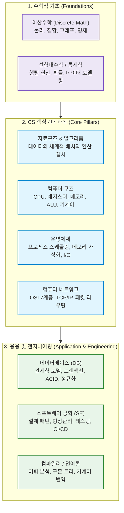

---

### 1. 개념 이해: CS 커리큘럼의 층위와 체계

컴퓨터공학 전공의 교육과정은 모래 위에 세운 성이 무너지지 않도록, 철저하게 **하부 하드웨어(물리 계층)부터 상부 애플리케이션(추상화 계층)**까지 촘촘히 층위를 쌓아 올리는 구조로 설계되어 있습니다.

#### (1) 컴퓨터 과학의 4대 기둥 (Core Pillars)

전 세계 유수의 공과대학 커리큘럼에서 가장 중요하게 다루는 4대 필수 과목은 다음과 같습니다.

1. **자료구조와 알고리즘 (Data Structures & Algorithms)**
   - **학습 목적**: "주어진 문제를 최소한의 자원(시간 및 메모리)으로 완벽하게 풀어내는 최적의 논리를 구성한다."
   - 배열, 연결 리스트, 스택, 큐, 트리, 그래프 등 데이터를 메모리에 어떤 구조로 배치할 것인가(자료구조)를 배우고, 이를 정렬·탐색·변환하는 효율적인 단계별 절차(알고리즘)를 공부합니다. 
   - 시간 복잡도(Big-O 표기법)를 통해 내가 짠 코드가 데이터가 1억 개로 늘어났을 때 1초 만에 끝날지, 100년이 걸릴지 사전에 수학적으로 예측하는 안목을 기릅니다.

2. **컴퓨터 구조 (Computer Architecture)**
   - **학습 목적**: "우리가 작성한 고수준 코드가 실리콘 반도체 칩(하드웨어)에서 실제로 어떻게 전기 신호로 구동되는지 이해한다."
   - 폰 노이만 구조, CPU의 산술논리연산장치(ALU), 제어장치(Control Unit), 레지스터(Register), 캐시 메모리(L1/L2/L3), 버스(Bus)의 작동 방식을 파헤칩니다.
   - 고수준 언어(C, Java, Python 등)가 어셈블리어(Assembly)와 바이너리 기계어(0과 1)로 변환된 후 명령어 파이프라인(Instruction Pipelining)을 통해 한 클록(Clock)마다 처리되는 메커니즘을 배웁니다.

3. **운영체제 (Operating Systems)**
   - **학습 목적**: "한정된 하드웨어 자원을 수많은 응용 프로그램에게 공정하고 효율적으로 분배하는 중앙 지휘관의 원리를 터득한다."
   - CPU는 하나인데 어떻게 유튜브를 보며 카카오톡 메시지를 입력할 수 있을까요? 운영체제는 '프로세스(Process)'와 '스레드(Thread)', 'CPU 스케줄링', '가상 메모리(Paging/Segmentation)', '동기화와 교착 상태(Deadlock)'를 통해 하드웨어 자원을 가상화하고 보호합니다.
   - 개발자가 시스템 콜(System Call)을 통해 하드웨어와 안전하게 상호작용하는 근본 인터페이스를 학습합니다.

4. **컴퓨터 네트워크 (Computer Networks)**
   - **학습 목적**: "물리적으로 격리된 수십억 대의 컴퓨터가 단 하나의 에러 없이 정보를 주고받는 전 지구적 통신 규칙을 규명한다."
   - 물리적 케이블선부터 웹 브라우저까지의 흐름을 정의한 **OSI 7계층 모델**과 **TCP/IP 4계층 프로토콜**을 학습합니다.
   - 패킷 교환(Packet Switching), 라우팅(Routing), 데이터 유실을 방지하고 순서를 보장하는 TCP의 3-Way Handshake 및 혼잡 제어(Congestion Control), 그리고 현대 웹의 근간인 HTTP, DNS, TLS/SSL의 암호화 메커니즘을 심도 있게 다룹니다.

---

#### (2) 기반 학문과 응용 및 실무 과목

4대 과목 외에도 견고한 엔지니어로 성장하기 위해 반드시 거치는 과목들이 존재합니다.

- **컴퓨터 수학 (이산수학, 선형대수, 확률과 통계)**: 컴퓨터는 연속적인 실수가 아닌 0과 1로 끊어지는 '이산(Discrete)' 세계입니다. 명제 논리, 집합론, 그래프 이론, 관계 연산은 데이터베이스와 알고리즘의 기초가 되며, 선형대수(행렬, 벡터)와 확률통계는 오늘날 머신러닝/딥러닝과 3D 그래픽스의 절대적인 수학적 뼈대입니다.
- **데이터베이스 (Database Systems)**: 애플리케이션이 종료되어도 데이터가 안전하게 영속(Persistence)되도록 설계하는 방법론입니다. 관계형 데이터 모델, SQL 문법, 데이터 무결성 보장을 위한 ACID 트랜잭션, B-Tree 인덱싱, 정규화(Normalization) 및 분산 DB 환경을 배웁니다.
- **소프트웨어 공학 (Software Engineering)**: 혼자 재미로 짜는 장난감 코드가 아니라, 수십·수백 명의 엔지니어가 수년간 유지보수하는 대규모 시스템을 결함 없이 구축하는 방법론입니다. 객체지향 설계 원칙(SOLID), 디자인 패턴, 단위/통합 테스팅, Git 형상관리, 지속적 통합 및 배포(CI/CD)를 다룹니다.
- **컴파일러 및 프로그래밍 언어론 (Compilers & Programming Languages)**: 사람이 읽을 수 있는 텍스트 형태의 소스 코드가 어떻게 어휘 분석(Lexical Analysis), 구문 분석(Parsing), 의미 분석을 거쳐 추상 구문 트리(AST)를 형성하고 궁극적으로 기계어로 최적화되는지를 배웁니다.

---

### 2. 현실 비유 및 실무 예시: "미슐랭 3스타 레스토랑으로 이해하는 CS 전공"

컴퓨터의 작동 구조를 대형 유명 레스토랑의 운영에 빗대어 보면, 전공 과목들의 유기적 관계가 한눈에 들어옵니다.

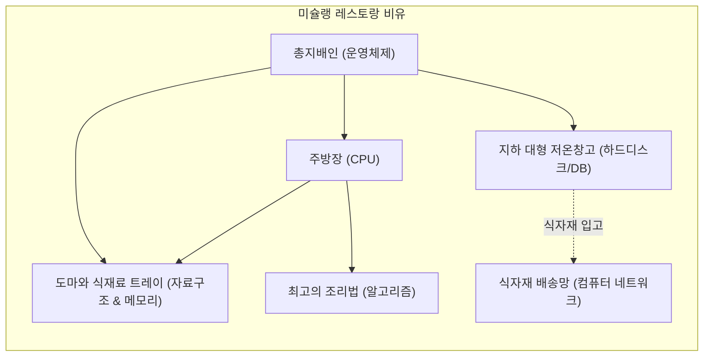

- **컴퓨터 구조**: 주방의 물리적 하드웨어 배치입니다. 초고속으로 손을 놀리는 주방장(CPU 코어), 주방장의 손 바로 옆에 놓인 작은 양념통들(레지스터), 그리고 바로 앞 도마(캐시 메모리)의 구조를 결정합니다.
- **자료구조**: 도마 위에 식재료를 어떤 용기에 담아둘 것인가의 문제입니다. 바로 꺼내 쓰기 좋게 1열로 나열된 칸막이 상자(배열), 재료끼리 실로 묶여 있어 줄줄이 꺼내는 구조(연결 리스트), 나중에 넣은 고명을 먼저 얹는 구조(스택)를 연구합니다.
- **알고리즘**: 복잡한 주문을 가장 빠르고 적은 화구를 써서 완벽한 코스 요리로 완성해 내는 '궁극의 요리 레시피'입니다.
- **운영체제**: 레스토랑의 **총지배인(Manager)**입니다. 수십 개의 테이블에서 동시에 쏟아지는 주문(멀티 프로세스)을 보고, 어느 화구를 누구에게 먼저 배정할지(CPU 스케줄링), 도마 공간이 부족하면 덜 쓰는 재료를 잠시 창고로 뺄지(가상 메모리 스와핑), 두 요리사가 같은 칼을 잡으려고 싸우지 않게 할지(동기화 및 데드락 방지)를 조율합니다.
- **컴퓨터 네트워크**: 전국 각지의 산지에서 신선한 식자재를 주문받고, 완성된 음식을 고객의 집까지 안전하게 배송하는 **물류 도로망 및 배송 규약(택배 송장 규격, 배송 확인 서명)**입니다.
- **데이터베이스**: 레스토랑 지하에 위치한 **철통 보안의 식자재 냉동창고와 장부**입니다. 정전이 일어나도 재고 수량이 한 치의 오차 없이 기록되어 있어야 합니다(트랜잭션 ACID).

> [!NOTE]
> **실무 연계 질문: "전공 지식은 실무에서 언제 쓰이나요?"**  
> 평소 프레임워크(Spring, React, Django 등)로 간단한 웹페이지를 만들 때는 CS 전공 지식이 없어도 코드를 완성할 수 있습니다.  
> 하지만 **서비스 사용자가 수십만 명으로 폭증할 때, 원인을 알 수 없는 메모리 누수(Memory Leak)가 발생할 때, 데이터베이스 쿼리가 병목을 일으킬 때, 서버 간 네트워크 지연이 심해질 때** 문제를 근본적으로 분석하고 해결할 수 있는 엔지니어는 오직 하부 컴퓨터의 원리를 꿰뚫고 있는 사람뿐입니다.

---

### 3. 상세 비교표: CS 핵심 과목 한눈에 보기

| 교과목 | 핵심 연구 질문 | 다루는 핵심 개념 | 이것을 모르면 실무에서 겪는 참사 |
| :--- | :--- | :--- | :--- |
| **자료구조 & 알고리즘** | *어떻게 하면 가장 빠르고 가볍게 처리할까?* | Big-O, 해시 테이블, B-Tree, 정렬, 최단 경로, 동적 계획법 | 데이터가 조금만 많아져도 서버 CPU 점유율이 100%를 치며 화면이 멈춤 |
| **컴퓨터 구조** | *기계(CPU/메모리)는 내부에서 어떻게 일하는가?* | ALU, 파이프라인, 캐시 적중률(Cache Hit), 바이트 오더링 | 캐시 미스(Cache Miss)가 대량 발생하는 비효율적 메모리 접근 코드를 양산함 |
| **운영체제** | *한정된 자원을 어떻게 안전하고 공평하게 나눌까?* | 프로세스 vs 스레드, 가상 메모리, 컨텍스트 스위칭, Mutex | 멀티스레드 환경에서 레이스 컨디션(Race Condition)으로 데이터가 꼬이거나 데드락 발생 |
| **컴퓨터 네트워크** | *멀리 떨어진 기계와 어떻게 신뢰성 있게 대화할까?* | TCP/IP, 핸드셰이크, 패킷 손실 복구, DNS, HTTP/3 | 통신 지연의 원인을 찾지 못하고 불필요한 재요청으로 네트워크 대역폭을 낭비함 |
| **데이터베이스** | *데이터의 무결성과 안전한 영속성을 어떻게 지킬까?* | ACID, 트랜잭션 격리 수준, B+Tree 인덱스, 정규화 | 결제 도중 시스템이 뻗었을 때 고객 돈은 빠져나갔는데 주문서는 증발하는 사고 발생 |
| **소프트웨어 공학** | *팀과 함께 10년 가는 시스템을 어떻게 지을까?* | SOLID 원칙, 디자인 패턴, 단위 테스트, CI/CD, 리팩터링 | 코드 한 줄 고쳤더니 전혀 상관없는 5군데 기능이 터지는 '스파게티 코드' 양산 |

---

### 4. 핵심 요약 (Summary Checklist)

- [x] 컴퓨터공학은 코드 문법 학습이 아니라 **컴퓨터의 동작 메커니즘과 계산 이론을 탐구하는 학문**입니다.
- [x] **4대 핵심 과목(자료구조/알고리즘, 컴퓨터구조, 운영체제, 네트워크)**은 하드웨어와 소프트웨어를 잇는 단단한 다리 역할을 합니다.
- [x] 수학적 기초(이산수학, 선형대수)와 응용 기술(데이터베이스, 소프트웨어 공학)이 결합될 때, 대규모 트래픽을 견디는 고성능 소프트웨어를 안정적으로 설계할 수 있습니다.

---

## 02 소프트웨어를 개발한다는 것은 무엇입니까?

> "프로그래밍은 컴퓨터에게 무엇을 해야 할지 명령하는 기술이지만,  
> 소프트웨어 엔지니어링은 인류의 모호한 현실 문제를 컴퓨터의 엄밀한 논리로 풀어내어  
> 지속 가능한 가치를 창출하는 고도의 문제 해결 예술입니다."

---

### 1. 개념 이해: 단순 코딩(Coding) vs 소프트웨어 엔지니어링(Software Engineering)

많은 입문자들이 '코딩(Coding)'과 '소프트웨어 개발(Software Development/Engineering)'을 같은 의미로 혼용합니다. 그러나 두 행위 사이에는 명확하고 거대한 질적 차이가 존재합니다.

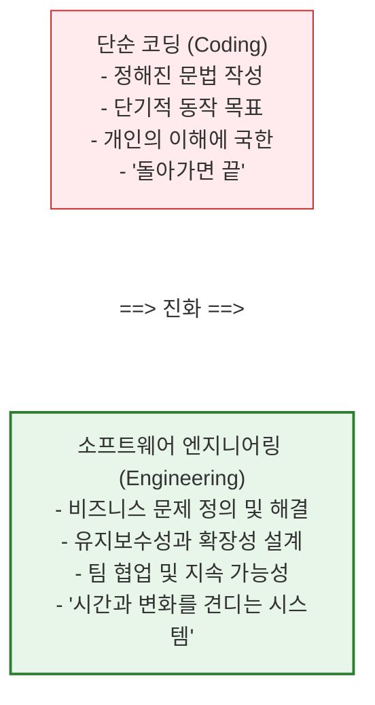

#### (1) 코딩이란 무엇인가?
코딩은 특정 프로그래밍 언어의 문법(Syntax) 규칙에 맞추어 컴퓨터가 실행할 명령문을 텍스트로 타이핑하는 **기능적 실행 단계**입니다. 레고 블록에 비유하자면, 주어진 설명서대로 몇 개의 블록을 결합해 자동차 한 대를 조립하는 행위와 같습니다. 여기서는 당장 프로그램이 에러 없이 실행되는 것(It works)이 1차적 목표입니다.

#### (2) 소프트웨어 엔지니어링이란 무엇인가?
소프트웨어 엔지니어링은 **비즈니스 환경의 요구사항과 제약 조건 속에서, 수많은 사람들과 함께, 시간의 흐름(소프트웨어의 생애주기)을 견뎌낼 수 있는 제품을 체계적으로 설계·구현·운영하는 공학적 훈련**입니다.
- 구글의 엔지니어링 디렉터 타이터스 윈터스(Titus Winters)는 책 《구글 엔지니어는 이렇게 일한다》에서 소프트웨어 엔지니어링을 한 문장으로 정의했습니다:  
  > **"소프트웨어 엔지니어링이란, 시간에 흐름에 따른 수정 가능성과 유지보수성이 더해진 프로그래밍이다."**

만약 오늘 작성한 코드가 내일 비즈니스 규칙이 바뀌었을 때 완전히 갈아엎어져야 하거나, 동료 개발자가 읽고 해석하는 데 3일이 걸린다면, 그것은 '동작하는 코드'일 수는 있어도 '성공적인 소프트웨어'는 아닙니다.

---

### 2. 비즈니스 문제 해결로서의 소프트웨어

실무 세계에서 소프트웨어 개발은 자기만족적인 기술적 유희가 아닙니다. **"어떤 비즈니스 문제를, 어떤 가치로 치환할 것인가?"**에 대한 대답입니다.

- **토스(Toss)**의 본질: 복잡한 공인인증서와 보안 프로그램을 거쳐야 했던 금융 송금의 극심한 사용자 고통(Pain Point)을 '전화번호와 지문 하나로 3초 만에 송금'이라는 비즈니스 해결책으로 치환한 소프트웨어입니다.
- **쿠팡(Coupang)**의 본질: 고객이 오늘 밤 자정에 주문한 생수를 내일 아침 7시 문 앞에 정확히 배송하기 위해, 수천만 개의 재고 위치와 물류 트럭 경로를 분초 단위로 최적화하는 거대한 알고리즘 시스템입니다.

결국 개발자가 작성하는 모든 함수와 조건문은 고객의 시간을 아껴주거나, 기업의 비용을 줄여주거나, 이전에 없던 새로운 효용을 만들어내기 위해 존재합니다.

---

### 3. 요구사항을 컴퓨터가 이해하는 논리로 변환하는 과정

인간의 생각은 대단히 모호하고, 생략되어 있으며, 맥락(Context)에 의존합니다. 반면 컴퓨터는 융통성이 전혀 없는 극단적인 결벽증 환자와 같습니다. 단 0.0001%의 모호함도 허용하지 않으며, 지정된 명령만을 곧이곧대로 수행합니다.

따라서 소프트웨어 개발의 핵심은 **"모호한 인간의 언어를 한 치의 오차도 없는 엄밀한 논리 구조로 탈바꿈시키는 번역 작업"**입니다.

#### 현실 세계의 모호한 요구사항:
> *"사용자가 상품을 구매하고 결제할 수 있게 해주세요. 돈을 내면 주문이 완료되어야 합니다."*

인간에게는 너무나 자연스러운 이 두 줄의 문장을 컴퓨터 세상의 논리로 옮기려면 다음과 같은 수십 가지의 상태(State)와 예외 조건(Exception)을 정의해야 합니다.

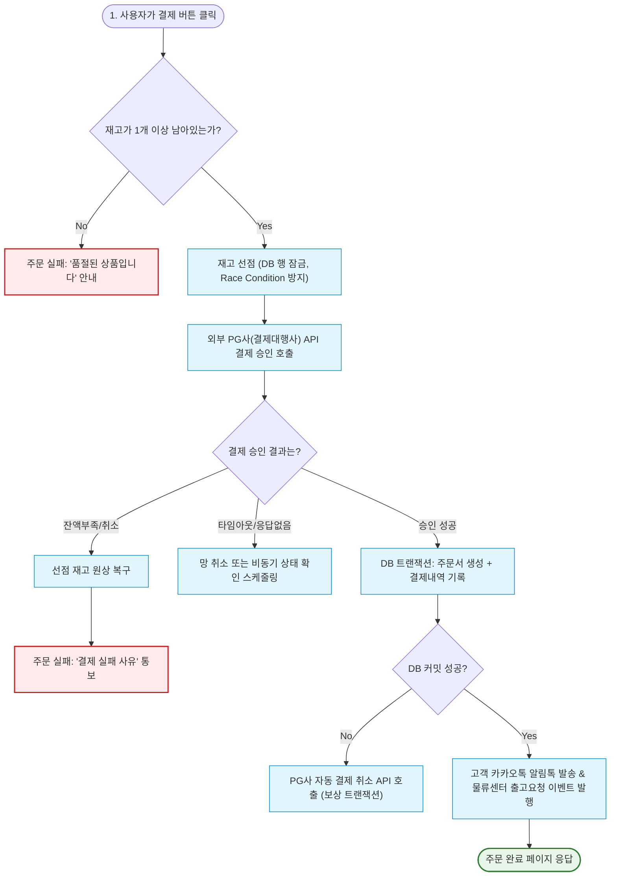

> [!IMPORTANT]
> **컴퓨터적 사고(Computational Thinking)의 본질**  
> 개발자는 "행복 경로(Happy Path, 모든 것이 계획대로 잘 풀리는 경로)"만 생각해서는 안 됩니다.  
> 0.1%의 확률로 발생하는 네트워크 단절, 데이터베이스 락, 결제 서버 지연, 잔액 부족, 동시성 충돌 등의 **엣지 케이스(Edge Case)**를 집요하게 상상하고, 그 모든 순간에 시스템이 우아하게 대처할 수 있도록 논리적 방망이를 놓아주는 사람이 바로 개발자입니다.

---

### 4. 상세 비교표: '취미 코더' vs '프로페셔널 소프트웨어 엔지니어'

| 비교 항목 | 아마추어 / 취미 코더 | 프로페셔널 소프트웨어 엔지니어 |
| :--- | :--- | :--- |
| **관심의 중심** | "어떻게든 내 화면에서 돌아가게 만드는 것" | "시간이 흘러도 안전하게 동작하고 쉽게 변경할 수 있는 구조" |
| **코드의 독자** | 컴퓨터 (기계만 이해하면 그만) | 동료 인간 개발자 (나중에 이 코드를 유지보수할 미래의 동료) |
| **에러를 대하는 태도** | 에러가 안 뜨면 끝났다며 안도함 | "어떤 극단적인 상황에서 이 코드가 터질까?"를 고민하며 테스트 코드를 작성함 |
| **도구의 사용** | 문법과 라이브러리를 가져다 붙여넣음 | 라이브러리의 내부 원리와 라이선스, 성능 한계를 분석하고 채택함 |
| **목표 지향점** | 구현된 기능(Feature) 자체 | 비즈니스 임팩트(고객 가치, 비용 절감, 운영 안정성) |

---

### 5. 핵심 요약 (Summary Checklist)

- [x] 코딩은 문법을 작성하는 수단이며, **소프트웨어 개발은 지속 가능한 가치를 창출하는 종합 공학**입니다.
- [x] 개발의 출발점은 언제나 **현실 세계의 비즈니스 문제와 사용자의 결핍**입니다.
- [x] 인간의 모호한 의도를 컴퓨터가 오해 없이 실행할 수 있도록 **모든 분기점과 예외를 완벽한 상태 머신(State Machine)으로 변환**하는 것이 개발자의 핵심 임무입니다.

---

## 03 소프트웨어는 어떻게 개발될까요?

> 소프트웨어는 한 번 뚝딱 만들어지는 조각상이 아닙니다.  
> 기획부터 폐기까지 끊임없이 진화하고 피드백을 수용하며 살아 움직이는 **유기체적인 생명주기(Lifecycle)**를 갖습니다.

---

### 1. 개념 이해: 소프트웨어 개발 생명주기 (SDLC, Software Development Life Cycle)

현대 소프트웨어 개발은 주먹구구식으로 이루어지지 않습니다. 실패 확률을 줄이고 품질을 극대화하기 위해 산업계가 수십 년간 다듬어온 체계적인 단계가 존재합니다. 이를 **소프트웨어 개발 생명주기(SDLC)**라고 부릅니다.

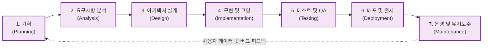

---

### 2. SDLC 7단계 상세 분석: 단계별 역할과 산출물

소프트웨어가 탄생하여 사용자에게 도달하기까지 거치는 7가지 핵심 단계와 각 단계의 주인공, 산출물을 정리합니다.

#### 1단계: 기획 (Planning / Ideation)
- **핵심 목표**: "우리는 무엇을 왜 만들어야 하는가? 비즈니스 타당성과 시장 기회가 있는가?"
- **주요 역할**: 프로덕트 매니저(PM), 프로덕트 오너(PO), 사업 기획자
- **활동**: 시장 조사, 사용자 인터뷰, 경쟁사 분석, 비즈니스 지표(KPI, OKR) 설정, 로드맵 수립
- **대표 산출물**: **PRD (Product Requirement Document, 제품 기획서)**, 비즈니스 모델 캔버스

#### 2단계: 요구사항 분석 (Requirements Analysis)
- **핵심 목표**: "제품이 반드시 갖추어야 할 기능적·비기능적 요구사항을 한 치의 오차 없이 명세화한다."
- **주요 역할**: PM, 시스템 분석가(SA), 테크 리드(Tech Lead)
- **활동**:
  - 기능 요구사항(Functional): "회원은 소셜 로그인을 할 수 있어야 한다", "장바구니에 최대 100개 품목을 담을 수 있다."
  - 비기능 요구사항(Non-Functional): "1초당 5,000건의 동시 접속을 처리해야 한다", "모든 비밀번호는 단방향 해시 암호화되어야 한다", "가용성(Availability) 99.99%를 충족해야 한다."
- **대표 산출물**: **SRS (Software Requirement Specification, 소프트웨어 요구사항 정의서)**, 유저 스토리(User Story)

#### 3단계: 시스템 & 소프트웨어 설계 (System Architecture & Software Design)
- **핵심 목표**: "실제 개발에 들어가기 전, 기술적 청사진(Architecture)과 사용자 경험(UI/UX)을 완벽히 설계한다."
- **주요 역할**: 소프트웨어 아키텍트, UI/UX 디자이너, 시니어 엔지니어
- **활동**:
  - 시스템 아키텍처: 모놀리식(Monolithic) vs 마이크로서비스(Microservices, MSA) 결정, 클라우드 인프라(AWS, GCP) 설계
  - 데이터 모델링: ERD(Entity Relationship Diagram)를 통한 테이블 스키마 및 관계 정의
  - API 명세: RESTful, GraphQL, gRPC 등 클라이언트-서버 간 통신 규격 정의
  - UI/UX 디자인: 피그마(Figma)를 통한 화면 와이어프레임 및 디자인 시스템 구축
- **대표 산출물**: **시스템 아키텍처 다이어그램, ERD, API 명세서(Swagger/OAS), Figma 디자인 프로토타입**

#### 4단계: 구현 (Implementation / Coding)
- **핵심 목표**: "설계도를 바탕으로 실제 실행 가능한 고품질의 소스 코드를 작성한다."
- **주요 역할**: 프론트엔드 개발자, 백엔드 개발자, 모바일 앱 개발자
- **활동**:
  - 프로그래밍 언어 및 프레임워크를 활용한 비즈니스 로직 작성
  - Git 브랜치 전략(Git-Flow, GitHub-Flow)을 기반으로 한 협업
  - 코드 리뷰(Pull Request Review): 동료의 코드를 검토하며 버그를 방지하고 코드 품질 상향 평준화
  - 단위 테스트(Unit Test) 코드 작성
- **대표 산출물**: **소스 코드 저장소(GitHub/GitLab Repository), 단위 테스트 코드**

#### 5단계: 테스트 및 품질 보증 (Testing & QA)
- **핵심 목표**: "시스템이 요구사항대로 동작하는지 검증하고, 결함(Bug)과 성능 문제를 사전에 색출한다."
- **주요 역할**: QA(Quality Assurance) 엔지니어, SDET(Software Development Engineer in Test), 보안 엔지니어
- **활동**:
  - 통합 테스트(Integration Test) 및 종단 간(E2E) 테스트 수행
  - 부하 및 성능 테스트(Load Testing): 수만 명이 동시 접속할 때 서버가 죽지 않는지 JMeter, k6 등으로 검증
  - 보안 취약점 점검: 모의 해킹, SQL 인젝션, XSS 방어 점검
- **대표 산출물**: **테스트 계획서(Test Plan), 테스트 케이스(Test Cases), 버그 리포트(Issue Tracker)**

#### 6단계: 배포 및 출시 (Deployment & CI/CD)
- **핵심 목표**: "검증된 소프트웨어를 실제 고객이 사용할 수 있는 프로덕션 서버 환경에 안전하게 출시한다."
- **주요 역할**: 데브옵스(DevOps) 엔지니어, SRE(Site Reliability Engineer)
- **활동**:
  - CI/CD 파이프라인(GitHub Actions, Jenkins, ArgoCD)을 통한 빌드·테스트·배포 자동화
  - 무중단 배포(Zero-Downtime Deployment): 롤링(Rolling), 블루/그린(Blue-Green), 카나리(Canary) 기법을 사용하여 사용자가 서비스를 이용하는 도중에도 중단 없이 업데이트
- **대표 산출물**: **도커 컨테이너 이미지(Docker Image), 쿠버네티스 매니페스트, 릴리즈 노트(Release Notes)**

#### 7단계: 운영 및 유지보수 (Maintenance & Evolution)
- **핵심 목표**: "24시간 365일 무장애 서비스를 제공하고, 사용자 피드백을 수집하여 제품을 지속적으로 진화시킨다."
- **주요 역할**: SRE, 서비스 운영팀, 전체 엔지니어링 팀
- **활동**:
  - 시스템 모니터링: 프로메테우스(Prometheus), 그라파나(Grafana), 데이터독(Datadog)으로 CPU, 메모리, 에러율 실시간 감시
  - 로깅 및 장애 대응: 센트리(Sentry), ELK 스택을 통한 에러 로그 수집 및 온콜(On-call) 핫픽스 대응
  - 기술 부채(Technical Debt) 청산 및 리팩터링
- **대표 산출물**: **장애 사후 분석 보고서(Post-mortem / RCA), 서비스 모니터링 대시보드**

---

### 3. 현실 비유: "건축(Building)과 소프트웨어 개발의 결정적 차이"

소프트웨어 개발을 흔히 '건축'에 비유하곤 합니다. 둘 다 기초 공사가 중요하고, 설계도(아키텍처)가 필요하며, 수많은 전문가가 협업한다는 점에서 매우 닮아 있습니다.

하지만 현대 소프트웨어 공학은 건축과 결정적으로 다른 한 가지 특성을 가집니다: **"소프트웨어는 물리적 법칙에 얽매이지 않으며, 극단적으로 변경이 용이(Soft)해야 한다"**는 점입니다.

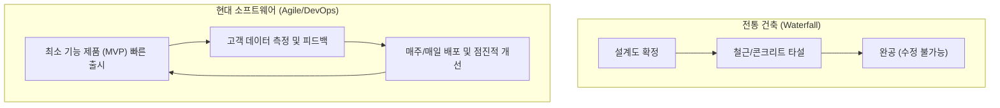

- 아파트 10층까지 콘크리트를 다 부었는데, 건축주가 갑자기 *"생각해 보니 엘리베이터 위치를 건물 반대편으로 옮기고 방을 3개 더 내어주세요"*라고 한다면 건물을 부수고 처음부터 다시 지어야 합니다. 이것이 과거의 개발 방식이었던 **폭포수(Waterfall) 모델**의 한계였습니다.
- 하지만 소프트웨어는 다릅니다. 사용자의 취향과 시장 트렌드는 하루가 다르게 변합니다. 현대의 훌륭한 엔지니어는 1년 뒤를 완벽히 예측하려 애쓰는 대신, **"언제든 기획이 바뀌어도 최소한의 비용으로 유연하게 코드를 수정할 수 있는 아키텍처"**를 만듭니다. 이것이 바로 오늘날 전 세계를 지배하는 **애자일(Agile)과 지속적 배포(CI/CD)**의 철학입니다.

---

### 4. 상세 비교표: 전통적 폭포수(Waterfall) vs 현대적 애자일(Agile)

| 비교 지표 | 폭포수(Waterfall) 모델 | 애자일(Agile / Scrum / DevOps) 모델 |
| :--- | :--- | :--- |
| **작업 방식** | 이전 단계가 100% 끝나야 다음 단계로 진행 (순차적) | 1~2주 단위의 짧은 주기(스프린트)로 기획-개발-배포를 반복 (반복적·점진적) |
| **요구사항 변경** | 초기에 확정하며, 중도 변경을 극도로 꺼림 (비용 폭증) | 개발 도중 요구사항이 바뀌는 것을 자연스러운 경쟁력으로 환영함 |
| **첫 출시 시점** | 모든 기능이 100% 완성된 프로젝트 막바지 (수개월~수년 소요) | 핵심 가치만 담은 최소 기능 제품(MVP)을 수 주 만에 조기 출시 |
| **테스트 시점** | 개발이 완전히 끝난 후 후반부 QA 단계에서 몰아서 진행 | 매 기능 구현 시마다 개발자가 테스트 코드를 짜고 자동 검증함 |
| **적합한 프로젝트** | 요구사항이 절대로 변하지 않는 공공/국방/우주항공 시스템 | 빠르게 시장의 반응을 검증해야 하는 스타트업, 웹/앱 서비스 |

---

### 5. 핵심 요약 (Summary Checklist)

- [x] 소프트웨어 개발은 **기획 -> 분석 -> 설계 -> 구현 -> 테스트 -> 배포 -> 유지보수**의 7단계 SDLC를 거칩니다.
- [x] 현대 소프트웨어 공학은 한 번에 완벽한 것을 만드는 것보다, **빠르게 배포하고 피드백을 받아 점진적으로 고도화하는 애자일(Agile) 방식**을 지향합니다.
- [x] 각 단계마다 코드뿐만 아니라 **PRD, ERD, API 명세서, 테스트 케이스, 모니터링 로그 등 정밀한 산출물**이 유기적으로 연결됩니다.

---

## 04 누가 소프트웨어 개발을 잘할 수 있을까요?

> "개발은 타고난 천재들의 전유물이 아닙니다.  
> 복잡함을 쪼갤 줄 아는 논리적 분해력, 끝까지 물고 늘어지는 끈기,  
> 그리고 기계 이면의 사람을 배려하는 소통 능력을 가진 사람이 가장 멀리 갑니다."

---

### 1. 개발자 적성에 대한 3대 오해와 진실

개발자라는 직업에 관심을 가질 때, 많은 사람들이 대중매체나 인터넷 커뮤니티가 만들어낸 거대한 편견과 마주합니다.

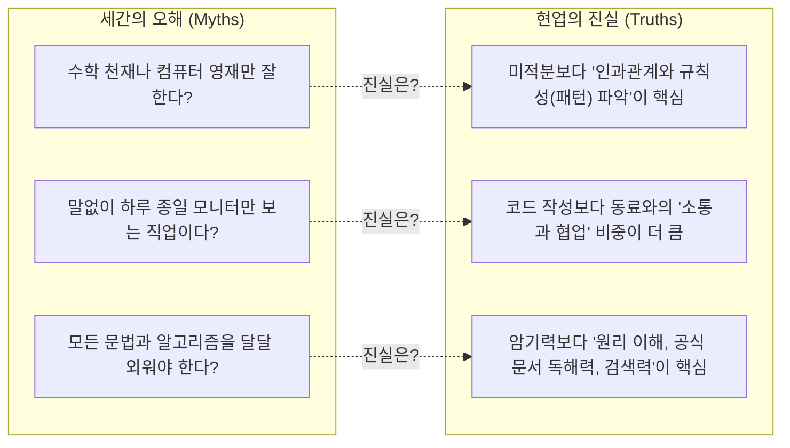

#### 오해 1: "수학 천재나 올림피아드 출신 영재들만 개발을 잘한다?"
- **진실**: AI 연구원이나 3D 물리 엔진 개발자처럼 고난도 수학이 필수적인 특수 분야도 있습니다. 그러나 대다수의 일반적인 웹, 앱, 백엔드, 비즈니스 소프트웨어 개발에서 필요한 수학은 '복잡한 미적분'이 아니라 **'초등학교 수준의 사칙연산과 중학교 수준의 명제 논리(참/거짓, AND/OR)'**입니다.
- 정작 중요한 것은 수학 시험 점수가 아니라, **"원인 A가 발생했기 때문에 결과 B가 도출된다"는 명확한 인과관계 추론 능력**입니다.

#### 오해 2: "하루 종일 어두운 방에서 말 한마디 없이 코딩만 하는 내향적 직업이다?"
- **진실**: 현실의 소프트웨어 개발은 철저한 **팀 스포츠(Team Sport)**입니다.
- 실무 개발자가 하루 8시간 중 순수하게 혼자 코드를 타이핑하는 시간은 평균 2~3시간에 불과합니다. 나머지 시간은 기획자와 기획의 모호함을 조율하고, 디자이너와 UI 인터랙션을 의논하며, 동료 엔지니어의 코드를 리뷰(Code Review)하고, 장애 발생 시 원인을 함께 규명하는 **치열한 커뮤니케이션의 연속**입니다.

#### 오해 3: "모든 최신 프레임워크와 API 문법을 암기하고 있어야 한다?"
- **진실**: IT 기술의 수명은 대단히 짧습니다. 3년 전에 유행하던 라이브러리가 오늘은 구시대의 유물이 되기도 합니다. 모든 것을 머릿속에 외우고 있는 개발자는 존재하지도 않으며, 그럴 필요도 없습니다.
- 진정으로 뛰어난 개발자는 문법을 달달 외우는 암기왕이 아니라, **"새로운 기술 문서(Documentation)를 두려움 없이 빠르게 읽어내고, 시스템의 동작 원리를 파악하여 적재적소에 응용하는 학습 민첩성(Learning Agility)"**을 가진 사람입니다.

---

### 2. 뛰어난 소프트웨어 엔지니어들의 5대 공통 핵심 역량

현업에서 소위 '일 잘하는 개발자'로 인정받는 사람들에게는 명확한 5가지 공통 분모가 관찰됩니다.

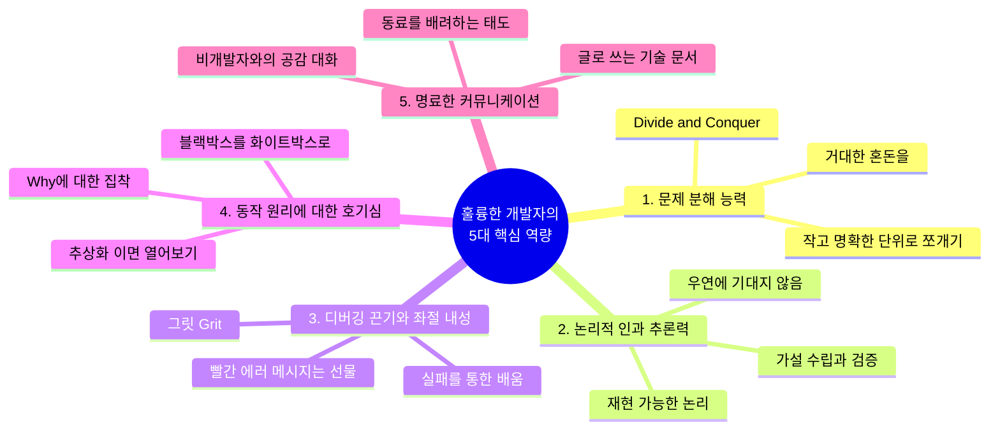

#### 1) 문제 분해 능력 (Problem Decomposition)
- 마주한 문제가 너무 거대해 보일 때 패닉에 빠지지 않고, **"이를 해결 가능한 가장 작은 단위(Sub-problems)로 어떻게 쪼갤 것인가?"**를 본능적으로 고민합니다.
- 예: "인스타그램을 만들어라"라는 거대한 과제를 [1. 사진 파일 업로드 API] -> [2. 이미지 리사이징 처리] -> [3. 피드 데이터베이스 조회] -> [4. 팔로우 관계 쿼리] 등으로 잘게 쪼개어 하나씩 정복해 나가는 능력(Divide and Conquer)입니다.

#### 2) 논리적 인과 추론력 (Logical Causality)
- 코드가 우연히 잘 돌아간다고 해서 그냥 넘어가지 않습니다. "왜 이 코드가 동작하는가?"를 증명할 수 있어야 합니다.
- 반대로 버그가 났을 때도 아무 코드나 이것저것 마구잡이로 바꿔보는 것이 아니라, 시스템의 상태를 추적하며 원인과 결과의 연결고리를 과학 수사관처럼 차근차근 좁혀나갑니다.

#### 3) 디버깅 끈기와 좌절 내성 (Grit & Resilience)
- 프로그래밍의 80%는 내가 만든 실수(버그)를 수습하는 과정입니다. 하루 종일 화면을 노려보았는데 세미콜론 하나, 변수명 오타 하나 때문에 안 돌아가는 날도 허다합니다.
- 이때 빨간 에러 메시지에 감정적으로 상처받지 않고, **"컴퓨터는 거짓말을 하지 않는다. 내가 어딘가 잘못 알려줬을 뿐이다. 반드시 원인을 찾아내겠다"**라며 끝까지 물고 늘어지는 지적 집요함(Grit)이 필요합니다.

#### 4) 지적 호기심과 '동작 원리' 집착 (Deep Curiosity)
- 겉으로 보기에 잘 돌아간다고 만족하지 않습니다. "내가 쓴 라이브러리는 내부에서 어떻게 돌아갈까?", "이 함수를 호출하면 메모리에서는 무슨 일이 벌어질까?"라며 한 겹 아래의 추상화 계층을 들여다보길 즐기는 호기심이 개발자를 주니어에서 시니어로 성장시키는 가장 강력한 엔진입니다.

#### 5) 명료한 커뮤니케이션 및 공감 능력 (Communication & Empathy)
- 내가 작성한 코드는 결국 다른 동료가 읽어야 합니다. 변수명 하나, 함수명 하나를 지을 때도 동료가 오해하지 않도록 배려하는 글쓰기 감각이 뛰어납니다.
- 기획자가 기술적 한계를 이해하지 못할 때 화를 내는 대신, 상대방의 비즈니스 언어로 풀어서 설명하고 현실적인 대안을 제시할 수 있는 공감 능력이 필수적입니다.

---

### 3. 현실 비유 및 실무 예시: "명탐정 셜록 홈즈와 시니어 디버거"

버그를 잡는 훌륭한 개발자의 모습은 범죄 현장을 조사하는 **명탐정 셜록 홈즈**와 놀랍도록 일치합니다.

> [!TIP]
> **셜록 홈즈의 격언**:  
> *"불가능한 것들을 모두 제외하고 남은 것은, 아무리 믿기 힘들지라도 진실일 수밖에 없다."*

- **초보 개발자의 버그 대응**:  
  화면에 에러가 뜨면 당황하여 인터넷에서 찾은 코드를 이것저것 복사해 붙여넣고 기도를 올립니다("제발 돌아가라!"). 우연히 돌아가더라도 왜 고쳐졌는지 본인도 모릅니다. 다음에 똑같은 버그가 나면 또다시 헤맵니다.
- **프로페셔널 개발자의 버그 대응 (명탐정의 방식)**:  
  1. **현장 보존**: 버그가 발생하는 정확한 조건과 입력값(재현 경로, Reproduce Step)을 확보합니다.
  2. **단서 수집**: 로그(Log)와 스택 트레이스(Stack Trace)를 확인하여 문제가 터진 정확한 시점과 메모리 상태를 관찰합니다.
  3. **가설 수립**: "DB 커넥션이 고갈되었거나, 외부 API 응답이 타임아웃 났을 것이다."
  4. **가설 검증 및 소거**: 하나씩 조건을 통제하며 용의 선상에서 배제합니다.
  5. **진인사대천명**: 마침내 단 하나의 확실한 원인을 지목하고, 최소한의 정확한 처방(Fix)을 내린 뒤 재발 방지를 위한 자동화 테스트 코드를 남깁니다.

---

### 4. 자가 진단 체크리스트: 나는 개발에 어울리는 사람일까?

다음 문항 중 본인에게 해당하는 항목이 많을수록, 당신은 소프트웨어 엔지니어로서 엄청난 잠재력을 가지고 있습니다.

- [ ] 어떤 기계나 가전제품을 샀을 때, 설명서를 읽거나 분해해서 내부 원리를 파악해 보는 것이 재미있다.
- [ ] 일상생활에서 비효율적이거나 반복적인 수작업을 보면 자동화하거나 개선하고 싶어 견딜 수 없다.
- [ ] 복잡한 퍼즐, 스도쿠, 추리 소설, 레고 조립처럼 규칙 안에서 논리적으로 답을 찾아가는 과정을 즐긴다.
- [ ] 게임을 하더라도 단순 플레이를 넘어 게임 내 시스템 규칙, 확률 공식, 최적의 공략법(메타)을 파고드는 편이다.
- [ ] 풀리지 않는 난제를 만났을 때 쉽게 포기하기보다, 오기가 생겨서 몇 시간이고 붙잡고 늘어지는 기질이 있다.
- [ ] 내가 알고 있는 복잡한 지식을 다른 사람의 눈높이에 맞추어 이해하기 쉽게 설명해 주는 데서 보람을 느낀다.

---

### 5. 핵심 요약 (Summary Checklist)

- [x] 개발자에게 가장 필요한 것은 고난도 수학 실력이 아니라 **논리적 사고력과 문제 분해 능력**입니다.
- [x] 소프트웨어 개발은 혼자 하는 외로운 작업이 아니라, 동료들과 끊임없이 교류하는 **협업과 소통의 장**입니다.
- [x] 에러를 두려워하지 않고 원인을 끝까지 추적하는 **디버깅 끈기와 시스템의 내부를 알고 싶어 하는 지적 호기심**이 성패를 가릅니다.

---

## (+) AI시대, 개발자에게 필요한 역량은 무엇인가요?

> "AI가 코드를 대신 짜주는 시대, 개발자는 사라지는 것이 아닙니다.  
> 코드를 한 줄 한 줄 직접 벽돌 쌓듯 치던 '시공 인부'에서,  
> 전체 시스템의 뼈대를 세우고 AI의 결과물을 엄격하게 감리하는 '총괄 건축가'로 격상되는 것입니다."

---

### 1. 패러다임의 대전환: AI 코딩 혁명과 개발자의 위상 변화

GitHub Copilot, ChatGPT, Claude 등 거대언어모델(LLM) 기반의 코딩 도구가 등장하면서 소프트웨어 개발 현장은 상전벽해의 변화를 맞이했습니다. 이제 웬만한 알고리즘 구현, 반복적인 보일러플레이트 코드 작성, 정규표현식 작성, 테스트 코드 생성 등은 AI가 인간보다 수십 배 빠른 속도로 처리해 냅니다.

일각에서는 *"이제 누구나 AI에게 말만 하면 프로그램이 만들어지니 개발자는 필요 없지 않은가?"*라는 성급한 전망을 내놓기도 합니다. 그러나 소프트웨어 공학의 역사를 돌이켜보면 이는 기술 혁신의 본질을 오해한 것입니다.

- 과거 천공 카드(Punch Card) 시절에서 어셈블리어가 나왔을 때도 프로그래머가 사라진다고 했습니다.
- 어셈블리어에서 C언어와 같은 고수준 언어가 나왔을 때도 마찬가지였습니다.
- 하지만 도구가 발전하여 인간을 단순 노동에서 해방시킬 때마다, 인류가 요구하는 소프트웨어의 규모와 복잡성은 기하급수적으로 폭발했고 소프트웨어 엔지니어의 몸값과 중요성은 오히려 더욱 높아졌습니다.

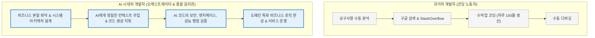

---

### 2. AI 시대 개발자의 4대 필수 핵심 역량

AI라는 초강력 엔진을 장착한 현대의 개발자가 갖추어야 할 차별화된 핵심 무기는 다음 네 가지로 요약됩니다.

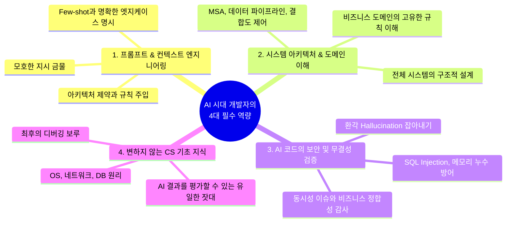

#### 역량 1: AI 도구 오케스트레이션 및 프롬프트/컨텍스트 엔지니어링 (Prompt & Context Engineering)
- AI에게 단순히 *"게시판 만들어줘"*라고 요청하는 사람은 좋은 결과를 얻을 수 없습니다.
- 뛰어난 개발자는 AI에게 **정밀한 컨텍스트(맥락)**를 제공합니다:
  - *"우리는 Spring Boot 3.2와 Java 21 가상 스레드를 사용 중이야. 사용자 트래픽은 초당 3,000건이고, 데이터베이스는 PostgreSQL이야. 조회 성능을 위해 Redis 캐시를 Look-aside 패턴으로 적용하고, 캐시 미스 시 Cache Stampede 현상을 방지할 수 있는 분산 락(Redisson)을 적용한 게시글 조회 서비스를 작성해 줘. 발생 가능한 동시성 엣지 케이스 3가지와 이에 대한 단위 테스트 코드도 함께 작성해."*
- 시스템의 제약 조건, 아키텍처 패턴, 코딩 컨벤션, 비즈니스 룰을 정교하게 주입하여 AI가 최적의 코드를 뱉어낼 수 있도록 유도하는 지휘자(Orchestrator)의 역량입니다.

#### 역량 2: 시스템 아키텍처 설계 및 비즈니스 도메인 심층 이해
- AI는 주어진 코드 조각을 작성하는 데는 천재적이지만, **"우리 회사의 비즈니스 모델에 맞춰 어떤 데이터베이스를 선택하고, 트래픽을 어떻게 분산하며, 서비스 간의 결합도(Coupling)를 어떻게 낮출 것인가?"**와 같은 거시적인 시스템 아키텍처를 결정하지는 못합니다.
- 복잡하게 얽힌 회사의 물류 시스템, 복잡한 금융 규제, 세무 회계 로직 등 **현실의 비즈니스 도메인을 깊이 이해하고 이를 구조화하는 능력**은 오직 인간 개발자만이 해낼 수 있는 영역입니다.

#### 역량 3: AI 생성 코드의 보안, 엣지 케이스, 버그 철저 검증 (Verification & Audit)
- AI는 매우 당당하고 그럴듯하게 틀린 코드(환각, Hallucination)를 작성합니다.
- AI가 짜준 코드 속에 숨어 있는 **보안 취약점(SQL Injection, XSS, 잘못된 권한 인가), 메모리 누수, 멀티스레드 동시성 충돌, 대규모 트래픽에서의 N+1 쿼리 문제**를 날카롭게 짚어내고 수정할 수 있는 비판적 검증(Code Review) 능력이 필수적입니다.
- AI가 작성한 코드를 맹신하고 복사-붙여넣기(Ctrl+C, Ctrl+V)만 하는 개발자는 시한폭탄을 심는 사람과 다름없습니다. 코드의 모든 줄에 대해 책임을 지는 것은 여전히 인간 개발자입니다.

#### 역량 4: 시대를 초월하는 불변의 CS 기초 지식 (CS Fundamentals)
- 역설적이게도 AI 시대가 될수록 **운영체제, 네트워크, 컴퓨터구조, 알고리즘, 데이터베이스**라는 4대 전공 기초 지식의 중요성은 더욱 강력해집니다.
- 왜일까요? **AI가 내놓은 답이 맞는지 틀렸는지 판단할 수 있는 유일한 기준선(Ground Truth)이 바로 기초 지식이기 때문**입니다.
- 시스템 장애가 발생했을 때 AI는 *"서버 로그를 확인하세요"*라는 교과서적인 답변만 반복할 수 있습니다. 이때 메모리 덤프를 열어 프로세스 상태를 분석하고, 네트워크 패킷 캡처를 분석하여 TCP 재전송 지연을 밝혀내며, 데이터베이스 데드락 그래프를 해석해 시스템을 살려내는 것은 밑바닥 기초가 탄탄한 엔지니어의 몫입니다.

---

### 3. 현실 비유: "초보 조수 100명을 지휘하는 특급 오케스트라 마에스트로"

AI 코딩 어시스턴트를 다루는 개발자의 모습은, 손은 엄청나게 빠르지만 경험이 부족하고 가끔 엉뚱한 실수를 저지르는 **수습 조수 100명을 거느린 오케스트라 지휘자(Maestro)**와 같습니다.

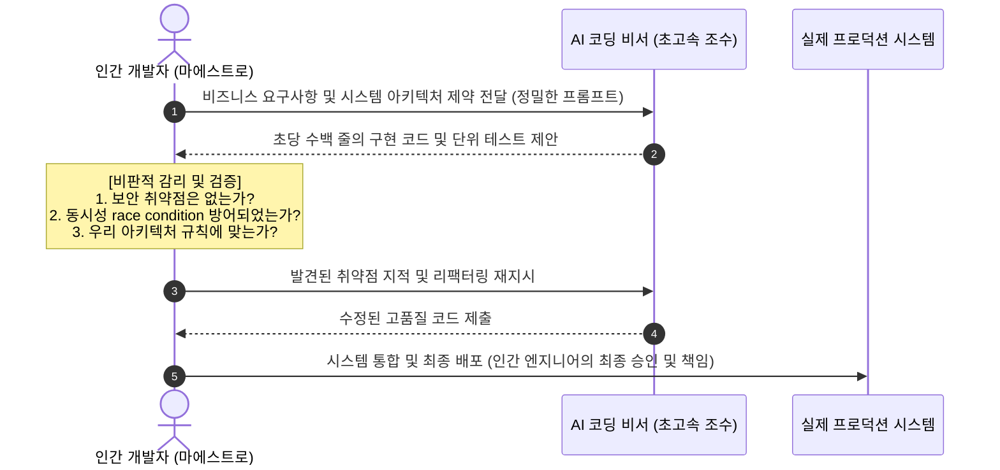

- 조수(AI)는 악보를 복사하고 음표를 그리는 속도가 인간보다 100배 빠릅니다.
- 하지만 전체 교향곡이 아름다운 화음을 이루고 있는지(시스템 무결성), 악보에 치명적인 불협화음(보안 버그)이 숨어 있는지, 관객(사용자)에게 감동을 주는 음악인지(비즈니스 가치)를 판별하고 지휘봉을 휘두르는 주체는 오직 마에스트로(인간 개발자)뿐입니다.

---

### 4. 상세 비교표: 레거시 개발자 vs AI-Augmented (AI 증강형) 현대 개발자

| 비교 기준 | 레거시 개발자 (과거 패러다임) | AI-Augmented 현대 개발자 (새로운 표준) |
| :--- | :--- | :--- |
| **코드 작성 방식** | 빈 화면에서 함수와 문법을 한 글자씩 수작업 타이핑 | AI에게 아키텍처와 컨텍스트를 제시하고 초안을 빠르게 생성 |
| **시간 배분** | 문법 타이핑과 단순 디버깅에 70%, 설계에 30% | 시스템 설계와 비즈니스 분석에 60%, AI 코드 검증에 40% |
| **생산성** | 하루 수십~수백 줄의 제한된 코드 생산 | AI 오케스트레이션을 통해 5~10배 이상의 빠른 프로토타이핑 및 구현 |
| **지식의 활용** | 라이브러리 문법과 파라미터 순서를 외우는 데 집중 | 시스템 구조, CS 기본 원리, 데이터 흐름을 꿰뚫어 보는 데 집중 |
| **에러 대응** | 구글링과 스택오버플로우 검색에 많은 시간 소모 | AI에게 에러 컨텍스트를 주입해 1차 원인을 분석시키고 본질을 검증 |
| **핵심 경쟁력** | "나는 이 프레임워크 문법을 많이 알고 있다" | "나는 AI를 능숙하게 지휘하여 견고하고 안전한 비즈니스 제품을 완성한다" |

---

### 5. 핵심 요약 (Summary Checklist)

- [x] AI는 개발자를 대체하는 것이 아니라, **단순 코딩 노동에서 해방시켜 상위 레벨의 엔지니어링에 집중하게 만듭니다.**
- [x] 현대 개발자의 필수 무기는 **프롬프트/컨텍스트 엔지니어링, 시스템 아키텍처 설계, 비즈니스 도메인 이해력**입니다.
- [x] AI가 생성한 코드의 환각과 보안 결함을 걸러내는 **비판적 검증 능력과 탄탄한 CS 기초 지식**이야말로 AI 시대에 가장 강력한 차별점이 됩니다.

---

## 에필로그: 첫 줄의 코드를 작성할 당신을 응원하며

소프트웨어 개발의 여정은 마치 거대하고 신비로운 미지의 대륙을 탐험하는 것과 같습니다. 처음에는 쏟아지는 전공 용어와 생소한 개념들, 그리고 화면을 가득 채우는 에러 메시지 앞에서 막막함과 두려움을 느낄지도 모릅니다.

하지만 기억하십시오. 세상의 모든 위대한 소프트웨어도 처음에는 화면에 `"Hello, World!"`라는 단 한 줄의 글자를 띄우는 아주 작고 소박한 순간에서 시작되었습니다.

컴퓨터의 차가운 실리콘 칩 이면에 숨겨진 논리를 이해하고, 복잡한 현실의 문제를 기술로 아름답게 풀어내어 누군가의 삶을 더 편리하게 바꾸어 나가는 일. 그것이 바로 소프트웨어 엔지니어가 누릴 수 있는 가장 가슴 뛰는 특권입니다.

이제 당신만의 멋진 시스템을 구축하기 위한 위대한 첫걸음을 힘차게 내딛으시길 바랍니다!
