# PART 01 소프트웨어 개발

> *"컴퓨터 과학은 컴퓨터에 관한 학문이 아니다. 그것은 마치 천문학이 망원경에 관한 학문이 아닌 것과 같다."*  
> — 에츠허르 데이크스트라 (Edsger W. Dijkstra, 튜링상 수상자)

---

## 프롤로그: 소프트웨어라는 새로운 우주로 들어서는 당신에게

스마트폰 화면을 가볍게 터치해 따뜻한 음식을 주문하고, 지구 반대편에 있는 수억 명의 사람들과 실시간으로 고화질 영상을 주고받으며, 인공지능(AI)이 몇 초 만에 복잡한 법률 문서와 의료 데이터를 분석해 주는 세상. 오늘날 인류 문명의 거의 모든 영역은 **소프트웨어(Software)**라는 보이지 않는 거대한 지적 구조물 위에서 구동되고 있습니다.

한때 '기계를 보조하는 부속품' 정도로 여겨졌던 소프트웨어는 이제 실물 경제를 통째로 삼키고 세상을 움직이는 가장 강력한 동력이 되었습니다. 실리콘밸리의 전설적인 벤처 투자자 마크 안드레센(Marc Andreessen)이 *"소프트웨어가 세상을 집어삼키고 있다(Software is eating the world)"*고 선언한 지 10여 년이 지난 지금, 그 예언은 완벽한 현실이 되었습니다. 자동차 회사는 바퀴 달린 슈퍼컴퓨터를 만드는 소프트웨어 기업으로 탈바꿈했고, 은행은 지점 대신 모바일 앱과 대규모 분산 서버 위에서 존재합니다.

하지만 이 화려한 기술 문명의 이면에서 실제로 소프트웨어를 설계하고 빚어내는 **'개발(Development)'**과 **'엔지니어링(Engineering)'**이라는 행위는 여전히 많은 사람들에게 검은 바탕화면 위를 빠르게 흘러가는 알 수 없는 영문 텍스트, 즉 일종의 현대판 마법처럼 여겨지곤 합니다. 입문자와 비전공자, 심지어 코딩을 막 시작한 초보 개발자들조차 다음과 같은 근원적인 갈증을 느낍니다.

- *"컴퓨터공학과 학생들은 대학 4년 동안 대체 무엇을 배우길래 저런 거대한 시스템을 만들 수 있는 걸까?"*
- *"단순히 문법을 외워 코딩을 한다는 것과, 프로페셔널하게 소프트웨어를 개발한다는 것은 어떤 본질적 차이가 있을까?"*
- *"우리가 매일 쓰는 카카오톡, 토스, 넷플릭스 같은 서비스는 처음 아이디어를 내는 순간부터 내 스마트폰에 깔리기까지 어떤 치밀한 공학적 절차와 문서들을 거치는 걸까?"*
- *"어떤 기질과 태도를 가진 사람이 개발이라는 길을 오래, 그리고 탁월하게 걸어갈 수 있을까?"*
- *"AI가 인간보다 수십 배 빠르게 코드를 쏟아내는 에이전틱 코딩(Agentic Coding) 시대에, 인간 개발자는 대체 무엇으로 자신의 대체 불가능한 가치를 증명해야 할까?"*

이 책의 첫 번째 관문인 **PART 01**에서는 이러한 근원적인 물음들에 대해 수박 겉핥기식의 추상적인 대답이 아닌, **실제 현업의 코드, 아키텍처 문서, 장애 대응 로그, 그리고 공학적 원리**가 살아 숨 쉬는 가장 본질적이고 명쾌한 해답을 드리고자 합니다. 표면적인 프로그래밍 언어 문법 습득을 넘어, 차가운 실리콘 반도체 위에서 논리가 어떻게 생명을 얻는지, 그리고 소프트웨어 엔지니어링의 진정한 본질이 무엇인지 꿰뚫어 보는 지적 여정을 지금 시작합니다.

---

## 01 컴퓨터 전공자들은 어떤 것들을 배우나요?

> 컴퓨터공학(Computer Science & Engineering)은 단순히 프로그래밍 언어의 문법을 외우는 직업 훈련 과정이 아닙니다.  
> 인간의 복잡하고 추상적인 사고체계를 '물리적 기계'가 오차 없이 이해하고 초고속으로 처리할 수 있는 수학적·공학적 논리로 번역하고 제어하는 **종합 시스템 학문**입니다.

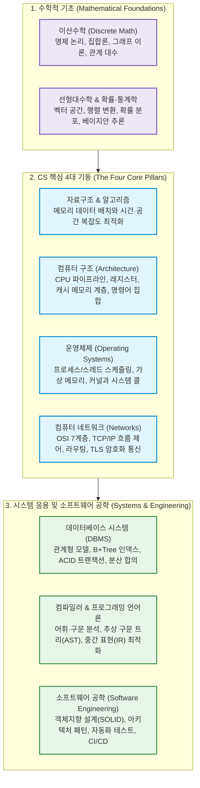

---

### 1. 개념 이해: CS 커리큘럼의 층위와 체계

많은 사람들이 컴퓨터공학과에 진학하면 1학년 때부터 C언어, 자바(Java), 파이썬(Python), 리액트(React) 같은 실무 언어와 프레임워크의 사용법을 4년 내내 배울 것이라 오해합니다. 하지만 실제 대학에 들어가 보면 프로그래밍 언어 문법 수업은 1학년 1학기 한두 과목으로 끝나버리고, 이후 3년 반 동안은 칠판 가득 수식과 메모리 구조도, 네트워크 패킷 헤더, 운영체제 커널 스케줄링 알고리즘을 배우게 됩니다.

왜 대학은 당장 취업에 쓰이는 최신 프레임워크 대신 이런 밑바닥 원리를 가르칠까요? 그 이유는 **기술 트렌드와 프레임워크는 3~5년마다 유행이 바뀌지만, 그 프레임워크가 동작하는 하부 컴퓨터 시스템의 근본 원리(CS 기초)는 50년 전이나 지금이나 변하지 않기 때문**입니다. 모래 위에 세운 성이 작은 파도에도 무너지듯, 하부 구조를 모르는 개발자는 시스템에 예상치 못한 병목이나 장애가 발생했을 때 속수무책으로 무너집니다.

컴퓨터공학 전공의 교육과정은 철저하게 **하부 하드웨어(물리 및 전자 계층)부터 상부 애플리케이션(추상화 및 소프트웨어 계층)**까지 촘촘히 벽돌을 쌓아 올리는 구조로 설계되어 있습니다.

---

#### (1) 대학 4년(8학기) 컴퓨터공학 표준 커리큘럼 로드맵

전 세계 주요 공과대학(MIT, 스탠퍼드, 서울대, KAIST 등)의 컴퓨터공학부 커리큘럼을 종합해 보면, 학생들은 4년(8학기) 동안 다음과 같은 정교한 단계별 로드맵을 따라 사고력을 확장해 나갑니다.

| 학년 / 학기 | 핵심 교육 목표 | 주요 개설 전공 과목 | 이 시기에 체득하는 엔지니어링 역량 |
| :--- | :--- | :--- | :--- |
| **1학년 1학기** | 컴퓨터와 대화하는 첫 문법 익히기 | 컴퓨터 프로그래밍 입문(C/Python), 미적분학, 공학개론 | 변수, 조건문, 반복문, 함수의 개념을 이해하고 간단한 콘솔 프로그램을 작성하는 능력 |
| **1학년 2학기** | 컴퓨터의 수학적 사고방식 장착 | **이산수학(Discrete Mathematics)**, 객체지향 프로그래밍(C++/Java), 디지털 논리회로 | 연속적인 현실 세계를 0과 1의 이산적 논리(명제, 집합, 부울 대수)와 논리 게이트(AND, OR, XOR)로 표현하는 능력 |
| **2학년 1학기** | 데이터 배치와 하드웨어의 만남 | **자료구조(Data Structures)**, **선형대수학**, 컴퓨터 구조 입문, 리눅스 시스템 실습 | 메모리에 데이터를 어떻게 조직화할지 결정하고, 포인터와 메모리 주소 체계를 다루는 능력 |
| **2학년 2학기** | 연산 최적화와 기계 내부 해부 | **알고리즘(Algorithms)**, **컴퓨터 구조(Computer Architecture)**, 시스템 프로그래밍, 확률과 통계 | 문제 해결의 시간·공간 복잡도를 수학적으로 증명하고, CPU 파이프라인과 캐시 메모리의 물리적 동작을 이해하는 능력 |
| **3학년 1학기** | 시스템을 지배하는 양대 거인 정복 | **운영체제(Operating Systems)**, **컴퓨터 네트워크(Computer Networks)**, 프로그래밍 언어론 | 프로세스/스레드 동기화, 가상 메모리 페이징, TCP/IP 소켓 통신 등 현대 서버 프로그래밍의 핵심 근간을 장악하는 능력 |
| **3학년 2학기** | 데이터의 영속성과 대규모 설계 | **데이터베이스 시스템(DBMS)**, **소프트웨어 공학(SE)**, 인공지능/머신러닝 개론 | 트랜잭션과 인덱스를 설계하고, 팀 단위로 아키텍처를 설계·테스트·배포하는 실전 엔지니어링 능력 |
| **4학년 1학기** | 고난도 심화 이론과 특수 도메인 | **컴파일러(Compilers)**, 분산 시스템, 정보보안 및 암호학, 컴퓨터 그래픽스, 딥러닝 | 언어를 직접 설계하거나, 수백 대의 서버를 하나로 묶는 분산 합의(Raft, Paxos) 및 보안 취약점을 다루는 고급 역량 |
| **4학년 2학기** | 종합 시스템 구축과 현장 문제 해결 | 캡스톤 디자인(졸업 프로젝트), 클라우드 컴퓨팅, 산학협력 인턴십 | 4년간 배운 모든 이론을 총동원하여 실제 운영 가능한 엔드투엔드(End-to-End) 프로덕션 서비스를 구축하고 검증하는 능력 |

---

#### (2) 컴퓨터 과학의 4대 기둥 (Core Pillars) 심층 해부

위 로드맵 중에서도 특히 모든 소프트웨어 엔지니어의 기초 체력을 좌우하는 **'CS 핵심 4대 기둥'**을 깊이 있게 들여다보겠습니다.

##### ① 자료구조와 알고리즘 (Data Structures & Algorithms)
- **핵심 질문**: *"주어진 데이터를 메모리 어디에 어떻게 배치할 것이며(자료구조), 어떤 절차로 계산해야 최소한의 시간과 공간으로 정답을 도출할 수 있는가(알고리즘)?"*
- **다루는 원리**:
  - **선형 자료구조**: 연속된 메모리 공간을 차지하여 인덱스 접근이 `O(1)`로 즉시 이루어지지만 중간 삽입·삭제가 `O(N)`으로 느린 **배열(Array)**, 메모리 곳곳에 흩어진 노드들을 포인터로 연결하여 삽입·삭제는 빠르지만 탐색이 느린 **연결 리스트(Linked List)**, 함수 호출의 근간인 **스택(Stack, LIFO)**, 작업 대기열의 표준인 **큐(Queue, FIFO)**.
  - **비선형 자료구조**: 계층적 데이터를 다루는 **이진 탐색 트리(BST)**, 데이터베이스 인덱스의 심장인 **B-Tree / B+Tree**, 우선순위 스케줄링을 위한 **힙(Heap)**, 키(Key)를 해시 함수에 통과시켜 평균 `O(1)` 시간에 값을 찾아내는 **해시 테이블(Hash Table)**, 그리고 도로망이나 소셜 네트워크 관계를 모델링하는 **그래프(Graph)**.
  - **알고리즘 설계 기법**: 문제를 반씩 쪼개어 정복하는 **분할 정복(Divide and Conquer)**, 작은 문제의 해답을 메모리에 저장(Memoization)해 중복 연산을 없애는 **동적 계획법(Dynamic Programming)**, 매 순간 최선의 선택을 하는 **탐욕 기법(Greedy)**, 최단 경로를 찾는 **데이크스트라(Dijkstra) 및 A* 알고리즘**.
- **공학적 의의**: 데이터가 100개일 때는 어떤 코드를 짜도 0.001초 안에 끝납니다. 하지만 사용자 수가 1,000만 명으로 늘어나면, `O(N²)` 알고리즘은 `10¹⁴`(100조) 번의 연산을 수행하느라 서버를 멈추게 만들고, `O(N log N)` 알고리즘은 약 `2.3 × 10⁸`(2억 3천만) 번의 연산으로 단 0.2초 만에 응답을 반환합니다. 이 극적인 차이를 코드 작성 전에 계산해 내는 안목이 바로 자료구조와 알고리즘입니다.

##### ② 컴퓨터 구조 (Computer Architecture)
- **핵심 질문**: *"우리가 텍스트로 작성한 고수준 코드가 어떻게 0과 1의 전기 신호로 바뀌어 실리콘 반도체 칩(CPU와 메모리) 위에서 빛의 속도로 실행되는가?"*
- **다루는 원리**:
  - **폰 노이만 구조(Von Neumann Architecture)**: 프로그램 명령어와 데이터를 모두 메모리(RAM)에 올려두고, CPU가 이를 하나씩 인출(Fetch) → 해독(Decode) → 실행(Execute) → 기록(Write-back)하는 현대 컴퓨터의 기본 설계.
  - **명령어 파이프라이닝(Instruction Pipelining)과 분기 예측(Branch Prediction)**: 세탁기와 건조기를 동시에 돌리듯, CPU가 여러 명령어를 겹쳐서 동시에 처리하는 파이프라인 기술과, `if` 조건문의 결과를 CPU가 미리 예측하여 실행 속도를 높이는 하드웨어 기법.
  - **메모리 계층 구조(Memory Hierarchy)와 캐시 지역성(Cache Locality)**: CPU 연산 속도는 1나노초(`10⁻⁹`초) 미만인 반면, 메인 메모리(RAM)에서 데이터를 가져오는 데는 약 100나노초가 걸립니다. 이 100배의 속도 격차(Memory Wall)를 극복하기 위해 CPU 내부에는 초고속 **레지스터(Register)**와 **L1/L2/L3 캐시 메모리(SRAM)**가 존재합니다. 인접한 메모리 주소를 연속해서 읽는 **공간 지역성(Spatial Locality)**과 방금 읽은 데이터를 다시 읽는 **시간 지역성(Temporal Locality)**을 이해해야 하드웨어 성능을 100% 끌어낼 수 있습니다.

##### ③ 운영체제 (Operating Systems)
- **핵심 질문**: *"물리적인 CPU 코어와 RAM 용량은 한정되어 있는데, 어떻게 수백 개의 프로그램이 서로 충돌하지 않고 동시에 안전하게 실행될 수 있는가?"*
- **다루는 원리**:
  - **프로세스(Process)와 스레드(Thread)**: 실행 중인 프로그램의 독립된 메모리 할당 단위인 프로세스와, 프로세스 내부에서 코드·데이터·힙 영역을 공유하며 각자의 스택(Stack)만 따로 갖고 달리는 실행 흐름인 스레드.
  - **컨텍스트 스위칭(Context Switching)과 CPU 스케줄링**: CPU가 0.001초 단위로 실행 중인 프로세스를 교대시켜 인간에게 '동시에 실행되는 것 같은 환상(동시성, Concurrency)'을 제공하는 원리, 그리고 이때 레지스터 상태를 PCB(Process Control Block)에 저장하고 복구하는 오버헤드.
  - **동기화(Synchronization)와 교착 상태(Deadlock)**: 여러 스레드가 공유 변수에 동시에 접근할 때 발생하는 **경쟁 상태(Race Condition)**를 막기 위한 **뮤텍스(Mutex)**, **세마포어(Semaphore)**, **모니터(Monitor)** 기법, 그리고 서로 상대방이 가진 자원을 무한정 기다리다 멈춰버리는 데드락의 4대 발생 조건과 해결책.
  - **가상 메모리(Virtual Memory)와 페이징(Paging)**: 물리적인 RAM이 16GB뿐이어도 각 프로세스에게 수십 테라바이트의 연속된 메모리가 있는 것처럼 속이는 가상 주소 체계, 페이지 테이블(Page Table), 그리고 페이지 폴트(Page Fault) 처리 메커니즘.
  - **유저 모드(User Mode)와 커널 모드(Kernel Mode)**: 일반 응용 프로그램이 하드웨어를 함부로 망가뜨리지 못하도록 권한을 격리하고, 파일 읽기나 네트워크 전송이 필요할 때만 **시스템 콜(System Call)**을 통해 운영체제 커널에 대행을 요청하는 보호 체계.

##### ④ 컴퓨터 네트워크 (Computer Networks)
- **핵심 질문**: *"서울에 있는 내 스마트폰에서 보낸 데이터가 태평양 해저 광케이블과 수십 대의 라우터를 거쳐 미국 버지니아에 있는 서버까지 단 1비트의 깨짐도 없이 도달하는 원리는 무엇인가?"*
- **다루는 원리**:
  - **계층화된 프로토콜(OSI 7계층 & TCP/IP 모델)**: 물리 계층(전선/광케이블) → 데이터 링크 계층(이더넷, MAC 주소) → 네트워크 계층(IP 주소, 라우팅) → 전송 계층(TCP/UDP, 포트 번호) → 응용 계층(HTTP, DNS, WebSocket)으로 이어지는 캡슐화(Encapsulation)와 역캡슐화 과정.
  - **TCP의 신뢰성 보장 메커니즘**: 연결 수립을 위한 **3-Way Handshake(`SYN` → `SYN+ACK` → `ACK`)**, 연결 종료를 위한 **4-Way Handshake**와 `TIME_WAIT` 상태의 존재 이유, 패킷 유실 시 재전송(ARQ), 수신자의 처리 속도에 맞추는 **흐름 제어(Flow Control)**, 네트워크 망 전체의 마비를 막는 **혼잡 제어(Congestion Control)**.
  - **현대의 웹 프로토콜과 보안**: 도메인 이름을 IP로 바꾸는 **DNS(Domain Name System)**, HTTP/1.1의 Head-of-Line Blocking 문제를 해결한 HTTP/2 멀티플렉싱과 QUIC(UDP 기반) 위에 구축된 **HTTP/3**, 그리고 공개키(비대칭키) 암호화와 대칭키 암호화를 결합해 도청을 원천 차단하는 **TLS(Transport Layer Security) 핸드셰이크**.

---

#### (3) 기반 수학과 시스템 응용 과목의 실체

- **이산수학 & 선형대수학**: 컴퓨터는 실수(Real Number)의 연속 세계가 아니라 0과 1로 딱딱 끊어지는 이산(Discrete)의 세계입니다. 이산수학의 집합론과 관계 대수는 그대로 관계형 데이터베이스(SQL `JOIN`, `UNION`)의 모태가 되었고, 그래프 이론은 네트워크 라우팅과 소셜 미디어 추천 알고리즘의 뼈대가 되었습니다. 선형대수학의 행렬 곱셈과 고유값 분해(Eigenvalue Decomposition)는 3D 게임 그래픽 엔진에서 캐릭터를 회전·이동시키는 변환 행렬이자, 챗GPT 같은 초거대 AI 모델(Transformer)의 어텐션(Attention) 연산 그 자체입니다.
- **데이터베이스 시스템 (DBMS)**: 메모리(RAM)는 전원이 꺼지면 데이터가 증발하는 휘발성 저장소입니다. 데이터를 비휘발성 디스크(SSD)에 영구히 기록하면서도 빠른 검색 속도와 완벽한 일관성을 유지하기 위해 **트랜잭션의 ACID 원칙(원자성, 일관성, 고립성, 지속성)**, **트랜잭션 격리 수준(Read Committed, Repeatable Read, Serializable)**, **WAL(Write-Ahead Logging, 로그 선기록)**, **MVCC(다중 버전 동시성 제어)**를 배웁니다.
- **컴파일러와 프로그래밍 언어론**: 우리가 작성한 텍스트 코드가 어떻게 **어휘 분석기(Lexer)**를 거쳐 토큰(Token)으로 쪼개지고, **구문 분석기(Parser)**를 통해 **추상 구문 트리(AST, Abstract Syntax Tree)**로 조립되며, 중간 코드 최적화(IR Optimization)를 거쳐 타겟 CPU의 기계어로 번역되는지 학습합니다. 또한 자바나 파이썬의 **가비지 컬렉터(Garbage Collector, GC)**가 어떻게 안 쓰는 메모리를 자동으로 청소하는지 그 알고리즘(Mark-and-Sweep, Generational GC)을 해부합니다.

---

### 2. 전공 과목 → 실제 현업 프로덕션 코드 매핑 (Code & Case Study)

*"학교에서 배운 이론이 실제 회사 코드에서 어떻게 쓰이나요?"*  
이 질문에 가장 명확히 답하기 위해, **대규모 게임 엔진, 초고트래픽 웹 서버, 금융 결제 시스템** 현업에서 각 전공 과목의 원리가 실제 코드 한 줄 한 줄에 어떻게 투영되는지 구체적인 코드로 살펴보겠습니다.

---

#### 사례 1: [컴퓨터 구조 + 선형대수학] 게임 엔진 및 대용량 이미지 처리의 캐시 지역성(Cache Locality) 최적화

2차원 행렬(예: `10,000 × 10,000` 픽셀 이미지 또는 게임 물리 엔진의 지형 그리드)의 모든 원소를 합산하는 똑같은 로직이라도, **컴퓨터 구조의 'CPU 캐시 라인(Cache Line, 보통 64바이트)'** 원리를 아는 개발자와 모르는 개발자의 코드는 실행 속도가 **10배 이상** 차이 납니다.

```python
# [현업 비교 코드] 2차원 배열 순회 순서에 따른 CPU 캐시 적중률(Cache Hit Ratio) 차이
import time

SIZE = 5000
# 5,000 x 5,000 크기의 2차원 행렬 생성 (메모리에는 행 우선 Row-Major 순서로 연속 배치됨)
matrix = [[1] * SIZE for _ in range(SIZE)]

# ❌ 나쁜 예 (컴퓨터 구조를 모르는 코드): 열(Column) 우선 순회
# matrix[0][0] -> matrix[1][0] -> matrix[2][0] 순서로 접근하면
# 메모리 주소를 5,000칸씩 건너뛰게 되어 매번 CPU L1 캐시 미스(Cache Miss)가 발생합니다!
start_col = time.perf_counter()
total_col = 0
for col in range(SIZE):
    for row in range(SIZE):
        total_col += matrix[row][col]
elapsed_col = time.perf_counter() - start_col

# ✅ 좋은 예 (컴퓨터 구조를 이해한 코드): 행(Row) 우선 순회
# matrix[0][0] -> matrix[0][1] -> matrix[0][2] 순서로 인접한 메모리를 연속 접근하므로
# CPU가 한 번에 퍼올린 64바이트 캐시 라인을 100% 활용(공간 지역성 극대화)합니다!
start_row = time.perf_counter()
total_row = 0
for row in range(SIZE):
    current_row = matrix[row]
    for col in range(SIZE):
        total_row += current_row[col]
elapsed_row = time.perf_counter() - start_row

print(f"열 우선 순회 (Cache Miss 다발): {elapsed_col:.4f}초")
print(f"행 우선 순회 (Cache Hit 극대화): {elapsed_row:.4f}초")
```

- **공학 해설**: 두 코드는 수학적 시간 복잡도가 모두 `` `O(N²)` ``으로 완전히 동일합니다! 하지만 실제 C/C++이나 고성능 연산 환경에서 실행해 보면 아래쪽 코드가 수배에서 수십 배 더 빠릅니다. **알고리즘(Big-O)만 알고 컴퓨터 구조(CPU 캐시 메모리)를 모르면 절대 이해할 수 없는 현업의 대표적 성능 최적화 사례**입니다.

---

#### 사례 2: [자료구조 & 알고리즘] 대규모 이커머스 실시간 중복 주문 검사와 `O(N²)` vs `O(N)`

블랙프라이데이 행사 중 10만 건의 주문 로그(`orders`)에서 이미 블랙리스트에 오른 1만 명의 악성 어뷰징 유저(`blacklist`)를 걸러내야 한다고 가정해 봅시다.

```python
# ❌ 나쁜 예: 리스트(Array) 안에서 선형 탐색(in 연산자) 반복 -> 시간 복잡도 O(N * M)
def filter_abusers_slow(orders: list[dict], blacklist_list: list[str]) -> list[dict]:
    valid_orders = []
    for order in orders:  # 100,000번 반복
        # 리스트의 'in' 연산은 처음부터 끝까지 하나씩 비교하므로 최대 10,000번 연산!
        # 총 연산 횟수: 100,000 * 10,000 = 1,000,000,000 (10억 번 연산 -> 서버 응답 지연!)
        if order["user_id"] not in blacklist_list:
            valid_orders.append(order)
    return valid_orders


# ✅ 좋은 예: 해시 테이블(Set) 자료구조로 변환 후 탐색 -> 시간 복잡도 O(N + M)
def filter_abusers_fast(orders: list[dict], blacklist_list: list[str]) -> list[dict]:
    # 리스트를 해시 기반 집합(Set)으로 변환 (10,000번 연산)
    blacklist_set = set(blacklist_list)
    
    valid_orders = []
    for order in orders:  # 100,000번 반복
        # 해시 테이블(Set)의 'in' 연산은 해시 함수를 통해 단 1번(O(1)) 만에 위치를 찾음!
        # 총 연산 횟수: 10,000 + 100,000 = 110,000 (단 11만 번 연산 -> 0.01초 만에 완료!)
        if order["user_id"] not in blacklist_set:
            valid_orders.append(order)
    return valid_orders
```

- **공학 해설**: 코드에서는 단지 `list`를 `set`으로 바꾼 한 줄(`blacklist_set = set(blacklist_list)`)의 차이일 뿐이지만, 연산 횟수는 **10억 번에서 11만 번으로 약 9,000배 감소**합니다. 자료구조 과목에서 배운 **해시 테이블(Hash Table)의 해시 함수 매핑과 충돌 해결(Collision Resolution)** 원리가 실무 서버의 생존을 결정짓는 순간입니다.

---

#### 사례 3: [운영체제 + 데이터베이스] 금융 계좌 이체 시스템의 교착 상태(Deadlock) 예방

토스나 카카오뱅크 같은 금융 서버에서 사용자 A가 사용자 B에게 1만 원을 송금하는 동시에, 공교롭게도 같은 0.001초의 순간에 사용자 B도 사용자 A에게 5천 원을 송금했다고 가정해 봅시다.

```java
// ❌ 치명적 장애가 발생하는 코드 (운영체제 Deadlock 원리를 모를 때)
public void transferUnsafe(Account from, Account to, long amount) {
    synchronized (from) {             // 스레드 1은 A 계좌를 잠금, 스레드 2는 B 계좌를 잠금
        synchronized (to) {           // 스레드 1은 B 계좌가 풀리길 대기, 스레드 2는 A 계좌가 풀리길 무한 대기!
            from.withdraw(amount);    // -> 영원히 끝나지 않는 교착 상태(Deadlock) 발생! 서버 전체 마비!
            to.deposit(amount);
        }
    }
}

// ✅ 운영체제 전공 지식을 적용한 프로덕션 코드 (순환 대기 Circular Wait 조건 파괴)
public void transferSafe(Account from, Account to, long amount) {
    // 운영체제론의 데드락 4대 필요조건 중 '순환 대기(Circular Wait)'를 깨뜨리기 위해
    // 항상 계좌 고유 ID가 작은 쪽부터 먼저 락(Lock)을 획득하도록 강제 정렬합니다!
    Account firstLock = (from.getId() < to.getId()) ? from : to;
    Account secondLock = (from.getId() < to.getId()) ? to : from;

    synchronized (firstLock) {        // 두 스레드 모두 무조건 ID가 작은 A 계좌 락부터 경쟁!
        synchronized (secondLock) {   // 승리한 스레드가 B 계좌 락까지 획득 후 안전하게 이체 수행
            from.withdraw(amount);
            to.deposit(amount);
        }
    }
}
```

- **공학 해설**: 운영체제 교과서에 나오는 **'교착 상태(Deadlock)의 4대 발생 조건(상호 배제, 점유 대기, 비선점, 순환 대기)'** 중 네 번째인 **순환 대기(Circular Wait)**는 *"자원들에 고유한 번호를 부여하고 항상 오름차순으로만 자원을 요청하게 하면 절대 발생하지 않는다"*는 정리로 해결됩니다. 대학 시절 시험 문제로만 풀던 이 원리가 금융권 코어 뱅킹 시스템의 멀티스레드 락 설계에 토씨 하나 다르지 않게 그대로 적용됩니다.

---

#### 사례 4: [컴파일러 & 프로그래밍 언어론] 정적 분석 도구(ESLint)와 코드 변환기(Babel)의 AST 활용

*"컴파일러를 직접 만들 것도 아닌데 왜 컴파일러 수업을 듣나요?"*  
현업에서 우리가 매일 쓰는 코드 포매터(Prettier), 린터(ESLint), 타입스크립트 트랜스파일러, ORM 쿼리 빌더, 그리고 IDE의 자동 리팩터링 기능은 모두 컴파일러 이론의 **추상 구문 트리(AST, Abstract Syntax Tree)**를 기반으로 작동합니다. 사내 수만 줄의 코드에서 보안상 위험한 `eval()` 함수 호출이나 개인정보 로깅 코드를 자동으로 찾아내 차단하는 보안 감사 스크립트를 만들 때, 정규표현식 대신 AST 파서를 사용하면 100% 정확한 도구를 만들 수 있습니다.

---

### 3. 현실 비유 및 실무 예시: "미슐랭 3스타 레스토랑으로 이해하는 CS 전공"

컴퓨터의 작동 구조를 대형 유명 레스토랑의 운영에 빗대어 보면, 전공 과목들의 유기적 관계가 한눈에 들어옵니다.

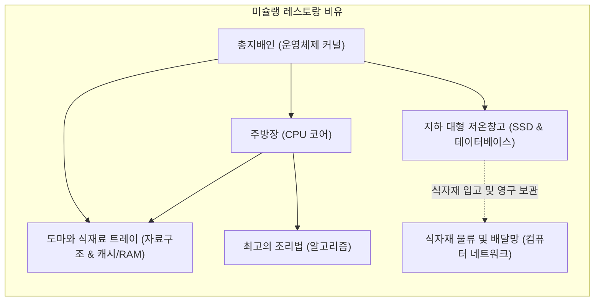

- **컴퓨터 구조**: 주방의 물리적 하드웨어 배치입니다. 초고속으로 손을 놀리는 주방장(CPU 코어), 주방장의 손 바로 옆에 놓인 아주 작은 양념통들(레지스터), 그리고 손만 뻗으면 닿는 앞 도마(L1/L2 캐시 메모리)와 주방 선반(RAM)의 동선을 결정합니다.
- **자료구조**: 도마 위에 식재료를 어떤 용기에 담아둘 것인가의 문제입니다. 바로 꺼내 쓰기 좋게 1열로 번호가 매겨진 칸막이 상자(배열), 재료끼리 실로 묶여 있어 새 재료를 중간에 끼워 넣기 좋은 구조(연결 리스트), 이름표만 대면 즉시 튀어나오는 마법의 서랍장(해시 테이블)을 연구합니다.
- **알고리즘**: 밀려드는 복잡한 주문을 가장 적은 칼질과 최소한의 화구 시간만을 써서 완벽한 코스 요리로 완성해 내는 **'궁극의 요리 레시피'**입니다.
- **운영체제**: 레스토랑의 **총지배인(Manager)**입니다. 홀의 50개 테이블에서 동시에 쏟아지는 주문(멀티 프로세스/스레드)을 보고, 어느 화구를 누구에게 몇 초씩 배정할지(CPU 스케줄링), 도마 공간이 부족하면 당장 안 쓰는 재료를 잠시 지하 창고로 내릴지(가상 메모리 스와핑/페이징), 두 요리사가 하나뿐인 트러플 오일 병을 동시에 잡으려고 싸우다 주방이 멈추지 않게 할지(동기화 및 데드락 방지)를 실시간으로 조율합니다.
- **컴퓨터 네트워크**: 전국 각지의 산지에서 신선한 식자재를 주문받고, 완성된 음식을 고객의 집까지 국물 한 방울 흘리지 않고 안전하게 배송하는 **물류 도로망 및 배송 규약(송장 규격, 파손 시 재배송, 수령 확인 서명 = TCP/IP)**입니다.
- **데이터베이스**: 레스토랑 지하에 위치한 **철통 보안의 식자재 냉동창고와 회계 장부**입니다. 주방에 갑자기 정전이 일어나도(서버 다운), 오늘 판 스테이크 수량과 매출액 장부는 단 1원의 오차 없이 기록되어 있어야 합니다(트랜잭션 ACID와 WAL 로그).

---

### 4. 상세 비교표: CS 핵심 과목 한눈에 보기

| 교과목 | 핵심 연구 질문 | 다루는 핵심 개념 | 현업 대표 적용 사례 | 이것을 모르면 실무에서 겪는 참사 |
| :--- | :--- | :--- | :--- | :--- |
| **이산수학 & 선형대수** | *현실의 문제를 어떻게 수학적 기호와 행렬로 모델링할까?* | 명제 논리, 집합론, 그래프, 벡터 내적, 행렬 변환 | AI/딥러닝 텐서 연산, 추천 시스템 코사인 유사도, 3D 그래픽스 | AI 모델의 파라미터 차원이나 벡터 검색(Vector DB)의 원리를 이해하지 못함 |
| **자료구조 & 알고리즘** | *어떻게 하면 가장 빠르고 메모리를 적게 쓰며 처리할까?* | Big-O, 해시 테이블, B+Tree, 힙, 동적 계획법, 최단 경로 | 대규모 검색 엔진, 네비게이션 경로 탐색, 인메모리 캐시 설계 | 데이터가 10만 건만 넘어가도 서버 CPU 점유율이 100%를 치며 타임아웃 발생 |
| **컴퓨터 구조** | *실리콘 칩(CPU/메모리)은 내부에서 어떻게 일하는가?* | ALU, 명령어 파이프라인, L1/L2/L3 캐시 지역성, 분기 예측 | 고성능 게임 엔진, 초저지연(Low-Latency) 증권 거래 시스템 | 캐시 미스(Cache Miss)가 대량 발생하는 비효율적 메모리 접근 코드를 양산함 |
| **운영체제 (OS)** | *한정된 하드웨어 자원을 어떻게 안전하고 공평하게 나눌까?* | 프로세스 vs 스레드, 가상 메모리, 컨텍스트 스위칭, Mutex, 비동기 I/O | 고성능 웹 서버(Nginx, Node.js, Netty)의 이벤트 루프 및 스레드 풀 튜닝 | 멀티스레드 환경에서 레이스 컨디션으로 결제 금액이 꼬이거나 데드락으로 서버가 멈춤 |
| **컴퓨터 네트워크** | *멀리 떨어진 기계와 어떻게 빠르고 신뢰성 있게 대화할까?* | OSI 7계층, TCP 3-Way Handshake, 혼잡 제어, HTTP/3, TLS | 글로벌 CDN 설계, 실시간 화상회의(WebRTC), MSA 서비스 간 gRPC 통신 | 간헐적 통신 지연이나 `TIME_WAIT` 소켓 고갈 장애가 났을 때 원인을 찾지 못함 |
| **데이터베이스 (DB)** | *데이터의 무결성과 안전한 영속성을 어떻게 지킬까?* | ACID, 격리 수준(Isolation Level), B+Tree 인덱스, MVCC, 샤딩 | 은행 계좌 이체, 선착순 티켓 예매, 대용량 로그 수집 및 분석 | 결제 도중 에러가 났을 때 고객 돈만 빠져나가고 주문 내역은 증발하는 대형 사고 발생 |
| **컴파일러 & 언어론** | *인간의 언어는 어떻게 기계어로 번역되고 실행되는가?* | Lexer, Parser, 추상 구문 트리(AST), 바이트코드, 가비지 컬렉션(GC) | JVM GC 튜닝(Stop-the-World 최소화), 코드 정적 분석기, DSL 설계 | 메모리 누수나 Full GC로 인해 서버가 주기적으로 수 초간 얼어붙는 현상을 해결하지 못함 |
| **소프트웨어 공학** | *수백 명의 팀원과 10년 가는 시스템을 어떻게 지을까?* | 객체지향 SOLID, 디자인 패턴, TDD, 리팩터링, CI/CD 파이프라인 | 대규모 엔터프라이즈 시스템 아키텍처, 무중단 배포 자동화 | 요구사항을 한 줄 수정했더니 전혀 상관없는 10군데 기능이 연쇄 폭발하는 스파게티 코드 양산 |

---

### 5. [심층 Q&A] 01절 멘토링 & 기술 면접 단골 질문

> [!TIP]
> **현업 시니어의 조언**: 비전공자이거나 부트캠프 출신 개발자라도 기죽을 필요가 전혀 없습니다. 대학 4년 동안 배우는 내용을 당장 오늘 하루 만에 다 외워야 하는 것이 아닙니다. 실무를 하면서 마주치는 문제들을 해결할 때 **"아, 이게 운영체제의 스레드 풀 문제구나!", "이게 데이터베이스의 인덱스 탐색 원리구나!"** 하고 하나씩 깊이 있게 파고들며 빈칸을 채워나가면 됩니다.

#### Q1. 비전공자로 개발을 시작했습니다. CS 과목이 너무 많은데, 어떤 순서로 공부하는 것이 가장 효율적인가요?
- **모범 답안**: 당장 학술적인 원서나 두꺼운 교과서를 처음부터 끝까지 읽으려 하면 지쳐서 포기하게 됩니다. 가장 추천하는 실무 밀착형 학습 순서는 다음과 같습니다.
  1. **1순위 — 자료구조와 알고리즘**: 내가 매일 짜는 코드의 리스트, 딕셔너리(해시 맵), 셋(Set)이 메모리에서 어떻게 돌아가고 시간 복잡도가 얼마인지 직결되므로 가장 먼저 체득해야 합니다.
  2. **2순위 — 컴퓨터 네트워크 & 데이터베이스**: 웹/앱 개발의 90%는 *"클라이언트가 네트워크(HTTP/TCP)로 요청을 보내면, 서버가 데이터베이스(SQL/인덱스/트랜잭션)에서 데이터를 꺼내 응답하는 과정"*입니다. 이 두 과목을 알면 실무 API 개발의 시야가 완전히 달라집니다.
  3. **3순위 — 운영체제 & 컴퓨터 구조**: 서비스 트래픽이 늘어나고 멀티스레드 동시성 이슈, 비동기 처리, 서버 메모리(OOM) 장애를 다룰 때 깊이 있게 공부하면 폭발적인 성장을 이룰 수 있습니다.

#### Q2. [기술 면접 단골] 프로세스(Process)와 스레드(Thread)의 차이는 무엇이며, 왜 멀티프로세스 대신 멀티스레드를 많이 사용하나요?
- **모범 답안**:
  - **프로세스**는 운영체제로부터 독립된 가상 메모리 공간(Code, Data, Heap, Stack)을 할당받아 실행되는 작업의 단위입니다. 프로세스끼리는 메모리를 전혀 공유하지 않으므로 하나가 죽어도 다른 프로세스에 영향을 주지 않지만(높은 안정성), 프로세스를 전환할 때(Context Switching) CPU 캐시와 가상 메모리 페이지 테이블(TLB)을 통째로 비워야 해서 오버헤드가 매우 큽니다.
  - **스레드**는 하나의 프로세스 내부에서 실행되는 여러 갈래의 작업 흐름입니다. 스레드들은 프로세스의 **Code, Data, Heap 메모리 영역을 서로 공유**하고, 오직 함수 호출과 지역 변수를 담는 **Stack 영역과 레지스터(PC)만 독립적으로 소유**합니다.
  - 따라서 멀티스레드는 메모리 공유를 통해 스레드 간 데이터 통신이 매우 빠르고 컨텍스트 스위칭 비용이 훨씬 가볍습니다. 단, Heap 영역을 공유하기 때문에 여러 스레드가 동시에 같은 변수를 수정할 때 발생하는 **경쟁 상태(Race Condition)**를 막기 위해 철저한 동기화(Synchronization) 설계가 동반되어야 합니다.

---

### 6. 핵심 요약 (Summary Checklist)

- [x] 컴퓨터공학은 단순 코딩 문법 학습이 아니라 **하드웨어부터 소프트웨어까지 이어지는 추상화 계층과 계산 이론을 탐구하는 시스템 학문**입니다.
- [x] **4대 핵심 과목(자료구조/알고리즘, 컴퓨터구조, 운영체제, 네트워크)**은 고수준 코드와 물리적 실리콘 칩을 잇는 단단한 교량 역할을 합니다.
- [x] 수학적 기초(이산수학, 선형대수)와 시스템 응용(데이터베이스, 컴파일러, 소프트웨어 공학)이 결합될 때, 비로소 수천만 명의 트래픽을 견디는 엔터프라이즈급 소프트웨어를 설계할 수 있습니다.

---

## 02 소프트웨어를 개발한다는 것은 무엇입니까?

> "프로그래밍(Coding)은 컴퓨터에게 무엇을 해야 할지 명령하는 기술이지만,  
> 소프트웨어 엔지니어링(Software Engineering)은 인류의 모호한 현실 문제를 컴퓨터의 엄밀한 논리로 풀어내어  
> 시간의 흐름과 변화 속에서도 지속 가능한 가치를 창출하는 고도의 공학 예술입니다."

---

### 1. 개념 이해: 단순 코딩(Coding) vs 소프트웨어 엔지니어링(Software Engineering)

많은 입문자들이 '코딩(Coding)'과 '소프트웨어 개발(Software Development / Engineering)'을 같은 의미로 혼용합니다. 그러나 두 행위 사이에는 동네 뒷산에 혼자 오두막을 짓는 일과, 지진과 태풍을 100년간 견뎌내는 100층짜리 초고층 빌딩을 설계·시공하는 일만큼이나 거대한 질적 차이가 존재합니다.

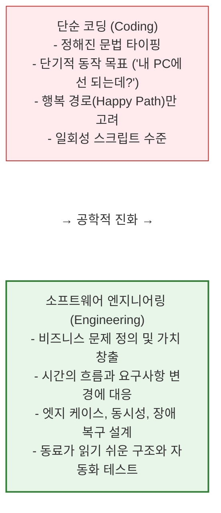

#### (1) 코딩이란 무엇인가?
코딩은 특정 프로그래밍 언어(Python, Java, TypeScript 등)의 문법(Syntax) 규칙에 맞추어 컴퓨터가 실행할 명령문을 텍스트로 작성하는 **기능적 구현 행위**입니다. 레고 블록에 비유하자면, 설명서를 보고 몇 개의 블록을 끼워 맞춰 장난감 자동차 한 대를 조립하는 것과 같습니다. 코딩 단계에서의 1차 목표는 당장 내 컴퓨터 화면에서 에러 없이 결과가 출력되는 것(`It works on my machine`)입니다.

#### (2) 소프트웨어 엔지니어링이란 무엇인가?
소프트웨어 엔지니어링은 **비즈니스 환경의 끊임없는 변화와 물리적 제약 조건(비용, 시간, 서버 자원) 속에서, 수많은 동료 엔지니어들과 협업하며, 수년에서 수십 년의 세월(생애주기)을 버텨낼 수 있는 살아있는 시스템을 구축하고 운영하는 종합 공학**입니다.

구글의 수석 엔지니어 타이터스 윈터스(Titus Winters)는 저서 《구글 엔지니어는 이렇게 일한다(Software Engineering at Google)》에서 이 차이를 역사상 가장 명쾌한 한 문장으로 정의했습니다.

> **"소프트웨어 엔지니어링이란, 시간의 흐름(Time)과 규모의 확장(Scale)이 더해진 프로그래밍이다."**

이 정의가 품고 있는 세 가지 거대한 공학적 질문을 곱씹어 보아야 합니다.
1. **시간의 흐름 (Time & Change)**: 오늘 내가 작성한 코드는 6개월 뒤 비즈니스 정책이 바뀌었을 때 얼마나 쉽게 수정될 수 있는가? 내가 퇴사한 뒤 새로 입사한 주니어 개발자가 이 코드를 읽고 부작용(Side Effect) 없이 기능을 추가할 수 있는가?
2. **규모의 확장 (Scale & Performance)**: 지금은 사용자가 100명이라 0.01초 만에 돌아가지만, 내일 마케팅 이벤트가 터져 동시 접속자가 100만 명으로 폭증하고 데이터베이스 용량이 10테라바이트가 되었을 때도 이 코드는 무너지지 않는가?
3. **트레이드오프의 결단 (Trade-offs)**: 세상에는 모든 면에서 완벽한 설계란 존재하지 않습니다(No Silver Bullet). 개발 속도를 높이면 구조적 유연성이 떨어지고, 보안을 극단적으로 강화하면 사용자 편의성과 응답 속도가 느려집니다. 엔지니어는 항상 **"현재 우리 팀과 비즈니스의 상황에서 무엇을 얻고 무엇을 포기할 것인가?"**를 공학적 근거로 결단하는 사람입니다.

---

### 2. 비즈니스 문제 해결로서의 소프트웨어

실무 세계에서 소프트웨어 개발은 결코 개발자 개인의 지적 유희나 최신 기술 자랑 대회가 아닙니다. 기업이 개발자에게 높은 연봉을 지급하는 이유는 단 하나, **"현실 세계의 고통스러운 비즈니스 문제를 소프트웨어를 통해 해결하고 경제적 가치를 창출하기 때문"**입니다.

- **토스(Toss)의 엔지니어링 본질**: 과거 대한민국에서 인터넷으로 친구에게 1만 원을 송금하려면 액티브X(ActiveX) 보안 프로그램 5개를 설치하고, 공인인증서 비밀번호와 보안카드 번호 3개를 입력하느라 10분 동안 고통받아야 했습니다. 토스의 엔지니어들은 이 극심한 사용자 고통(Pain Point)을 해결하기 위해 복잡한 금융결제원 펌뱅킹 프로토콜과 이상거래탐지시스템(FDS)을 백엔드 소프트웨어로 추상화하여, 고객에게는 **'비밀번호 여섯 자리로 3초 만에 끝나는 송금'**이라는 압도적 가치를 선사했습니다.
- **배달의민족 / 쿠팡이츠의 엔지니어링 본질**: 비가 억수같이 쏟아지는 금요일 저녁 7시, 서울 시내에서 동시에 50만 건의 치킨과 떡볶이 주문이 발생합니다. 이때 어느 매장의 조리 시간이 얼마나 걸리는지 예측하고, 수만 명의 배달 라이더 중 누구에게 어떤 경로로 주문을 배차해야 음식이 식지 않고 가장 빠르게 도착할지 실시간으로 계산해 내는 **초거대 실시간 최적화 엔진**이 바로 그 본질입니다.

결국 훌륭한 개발자는 코드를 한 줄 치기 전에 반드시 묻습니다.  
**"내가 지금 작성하는 이 함수와 API가 고객의 어떤 문제를 해결하며, 비즈니스에 어떤 실질적 임팩트를 만들어내는가?"**

---

### 3. 모호한 자연어 요구사항이 견고한 프로덕션 코드로 진화하는 4단계 과정

인간의 일상 언어는 대단히 모호하고, 맥락(Context)에 의존하며, "당연히 알아서 잘 처리하겠지"라는 무수한 생략을 포함하고 있습니다. 반면 컴퓨터는 융통성이 제로에 수렴하는 극단적인 기계입니다. 개발자가 코드로 명시하지 않은 예외 상황이 단 하나라도 발생하면, 컴퓨터는 즉시 프로그램을 강제 종료시키거나 엉뚱한 데이터를 데이터베이스에 덮어써 버립니다.

따라서 소프트웨어 개발의 핵심 본질은 **"모호하고 허점투성이인 인간의 자연어 요구사항을, 발생 가능한 모든 엣지 케이스(Edge Case)를 완벽히 방어하는 엄밀한 논리 체계로 번역하는 과정"**입니다.

이 과정이 실제로 어떻게 일어나는지, 현업에서 가장 빈번하게 다루는 **'이커머스 포인트 결제 및 상품 주문 로직'**이 초보자의 코드에서 프로덕션 코드로 진화하는 **4단계(Stage 1 → Stage 4)**를 통해 직접 확인해 보겠습니다.

---

#### [출발점] 기획자가 전달한 한 줄짜리 자연어 요구사항
> *"유저가 보유한 포인트를 사용해서 상품을 주문할 수 있게 해주세요. 포인트가 차감되고 재고가 줄어들면 됩니다."*

---

#### Stage 1: 초보 코더의 '행복 경로(Happy Path)' 코드 (참사 발생 전야)

입문자는 기획자의 말을 문자 그대로(Literally) 번역하여 다음과 같은 코드를 짭니다.

```python
# ❌ Stage 1: 아무런 방어 로직이 없는 순진한 코드 (절대 실무 배포 금지!)
def order_product_v1(db, user_id: int, product_id: int, quantity: int):
    user = db.get_user(user_id)
    product = db.get_product(product_id)
    
    total_price = product.price * quantity
    
    # 1. 유저 포인트 차감
    user.points = user.points - total_price
    db.save(user)
    
    # 2. 상품 재고 차감
    product.stock = product.stock - quantity
    db.save(product)
    
    # 3. 주문서 생성
    order = db.create_order(user_id=user_id, product_id=product_id, quantity=quantity)
    return {"status": "SUCCESS", "order_id": order.id}
```

> [!CAUTION]
> **Stage 1 코드를 실제 서비스에 배포하면 벌어지는 5대 대참사**
> 1. **음수 수량 해킹(Negative Quantity Attack)**: 악의적인 사용자가 `quantity = -10`을 입력해 API를 호출합니다. `total_price`가 `-100,000원`이 되고, `user.points - (-100,000)`이 실행되어 **오히려 유저의 포인트가 10만 원 복사되는 치명적 금융 해킹 사고**가 터집니다!
> 2. **잔액 및 재고 부족 무시**: 보유 포인트가 0원이어도 포인트가 마이너스(`-50,000원`)가 되며 공짜로 물건이 주문되고, 재고가 0개여도 `-1개`가 되며 유령 상품이 팔려 나갑니다.
> 3. **트랜잭션 원자성(Atomicity) 부재**: 1번(`db.save(user)`)으로 포인트는 이미 깎였는데, 직후 2번을 실행하려는 순간 DB 네트워크가 0.1초 끊겨 에러가 나면? **고객의 돈(포인트)만 날아가고 상품 주문은 생성되지 않는 최악의 데이터 부정합**이 발생합니다.
> 4. **동시성 충돌(Race Condition / Lost Update)**: 한정판 운동화 재고가 딱 1개 남았을 때, 100명이 동시에 결제 버튼을 누르면 100명 모두 `product.stock`을 `1`로 읽어 들인 뒤 결제가 통과되어 **재고는 1개인데 100명에게 주문 완료가 뜨는 오버셀링(Overselling) 참사**가 벌어집니다.
> 5. **네트워크 따블 클릭(중복 결제)**: 지하철 안에서 통신이 느려 사용자가 답답한 마음에 '결제하기' 버튼을 연타(두 번 클릭)하면, 똑같은 상품이 두 번 결제되어 포인트가 두 배로 빠져나갑니다.

---

#### Stage 2: 입력값 검증(Validation)과 도메인 비즈니스 규칙 방어

엔지니어는 먼저 **'사용자의 입력값은 절대 신뢰하지 않는다(Zero Trust Input)'**는 원칙에 따라 모든 경계값과 도메인 불변식(Invariant)을 검증합니다.

```python
# ⚠️ Stage 2: 입력값 검증과 도메인 규칙(잔액/재고 확인)이 추가된 코드
class DomainException(Exception):
    pass

def order_product_v2(db, user_id: int, product_id: int, quantity: int):
    # [방어 1] 입력 파라미터 유효성 검증 (음수 및 0원 결제 원천 차단, 최대 구매 수량 제한)
    if quantity <= 0:
        raise DomainException("주문 수량은 반드시 1개 이상이어야 합니다.")
    if quantity > 100:
        raise DomainException("1회 최대 주문 가능 수량(100개)을 초과했습니다.")

    user = db.get_user(user_id)
    if user is None or user.status != "ACTIVE":
        raise DomainException("유효하지 않거나 정지된 회원 계정입니다.")

    product = db.get_product(product_id)
    if product is None or not product.is_on_sale:
        raise DomainException("현재 판매 중이지 않은 상품입니다.")

    # [방어 2] 정수 오버플로우 및 가격 무결성 검증
    if product.price < 0:
        raise DomainException("상품 가격 데이터에 오류가 있습니다.")
    total_price = product.price * quantity

    # [방어 3] 재고 및 포인트 잔액 사전 검증
    if product.stock < quantity:
        raise DomainException(f"재고가 부족합니다. (현재 잔여 재고: {product.stock}개)")
    if user.points < total_price:
        raise DomainException(f"포인트가 부족합니다. (보유: {user.points}P, 필요: {total_price}P)")

    # 상태 변경 수행
    user.points -= total_price
    product.stock -= quantity
    
    db.save(user)
    db.save(product)
    order = db.create_order(user_id=user_id, product_id=product_id, quantity=quantity)
    return {"status": "SUCCESS", "order_id": order.id}
```

- **진화 포인트**: 이제 음수 입력을 통한 포인트 복사 해킹이나 잔액 부족 상태에서의 결제는 막아냈습니다. 하지만 **멀티스레드 동시성 충돌(100명이 동시에 요청할 때)**과 **중간에 서버가 죽었을 때의 트랜잭션 깨짐**, 그리고 **따블 클릭 중복 결제** 문제는 여전히 해결되지 않았습니다!

---

#### Stage 3: 데이터베이스 트랜잭션(ACID)과 비관적 락(Pessimistic Lock)을 통한 동시성 제어

이제 CS 전공 과목인 **데이터베이스와 운영체제의 동시성 제어(Concurrency Control)** 지식이 투입됩니다.

```python
# 🔧 Stage 3: DB 트랜잭션 원자성 보장 및 비관적 락(SELECT ... FOR UPDATE) 적용
def order_product_v3(db, user_id: int, product_id: int, quantity: int):
    if quantity <= 0 or quantity > 100:
        raise DomainException("유효하지 않은 주문 수량입니다.")

    # [방어 4] DB 트랜잭션 블록 시작: 블록 내부 작업은 전부 성공(Commit)하거나 전부 취소(Rollback)됨!
    with db.transaction():
        # [방어 5] 비관적 락(SELECT ... FOR UPDATE)으로 행 잠금(Row-Level Lock) 획득!
        # 다른 스레드가 동시에 같은 유저나 같은 상품을 수정하려 하면 이 트랜잭션이 끝날 때까지 줄을 서서 대기함.
        # 데드락 방지를 위해 항상 정해진 순서(User -> Product)로 락을 획득.
        user = db.get_user_for_update(user_id)
        product = db.get_product_for_update(product_id)

        if user is None or user.status != "ACTIVE":
            raise DomainException("유효하지 않은 회원입니다.")
        if product is None or not product.is_on_sale:
            raise DomainException("판매 중인 상품이 아닙니다.")

        total_price = product.price * quantity

        # 락을 건 상태에서 재고와 포인트를 검사하므로 Race Condition이 100% 차단됨!
        if product.stock < quantity:
            raise DomainException("재고가 소진되었습니다.")
        if user.points < total_price:
            raise DomainException("포인트 잔액이 부족합니다.")

        user.points -= total_price
        product.stock -= quantity

        db.save(user)
        db.save(product)
        order = db.create_order(
            user_id=user_id,
            product_id=product_id,
            quantity=quantity,
            total_price=total_price
        )
        # with 블록을 정상 빠져나갈 때 자동으로 DB Commit 수행!
        # 중간에 어떤 예외라도 터지면 자동으로 DB Rollback 되어 포인트 차감이 원상 복구됨!
        return {"status": "SUCCESS", "order_id": order.id}
```

---

#### Stage 4: 실전 엔터프라이즈 프로덕션 코드 — 멱등성(Idempotency), 감사 로그, 비동기 이벤트 분리

마지막으로 시니어 엔지니어는 **네트워크 재전송이나 사용자의 버튼 연타로 인한 중복 결제 방지(멱등성 보장, Idempotency Key)**, **금융 감사를 위한 원장 기록(Audit Ledger)**, 그리고 **외부 알림톡 발송 실패가 주문 트랜잭션을 롤백시키지 않도록 하는 이벤트 분리**까지 완성합니다.

```python
# 🏆 Stage 4: 실제 빅테크/금융권 프로덕션 수준의 견고한 주문 처리 아키텍처
import logging

logger = logging.getLogger("order_service")

def order_product_production(
    db,
    redis_lock,
    event_publisher,
    idempotency_key: str,  # 클라이언트가 생성한 고유 요청 UUID (중복 결제 방지용)
    user_id: int,
    product_id: int,
    quantity: int
) -> dict:
    # 1. 기본 파라미터 검증 (Fail-Fast 원칙: DB에 접근하기 전에 잘못된 요청을 즉시 튕겨냄)
    if not idempotency_key or len(idempotency_key) > 64:
        raise DomainException("유효한 멱등성 키(Idempotency-Key)가 필요합니다.")
    if quantity <= 0 or quantity > 100:
        raise DomainException("주문 수량은 1개 이상 100개 이하여야 합니다.")

    # 2. [방어 6] 분산 락 및 멱등성(Idempotency) 검증
    # 동일한 idempotency_key로 이미 처리 중이거나 처리된 요청인지 확인 (따블 클릭 완벽 방어)
    existing_order = db.find_order_by_idempotency_key(idempotency_key)
    if existing_order is not None:
        logger.info(f"중복 요청 감지됨 - 기존 주문 결과 반환: key={idempotency_key}")
        return {"status": "SUCCESS", "order_id": existing_order.id, "idempotent_replay": True}

    # 3. 핵심 비즈니스 트랜잭션 수행 (최소한의 시간 동안만 DB 락 유지)
    with db.transaction():
        # Unique 제약 조건이 걸린 멱등성 키를 먼저 등록하여 동시 중복 요청 차단
        db.register_idempotency_key(idempotency_key, user_id=user_id)

        user = db.get_user_for_update(user_id)
        product = db.get_product_for_update(product_id)

        if not user or user.status != "ACTIVE":
            raise DomainException("주문 가능한 회원 상태가 아닙니다.")
        if not product or not product.is_on_sale:
            raise DomainException("현재 구매할 수 없는 상품입니다.")

        total_price = product.price * quantity
        if product.stock < quantity:
            raise DomainException("상품 재고가 부족합니다.")
        if user.points < total_price:
            raise DomainException("보유 포인트가 부족합니다.")

        # 상태 변경 및 금융 원장(Ledger) 이력 남기기 (누가 언제 왜 포인트를 썼는지 추적 보장)
        before_points = user.points
        user.points -= total_price
        product.stock -= quantity

        db.save(user)
        db.save(product)
        db.insert_point_ledger(
            user_id=user_id,
            amount=-total_price,
            balance_before=before_points,
            balance_after=user.points,
            reason="PRODUCT_ORDER",
            idempotency_key=idempotency_key
        )

        order = db.create_order(
            idempotency_key=idempotency_key,
            user_id=user_id,
            product_id=product_id,
            quantity=quantity,
            total_price=total_price,
            status="PAID"
        )

        # [방어 7] 트랜잭션 아웃박스 패턴(Transactional Outbox Pattern)
        # 카카오톡 알림 발송 같은 외부 네트워크 호출을 DB 트랜잭션 안에서 직접 하면
        # 외부 서버가 느려질 때 우리 DB 커넥션까지 고갈됩니다!
        # 따라서 DB에는 '발송할 이벤트'만 안전하게 기록하고 트랜잭션을 즉시 커밋합니다.
        db.save_outbox_event(
            event_type="ORDER_COMPLETED",
            payload={"order_id": order.id, "user_id": user_id, "total_price": total_price}
        )

    # 4. 트랜잭션이 안전하게 커밋된 후 비동기 워커가 알림톡을 발송하도록 트리거
    event_publisher.trigger_async_outbox_worker()

    logger.info(f"주문 정상 완료: order_id={order.id}, user_id={user_id}, price={total_price}")
    return {"status": "SUCCESS", "order_id": order.id, "idempotent_replay": False}
```

---

#### Stage 1 vs Stage 4 비교를 통해 깨닫는 '소프트웨어 개발'의 진실

보셨나요? 기획자의 요구사항은 *"포인트를 깎고 주문을 만들어주세요"*라는 단 한 줄이었지만, 실제 프로덕션 엔지니어가 작성한 **Stage 4** 코드에는 다음과 같은 수많은 공학적 고민이 응축되어 있습니다.

1. **보안(Security)**: 음수 수량 입력을 통한 포인트 복사 해킹 차단.
2. **데이터 무결성(Data Integrity)**: DB 트랜잭션과 포인트 변동 원장(`point_ledger`) 기록을 통해 1원의 오차도 허용하지 않음.
3. **동시성 제어(Concurrency)**: `SELECT ... FOR UPDATE` 비관적 락을 통해 1,000명이 동시에 접속해도 재고가 정확히 차감되도록 보장.
4. **멱등성(Idempotency)**: `idempotency_key`를 도입하여 네트워크가 불안정한 환경에서 사용자가 결제 버튼을 10번 연타해도 단 한 번만 결제되도록 방어.
5. **장애 격리(Fault Isolation)**: 외부 알림톡 서버가 죽더라도 우리 회사의 핵심 결제 트랜잭션은 멈추지 않도록 아웃박스 패턴(Outbox Pattern)으로 결합도를 분리.

**이처럼 Stage 1의 코드를 Stage 4의 수준으로 설계하고 빚어내는 모든 지적 활동, 바로 그것이 '소프트웨어를 개발한다는 것'의 진짜 의미입니다.**

---

### 4. 상세 비교표: '취미 코더' vs '프로페셔널 소프트웨어 엔지니어'

| 비교 항목 | 아마추어 / 취미 코더 (Stage 1 수준) | 프로페셔널 소프트웨어 엔지니어 (Stage 4 수준) |
| :--- | :--- | :--- |
| **관심의 중심** | "어떻게든 내 컴퓨터 화면에서 돌아가게 만드는 것" | "수만 명이 동시에 써도 안전하고, 1년 뒤에도 쉽게 고칠 수 있는 구조" |
| **코드의 독자** | 컴퓨터 (기계만 에러 없이 실행하면 그만) | 동료 인간 개발자 (나중에 이 코드를 읽고 유지보수할 미래의 동료와 나 자신) |
| **예외 상황을 대하는 태도** | 정상적인 입력값(Happy Path)만 넣어보고 잘 된다며 안도함 | "음수를 넣으면? 버튼을 연타하면? DB가 중간에 끊기면?"을 집요하게 방어함 |
| **외부 시스템 연동** | 외부 API가 항상 0.1초 만에 성공 응답을 줄 것이라 맹신함 | 외부 API는 언제든 죽거나 느려질 수 있다고 가정하고 타임아웃·서킷브레이커를 걸어둠 |
| **데이터 변경 방식** | 기존 변수 값을 그냥 덮어써서(`UPDATE`) 과거 이력이 사라짐 | 변경 전후 상태를 원장(Ledger)과 감사 로그(Audit Log)로 남겨 추적 가능성을 확보함 |
| **목표 지향점** | 코드 줄 수와 구현된 기능(Feature) 자체 | 비즈니스 임팩트, 시스템 안정성(SLA), 운영 및 유지보수 비용 절감 |

---

### 5. [심층 Q&A] 02절 멘토링 & 기술 면접 단골 질문

#### Q1. [기술 면접 단골] 결제나 송금 API에서 '멱등성(Idempotency)'이란 무엇이며, 왜 필수적인가요?
- **모범 답안**:
  - **멱등성(Idempotency)**이란 수학 및 컴퓨터 과학 용어로, **동일한 요청을 한 번 보내는 것과 여러 번 연속해서 보내는 것이 시스템의 상태에 똑같은 결과를 미치며, 부작용(중복 처리)이 발생하지 않는 성질**을 뜻합니다(`f(f(x)) = f(x)`).
  - HTTP 메서드 중 조회(`GET`), 전체 수정(`PUT`), 삭제(`DELETE`)는 본래 멱등성을 가지지만, 새로운 자원을 생성하거나 결제를 수행하는 `POST` 요청은 기본적으로 멱등하지 않습니다.
  - 모바일 환경에서는 사용자가 결제 버튼을 누른 후 서버에서는 결제가 완료되었으나, 엘리베이터에 타서 응답 패킷이 유실되는 일이 빈번합니다. 이때 클라이언트(앱)나 사용자가 요청을 재전송했을 때 서버에 멱등성 처리가 없다면 고객의 카드에서 돈이 두 번 빠져나갑니다.
  - 이를 해결하기 위해 클라이언트가 요청 시 고유한 `Idempotency-Key`(UUID 등)를 헤더에 담아 보내고, 서버는 이 키를 DB나 Redis에 저장해 두었다가 동일한 키로 재요청이 들어오면 실제 결제를 다시 실행하지 않고 이전에 저장해 둔 성공 응답만 그대로 돌려주는 방식으로 멱등성을 구현합니다.

#### Q2. 좋은 코드(Clean Code)란 무조건 짧고 기교가 넘치는 코드를 말하나요?
- **모범 답안**: 전혀 그렇지 않습니다. 현업에서 가장 기피하는 코드는 작성자 본인의 문법 지식을 뽐내기 위해 여러 줄의 로직을 한 줄의 괴기한 삼항 연산자나 복잡한 표현식으로 압축해 놓은 '암호 같은 코드'입니다.
  - 진정한 좋은 코드란 **"새로 입사한 동료 개발자가 새벽 2시에 긴급 장애 알람을 받고 눈을 비비며 열었을 때, 단 1분 만에 의도와 흐름을 오해 없이 파악할 수 있는 명료한 코드"**입니다.
  - 역할에 맞는 명확한 변수명·함수명, 한 가지 일만 수행하는 작은 함수(단일 책임 원칙, SRP), 그리고 예측 가능한 예외 처리가 담긴 코드가 진짜 프로페셔널한 코드입니다.

---

### 6. 핵심 요약 (Summary Checklist)

- [x] 코딩은 문법을 작성하는 수단이며, **소프트웨어 엔지니어링은 시간의 흐름과 규모의 확장을 견디는 시스템을 짓는 종합 공학**입니다.
- [x] 개발의 출발점은 언제나 **현실 세계의 비즈니스 고통(Pain Point) 해결과 고객 가치 창출**입니다.
- [x] 모호한 한 줄의 요구사항을 **입력값 검증, 트랜잭션 원자성, 동시성 락, 멱등성, 장애 격리**가 완비된 Stage 4 프로덕션 코드로 탈바꿈시키는 것이 개발자의 존재 이유입니다.

---

## 03 소프트웨어는 어떻게 개발될까요?

> 소프트웨어는 예술가가 골방에 틀어박혀 영감만으로 단번에 깎아내는 조각상이 아닙니다.  
> 비즈니스 기획부터 요구사항 분석, 아키텍처 설계, 구현, 테스트, 배포, 그리고 24시간 무중단 운영에 이르기까지, 수많은 직군의 전문가들이 정밀한 문서와 자동화 파이프라인을 통해 호흡을 맞추며 진화시키는 **유기체적 생명주기(Lifecycle)**의 산물입니다.

---

### 1. 개념 이해: 소프트웨어 개발 생명주기 (SDLC, Software Development Life Cycle)

현대 소프트웨어 개발은 결코 주먹구구식으로 이루어지지 않습니다. 수백억 원의 예산과 수십만 명의 고객 데이터가 걸린 프로젝트에서 실패 확률을 줄이고 품질을 극대화하기 위해, IT 산업계가 반세기 동안 피와 땀으로 다듬어온 체계적인 공정 단계가 존재합니다. 이를 **소프트웨어 개발 생명주기(SDLC)**라고 부릅니다.

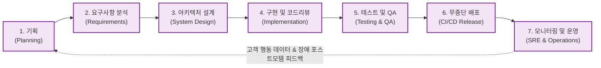

입문자들은 흔히 **'4단계: 구현(코딩)'**만이 개발의 전부라고 생각하기 쉽습니다. 하지만 실제 빅테크 기업이나 우량 스타트업에서 코딩은 전체 SDLC 7단계 중 정확히 가운데에 위치한 하나의 단계일 뿐입니다. 앞단의 **기획·분석·설계(1~3단계)**가 부실하면 아무리 코딩을 빨리 해도 '아무도 쓰지 않는 엉뚱한 제품'이나 '트래픽을 견디지 못하는 모래성'을 만들게 되고, 뒷단의 **테스트·배포·운영(5~7단계)**이 부실하면 매일 밤 서버가 터져 개발자들이 새벽잠을 설치게 됩니다.

---

### 2. SDLC 7단계 상세 분석 및 현업 실전 문서 템플릿

그렇다면 현업의 프로덕트 팀(PM, 디자이너, 프론트엔드/백엔드 엔지니어, QA, DevOps/SRE)은 각 단계에서 구체적으로 어떤 일을 하며, **실제로 어떤 문서를 주고받으며 일할까요?**  
막연한 설명 대신, 현업에서 오늘 당장 복사해서 쓸 수 있을 정도로 구체적인 **실전 산출물 템플릿 예시(한정판 스니커즈 선착순 드로우 및 결제 시스템 구축 프로젝트)**를 단계별로 공개합니다.

---

#### 1단계: 기획 (Planning / Product Discovery)
- **핵심 질문**: *"우리는 왜 이 기능을 만들어야 하는가? 고객의 어떤 문제를 해결하며, 성공 여부를 어떤 숫자로 측정할 것인가?"*
- **주도 역할**: 프로덕트 매니저(PM / PO), 데이터 분석가, 비즈니스 리더
- **핵심 활동**: 고객 이탈 데이터 분석, 사용자 인터뷰, 경쟁사 벤치마킹, 비즈니스 기대 효과(ROI) 산출, 핵심 성과 지표(KPI / North Star Metric) 설정.
- **실전 산출물 예시: PRD (Product Requirements Document, 제품 기획서)**

> **[실전 문서 템플릿 1] PRD (제품 기획서) 발췌본**
> - **문서 제목**: [PRD-2026-04] 한정판 스니커즈 선착순 타임딜(Flash Sale) 시스템 구축
> - **작성자 / 상태**: 김프로 (Product Owner) / `APPROVED`
> - **1. 배경 및 문제 정의 (Problem Statement)**:
>   - 현재 매주 금요일 오전 11시 한정판 스니커즈 오픈 시, 평소 대비 80배의 트래픽(동시 접속자 15만 명)이 특정 상품 상세 페이지에 집중됨.
>   - 기존 일반 주문 파이프라인이 DB 락 경합을 견디지 못해 전체 서비스가 15분간 다운되며, 일반 상품을 구매하려는 고객까지 결제 실패를 겪어 주간 매출의 18%가 손실되고 있음.
> - **2. 목표 및 성공 지표 (Goals & Success Metrics)**:
>   - **핵심 목표**: 타임딜 오픈 시에도 일반 커머스 서비스의 가용성 99.99% 유지 및 오버셀링(재고 초과 판매) 0건 달성.
>   - **성공 지표 (KPI)**:
>     1. 대기열 진입 응답 시간 `p99 < 200ms` 이내 달성
>     2. 재고 초과 판매(Overselling) 발생 건수: 월간 `0건` (절대 지표)
>     3. 타임딜 시간대 일반 상품 결제 전환율 기존 대비 `25%p 회복`
> - **3. 사용자 흐름 (User Journey)**:
>   - `오전 10:59` 카운트다운 화면 진입 → `11:00 정각` 구매 버튼 활성화 → 가상 대기열(Waiting Room) 진입 및 실시간 대기 순번 표시 → 순번 도달 시 3분간 유효한 '구매 진입 토큰' 발급 → 결제 완료.

---

#### 2단계: 요구사항 분석 (Requirements Analysis)
- **핵심 질문**: *"기획서의 비즈니스 목표를 달성하기 위해 시스템이 반드시 보장해야 하는 기능적 규칙과 비기능적 한계치는 무엇인가?"*
- **주도 역할**: 테크 리드(Tech Lead), 시스템 분석가, 백엔드/프론트엔드 엔지니어, PM
- **핵심 활동**: 기획서의 모호한 표현("빠르게", "많은 사람")을 정량적인 엔지니어링 수치("응답 시간 100ms 이내", "초당 10,000 TPS")로 변환하고, 기능 요구사항(Functional)과 비기능 요구사항(Non-Functional)을 명세화합니다.
- **실전 산출물 예시: SRS (Software Requirements Specification, 요구사항 정의서)**

| 요구사항 ID | 분류 | 요구사항 명칭 | 상세 명세 및 수락 조건 (Acceptance Criteria) | 우선순위 | 검증 방법 |
| :--- | :--- | :--- | :--- | :--- | :--- |
| **REQ-F-001** | 기능(Functional) | 1인당 구매 수량 제한 | 동일 회원(`user_id`)은 동일 타임딜 회차(`deal_id`) 상품을 최대 1개까지만 구매할 수 있다. 중복 요청 시 `409 Conflict`를 반환한다. | **P0 (필수)** | 단위/통합 테스트 |
| **REQ-F-002** | 기능(Functional) | 재고 선점 만료 회수 | 대기열을 통과해 재고를 가선점(`RESERVED`)한 후 **180초(3분)** 이내에 결제를 완료하지 않으면, 선점 상태가 자동 해제되고 재고가 즉시 `+1` 복구되어야 한다. | **P0 (필수)** | 스케줄러/TTL 테스트 |
| **REQ-F-003** | 기능(Functional) | 매크로 봇 차단 | 동일 IP 또는 동일 디바이스 핑거프린트에서 1초에 10회 이상 요청 발생 시 10분간 요청을 차단(`429 Too Many Requests`)한다. | **P1 (중요)** | 보안 침투 테스트 |
| **REQ-NF-001** | 비기능(성능) | 처리량 및 응답 지연 | 대기열 발급 API는 초당 **20,000 RPS(Requests Per Second)** 부하 상태에서 평균 응답 시간 `50ms`, 상위 99% 지연 시간(`p99`) `200ms` 이하를 유지해야 한다. | **P0 (필수)** | k6 부하 테스트 |
| **REQ-NF-002** | 비기능(무결성) | 재고 정합성 보장 | 준비된 재고 `1,000개`에 대해 `100,000명`이 동시 결제 요청 시, 정확히 `1,000건`만 결제 승인되고 `99,000건`은 품절 응답을 받아야 한다(오차 허용 범위 `0`). | **P0 (필수)** | 동시성 스트레스 테스트 |
| **REQ-NF-003** | 비기능(장애격리) | 일반 서비스 영향도 격리 | 타임딜 전용 Redis 또는 워커 노드에 장애가 발생하더라도, 일반 상품 검색 및 장바구니 결제 API의 에러율은 `0.01%` 미만이어야 한다(Bulkhead 패턴 적용). | **P0 (필수)** | 카오스 엔지니어링 |

---

#### 3단계: 시스템 아키텍처 및 상세 설계 (System & Software Design)
- **핵심 질문**: *"이 가혹한 요구사항(초당 2만 건 요청, 오차 0건)을 만족하려면 서버, 캐시, 데이터베이스 스키마, API 규격을 어떻게 설계해야 하는가?"*
- **주도 역할**: 소프트웨어 아키텍트, 시니어 엔지니어, DBA, UI/UX 디자이너
- **핵심 활동**: 아키텍처 설계 문서(RFC / ADR) 작성, 데이터베이스 ERD 모델링 및 인덱스 설계, 클라이언트-서버 간 REST/gRPC API 명세서 확정.
- **실전 산출물 예시: API 명세서(OpenAPI 규격) 및 핵심 DB 스키마**

```yaml
# [실전 문서 템플릿 2] API 명세서 (OpenAPI / Swagger 핵심 요약)
POST /api/v1/flash-deals/{dealId}/orders
Summary: 타임딜 상품 재고 선점 및 주문 생성 요청
Headers:
  Authorization: Bearer {access_token}       # JWT 인증 토큰
  Idempotency-Key: 550e8400-e29b-41d4-...   # [필수] 중복 요청 방지용 고유 UUID v4
  X-Queue-Pass-Token: eyJhbGciOiJIUzI1...   # [필수] 대기열 통과 인증 서명 토큰
Request Body (application/json):
  {
    "productId": 90012,
    "sizeOption": "270",
    "paymentMethod": "TOSS_PAY"
  }
Responses:
  201 Created:
    {
      "orderId": "ORD-20261115-883920",
      "status": "PAYMENT_PENDING",
      "expiresAt": "2026-11-15T11:03:05Z",
      "paymentRedirectUrl": "https://pay.example.com/checkout/..."
    }
  409 Conflict (에러 코드 세분화):
    - CODE: "ALREADY_PURCHASED" -> "이미 본 이벤트 상품을 구매하셨습니다. (1인 1족 제한)"
    - CODE: "OUT_OF_STOCK"      -> "준비된 수량이 모두 소진되었습니다."
  429 Too Many Requests:
    - CODE: "RATE_LIMIT_EXCEEDED" -> "비정상적인 반복 요청이 감지되었습니다. 잠시 후 다시 시도해 주세요."
```

```sql
-- [실전 문서 템플릿 3] 데이터베이스 DDL 및 복합 인덱스 설계
CREATE TABLE flash_deal_orders (
    id BIGINT AUTO_INCREMENT PRIMARY KEY,
    deal_id BIGINT NOT NULL COMMENT '타임딜 이벤트 고유 ID',
    user_id BIGINT NOT NULL COMMENT '구매 회원 고유 ID',
    product_id BIGINT NOT NULL COMMENT '상품 고유 ID',
    idempotency_key VARCHAR(64) NOT NULL COMMENT '따블 클릭 방지용 멱등성 키',
    order_status VARCHAR(20) NOT NULL COMMENT 'RESERVED, PAID, CANCELLED, EXPIRED',
    reserved_at DATETIME(6) NOT NULL COMMENT '재고 선점 시각(마이크로초 정밀도)',
    expires_at DATETIME(6) NOT NULL COMMENT '결제 만료 시한(선점 후 3분)',
    
    -- [핵심 설계 1] 1인 1구매 제한을 애플리케이션 코드뿐만 아니라 DB 레벨에서도 물리적으로 강제!
    CONSTRAINT uk_deal_user UNIQUE (deal_id, user_id),
    -- [핵심 설계 2] 동일한 멱등성 키로 중복 주문이 생성되는 것을 원천 차단!
    CONSTRAINT uk_idempotency UNIQUE (idempotency_key),
    -- [핵심 설계 3] 만료된 미결제 주문을 1초마다 스캔하여 재고를 복구하는 배치를 위한 복합 인덱스!
    INDEX idx_status_expires (order_status, expires_at)
) ENGINE=InnoDB DEFAULT CHARSET=utf8mb4;
```

---

#### 4단계: 구현 및 코드 리뷰 (Implementation & Peer Code Review)
- **핵심 질문**: *"설계도를 바탕으로 동료가 읽기 쉽고, 확장 가능하며, 결함이 없는 코드와 단위 테스트를 어떻게 작성할 것인가?"*
- **주도 역할**: 백엔드/프론트엔드/모바일 엔지니어 전원
- **핵심 활동**:
  - 기능 브랜치(`feat/flash-deal-order`) 생성 후 코드 작성.
  - **단위 테스트(Unit Test)** 작성: 외부 DB나 네트워크 없이도 핵심 비즈니스 로직이 0.1초 만에 검증되도록 테스트 코드 작성.
  - **PR(Pull Request) 및 동료 코드 리뷰**: 최소 2명 이상의 동료 엔지니어가 코드를 한 줄씩 읽으며 잠재적 버그, 성능 병목, 가독성 문제를 코멘트하고 승인(`Approve`)해야만 메인 브랜치(`main`)에 병합(Merge)될 수 있습니다.

---

#### 5단계: 테스트 및 품질 보증 (Testing & Quality Assurance)
- **핵심 질문**: *"우리가 만든 시스템이 극한의 경계 조건과 악의적인 트래픽 앞에서도 요구사항 정의서(SRS)대로 정확히 작동하는가?"*
- **주도 역할**: QA 엔지니어, SDET(테스트 자동화 엔지니어), 개발팀 전원
- **핵심 활동**: 단위 테스트(Unit) → 통합 테스트(Integration) → 종단 간 테스트(E2E) → 부하 테스트(Stress/Load Test) 수행.
- **실전 산출물 예시: QA 테스트 케이스 명세서 (Test Case Matrix)**

| TC ID | 테스트 시나리오 | 사전 조건 (Pre-condition) | 테스트 입력 및 실행 절차 (Steps) | 기대 결과 (Expected Result) | 실제 결과 |
| :--- | :--- | :--- | :--- | :--- | :--- |
| **TC-01** | 정상 선착순 구매 (Happy Path) | 잔여 재고 `50개`, 유저 A 미구매 상태, 유효한 대기열 토큰 보유 | 정상 주문 생성 API 호출 후 30초 내 결제 승인 콜백 전송 | `201 Created` 반환, 재고 `49개`로 차감, 주문 상태 `PAID` 전환 | **PASS** |
| **TC-02** | 마지막 1개 재고에 대한 100명 동시 경합 | 잔여 재고 정확히 `1개`, 서로 다른 유저 100명의 유효 토큰 준비 | JMeter/k6를 이용해 `0.001초` 오차 범위 내 100개 스레드 동시 요청 발사 | 정확히 `1명`만 `201 Created` 수신, 나머지 `99명`은 `409 OUT_OF_STOCK` 수신, 최종 재고 `0개` | **PASS** |
| **TC-03** | 따블 클릭(동일 유저 동시 중복 요청) 방어 | 잔여 재고 `10개`, 유저 B가 동일한 `Idempotency-Key`로 요청 | 네트워크 지연을 시뮬레이션하여 동일 요청을 0.05초 간격으로 5회 연속 전송 | 첫 요청만 처리되고 나머지 4회는 재고 추가 차감 없이 동일한 주문 ID 반환 | **PASS** |
| **TC-04** | 결제 미완료 타임아웃 재고 자동 회수 | 잔여 재고 `1개`, 유저 C가 주문 생성(`RESERVED`) 후 결제창 이탈 | 재고 `0개` 상태에서 `180초` 경과 대기 후 배치 스케줄러 실행 확인 | 유저 C의 주문이 `EXPIRED`로 변경되고, 재고가 다시 `1개`로 복구되어 유저 D가 구매 가능해짐 | **PASS** |

---

#### 6단계: 배포 및 출시 (Deployment & CI/CD Pipeline)
- **핵심 질문**: *"현재 10만 명의 고객이 접속해 있는 라이브 서버에 단 1초의 서비스 중단도 없이 어떻게 새 버전을 안전하게 배포할 것인가?"*
- **주도 역할**: DevOps 엔지니어, 플랫폼 엔지니어, 개발팀
- **핵심 활동**:
  - **CI (Continuous Integration, 지속적 통합)**: 코드가 Git에 푸시될 때마다 GitHub Actions 등이 자동으로 컴파일, 린트 검사, 수천 개의 자동화 테스트를 실행하여 단 하나라도 실패하면 배포를 원천 차단합니다.
  - **CD (Continuous Delivery/Deployment, 지속적 배포)**: 검증된 코드를 도커(Docker) 컨테이너 이미지로 말아 쿠버네티스(Kubernetes) 클러스터에 배포합니다.
  - **무중단 배포 전략**:
    - **롤링 배포(Rolling Update)**: 서버 10대 중 2대씩 순차적으로 새 버전으로 교체.
    - **블루/그린 배포(Blue-Green)**: 구버전(Blue)과 동일한 규모의 신버전(Green) 서버군을 미리 띄워둔 뒤, 로드밸런서 트래픽 스위치만 한 번에 전환.
    - **카나리 배포(Canary Release)**: 옛날 광부들이 유독가스를 감지하기 위해 탄광에 카나리아 새를 먼저 들여보냈던 것처럼, **전체 사용자 중 단 1%의 트래픽만 신버전 서버로 흘려보내 에러율과 응답 속도를 관찰**한 뒤, 이상이 없을 때만 10% → 50% → 100%로 점진적 확대하는 가장 안전한 현대적 배포 기법입니다.

---

#### 7단계: 운영, 모니터링 및 사후 분석 (Operations, Observability & Post-mortem)
- **핵심 질문**: *"배포 후 실제 고객 환경에서 시스템은 건강한가? 만약 장애가 터졌다면 어떻게 최단 시간에 복구하고, 다시는 같은 장애가 재발하지 않도록 시스템을 개선할 것인가?"*
- **주도 역할**: SRE(Site Reliability Engineer, 사이트 신뢰성 엔지니어), 온콜(On-call) 담당 개발자
- **핵심 활동**:
  - **관측 가능성(Observability) 3대 요소 구축**: 메트릭(Metrics - CPU, 메모리, RPS 수치), 로그(Logs - 상세 실행 기록), 트레이스(Traces - MSA 서버 간 호출 경로 추적)를 실시간 수집.
  - **비난 없는 사후 분석 보고서(Blameless Post-mortem)**: 장애가 발생했을 때 *"누가 이 따위로 코딩했어?"*라고 개인을 처벌하면, 다음부터 개발자들은 실수를 숨기게 됩니다. 선진 엔지니어링 문화(구글, 토스, 쿠팡 등)에서는 **사람을 비난하지 않고, 인간의 실수가 프로덕션 장애로 이어지기까지 왜 방어 시스템이 작동하지 않았는지 '시스템적 근본 원인(Root Cause)'을 파헤치는 포스트모템 문서**를 작성합니다.

> **[실전 문서 템플릿 4] 장애 사후 분석 보고서 (Blameless Post-mortem / RCA)**
> - **장애 관리 번호**: `INC-2026-1102` (심각도: **Sev-1 / Critical**)
> - **장애 요약**: 11월 2일 오전 11:00~11:14 (총 14분간) 타임딜 오픈 직후 주문 조회 API 응답 지연 및 전체 앱 로그인 불가 현상 발생.
> - **1. 타임라인 (Timeline - KST 기준)**:
>   - `11:00:00` 타임딜 오픈, 동시 접속자 18만 명 유입.
>   - `11:01:20` Datadog 알람 발생: `[CRITICAL] Main RDS CPU Utilization > 98%`, API `504 Gateway Timeout` 급증.
>   - `11:03:00` 온콜(On-call) 엔지니어 긴급 소집 및 슬랙 워룸(War-room) 개설.
>   - `11:06:30` DB 슬로우 쿼리(Slow Query) 로그 분석 결과, `flash_deal_orders` 테이블에서 만료 주문을 조회하는 배치가 인덱스를 타지 못하고 **Full Table Scan**을 일으키고 있음을 발견.
>   - `11:09:00` 긴급 조치(Mitigation): 해당 배치 워커 일시 중지 및 DB 온라인 인덱스(`idx_status_expires`) 긴급 생성 적용.
>   - `11:14:00` DB CPU 사용률 `15%`로 안정화, 모든 API 응답 정상화 확인 (장애 종료).
> - **2. 근본 원인 분석 (5 Whys 기법)**:
>   1. *왜 전체 로그인이 안 되었는가?* → 회원 DB와 타임딜 주문 DB가 물리적으로 같은 RDS 인스턴스를 공유하고 있었는데, 해당 DB의 커넥션 풀이 100% 고갈되었기 때문.
>   2. *왜 DB 커넥션 풀이 고갈되었는가?* → 1초마다 실행되는 재고 회수 쿼리 1개가 8초씩 걸리면서 커넥션을 놓아주지 않았기 때문.
>   3. *왜 쿼리가 8초나 걸렸는가?* → `WHERE DATE_FORMAT(expires_at, '%Y-%m-%d %H:%i') <= NOW()`처럼 인덱스 컬럼(`expires_at`)을 함수로 가공하여 **B+Tree 인덱스가 무력화(Full Table Scan 발생)**되었기 때문.
>   4. *왜 코드 리뷰와 QA에서 발견되지 않았는가?* → QA 테스트 환경의 더미 데이터가 100건뿐이어서 인덱스를 안 타도 0.001초 만에 통과되었기 때문.
> - **3. 재발 방지 대책 (Action Items)**:
>   - **[즉시 완료]** 쿼리 조건문을 컬럼 가공 없는 범위 조건(`WHERE order_status = 'RESERVED' AND expires_at <= NOW()`)으로 수정하여 인덱스 정상 작동 확인 (`실행 계획 type: range`).
>   - **[단기 - 1주 내]** CI 파이프라인에 SQL `EXPLAIN` 자동 검증기를 도입하여 `type: ALL`(Full Scan) 쿼리가 포함되면 PR 머지가 차단되도록 자동화.
>   - **[중장기 - 1개월 내]** 타임딜 데이터베이스와 회원 코어 데이터베이스를 물리적으로 분리(Database Per Service)하여 장애 전파 원천 차단.

---

### 3. 현실 비유: "건축(Building)과 소프트웨어 개발의 결정적 차이"

소프트웨어 개발을 흔히 '건축'에 비유하곤 합니다. 둘 다 기초 공사가 중요하고, 설계도(아키텍처)가 필요하며, 수많은 전문가가 협업한다는 점에서 매우 닮아 있습니다.

하지만 현대 소프트웨어 공학은 물리적 건축과 결정적으로 다른 한 가지 특성을 가집니다. 바로 **"소프트웨어는 콘크리트가 아니므로, 언제든 극단적으로 변경이 용이(Soft)하도록 설계되어야 한다"**는 점입니다.

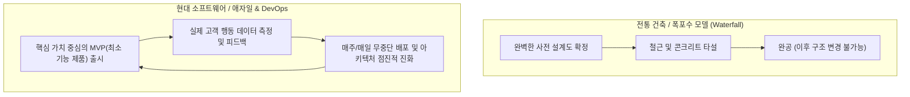

- 아파트 15층까지 콘크리트를 다 부었는데, 건축주가 갑자기 *"생각해 보니 거실 위치를 건물 반대편으로 옮기고 수영장을 5층에 넣어주세요"*라고 한다면 건물을 폭파하고 처음부터 다시 지어야 합니다. 과거의 개발 방식이었던 **폭포수(Waterfall) 모델**은 소프트웨어를 건축처럼 다루려다 수많은 실패를 겪었습니다.
- 왜냐하면 비즈니스 시장과 사용자의 마음은 1년 동안 기다려주지 않고 매주 바뀌기 때문입니다. 따라서 현대의 탁월한 소프트웨어 엔지니어는 1년 뒤의 모든 요구사항을 점쟁이처럼 미리 맞히려 애쓰는 대신, **"내일 당장 기획이 바뀌더라도 기존 코드를 부수지 않고 최소한의 비용으로 안전하게 기능을 수정·확장할 수 있는 유연한 구조(모듈화, 느슨한 결합, 자동화 테스트)"**를 만듭니다. 이것이 바로 **애자일(Agile)과 지속적 통합/배포(CI/CD)**의 핵심 철학입니다.

---

### 4. 상세 비교표: 전통적 폭포수(Waterfall) vs 현대적 애자일(Agile & DevOps)

| 비교 지표 | 전통적 폭포수(Waterfall) 모델 | 현대적 애자일(Agile / Scrum / DevOps) 모델 |
| :--- | :--- | :--- |
| **진행 방식** | 기획 → 설계 → 구현 → 테스트가 거대한 단일 단위로 순차 진행 | 1~2주 단위의 짧은 주기(Sprint)로 기획-설계-구현-배포를 계속 반복 |
| **요구사항 변경에 대한 태도** | 초기 확정 후 변경을 엄격히 통제함 (후반부 변경 시 비용 폭증) | 시장 피드백에 따른 요구사항 변경을 자연스러운 경쟁력으로 수용함 |
| **첫 고객 가치 전달 시점** | 모든 기능이 100% 완성되는 프로젝트 종료 시점 (수개월~수년 뒤) | 핵심 기능만 담은 최소 기능 제품(MVP)을 수 주 만에 출시하여 즉시 검증 |
| **품질 검증(테스트) 방식** | 개발이 모두 끝난 후 출시 직전 QA 단계에서 수동 테스트에 의존 | 개발자가 기능 구현과 동시에 자동화 테스트(Unit/Integration)를 작성해 매시간 검증 |
| **배포 주기와 위험도** | 분기별 또는 연 1~2회 대규모 심야 배포 (한 번에 바꾸는 양이 많아 장애 위험 극대화) | 하루에도 수십 번 작은 단위로 카나리/무중단 배포 (문제 발생 시 1분 내 즉시 롤백) |
| **적합한 프로젝트 도메인** | 요구사항이 명확히 고정되고 변경 비용이 치명적인 우주항공, 원자력 제어, 국방 하드웨어 | 사용자 반응에 기민하게 대응해야 하는 모든 현대 웹/앱 서비스, 핀테크, AI 플랫폼 |

---

### 5. [심층 Q&A] 03절 멘토링 & 기술 면접 단골 질문

#### Q1. "우리 회사는 애자일(Agile)을 한다면서 기획서도 없이 매일 말로만 요구사항을 바꾸고 야근만 시킵니다. 이게 애자일이 맞나요?"
- **모범 답안**: 그것은 애자일이 아니라 **'무계획 주먹구구식 개발(Cowboy Coding)'에 애자일이라는 이름표만 붙인 가짜 애자일**입니다.
  - 진짜 애자일은 문서나 설계를 없애는 것이 아닙니다. 수백 페이지짜리 쓸모없는 보고서 대신 **살아있는 테스트 코드, 명확한 유저 스토리와 수락 조건(Acceptance Criteria), 짧은 스프린트 단위의 목표 합의, 그리고 언제든 코드를 수정해도 안전함을 보장하는 CI/CD 자동화 파이프라인**이라는 고도의 공학적 규율(Discipline) 위에서만 작동합니다.
  - 또한 애자일에서도 한 번 시작된 1~2주간의 스프린트 기간 동안에는 특별한 긴급 사태가 아닌 한 목표를 임의로 흔들지 않고 개발팀의 집중력을 보호하는 것이 원칙입니다.

#### Q2. [기술 면접 단골] 단위 테스트(Unit Test)와 통합 테스트(Integration Test)의 차이점은 무엇이며, 왜 바쁜 일정 속에서도 테스트 코드를 짜야 하나요?
- **모범 답안**:
  - **단위 테스트(Unit Test)**는 데이터베이스나 외부 네트워크 같은 외부 의존성을 가짜 객체(Mock/Stub)로 격리하고, 오직 하나의 함수나 도메인 클래스의 순수 비즈니스 로직이 의도대로 동작하는지 밀리초(`ms`) 단위로 초고속 검증하는 테스트입니다.
  - **통합 테스트(Integration Test)**는 실제 DB 컨테이너(예: Testcontainers)나 캐시, 여러 모듈을 실제로 연결했을 때 쿼리 문법 오류나 트랜잭션 설정, 직렬화 문제가 없는지 검증하는 테스트입니다.
  - **바쁠수록 테스트 코드를 짜야 하는 이유**: 테스트 코드 없이 당장 오늘 하루 코딩 속도는 빠를지 몰라도, 기능이 50개로 늘어나면 새 기능 하나를 추가할 때마다 기존 50개 기능이 망가지지 않았는지 사람이 일일이 화면을 클릭해 보며 확인해야 합니다. 자동화 테스트는 **"내가 지금 코드를 리팩터링하거나 새 기능을 넣어도 기존 시스템이 깨지지 않았다"는 즉각적인 심리적·공학적 안전망**을 제공하여 결과적으로 전체 개발 속도를 수배 이상 높여줍니다.

---

### 6. 핵심 요약 (Summary Checklist)

- [x] 소프트웨어는 **기획(PRD) → 요구사항 분석(SRS) → 설계(API/ERD) → 구현(PR) → 테스트(TC) → 배포(CI/CD) → 운영(Post-mortem)**의 7단계 생명주기를 통해 태어나고 진화합니다.
- [x] 비기능 요구사항(트래픽 처리량, 응답 지연 시간, 데이터 정합성)을 정량적으로 정의하고 설계에 반영하는 것이 시스템 아키텍처의 핵심입니다.
- [x] 장애가 발생했을 때 개인을 탓하지 않고 시스템적 허점을 개선하는 **비난 없는 포스트모템(Blameless Post-mortem)** 문화가 일류 엔지니어링 조직을 만듭니다.

---

## 04 누가 소프트웨어 개발을 잘할 수 있을까요?

> "소프트웨어 개발은 소수의 타고난 수학 천재나 컴퓨터 영재들만의 전유물이 아닙니다.  
> 거대한 혼돈을 작은 단위로 쪼갤 줄 아는 논리적 분해력, 미스터리한 버그의 원인을 끝까지 추적하는 탐정의 집요함,  
> 그리고 화면 너머의 동료와 사용자를 배려하는 따뜻한 소통 능력을 가진 사람이 결국 가장 멀리, 가장 높이 올라갑니다."

---

### 1. 개발자 적성에 대한 3대 오해와 현업의 진실

개발자라는 직업에 첫발을 내딛으려는 수많은 사람들이 대중매체(영화 속 천재 해커의 모습)나 과장된 소문이 만들어낸 거대한 편견 앞에서 주저하곤 합니다.

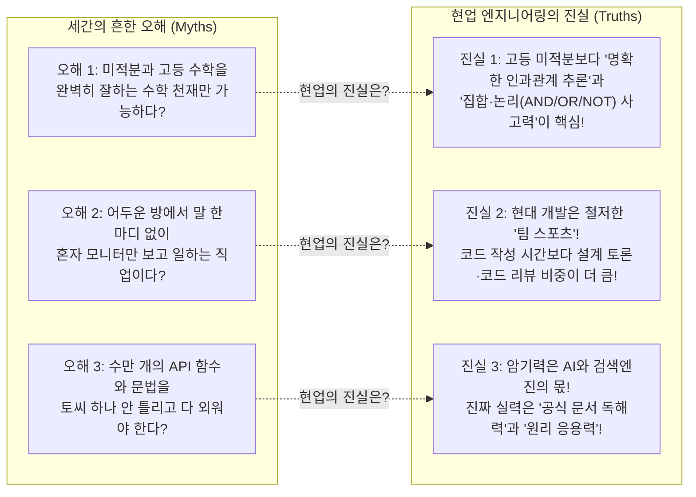

#### 오해 1: "수학 경시대회 출신이나 수학 천재들만 개발을 잘한다?"
- **현업의 진실**: 물론 3D 게임 물리 엔진을 바닥부터 만들거나, 새로운 딥러닝 신경망 수식을 창안하는 AI 코어 연구원, 양자 암호학 연구원에게는 고도의 선형대수학과 미적분학이 필수적입니다. 하지만 현업 소프트웨어 엔지니어의 **95% 이상을 차지하는 웹, 모바일 앱, 백엔드 서버, 데이터 파이프라인, 클라우드 인프라 개발**에서 쓰이는 수학은 고등학교 미적분이 아닙니다.
- 실무에서 매일 쓰는 수학은 **사칙연산, 비율 계산(퍼센트), 집합의 포함 관계(교집합/합집합), 그리고 중학교 수준의 명제 논리(`A이고 B일 때만 C를 실행한다`, 드모르간의 법칙)**입니다.
- 수학 공식 암기보다 백배 더 중요한 것은 **"복잡하게 얽힌 비즈니스 규칙에서 모순이나 빈틈(사각지대)을 찾아내는 논리적 완결성"**입니다. 오히려 국어 비문학 독해나 철학 논리학, 법학의 조문 해석을 잘하는 사람이 훌륭한 아키텍트로 성장하는 경우가 매우 많습니다.

#### 오해 2: "사람 만나는 걸 싫어하는 내향적인 사람이 혼자 조용히 일하기 좋은 직업이다?"
- **현업의 진실**: 오늘날 독불장군 천재 한 명이 골방에서 세상을 바꾸는 소프트웨어를 다 만드는 일은 없습니다. 현대의 소프트웨어는 수십, 수백 명의 엔지니어와 기획자, 디자이너가 함께 짓는 거대한 오케스트라 연주이자 **팀 스포츠(Team Sport)**입니다.
- 말을 화려하게 잘하는 '언변'이 필요한 것이 아닙니다. **상대방(기획자, 동료 개발자)의 의도를 정확히 경청하고, 복잡한 기술적 제약 사항을 비개발자도 이해할 수 있는 명료한 글과 그림으로 설명하며, 코드 리뷰에서 동료의 자존심을 상하게 하지 않으면서도 코드의 결함을 날카롭게 짚어내는 성숙한 소통 능력**이 시니어 개발자의 가장 큰 무기입니다.

#### 오해 3: "레퍼런스 문서를 보지 않고도 모든 문법과 라이브러리를 줄줄 외워야 프로다?"
- **현업의 진실**: 20년 차 수석 엔지니어도 날짜 포맷 변환 함수나 정규표현식 옵션을 헷갈려 매번 공식 문서(Official Documentation)를 찾아보거나 AI에게 물어봅니다. 인간의 뇌 용량(워킹 메모리)은 암기장이 아니라 **'시스템 구조 설계와 문제 해결'**에 써야 합니다.
- 중요한 것은 문법 자체를 외우는 것이 아니라, **"내가 지금 해결하려는 문제에 어떤 개념(예: 분산 락, 비동기 큐, B+Tree 인덱스)이 필요한지 알고 있으며, 공식 문서를 빠르게 읽어 내 시스템에 맞게 정확히 적용할 수 있는 능력"**입니다.

---

### 2. 현업 개발자의 실제 하루 일과 (A Day in the Life of a Software Engineer)

*"그럼 실제 회사에 출근하면 개발자는 아침부터 저녁까지 구체적으로 어떻게 시간을 보내나요?"*  
판교나 실리콘밸리의 IT 기업에서 일하는 3년 차 백엔드/풀스택 엔지니어 '민수' 씨의 실제 하루 일과표를 통해 현업의 생생한 공기를 들여다보겠습니다.

| 시간대 | 주요 일정 및 활동 | 구체적으로 수행하는 엔지니어링 업무 | 소요 비중 |
| :--- | :--- | :--- | :--- |
| **09:30 ~ 10:00** | 출근 및 모닝 루틴 (시스템 헬스체크 & 코드 리뷰) | 커피 한 잔과 함께 밤사이 서비스 모니터링 대시보드(Grafana/Sentry)에 특이 에러나 응답 지연이 없었는지 확인합니다. 이어서 어제 퇴근 전 동료들이 올려둔 **PR(Pull Request) 코드 2건을 읽으며 코드 리뷰 코멘트**를 남깁니다. | **협업 & 검증 (15%)** |
| **10:00 ~ 10:15** | 데일리 스탠드업 미팅 (Daily Stand-up) | 스쿼드(Squad) 팀원 7명이 모여 15분간 서서 짧게 공유합니다.<br/>1) 어제 완료한 일 2) 오늘 집중할 일 3) 현재 내 작업을 막고 있는 장애물(Blocker). 긴 토론이 필요하면 미팅 직후 관련자끼리만 따로 모입니다. | **소통 & 정렬 (5%)** |
| **10:15 ~ 12:00** | 오전 딥워크 (Deep Work - 핵심 설계 및 코딩) | 슬랙 알림을 잠시 '집중 모드'로 해두고, 이번 스프린트 핵심 과제인 '정기구독 자동 결제 재시도 로직'을 구현합니다. AI 코딩 에이전트와 페어 프로그래밍하며 도메인 모델과 단위 테스트 케이스 12개를 작성합니다. | **핵심 구현 (25%)** |
| **12:00 ~ 13:15** | 점심 식사 및 휴식 | 팀원들과 식사하며 최근 새로 나온 오픈소스 데이터베이스나 AI 에이전트 툴에 대한 가벼운 기술 수다를 떱니다. | 휴식 |
| **13:15 ~ 14:15** | 기획-디자인-개발 그루밍 미팅 (Backlog Grooming) | 다음 주에 개발할 '친구 초대 리워드 개편' 기획서를 두고 PM, 디자이너와 마주 앉습니다. *"초대받은 친구가 가입 후 바로 탈퇴했다가 재가입하면 리워드를 또 주나요?"* 같은 **기획서의 엣지 케이스를 개발자 시각에서 질문하고 정책을 확정**합니다. | **문제 정의 & 소통 (15%)** |
| **14:15 ~ 16:30** | 오후 딥워크 & 스테이징 트러블슈팅 | 오전에 짠 코드를 스테이징(테스트) 서버에 배포해 보고, QA 엔지니어가 제보한 간헐적 타임아웃 버그의 로그를 추적하여 원인을 잡아냅니다. | **디버깅 & 구현 (25%)** |
| **16:30 ~ 17:30** | 기술 부채 해소 및 아키텍처 문서(RFC) 작성 | 내가 수정한 결제 모듈의 상태 전이 다이어그램(State Diagram)을 팀 위키(Notion/Confluence)에 업데이트하고, 카나리 배포 파이프라인을 통해 프로덕션 서버에 안전하게 배포합니다. | **문서화 & 배포 (15%)** |

- **인사이트**: 하루 8시간의 근무 시간 중 **순수하게 자판을 두드리며 새 코드를 타이핑하는 시간은 약 3~4시간(40~50%)**입니다. 나머지 절반의 시간은 동료의 코드를 읽고, 기획의 빈틈을 찾아내며, 로그를 분석해 버그를 잡고, 미래의 동료를 위해 설계 문서를 남기는 **고차원적인 엔지니어링 커뮤니케이션**에 쓰입니다.

---

### 3. 실전 디버깅 시나리오: 미스터리한 버그를 잡는 셜록 홈즈의 추리 과정

뛰어난 개발자와 평범한 개발자의 실력 차이는 평화로울 때가 아니라, **원인을 알 수 없는 기괴한 버그가 발생했을 때 이를 어떻게 추적(Debugging)하는가**에서 극명하게 갈립니다.

초보자는 버그가 나면 에러 메시지도 제대로 읽지 않고 코드 여기저기를 무작위로 고쳐보며 *"이렇게 하면 될까?"* 하고 운에 맡깁니다(이른바 **산탄총 디버깅, Shotgun Debugging**). 반면 프로페셔널 엔지니어는 철저하게 **과학적 방법론(관찰 → 가설 수립 → 실험 및 반증 → 근본 원인 규명)**을 따릅니다.

실제 현업에서 있었던 손에 땀을 쥐게 하는 디버깅 추적 시나리오를 함께 따라가 보겠습니다.

---

#### [사건 발생] 금요일 오후 3시, 고객센터로 인입된 미스터리한 장애 제보
> **증상**: *"간헐적으로(약 100명 중 1명꼴로) 장바구니에서 10% 할인 쿠폰을 적용해 결제를 완료했는데, 실제 카드 승인 금액은 할인 전 원가(100%)로 결제되는 치명적인 버그가 발생하고 있습니다! 그런데 개발자 PC에서 테스트해 보면 100번 중 100번 다 정상적으로 10% 할인이 잘 됩니다!"*

내 PC에서는 절대 재현되지 않는데 실제 서버에서만 가끔 터지는 버그(하이젠버그, Heisenbug)! 이때 시니어 엔지니어는 당황하지 않고 다음 **5단계 추리 노트**를 펼칩니다.

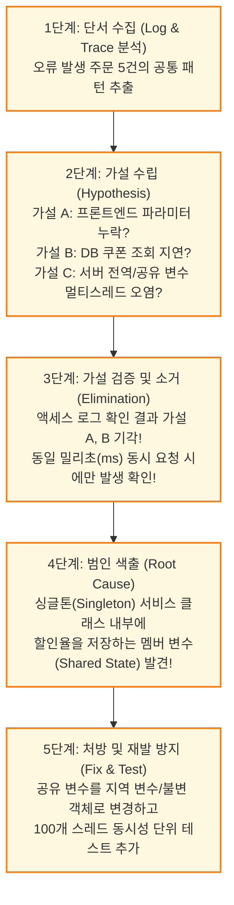

---

#### 🕵️‍♂️ 1단계: 현장 보존 및 로그(Log) 단서 수집
먼저 피해가 발생한 주문 번호(`order_id: ORD-9981`)의 서버 애플리케이션 로그와 HTTP 액세스 로그를 시간순(밀리초 단위)으로 대조합니다.

```text
[2026-11-15 14:22:01.102] [Thread-exec-14] INFO  OrderController - [유저 A] 주문 요청 수신: itemPrice=50000, couponCode="WELCOME_10"
[2026-11-15 14:22:01.105] [Thread-exec-14] INFO  DiscountService - [유저 A] 쿠폰 검증 성공: discountRate=0.10 (10% 할인 예정)
[2026-11-15 14:22:01.108] [Thread-exec-27] INFO  OrderController - [유저 B] 주문 요청 수신: itemPrice=30000, couponCode=NONE (쿠폰 없음)
[2026-11-15 14:22:01.110] [Thread-exec-27] INFO  DiscountService - [유저 B] 쿠폰 미적용 설정: discountRate=0.00 (할인 없음)
[2026-11-15 14:22:01.145] [Thread-exec-14] INFO  PaymentClient   - [유저 A] 최종 PG 결제 승인 완료: chargedAmount=50000 (어라?! 왜 45000원이 아니라 50000원이지?!)
```

#### 🕵️‍♂️ 2단계 & 3단계: 단서 연결 및 가설 검증
로그를 유심히 관찰하던 엔지니어의 눈이 번쩍 뜨입니다!
- `14:22:01.105` 시점에는 분명히 `[Thread-exec-14]`에서 유저 A의 할인율이 `0.10`(10%)으로 정상 계산되었습니다.
- 그런데 불과 **0.005초 뒤(`14:22:01.110`)**, 다른 스레드인 `[Thread-exec-27]`에서 쿠폰을 쓰지 않은 유저 B의 요청이 들어와 `discountRate=0.00`을 찍자마자, 유저 A의 결제 금액이 할인 없는 `50,000원`으로 둔갑해 버렸습니다!
- **결정적 추론**: *"왜 개발자 PC에서는 한 번도 안 터졌을까? 개발자 PC에서는 나 혼자 한 번에 하나씩만 요청을 보냈기 때문이다! 이 버그는 **두 명 이상의 사용자가 0.04초 이내의 간격으로 동시에 결제할 때, 다른 사람의 할인율 데이터가 내 데이터를 덮어쓰는 멀티스레드 동시성(Race Condition) 버그**다!"*

#### 🕵️‍♂️ 4단계: 범인 색출 — 문제의 소스 코드 확인
즉시 `DiscountService` 코드를 열어보니 아니나 다를까, 주니어 개발자가 무심코 작성해 둔 치명적인 코드가 모습을 드러냅니다.

```python
# ❌ 범인 코드: 여러 스레드가 공유하는 싱글톤(Singleton) 객체에 '상태 변수(self.current_discount_rate)'를 선언함!
class DiscountService:
    def __init__(self, coupon_repo, pg_client):
        self.coupon_repo = coupon_repo
        self.pg_client = pg_client
        # [치명적 결함!] 모든 사용자 요청 스레드가 이 변수 하나를 같이 씁니다!
        self.current_discount_rate = 0.0

    def calculate_and_pay(self, user_id: int, item_price: int, coupon_code: str | None) -> int:
        if coupon_code:
            coupon = self.coupon_repo.find_by_code(coupon_code)
            self.current_discount_rate = coupon.rate  # 유저 A 스레드가 0.10을 기록함
        else:
            self.current_discount_rate = 0.0          # 0.005초 뒤 유저 B 스레드가 여기를 0.0으로 덮어써 버림!

        # 외부 포인트/혜택 조회 등으로 약 0.04초(40ms) 네트워크 I/O 지연 발생
        self.coupon_repo.record_usage_audit(user_id, coupon_code)

        # 유저 A 스레드가 0.04초 뒤에 돌아와 계산할 때는 이미 self.current_discount_rate가 0.0으로 바뀐 상태!
        final_price = int(item_price * (1.0 - self.current_discount_rate))
        self.pg_client.charge(user_id, final_price)
        return final_price
```

#### 🕵️‍♂️ 5단계: 근본 처방(Fix) 및 재발 방지 테스트 코드 작성
원인을 정확히 규명했으니, 처방은 단 3줄의 수정으로 깔끔하게 끝납니다. **싱글톤 서비스 객체 내부의 공유 상태 변수(`self.current_discount_rate`)를 완전히 제거(Stateless 설계)**하고, 각 스레드의 고유한 메모리 공간인 **스택(Stack)에 생성되는 지역 변수(`discount_rate`)**만 사용하도록 수정합니다.

```python
# ✅ 해결된 프로덕션 코드: 상태를 가지지 않는 무상태(Stateless) 설계로 스레드 안전성(Thread-Safety) 100% 확보!
class DiscountService:
    def __init__(self, coupon_repo, pg_client):
        self.coupon_repo = coupon_repo
        self.pg_client = pg_client
        # 공유 멤버 변수를 완전히 삭제!

    def calculate_and_pay(self, user_id: int, item_price: int, coupon_code: str | None) -> int:
        # [핵심 해결] 지역 변수(Local Variable)는 각 스레드의 독립된 Stack 메모리에 생성되므로
        # 10만 명이 동시에 호출해도 절대 서로의 값을 침범하지 못합니다! (운영체제 전공 지식의 승리!)
        discount_rate = 0.0
        if coupon_code:
            coupon = self.coupon_repo.find_by_code(coupon_code)
            discount_rate = coupon.rate

        self.coupon_repo.record_usage_audit(user_id, coupon_code)

        final_price = int(item_price * (1.0 - discount_rate))
        self.pg_client.charge(user_id, final_price)
        return final_price
```

여기서 멈추지 않고, 프로 엔지니어는 `ThreadPoolExecutor`로 쿠폰 적용 유저와 미적용 유저 100명을 동시에 실행시키는 **멀티스레드 재현 테스트 코드**를 작성하여 CI 파이프라인에 등록합니다. 이제 이 회사의 서비스에서는 영원히 같은 버그가 재발하지 않습니다.

> [!IMPORTANT]
> **디버깅 시나리오가 주는 교훈**  
> 01절에서 배웠던 **운영체제의 스레드 메모리 구조(Heap 영역은 스레드끼리 공유하고, 지역 변수가 담긴 Stack 영역은 스레드마다 독립된다)**를 정확히 이해하고 있던 엔지니어는 로그 한 줄만 보고도 10분 만에 범인을 특정해 냈습니다. 기본기가 실무의 디버깅 속도를 결정하는 완벽한 증거입니다.

---

### 4. 뛰어난 소프트웨어 엔지니어들의 5대 공통 핵심 역량

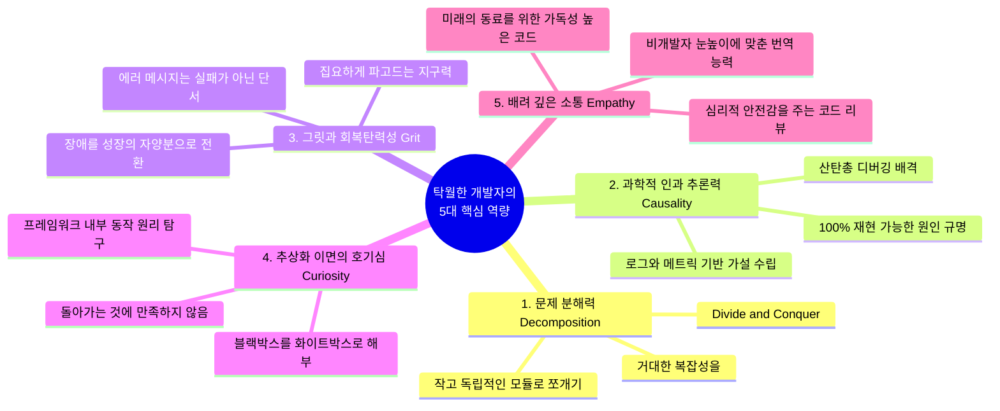

1. **문제 분해 능력 (Problem Decomposition)**: 아무리 거대하고 막막해 보이는 프로젝트라도 당황하지 않고, 오늘 당장 구현하고 테스트할 수 있는 가장 작고 명확한 하위 문제(Sub-problem)들로 쪼개어 하나씩 각개격파(Divide and Conquer)해 나갑니다.
2. **과학적 인과 추론력 (Scientific Causality)**: "어제는 안 됐는데 재부팅하니까 갑자기 되네? 그냥 넘어가자"라는 태도를 가장 경계합니다. 왜 안 되었는지, 왜 고쳐졌는지 인과관계를 증명할 수 없으면 아직 고쳐진 것이 아니라고 믿는 엄밀함을 갖춥니다.
3. **디버깅 끈기와 회복탄력성 (Grit & Resilience)**: 화면을 가득 채운 붉은색 에러 트레이스를 보며 자책하거나 짜증을 내는 대신, *"오, 아까와는 다른 새로운 에러 메시지가 떴네! 해결에 한 걸음 더 가까워졌다!"*라며 퍼즐을 풀듯 집요하게 파고드는 단단한 내면을 지녔습니다.
4. **추상화 계층 아래를 들여다보는 호기심 (Under-the-Hood Curiosity)**: 프레임워크가 제공하는 편리한 어노테이션 한 줄(`@Transactional`, `async/await`)을 쓰더라도, *"이 한 줄이 내부에서 구체적으로 어떤 프록시 객체를 만들고 어떻게 동작할까?"*를 궁금해하며 공식 문서와 내부 소스 코드를 열어보는 호기심이 주니어를 시니어로 만듭니다.
5. **명료한 글쓰기와 공감형 커뮤니케이션 (Writing & Empathy)**: 좋은 코드는 결국 좋은 에세이와 같습니다. 주석 없이도 읽히는 명확한 네이밍을 고민하고, 복잡한 아키텍처 결정의 이유를 깔끔한 문서(ADR)로 남기며, 동료의 성장을 돕는 따뜻한 코드 리뷰어를 지향합니다.

---

### 5. 자가 진단 체크리스트: 나는 개발에 어울리는 사람일까?

다음 8가지 문항 중 **4개 이상**에 고개가 끄덕여진다면, 당신은 이미 훌륭한 소프트웨어 엔지니어가 될 수 있는 최고의 자질을 품고 있습니다.

- [ ] **원리 탐구**: 새로운 가전제품이나 앱을 써볼 때, 겉모습뿐만 아니라 *"이건 내부에서 어떤 규칙과 원리로 돌아가는 걸까?"* 궁금해하곤 한다.
- [ ] **귀차니즘의 승화**: 일상이나 업무에서 똑같은 단순 반복 작업(엑셀 복사-붙여넣기, 파일 이름 일괄 변경 등)을 3번 이상 하면, 어떻게든 자동화하거나 단축하는 방법을 찾아내고야 만다.
- [ ] **분해와 조립**: 복잡한 문제를 만났을 때 머릿속으로 순서를 매기거나 종이에 네모 상자와 화살표를 그려가며 단계별로 쪼개어 정리하는 습관이 있다.
- [ ] **규칙 기반 사고**: 보드게임, 추리 소설, 스도쿠, 전략 시뮬레이션 게임처럼 정해진 규칙과 제약 조건 안에서 최적의 해법을 찾아내는 지적 유희를 즐긴다.
- [ ] **집요한 엉덩이 힘**: 풀리지 않는 문제를 만났을 때 쉽게 덮어버리기보다, 밥 먹을 때나 샤워할 때도 *"아, 혹시 그 방법을 써보면 어떨까?"* 하고 생각을 이어가는 끈기가 있다.
- [ ] **번역가의 기질**: 내가 이해한 어려운 개념을 잘 모르는 친구나 가족에게 쉬운 비유를 들어 명쾌하게 설명해 주고, 상대방이 *"아하! 무슨 말인지 단번에 이해됐어!"*라고 할 때 큰 보람을 느낀다.
- [ ] **정리 정돈의 쾌감**: 어지럽게 흩어진 서랍장이나 폴더 구조, 복잡한 문장을 깔끔하고 일관된 규칙에 따라 정돈(리팩터링)했을 때 기분이 상쾌해진다.
- [ ] **평생 학습자의 설렘**: 한 번 배운 지식으로 평생 우려먹는 안정감보다, 매년 새로운 도구와 기술을 배우며 어제의 나보다 더 똑똑해지는 성장의 과정 자체가 즐겁다.

---

### 6. [심층 Q&A] 04절 멘토링 & 기술 면접 단골 질문

#### Q1. 주니어 개발자가 회사에 입사해서 가장 빨리 실력을 키우고 팀의 신뢰를 얻는 비결은 무엇인가요?
- **모범 답안**: 세 가지 습관이 주니어의 성장 속도를 결정합니다.
  1. **질문하는 기술 (15분 규칙과 맥락 공유)**: 모르는 문제가 생겼을 때 3일 동안 혼자 끙끙 앓으며 일정을 지연시키는 것도 나쁘고, 1분도 고민 안 해보고 바로 사수에게 *"안 돼요"*라고 묻는 것도 나쁩니다. 15~30분 동안 직접 공식 문서와 로그를 파고들어 본 뒤, **"제가 A라는 목표를 위해 B와 C 방법을 시도해 보았는데 D라는 에러 로그가 발생했습니다. 제 가설은 E인데 혹시 제가 놓친 방향이 있을까요?"**라고 질문하면 모든 시니어 개발자가 기꺼이 모든 노하우를 전수해 줄 것입니다.
  2. **팀의 코드 리뷰와 장애 회고록 정독하기**: 사내 GitHub 저장소에 올라온 시니어 엔지니어들의 과거 PR(Pull Request) 코멘트와 장애 포스트모템 문서들은 그 어떤 유료 강의에서도 배울 수 없는 살아있는 보물창고입니다.
  3. **작은 약속(기한과 테스트) 지키기**: 내가 맡은 작은 기능 하나라도 스스로 엣지 케이스를 꼼꼼히 테스트하여 버그 없이 약속한 일정 내에 전달하는 신뢰가 쌓이면, 점점 더 중요하고 핵심적인 아키텍처 설계 기회를 부여받게 됩니다.

#### Q2. [기술 면접 단골] 좋은 코드 리뷰(Code Review) 문화란 무엇이며, 코드 리뷰 시 어떤 점들을 중점적으로 보시나요?
- **모범 답안**:
  - 좋은 코드 리뷰는 동료의 실력을 심판하는 자리가 아니라, **코드의 품질을 함께 높이고 팀 전체가 도메인 지식과 설계 철학을 공유하는 학습의 장**입니다.
  - 우선 들여쓰기, 세미콜론, 변수 표기법(camelCase 등) 같은 단순 스타일 문제는 사람이 지적하지 않고 CI 파이프라인의 **Linter/Formatter(ESLint, Prettier, Checkstyle 등)가 100% 자동으로 잡도록 위임**해야 감정 소모를 막을 수 있습니다.
  - 인간 리뷰어는 오직 **1) 비즈니스 요구사항과 엣지 케이스(동시성, Null 처리, 트랜잭션 경계)가 누락 없이 반영되었는가, 2) 6개월 뒤 다른 팀원이 읽었을 때 함수의 역할과 의도가 한눈에 읽히는가(가독성), 3) 보안 취약점이나 대용량 트래픽에서의 성능 병목(N+1 쿼리 등)은 없는가, 4) 핵심 로직을 검증하는 테스트 코드가 충분한가**에 집중해야 합니다. 또한 코멘트를 남길 때도 `[Nit]`(사소한 제안), `[Blocker]`(반드시 수정 필요), `[Question]`(단순 질문)처럼 태그를 붙여 리뷰이의 의사결정을 돕는 것이 성숙한 방법입니다.

---

### 7. 핵심 요약 (Summary Checklist)

- [x] 개발자에게 가장 필요한 것은 고등 미적분 암기력이 아니라 **논리적 인과 추론력과 거대한 문제를 작게 쪼개는 분해력**입니다.
- [x] 현업 개발자의 하루는 혼자 코딩만 하는 시간이 아니라 **설계 토론, 기획 검증, 코드 리뷰, 디버깅이 어우러진 고도의 팀 스포츠**입니다.
- [x] 미스터리한 버그를 만났을 때 무작정 코드를 고치는 산탄총 디버깅을 버리고, **로그 단서 수집 → 가설 수립 → 반증 및 소거 → 근본 원인 제거**의 과학적 디버깅 절차를 체화해야 합니다.

---

## (+) AI시대, 개발자에게 필요한 역량은 무엇인가요?

> "AI가 초당 수백 줄의 코드를 쏟아내는 시대, 소프트웨어 엔지니어는 사라지는 것이 아닙니다.  
> 벽돌(코드)을 한 장씩 손수 나르고 쌓던 '시공 작업자'에서,  
> 비즈니스 문제를 정의하고 전체 도시의 청사진을 그리며 수십 명의 자율형 AI 에이전트 군단을 지휘·감리하는 **'총괄 시스템 아키텍트(Chief System Architect)'**로 그 위상이 격상되는 것입니다."

---

### 1. 패러다임의 대전환: 단순 챗봇을 넘어 '에이전틱 코딩(Agentic Coding)'의 시대로

소프트웨어 엔지니어링의 역사는 곧 **'추상화(Abstraction)의 역사'**였습니다.
- 1950년대에는 종이에 구멍을 뚫어 0과 1의 기계어를 직접 입력(천공 카드)했습니다.
- 1970년대 C언어라는 고수준 언어가 등장했을 때, 사람들은 *"이제 기계어를 몰라도 영단어 몇 개만 치면 프로그램이 나오니 프로그래머라는 직업은 곧 사라질 것"*이라고 예언했습니다.
- 2000년대 오픈소스 프레임워크(Spring, Django, React)와 클라우드(AWS)가 등장했을 때도 똑같은 말이 반복되었습니다.

하지만 결과는 어떠했나요? 도구가 인간을 하위 수준의 단순 반복 노동(보일러플레이트 타이핑, 메모리 수동 할당)에서 해방시킬 때마다, **인류가 소프트웨어를 통해 해결하고자 하는 비즈니스 문제의 규모와 복잡성은 수백 배로 폭발(제본스의 역설, Jevons Paradox)**했고, 그 복잡성을 통제할 수 있는 진짜 소프트웨어 엔지니어의 수요와 가치는 오히려 역사상 최고치로 치솟았습니다.

그리고 지금, 우리는 AI 코딩 도구의 급격한 진화 속에서 **3세대 패러다임 전환**을 목격하고 있습니다.

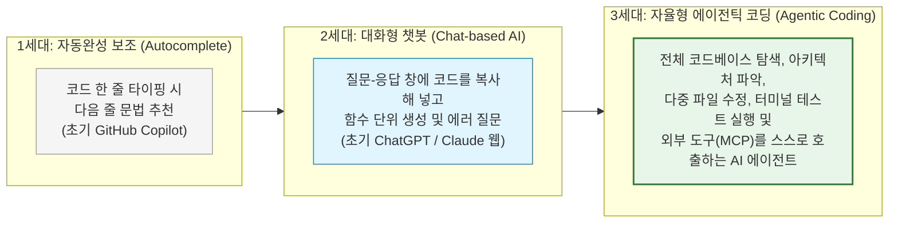

#### 현대 에이전틱 코딩(Agentic Software Engineering)의 3대 핵심 기술 축
오늘날의 선진 개발 환경은 단순히 채팅창에 질문을 던지고 코드를 복사해 붙여넣는 수준을 완전히 넘어섰습니다.

1. **자율 루프 기반 에이전트 (Autonomous Agent Loop)**: 현대의 AI 코딩 에이전트(Claude Code, Cursor Agent, Antigravity 등)는 개발자가 목표를 부여하면 스스로 프로젝트의 디렉터리 구조를 탐색(`grep`, `read_file`)하고, 수십 개의 연관 파일을 동시에 수정한 뒤, 직접 터미널에서 컴파일과 테스트 명령어를 실행(`run_command`)합니다. 테스트가 실패하면 에러 로그를 스스로 읽고 원인을 분석해 테스트가 통과할 때까지 코드를 자가 수정(Self-Healing)하는 루프를 돕니다.
2. **MCP (Model Context Protocol, 모델 컨텍스트 프로토콜)**: 과거의 AI는 내 컴퓨터의 코드 파일만 볼 수 있는 고립된 두뇌였습니다. 하지만 개방형 표준인 **MCP**를 통해 이제 AI 에이전트는 사내 노션(Notion)의 기획서, 지라(Jira)의 이슈 티켓, 피그마(Figma)의 디자인 시안, 실제 운영 데이터베이스의 스키마, 심지어 데이터독(Datadog)의 실시간 에러 로그와 브라우저의 DOM 상태(Chrome DevTools)까지 직접 안전하게 조회하고 조작하며 입체적으로 개발을 수행합니다.
3. **멀티 에이전트 오케스트레이션 (Multi-Agent Orchestration)**: 한 명의 개발자가 하나의 AI만 쓰는 것이 아니라, **'아키텍처 설계 및 기획 검증 에이전트'**, **'백엔드 API 구현 에이전트'**, **'프론트엔드 UI 구현 에이전트'**, **'보안 취약점 및 엣지 케이스 공격 전담 QA 에이전트'**를 병렬(Swarm)로 띄워 서로의 결과물을 교차 검증하게 만드는 지휘 체계를 활용합니다.

---

### 2. AI 시대, 대체 불가능한 개발자의 5대 핵심 역량

AI가 코드 타이핑 속도를 인간의 100배로 끌어올린 이 시대에, 기업의 채용 시장에서 단순 코더(Coder)의 자리는 빠르게 줄어드는 반면 **'AI 증강형 엔지니어(AI-Augmented Software Engineer)'**의 몸값은 천정부지로 치솟고 있습니다. 그 차이를 가르는 5가지 핵심 역량을 해부합니다.

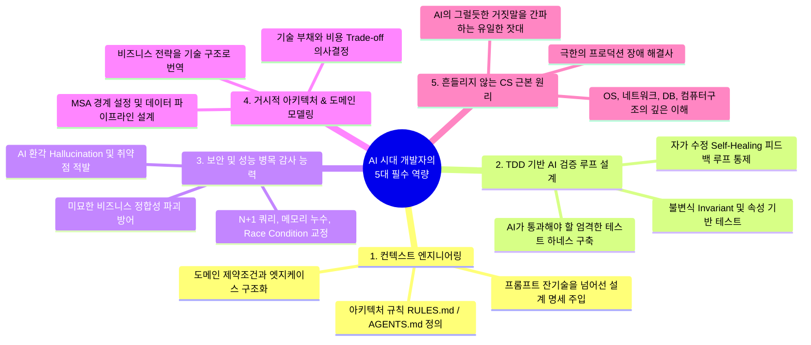

---

#### 역량 1: 컨텍스트 엔지니어링 (Context Engineering)과 아키텍처 가드레일 설계
- 과거에는 단편적인 질문 요령인 '프롬프트 엔지니어링(Prompt Engineering)'이 유행했다면, 에이전틱 코딩 시대에는 AI 에이전트에게 프로젝트 전체의 맥락과 아키텍처 헌법을 체계적으로 주입하는 **컨텍스트 엔지니어링(Context Engineering)**이 핵심입니다.
- **실전 차이 비교**:
  - **하수(단순 프롬프트)**: *"회원 탈퇴 API 코드 짜줘."* → AI가 우리 회사의 인증 방식도 모르고, 법적 보관 의무가 있는 결제 이력까지 `DELETE FROM users`로 날려버리는 끔찍한 코드를 생성합니다.
  - **고수(컨텍스트 엔지니어링)**: 프로젝트 루트에 `AGENTS.md`(또는 아키텍처 규칙 문서)를 정의해 두고, **도메인 규칙, 기술 스택 버전, 트랜잭션 경계, 에러 응답 표준 규격, 보안 제약**을 명확한 구조적 컨텍스트로 주입합니다.

> **[실전 예시] 시니어 엔지니어가 AI 에이전트에게 주입하는 고밀도 컨텍스트 명세서**
> ```markdown
> # [작업 지시 및 컨텍스트 명세: 회원 탈퇴(Soft Delete) 및 개인정보 파기 파이프라인 구현]
> 
> ## 1. 시스템 아키텍처 및 기술 제약 (Architecture Constraints)
> - Runtime: Python 3.12 / FastAPI / SQLAlchemy 2.0 (AsyncSession) / PostgreSQL 16
> - 아키텍처 패턴: 헥사고날 아키텍처 (Domain 계층은 인프라/ORM에 절대 의존하지 말 것)
> 
> ## 2. 핵심 비즈니스 도메인 불변식 (Domain Invariants - 절대 위반 금지)
> - [규칙 1 - 진행 중 거래 검증]: 현재 상태가 `SHIPPING`(배송 중)이거나 `REFUND_REQUESTED`(환불 진행 중), 또는 미정산 예치금(`balance > 0`)이 남아있는 회원은 탈퇴 요청 시 `409 Conflict (CODE: ACTIVE_TRANSACTION_EXISTS)` 예외를 발생시켜 탈퇴를 차단해야 한다.
> - [규칙 2 - 전자상거래법 보존 의무]: 탈퇴 시 `users` 테이블의 레코드를 물리 삭제(Hard Delete)하면 외래키(FK)로 연결된 5년 보관 의무 결제 원장(`payment_ledgers`)이 깨진다. 반드시 `status = 'WITHDRAWN'`, `withdrawn_at = NOW()`로 **논리 삭제(Soft Delete)** 처리할 것.
> - [규칙 3 - 개인정보 즉시 비식별화(PII Masking)]: 단, 개인정보보호법에 따라 탈퇴 즉시 `email`, `phone_number`, `name` 컬럼은 복구 불가능한 암호학적 솔트 해시(`SHA-256`) 또는 마스킹 값으로 덮어쓰고, 기존 발급된 모든 Redis Refresh Token과 세션을 즉시 무효화(Revoke)해야 한다.
> 
> ## 3. 검증 요구사항 (Verification Criteria)
> - 위 3가지 규칙과 동시성 경합 상황을 모두 검증하는 `pytest` 비동기 통합 테스트 케이스 6종을 먼저 작성(Red)한 뒤, 이를 통과하는 서비스 로직을 구현(Green)하라.
> ```

이처럼 **완벽한 컨텍스트 명세서를 작성할 수 있는 능력은 곧 그 개발자의 도메인 이해도와 시스템 설계 능력에 정확히 비례**합니다. 아는 만큼만 AI에게 지시할 수 있기 때문입니다.

---

#### 역량 2: TDD(테스트 주도 개발) 기반의 AI 검증 하네스(Verification Harness) 구축
- AI 에이전트가 코드를 스스로 수정하며 완성도를 높이게 만드는 가장 강력한 비결은 **'인간 엔지니어가 엄격한 자동화 테스트 그물망(Test Harness)을 설계해 주는 것'**입니다.
- AI에게 기능 코드만 짜달라고 하면 겉보기엔 그럴듯하지만 경계값에서 깨지는 코드를 만듭니다. 반면, 인간 엔지니어가 비즈니스 핵심 엣지 케이스가 담긴 테스트 명세를 먼저 확정하고 **"이 테스트 스위트 전체가 100% 통과하고 테스트 커버리지가 90% 이상이 될 때까지 스스로 코드를 개선해라"**라고 에이전틱 루프를 돌리면, AI는 놀라울 정도로 완벽한 프로덕션 코드를 완성해 냅니다.

---

#### 역량 3: AI가 생성한 미묘한 보안 취약점·성능 병목·동시성 버그를 꿰뚫어 보는 감사(Audit) 능력
- AI는 인터넷상의 방대한 평균적인 코드를 학습했기 때문에, **문법적으로는 완벽하고 당장 실행도 잘 되지만 대규모 트래픽이나 해커의 공격 앞에서는 처참하게 무너지는 '시한폭탄 코드'**를 아주 해맑고 당당하게 생성하곤 합니다.
- 실제 현업에서 AI가 흔히 만들어내는 치명적 결함 코드와, 이를 인간 시니어 엔지니어가 어떻게 간파하고 리팩터링하는지 두 가지 실전 코드 비교로 확인해 보겠습니다.

---

##### [실전 비교 사례 A] 보안 취약점 & 메모리 폭발(OOM)을 유발하는 AI 코드 vs 인간 엔지니어의 교정

> **요구사항**: *"관리자가 특정 기간의 회원 주문 내역을 검색해서 CSV 파일로 다운로드하는 API를 만들어줘."*

```python
# ❌ AI가 3초 만에 생성한 그럴듯한 코드 (프로덕션 배포 시 서버 즉사 & 해킹 위험!)
@app.get("/admin/orders/export")
def export_orders_ai_bad(start_date: str, end_date: str, status: str, db_conn):
    cursor = db_conn.cursor()
    
    # [치명적 결함 1 - SQL Injection 보안 취약점!]
    # AI가 문자열 포매팅(f-string)으로 SQL을 조립하여, 해커가 status 파라미터에
    # "' OR '1'='1'; DROP TABLE orders; --" 를 넣으면 DB가 통째로 탈취되거나 파괴됩니다!
    query = f"SELECT * FROM orders WHERE created_at BETWEEN '{start_date}' AND '{end_date}' AND status = '{status}'"
    cursor.execute(query)
    
    # [치명적 결함 2 - 권한 인가(Authorization) 누락!]
    # URL 경로만 /admin 일 뿐, 실제 요청자가 관리자(ADMIN) 권한이 있는지 전혀 체크하지 않습니다!
    
    # [치명적 결함 3 - fetchall()로 인한 서버 메모리 폭발(OOM, Out Of Memory)!]
    # 조회 기간이 1년이라 주문이 500만 건이면, 500만 건 전체를 파이썬 RAM에 한 번에 올리려다
    # 서버 메모리가 100% 차올라 운영체제 OOM Killer에 의해 웹 서버 프로세스가 즉사합니다!
    rows = cursor.fetchall()
    
    csv_text = "id,user_id,amount,status\n"
    for r in rows:
        # [치명적 결함 4 - 문자열 += 반복으로 인한 O(N²) 메모리 복사 병목!]
        csv_text += f"{r[0]},{r[1]},{r[2]},{r[3]}\n"
        
    return Response(content=csv_text, media_type="text/csv")
```

초보자는 위 코드를 복사해서 실행해 보고 *"와! 엑셀 파일이 진짜로 다운로드되네! AI 최고다!"*라며 그대로 배포합니다. 그리고 다음 날 관리자가 1년 치 데이터를 다운로드하는 버튼을 누르는 순간 회사 서버 전체가 다운됩니다.

반면, **CS 기초(운영체제 메모리 관리, 네트워크 스트리밍, DB 커서, 정보보안)**를 갖춘 인간 시니어 엔지니어는 위 코드의 4가지 결함을 10초 만에 짚어내고 다음과 같이 리팩터링합니다.

```python
# ✅ 인간 시니어 엔지니어가 검증 및 리팩터링한 프로덕션 코드
import csv
import io
from fastapi import Depends, HTTPException
from fastapi.responses import StreamingResponse

@app.get("/admin/orders/export")
def export_orders_human_senior(
    start_date: date,
    end_date: date,
    status: OrderStatusEnum,  # 타입 및 Enum 강제로 허용된 상태값 외 입력 원천 차단
    current_user: User = Depends(require_admin_role),  # [교정 2] 엄격한 관리자 RBAC 권한 검증!
    db_conn = Depends(get_db_connection)
):
    # 최대 조회 기간 제한 (비즈니스 방어 로직)
    if (end_date - start_date).days > 90:
        raise HTTPException(status_code=400, detail="최대 90일 단위로만 내보내기가 가능합니다.")

    def generate_csv_stream():
        # [교정 3] Server-side Cursor(스트리밍 커서)를 사용하여 500만 건이어도
        # 메모리(RAM)에는 항상 1,000건(수 메가바이트)만 올라오도록 메모리 사용량을 O(1)로 통제!
        with db_conn.cursor(name="order_export_stream_cursor") as cursor:
            cursor.itersize = 1000
            
            # [교정 1] 파라미터 바인딩(Prepared Statement, %s)을 사용하여 SQL Injection 100% 원천 방어!
            # 또한 SELECT * 대신 필요한 컬럼만 명시하여 네트워크 및 디스크 I/O 최소화(커버링 인덱스 유도)
            sql = """
                SELECT id, user_id, total_amount, status, created_at
                FROM orders
                WHERE created_at >= %s AND created_at < %s AND status = %s
                ORDER BY created_at ASC
            """
            cursor.execute(sql, (start_date, end_date, status.value))

            # CSV 헤더 스트리밍 전송
            buffer = io.StringIO()
            writer = csv.writer(buffer)
            writer.writerow(["order_id", "user_id", "total_amount", "status", "created_at"])
            yield buffer.getvalue()
            buffer.seek(0)
            buffer.truncate(0)

            # [교정 4] 1,000건씩 청크(Chunk) 단위로 퍼올려 HTTP Chunked Transfer Encoding으로 즉시 스트리밍!
            while True:
                rows = cursor.fetchmany(1000)
                if not rows:
                    break
                for row in rows:
                    # CSV Injection(엑셀 수식 실행 취약점) 방어 처리 포함
                    writer.writerow(row)
                yield buffer.getvalue()
                buffer.seek(0)
                buffer.truncate(0)

    return StreamingResponse(
        generate_csv_stream(),
        media_type="text/csv",
        headers={"Content-Disposition": f"attachment; filename=orders_{start_date}_{end_date}.csv"}
    )
```

---

##### [실전 비교 사례 B] ORM `N+1` 쿼리 폭탄을 만드는 AI 코드 vs 인간 엔지니어의 최적화

```python
# ❌ AI가 흔히 작성하는 ORM 코드: 전형적인 N+1 쿼리 성능 병목 발생!
def get_recent_posts_with_authors_bad(session):
    # 1번의 쿼리로 게시글 100개를 가져옴 (SELECT * FROM posts LIMIT 100)
    posts = session.query(Post).order_by(Post.created_at.desc()).limit(100).all()
    
    result = []
    for post in posts:
        # [치명적 병목!] 루프를 100번 돌 때마다 post.author에 접근하면서
        # 매번 DB에 추가 쿼리(SELECT * FROM users WHERE id = ?)를 100번 더 날립니다!
        # 게시글 100개 조회에 총 1 + 100 = 101번의 DB 네트워크 왕복 발생!
        result.append({
            "title": post.title,
            "author_name": post.author.name,
            "comment_count": len(post.comments)  # 여기서 또 100번 쿼리 추가 발생! (총 201번 쿼리!)
        })
    return result

# ✅ 인간 엔지니어가 교정한 쿼리 최적화 코드: 단 1번의 JOIN 및 집계 쿼리로 끝냄!
def get_recent_posts_with_authors_good(session):
    # joinedload와 서브쿼리 집계를 통해 DB 네트워크 왕복을 201번 -> 단 1번으로 압축! (응답 속도 50배 향상)
    stmt = (
        select(
            Post.id,
            Post.title,
            User.name.label("author_name"),
            func.count(Comment.id).label("comment_count")
        )
        .join(User, Post.author_id == User.id)
        .outerjoin(Comment, Comment.post_id == Post.id)
        .group_by(Post.id, User.name)
        .order_by(Post.created_at.desc())
        .limit(100)
    )
    return session.execute(stmt).mappings().all()
```

---

#### 역량 4 & 5: 거시적 시스템 아키텍처 설계력과 불변의 CS 기초 체력
- AI가 단위 함수나 클래스를 아무리 빠르게 만들어내도, **"우리 서비스의 결제 시스템과 재고 시스템을 동기(gRPC)로 묶을 것인가, 비동기 이벤트(Kafka)로 분리할 것인가?"**, **"데이터베이스 샤딩 키(Sharding Key)를 `user_id`로 잡을 것인가, `region_id`로 잡을 것인가?"**와 같은 거시적인 시스템 아키텍처의 결단은 비즈니스 맥락과 미래 확장성을 읽는 인간 아키텍트의 고유 영역입니다.
- 그리고 앞서 살펴본 것처럼, AI가 만든 코드의 `OOM(메모리 폭발)`, `SQL Injection`, `N+1 쿼리`, `Deadlock(교착 상태)`을 단번에 간파하고 교정할 수 있는 눈(Eye)은 오직 **01절에서 배운 컴퓨터공학 기초(CS Fundamentals)**에서 나옵니다. **역설적이게도 AI가 발전할수록 문법 암기의 가치는 0에 수렴하고, CS 전공 기초 원리의 가치는 무한대로 상승합니다.**

---

### 3. 실전 에이전틱 엔지니어링 5단계 표준 워크플로우

현업의 최상위 1% 개발자들이 AI 에이전트를 활용하여 하루 만에 일주일 치의 고품질 시스템을 구축해 내는 **'5단계 에이전틱 엔지니어링 루프'**는 다음과 같습니다.

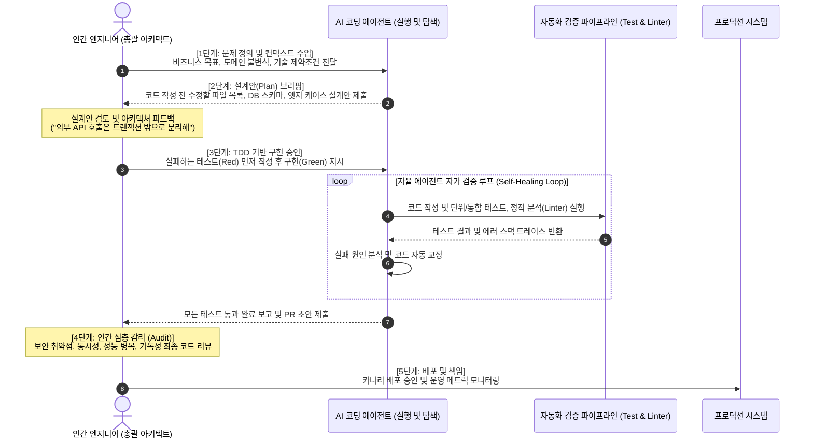

1. **Plan First (선 설계 브리핑, 후 코딩 원칙)**: 에이전트에게 곧바로 코드를 고치라고 하지 않습니다. 먼저 *"현재 코드베이스를 분석해서 어떤 파일들을 어떻게 수정할지, 우려되는 엣지 케이스는 무엇인지 아키텍처 계획서(Implementation Plan)부터 작성해 브리핑해라"*라고 지시하여 방향성을 먼저 정렬합니다.
2. **Test-Driven Generation**: 구현 코드보다 검증용 테스트 코드를 먼저 확정하여 AI가 달성해야 할 명확한 골대를 세웁니다.
3. **Human-in-the-Loop Audit**: 모든 자동화 테스트가 통과하더라도, 마지막에 프로덕션 브랜치에 머지(Merge) 버튼을 누르고 그 결과에 대해 비즈니스적·윤리적·법적 책임을 지는 주체는 언제나 **인간 엔지니어**입니다.

---

### 4. 상세 비교표: 레거시 코더 vs AI-Augmented 현대 소프트웨어 엔지니어

| 비교 기준 | 과거의 레거시 코더 (Legacy Coder) | AI-Augmented 현대 엔지니어 (Agentic Architect) |
| :--- | :--- | :--- |
| **자신의 정체성** | "나는 자바/리액트 문법을 손으로 직접 빠르게 치는 사람이다" | "나는 비즈니스 문제를 정의하고 AI 에이전트를 지휘해 시스템을 완성하는 건축가다" |
| **시간 배분 구조** | 문법 검색 및 보일러플레이트 타이핑 70% / 설계 및 검증 30% | **도메인 정의 및 아키텍처 설계 50% / AI 코드 감사 및 테스트 검증 40%** / 수동 코딩 10% |
| **AI 활용 수준** | 에러 메시지를 복사해 채팅창에 붙여넣고 나온 코드를 무지성 복붙함 | `AGENTS.md` 규칙, MCP 연동, TDD 검증 루프를 설계하여 멀티 에이전트를 오케스트레이션함 |
| **CS 기초 지식의 역할** | 당장 CRUD 화면 만드는 데는 몰라도 그럭저럭 티가 안 남 | **AI가 만든 미묘한 메모리 누수, 동시성 버그, 보안 결함을 잡아내는 절대적 무기** |
| **생산성 및 임팩트** | 한 번에 하나의 기능 티켓만 순차적으로 처리 (1x) | 아키텍처 중심 설계와 에이전트 병렬 지휘로 팀 단위 생산성 달성 (5x ~ 10x) |
| **대체 가능성** | AI 모델이 똑똑해질수록 가장 먼저 대체될 위험에 처함 | AI 모델이 똑똑해질수록 더 거대한 시스템을 다룰 수 있게 되어 몸값과 가치가 급상승함 |

---

### 5. [심층 Q&A] PART 01 종합 멘토링 & 기술 면접 마스터 Q&A

PART 01 전체를 마무리하며, 입문자와 주니어 개발자들이 멘토링 자리와 기술 면접에서 가장 많이 묻고 또 질문받는 핵심 질문 5가지를 명쾌하게 정리합니다.

#### Q1. "AI가 이렇게 코드를 잘 짜는데, 지금 새로 개발 공부를 시작하는 주니어는 설 자리가 아예 없어지는 것 아닌가요?"
- **모범 답안**: **'생각 없이 시키는 대로만 코딩하는 주니어'**의 자리는 줄어드는 것이 맞지만, **'CS 기본기를 바탕으로 AI 도구를 능숙하게 다루며 비즈니스 문제를 끝까지 해결해 내는 주니어'**에게는 역사상 가장 거대한 기회의 시대가 열렸습니다.
  - 과거에는 주니어 개발자가 사내 레거시 코드를 파악하고 새로운 프레임워크 문법을 익혀 첫 제구실을 하기까지 최소 1~2년의 수련 기간이 필요했습니다.
  - 하지만 이제는 탄탄한 CS 기초 원리(네트워크, DB, OS, 아키텍처)와 문제 해결력만 갖추고 있다면, AI 에이전트를 레버리지 삼아 입사 초기부터 과거 3~5년 차 미들급 엔지니어 수준의 생산성과 시스템 구축 범위를 낼 수 있습니다. 따라서 공부의 초점을 '단순 문법 암기'에서 **'시스템 설계, CS 원리, 테스트 작성, 그리고 AI 코드 검증 능력'**으로 발 빠르게 이동해야 합니다.

#### Q2. "바이브 코딩(Vibe Coding, 원리를 모른 채 AI가 주는 코드를 느낌대로 이어 붙여 만드는 방식)만으로 상용 서비스를 만들어도 되나요?"
- **모범 답안**: 아이디어 검증을 위한 주말 해커톤이나 개인용 프로토타입(MVP)을 만들 때는 바이브 코딩이 아주 훌륭하고 빠른 도구입니다.
  - 그러나 실제 고객의 개인정보와 결제 자금이 오가는 **상용 프로덕션 서비스**를 원리 이해 없이 바이브 코딩만으로 구축하는 것은 브레이크 없는 자동차를 고속도로에 올리는 것과 같습니다.
  - 앞서 코드 사례에서 보았듯, 원리를 모르면 AI가 숨겨놓은 SQL Injection 보안 구멍이나 멀티스레드 동시성 결함, 클라우드 요금 폭탄 루프를 전혀 알아차리지 못합니다. 그리고 실제 서비스 운영 중 장애가 터졌을 때, 코드의 작동 원리를 모르는 사람은 AI에게 *"고쳐줘"*라고만 외치다 AI가 다른 곳까지 망가뜨리는 악순환에 빠져 서비스를 문 닫게 됩니다. **프로토타이핑은 바이브(Vibe)로 빠르게 시작하되, 프로덕션 엔지니어링은 반드시 엄밀한 공학(Engineering)으로 검증하고 통제해야 합니다.**

#### Q3. [기술 면접 단골] 본인이 작성한(또는 AI와 함께 작성한) 코드가 프로덕션에 배포되기 전, 어떤 기준들로 최종 점검하시나요?
- **모범 답안 (프로덕션 레디니스 체크리스트, Production Readiness Checklist)**:
  1. **정합성 및 경계값(Edge Cases)**: 입력값이 `null`, 빈 문자열, 음수, 극단적으로 큰 값일 때 안전하게 방어(Fail-Fast)되는가?
  2. **동시성 및 멱등성(Concurrency & Idempotency)**: 동시에 100개의 요청이 들어오거나 네트워크 지연으로 중복 요청이 들어왔을 때 데이터가 깨지지 않는가?
  3. **성능 및 자원 한계(Performance & Resource Bounds)**: 루프 내부에서 DB 쿼리나 외부 API를 호출(`N+1` 문제)하지 않는가? 메모리에 전체 데이터를 한 번에 적재(`fetchall`)하여 OOM을 유발할 위험은 없는가?
  4. **장애 격리 및 타임아웃(Fault Tolerance)**: 외부 API나 DB 호출에 반드시 명시적인 `Timeout`이 설정되어 있는가? 외부 시스템 장애 시 우리 서버까지 전파되지 않도록 예외 처리가 되어 있는가?
  5. **보안 및 개인정보(Security & Privacy)**: SQL 파라미터 바인딩이 적용되었는가? 권한 인가(Authorization) 체크가 누락되지 않았는가? 로그에 비밀번호나 카드번호 같은 민감 정보(PII)가 평문으로 찍히지 않는가?
  6. **관측 가능성 및 롤백(Observability & Rollback)**: 문제 발생 시 즉시 원인을 추적할 수 있는 구조화된 로그와 메트릭이 심어져 있으며, 배포 직후 이상 징후 발견 시 1분 내에 구버전으로 되돌릴 수 있는가(하위 호환성 유지)?

#### Q4. 프로그래밍 언어가 너무 많습니다(Python, Java, JavaScript/TypeScript, Go, Rust, C++ 등). 첫 언어로 무엇을 선택해야 하며, 언어를 몇 개나 배워야 하나요?
- **모범 답안**: 프로그래밍 언어는 목수가 사용하는 도구(망치, 톱, 드릴)와 같습니다.
  - 웹 프론트엔드와 빠른 풀스택 서비스가 목표라면 **TypeScript(JavaScript)**, 데이터 엔지니어링과 AI 서비스 및 빠른 백엔드 구축이 목표라면 **Python**, 대규모 금융권이나 엔터프라이즈 백엔드 시스템이 목표라면 **Java(또는 Kotlin)**, 클라우드 네이티브 인프라와 고성능 마이크로서비스가 목표라면 **Go**, 시스템 프로그래밍이나 초고성능 엔진이 목표라면 **C++이나 Rust**가 표준적인 선택입니다.
  - 중요한 것은 **처음부터 5개 언어를 얕게 기웃거리는 것이 아니라, 한 가지 주력 언어를 선택해 그 언어의 메모리 구조, 비동기 모델, 내부 동작 원리까지 깊이 있게 파고드는 것**입니다. 하나의 언어와 CS 기초 원리를 제대로 통달하고 나면, 두 번째나 세 번째 새로운 언어를 습득하는 데는 단 일주일이면 충분합니다. 모든 현대 프로그래밍 언어는 변수, 제어문, 스코프, 메모리 할당, 타입 시스템이라는 공통된 뿌리를 공유하기 때문입니다.

#### Q5. 오랜 시간 번아웃 없이 꾸준히 성장하는 시니어 엔지니어들의 남다른 학습법은 무엇인가요?
- **모범 답안**: 세상의 모든 신기술을 다 따라잡으려 하면 반드시 불안감과 번아웃에 빠집니다.
  - 롱런하는 시니어 엔지니어들은 **'변하는 것(유행하는 프레임워크)'과 '변하지 않는 것(CS 근본 원리와 문제 해결 본질)'을 명확히 구분**합니다.
  - 평소 에너지의 70%는 운영체제, 데이터베이스 내부 구조, 네트워크, 소프트웨어 아키텍처 설계 원칙처럼 **수명이 20년 이상 가는 불변의 지식(Lindindy Effect)**을 깊이 다지는 데 투자합니다. 이 뿌리가 튼튼하면 새로운 프레임워크나 AI 도구가 나왔을 때 *"아, 이건 기존 A 개념에 B 방식을 결합해서 편의성을 높인 도구구나"* 하고 단숨에 본질을 꿰뚫어 볼 수 있어, 유행에 휩쓸리지 않고 기술을 주도적으로 부리는 자유를 얻게 됩니다.

---

### 6. 핵심 요약 (Summary Checklist)

- [x] AI 시대의 개발자는 단순 코딩 노동자에서 **비즈니스 문제를 정의하고 자율형 AI 에이전트 군단을 지휘·감리하는 '총괄 시스템 아키텍트'**로 진화했습니다.
- [x] 현대 개발자의 5대 핵심 무기는 **컨텍스트 엔지니어링, TDD 검증 하네스 설계, AI 코드의 보안/성능 감사 능력, 거시적 아키텍처 설계, 그리고 불변의 CS 기초 지식**입니다.
- [x] AI가 생성한 코드의 속도 위에 인간 엔지니어의 엄격한 공학적 검증(보안, 동시성, 무결성)과 최종 책임 의식이 결합될 때 비로소 세상을 움직이는 위대한 소프트웨어가 완성됩니다.

---

## 에필로그: 첫 줄의 코드를 넘어 시스템을 지휘할 당신을 응원하며

소프트웨어 개발의 세계로 들어서는 여정은 마치 미지의 거대한 대륙을 탐험하는 것과 같습니다. 처음에는 낯선 전공 용어들, 컴퓨터 내부의 복잡한 메모리와 네트워크 계층, 그리고 화면을 메우는 빨간 에러 메시지 앞에서 막막함을 느낄지도 모릅니다.

하지만 기억하십시오. 오늘날 전 세계 수십억 인구가 매일 사용하는 위대한 운영체제와 인터넷, 그리고 인공지능 시스템조차도 처음에는 누군가가 검은 화면 위에 조심스럽게 띄운 `"Hello, World!"`라는 단 한 줄의 코드에서 시작되었습니다.

지금까지 **PART 01**을 통해 우리는 다음의 핵심 진실들을 함께 확인했습니다.
1. 컴퓨터공학의 이론들은 박물관에 박제된 지식이 아니라, **실제 서버가 터지지 않고 초고속으로 돌아가게 만드는 가장 실용적인 무기**라는 것.
2. 소프트웨어를 개발한다는 것은 단순히 돌아가는 코드를 치는 것이 아니라, **모호한 현실의 문제를 시간과 규모의 변화를 견뎌내는 엄밀한 논리 구조로 번역하는 공학 예술**이라는 것.
3. 훌륭한 소프트웨어는 치밀한 **기획, 요구사항 명세, 아키텍처 설계, 자동화 테스트, 무중단 배포, 그리고 비난 없는 회고**라는 7단계 생명주기 속에서 팀원들의 따뜻한 협업으로 탄생한다는 것.
4. 그리고 AI가 코드를 쏟아내는 새로운 시대일수록, **시스템의 근본 원리를 꿰뚫어 보고 방향을 제시하는 인간 엔지니어의 지성**은 그 어느 때보다 눈부시게 빛난다는 것입니다.

차가운 실리콘 반도체 칩 위에 당신의 논리로 따뜻한 생명을 불어넣고, 세상의 불편함을 해결하여 누군가의 하루를 더 나은 곳으로 바꾸어 나가는 일. 그것이 바로 소프트웨어 엔지니어가 누릴 수 있는 가장 가슴 뛰는 특권입니다.

이제 다음 파트에서부터 본격적으로 펼쳐질 프로그래밍과 컴퓨터 시스템의 구체적인 세계로, 자신감 있게 다음 페이지를 넘기시기 바랍니다!
