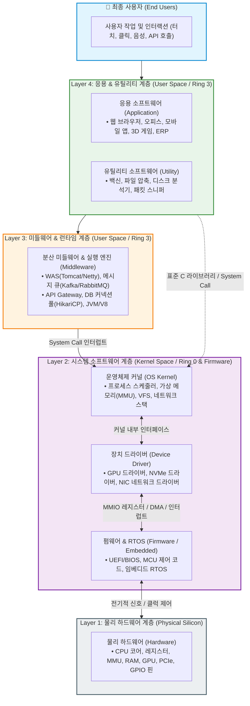
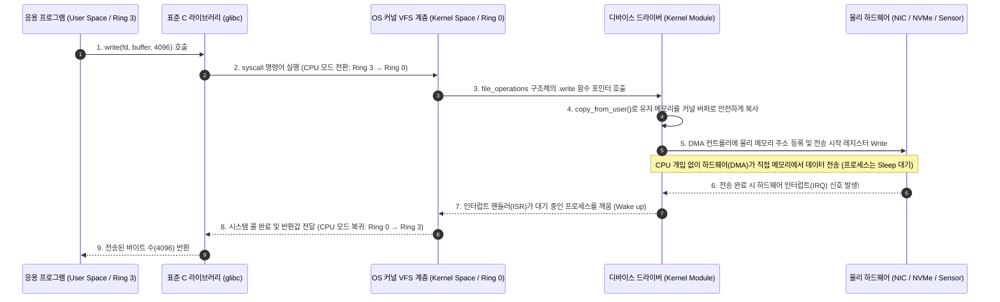
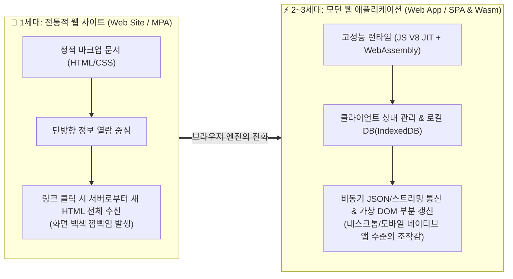
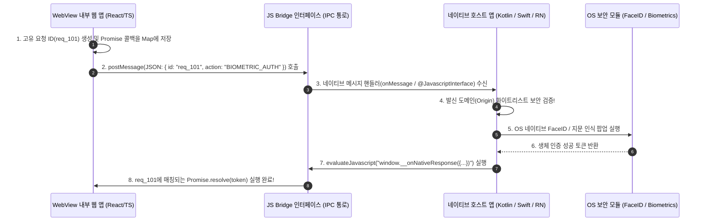
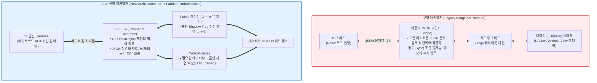
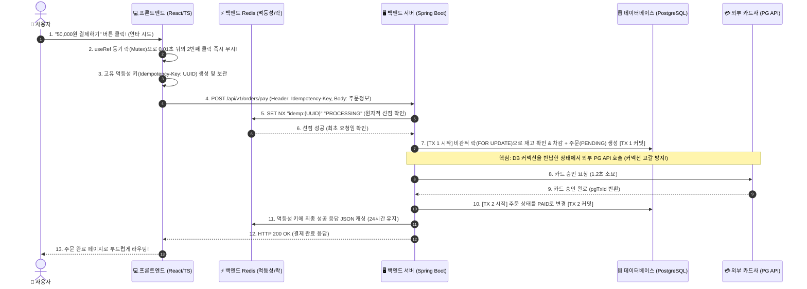
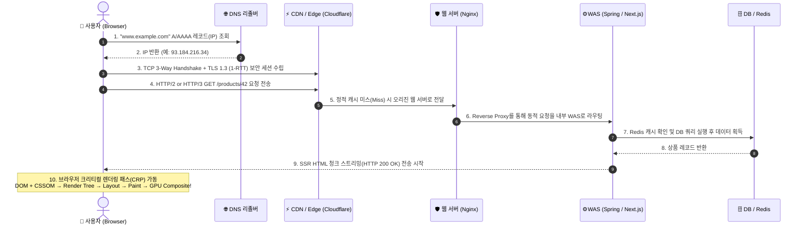
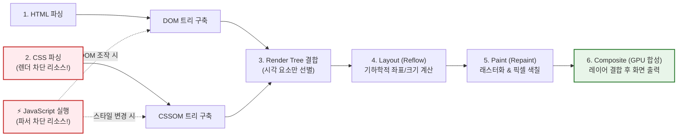
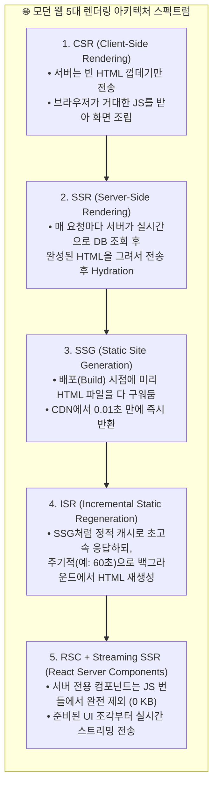

# PART 02 소프트웨어의 종류와 특징

> **"컴퓨터는 단지 믿을 수 없을 정도로 빠르고 정확한 바보일 뿐이다. 그 바보에게 생명과 지능을 불어넣는 유일한 마법이 바로 소프트웨어다."**  
> — 컴퓨터 공학의 오랜 격언

---

## 들어가며: 소프트웨어는 현대 문명의 보이지 않는 뼈대다

현대 사회에서 인간의 일상은 단 1초도 소프트웨어(Software)의 손길을 벗어나지 않습니다. 아침에 눈을 뜨며 스마트폰의 알람을 끄는 순간부터, 지하철 개찰구에 교통카드를 태그하고, 출근길에 지도 앱으로 최적 경로를 찾으며, 회사에서 클라우드 문서로 협업하고, 퇴근 후 OTT 서비스로 영화를 스트리밍하는 모든 순간에 소프트웨어가 동작하고 있습니다. 심지어 우리가 타는 자동차 한 대에도 약 1억 줄(Lines of Code) 이상의 소프트웨어 코드가 탑재되어 엔진 점화 타이밍부터 브레이크 유압, 자율주행 센서 퓨전까지 제어하고 있습니다.

하지만 우리가 화면을 통해 손가락으로 터치하거나 마우스로 클릭하는 화려한 그래픽 인터페이스(GUI)는 거대한 빙산의 일각에 불과합니다. 그 수면 아래에는 실리콘 반도체 소자의 전압을 나노초(ns) 단위로 제어하는 극미세한 **펌웨어(Firmware)**부터, 하드웨어 장치를 추상화하는 **디바이스 드라이버(Device Driver)**, 수십억 줄의 연산과 메모리를 조율하는 **운영체제 커널(OS Kernel)**, 전 세계에 흩어진 수만 대의 서버를 실시간으로 연결하고 장애를 격리하는 **분산 미들웨어(Middleware)**, 그리고 브라우저 상에서 초당 60~120프레임으로 픽셀을 그려내는 **현대적 렌더링 엔진**에 이르기까지 수많은 계층의 소프트웨어가 톱니바퀴처럼 정교하게 맞물려 돌아가고 있습니다.

소프트웨어 엔지니어나 시스템 아키텍트, 혹은 IT 기술을 깊이 있게 이해하고자 하는 사람에게 가장 먼저 요구되는 핵심 역량은 무엇일까요? 바로 **"내가 지금 작성하고 다루는 코드가 컴퓨터 시스템의 어느 계층에 위치하며, 상하위 계층과 어떤 인터페이스로 소통하고, 어떤 물리적·논리적 제약 속에서 동작하는가?"**를 입체적으로 조망하는 거시적 안목입니다.

이 안목이 없으면 프론트엔드 개발자는 왜 브라우저가 특정 애니메이션에서 프레임 드랍을 일으키는지 이해하지 못하고, 백엔드 개발자는 왜 데이터베이스 커넥션 풀이 고갈되었을 때 전체 서버가 멈추는지 원인을 찾지 못하며, 모바일 개발자는 왜 하이브리드 웹뷰 앱에서 대용량 리스트를 스크롤할 때 버벅임이 발생하는지 근본적인 해결책을 내놓을 수 없습니다.

본 파트에서는 현대 컴퓨터와 디지털 세상을 지탱하는 소프트웨어의 다채로운 분류와 동작 원리를 밑바닥부터 해부합니다.
* **01절**에서는 레지스터를 직접 제어하는 베어메탈 펌웨어와 RTOS부터 디바이스 드라이버, OS 커널, 분산 미들웨어에 이르는 소프트웨어의 5대 수직 계층을 실제 C/Java 코드와 함께 살펴봅니다.
* **02절**에서는 웹, 웹 앱, 하이브리드 앱(WebView 브릿지), 크로스 플랫폼 앱(React Native의 JSI/Fabric 신형 아키텍처, Flutter의 Impeller 엔진), 네이티브 앱의 내부 렌더링 파이프라인과 기업 상황별 플랫폼 의사결정 매트릭스를 파헤칩니다.
* **03절**에서는 프론트엔드와 백엔드의 분업 구조를 살펴보고, 사용자가 **'결제하기'** 버튼을 클릭하는 단 한 번의 순간에 프론트엔드(React/TypeScript)와 백엔드(Spring Boot/분산 락/트랜잭션) 양쪽에서 벌어지는 치열한 엔지니어링 코드를 대조 분석합니다.
* **04절**에서는 URL 입력부터 화면 픽셀 출력까지의 크리티컬 렌더링 패스(CRP)와 CSR, SSR, SSG, ISR, RSC(React Server Components)의 성능 지표(TTFB, FCP, LCP, TTI), 그리고 Hydration Mismatch 해결 기법을 다룹니다.
* **(+) Special Topic**에서는 웹과 앱의 경계를 허무는 PWA(Progressive Web App)의 프로덕션급 `manifest.json` 및 `sw.js`(서비스 워커) 전체 구현 코드와 iOS/Android 환경별 지원 현황을 완벽 정리합니다.

자, 이제 가장 낮은 곳의 실리콘 칩셋 위에서 뛰고 있는 원초적인 코드부터 여행을 시작해 볼까요?

---

## 01 소프트웨어의 종류: 컴퓨터의 영혼을 구성하는 5가지 계층

소프트웨어는 물리적 실체(Hardware)가 없는 논리적 명령어(Instruction)와 데이터(Data)의 집합이지만, 그 역할과 하드웨어와의 물리적 거리에 따라 매우 엄격한 **위계질서(Hierarchy)**와 **권한 수준(Privilege Level)**을 형성하고 있습니다. 이 수직 계층을 이해하는 것은 컴퓨터 아키텍처와 소프트웨어 공학의 첫걸음입니다.



현대 CPU(x86-64, ARM64 등)는 하드웨어 차원에서 소프트웨어가 실행될 수 있는 권한 등급을 나눈 **보호 링(Protection Rings)** 아키텍처를 채택하고 있습니다.
* **Ring 0 (커널 모드 / Supervisor Mode)**: 운영체제 커널과 디바이스 드라이버가 실행되는 절대 권한 영역입니다. 모든 물리 메모리 주소에 접근할 수 있고, CPU의 모든 특권 명령어(I/O 포트 제어, 인터럽트 활성화/비활성화, 페이지 테이블 변경 등)를 직접 실행할 수 있습니다.
* **Ring 3 (사용자 모드 / User Mode)**: 일반 응용 소프트웨어, 유틸리티, 미들웨어가 실행되는 제한된 영역입니다. 만약 Ring 3에서 동작하는 크롬 브라우저나 카카오톡이 임의로 하드웨어 그래픽 카드 메모리를 직접 건드리거나 다른 프로그램의 메모리를 읽으려고 시도하면, CPU 하드웨어(MMU)가 즉시 이를 차단하고 **Segmentation Fault(일반 보호 오류)** 예외를 발생시켜 해당 프로세스를 강제 종료시킵니다.

이처럼 철저한 계층 분리가 존재하기 때문에, 응용 프로그램 하나가 버그로 인해 뻗더라도 컴퓨터 전체가 멈추지 않고 안전하게 격리될 수 있는 것입니다.

---

### 1. 시스템 소프트웨어 (System Software): 하드웨어를 길들이는 절대 권력

시스템 소프트웨어는 **"하드웨어가 정상적으로 부팅되고, 물리 자원을 안전하게 배분하며, 상위 응용 소프트웨어들이 하드웨어의 복잡한 물리적 특성을 몰라도 안심하고 실행될 수 있는 추상화된 실행 환경(Runtime Environment)을 제공하는 기반 소프트웨어"**입니다.

시스템 소프트웨어는 하드웨어와 가까운 순서대로 **펌웨어(Firmware)**, **장치 드라이버(Device Driver)**, **운영체제(Operating System)**의 세 단계로 세분화됩니다.

---

#### (1) 펌웨어 (Firmware): 하드웨어에 각인된 원초적 생명과 레지스터 제어

펌웨어는 하드웨어 내부의 비휘발성 메모리(ROM, EEPROM, NOR/NAND Flash 메모리)에 영구적이거나 준영구적으로 저장되어, 하드웨어 회로를 가장 밑바닥에서 직접 제어하는 초저수준(Low-level) 소프트웨어입니다. 소프트웨어와 하드웨어의 중간 성격을 띤다고 하여 '단단한(Firm) 소프트웨어(Ware)'라는 이름이 붙었습니다.

##### 부팅 시퀀스(Boot Sequence)에서의 역할
컴퓨터나 스마트폰의 전원 버튼을 누르는 순간, RAM(주기억장치)은 완전히 비어 있기 때문에 운영체제(Windows, Linux, iOS)는 아직 존재하지도 않습니다. 이때 CPU의 프로그램 카운터(PC, Program Counter) 레지스터는 하드웨어 설계상 미리 정해진 ROM의 특정 메모리 주소(Reset Vector)를 가리키도록 강제되어 있습니다.
1. **ROM/UEFI 실행**: 메인보드 ROM에 박혀 있는 **BIOS** 또는 **UEFI(Unified Extensible Firmware Interface)** 펌웨어가 가장 먼저 깨어납니다.
2. **POST (Power-On Self-Test)**: CPU 클럭을 초기화하고, RAM 컨트롤러의 타이밍을 맞추며, 그래픽 카드와 키보드 등 필수 주변장치가 정상적으로 연결되어 있는지 전기적 신호로 자가 진단을 수행합니다.
3. **부트로더(Bootloader) 적재**: 저장장치(SSD/NVMe)의 첫 번째 파티션(EFI System Partition)에서 부트로더(예: Linux의 GRUB, Windows Boot Manager, 임베디드의 U-Boot)를 찾아 RAM에 올리고 제어권을 넘깁니다.
4. **커널 초기화**: 부트로더가 운영체제 커널 이미지를 압축 해제하여 RAM에 적재함으로써 비로소 운영체제의 시대가 열립니다.

##### 펌웨어는 어떻게 하드웨어를 직접 제어할까요? (MMIO와 레지스터 제어)
일반 애플리케이션 개발자는 화면에 불을 켜기 위해 함수를 호출하지만, 펌웨어 개발자는 마이크로컨트롤러(MCU, 예: STM32, ARM Cortex-M)의 데이터시트(Datasheet) 수천 페이지를 펼쳐놓고 **메모리 맵 입출력(MMIO, Memory-Mapped I/O)** 주소를 확인합니다.

하드웨어 설계자들은 특정 물리 메모리 주소(예: `0x40020000`)를 실제 RAM이 아니라 **칩셋 내부의 물리적 스위치(레지스터, Register)**와 전선으로 연결해 둡니다. 즉, 소프트웨어가 `0x40020014` 번지에 숫자 `1`을 쓰는(Write) 명령어를 실행하면, 실제로는 칩의 5번 금속 핀(GPIO Pin)에 `3.3V`의 전압이 흘러나가 LED에 불이 켜지거나 모터가 회전하는 것입니다!

실제 임베디드/펌웨어 현업에서 작성하는 C언어 레지스터 제어 코드를 살펴보겠습니다.

```c
/**
 * [실전 펌웨어 코드 예시] ARM Cortex-M4 (STM32F4 계열) 베어메탈 펌웨어
 * 운영체제(OS) 없이 물리 메모리 주소(MMIO)의 비트를 직접 조작하여
 * 하드웨어 클럭을 켜고 GPIO A포트 5번 핀의 LED를 제어하며 인터럽트를 처리하는 코드입니다.
 */
#include <stdint.h>

// 1. 하드웨어 데이터시트에 명시된 물리 레지스터 절대 주소 정의
#define PERIPH_BASE           (0x40000000UL)
#define AHB1PERIPH_BASE       (PERIPH_BASE + 0x00020000UL)
#define RCC_BASE              (AHB1PERIPH_BASE + 0x3800UL) // 클럭 제어기(Reset & Clock Control) 주소
#define GPIOA_BASE            (AHB1PERIPH_BASE + 0x0000UL) // GPIO 포트 A 제어 블록 주소

// 2. 핵심 키워드 'volatile': 컴파일러 최적화 금지 지시자!
// 하드웨어 레지스터 값은 소프트웨어 코드 흐름과 무관하게 외부 전기 신호에 의해 언제든 바뀔 수 있습니다.
// volatile을 붙이지 않으면 컴파일러가 "이 변수는 바뀐 적이 없네?"라고 착각하여
// 레지스터 읽기/쓰기 명령어를 임의로 삭제(최적화)해 버리는 대형 참사가 발생합니다.
#define REG32(addr)           (*(volatile uint32_t *)(addr))

// RCC 및 GPIOA의 세부 제어 레지스터 매핑
#define RCC_AHB1ENR           REG32(RCC_BASE + 0x30UL)   // AHB1 버스 클럭 활성화 레지스터
#define GPIOA_MODER           REG32(GPIOA_BASE + 0x00UL) // 핀 입출력 모드 설정 레지스터
#define GPIOA_ODR             REG32(GPIOA_BASE + 0x14UL) // 출력 데이터 레지스터 (Output Data Register)
#define GPIOA_IDR             REG32(GPIOA_BASE + 0x10UL) // 입력 데이터 레지스터 (Input Data Register)

// 워치독 타이머(Independent Watchdog) 레지스터 - 시스템 먹통 방지용 하드웨어 타이머
#define IWDG_KR               REG32(0x40003000UL)

#define GPIO_PIN_5            (1UL << 5) // 5번 비트 마스크 (0b00100000)

/**
 * 하드웨어 초기화 함수
 */
void Hardware_GPIO_Init(void) {
    // STEP 1: GPIOA 하드웨어 블록에 클럭(전원 심장박동) 공급 활성화 (0번 비트를 1로 설정)
    // 임베디드 칩은 전력 소모를 줄이기 위해 기본적으로 모든 주변장치의 클럭이 꺼져 있습니다.
    RCC_AHB1ENR |= (1UL << 0);

    // 클럭이 안정화될 때까지 더미 읽기(Dummy Read)로 파이프라인 지연 확보
    volatile uint32_t dummy = RCC_AHB1ENR;
    (void)dummy;

    // STEP 2: GPIOA 5번 핀의 모드(MODER의 10번, 11번 비트)를 초기화(00)한 뒤 일반 출력 모드(01)로 설정
    GPIOA_MODER &= ~(3UL << (5 * 2)); // 기존 10, 11번 비트 클리어 (AND NOT 연산)
    GPIOA_MODER |=  (1UL << (5 * 2)); // 10번 비트를 1로 세팅 (OR 연산) -> General Purpose Output Mode
}

/**
 * 하드웨어 인터럽트 서비스 루틴 (ISR: Interrupt Service Routine)
 * 외부 센서에서 긴급 신호가 들어오면 CPU는 하던 일을 즉시 멈추고 이 함수로 점프합니다.
 */
void EXTI0_IRQHandler(void) {
    // 출력 레지스터의 5번 비트를 XOR(^) 연산으로 반전 -> LED 즉시 토글 (3.3V <-> 0V)
    GPIOA_ODR ^= GPIO_PIN_5;
}

int main(void) {
    Hardware_GPIO_Init();

    // 펌웨어는 종료 개념이 없으므로 전원이 꺼질 때까지 무한 루프(Super Loop)를 돕니다.
    while (1) {
        // 하드웨어 워치독 타이머 리셋 (일정 시간 내에 0xAAAA를 써주지 않으면 칩이 강제 재부팅됨)
        IWDG_KR = 0xAAAA;

        // 저전력 대기 명령어(WFI: Wait For Interrupt) - 인터럽트가 발생할 때까지 CPU 코어를 수면 상태로 전환
        __asm volatile ("wfi");
    }
    return 0;
}
```

> [!IMPORTANT]
> **왜 펌웨어 개발에서는 `volatile` 키워드가 생명줄일까요?**
> 일반 응용 프로그램에서는 변수 `a`에 `1`을 대입한 뒤 아무 연산도 하지 않으면 변수의 값이 영원히 `1`입니다. 따라서 똑똑한 C 컴파일러(`gcc -O2`)는 루프 안에서 변수 `a`를 반복해서 읽는 코드를 발견하면, 메모리에서 매번 읽지 않고 CPU 레지스터에 캐싱된 값을 재사용하도록 코드를 고쳐버립니다.
> 하지만 펌웨어에서 물리 주소 `0x40020010(GPIOA_IDR)`은 외부 버튼과 연결된 하드웨어 입력 레지스터입니다. 사용자가 밖에서 물리 버튼을 누르면 소프트웨어 코드 한 줄 실행되지 않아도 그 메모리 번지의 값이 `0`에서 `1`로 저절로 바뀝니다! 이때 `volatile`을 선언하지 않으면 컴파일러가 메모리 재읽기 코드를 지워버려, 버튼을 아무리 눌러도 프로그램이 영원히 인식하지 못하는 치명적인 버그가 발생합니다.

---

#### (2) 장치 드라이버 (Device Driver): 커널과 하드웨어 사이의 특급 통역사

장치 드라이버는 그래픽 카드(GPU), 네트워크 카드(NIC), SSD 컨트롤러(NVMe), 사운드 카드, 프린터 등 특정 하드웨어 장치를 운영체제 커널이 표준화된 방식으로 제어할 수 있도록 번역해 주는 커널 모듈 소프트웨어입니다.

##### 왜 운영체제는 드라이버를 분리했을까요? (추상화와 VFS)
전 세계에는 수만 종류의 하드웨어 칩셋이 존재하며 매년 수천 개의 신제품이 쏟아집니다. 리눅스나 윈도우 커널 개발팀이 세상의 모든 하드웨어 레지스터 규격을 커널 코드 안에 직접 작성하는 것은 불가능합니다.
따라서 운영체제는 **"가상 파일 시스템(VFS, Virtual File System)"**이나 **"WDM(Windows Driver Model)"** 같은 표준 인터페이스 규격만 정의합니다.

리눅스 철학의 정수는 **"모든 것은 파일이다(Everything is a file)"**입니다. 응용 프로그램 개발자는 상대가 하드디스크든, 키보드든, 온도 센서든, 그래픽 카드든 신경 쓸 필요 없이 `/dev/ttyS0`나 `/dev/nvme0n1`이라는 장치 파일(Device Node)을 상대로 똑같이 `open()`, `read()`, `write()`, `ioctl()` 시스템 콜만 호출하면 됩니다. 그러면 커널 내부에서 해당 장치에 연결된 **디바이스 드라이버**가 이 표준 요청을 받아 실제 하드웨어 고유의 레지스터 제어 명령이나 **DMA(Direct Memory Access)** 전송 명령으로 번역하여 수행합니다.



아래는 리눅스 커널 공간(Ring 0)에서 동작하는 실제 **캐릭터 디바이스 드라이버(Character Device Driver)**의 핵심 구조 코드입니다. 응용 프로그램이 호출하는 표준 함수(`open`, `read`, `write`, `unlocked_ioctl`)가 어떻게 드라이버 내부 함수와 매핑되는지 한눈에 확인할 수 있습니다.

```c
/**
 * [실전 커널 드라이버 코드 예시] Linux Kernel Character Device Driver
 * 사용자 공간(User Space)의 read(), write(), ioctl() 시스템 콜을
 * 커널 공간(Kernel Space)에서 가로채어 하드웨어와 연결하는 인터페이스 코드입니다.
 */
#include <linux/module.h>
#include <linux/kernel.h>
#include <linux/fs.h>
#include <linux/uaccess.h> // copy_to_user, copy_from_user 제공

#define DEVICE_NAME "sensor_drv"
#define IOCTL_SET_SAMPLING_RATE _IOW('S', 1, int) // 하드웨어 제어용 커스텀 명령 코드

static int major_number;
static int current_sampling_rate = 100; // Hz

// 1. 응용 프로그램이 read(fd, buf, len)를 호출했을 때 실행되는 커널 함수
static ssize_t sensor_driver_read(struct file *filep, char __user *user_buffer, size_t len, loff_t *offset) {
    int hardware_sensor_value = 42; // 실제로는 ioread32()로 하드웨어 레지스터에서 읽은 값

    // [핵심 보안 규칙] 커널 공간에서 사용자 공간 포인터(user_buffer)에 직접 역참조(*user_buffer = 42)를 하면 안 됩니다!
    // 악의적인 유저가 잘못된 커널 주소를 넘겨 커널 메모리를 오염시킬 수 있기 때문입니다.
    // 반드시 주소 유효성을 검증하는 copy_to_user() 함수를 통해 안전하게 데이터를 복사해야 합니다.
    if (copy_to_user(user_buffer, &hardware_sensor_value, sizeof(int)) != 0) {
        return -EFAULT; // Bad Address 에러 반환
    }
    return sizeof(int);
}

// 2. 일반적인 읽기/쓰기로 표현할 수 없는 특수 하드웨어 설정(예: 센서 샘플링 주기 변경, 모터 속도 제어)은
// ioctl(Input/Output Control) 시스템 콜을 통해 처리합니다.
static long sensor_driver_ioctl(struct file *filep, unsigned int cmd, unsigned long arg) {
    switch (cmd) {
        case IOCTL_SET_SAMPLING_RATE:
            if (copy_from_user(&current_sampling_rate, (int __user *)arg, sizeof(int))) {
                return -EFAULT;
            }
            printk(KERN_INFO "[sensor_drv] 하드웨어 샘플링 주기가 %d Hz로 변경되었습니다.\n", current_sampling_rate);
            // 여기서 실제 하드웨어 타이머 레지스터 값을 변경함
            break;
        default:
            return -EINVAL; // 지원하지 않는 명령
    }
    return 0;
}

// 3. VFS(가상 파일 시스템)와 드라이버 함수를 연결하는 핵심 테이블 (다형성 구현)
static struct file_operations fops = {
    .owner          = THIS_MODULE,
    .read           = sensor_driver_read,
    .unlocked_ioctl = sensor_driver_ioctl,
};

// 커널에 드라이버 모듈이 적재(insmod)될 때 실행
static int __init sensor_driver_init(void) {
    major_number = register_chrdev(0, DEVICE_NAME, &fops);
    printk(KERN_INFO "[sensor_drv] 디바이스 드라이버가 커널에 등록되었습니다 (Major: %d)\n", major_number);
    return 0;
}

// 커널에서 드라이버가 제거(rmmod)될 때 실행
static void __exit sensor_driver_exit(void) {
    unregister_chrdev(major_number, DEVICE_NAME);
}

module_init(sensor_driver_init);
module_exit(sensor_driver_exit);
MODULE_LICENSE("GPL");
```

---

#### (3) 운영체제 (OS, Operating System): 시스템 자원의 총사령관

운영체제는 컴퓨터 시스템의 제한된 물리 하드웨어 자원(CPU 코어, 물리 RAM, 디스크 블록, 네트워크 인터페이스)을 독점적으로 관리하며, 그 위에서 동작하는 수백 개의 응용 프로그램에 **공정한 자원 분배(Scheduling)**와 **완벽한 격리(Isolation)**를 제공하는 거대한 시스템 소프트웨어입니다.

* **핵심 아키텍처 메커니즘 4가지**:
  1. **프로세스 및 스레드 스케줄링 (Process & Thread Scheduling)**:
     * CPU 코어가 8개뿐인데 어떻게 크롬 탭 50개, 카카오톡, 음악 플레이어, 백그라운드 데몬 등 300개의 프로세스가 동시에 돌아가는 것처럼 보일까요?
     * 운영체제 커널의 스케줄러(예: Linux의 **CFS - Completely Fair Scheduler**, 최신 **EEVDF**)가 1초를 수천 번(밀리초 단위 타임 슬라이스)으로 쪼개어 CPU의 레지스터 상태를 저장하고 갈아끼우는 **문맥 교환(Context Switching)**을 빛의 속도로 수행하기 때문입니다.
  2. **가상 메모리와 페이징 (Virtual Memory & Paging)**:
     * 물리 RAM이 16GB밖에 없더라도, 64비트 운영체제는 실행되는 모든 프로세스 각각에게 마치 혼자서 수백 테라바이트(TB)의 연속된 메모리를 독점하고 있는 것 같은 환상(Virtual Address Space)을 제공합니다.
     * CPU 내부의 **MMU(Memory Management Unit)** 하드웨어와 커널의 **페이지 테이블(Page Table)**이 협력하여 가상 주소를 실제 물리 RAM 주소로 실시간 변환(4KB 페이지 단위)합니다. 당장 쓰지 않는 메모리 페이지는 디스크(Swap 공간)로 몰래 빼돌리고, 다른 프로세스의 메모리 영역에는 절대 접근하지 못하게 하드웨어 차원의 장벽을 세웁니다.
  3. **가상 파일 시스템 (VFS)과 페이지 캐시 (Page Cache)**:
     * 저장장치의 물리적 특성(HDD의 자기 디스크든, SSD의 플래시 셀이든, 네트워크 너머의 NFS든)을 완전히 감추고 일관된 디렉터리/파일 트리 구조를 제공합니다. 또한 자주 읽는 디스크 블록을 남은 RAM 공간(Page Cache)에 캐싱하여 디스크 I/O 병목을 극적으로 줄입니다.
  4. **시스템 콜 인터페이스와 인터럽트 기반 I/O**:
     * 사용자 공간(Ring 3)의 프로그램이 파일 읽기, 네트워크 소켓 열기, 자식 프로세스 생성(`fork`), 메모리 할당(`mmap`/`brk`) 등 민감한 작업을 요청할 때 반드시 거치는 공식 검문소입니다.

---

### 2. 응용 소프트웨어 (Application Software): 인간의 문제를 해결하는 비즈니스 도구

응용 소프트웨어는 우리가 흔히 부르는 **'애플리케이션(App)'** 또는 **'프로그램'**의 본체입니다. 컴퓨터 하드웨어의 유지보수나 시스템 제어가 목적이 아니라, **"최종 사용자(End User)가 원하는 특정한 업무, 창작, 소통, 학술 연산, 엔터테인먼트 등의 실질적 가치를 창출하기 위해 제작된 소프트웨어"**입니다.

* **기술적 특징**:
  * **사용자 공간(User Space, Ring 3)**에서 동작하며, 하드웨어 레지스터나 물리 메모리 주소를 직접 건드릴 수 없습니다. 모든 I/O 작업은 운영체제가 제공하는 시스템 콜 API나 상위 런타임 프레임워크(.NET, JVM, Electron, Cocoa, Android SDK 등)를 통해 간접적으로 수행합니다.
  * 운영체제별로 정해진 실행 파일 포맷(**Windows의 PE(`.exe`)**, **Linux의 ELF**, **macOS/iOS의 Mach-O**, **Android의 APK/AAB**)으로 패키징되어 배포됩니다.
* **주요 도메인별 분류**:
  * **오피스 및 문서 생산성**: Microsoft Office(Word, Excel, PowerPoint), 한글(HWP), Notion, Obsidian
  * **웹 브라우저 (가장 거대한 응용 소프트웨어)**: Google Chrome, Apple Safari, Mozilla Firefox, Microsoft Edge (오늘날의 브라우저는 단순한 뷰어를 넘어 자체 프로세스 관리자, V8 JIT 컴파일러, GPU 합성기를 내장한 '운영체제 위의 운영체제'로 불립니다)
  * **크리에이티브 및 엔지니어링(CAD/DCC)**: Adobe Photoshop, Premiere Pro, AutoCAD, Blender, Unity/Unreal Engine 에디터
  * **엔터프라이즈 비즈니스 시스템**: SAP ERP(전사적 자원 관리), Salesforce CRM(고객 관계 관리), 금융 코어뱅킹 단말 시스템

---

### 3. 유틸리티 소프트웨어 (Utility Software): 시스템의 건강을 지키는 주치의

유틸리티 소프트웨어는 시스템 소프트웨어와 응용 소프트웨어의 경계에 위치하는 특수 목적 소프트웨어입니다. 사용자의 비즈니스 문서 작성이나 오락을 위한 것이 아니라, **"컴퓨터 시스템 자체의 보안 유지, 성능 진단, 저장공간 최적화, 파일 관리 및 장애 복구를 보조하기 위해 설계된 도구"**입니다.

* **기술적 특징**:
  * 기본적으로는 사용자 공간(Ring 3)에서 인터페이스를 띄우지만, 본연의 임무를 수행하기 위해 **커널 드라이버(Ring 0)나 관리자 권한(Root/Administrator)과 긴밀하게 결합**하는 경우가 많습니다.
  * 예를 들어, 실시간 바이러스 백신은 일반 프로그램이 파일을 실행(`execve`)하거나 디스크에 쓸 때마다 커널의 **미니필터 드라이버(Minifilter Driver)** 수준에서 파일 I/O를 가로채어 악성코드 시그니처가 있는지 먼저 검사한 뒤 통과시킵니다.
  * 네트워크 패킷 분석기인 **Wireshark** 역시 커널의 네트워크 카드 드라이버 직상단에 `libpcap`/`Npcap` 드라이버를 꽂아 넣어, 운영체제 네트워크 스택을 거치기 전의 날것(Raw) 그대로인 이더넷 프레임을 복사해 옵니다.
* **대표 분야**:
  * **보안 및 방역**: 안티바이러스 백신(Windows Defender, V3, CrowdStrike Falcon), 개인 방화벽
  * **파일 및 스토리지 관리**: 고성능 압축/아카이빙(7-Zip, Bandizip, `tar`/`zstd`), 디스크 파티션 관리자, SSD TRIM 및 S.M.A.R.T. 상태 진단 도구(CrystalDiskInfo)
  * **시스템 관측성(Observability) 및 디버깅**: 작업 관리자, Sysinternals Process Explorer, `htop`, `strace`(시스템 콜 추적기), CPU-Z, HWMonitor

---

### 4. 미들웨어 (Middleware): 분산 세상의 대동맥과 장애 격리 아키텍처

과거 메인프레임이나 단일 PC 시대에는 소프트웨어가 한 대의 컴퓨터 안에서만 돌아갔기 때문에 `운영체제(System) ↔ 응용 프로그램(Application)`의 이분법만으로 충분했습니다. 그러나 현대의 모든 IT 서비스는 수십~수천 대의 서버 컴퓨터가 네트워크로 얽혀 하나의 유기체처럼 동작하는 **분산 시스템(Distributed System)**입니다.

이때 서로 다른 운영체제(Linux, Windows), 서로 다른 프로그래밍 언어(Java, Go, Python, Node.js, C++), 서로 다른 데이터베이스(PostgreSQL, Redis, Elasticsearch) 사이에서 **통신 프로토콜을 중재하고, 대규모 동시 접속 트래픽을 제어하며, 한 서버의 장애가 전체 시스템으로 번지는 것을 막아주는 중간 계층 소프트웨어**가 바로 **미들웨어(Middleware)**입니다.

---

#### (1) 현대 백엔드 아키텍처를 지탱하는 4대 핵심 미들웨어

1. **API 게이트웨이 & 리버스 프록시 (API Gateway & Reverse Proxy)**:
   * **대표 솔루션**: Nginx, Envoy, Kong, AWS API Gateway, Spring Cloud Gateway
   * **역할**: 외부 인터넷에서 들어오는 수만 개의 클라이언트 요청을 최전선에서 맞이하는 문지기입니다. SSL/TLS 암호화 해독(Termination), 라우팅, 속도 제한(Rate Limiting - 디도스 및 과도한 호출 방어), 공통 인증 토큰 검증을 수행하여 뒤쪽의 비즈니스 서버들이 오직 핵심 로직에만 집중할 수 있게 해줍니다.
2. **WAS (Web Application Server)**:
   * **대표 솔루션**: Apache Tomcat, Undertow, Netty, Gunicorn/Uvicorn
   * **역할**: HTTP 프로토콜을 파싱하고, **스레드 풀(Thread Pool)** 또는 **이벤트 루프(Event Loop)**를 관리하여 동시에 밀려드는 수천 건의 동적 비즈니스 코드(Servlet, Spring Controller 등)를 안전하게 병렬 실행하는 런타임 컨테이너입니다.
3. **데이터베이스 커넥션 풀러 (DB Connection Pooler)**:
   * **대표 솔루션**: HikariCP (애플리케이션 내장형), PgBouncer, ProxySQL (독립 프록시형)
   * **역할**: 애플리케이션이 데이터베이스와 매번 TCP 3-Way Handshake와 DB 인증을 새로 맺는 데는 수십 밀리초(ms)의 막대한 비용이 듭니다. 커넥션 풀 미들웨어는 부팅 시점에 DB와의 물리적 연결(Connection)을 미리 수십 개 맺어 웅덩이(Pool)에 보관해 두고, 스레드가 요청할 때마다 `0.01ms` 만에 빌려주었다가 돌려받아 재사용합니다.
4. **메시지 지향 미들웨어 (MOM / Message Broker & Event Streaming)**:
   * **대표 솔루션**: Apache Kafka, RabbitMQ, Redis Streams, AWS SQS
   * **역할**: 서버와 서버가 직접 동기(Synchronous)로 호출하지 않고, 중간의 우체통(Queue/Topic)에 이벤트 메시지를 넣어두면 소비자가 자신의 처리 속도에 맞춰 꺼내 가도록 완충해 주는 비동기 파이프라인입니다.

---

#### (2) [실전 아키텍처 사례] 미들웨어를 통한 장애 격리(Fault Isolation)와 트래픽 제어

왜 대규모 서비스에서는 서버끼리 그냥 HTTP로 직접 부르지 않고 값비싼 미들웨어를 중간에 끼워 넣을까요? 실제 이커머스 기업의 **'선착순 타임세일 주문 대란'** 사례를 통해 미들웨어의 진가를 확인해 보겠습니다.

```mermaid
flowchart TB
    subgraph BadArch ["❌ 미들웨어 없는 강결합 동기 아키텍처 (연쇄 장애 발생)"]
        direction LR
        B_User["10만 명 동시 주문"] -->|HTTP 폭주| B_Order["주문 서버"]
        B_Order -->|동기 호출 1| B_PG["결제 연동"]
        B_Order -->|동기 호출 2 (병목!)| B_SMS["외부 문자(SMS) 발송 서버<br>(응답 5초 지연 발생)"]
        B_Order -->|DB 커넥션 1만 개 생성 시도| B_DB[("주문 DB<br>(Max Connection 초과로 다운!)")]
    end

    subgraph GoodArch ["✅ 미들웨어 기반 비동기 디커플링 & 장애 격리 아키텍처"]
        direction LR
        G_User["10만 명 동시 주문"] --> G_GW["API Gateway<br>(Rate Limiting: 초당 5천 건 제어)"]
        G_GW --> G_Order["주문 서버 (WAS)<br>+ HikariCP (DB 커넥션 50개로 제한 보호)"]
        G_Order -->|핵심 트랜잭션만 즉시 처리 (15ms)| G_DB[("주문 DB (안정적 유지)")]
        G_Order -->|주문완료 이벤트 발행 (1ms)| G_Kafka[["메시지 브로커 미들웨어<br>(Apache Kafka / RabbitMQ)"]]
        G_Kafka -.->|자신의 속도로 천천히 소비| G_SMS["알림/SMS 서버<br>(장애가 나도 주문은 100% 성공!)"]
        G_Kafka -.->|비동기 소비| G_Point["포인트 적립 & 데이터 분석 서버"]
    end

    classDef bad fill:#FFEBEE,stroke:#C62828,stroke-width:2px;
    classDef good fill:#E8F5E9,stroke:#2E7D32,stroke-width:2px;
    classDef mw fill:#FFF8E1,stroke:#F57F17,stroke-width:2px;

    class BadArch bad;
    class GoodArch good;
    class G_GW,G_Kafka mw;
```

##### 장애 시나리오와 미들웨어의 구원
1. **연쇄 장애(Cascading Failure)의 악몽**:
   * 미들웨어 없이 주문 서버가 결제 후 '문자 알림(SMS) 서버'를 직접 호출하도록 짰다고 가정해 봅시다.
   * 만약 외부 통신사 SMS 게이트웨이에 장애가 발생해 응답이 5초씩 늦어지면 어떻게 될까요? 문자 한 통 안 가는 사소한 문제 때문에 주문 서버의 작업 스레드(예: Tomcat 200개 스레드)가 전부 SMS 응답을 기다리느라 멈춰버립니다(Thread Starvation). 결국 **문자 서버가 죽었을 뿐인데 쇼핑몰 전체의 주문과 결제가 마비**되는 대참사가 벌어집니다.
2. **메시지 큐(Kafka/RabbitMQ)를 통한 시공간의 분리**:
   * 주문 서버는 DB에 주문 내역을 기록한 직후, 메시지 브로커 미들웨어(Kafka)의 `order-completed` 토픽에 JSON 메시지 한 줄만 던져놓고(`1ms` 소요) 즉시 사용자에게 *"주문이 완료되었습니다!"*라고 응답을 끝냅니다.
   * 설령 문자 발송 서버가 1시간 동안 죽어 있더라도 주문과 결제는 단 1건의 실패도 없이 평소처럼 돌아갑니다. 문자 서버가 1시간 뒤에 복구되면, 그때 Kafka에 안전하게 쌓여 있던 밀린 메시지를 순서대로 읽어 문자를 발송하면 됩니다(**내결함성 & 궁극적 일관성 확보**).

---

### 5. 임베디드 소프트웨어 (Embedded Software)와 RTOS 심층 분석

임베디드 소프트웨어는 범용 컴퓨터(PC, 노트북, 클라우드 서버)가 아닌, **"특정한 고유 목적을 수행하기 위해 설계된 하드웨어 시스템(자동차 ECU, 항공기 제어기, 스마트 가전, 의료기기, 산업용 로봇) 내부에 내장된 소프트웨어"**입니다.

#### (1) 왜 자동차 브레이크 제어기에는 Windows나 일반 Linux를 쓰지 않을까요?

범용 운영체제(GPOS: General Purpose OS, 예: Windows, macOS, Ubuntu Linux)의 설계 목표는 **'전체 처리량(Throughput) 극대화'**와 **'평균 응답 속도 향상'**입니다. 따라서 백그라운드에서 갑자기 메모리 정리나 디스크 인덱싱이 돌아가면 특정 프로그램의 실행이 `50ms` 걸리다가 가끔 `300ms`로 지연되기도 합니다(비결정론적 동작, Non-deterministic).

하지만 시속 100km로 달리는 자동차에서 급브레이크를 밟았을 때 작동하는 **ABS(안티록 브레이크 시스템)**나 충돌 시 터져야 하는 **에어백 제어기**를 생각해 보십시오. 에어백 전개 연산의 데드라인(Deadline)은 충돌 감지 후 **최대 `10ms(0.01초)`**입니다. 만약 운영체제가 다른 작업을 하느라 에어백 전개를 `100ms` 늦게 실행했다면, 연산 결과값이 아무리 정확하더라도 탑승자는 이미 생명을 잃은 뒤입니다!

이처럼 **"연산의 논리적 정확성뿐만 아니라, 연산이 완료되는 물리적 시간(Deadline) 자체가 맞지 않으면 시스템 전체의 실패로 간주되는 환경"**을 위해 탄생한 것이 바로 **실시간 운영체제(RTOS: Real-Time Operating System)**입니다.

* **경성 실시간 시스템 (Hard Real-Time System)**:
  * 데드라인을 단 한 번, 단 `1ms`라도 어기면 인명 피해나 장비 파손 등 돌이킬 수 없는 치명적 재앙이 발생하는 시스템입니다.
  * 예: 항공기 비행 제어 시스템(Fly-by-Wire), 자동차 엔진/브레이크 ECU, 원자력 발전소 냉각 제어기, 인공심장박동기.
* **연성 실시간 시스템 (Soft Real-Time System)**:
  * 데드라인을 지키는 것이 매우 중요하지만, 간혹 데드라인을 넘기더라도 서비스 품질(프레임 드랍, 음질 저하)만 약간 떨어질 뿐 치명적인 사고로 이어지지는 않는 시스템입니다.
  * 예: 넷플릭스 실시간 동영상 디코더, 블루투스 오디오 스트리밍, 스마트 TV UI 제어기.

---

#### (2) [실전 RTOS 코드 예시] FreeRTOS 기반 우선순위 선점형 태스크 스케줄링

임베디드 현업에서 전 세계적으로 가장 널리 쓰이는 오픈소스 RTOS인 **FreeRTOS**를 사용하여, 자동차 또는 드론 제어기에서 **고우선순위 긴급 안전 태스크**가 어떻게 **저우선순위 일반 태스크**를 즉각 밀어내고(Preemption) 데드라인을 사수하는지 실전 C 코드로 살펴보겠습니다.

```c
/**
 * [실전 임베디드 RTOS 코드 예시] FreeRTOS 기반 선점형 멀티태스킹 (Preemptive Scheduling)
 * - Task 1 (최고 우선순위 3): 5ms 주기로 브레이크/자세제어 센서를 읽고 모터를 즉각 제어 (Hard Real-Time)
 * - Task 2 (낮은 우선순위 1): 1000ms 주기로 현재 상태 로그를 디스플레이/통신 모듈로 전송 (Soft Real-Time)
 */
#include "FreeRTOS.h"
#include "task.h"
#include "semphr.h"

// 공유 자원 보호를 위한 뮤텍스(Mutex) 핸들
// 주의: 일반 세마포어가 아닌 FreeRTOS Mutex를 써야 '우선순위 역전(Priority Inversion)'을 막는
// '우선순위 상속(Priority Inheritance)' 메커니즘이 자동으로 작동합니다!
SemaphoreHandle_t xSensorDataMutex;

typedef struct {
    int32_t wheel_speed_rpm;
    int32_t brake_pressure_bar;
} VehicleState_t;

static VehicleState_t g_vehicle_state;

/**
 * [Task 1] 긴급 안전 제어 태스크 (우선순위: 3 - 최고 등급)
 * 어떤 일이 있어도 정확히 5ms(200Hz)마다 한 치의 오차도 없이 실행되어야 합니다.
 */
void vSafetyCriticalControlTask(void *pvParameters) {
    TickType_t xLastWakeTime = xTaskGetTickCount();
    const TickType_t xFrequency = pdMS_TO_TICKS(5); // 정확히 5ms 주기 설정

    for (;;) {
        // vTaskDelay()가 아닌 vTaskDelayUntil()을 사용하여
        // 연산 소요 시간과 무관하게 절대적인 5ms 주기(Deterministic Period)를 칼같이 보장합니다.
        vTaskDelayUntil(&xLastWakeTime, xFrequency);

        // 1. 하드웨어 ADC 센서로부터 실시간 유압 및 휠 속도 수집
        int32_t current_rpm = Read_Hardware_Wheel_Sensor();
        int32_t current_pressure = Read_Hardware_Brake_Pressure();

        // 2. 긴급 잠김 감지 시 즉시 ABS 솔레노이드 밸브 제어 (데드라인: 1ms 이내)
        if (current_rpm == 0 && current_pressure > 80) {
            Trigger_ABS_Valve_Release(); // 즉각 브레이크 압력 해제하여 타이어 미끄러짐 방지!
        }

        // 3. 공유 구조체 업데이트 (최대 1ms만 대기)
        if (xSemaphoreTake(xSensorDataMutex, pdMS_TO_TICKS(1)) == pdTRUE) {
            g_vehicle_state.wheel_speed_rpm = current_rpm;
            g_vehicle_state.brake_pressure_bar = current_pressure;
            xSemaphoreGive(xSensorDataMutex);
        }
    }
}

/**
 * [Task 2] 계기판 텔레메트리 로깅 태스크 (우선순위: 1 - 낮음)
 * 이 태스크가 무거운 문자열 포맷팅을 하고 있더라도, 5ms 타이머 인터럽트가 울리면
 * RTOS 커널이 즉시 이 태스크를 멈추고(Preempt) Task 1에게 CPU를 100% 넘겨줍니다.
 */
void vTelemetryLoggingTask(void *pvParameters) {
    for (;;) {
        if (xSemaphoreTake(xSensorDataMutex, pdMS_TO_TICKS(10)) == pdTRUE) {
            Send_CAN_Bus_Message(g_vehicle_state.wheel_speed_rpm, g_vehicle_state.brake_pressure_bar);
            xSemaphoreGive(xSensorDataMutex);
        }
        vTaskDelay(pdMS_TO_TICKS(1000)); // 1초 대기
    }
}

int main(void) {
    // 우선순위 상속 기능이 내장된 뮤텍스 생성
    xSensorDataMutex = xSemaphoreCreateMutex();

    // 태스크 등록 (스택 크기: 256 Words, 우선순위 명시)
    xTaskCreate(vSafetyCriticalControlTask, "ABS_Ctrl", 256, NULL, 3, NULL);
    xTaskCreate(vTelemetryLoggingTask,      "Telemetry", 256, NULL, 1, NULL);

    // RTOS 스케줄러 가동! (이 시점부터 하드웨어 SysTick 타이머가 CPU 제어권을 장악함)
    vTaskStartScheduler();

    // 스케줄러가 정상 동작하면 이 줄에는 절대 도달하지 않습니다.
    for (;;);
    return 0;
}
```

---

### 6. [표 1] 베어메탈(Bare-metal) vs RTOS vs 범용 OS(GPOS) 상세 비교 분석표

임베디드 및 시스템 아키텍트가 하드웨어 플랫폼을 설계할 때 가장 먼저 결정해야 하는 세 가지 실행 환경의 정밀 비교표입니다.

| 비교 항목 | 베어메탈 (Bare-metal / 펌웨어) | 실시간 OS (RTOS: FreeRTOS, VxWorks, QNX) | 범용 OS (GPOS: Linux, Windows, Android) |
| :--- | :--- | :--- | :--- |
| **핵심 구조** | 운영체제 없음 (`main` 무한 루프 + 하드웨어 인터럽트 ISR로만 동작) | 초경량 실시간 스케줄러 커널 + 고정 우선순위 멀티태스킹 | 거대한 커널 + 가상 메모리(MMU) + 시분할 공정 스케줄러 |
| **결정론적 실시간성 (Determinism)** | **극상 (나노초~마이크로초 단위 제어)**<br>단, 기능이 복잡해지면 루프 지연 발생 | **최상 (마이크로초~밀리초 데드라인 100% 보장)**<br>최고 우선순위 태스크의 즉각 선점 보장 | **낮음 (수십~수백 밀리초 지연 변동)**<br>전체 처리량 중심이라 데드라인 보장 불가 |
| **스케줄링 알고리즘** | 스케줄러 없음 (순차 실행 Super Loop + 하드웨어 IRQ) | **고정 우선순위 선점형 (Fixed-Priority Preemptive)** | **공정 시분할 (CFS, EEVDF, Round-Robin)** |
| **필요 하드웨어 사양 (RAM / Flash)** | **초저사양** (RAM 수 KB ~ 수십 KB, 8/16/32비트 MCU) | **저사양** (RAM 수십 KB ~ 수 MB, 32비트 ARM Cortex-M/R) | **고사양** (RAM 수백 MB ~ 수백 GB, 64비트 Cortex-A / x86) |
| **메모리 보호 (MMU 사용)** | 없음 (단일 물리 주소 공간 공유) | 대부분 없음 (MPU로 제한적 보호하거나 단일 주소 공간 사용하여 문맥 교환 속도 극대화) | **엄격함** (MMU 기반 프로세스별 독립 가상 메모리 공간 및 Ring 0/3 분리) |
| **부팅 소요 시간** | **즉시 (`1ms` 미만)** | **초고속 (`수 ms ~ 수십 ms`)** | **느림 (`수 초 ~ 수십 초`)** |
| **대표 적용 분야** | 전자레인지, 리모컨, 무선 이어폰, 단순 센서 노드, 배터리 관리(BMS) | 자동차 ABS/에어백 ECU, 우주 탐사선(화성 로버), 산업용 로봇 팔, 인공심장 | 스마트폰, PC, 클라우드 웹 서버, 자동차 인포테인먼트(IVI) 디스플레이 |

---

### 7. [표 2] 소프트웨어 5대 계층 종합 비교 분석표

| 구분 | 시스템 소프트웨어 | 미들웨어 | 응용 소프트웨어 | 유틸리티 소프트웨어 | 임베디드 소프트웨어 |
| :--- | :--- | :--- | :--- | :--- | :--- |
| **핵심 존재 목적** | 하드웨어 자원 관리, 추상화 및 안전한 실행 기반 제공 | 분산 시스템 간 이기종 통신 중계, 트래픽 완충 및 장애 격리 | 최종 사용자의 비즈니스 업무 처리, 창작, 소통 및 엔터테인먼트 | 시스템 보안 유지, 성능 진단, 디스크/파일 최적화 및 관리 보조 | 특수 목적 하드웨어 기기의 정밀 제어 및 실시간 이벤트 대응 |
| **실행 권한 및 위치** | **커널 공간 (Ring 0)** 및 하드웨어 직상위 ROM | 사용자 공간 (Ring 3), OS와 비즈니스 앱의 중간 계층 | **사용자 공간 (Ring 3)** 최상단 | 사용자 공간 (Ring 3) + 일부 커널 필터 드라이버(Ring 0) 연동 | 기기 내장 플래시/ROM (베어메탈 또는 RTOS 위) |
| **하드웨어 종속성** | **매우 높음** (CPU 명령어 집합 ISA, 레지스터 규격에 종속) | **매우 낮음** (표준 네트워크 프로토콜 TCP/HTTP 및 런타임 기반) | **낮음** (OS 시스템 콜 API 및 프레임워크에 의존) | **중간** (OS 내부 파일 시스템 구조, 하드웨어 센서 규격에 영향) | **극도로 높음** (회로도, MCU 핀맵, 클럭 타이밍에 100% 종속) |
| **주요 인터페이스** | System Call, VFS, 인터럽트 벡터, MMIO 레지스터 | REST, gRPC, AMQP, Kafka 프로토콜, JDBC/커넥션 풀 | GUI(그래픽 화면), CLI, 터치 제스처, 웹 DOM | GUI 대시보드, 시스템 트레이 데몬, CLI 명령어 | GPIO, I2C, SPI, UART, CAN 버스(자동차), PWM 신호 |
| **주요 성능 병목** | 문맥 교환(Context Switch) 오버헤드, 인터럽트 지연, 락 경합 | 네트워크 I/O 지연, 직렬화/역직렬화 비용, 큐 적체(Consumer Lag) | UI 렌더링 프레임 드랍, 비즈니스 알고리즘 복잡도 | 디스크 I/O 스캔 속도, 패킷/파일 필터링 CPU 오버헤드 | 제한된 CPU 클럭, 극소량의 RAM 용량, 실시간 데드라인 미달 |
| **주 사용 언어** | C, C++, Rust, Assembly | Java, Go, C++, Rust, Erlang | TypeScript/JS, Kotlin, Swift, Python, Java, C# | C, C++, Rust, Python, Go | C, C++, Rust, Ada (항공/국방) |
| **대표 사례** | Linux 커널, Windows NT 커널, UEFI, NVIDIA 드라이버 | Apache Kafka, Redis, Tomcat, Envoy, HikariCP | Chrome, MS Office, Figma, 카카오톡, 배틀그라운드 | V3/Defender 백신, Bandizip, Wireshark, `htop` | 자동차 AUTOSAR 제어기, 드론 비행 컨트롤러, 스마트워치 OS |

---

### 8. 01절 실무 아키텍처 트러블슈팅 & 면접 핵심 Q&A

> [!TIP]
> **Q1. [실무 트러블슈팅] 리눅스 서버의 CPU 사용률을 `top` 명령어로 확인했더니, 사용자 영역(`us`, User Time)은 20%인데 커널 영역(`sy`, System Time)이 75%까지 치솟으며 서버가 느려졌습니다. 어떤 원인을 의심해야 하나요?**
>
> **A.** CPU의 `sy(System Time)`가 비정상적으로 높다는 것은 응용 프로그램이 자신의 비즈니스 로직(User Space, Ring 3)을 실행하는 시간보다, **운영체제 커널(Kernel Space, Ring 0)을 호출(System Call)하고 문맥 교환(Context Switching)을 하는 데 CPU 자원을 대부분 낭비하고 있다**는 명백한 신호입니다.
> 주요 원인과 해결책은 다음 3가지입니다:
> 1. **과도한 소량 I/O 시스템 콜 남발**: 예를 들어 파일에 로그를 쓸 때 버퍼링(`BufferedWriter`) 없이 1바이트마다 `write()` 시스템 콜을 호출하면, 매번 `Ring 3 → Ring 0 → Ring 3` 전환이 일어나며 CPU가 마비됩니다. 반드시 입출력 버퍼링을 적용해야 합니다.
> 2. **지나치게 많은 스레드 생성으로 인한 문맥 교환(Context Switch) 폭발**: CPU 코어는 8개인데 블로킹 스레드를 5,000개 만들어 돌리면, 커널 스케줄러가 스레드를 갈아끼우는 데만 CPU의 70% 이상을 씁니다. 스레드 풀 크기를 적정 수준으로 줄이거나 논블로킹(Non-blocking) I/O로 전환해야 합니다.
> 3. **진단 방법**: 리눅스 유틸리티인 `vmstat 1`로 초당 문맥 교환 횟수(`cs` 컬럼)를 확인하고, `strace -c -p <PID>` 명령어로 해당 프로세스가 어떤 시스템 콜을 수만 번 호출하고 있는지 즉시 범인을 색출할 수 있습니다.

> [!NOTE]
> **Q2. [기술 면접 단골 질문] 임베디드 RTOS에서 말하는 '우선순위 역전(Priority Inversion)' 현상이란 무엇이며, 화성 탐사선 패스파인더(Mars Pathfinder) 호에서는 왜 이 문제로 시스템이 계속 리셋되었나요?**
>
> **A.** **우선순위 역전(Priority Inversion)**이란 우선순위가 가장 높은 태스크(High)가 우선순위가 가장 낮은 태스크(Low)가 점유한 공유 자원(락/세마포어)을 기다리는 사이에, 공유 자원과 전혀 상관없는 **중간 우선순위 태스크(Medium)**가 끼어들어 CPU를 독점함으로써 결과적으로 최고 우선순위 태스크가 중간 태스크보다 늦게 실행되는 치명적인 버그입니다.
> * **1997년 NASA 화성 탐사선 패스파인더 사례**:
>   1. 우선순위가 낮은 '기상 데이터 수집 태스크(Low)'가 정보 버스 뮤텍스(락)를 잡고 데이터를 쓰고 있었습니다.
>   2. 그 순간 최고 우선순위인 '버스 관리 태스크(High)'가 깨어나 락을 요청했으나, Low가 잡고 있으므로 대기(Blocked) 상태에 들어갔습니다.
>   3. 바로 그때 중간 우선순위인 '통신 태스크(Medium)'가 깨어났습니다! Medium은 락이 필요 없었고 Low보다 우선순위가 높았기 때문에, Low로부터 CPU를 빼앗아 오랜 시간 실행되었습니다.
>   4. 결국 Low는 CPU를 받지 못해 락을 풀지 못하고, High는 Low가 락을 풀기만을 하염없이 기다리다가 데드라인을 넘겨 **워치독 타이머(Watchdog Timer)가 탐사선 컴퓨터 전체를 강제 리셋**시켜 버렸습니다.
> * **해결책 (Priority Inheritance, 우선순위 상속)**:
>   고우선순위 태스크(High)가 저우선순위 태스크(Low)가 가진 뮤텍스를 기다리게 되는 순간, RTOS 커널이 **Low의 우선순위를 일시적으로 High와 똑같은 최고 등급으로 강제 격상**시킵니다. 덕분에 중간 태스크(Medium)가 끼어들지 못하고, Low가 빠르게 작업을 마치고 락을 반납한 뒤 원래 우선순위로 돌아가며 High가 즉시 실행됩니다.

---

## 02 웹, 웹 앱, 네이티브 앱, 하이브리드 앱의 차이: 플랫폼의 선택과 아키텍처의 진화

스마트폰의 탄생 이후 소프트웨어 엔지니어링의 최대 격전지는 **모바일 디바이스(iOS / Android)**와 **웹 브라우저(Web)**가 되었습니다. 새로운 서비스를 기획하거나 기존 시스템을 리빌딩할 때 CTO와 수석 아키텍트가 가장 치열하게 고민하는 질문은 항상 같습니다.

> *"우리의 서비스를 모바일 웹으로 만들 것인가, 네이티브 앱으로 각각 짤 것인가, 크로스 플랫폼(React Native, Flutter)으로 통합할 것인가, 아니면 네이티브 껍데기 안에 웹뷰(WebView)를 섞는 하이브리드 슈퍼앱 구조를 취할 것인가?"*

이 질문에 "요즘 플러터가 유행이래요" 혹은 "무조건 네이티브가 빠르대요" 같은 단편적인 유행어로 답해서는 안 됩니다. 각 플랫폼이 **메모리에서 어떻게 코드를 실행하고, 스레드 간에 어떻게 데이터를 주고받으며, GPU를 통해 화면 픽셀을 어떻게 그려내는지** 내부 아키텍처를 꿰뚫고 있어야 비즈니스 상황에 맞는 최적의 결정을 내릴 수 있습니다.

---

### 1. 웹 사이트(Web Site) vs 웹 애플리케이션(Web Application): 문서에서 런타임으로

우리가 매일 브라우저 주소창에 URL을 입력해 접속하는 '웹(Web)'은 지난 30년간 컴퓨터 과학 역사상 가장 극적인 진화를 겪었습니다.



* **웹 사이트 (Web Site - 문서 중심 패러다임)**:
  * **본질**: 팀 버너스리(Tim Berners-Lee)가 고안한 초기 월드와이드웹(WWW)의 본래 목적 그대로, 하이퍼링크로 연결된 **전자 문서(Document)의 집합체**입니다.
  * **아키텍처 특징**: 사용자가 링크를 클릭할 때마다 브라우저는 기존 페이지의 메모리와 DOM 트리를 전부 파괴하고, 서버로부터 완전히 새로운 HTML 문서를 내려받아 처음부터 다시 파싱하고 그립니다(**MPA: Multi-Page Application**). 따라서 페이지 이동 시 화면이 하얗게 깜빡이는 현상(White Flash)이 필연적으로 발생합니다.
  * **적합한 영역**: 기업 소개 홈페이지, 뉴스 언론사 기사 페이지, 위키백과, 기술 블로그.

* **웹 애플리케이션 (Web Application - 소프트웨어 중심 패러다임)**:
  * **본질**: 웹 브라우저를 단순한 '문서 뷰어'가 아니라 하나의 **가상 운영체제(OS)**로 삼아, 그 위에서 동작하는 **완전한 대화형 소프트웨어(Interactive Software)**입니다.
  * **아키텍처 특징**:
    1. 최초 접속 시 화면 제어 로직이 담긴 자바스크립트 번들이 브라우저 메모리에 상주하며, 이후에는 서버와 화면 전체(HTML)가 아닌 **순수 데이터(JSON, Protocol Buffers)**만 비동기(`fetch`, WebSocket)로 주고받으며 변경된 UI 영역만 국소적으로 다시 그립니다(**SPA: Single Page Application**).
    2. 오늘날에는 C, C++, Rust로 작성된 고성능 그래픽/영상 처리 코드를 브라우저에서 네이티브에 가까운 속도로 실행하는 **WebAssembly(Wasm)**와 그래픽 카드에 직접 접근하는 **WebGPU / WebGL**까지 결합되었습니다.
  * **대표 사례**: **Figma**(수십만 개의 벡터 도형을 웹 브라우저 안에서 60fps로 동시 편집하는 디자인 툴), **Google Docs / Sheets**, **Notion**, **VS Code for Web(`vscode.dev`)**.

---

### 2. 네이티브 앱 (Native App): 플랫폼 하드웨어와의 직통 연결

네이티브 앱은 특정 모바일 운영체제(Apple의 iOS 또는 Google의 Android)가 공식 제공하는 언어로 작성되고, 해당 OS 전용 컴파일러를 통해 하드웨어 친화적인 기계어로 빌드된 애플리케이션입니다.

* **플랫폼별 공식 기술 스택**:
  * **iOS 네이티브**: **Swift** (또는 Objective-C) + Xcode + LLVM 컴파일러 + **SwiftUI / UIKit** + **Metal**(저수준 GPU 그래픽 API)
  * **Android 네이티브**: **Kotlin** (또는 Java) + Android Studio + ART(Android Runtime) + **Jetpack Compose / Android View** + **Vulkan / OpenGL ES**

* **내부 실행 아키텍처의 강점**:
  1. **AOT(Ahead-Of-Time) 컴파일을 통한 기계어 직결**:
     * iOS의 Swift 코드는 빌드 시점에 ARM64 CPU가 즉시 실행할 수 있는 **Mach-O 네이티브 기계어 바이너리**로 100% 변환됩니다.
     * Android의 Kotlin 코드 역시 DEX 바이트코드로 패키징된 후, 기기 설치 시점 및 유휴 시점에 안드로이드 런타임(ART)의 `dex2oat` 컴파일러에 의해 **네이티브 기계어(OAT/ELF)**로 사전 컴파일됩니다.
  2. **중간 통역사(Bridge) 제로**:
     * UI 버튼을 하나 그리거나 카메라 센서를 호출할 때, 자바스크립트 엔진을 거치거나 데이터를 직렬화(Serialization)하는 중간 과정이 전혀 없습니다. OS 커널과 시스템 프레임워크의 C/C++/Swift/Kotlin API를 메모리 주소 참조만으로 나노초 단위에 직접 호출합니다.

```
[ 네이티브 앱 실행 파이프라인 (No Bridge Overhead) ]
┌──────────────────────────────────────────────────────────────────┐
│                 iOS (Swift) / Android (Kotlin)                   │
│             사전 컴파일된 ARM64 기계어 코드 (AOT Binary)          │
└──────────────────────────────────────────────────────────────────┘
                                 │ (동일 프로세스 메모리 내 직접 함수 호출)
                                 ▼
┌──────────────────────────────────────────────────────────────────┐
│                플랫폼 네이티브 UI & 그래픽 프레임워크              │
│       • iOS: SwiftUI / UIKit ──► CoreAnimation ──► Metal         │
│       • Android: Jetpack Compose ──► Skia/HWUI ──► Vulkan/GL     │
└──────────────────────────────────────────────────────────────────┘
                                 │ (시스템 콜 / DMA / 하드웨어 가속)
                                 ▼
┌──────────────────────────────────────────────────────────────────┐
│         OS Kernel (XNU / Linux) & Hardware (CPU / GPU / NPU)     │
└──────────────────────────────────────────────────────────────────┘
```

* **네이티브 앱의 한계 (비즈니스적 딜레마)**:
  * 기술적으로는 완벽에 가깝지만, **비즈니스 비용 관점에서는 가장 비싼 선택**입니다.
  * 똑같은 비즈니스 로직(예: 장바구니 할인 계산, 회원 등급 산정)을 웹(TypeScript), iOS(Swift), Android(Kotlin) **세 가지 언어로 세 번 중복 작성**해야 합니다. 세 플랫폼 간에 미묘한 버그 차이가 발생하기 쉽고, 기능 하나를 출시할 때마다 세 팀의 배포 일정을 맞춰야 하며, 앱스토어 심사(1~3일 소요)를 통과해야만 사용자에게 도달할 수 있습니다.

---

### 3. 웹뷰 기반 하이브리드 앱 (Hybrid App)과 양방향 JS 브릿지 심층 해부

#### (1) 왜 토스, 배달의민족, 카카오톡 같은 슈퍼앱들은 여전히 '웹뷰(WebView)'를 적극 활용할까요?

많은 입문자들이 *"하이브리드 앱(웹뷰)은 구식 기술이고 느려서 안 쓰지 않나요?"*라고 오해합니다. 천만의 말씀입니다! 현재 대한민국과 글로벌 시장을 지배하는 **금융 슈퍼앱(토스, 카카오뱅크), 이커머스(쿠팡, 무신사), 플랫폼(카카오톡, 네이버, 배달의민족)의 화면 중 절반 이상은 네이티브 앱 안에 정교하게 삽입된 웹뷰(WebView)**로 돌아가고 있습니다.

이유는 명확합니다:
1. **초고속 배포 기민성 (Zero Store Review)**: 매일 바뀌는 이벤트 페이지, 프로모션 배너, 약관 변경, 신규 금융 상품 가입 화면을 네이티브 코드로 짜면 수정할 때마다 애플 앱스토어 심사를 기다려야 합니다. 반면 이 화면들을 웹뷰로 만들면 프론트엔드 서버에 배포하는 즉시 **전 세계 사용자의 앱 화면이 1초 만에 업데이트**됩니다.
2. **채널 간 코드 100% 재사용**: 모바일 앱 내부 화면과 일반 모바일 웹 브라우저 화면을 단 하나의 React/Next.js 코드베이스로 동시에 서비스할 수 있습니다.

따라서 현대의 실무 아키텍처는 앱 전체를 웹뷰로만 감싸는 초기 방식(Cordova)을 넘어, **앱의 뼈대(탭 바, 네비게이션, 생체인증, 푸시 알림, 카메라)는 고성능 네이티브(또는 RN/Flutter)로 구축하고, 자주 변하는 비즈니스 도메인 화면들은 최적화된 WebView로 띄운 뒤 '양방향 브릿지(JavaScript Bridge)'로 긴밀하게 통신하는 '모던 하이브리드 아키텍처'**를 표준으로 채택하고 있습니다.

---

#### (2) [실전 코드 예제] WebView ↔ Native 양방향 브릿지(JS Bridge) 아키텍처 구현

웹뷰 안의 자바스크립트는 보안 샌드박스에 갇혀 있어 스마트폰의 지문 인식기(Face ID/Touch ID)나 진동 모터(Haptic), 네이티브 보안 저장소(Keychain/Keystore)에 직접 접근할 수 없습니다. 이때 웹과 네이티브가 어떻게 대화를 나누는지 **실제 프로덕션 수준의 양방향 브릿지 프로토콜 코드**로 확인해 보겠습니다.



##### ① 웹 프론트엔드 측 코드 (TypeScript - 비동기 Promise 기반 브릿지 클라이언트)

```typescript
/**
 * [WebView 내부 프론트엔드 코드] nativeBridge.ts
 * 단방향 문자열 전송인 postMessage를 추상화하여, 마치 일반 비동기 함수(async/await)처럼
 * 네이티브 기능을 호출하고 응답을 돌려받을 수 있게 설계한 실전 브릿지 모듈입니다.
 */

// Android WebView, iOS WKWebView, ReactNativeWebView의 전역 객체 타입 선언
declare global {
  interface Window {
    ReactNativeWebView?: { postMessage: (msg: string) => void };
    AndroidBridge?: { postMessage: (msg: string) => void };
    webkit?: { messageHandlers?: { iOSBridge?: { postMessage: (msg: unknown) => void } } };
    __onNativeBridgeResponse?: (responseJson: string) => void;
  }
}

interface BridgeRequestPayload<T = unknown> {
  requestId: string;
  action: 'REQUEST_BIOMETRIC_AUTH' | 'TRIGGER_HAPTIC' | 'GET_DEVICE_INFO';
  params?: T;
}

interface BridgeResponsePayload<R = unknown> {
  requestId: string;
  success: boolean;
  data?: R;
  errorCode?: string;
  errorMessage?: string;
}

class NativeBridgeClient {
  // 요청 ID별로 대기 중인 Promise의 resolve, reject 함수를 보관하는 대기열(Map)
  private pendingRequests = new Map<
    string,
    { resolve: (value: any) => void; reject: (reason?: any) => void; timer: ReturnType<typeof setTimeout> }
  >();

  constructor() {
    if (typeof window !== 'undefined') {
      // 네이티브 앱이 작업 완료 후 호출할 전역 콜백 함수 등록
      window.__onNativeBridgeResponse = (responseJson: string) => {
        this.handleNativeResponse(responseJson);
      };
    }
  }

  /**
   * 웹에서 네이티브 기능을 비동기(Promise)로 호출하는 핵심 메서드
   */
  public invoke<R = any, T = any>(
    action: BridgeRequestPayload['action'],
    params?: T,
    timeoutMs = 10000
  ): Promise<R> {
    return new Promise<R>((resolve, reject) => {
      const requestId = `req_${Date.now()}_${Math.random().toString(36).substring(2, 9)}`;

      // 네이티브 응답이 없을 경우 메모리 누수를 막기 위한 타임아웃 방어 장치
      const timer = setTimeout(() => {
        this.pendingRequests.delete(requestId);
        reject(new Error(`[NativeBridge] '${action}' 호출 타임아웃 (${timeoutMs}ms 초과)`));
      }, timeoutMs);

      this.pendingRequests.set(requestId, { resolve, reject, timer });

      const message = JSON.stringify({ requestId, action, params });

      // 실행 환경(RN WebView / Android Native / iOS WKWebView)을 자동 감지하여 메시지 전송
      if (window.ReactNativeWebView) {
        window.ReactNativeWebView.postMessage(message);
      } else if (window.AndroidBridge) {
        window.AndroidBridge.postMessage(message);
      } else if (window.webkit?.messageHandlers?.iOSBridge) {
        window.webkit.messageHandlers.iOSBridge.postMessage(message);
      } else {
        clearTimeout(timer);
        this.pendingRequests.delete(requestId);
        reject(new Error('[NativeBridge] 현재 환경은 네이티브 앱 웹뷰 내부가 아닙니다.'));
      }
    });
  }

  /**
   * 네이티브로부터 결과가 도착했을 때 매칭되는 Promise를 깨우는 핸들러
   */
  private handleNativeResponse(responseJson: string): void {
    try {
      const response: BridgeResponsePayload = JSON.parse(responseJson);
      const pending = this.pendingRequests.get(response.requestId);
      if (!pending) return;

      clearTimeout(pending.timer);
      this.pendingRequests.delete(response.requestId);

      if (response.success) {
        pending.resolve(response.data);
      } else {
        pending.reject(new Error(`[${response.errorCode}] ${response.errorMessage}`));
      }
    } catch (err) {
      console.error('[NativeBridge] 응답 JSON 파싱 실패:', err);
    }
  }
}

export const nativeBridge = new NativeBridgeClient();

// [실제 화면 컴포넌트에서의 사용 예시]
export async function authenticateWithFaceId() {
  try {
    // 1. 네이티브 햅틱 진동 피드백 호출
    await nativeBridge.invoke('TRIGGER_HAPTIC', { type: 'impactMedium' });

    // 2. 네이티브 생체인증(FaceID/지문) 호출 후 서명 토큰 수신 대기
    const result = await nativeBridge.invoke<{ authToken: string }>('REQUEST_BIOMETRIC_AUTH', {
      reason: '안전한 송금을 위해 생체 인증을 진행해 주세요.',
    });

    console.log('생체 인증 성공! 발급된 하드웨어 서명 토큰:', result.authToken);
    return result.authToken;
  } catch (error) {
    console.error('생체 인증 실패 또는 사용자 취소:', error);
    throw error;
  }
}
```

##### ② 네이티브 호스트 측 코드 (Android Kotlin `@JavascriptInterface` 구현)

```kotlin
/**
 * [Android Native 호스트 코드] WebViewBridgeHandler.kt
 * 웹뷰에서 보낸 postMessage를 수신하고, 보안 검증 후 OS 하드웨어 기능을 실행한 뒤
 * 결과를 다시 웹뷰의 JavaScript 컨텍스트로 주입합니다.
 */
package com.example.superapp.webview

import android.net.Uri
import android.os.Handler
import android.os.Looper
import android.webkit.JavascriptInterface
import android.webkit.WebView
import org.json.JSONObject

class WebViewBridgeHandler(
    private val webView: WebView,
    private val biometricManager: BiometricAuthHelper
) {
    private val mainHandler = Handler(Looper.getMainLooper())

    // [필수 보안 조치] 브릿지 호출을 허용할 신뢰된 도메인 화이트리스트
    private val allowedDomains = setOf("pay.mycompany.com", "app.mycompany.com")

    @JavascriptInterface
    fun postMessage(rawJson: String) {
        // 주의: @JavascriptInterface 메서드는 메인(UI) 스레드가 아닌 별도의 백그라운드 브릿지 스레드에서 호출됩니다!
        // 따라서 WebView의 현재 URL을 확인하거나 UI 작업을 할 때는 반드시 Main Thread로 전환해야 합니다.
        mainHandler.post {
            val currentUrl = webView.url ?: return@post
            val host = Uri.parse(currentUrl).host

            // 1. XSS나 외부 광고 링크를 통한 악의적인 네이티브 API 탈취 차단 (Origin 검증)
            if (host == null || !allowedDomains.contains(host)) {
                sendResponseToWeb("unknown", false, null, "ERR_FORBIDDEN_ORIGIN", "허용되지 않은 도메인입니다.")
                return@post
            }

            // 2. 요청 JSON 파싱 및 액션 분기
            val req = JSONObject(rawJson)
            val requestId = req.optString("requestId")
            val action = req.optString("action")

            when (action) {
                "REQUEST_BIOMETRIC_AUTH" -> {
                    biometricManager.authenticate(
                        onSuccess = { hardwareToken ->
                            val data = JSONObject().put("authToken", hardwareToken)
                            sendResponseToWeb(requestId, true, data)
                        },
                        onFailure = { errCode, errMsg ->
                            sendResponseToWeb(requestId, false, null, errCode, errMsg)
                        }
                    )
                }
                "TRIGGER_HAPTIC" -> {
                    webView.performHapticFeedback(android.view.HapticFeedbackConstants.VIRTUAL_KEY)
                    sendResponseToWeb(requestId, true, JSONObject().put(" vibrated", true))
                }
                else -> {
                    sendResponseToWeb(requestId, false, null, "ERR_UNKNOWN_ACTION", "지원하지 않는 브릿지 명령입니다.")
                }
            }
        }
    }

    private fun sendResponseToWeb(
        requestId: String,
        success: Boolean,
        data: JSONObject? = null,
        errorCode: String? = null,
        errorMessage: String? = null
    ) {
        val responseObj = JSONObject().apply {
            put("requestId", requestId)
            put("success", success)
            if (data != null) put("data", data)
            if (errorCode != null) put("errorCode", errorCode)
            if (errorMessage != null) put("errorMessage", errorMessage)
        }

        // JSON 문자열 이스케이프 처리 후 웹뷰의 전역 콜백 함수 실행
        val escapedJson = JSONObject.quote(responseObj.toString())
        val script = "window.__onNativeBridgeResponse && window.__onNativeBridgeResponse($escapedJson);"
        webView.evaluateJavascript(script, null)
    }
}
```

> [!WARNING]
> **웹뷰 브릿지 설계 시 반드시 지켜야 할 보안 원칙 (Origin Validation)**
> 만약 웹뷰에 `@JavascriptInterface`로 생체인증이나 연락처 조회, 자동 로그인 토큰 발급 함수를 열어두었는데 **도메인 화이트리스트 검증(`allowedDomains`)**을 누락하면 어떻게 될까요?
> 사용자가 앱 내 게시판이나 이벤트 페이지에 있는 외부 링크를 눌러 해커가 심어둔 외부 사이트로 이동했을 때, 해커의 스크립트가 `window.AndroidBridge.postMessage(...)`를 그대로 호출하여 사용자의 인증 토큰과 개인정보를 통째로 탈취할 수 있습니다! 따라서 모든 네이티브 브릿지 핸들러는 반드시 현재 웹뷰의 `Origin(Host + HTTPS 프로토콜)`을 최우선으로 검증해야 합니다.

---

### 4. 크로스 플랫폼의 혁명: React Native의 구형 Bridge vs 신형 아키텍처(JSI & Fabric)

웹뷰 하이브리드 앱은 빠른 배포에는 유리하지만, 결국 브라우저 엔진(DOM/CSS)이 화면을 그리기 때문에 복잡한 제스처나 긴 리스트 스크롤에서 네이티브 특유의 매끄러운 조작감을 100% 재현하기 어렵습니다. 이를 극복하기 위해 Meta(구 Facebook)가 내놓은 해답이 **React Native(RN)**입니다.

React Native는 개발자가 React(JavaScript/TypeScript)로 코드를 작성하지만, 최종적으로 화면에 그려지는 대상은 웹 태그(`<div>`)가 아니라 **iOS의 실제 `UIView`와 Android의 실제 `android.view.View` 네이티브 컴포넌트**입니다.

특히 최근 React Native는 탄생 이래 가장 거대한 아키텍처 대수술인 **'신형 아키텍처(New Architecture: JSI, Fabric, TurboModules)'**로의 전환을 완료하며 기존의 성능 한계를 완전히 뛰어넘었습니다. 구형과 신형이 어떻게 다른지 아키텍처 수준에서 비교해 보겠습니다.



#### (1) 구형 아키텍처(Legacy Bridge)는 왜 고속 스크롤에서 버벅였을까요?
1. **비동기 JSON 직렬화 세금(Serialization Tax)**:
   * 구형 React Native에서 자바스크립트 세계와 네이티브 세계는 서로의 메모리를 전혀 볼 수 없었습니다.
   * 두 세계가 대화할 수 있는 유일한 방법은 데이터를 거대한 **JSON 문자열로 변환(Serialize)**하여 '브릿지(Bridge)'라는 단일 파이프에 비동기로 던져 넣고, 반대편에서 다시 **파싱(Deserialize)**하는 것뿐이었습니다.
2. **60fps(16.6ms) 데드라인 실패와 하얀 공백(Blank Space) 현상**:
   * 사용자가 초당 수십 개의 상품 카드가 있는 리스트를 손가락으로 빠르게 휙 스크롤한다고 가정해 봅시다.
   * 네이티브 UI 스레드가 `"사용자가 Y좌표 500px로 스크롤했음"`이라는 이벤트를 JSON으로 말아 브릿지로 넘기면 → JS 스레드가 이를 파싱해 어떤 상품을 그릴지 계산한 뒤 → 다시 JSON으로 말아 브릿지로 돌려보내야 비로소 화면이 그려집니다.
   * 이 왕복 과정에서 프레임당 허용 시간인 `16.6ms(60fps)` 또는 `8.3ms(120fps)`를 넘겨버리면, 데이터는 아직 도착하지 않았는데 스크롤만 먼저 내려가서 **화면이 순간적으로 하얗게 비어 보이는 현상**이 발생했던 것입니다.

#### (2) 신형 아키텍처(New Architecture)의 4대 핵심 무기
1. **JSI (JavaScript Interface)**:
   * C++로 작성된 경량 인터페이스로, 자바스크립트 엔진(Hermes)이 C++ 객체(**HostObject**)의 메모리 포인터를 직접 들고 있을 수 있게 해줍니다!
   * 이제 JSON 문자열로 변환하고 복사할 필요 없이, 자바스크립트 코드에서 `nativeCamera.takePhoto()`를 호출하면 **같은 메모리 주소에 있는 C++/네이티브 함수를 즉시 동기(Synchronous) 또는 비동기로 직접 실행**합니다.
2. **Fabric (차세대 렌더링 시스템)**:
   * UI 레이아웃을 계산하는 Shadow Tree를 C++ 영역에 생성하여 JS와 네이티브 렌더러가 메모리를 직접 공유(Zero-copy)합니다. 덕분에 스크롤이나 제스처와 동기화된 즉각적인 UI 업데이트가 가능해졌습니다.
3. **TurboModules (지연 로딩 네이티브 모듈)**:
   * 구형 아키텍처는 앱을 켤 때 사용하지도 않는 블루투스, 카메라, 위치 모듈 수십 개를 전부 초기화하느라 앱 초기 구동 시간(Startup Time)이 느렸습니다. TurboModules는 JSI를 통해 해당 기능이 실제로 쓰이는 순간에만 모듈을 메모리에 올립니다(Lazy Loading).
4. **Codegen (정적 타입 기반 C++ 브릿지 자동 생성기)**:
   * 개발자가 TypeScript로 인터페이스 명세를 작성하면, 빌드 타임에 C++ 바인딩 코드를 자동으로 생성하여 런타임 타입 검증 오버헤드를 제거합니다.

---

### 5. [표 3] React Native 구형 아키텍처(Bridge) vs 신형 아키텍처(New Architecture) 비교표

| 비교 항목 | 구형 아키텍처 (Legacy Bridge) | 신형 아키텍처 (New Architecture: JSI / Fabric) | 아키텍처적 개선 효과 |
| :--- | :--- | :--- | :--- |
| **통신 메커니즘** | 단일 비동기 브릿지 큐 (JSON 문자열 교환) | **C++ JSI (HostObject 메모리 포인터 직접 참조)** | 직렬화/역직렬화 CPU 비용 및 메모리 복사 완전 제거 |
| **호출 방식** | **오직 비동기(Asynchronous)만 가능** | **동기(Synchronous) 및 비동기 모두 지원** | 스크롤 시 레이아웃 즉각 동기 계산으로 하얀 공백(Blank) 해결 |
| **네이티브 모듈 로딩** | 앱 시작 시 전체 네이티브 모듈 일괄 초기화 (Eager) | **필요한 시점에 온디맨드 지연 로딩 (TurboModules)** | 앱 초기 구동 속도(Cold Start) 대폭 단축 |
| **렌더링 파이프라인** | 3개 스레드 간 비동기 이벤트 전달 후 UI 갱신 | **C++ 공유 코어(Fabric)에서 불변 트리 직접 마운트** | React 18 동시성 기능(Suspense, Transitions) 완벽 호환 |
| **타입 안전성** | 런타임에 동적으로 타입 확인 | **Codegen을 통한 빌드 타임 C++ 정적 바인딩 생성** | 런타임 크래시 예방 및 실행 속도 향상 |
| **기본 JS 엔진** | JavaScriptCore (JIT 미지원 시 파싱 지연) | **Hermes 엔진 (빌드 시 바이트코드로 AOT 사전 컴파일)** | 앱 용량 감소, 메모리 점유율 절감, 첫 화면 진입 속도(TTI) 극대화 |

---

### 6. 자체 엔진 기반 크로스 플랫폼: Flutter와 Impeller 렌더링 파이프라인

Meta의 React Native가 *"자바스크립트로 OS의 네이티브 위젯을 조종하자"*는 철학이라면, Google이 만든 **Flutter(플러터)**는 훨씬 과감하고 급진적인 철학을 선택했습니다.

> *"왜 iOS의 UIView와 Android의 View에 의존해야 하는가? 운영체제에게는 그냥 텅 빈 도화지(Canvas) 한 장만 달라고 하고, 그 위의 모든 버튼과 텍스트, 그림자, 애니메이션 픽셀을 우리 자체 그래픽 엔진이 GPU로 직접 다 그려버리자!"*

이 구조는 사실 모바일 앱이라기보다 **Unity나 Unreal 같은 3D 게임 엔진의 작동 방식**과 똑같습니다.

#### (1) Flutter의 3-Tree 아키텍처: 왜 매 프레임 위젯을 새로 만들어도 빠를까요?
Flutter 개발자는 상태가 바뀔 때마다 `Widget` 객체를 수시로 새로 생성합니다. 얼핏 보면 성능이 엄청나게 느릴 것 같지만, Flutter는 내부적으로 역할을 철저히 분리한 **3개의 트리(Three Trees)**를 운영하여 `O(N)` 시간 복잡도로 화면을 초고속 갱신합니다.

```
[ Flutter 내부 3-Tree 렌더링 파이프라인 ]
┌──────────────────────┐      ┌──────────────────────┐      ┌──────────────────────┐
│  1. Widget Tree      │      │  2. Element Tree     │      │ 3. RenderObject Tree │
│  (불변의 설계 도면)  │ ───► │  (생명주기 & 중재자) │ ───► │ (실제 레이아웃/페인팅)│
├──────────────────────┤      ├──────────────────────┤      ├──────────────────────┤
│ • 매우 가벼운 설정값 │      │ • 상태(State)를 보관 │      │ • 무거운 크기/좌표 및│
│ • 매 프레임 재생성됨 │      │ • 이전 위젯과 새 위젯│      │   GPU 드로잉 담당    │
│ • 개발자가 직접 작성 │      │   비교(Diffing) 수행 │      │ • 절대 새로 안 만들고│
│                      │      │                      │      │   속성만 업데이트함! │
└──────────────────────┘      └──────────────────────┘      └──────────────────────┘
```

1. **Widget Tree (설계도)**: 단순히 *"여기에 파란색 16px 글씨를 그려라"*라고 적힌 가벼운 불변(Immutable) 데이터 구조체입니다. 만들고 버리는 비용이 거의 0에 가깝습니다.
2. **Element Tree (관제탑)**: 위젯 트리와 실제 렌더 트리 사이를 연결하는 뼈대입니다. 위젯이 새로 만들어져도 `Element`는 파괴되지 않고, 바뀐 속성(예: 파란색 → 빨간색)만 감지하여 렌더 객체에 전달합니다.
3. **RenderObject Tree (화가)**: 실제로 화면 좌표를 계산(Layout)하고 GPU에 드로잉 명령을 내리는 무거운 객체입니다. 위젯이 수백 번 재생성되어도 `RenderObject`는 그대로 재사용되므로 초당 120프레임의 성능을 유지할 수 있습니다.

#### (2) 왜 Flutter는 Skia를 넘어 'Impeller' 엔진을 새로 개발했을까요? (Shader Compilation Jank 해결)
과거 Flutter(구형 Skia 엔진 시절)의 가장 큰 아킬레스건은 **"앱을 설치하고 처음 애니메이션을 실행할 때 뚝뚝 끊기는 현상(Shader Compilation Jank)"**이었습니다.
* **원인**: 그래픽 카드(GPU)가 복잡한 그라데이션이나 그림자를 그리려면 **셰이더(Shader)**라는 GPU 전용 프로그램을 컴파일해야 합니다. 기존 Skia 엔진은 사용자가 화면을 터치해 애니메이션이 실행되는 바로 그 순간(런타임)에 실시간으로 셰이더를 컴파일했습니다. 이 컴파일이 `50~100ms`씩 걸리면서 첫 애니메이션이 뚝 끊겼던 것입니다.
* **Impeller 엔진의 해결책 (AOT Shader Pre-compilation)**:
  * Flutter의 차세대 그래픽 엔진인 **Impeller**는 앱을 빌드(컴파일)할 때 필요한 모든 셰이더를 **미리 기계어로 전부 컴파일(AOT Pre-compile)**하여 앱 패키지에 넣어버립니다!
  * 또한 iOS의 **Metal**과 Android의 **Vulkan** 같은 현대적 저수준 GPU API에 직접 최적화되어 있어, 런타임에 셰이더 컴파일로 인해 멈칫하는 현상(Jank)을 원천적으로 박멸했습니다.

---

### 7. [표 4] 모바일/웹 플랫폼 5대 아키텍처 정밀 비교 분석표

| 비교 지표 | 모바일 웹 (SPA/SSR) | 웹뷰 하이브리드 앱 (Cordova / In-App WebView) | React Native (New Arch: JSI/Fabric) | Flutter (Dart + Impeller) | 네이티브 앱 (Swift / Kotlin) |
| :--- | :--- | :--- | :--- | :--- | :--- |
| **UI 렌더링 주체** | 브라우저 DOM & CSSOM 엔진 | 앱 내부 OS WebView 엔진 (WKWebView / Chromium) | **OS 실제 네이티브 위젯** (`UIView` / `android.view`) | **자체 그래픽 엔진(Impeller)이 캔버스 픽셀 직접 드로잉** | **OS 실제 네이티브 위젯 & 프레임워크 직결** |
| **실행 언어 및 런타임** | JS/TS + V8/WebKit JIT | JS/TS + WebView JS 엔진 | JS/TS + **Hermes 바이트코드 엔진** + C++ JSI | **Dart 언어 (릴리즈 시 ARM64 기계어로 AOT 컴파일)** | Swift / Kotlin (**AOT 네이티브 기계어**) |
| **통신/브릿지 오버헤드** | 해당 없음 (웹 API 범위 내) | **높음** (비동기 문자열 `postMessage` 브릿지 통신) | **매우 낮음** (C++ JSI 메모리 포인터 직접 참조) | **최소** (렌더링은 브릿지 무관, 하드웨어 호출 시만 Platform Channel 사용) | **완전 제로 (0%)** (OS API 직접 호출) |
| **그래픽/스크롤 성능** | 보통 (무거운 DOM에서 프레임 드랍) | 중하 (웹뷰 메모리 제약 및 스크롤 이질감) | **높음** (60~120fps 지원, 네이티브에 근접) | **매우 높음** (Impeller 엔진 기반 일관된 120fps 보장) | **최상 (100% 하드웨어 한계치까지 활용 가능)** |
| **OS별 UI 일관성** | 모든 브라우저에서 동일 | 모든 OS에서 동일 | 각 OS 고유의 네이티브 감성 자동 반영 | **구형/신형 OS 무관하게 1px까지 100% 동일한 화면 보장** | 각 OS(HIG / Material)에 완벽히 특화됨 |
| **코드 재사용률** | **100%** (웹/모바일 통합) | **95% 이상** (웹 자산 그대로 재활용) | **85~95%** (React 웹 개발자와 생태계 공유 가능) | **90~95%** (모바일/데스크톱 단일 Dart 코드 공유) | **0%** (iOS/Android 완전 별도 구현) |
| **무심사 즉시 배포 (OTA)** | **100% 즉시 반영** | **웹뷰 영역 100% 즉시 반영** | **가능** (CodePush/EAS Update로 JS 번들만 즉시 패치 가능) | **불가능** (Dart가 기계어로 컴파일되므로 원칙적 스토어 심사 필수, Shorebird 등 예외적 툴만 존재) | **불가능** (무조건 앱스토어 심사 통과 필수) |
| **앱 설치 용량 (Base)** | `0 MB` (설치 불필요) | `3 ~ 10 MB` (매우 가벼움) | `15 ~ 25 MB` (Hermes 엔진 포함) | `15 ~ 30 MB` (Flutter 엔진 포함) | `5 ~ 15 MB` (OS 내장 프레임워크 활용) |

---

### 8. [표 5] 기업 상황 및 도메인별 플랫폼 의사결정 매트릭스 (Architecture Decision Matrix)

실무에서 프로젝트를 시작할 때 어떤 플랫폼 조합을 선택해야 하는지 결정해 주는 아키텍트의 실전 가이드라인입니다.

| 비즈니스 시나리오 및 기업 유형 | 최우선 아키텍처 목표 | 추천 플랫폼 전략 | 핵심 선택 이유 및 실무 전략 |
| :--- | :--- | :--- | :--- |
| **1. 시드~시리즈 A 초기 스타트업 (MVP 검증)** | • 출시 속도(Time-to-Market) 극대화<br>• 최소한의 개발 인력(2~4명)으로 웹/앱 동시 대응<br>• 하루에도 수번씩 기획 변경 실험 | **Next.js (모바일 웹/PWA) + React Native(또는 WebView 래퍼)** | 초기에는 비즈니스 가설이 매일 바뀝니다. 스토어 심사에 3일씩 묶여 있으면 생존할 수 없습니다. React 기반 웹뷰 하이브리드나 RN+CodePush로 빠른 A/B 테스트를 수행해야 합니다. |
| **2. 대규모 이커머스 / O2O 플랫폼 (쿠팡, 무신사, 배달앱류)** | • 검색엔진 노출(SEO) 및 웹 링크 공유<br>• 매일 바뀌는 수백 개의 기획전/프로모션 즉시 반영<br>• 결제의 안정성과 매끄러운 탭 전환 | **네이티브(또는 RN) 쉘 + 도메인별 하이브리드 WebView** | 홈 탭, 검색바, 바텀 네비게이션, 장바구니 등 뼈대는 네이티브로 잡아 쾌적함을 유지하고, 상세 상품 페이지와 이벤트 페이지는 SSR 웹뷰로 띄워 즉시 배포와 웹 공유를 동시에 잡습니다. |
| **3. 디자인 일관성이 중요한 글로벌 B2C / SaaS 앱** | • iOS와 Android에서 1픽셀도 다르지 않은 독창적 브랜드 UI/애니메이션 구현<br>• 단일 팀으로 고성능 앱 개발 | **Flutter (단일 코드베이스)** | OS 기본 위젯에 의존하지 않고 자체 Impeller 엔진으로 렌더링하므로, 구형 안드로이드 폰부터 최신 아이폰까지 브랜드 고유의 커스텀 애니메이션을 완벽히 동일하게 구현합니다. |
| **4. 금융권 / 핀테크 슈퍼앱 (토스, 뱅킹, 증권 MTS)** | • 철통같은 보안(루팅/탈옥 탐지, 메모리 해킹 방어, 하드웨어 키스토어)<br>• 실시간 호가창(초당 수백 건 WebSocket 렌더링) + 수백 개의 부가 서비스 | **코어 네이티브(Swift/Kotlin) + 마이크로 프론트엔드 WebView** | 보안 모듈, 신분증 OCR 카메라, 실시간 주식 차트는 100% 네이티브로 극한의 성능과 보안을 확보하고, 대출 비교·보험·이벤트 등 수백 개의 개별 서비스는 웹뷰로 분리해 수십 개 팀이 독립 배포합니다. |
| **5. 고사양 3D 모바일 게임 / AR 카메라 / 온디바이스 AI 앱** | • GPU/NPU 하드웨어 가속 100% 활용<br>• 발열 제어 및 배터리 소모 최소화<br>• `1ms` 단위의 입력 반응성 | **100% 순수 네이티브 (Swift/Metal, Kotlin/Vulkan, C++ NDK) 또는 Unity/Unreal** | 카메라 프레임 버퍼를 실시간으로 딥러닝 모델(CoreML, NNAPI)에 통과시키거나 LiDAR 센서를 다루는 작업은 브릿지나 가상 머신 오버헤드가 조금만 있어도 발열과 프레임 드랍이 발생합니다. |

---

### 9. 02절 실무 아키텍처 트러블슈팅 & 면접 핵심 Q&A

> [!TIP]
> **Q1. [실무 트러블슈팅] 네이티브 앱 내부에 웹뷰(WebView)로 쇼핑몰 상품 상세 페이지를 띄웠는데, 사용자가 웹뷰 안에서 페이지를 3번 이동한 뒤 스마트폰의 '물리 뒤로가기 버튼(Android Back Button)'을 눌렀더니 이전 웹페이지로 가지 않고 앱 화면 전체가 확 닫혀버렸습니다! 어떻게 해결해야 하나요?**
>
> **A.** 하이브리드 앱 개발에서 가장 빈번하게 겪는 **'네이티브 네비게이션 스택과 웹뷰 브라우저 히스토리 스택의 불일치'** 문제입니다.
> * **원인**: 안드로이드 OS의 물리 뒤로가기 버튼은 기본적으로 **네이티브 액티비티(Activity/Fragment) 스택**만 바라봅니다. 웹뷰 안에서 React Router(`history.pushState`)로 페이지를 10번 이동했더라도, 네이티브 입장에서는 그냥 '웹뷰 액티비티 1개'가 켜져 있는 것으로만 보이기 때문에 뒤로가기를 누르면 액티비티를 종료시켜 버리는 것입니다.
> * **해결법**:
>   1. 안드로이드 네이티브의 `OnBackPressedCallback`에서 먼저 `if (webView.canGoBack()) { webView.goBack() }`를 체크하도록 가로챕니다.
>   2. 만약 웹뷰 내부가 SPA(React/Next.js) 구조여서 모달창이 떠 있거나 커스텀 뒤로가기 확인 팝업("작성 중인 내용이 사라집니다")을 띄워야 한다면, 네이티브가 뒤로가기 이벤트를 즉시 실행하지 않고 브릿지를 통해 웹뷰로 `ON_BACK_PRESSED` 이벤트를 먼저 던집니다.
>   3. 웹뷰가 자신의 모달이나 내부 라우터를 닫을 수 있으면 처리 후 `{ handled: true }`를 반환하고, 더 이상 뒤로 갈 웹 히스토리가 없는 루트 페이지일 때만 `{ handled: false }`를 반환하여 네이티브가 최종적으로 화면을 닫도록 양방향 핸드셰이크를 구현합니다.

> [!NOTE]
> **Q2. [기술 면접 단골 질문] React Native는 왜 CodePush(OTA 무심사 업데이트)가 가능한데, Flutter는 공식적으로 CodePush가 불가능한가요? 또 React Native에서 CodePush를 쓸 때 애플 앱스토어 정책상 주의할 점은 무엇인가요?**
>
> **A.** 두 프레임워크의 **컴파일 방식과 실행 아키텍처의 근본적 차이** 때문입니다.
> 1. **기술적 이유**:
>    * **React Native**는 네이티브 기계어(C++/Obj-C/Java) 엔진 위에 **자바스크립트 번들 파일(`main.jsbundle`)**을 얹어서 실행하는 인터프리터/바이트코드 구조입니다. 즉, 실행 로직이 데이터 파일 형태이므로 앱 출시 후에도 원격 서버에서 새로운 JS 번들 파일만 다운로드받아 갈아끼우면 앱의 동작이 바뀝니다.
>    * 반면 **Flutter**는 릴리즈 빌드 시 Dart 코드를 인터프리터로 돌리지 않고 **ARM64 CPU용 네이티브 기계어 바이너리(`App.framework` / `libapp.so`)로 100% AOT 컴파일**해 버립니다. 애플 iOS 보안 정책(Apple Developer Program License Agreement 3.3.2조)은 실행 가능한 네이티브 기계어 바이너리를 원격에서 다운로드하여 실행하는 행위를 악성코드 유입 방지를 위해 운영체제 커널 수준(Code Signing 검증)에서 원천 차단합니다.
> 2. **React Native CodePush 사용 시 스토어 정책 주의사항**:
>    * 애플은 해석 가능한 코드(JavaScript)의 원격 업데이트를 허용하지만, **"앱의 본래 목적이나 핵심 기능을 심사 당시와 완전히 다르게 변경하는 행위"**나 **"네이티브 모듈(카메라 권한, 결제 SDK 등)이 추가된 변경"**은 절대 OTA로 배포할 수 없도록 규정하고 있습니다. 만약 쇼핑몰 앱으로 심사받은 뒤 CodePush로 카지노 게임 화면을 띄우면 계정이 영구 정지됩니다. 또한 네이티브 코드(`ios/`, `android/` 폴더)가 한 줄이라도 바뀌면 CodePush가 아닌 정식 스토어 빌드를 올려야 합니다.

---

## 03 프론트엔드와 백엔드: 보이지 않는 분업의 예술과 실전 코드 해부

소프트웨어 개발 생태계에서 가장 보편적이면서도 핵심적인 분업 구조가 바로 **"프론트엔드(Frontend)"**와 **"백엔드(Backend)"**입니다. 이 두 영역의 분리는 단순히 개발자의 직무를 나눈 것이 아니라, 현대 컴퓨터 과학이 추구하는 **"관심사의 분리(Separation of Concerns)"**와 **"신뢰 경계(Trust Boundary)의 확립"**이라는 근본 아키텍처 철학에서 탄생했습니다.

```mermaid
flowchart LR
    subgraph ClientSide ["💻 비신뢰 영역: 클라이언트 (Front-End)"]
        User["👤 사용자"] <--> UI["시각적 컴포넌트 (UI/UX)"]
        UI <--> State["클라이언트 상태 & 서버 캐시<br>(Zustand / TanStack Query)"]
        State <--> Guard["1차 방어선: 중복 클릭 방지(Mutex)<br>& 멱등성 키(Idempotency-Key) 생성"]
        Guard <--> Net["HTTP 클라이언트 (Fetch / Axios)"]
    end

    subgraph Boundary ["🛡️ 신뢰 경계선 (Trust Boundary / Zero Trust)"]
        API["HTTPS (TLS 1.3)<br>REST / GraphQL / gRPC"]
    end

    subgraph ServerSide ["🖥️ 신뢰 영역: 백엔드 서버 (Back-End)"]
        GW["API Gateway & Rate Limiter"] --> Auth["인증(JWT) & 인가(RBAC) 검문소"]
        Auth --> Idem["2차 방어선: 멱등성 검증 & 분산 락<br>(Redis SET NX / Redisson)"]
        Idem --> Domain["핵심 비즈니스 도메인 로직"]
        Domain --> Tx["ACID 트랜잭션 매니저"]
        Tx --> DB[("주 데이터베이스<br>(PostgreSQL / MySQL)")]
        Domain -.->|비동기 이벤트 발행| MQ[["메시지 브로커 (Kafka)"]]
    end

    Net <==> Boundary
    Boundary <==> GW

    classDef client fill:#E3F2FD,stroke:#1565C0,stroke-width:2px;
    classDef bound fill:#FFF3E0,stroke:#EF6C00,stroke-width:2px;
    classDef server fill:#E8F5E9,stroke:#2E7D32,stroke-width:2px;
    class ClientSide client;
    class Boundary bound;
    class ServerSide server;
```



---

### 1. 왜 프론트엔드와 백엔드를 철저히 분리해야 할까요? (신뢰 경계의 비밀)

초보 개발자들이 가장 많이 하는 질문 중 하나는 *"프론트엔드 자바스크립트 코드에서 이미 쿠폰 할인 금액도 계산했고, 비밀번호 글자 수 검사도 다 끝냈는데, 왜 백엔드 서버에서 똑같은 검사를 또 중복해서 작성하나요?"*입니다.

답은 단 하나, **"클라이언트(프론트엔드)에서 실행되는 모든 코드는 사용자의 컴퓨터에 다운로드된 상태이므로, 해커나 악의적인 사용자가 언제든 100% 조작할 수 있기 때문(Never Trust the Client)"**입니다!
* 사용자가 크롬 브라우저에서 `F12(개발자 도구)`를 눌러 프론트엔드의 결제 금액 변수를 `50,000원`에서 `100원`으로 고치거나, 아예 브라우저를 거치지 않고 `curl`이나 Postman으로 백엔드 API에 직접 조작된 JSON 패킷을 쏠 수 있습니다.
* 따라서 **프론트엔드의 유효성 검사**는 오직 **"선량한 사용자가 실수했을 때 서버까지 다녀오지 않고도 0.01초 만에 친절한 안내 메시지를 보여주기 위한 사용자 경험(UX) 장치"**일 뿐이며, 실제 금전 계산·권한 확인·데이터 무결성 검증의 **최종 권위(Single Source of Truth)는 무조건 백엔드 서버**에 있어야 합니다.

---

### 2. 프론트엔드(Frontend): 인간의 감각과 맞닿은 시각적 우주

프론트엔드는 사용자의 디바이스(웹 브라우저, 모바일 기기 화면 등)에서 직접 실행되며, 복잡한 시스템 데이터를 인간이 가장 직관적이고 쾌적하게 인지하고 조작할 수 있는 시각적 인터페이스로 변환하는 모든 엔지니어링 영역입니다.

* **현대 프론트엔드 엔지니어링의 4대 핵심 과제**:
  1. **선언적 UI(Declarative UI)와 컴포넌트 아키텍처**:
     * 과거(jQuery 시절)에는 데이터가 바뀔 때마다 개발자가 직접 DOM 요소를 찾아 글자를 바꾸는 명령형(Imperative) 코드를 짰습니다. 화면이 복잡해지면 어떤 코드가 어떤 화면을 건드렸는지 추적할 수 없는 스파게티 코드가 되었습니다.
     * 현대 프론트엔드(React, Vue, Svelte)는 `UI = f(State)`라는 공식 아래, **"현재 상태(State)가 이러할 때 화면은 이렇게 생겨야 한다"**라고 선언만 해두면 프레임워크가 알아서 변경된 부분만 최소한으로 업데이트합니다.
  2. **클라이언트 상태(Client State)와 서버 상태(Server State)의 분리**:
     * 다크 모드 여부, 모달창 열림/닫힘 같은 순수 UI 상태는 **Zustand, Redux** 같은 가벼운 스토어로 관리하고, 백엔드에서 가져온 상품 목록이나 유저 프로필 데이터는 **TanStack Query(React Query), SWR**를 통해 캐싱, 만료 시간(Stale Time), 백그라운드 자동 갱신, 낙관적 업데이트(Optimistic Update)로 정교하게 분리 관리합니다.
  3. **동시성 제어와 네트워크 회복탄력성(Resilience)**:
     * 사용자가 결제 버튼을 0.1초 만에 광클(연타)할 때 중복 요청이 나가지 않도록 뮤텍스(Mutex)/디바운스(Debounce)를 걸고, 지하철에서 네트워크가 순간 끊겼을 때 자동 재시도(Exponential Backoff Retry)를 수행하며, 특정 위젯에서 에러가 나도 화면 전체가 하얗게 죽지 않도록 **에러 바운더리(Error Boundary)**로 격리합니다.
  4. **웹 접근성(Accessibility, a11y)과 크로스 브라우징**:
     * 마우스를 쓸 수 없는 사용자나 시각 장애인이 스크린 리더(Screen Reader)와 키보드 `Tab` 키만으로도 모든 기능을 막힘없이 이용할 수 있도록 `WAI-ARIA` 규격과 시맨틱 마크업을 준수합니다.

---

### 3. 백엔드(Backend): 비즈니스 무결성과 대규모 트래픽을 지탱하는 심장

백엔드는 사용자의 눈에 보이지 않는 클라우드 데이터센터 내부에서 24시간 365일 돌아가며, 비즈니스 규칙을 엄격히 집행하고 데이터의 영속성(Persistence)과 일관성(Consistency)을 수호하는 영역입니다.

* **현대 백엔드 엔지니어링의 4대 핵심 과제**:
  1. **도메인 주도 설계(DDD)와 비즈니스 무결성**:
     * 할인 쿠폰 중복 적용 불가 규칙, 재고 차감, 정산 수수료 계산 등 기업의 핵심 자산과 직결된 도메인 규칙을 외부 프레임워크나 DB에 종속되지 않는 순수한 도메인 모델로 설계합니다.
  2. **ACID 트랜잭션과 동시성 제어 (Concurrency Control)**:
     * 남은 콘서트 티켓이 딱 **1장**인데, 정확히 같은 `0.001초`에 1,000명의 사용자가 동시에 '예매하기' 요청을 보냈다면 어떻게 될까요?
     * 아무런 잠금(Lock) 장치 없이 `SELECT 재고` → `재고 > 0 확인` → `UPDATE 재고 - 1`을 실행하면, 1,000명 모두 재고가 1인 것으로 읽혀 **티켓 1장에 1,000명이 결제 성공하는 대형 사고(Race Condition, 경쟁 상태)**가 터집니다. 백엔드 엔지니어는 DB의 **비관적 락(`SELECT ... FOR UPDATE`)**, **낙관적 락(Version 컬럼)**, 또는 **Redis 분산 락(Distributed Lock)**을 적재적소에 구사하여 단 1명만 성공하도록 통제해야 합니다.
  3. **멱등성(Idempotency) 보장**:
     * 사용자가 결제 버튼을 눌렀고 백엔드에서 실제로 카드 결제가 완료되었는데, 공교롭게도 응답 패킷이 돌아오는 길에 사용자의 와이파이가 끊겨 프론트엔드가 타임아웃 에러를 받았다고 가정해 봅시다.
     * 이때 사용자가 다시 결제 버튼을 눌렀을 때 카드에서 돈이 **두 번 빠져나가면(이중 결제)** 큰일 납니다! 백엔드는 동일한 `Idempotency-Key(멱등성 키)`로 들어온 재요청에 대해서는 결제를 다시 실행하지 않고 이전의 성공 결과를 그대로 돌려주는 **멱등성 아키텍처**를 반드시 갖추어야 합니다.
  4. **트랜잭션 범위 최소화와 외부 시스템 격리**:
     * DB 트랜잭션(`@Transactional`)을 열어둔 채로 응답에 1~2초씩 걸리는 외부 카드사(PG) API를 호출하면, 순식간에 DB 커넥션 풀이 고갈되어 서버 전체가 멈춥니다. 따라서 외부 네트워크 호출과 내부 DB 트랜잭션을 철저히 분리하고 실패 시 **보상 트랜잭션(Compensation Transaction)**으로 복구하는 고도의 설계가 요구됩니다.

---

### 4. [실전 코드 대조] '결제하기' 버튼 클릭 1초 동안 프론트엔드와 백엔드에서 벌어지는 일

백문이 불여일견입니다! 이론으로만 배운 프론트엔드와 백엔드의 역할이 실제 프로덕션 코드에서는 어떻게 구현되고 맞물리는지, 이커머스의 꽃인 **'주문 및 결제하기(Order & Checkout)'** 시나리오를 통해 양쪽의 실전 코드를 나란히 대조해 보겠습니다.



---

#### ① 프론트엔드 실전 코드 (React 18 + TypeScript)

프론트엔드 개발자는 사용자의 **연타(더블 클릭)**를 방어하고, 네트워크 오류로 재시도할 때 이중 결제가 일어나지 않도록 **동일한 멱등성 키(Idempotency Key)를 유지**하며, **타임아웃(`AbortController`)**을 제어하는 견고한 UI 코드를 작성합니다.

```tsx
/**
 * [프론트엔드 실전 코드] CheckoutPaymentButton.tsx
 * 1. useState의 비동기 렌더링 지연을 보완하기 위해 useRef 기반 동기식 뮤텍스(Mutex)로 더블 클릭 완벽 차단
 * 2. 주문 시도 단위로 고유한 Idempotency-Key(UUID)를 생성하여 네트워크 재시도 시에도 이중 결제 방지
 * 3. AbortController를 통한 요청 타임아웃 제어 및 친절한 에러 복구 UX 제공
 */
import React, { useState, useRef } from 'react';

interface PaymentRequestDto {
  productId: number;
  quantity: number;
  expectedAmount: number;
  paymentMethodToken: string;
}

interface PaymentResponseDto {
  orderId: string;
  status: 'PAID' | 'FAILED';
  approvedAt: string;
  receiptUrl: string;
}

export const CheckoutPaymentButton: React.FC<{ orderData: PaymentRequestDto }> = ({ orderData }) => {
  const [isLoading, setIsLoading] = useState<boolean>(false);
  const [errorMessage, setErrorMessage] = useState<string | null>(null);

  // [핵심 1] 왜 isLoading(useState)만으로는 더블 클릭을 막을 수 없을까요?
  // React의 setState는 비동기로 다음 렌더링 스케줄에 반영됩니다.
  // 사용자가 0.005초 간격으로 마우스를 두 번 따닥 클릭하면, 리렌더링되어 버튼이 disabled 되기 전에
  // 이벤트 핸들러가 두 번 실행되어 버립니다! 반면 useRef는 메모리 값을 즉시 동기적으로 바꿉니다.
  const isSubmittingRef = useRef<boolean>(false);

  // [핵심 2] 멱등성 키 보관용 Ref
  // 네트워크가 끊겨서 사용자가 '다시 시도'를 누를 때는 새 UUID를 만들면 안 되고,
  // 아까 보냈던 것과 '똑같은 UUID'를 보내야 서버가 이전 요청의 재시도임을 알고 이중 결제를 막아줍니다!
  const idempotencyKeyRef = useRef<string>(crypto.randomUUID());

  const handlePaymentClick = async () => {
    // 1. 동기식 뮤텍스 가드: 이미 요청 진행 중이면 0.0001초 만에 즉시 차단
    if (isSubmittingRef.current) {
      console.warn('[Checkout] 중복 클릭이 감지되어 무시되었습니다.');
      return;
    }

    isSubmittingRef.current = true;
    setIsLoading(true);
    setErrorMessage(null);

    // 2. 15초 이상 서버 응답이 없을 경우 요청을 안전하게 취소하기 위한 컨트롤러
    const abortController = new AbortController();
    const timeoutId = setTimeout(() => abortController.abort(), 15000);

    try {
      const response = await fetch('/api/v1/orders/pay', {
        method: 'POST',
        headers: {
          'Content-Type': 'application/json',
          // 백엔드와 약속된 표준 멱등성 헤더 전송
          'Idempotency-Key': idempotencyKeyRef.current,
          Authorization: `Bearer ${localStorage.getItem('accessToken') ?? ''}`,
        },
        body: JSON.stringify(orderData),
        signal: abortController.signal,
      });

      clearTimeout(timeoutId);

      if (response.status === 409) {
        throw new Error('현재 이전 결제 요청이 처리 중입니다. 잠시만 기다려 주세요.');
      }

      if (!response.ok) {
        const errorBody = await response.json().catch(() => ({}));
        // 비즈니스 거절(예: 잔액 부족, 품절)인 경우에는 다음 시도 시 새로운 멱등성 키를 쓰도록 갱신
        if (response.status >= 400 && response.status < 500) {
          idempotencyKeyRef.current = crypto.randomUUID();
        }
        throw new Error(errorBody.message || '결제 처리 중 오류가 발생했습니다.');
      }

      const result: PaymentResponseDto = await response.json();

      // 3. 결제 성공 시 주문 완료 화면으로 이동
      window.location.href = `/orders/complete?orderId=${encodeURIComponent(result.orderId)}`;
    } catch (err: any) {
      if (err.name === 'AbortError') {
        // 타임아웃 발생 시: 서버에서는 결제가 되었을 수도 있으므로 절대 idempotencyKeyRef를 바꾸지 않음!
        setErrorMessage(
          '네트워크 응답이 지연되고 있습니다. 다시 버튼을 누르셔도 중복 결제되지 않으니 안심하고 재시도해 주세요.'
        );
      } else {
        setErrorMessage(err.message);
      }
    } finally {
      clearTimeout(timeoutId);
      isSubmittingRef.current = false;
      setIsLoading(false);
    }
  };

  return (
    <div className="checkout-box">
      {errorMessage && (
        <div role="alert" aria-live="assertive" className="error-banner">
          ⚠️ {errorMessage}
        </div>
      )}
      <button
        type="button"
        onClick={handlePaymentClick}
        disabled={isLoading}
        aria-busy={isLoading}
        className="btn-primary-pay"
      >
        {isLoading
          ? '안전하게 결제를 진행하고 있습니다...'
          : `${orderData.expectedAmount.toLocaleString()}원 결제하기`}
      </button>
    </div>
  );
};
```

---

#### ② 백엔드 실전 코드 (Java Spring Boot + Redis + JPA)

이제 프론트엔드가 보낸 요청을 맞이하는 백엔드 서버의 코드를 보겠습니다. 백엔드는 프론트엔드가 보낸 `expectedAmount(결제 금액)`를 그대로 믿지 않고 **DB의 실제 상품 가격과 대조 검증**하며, **Redis로 멱등성을 보장**하고, **DB 트랜잭션과 외부 PG 호출을 분리**하여 대용량 트래픽에서도 장애가 나지 않도록 방어합니다.

```java
/**
 * [백엔드 실전 코드] OrderPaymentFacadeService.java
 * 1. Redis SET NX를 활용한 원자적(Atomic) 멱등성 검증 및 따닥(동시 중복 요청) 완벽 방어
 * 2. 클라이언트 조작 방지를 위한 서버 권위(Server Authority) 가격 검증
 * 3. 외부 PG 네트워크 호출을 DB @Transactional 밖으로 분리하여 DB 커넥션 풀 고갈(Starvation) 원천 차단
 * 4. 외부 PG 실패 시 재고를 원상 복구하는 보상 트랜잭션(Compensation Transaction) 수행
 */
package com.example.commerce.payment.service;

import org.springframework.data.redis.core.StringRedisTemplate;
import org.springframework.stereotype.Service;
import org.springframework.transaction.support.TransactionTemplate;
import java.time.Duration;

@Service
public class OrderPaymentFacadeService {

    private final StringRedisTemplate redisTemplate;
    private final TransactionTemplate transactionTemplate; // 프로그래밍 방식의 정밀한 트랜잭션 범위 제어
    private final ProductRepository productRepository;
    private final OrderRepository orderRepository;
    private final ExternalPgClient externalPgClient;
    private final ObjectMapper objectMapper;

    // 생성자 주입 생략...

    public PaymentResponseDto processPayment(
            Long authenticatedUserId,
            String idempotencyKey,
            PaymentRequestDto request
    ) {
        String redisKey = "idempotency:pay:" + authenticatedUserId + ":" + idempotencyKey;

        // [STEP 1] Redis 원자적 선점 (SET if Not eXists)
        // 만약 0.001초 차이로 똑같은 요청이 두 번 들어오면, 첫 번째 스레드만 true를 받고
        // 두 번째 스레드는 false를 받아 즉시 차단됩니다.
        Boolean isFirstRequest = redisTemplate.opsForValue()
                .setIfAbsent(redisKey, "PROCESSING", Duration.ofMinutes(10));

        if (Boolean.FALSE.equals(isFirstRequest)) {
            String cachedValue = redisTemplate.opsForValue().get(redisKey);
            if ("PROCESSING".equals(cachedValue)) {
                throw new DuplicateRequestInProgressException("이미 결제가 진행 중입니다 (HTTP 409).");
            }
            // 이미 처리가 끝난 재시도 요청이라면, 결제를 다시 실행하지 않고 저장된 성공 결과를 그대로 반환! (완벽한 멱등성)
            return deserializeResponse(cachedValue);
        }

        Long createdOrderId = null;
        try {
            // [STEP 2] 짧은 DB 트랜잭션 1: 비관적 락으로 재고 차감 및 PENDING 상태 주문서 생성 (소요시간 ~5ms)
            // 외부 PG API를 호출하기 전에 DB 트랜잭션을 먼저 커밋하여 DB 커넥션을 풀(HikariCP)에 즉시 반납합니다!
            createdOrderId = transactionTemplate.execute(status -> {
                // SELECT ... FOR UPDATE로 동시 재고 차감 경쟁 상태(Race Condition) 방어
                Product product = productRepository.findByIdWithPessimisticLock(request.getProductId())
                        .orElseThrow(() -> new IllegalArgumentException("존재하지 않는 상품입니다."));

                // [보안 검증] 프론트엔드가 보낸 금액과 서버 DB의 실제 계산 금액이 일치하는지 대조!
                long actualTotalAmount = product.getPrice() * request.getQuantity();
                if (actualTotalAmount != request.getExpectedAmount()) {
                    throw new SecurityTamperingException("결제 금액 위변조 또는 가격 변동이 감지되었습니다.");
                }

                // 도메인 객체 내부에서 재고 부족 검사 및 차감 수행
                product.decreaseStock(request.getQuantity());

                Order pendingOrder = Order.createPending(authenticatedUserId, product.getId(), request.getQuantity(), actualTotalAmount);
                return orderRepository.save(pendingOrder).getId();
            });

            // [STEP 3] 트랜잭션 밖에서 외부 카드사(PG) 승인 API 호출 (네트워크 지연 1~3초 발생 가능)
            // 이 시점에는 DB 커넥션을 잡고 있지 않으므로 PG사가 느려져도 우리 DB는 절대 죽지 않습니다!
            PgApprovalResult pgResult = externalPgClient.requestApproval(
                    createdOrderId,
                    request.getExpectedAmount(),
                    request.getPaymentMethodToken()
            );

            // [STEP 4] 짧은 DB 트랜잭션 2: 주문 상태를 최종 결제 완료(PAID)로 확정 (소요시간 ~3ms)
            final Long targetOrderId = createdOrderId;
            PaymentResponseDto finalResponse = transactionTemplate.execute(status -> {
                Order order = orderRepository.findById(targetOrderId).orElseThrow();
                order.markAsPaid(pgResult.getPgTransactionId(), pgResult.getApprovedAt());
                return PaymentResponseDto.from(order, pgResult.getReceiptUrl());
            });

            // [STEP 5] 멱등성 보장을 위해 최종 성공 응답을 Redis에 24시간 동안 저장
            redisTemplate.opsForValue().set(redisKey, serializeResponse(finalResponse), Duration.ofHours(24));
            return finalResponse;

        } catch (Exception ex) {
            // [보상 트랜잭션 (Compensation Transaction)]
            // 만약 STEP 2에서 재고는 깎았는데 STEP 3(외부 PG 결제)에서 잔액 부족 등으로 실패했다면?
            // 차감했던 재고를 다시 원래대로 되돌려 놓고 주문을 FAILED 처리합니다!
            if (createdOrderId != null) {
                final Long failedOrderId = createdOrderId;
                transactionTemplate.executeWithoutResult(status -> {
                    Order order = orderRepository.findById(failedOrderId).orElseThrow();
                    if (order.isPending()) {
                        Product product = productRepository.findByIdWithPessimisticLock(order.getProductId()).orElseThrow();
                        product.restoreStock(order.getQuantity()); // 재고 복구!
                        order.markAsFailed(ex.getMessage());
                    }
                });
            }
            // 재시도가 가능하도록 진행 중이던 멱등성 락 키 삭제
            redisTemplate.delete(redisKey);
            throw ex;
        }
    }
}
```

> [!IMPORTANT]
> **코드 대조에서 얻을 수 있는 핵심 아키텍처 통찰**
> 사용자는 그저 화면의 파란색 `'결제하기'` 버튼 하나를 눌렀을 뿐이지만, 그 뒤에서는 **프론트엔드의 동기식 뮤텍스(`isSubmittingRef`)와 멱등성 키 유지 전략**, 그리고 **백엔드의 Redis 원자적 선점(`setIfAbsent`), 가격 위변조 대조, DB 비관적 락(`FOR UPDATE`), 트랜잭션 분리, 보상 트랜잭션**이 오케스트라처럼 완벽한 호흡을 맞추고 있습니다. 어느 한쪽이라도 자신의 책임을 소홀히 하면 즉시 '이중 출금'이나 '재고 마이너스', 혹은 '서버 다운'이라는 재앙으로 이어집니다.

---

### 5. [표 6] 프론트엔드 vs 백엔드 아키텍처 관점 및 기술 스택 정밀 비교표

| 비교 차원 | 프론트엔드 (Front-End Engineering) | 백엔드 (Back-End Engineering) |
| :--- | :--- | :--- |
| **실행 환경 (Runtime)** | 사용자의 로컬 디바이스 (**크롬 V8, 사파리 WebKit, 모바일 WebView**) — 기기 사양과 네트워크 품질이 천차만별임 | 통제된 클라우드 데이터센터 서버 (**Linux 컨테이너, JVM, Node.js, Go Runtime**) — 고사양 하드웨어 및 고속 내부망 보장 |
| **신뢰 수준 (Trust Level)** | **Zero Trust (절대 신뢰 불가)** — 모든 코드와 메모리 상태가 사용자에게 노출되어 있어 언제든 변조될 수 있음 | **High Trust (신뢰의 원천, Single Source of Truth)** — 방화벽과 VPC 내부에서 비즈니스 규칙과 데이터를 최종 집행함 |
| **상태의 수명 (State Lifecycle)** | **일시적 (Ephemeral)** — 탭을 닫거나 새로고침하면 메모리 상태가 소멸됨 (`LocalStorage`/`IndexedDB`에 일부 보조 저장) | **영구적 (Persistent)** — 전원이 꺼져도 디스크 볼륨(RDBMS, NoSQL, Object Storage)에 영구히 보존되어야 함 |
| **핵심 성능 지표 (KPI)** | **Core Web Vitals (`LCP`, `INP`, `CLS`)**, 프레임 레이트(`60~120fps`), 번들 크기(KB), 초기 로딩 체감 속도 | **처리량 (`TPS / RPS`)**, 응답 지연 시간 분포(**`p95`, `p99` Latency**), 가용성(`99.99% SLA`), 에러율, DB 커넥션 점유율 |
| **동시성(Concurrency)의 초점** | **단일 사용자의 비동기 이벤트 조율** (사용자 입력과 네트워크 응답, 애니메이션이 메인 스레드를 블로킹하지 않게 관리) | **수만 명의 다중 사용자 경쟁 상태(Race Condition) 제어** (락, 트랜잭션 격리 수준, 스레드 풀, 메시지 큐 분산 처리) |
| **핵심 언어 및 프레임워크** | TypeScript, JavaScript, HTML5/CSS3, **React, Next.js, Vue, Nuxt, Svelte, Tailwind CSS** | **Java(Spring Boot), Kotlin, TypeScript(NestJS), Go, Python(FastAPI), Rust** |
| **상태 및 데이터 관리 도구** | TanStack Query, SWR, Zustand, Redux Toolkit, Apollo Client | PostgreSQL, MySQL, MongoDB, **Redis, Elasticsearch, Apache Kafka** |

---

### 6. [표 7] 프론트엔드-백엔드 및 서버 간 4대 통신 프로토콜 비교 매트릭스

프론트엔드와 백엔드가 데이터를 주고받을 때 사용하는 대표 통신 규약 4가지의 아키텍처적 트레이드오프입니다.

| 비교 항목 | RESTful API (HTTP + JSON) | GraphQL | gRPC (Protocol Buffers) | WebSocket |
| :--- | :--- | :--- | :--- | :--- |
| **데이터 포맷** | 텍스트 기반 **JSON** | 텍스트 기반 **JSON** (쿼리 스키마 사용) | **이진(Binary) 직렬화 (Protobuf)** | 텍스트(JSON) 또는 이진(Binary) 프레임 |
| **전송 계층 규약** | HTTP/1.1, HTTP/2, HTTP/3 | HTTP POST (단일 엔드포인트 `/graphql`) | **HTTP/2 기반 멀티플렉싱 스트리밍** | TCP 위에서 핸드셰이크 후 **지속적 양방향 전이중(Full-Duplex) 연결** |
| **핵심 철학** | 리소스(URI) 중심 + 표준 HTTP 메서드(`GET`, `POST`, `PUT`, `DELETE`) 활용 | **클라이언트 주도 쿼리** (클라이언트가 필요한 필드만 정확히 골라서 요청) | 원격 서버의 함수를 로컬 함수처럼 초고속 호출(RPC) | 서버와 클라이언트가 연결을 끊지 않고 실시간으로 서로 데이터 푸시 |
| **최대 강점** | 생태계 표준, 브라우저 내장 지원, **HTTP 캐싱(CDN) 활용이 매우 쉬움** | **Over-fetching(불필요한 데이터 수신) 및 Under-fetching(N+1번 API 호출) 완벽 해결** | JSON 대비 **직렬화 속도와 페이로드 크기가 3~10배 압도적으로 빠르고 작음** | 헤더 오버헤드 없이 **`1ms` 단위의 초저지연 양방향 실시간 통신** 가능 |
| **주요 약점** | 화면마다 필요한 데이터 모양이 다르면 API 개수가 폭발하거나 불필요한 필드를 다 받아야 함 | HTTP GET 캐싱이 어렵고, 악의적인 깊은 중첩 쿼리 방어 및 백엔드 `DataLoader` 구현 필요 | 브라우저에서 직접 호출 시 `gRPC-Web` 프록시가 필요하며 사람이 패킷을 눈으로 읽기 어려움 | 연결 상태(Stateful)를 유지해야 하므로 서버 스케일 아웃 시 Redis Pub/Sub 연동 등 관리 비용 높음 |
| **최적 활용처** | **대부분의 범용 웹/앱 Public API**, CRUD 중심 비즈니스 서비스 | **화면 구조가 복잡한 모바일 앱/웹 프론트엔드(BFF 계층)**, 다중 클라이언트 대응 | **백엔드 마이크로서비스(MSA) 내부 서버 간 초고속 통신**, 다중 언어 환경 | **실시간 주식/코인 호가창, 라이브 채팅, 멀티플레이어 게임, 공동 문서 편집** |

---

### 7. 03절 실무 아키텍처 트러블슈팅 & 면접 핵심 Q&A

> [!TIP]
> **Q1. [실무 트러블슈팅] 프론트엔드 개발자가 로컬(`http://localhost:3000`)에서 백엔드 개발 서버(`https://api.dev-company.com`)로 `fetch()` API를 호출했더니, Postman에서는 200 OK가 잘 오는데 유독 크롬 브라우저에서만 빨간색 글씨로 `Access to fetch ... has been blocked by CORS policy` 에러가 나며 통신이 안 됩니다! 누구의 문제이며 어떻게 해결해야 하나요?**
>
> **A.** 현업에서 프론트엔드와 백엔드가 처음 연동할 때 100% 마주치는 **CORS(Cross-Origin Resource Sharing, 교차 출처 리소스 공유) 보안 정책** 이슈입니다.
> 1. **왜 Postman에서는 되는데 브라우저에서만 막힐까요?**:
>    * CORS는 서버의 방화벽이 막는 것이 아니라, **웹 브라우저가 사용자를 보호하기 위해 스스로 발동하는 보안 규칙(SOP: Same-Origin Policy)**입니다.
>    * 만약 브라우저에 이 규칙이 없다면, 사용자가 은행 사이트에 로그인해 둔 상태에서 해커가 만든 낚시 사이트(`evil.com`)에 접속했을 때, `evil.com`의 자바스크립트가 몰래 은행 서버(`bank.com/transfer`)로 송금 API를 호출해 돈을 빼갈 수 있습니다(CSRF 공격). 따라서 브라우저는 현재 웹페이지의 출처(Origin: 프로토콜 + 도메인 + 포트)와 다른 출처의 서버로 API를 호출할 때, 서버가 명시적으로 허락한 경우에만 응답 데이터를 자바스크립트에 넘겨줍니다. (Postman은 브라우저가 아니므로 CORS 검사를 아예 하지 않습니다.)
> 2. **Preflight(사전 요청)의 원리**:
>    * 프론트엔드가 `Authorization` 헤더나 `Content-Type: application/json`을 담아 `POST` 요청을 보내면, 브라우저는 본 요청을 보내기 전에 먼저 **`OPTIONS` 메서드**로 서버에 *"나 `http://localhost:3000`에서 왔는데, `POST` 메서드랑 `Idempotency-Key` 헤더 써도 돼?"*라고 사전 탐색(Preflight) 요청을 보냅니다.
> 3. **올바른 해결책**:
>    * **백엔드 서버(또는 API Gateway/Nginx)**의 응답 헤더에 허용할 프론트엔드 출처를 명시해 주어야 합니다:
>      * `Access-Control-Allow-Origin: http://localhost:3000` (주의: 쿠키나 인증 헤더를 포함하는 `credentials: 'include'` 통신일 때는 와일드카드 `*`를 쓸 수 없으며 반드시 정확한 Origin을 적어주어야 합니다!)
>      * `Access-Control-Allow-Methods: GET, POST, PUT, DELETE, OPTIONS`
>      * `Access-Control-Allow-Headers: Content-Type, Authorization, Idempotency-Key`
>    * 또는 프론트엔드 개발 환경(Vite/Next.js)의 **Dev Server Proxy(리버스 프록시)** 설정을 통해 브라우저 입장에서는 같은 출처(`/api/...`)로 요청하게 만들고, 로컬 개발 서버가 백엔드로 중계하도록 구성할 수도 있습니다.

---

## 04 웹 애플리케이션 개발: 요청에서 픽셀까지의 대여정과 모던 렌더링 아키텍처

우리가 브라우저 주소창에 `https://www.example.com`을 입력하고 키보드 `Enter`를 누른 뒤, 모니터에 정교한 웹 애플리케이션 화면이 그려지기까지는 단 **0.3~0.8초**밖에 걸리지 않습니다. 그러나 이 찰나의 순간 동안 전 세계 해저 광케이블부터 운영체제 네트워크 커널, 클라우드 리버스 프록시, 백엔드 WAS, 그리고 브라우저 내부의 C++ 렌더링 엔진과 GPU에 이르기까지 컴퓨터 과학의 정수가 응축된 대장정이 펼쳐집니다.

이 전체 경로(**Critical Rendering Path, CRP**)를 1밀리초 단위로 해부하고 최적화할 수 있는 능력은 주니어 개발자와 시니어 아키텍트를 가르는 가장 결정적인 척도입니다.

---

### 1. 엔드투엔드(End-to-End) 요청-응답-렌더링 7단계 전체 흐름



#### STEP 1: 브라우저 캐시 탐색 및 계층적 DNS 조회 (도메인 이름을 물리 IP 좌표로)
1. 사용자가 URL을 입력하면 브라우저는 먼저 **HSTS(HTTP Strict Transport Security)** 목록을 확인하여 설령 `http://`로 입력했더라도 내부적으로 즉시 안전한 `https://`로 강제 변환합니다.
2. 이어서 **브라우저 DNS 캐시 → 운영체제(OS) DNS 캐시 및 `hosts` 파일 → 공유기(Router) 캐시 → ISP(통신사) 로컬 DNS 서버** 순으로 도메인에 매핑된 IP 주소가 있는지 찾습니다.
3. 캐시에 없다면 재귀적 질의(Recursive Query)를 통해 `Root DNS(.)` → `TLD DNS(.com)` → `Authoritative DNS(example.com)`를 차례로 거쳐 최종 IP 주소(예: `93.184.216.34`)를 획득합니다.

#### STEP 2: TCP 3-Way Handshake와 TLS 1.3 암호화 협상 (보안 터널 개통)
1. **TCP 연결 수립 (1-RTT)**: 클라이언트가 `SYN` 패킷을 보내고, 서버가 `SYN + ACK`로 응답하며, 클라이언트가 다시 `ACK`를 보내 양방향 시퀀스 번호를 동기화합니다.
2. **TLS 1.3 핸드셰이크 (1-RTT 또는 0-RTT)**: 과거 TLS 1.2는 암호화 키를 교환하는 데만 왕복 2회(2-RTT)가 걸렸지만, 최신 **TLS 1.3**은 첫 번째 메시지(`ClientHello`)에 타원곡선 디피-헬만(ECDHE) 키 공유 파라미터를 미리 실어 보내 **단 1번의 왕복(1-RTT) 만에 대칭 세션 키 합의를 끝냅니다.** (재방문 시에는 `0-RTT`로 대기 시간 없이 첫 패킷부터 즉시 암호화 데이터를 전송합니다.)
3. 참고로 최신 웹 표준인 **HTTP/3(QUIC)**를 사용하는 서버라면, TCP 대신 UDP 위에서 동작하는 QUIC 프로토콜을 통해 **연결 수립과 TLS 1.3 암호화 협상을 한 번에 통합하여 단 1-RTT(재방문 시 0-RTT)** 만에 통신을 시작하며, 패킷 하나가 유실되어도 다른 스트림이 멈추지 않는(No Head-of-Line Blocking) 혁신적인 속도를 보여줍니다.

#### STEP 3~6: HTTP 요청 전송과 웹 서버(Nginx) · WAS의 분업
보안 터널이 열리면 브라우저는 HTTP 요청 메시지를 전송합니다. 이때 서버 측 최전선에서는 왜 **웹 서버(Web Server, 예: Nginx)**와 **WAS(Web Application Server, 예: Tomcat, Node.js)**를 분리해서 배치할까요?
* **Nginx(웹 서버)의 역할**: C언어 기반의 이벤트 루프(Event-Driven) 아키텍처로 설계되어, 수만 개의 동시 소켓 연결을 메모리를 거의 쓰지 않고 받아냅니다. `.js`, `.css`, `.webp` 같은 정적 파일 요청은 백엔드까지 보내지 않고 Nginx가 직접 초고속으로 응답하며, TLS 암복호화, Gzip/Brotli 압축, 로드 밸런싱(무중단 배포 라우팅)을 전담합니다.
* **WAS의 역할**: Nginx가 걸러준 순수한 동적 비즈니스 요청만 넘겨받아, 무거운 데이터베이스 트랜잭션과 도메인 로직, 서버 사이드 HTML 렌더링(SSR)에 CPU 자원을 온전히 집중합니다.

---

### 2. 브라우저 크리티컬 렌더링 패스(Critical Rendering Path) 심층 해부 및 실전 최적화

서버로부터 첫 번째 HTML 바이트 조각(Chunk)이 도착하는 순간(**TTFB: Time to First Byte**), 브라우저의 렌더링 엔진(Chrome/Edge의 **Blink**, Safari의 **WebKit**, Firefox의 **Gecko**)이 깨어나 텍스트 코드에 불과한 HTML/CSS/JS를 모니터의 빛나는 픽셀로 변환하는 6단계 파이프라인을 가동합니다.



#### (1) 왜 CSS는 '렌더링 차단(Render-Blocking)'이고 JS는 '파서 차단(Parser-Blocking)'일까요?
1. **CSS가 렌더링을 차단하는 이유 (FOUC 방지)**:
   * 만약 브라우저가 CSS 파일을 다 읽기도 전에 DOM 트리만으로 화면을 먼저 그려버리면 어떻게 될까요? 처음 0.5초 동안은 디자인이 전혀 입혀지지 않은 깨진 검은 글씨 뭉치가 보였다가, CSS가 로드되는 순간 화면이 번쩍하며 레이아웃이 확 바뀌는 끔찍한 현상(**FOUC: Flash of Unstyled Content**)이 일어납니다.
   * 따라서 브라우저는 `<head>` 안의 모든 외부 CSS 파일이 다운로드되고 **CSSOM 트리가 100% 완성될 때까지 Render Tree 생성과 화면 그리기를 완전히 멈추고 기다립니다.**
2. **JavaScript가 HTML 파서를 차단하는 이유**:
   * HTML을 위에서 아래로 한 줄씩 읽어 내려가며 DOM 트리를 만들던 브라우저가 갑자기 `<script src="app.js"></script>` 태그를 만나면, **HTML 읽기를 그 자리에서 즉시 중단(Block)**하고 JS 파일을 다운로드해 실행합니다.
   * 왜냐하면 그 자바스크립트 코드 안에 `document.write()`나 `document.getElementById().remove()`처럼 **현재 만들고 있는 DOM 트리 구조를 통째로 바꿔버리는 명령어**가 들어 있을 수도 있기 때문입니다!
   * 심지어 해당 `<script>` 위에 `<link rel="stylesheet">`가 있다면, 자바스크립트가 `getComputedStyle()`로 CSS 값을 물어볼 수도 있기 때문에 **CSSOM이 완성될 때까지 자바스크립트 실행조차 함께 멈춰버립니다!**

```
[ <script> 로딩 속성에 따른 브라우저 파싱 타임라인 비교 ]

1. 일반 <script src="app.js"> (최악: 다운로드 + 실행 동안 HTML 파싱 완전 정지!)
HTML 파싱 ━━━━━━━░░░░░░░░░░░░░░░░░━━━━━━━━━━► (DOM 완성 지연!)
JS 다운로드      ┗━━━Down━━━┛
JS 실행                     ┗━Run━┛

2. <script async src="app.js"> (비동기 다운로드 후, 완료 즉시 파싱 멈추고 실행 - 실행 순서 보장 안 됨)
HTML 파싱 ━━━━━━━━━━━━━━░░░░░━━━━━━━━━━━━━━━►
JS 다운로드  ┗━━━Down━━━┛
JS 실행                 ┗Run┛

3. <script defer src="app.js"> (권장 표준: 백그라운드 다운로드 후, HTML 파싱이 끝난 직후 순서대로 실행!)
HTML 파싱 ━━━━━━━━━━━━━━━━━━━━━━━━━► (중단 없이 초고속 DOM 완성!)
JS 다운로드  ┗━━━Down━━━┛
JS 실행                            ┗━Run━┛
```

---

#### (2) [표 8] 브라우저 렌더링 3대 비용 단계(Reflow vs Repaint vs Composite) 및 CSS 최적화 비교표

화면이 한 번 그려진 뒤 자바스크립트나 CSS 애니메이션으로 스타일을 바꿀 때, 어떤 CSS 속성을 건드리느냐에 따라 브라우저가 다시 수행해야 하는 연산량이 하늘과 땅 차이로 벌어집니다.

| 렌더링 단계 | 유발되는 현상 | 브라우저 내부 동작 원리 | 연산 비용 (CPU/GPU 부하) | 이 단계를 유발하는 대표 CSS 속성 |
| :--- | :--- | :--- | :--- | :--- |
| **1. Layout (Reflow, 재배치)** | **`Layout` → `Paint` → `Composite` 전체 재실행!** | 요소의 크기나 위치가 바뀌어 주변 부모·형제·자식 요소들의 기하학적 좌표까지 도미노처럼 전부 다시 계산해야 함 | **극도로 높음 (CPU 메인 스레드 과부하)**<br>애니메이션에 쓰면 프레임 드랍(`Jank`) 직결 | `width`, `height`, `padding`, `margin`, `top`, `left`, `font-size`, `display`, `position` + JS의 `offsetHeight`, `getBoundingClientRect()` 호출 |
| **2. Paint (Repaint, 재색칠)** | `Layout`은 생략하고 **`Paint` → `Composite`만 실행** | 요소의 크기와 좌표는 그대로이므로 배치는 건너뛰고, 변경된 시각적 픽셀만 비트맵에 다시 색칠함 | **중간~높음 (CPU/GPU 래스터화 비용 발생)** | `color`, `background-color`, `border-color`, `box-shadow`, `visibility`, `border-radius` |
| **3. Composite (GPU 레이어 합성)** | `Layout`과 `Paint`를 모두 건너뛰고 **오직 `Composite`만 실행!** | 이미 그려진 비트맵 레이어를 **GPU(그래픽 카드)**가 위치 이동·회전·투명도 조절만 수행하여 합성함 (메인 스레드가 멈춰 있어도 120fps 유지!) | **극도로 낮음 (최고의 성능, 하드웨어 가속 100%)** | **`transform` (`translate`, `scale`, `rotate`)**, **`opacity`**, `will-change: transform` |

> [!TIP]
> **실전 프론트엔드 최적화 황금률**:
> 요소를 화면에서 오른쪽으로 `100px` 이동시키는 애니메이션을 만들 때, 절대 `left: 0px → left: 100px`를 사용하지 마십시오! 매 프레임(1초에 60번)마다 **Reflow(Layout)**가 터지면서 저사양 스마트폰에서 화면이 뚝뚝 끊깁니다.
> 대신 **`transform: translateX(100px)`**를 사용하면 Layout과 Paint를 완전히 건너뛰고 GPU가 독립된 레이어에서 픽셀 판만 살짝 밀어주므로 어떤 기기에서도 실크처럼 부드러운 120fps 애니메이션이 동작합니다.

---

#### (3) [실전 코드 예제] 크리티컬 렌더링 패스(CRP) 극한 최적화 마크업 & 스타일

```html
<!DOCTYPE html>
<html lang="ko">
<head>
  <meta charset="UTF-8" />
  <meta name="viewport" content="width=device-width, initial-scale=1.0" />
  <title>크리티컬 렌더링 패스(CRP) 최적화 실전 템플릿</title>

  <!-- [최적화 1] Resource Hints: API 서버 및 CDN 도메인의 DNS 조회 + TCP + TLS 핸드셰이크를 백그라운드에서 미리 수행 -->
  <link rel="preconnect" href="https://api.example.com" crossorigin />
  <link rel="dns-prefetch" href="https://cdn.example.com" />

  <!-- [최적화 2] LCP(최대 콘텐츠풀 페인트) 핵심 히어로 이미지와 웹폰트를 최우선 순위로 선제 다운로드 -->
  <link rel="preload" href="/fonts/Pretendard-Bold.woff2" as="font" type="font/woff2" crossorigin />
  <link rel="preload" href="/images/hero-banner.webp" as="image" fetchpriority="high" />

  <!-- [최적화 3] Critical CSS 인라인화: 첫 화면(Above the Fold) 렌더링에 필수적인 최소한의 CSS만 <style>에 직접 삽입하여 네트워크 왕복(RTT) 없이 즉시 첫 페인팅(FCP) 달성 -->
  <style>
    body { margin: 0; font-family: 'Pretendard', system-ui, sans-serif; }
    .hero-section { min-height: 420px; display: flex; align-items: center; }
    /* Reflow를 유발하는 top/left 대신 GPU Composite만 사용하는 슬라이드 애니메이션 */
    .gpu-accelerated-card {
      will-change: transform, opacity;
      transition: transform 0.25s cubic-bezier(0.22, 1, 0.36, 1), opacity 0.25s ease;
    }
    .gpu-accelerated-card:hover {
      transform: translate3d(0, -8px, 0); /* GPU 레이어에서 Layout/Paint 없이 120fps 이동 */
    }
  </style>

  <!-- [최적화 4] 당장 첫 화면에 보이지 않는 하단부 스타일시트는 렌더링을 차단하지 않도록 비동기 로드 기법 적용 -->
  <link rel="stylesheet" href="/css/non-critical.css" media="print" onload="this.media='all'" />

  <!-- [최적화 5] JS 번들은 반드시 defer(또는 type="module")를 사용하여 HTML 파싱을 단 1ms도 멈추지 않게 함 -->
  <script defer src="/js/vendor.bundle.js"></script>
  <script defer src="/js/main.bundle.js"></script>
</head>
<body>
  <main class="hero-section">
    <!-- [최적화 6] width/height를 명시하여 이미지 로드 전후 레이아웃 밀림(CLS)을 0으로 방어하고, fetchpriority="high" 부여 -->
    
  </main>
</body>
</html>
```

---

### 3. 모던 웹 렌더링 아키텍처 5대 패러다임 완벽 해부 (CSR, SSR, SSG, ISR, RSC)

웹 개발의 역사는 **"어디에서(서버 vs 브라우저), 그리고 언제(빌드 시점 vs 요청 시점) HTML을 조립할 것인가?"**를 둘러싼 치열한 변증법적 진화의 역사입니다. 오늘날 Next.js, Nuxt, Remix 같은 모던 풀스택 메타 프레임워크는 단일 프로젝트 안에서 페이지의 성격에 따라 아래 5가지 렌더링 전략을 페이지/컴포넌트 단위로 자유자재로 조합(**Hybrid Rendering**)합니다.



---

### 4. [표 9] 모던 웹 5대 렌더링 방식 타임라인별 성능 지표 및 아키텍처 비교표

웹 성능을 측정하는 핵심 타임라인 지표 5가지를 먼저 명확히 정의한 뒤 비교표를 살펴보겠습니다:
* **`TTFB` (Time to First Byte)**: 브라우저가 요청을 보낸 후 서버로부터 첫 번째 응답 바이트가 도착하기까지 걸리는 시간 (서버/네트워크 응답성).
* **`FCP` (First Contentful Paint)**: 화면에 첫 번째 텍스트나 이미지가 처음으로 찍히는 순간 (사용자가 "아, 페이지가 열리고 있구나!"라고 느끼는 시간).
* **`LCP` (Largest Contentful Paint)**: 화면에서 가장 큰 메인 콘텐츠(히어로 이미지, 본문 제목)가 완전히 그려진 순간 (Google Core Web Vitals 핵심 지표, `2.5초` 이내 권장).
* **`TTI` (Time to Interactive)**: 화면이 눈으로 보일 뿐만 아니라, 자바스크립트 이벤트 리스너가 모두 연결(Hydration 완료)되어 사용자가 버튼을 눌렀을 때 즉각 반응할 수 있는 시간.
* **`TBT` (Total Blocking Time)**: FCP와 TTI 사이에서 메인 스레드가 무거운 JS 실행으로 인해 `50ms` 이상 멈춰서 사용자의 입력을 받지 못한 총 시간.

| 비교 항목 | 1. CSR (순수 SPA) | 2. 전통적/모던 SSR | 3. SSG (정적 생성) | 4. ISR (증분 정적 재생성) | 5. RSC + Streaming SSR |
| :--- | :--- | :--- | :--- | :--- | :--- |
| **HTML 생성 주체 및 시점** | **클라이언트 브라우저**<br>(런타임에 JS 실행 후 생성) | **백엔드/프론트 서버**<br>(사용자의 **매 요청 시점**마다 생성) | **빌드 서버**<br>(배포 **Build 타임**에 단 한 번 생성) | **빌드 서버 + 런타임 서버**<br>(빌드 시 생성 후, 만료 주기마다 백그라운드 재생성) | **서버(RSC) + 클라이언트(RCC)**<br>(컴포넌트별로 분할하여 스트리밍 생성) |
| **`TTFB` (첫 바이트 도달)** | **매우 빠름** (작은 빈 `index.html`만 즉시 반환) | **느림** (서버가 DB 조회 후 HTML을 다 만들 때까지 대기) | **극도로 빠름** (CDN 엣지에 미리 구워진 파일 즉시 반환) | **극도로 빠름** (캐시된 정적 HTML을 CDN에서 즉시 반환) | **매우 빠름** (상단 레이아웃 껍데기부터 즉시 스트리밍 시작) |
| **`FCP` & `LCP` (시각적 표시)** | **매우 느림** (거대한 JS 번들 다운로드 + 실행 + API 재요청 끝날 때까지 하얀 화면) | **빠름** (HTML이 도착하자마자 브라우저가 즉시 화면에 텍스트/이미지 출력) | **최상 (`0.1~0.5초`)** (CDN에서 받은 완성형 HTML 즉시 출력) | **최상 (`0.1~0.5초`)** (SSG와 동일한 초기 체감 속도) | **매우 빠름** (느린 DB 쿼리가 있는 영역만 스켈레톤을 띄우고 나머지는 즉시 출력) |
| **`TTI` & `TBT` (상호작용 가능)** | JS 실행 완료 직후 즉시 가능 (`FCP = TTI`) | **Uncanny Valley 존재** (화면은 보이지만 JS Hydration이 끝날 때까지 잠시 클릭 먹통) | 빠름 (단, 페이지 전체 Hydration 비용은 존재) | 빠름 (SSG와 동일) | **매우 우수** (서버 컴포넌트는 Hydration 자체가 불필요하여 JS 크기와 TBT가 극적으로 감소!) |
| **검색엔진 최적화 (SEO)** | **매우 취약** (초기 HTML이 `<div id="root"></div>`뿐이라 크롤러 수집 불리) | **완벽함** (완성된 메타태그와 본문 HTML 제공) | **완벽함** | **완벽함** | **완벽함** |
| **데이터 실시간성** | **최상** (항상 최신 API 조회) | **최상** (매 요청 최신 데이터 반영) | **최하** (내용 수정 시 전체 사이트 재빌드 및 재배포 필요) | **높음** (설정된 시간 `revalidate: 60`마다 자동 최신화 및 온디맨드 갱신 가능) | **최상** |
| **최적 적용 도메인** | 로그인이 필수인 **사내 관리자(Admin) 대시보드, B2B SaaS 작업 툴** | **실시간 개인화 피드, 주가/환율 페이지, 검색 결과 페이지** | **기술 블로그, 공식 문서(Docs), 회사 소개 랜딩 페이지** | **수백만 개 상품이 있는 이커머스 상품 상세 페이지, 뉴스 기사** | **현대 대규모 웹 서비스 표준 (Next.js App Router 기본 아키텍처)** |

---

### 5. Hydration(수화)의 원리와 Hydration Mismatch 실전 해결법

모던 SSR(Next.js, Nuxt 등)을 다루는 개발자라면 누구나 한 번쯤 콘솔 창을 시뻘겋게 물들이는 무시무시한 에러 메시지를 마주한 적이 있을 것입니다.

> `Uncaught Error: Hydration failed because the initial UI does not match what was rendered on the server.`

이 에러가 왜 발생하는지 이해하려면 먼저 **Hydration(수화, 물 주기)**의 정확한 메커니즘을 알아야 합니다.

#### (1) Hydration이란 무엇일까요? (메마른 마네킹에 영혼 불어넣기)
1. **서버가 보낸 HTML은 '메마른 종이 인형'입니다**:
   * SSR 서버가 React 컴포넌트를 실행(`renderToString`)하여 브라우저에 보내준 HTML은 색깔도 예쁘고 글씨도 다 적혀 있지만, **`onClick` 같은 자바스크립트 이벤트 핸들러나 `useState` 상태가 전혀 연결되지 않은 죽어 있는 마크업**입니다. 이 상태에서는 사용자가 버튼을 아무리 눌러도 아무 일도 일어나지 않습니다(이를 **Uncanny Valley, 불쾌한 골짜기** 구간이라 부릅니다).
2. **Hydration(수화) 과정**:
   * 뒤이어 브라우저에 도착한 React 자바스크립트 번들이 실행(`hydrateRoot`)되면서, 브라우저는 DOM을 새로 처음부터 다시 그리는 대신(그러면 화면이 깜빡이니까요!), **서버가 미리 그려놓은 기존 HTML DOM 트리를 순회하며 자신이 메모리에서 계산한 Virtual DOM 트리와 1:1로 짝을 맞추고 이벤트 리스너(`onClick` 등)만 조용히 풀칠하여 붙여줍니다.**
   * 이처럼 메마른 정적 HTML에 자바스크립트라는 수분(생명력)을 머금게 한다고 하여 **Hydration(수화)**이라고 부릅니다.

#### (2) 왜 Hydration Mismatch 에러가 터질까요?
React가 기존 HTML에 이벤트 리스너를 붙이려고 보니까, **"어? 서버가 그려서 보낸 HTML에는 `<span>오후 2시 00분 01초</span>`라고 적혀 있는데, 지금 브라우저에서 내가 실행해 본 결과는 `<span>오후 2시 00분 02초</span>`네? 두 트리가 서로 다르잖아!"** 하고 패닉에 빠지는 현상이 바로 **Hydration Mismatch**입니다.

##### Hydration Mismatch를 유발하는 3대 주범과 실전 해결 코드

```tsx
/**
 * [실전 트러블슈팅 코드] HydrationMismatchSolution.tsx
 * SSR 환경에서 서버 렌더링 결과와 클라이언트 첫 렌더링 결과가 달라서 발생하는
 * Hydration Mismatch의 3대 원인과 완벽한 해결 패턴입니다.
 */
import React, { useState, useEffect } from 'react';

// ============================================================================
// ❌ [나쁜 예시 - 100% Hydration Mismatch 에러 발생!]
// ============================================================================
export function BrokenGreetingComponent() {
  // 원인 1: 서버(Node.js)에서는 window나 localStorage가 없으므로 '게스트'가 렌더링되지만,
  // 브라우저에서 Hydration할 때는 localStorage에서 '홍길동'을 읽어와 서버 HTML과 글자가 달라짐!
  const userName = typeof window !== 'undefined' ? localStorage.getItem('userName') || '게스트' : '게스트';

  // 원인 2: 서버에서 HTML을 만든 시각(100ms 전)과 브라우저가 Hydration하는 시각이 달라 텍스트 불일치!
  const currentTime = new Date().toLocaleTimeString();

  return (
    // 원인 3: HTML 표준 규격 위반 중첩 (<p> 태그 안에는 블록 요소인 <div>가 들어갈 수 없음!)
    // 브라우저 HTML 파서가 강제로 <p>를 닫아버려 React가 예상한 DOM 구조와 깨지게 됨!
    <p>
      <div>안녕하세요, {userName}님!</div>
      <span>현재 시각: {currentTime}</span>
    </p>
  );
}

// ============================================================================
// ✅ [올바른 해결 예시 - Hydration Mismatch 완벽 방지!]
// ============================================================================
export function SafeGreetingComponent() {
  // 해결법 1 (2-Pass Rendering 패턴):
  // 서버 렌더링과 클라이언트의 '첫 번째 Hydration 렌더링'에서는 무조건 동일한 초기값('게스트')을 유지합니다!
  // 그 직후 마운트가 완료된 시점(useEffect)에 브라우저 전용 데이터(localStorage)로 상태를 안전하게 업데이트합니다.
  const [userName, setUserName] = useState<string>('게스트');
  const [mountedTime, setMountedTime] = useState<string>('');

  useEffect(() => {
    // useEffect는 오직 클라이언트에서 Hydration이 무사히 끝난 직후에만 실행됩니다.
    const savedName = localStorage.getItem('userName');
    if (savedName) {
      setUserName(savedName);
    }
    setMountedTime(new Date().toLocaleTimeString());
  }, []);

  return (
    // 해결법 3: 올바른 시맨틱 태그 구조 유지 (<p> 대신 <div> 또는 <section> 사용)
    <section className="greeting-card">
      <h2>안녕하세요, {userName}님!</h2>

      {/* 해결법 2: 타임스탬프처럼 서버와 클라이언트가 필연적으로 1~2초 차이 나는 단순 텍스트 요소에는
          공식 속성인 suppressHydrationWarning을 부여하여 경고를 안전하게 무시하거나 마운트 후 표시합니다. */}
      <span suppressHydrationWarning>
        현재 시각: {mountedTime || '시간 불러오는 중...'}
      </span>
    </section>
  );
}
```

---

## (+) Special Topic: PWA(프로그레시브 웹 앱)는 무엇인가요?

> **"웹(Web)이 가진 무한한 개방성과 링크 공유 능력(Reach)에, 네이티브 앱(Native App)이 가진 오프라인 동작·홈 화면 설치·푸시 알림 능력(Capabilities)을 하나로 합칠 수는 없을까?"**

이 질문에 대한 웹 표준 진영(W3C, Google, Microsoft, Apple)의 해답이 바로 **PWA(Progressive Web Apps: 프로그레시브 웹 앱)**입니다.

PWA는 React나 Flutter처럼 별도로 배워야 하는 새로운 프레임워크나 프로그래밍 언어가 아닙니다. 기존의 어떤 웹사이트(React, Vue, Next.js, 심지어 순수 HTML/JS)에든 **현대 브라우저가 제공하는 3가지 웹 표준 기술(`Web App Manifest`, `Service Worker`, `HTTPS + Web APIs`)을 점진적(Progressive)으로 결합하여, 웹사이트를 스마트폰과 데스크톱에 정식 설치 가능한 앱으로 변신시키는 아키텍처 기술**입니다.

---

### 1. 왜 지금 수많은 기업이 PWA에 주목할까요?

1. **앱 설치 전환율의 참혹한 현실 (App Store Friction)**:
   * 마케팅 비용 수억 원을 써서 사용자를 광고 페이지로 데려왔더라도, *"서비스를 이용하려면 앱스토어로 이동해 150MB짜리 앱을 다운로드하세요"*라는 창이 뜨는 순간 **사용자의 60~80%가 그 자리에서 이탈**합니다.
   * 반면 PWA는 사용자가 URL 링크를 클릭한 즉시 브라우저에서 1초 만에 서비스를 체험하게 하고, 하단의 `'홈 화면에 앱 설치'` 버튼만 누르면 앱스토어를 거치지 않고도 **단 1초 만에 스마트폰 바탕화면에 정식 아이콘으로 설치**됩니다.
2. **인앱 결제 수수료(30%)와 스토어 심사 해방**:
   * 앱스토어에 종속되지 않고 웹 표준 위에서 직접 배포하므로, 애플/구글의 스토어 심사 지연을 겪지 않으며 웹 결제 모듈을 그대로 활용할 수 있습니다.
3. **지하철·비행기 오프라인 환경에서의 완벽한 생존**:
   * 일반 웹사이트는 인터넷이 끊기면 즉시 에러 화면이 뜨며 멈추지만, PWA는 **서비스 워커(Service Worker)**가 로컬 캐시 저장소(`Cache Storage` & `IndexedDB`)를 제어하여 인터넷이 완전히 끊긴 비행기 안에서도 이전에 본 문서나 화면을 그대로 띄우고 작업을 이어갈 수 있습니다.

---

### 2. PWA를 완성하는 프로덕션급 실전 코드 (`manifest.json` & `sw.js`)

교과서적인 짧은 예제 조각이 아니라, 실제 현업 서비스에 그대로 적용할 수 있는 **프로덕션 수준의 웹 앱 매니페스트(`manifest.json`)와 서비스 워커(`sw.js`) 전체 아키텍처 코드**를 살펴보겠습니다.

#### (1) [실전 코드 ①] 프로덕션급 `manifest.json` 전체 설정

최신 PWA 규격은 단순 아이콘 지정을 넘어, 안드로이드 적응형 아이콘(`maskable`), 앱 아이콘 길게 누르기 단축 메뉴(`shortcuts`), 설치 유도 리치 UI용 스크린샷(`screenshots`), 네이티브 공유 시트 연동(`share_target`)까지 지원합니다.

```json
{
  "id": "/?source=pwa",
  "name": "기술노트 아키텍처 스튜디오",
  "short_name": "기술노트",
  "description": "오프라인에서도 완벽하게 동작하는 클라우드 기술 문서 및 아키텍처 플랫폼",
  "lang": "ko-KR",
  "dir": "ltr",
  "start_url": "/?utm_source=pwa_homescreen",
  "scope": "/",
  "display": "standalone",
  "display_override": ["window-controls-overlay", "standalone", "minimal-ui"],
  "orientation": "portrait-primary",
  "background_color": "#0F172A",
  "theme_color": "#2563EB",
  "categories": ["productivity", "education", "developer tools"],
  "icons": [
    {
      "src": "/icons/icon-192x192.png",
      "sizes": "192x192",
      "type": "image/png",
      "purpose": "any"
    },
    {
      "src": "/icons/icon-512x512.png",
      "sizes": "512x512",
      "type": "image/png",
      "purpose": "any"
    },
    {
      "src": "/icons/icon-maskable-512x512.png",
      "sizes": "512x512",
      "type": "image/png",
      "purpose": "maskable"
    }
  ],
  "shortcuts": [
    {
      "name": "새 기술노트 작성",
      "short_name": "새 노트",
      "description": "즉시 새로운 마크다운 기술 문서를 작성합니다.",
      "url": "/notes/new?utm_source=pwa_shortcut",
      "icons": [{ "src": "/icons/shortcut-write-96x96.png", "sizes": "96x96" }]
    },
    {
      "name": "오프라인 보관함",
      "short_name": "보관함",
      "url": "/notes/offline",
      "icons": [{ "src": "/icons/shortcut-saved-96x96.png", "sizes": "96x96" }]
    }
  ],
  "screenshots": [
    {
      "src": "/screenshots/mobile-home.webp",
      "sizes": "1080x1920",
      "type": "image/webp",
      "form_factor": "narrow",
      "label": "모바일 홈 대시보드 화면"
    },
    {
      "src": "/screenshots/desktop-editor.webp",
      "sizes": "1920x1080",
      "type": "image/webp",
      "form_factor": "wide",
      "label": "데스크톱 에디터 화면"
    }
  ],
  "share_target": {
    "action": "/share-receiver",
    "method": "POST",
    "enctype": "multipart/form-data",
    "params": {
      "title": "sharedTitle",
      "text": "sharedText",
      "url": "sharedUrl"
    }
  }
}
```

---

#### (2) [실전 코드 ②] 프로덕션급 서비스 워커 (`sw.js`) 전체 구현

서비스 워커에서 가장 중요한 것은 **1) 캐시 버전 관리(구버전 캐시 자동 청소)**, **2) 요청 유형별 맞춤형 캐싱 전략(정적 파일은 `Cache-First`, API 데이터는 `Network-First`, HTML 문서는 `Offline Fallback`)**, 그리고 **3) 웹 푸시 알림(`push`)과 백그라운드 동기화(`sync`) 처리**입니다.

```javascript
/**
 * [프로덕션급 서비스 워커 전체 코드] sw.js
 * - 버전 기반 캐시 수명주기 관리 (Install -> Activate -> Fetch)
 * - 라우트 성격별 하이브리드 캐싱 전략 (Cache-First / Network-First / Offline Fallback)
 * - Web Push 알림 수신 및 클릭 시 딥링크 탭 포커싱
 */

const CACHE_VERSION = 'v1.4.2';
const STATIC_CACHE_NAME = `tech-note-static-${CACHE_VERSION}`;
const DYNAMIC_API_CACHE_NAME = `tech-note-api-${CACHE_VERSION}`;
const OFFLINE_FALLBACK_PAGE = '/offline.html';

// 1. 앱 설치 즉시 오프라인 보장을 위해 반드시 선제 캐싱(Pre-cache)할 핵심 App Shell 에셋 목록
const PRECACHE_ASSETS = [
  '/',
  OFFLINE_FALLBACK_PAGE,
  '/manifest.json',
  '/css/critical.css',
  '/js/main.bundle.js',
  '/icons/icon-192x192.png',
];

// ============================================================================
// [Lifecycle 1] INSTALL: 서비스 워커 최초 설치 및 핵심 정적 에셋 프리캐싱
// ============================================================================
self.addEventListener('install', (event) => {
  event.waitUntil(
    caches.open(STATIC_CACHE_NAME).then((cache) => {
      console.log(`[ServiceWorker] 신규 버전(${CACHE_VERSION}) App Shell 프리캐싱 시작`);
      return cache.addAll(PRECACHE_ASSETS);
    }).then(() => {
      // 대기(Waiting) 상태를 건너뛰고 즉시 활성(Active) 서비스 워커로 승격
      return self.skipWaiting();
    })
  );
});

// ============================================================================
// [Lifecycle 2] ACTIVATE: 구버전 캐시 자동 삭제 (용량 확보 및 구버전 충돌 방지)
// ============================================================================
self.addEventListener('activate', (event) => {
  const allowedCaches = new Set([STATIC_CACHE_NAME, DYNAMIC_API_CACHE_NAME]);

  event.waitUntil(
    caches.keys().then((cacheNames) => {
      return Promise.all(
        cacheNames.map((cacheName) => {
          if (!allowedCaches.has(cacheName)) {
            console.log(`[ServiceWorker] 만료된 구버전 캐시 삭제: ${cacheName}`);
            return caches.delete(cacheName);
          }
        })
      );
    }).then(() => {
      // 현재 열려 있는 모든 브라우저 탭의 네트워크 제어권을 즉시 장악
      return self.clients.claim();
    })
  );
});

// ============================================================================
// [Lifecycle 3] FETCH: 모든 네트워크 요청 가로채기 및 라우트별 캐싱 전략 분기
// ============================================================================
self.addEventListener('fetch', (event) => {
  const { request } = event;
  const url = new URL(request.url);

  // GET 요청이 아니거나(POST/DELETE 등) 외부 크롬 확장프로그램 요청은 가로채지 않고 통과
  if (request.method !== 'GET' || !url.protocol.startsWith('http')) {
    return;
  }

  // 전략 A: 백엔드 데이터 API 요청 (/api/*) -> [Network-First + Offline Cache Fallback]
  // 항상 최신 서버 데이터를 우선 시도하되, 지하철 등 오프라인일 때만 캐시된 이전 응답을 반환합니다.
  if (url.pathname.startsWith('/api/')) {
    event.respondWith(
      fetch(request)
        .then((networkResponse) => {
          if (networkResponse && networkResponse.status === 200) {
            const responseClone = networkResponse.clone();
            caches.open(DYNAMIC_API_CACHE_NAME).then((cache) => cache.put(request, responseClone));
          }
          return networkResponse;
        })
        .catch(async () => {
          const cachedApi = await caches.match(request);
          if (cachedApi) return cachedApi;
          // 캐시조차 없을 때 프론트엔드가 우아하게 처리할 수 있도록 오프라인 표준 JSON 반환
          return new Response(
            JSON.stringify({ offline: true, message: ' 현재 오프라인 상태입니다. 캐시된 데이터가 없습니다.' }),
            { status: 503, headers: { 'Content-Type': 'application/json' } }
          );
        })
    );
    return;
  }

  // 전략 B: HTML 페이지 이동 요청 (mode === 'navigate') -> [Network-First + Offline.html Fallback]
  if (request.mode === 'navigate') {
    event.respondWith(
      fetch(request).catch(async () => {
        const cachedPage = await caches.match(request);
        return cachedPage || (await caches.match(OFFLINE_FALLBACK_PAGE));
      })
    );
    return;
  }

  // 전략 C: 정적 에셋 (폰트, 이미지, CSS, JS) -> [Stale-While-Revalidate]
  // 캐시가 있으면 0.001초 만에 즉시 화면에 먼저 돌려주고, 동시에 백그라운드에서 새 버전을 받아 캐시를 갱신합니다.
  event.respondWith(
    caches.match(request).then((cachedResponse) => {
      const networkFetch = fetch(request)
        .then((networkResponse) => {
          if (networkResponse && networkResponse.status === 200) {
            const responseClone = networkResponse.clone();
            caches.open(STATIC_CACHE_NAME).then((cache) => cache.put(request, responseClone));
          }
          return networkResponse;
        })
        .catch(() => cachedResponse);

      return cachedResponse || networkFetch;
    })
  );
});

// ============================================================================
// [Feature 4] PUSH & NOTIFICATION CLICK: 백그라운드 푸시 알림 수신 및 딥링크 이동
// ============================================================================
self.addEventListener('push', (event) => {
  const payload = event.data
    ? event.data.json()
    : { title: '기술노트 알림', body: '새로운 아키텍처 아티클이 등록되었습니다.', url: '/' };

  const options = {
    body: payload.body,
    icon: '/icons/icon-192x192.png',
    badge: '/icons/badge-72x72.png',
    vibrate: [100, 50, 100],
    data: { targetUrl: payload.url || '/' },
  };

  event.waitUntil(self.registration.showNotification(payload.title, options));
});

self.addEventListener('notificationclick', (event) => {
  event.notification.close();
  const targetUrl = event.notification.data.targetUrl;

  // 이미 열려 있는 탭이 있으면 그 탭으로 포커스하고, 없으면 새 독립 창을 엽니다.
  event.waitUntil(
    self.clients.matchAll({ type: 'window', includeUncontrolled: true }).then((windowClients) => {
      for (const client of windowClients) {
        if (client.url.includes(targetUrl) && 'focus' in client) {
          return client.focus();
        }
      }
      if (self.clients.openWindow) {
        return self.clients.openWindow(targetUrl);
      }
    })
  );
});
```

---

### 3. [표 10] Android(Chrome) vs iOS(Safari) vs Desktop 환경별 PWA 지원 현황 비교표

실무에서 PWA 도입을 검토할 때 가장 중요하게 확인해야 하는 것이 바로 **Apple iOS(Safari/WebKit) 환경에서의 동작 차이점**입니다. iOS 16.4 이후 웹 푸시가 지원되면서 격차가 많이 줄었지만, 여전히 아키텍트가 반드시 알아야 할 플랫폼별 차이가 존재합니다.

| PWA 기능 및 API | Android (Chrome / Edge / Samsung) | iOS / iPadOS (Safari 16.4+ 기준) | Desktop (Chrome / Edge / macOS Safari) | 실무 대응 가이드라인 |
| :--- | :--- | :--- | :--- | :--- |
| **설치 프롬프트 (`beforeinstallprompt`)** | **완벽 지원** (웹앱 내 커스텀 '앱 설치하기' 버튼 클릭 한 번으로 즉시 설치 팝업 노출) | **미지원** (자동 설치 팝업 API 없음. 사용자가 직접 Safari 하단 `공유 버튼 → 홈 화면에 추가`를 눌러야 함) | **완벽 지원** (주소창 우측 설치 아이콘 및 커스텀 버튼 지원, macOS Sonoma부터 Dock 앱 추가 지원) | iOS 접속자에게는 `navigator.userAgent`를 감지하여 *"하단 공유 버튼을 눌러 홈 화면에 추가하세요"*라는 친절한 시각적 안내 모달(coach-mark)을 직접 띄워주어야 함 |
| **독립 실행 UI (`display: standalone`)** | **완벽 지원** (WebAPK 기술로 실제 네이티브 앱처럼 앱 서랍 및 설정 목록에 등록됨) | **지원** (단독 전체화면 실행 지원) | **완벽 지원** (독립 윈도우 창으로 실행 및 작업 표시줄 고정 가능) | 모든 플랫폼에서 주소창 없는 네이티브 앱 화면 구현 가능 |
| **웹 푸시 알림 (`Web Push API`)** | **완벽 지원** (홈 화면에 설치하지 않고 일반 브라우저에서 알림 허용만 해도 수신 가능) | **조건부 지원 (iOS 16.4+)**<br>**반드시 사용자가 '홈 화면에 추가'로 설치한 PWA를 실행했을 때만** 푸시 권한 요청 및 수신 가능! | **완벽 지원** (OS 네이티브 알림 센터 연동) | iOS 사용자에게 푸시 알림을 보내려면 반드시 먼저 '홈 화면에 추가(설치)'를 유도하는 온보딩 플로우가 선행되어야 함 |
| **오프라인 캐시 용량 및 보존 정책** | **매우 넉넉함** (가용 디스크의 최대 60~80%까지 허용, 영구 보존 신청 가능) | **엄격함** (일반 Safari 탭은 7일 미접속 시 캐시 삭제 정책(ITP)이 있으나, 홈 화면에 설치된 PWA는 독립 저장소 유지) | **매우 넉넉함** | 핵심 오프라인 데이터는 `IndexedDB`와 `Cache Storage`에 저장하고 `navigator.storage.persist()` 호출 권장 |
| **백그라운드 동기화 (`Background Sync API`)** | **완벽 지원** (앱을 닫아도 네트워크 복구 시 OS가 서비스 워커를 깨워 자동 전송) | **미지원** (앱이 화면에 다시 켜질 때 온라인 이벤트를 감지해 재전송해야 함) | **지원** (Chromium 계열 브라우저 지원) | iOS 호환성을 위해 `Background Sync`에만 의존하지 말고, 앱 포그라운드 복귀(`visibilitychange`, `online` 이벤트) 시 `IndexedDB` 큐를 비우는 폴백 로직을 함께 구현해야 함 |
| **하드웨어 고급 API (`Web Bluetooth`, `Web NFC`)** | **지원** (브라우저에서 직접 블루투스 기기 및 NFC 태그 통신 가능) | **미지원** (Apple이 보안 및 생태계 정책상 Web Bluetooth / Web NFC를 차단함) | **일부 지원** (Web Bluetooth 및 WebUSB/WebSerial 지원) | 만약 iOS에서 블루투스 연동이나 NFC 태그 인식이 필수인 서비스라면 PWA가 아닌 네이티브/크로스 플랫폼 앱을 선택해야 함 |

---

### 4. 04절 & PWA 실무 아키텍처 트러블슈팅 Q&A

> [!CAUTION]
> **Q1. [실무 대형 사고 사례] 서비스 워커(`sw.js`)에서 `index.html`까지 무조건 `Cache-First(캐시 우선)`로 설정해서 배포했더니, 다음 날 긴급 버그를 수정해서 서버에 새 버전을 배포했는데도 기존 사용자들의 화면이 영원히 구버전에 갇혀 업데이트되지 않는 '캐시 감옥(Cache Trap)' 사고가 터졌습니다! 어떻게 예방하고 탈출해야 하나요?**
>
> **A.** PWA를 처음 도입하는 팀이 가장 흔하게 겪는 아찔한 장애 사례입니다.
> 1. **원인**:
>    * 해시값이 파일명에 붙는 정적 번들 파일(`main.a8f92b.js`)은 영구 캐싱(`Cache-First`)해도 안전하지만, 그 파일들을 가리키는 진입점 문서인 **`index.html`이나 `sw.js` 파일 자체를 강한 캐시(`Cache-First` 또는 긴 HTTP `Cache-Control: max-age=31536000`)로 묶어버리면**, 브라우저는 서버에 새 버전이 나왔는지 확인조차 하지 않고 로컬 캐시의 옛날 `index.html`만 계속 띄우게 됩니다.
> 2. **절대 원칙 3가지**:
>    * **원칙 1**: 웹 서버(Nginx/CDN) 설정에서 **`sw.js`와 `index.html`의 HTTP 응답 헤더는 반드시 `Cache-Control: no-cache, no-store, must-revalidate`로 설정**하여 브라우저가 매번 최신 `sw.js`가 있는지 서버에 확인하도록 해야 합니다.
>    * **원칙 2**: 서비스 워커 내부에서 HTML 네비게이션 요청(`request.mode === 'navigate'`)은 위 실전 코드처럼 반드시 **`Network-First(네트워크 우선, 실패 시만 오프라인 폴백)`** 전략을 사용해야 합니다.
>    * **원칙 3 (우아한 업데이트 알림 UX)**: 새 서비스 워커가 감지(`registration.waiting`)되면 화면 하단에 *"새로운 버전이 출시되었습니다. [지금 새로고침]"* 토스트 팝업을 띄우고, 사용자가 누르면 `skipWaiting()` 후 `window.location.reload()`를 실행하여 안전하게 새 버전으로 전환시킵니다.

---

## 05 마치며: 플랫폼의 경계가 무너지는 시대를 지휘하는 아키텍트에게

지금까지 우리는 실리콘 칩셋의 전압을 직접 제어하는 가장 밑바닥의 **베어메탈 펌웨어와 RTOS**부터, 하드웨어를 추상화하는 **디바이스 드라이버와 OS 커널**, 대규모 트래픽의 충격을 흡수하고 장애를 격리하는 **분산 미들웨어**, 모바일과 웹의 격전지인 **네이티브·하이브리드·크로스 플랫폼(React Native JSI/Fabric, Flutter Impeller)**, **프론트엔드와 백엔드의 치밀한 트랜잭션 공조**, 그리고 브라우저 렌더링 파이프라인(**CRP, SSR/RSC, Hydration**)과 **PWA**에 이르기까지 현대 소프트웨어 아키텍처의 전 영역을 종단하며 깊이 있게 탐구했습니다.

현대 소프트웨어 공학의 거대한 흐름은 한마디로 **'추상화(Abstraction)의 고도화'**와 **'플랫폼 경계의 융합(Convergence)'**입니다.
* 과거에는 하드웨어 레지스터를 모르면 화면에 글자 하나를 찍을 수 없었지만, 이제는 운영체제와 브라우저 엔진이라는 거인의 어깨 위에서 선언적 코드 몇 줄로 전 세계 수억 명의 사용자와 실시간으로 소통합니다.
* 웹과 네이티브 앱의 경계 또한 WebAssembly, WebGPU, PWA, 그리고 C++ JSI와 Impeller 같은 혁신적인 크로스 플랫폼 엔진들의 등장으로 빠르게 허물어지고 있습니다.

그러나 추상화 수준이 높아질수록 **"추상화 아래의 밑바닥 원리를 아는 엔지니어"**의 가치는 오히려 천정부지로 치솟습니다. 평소에는 프레임워크가 알아서 다 해주지만, 결정적인 대규모 트래픽 장애나 기기 발열, 미묘한 동시성 버그, 렌더링 프레임 드랍이 발생했을 때 문제를 해결할 수 있는 사람은 오직 **자신이 작성한 한 줄의 코드가 네트워크와 커널, 메모리와 GPU에서 어떻게 실행되는지 꿰뚫어 보는 엔지니어**뿐이기 때문입니다.

> **핵심 요약 체크리스트**
> 1. **계층과 권한의 이해**: 하드웨어 직결 제어와 `1ms` 데드라인이 생명이라면 **펌웨어/RTOS**를, 자원 추상화와 격리는 **OS 커널/드라이버(Ring 0)**를, 대규모 분산 환경의 통신 완충과 장애 격리는 **미들웨어(Kafka, Redis, API Gateway)**를 활용합니다.
> 2. **클라이언트 플랫폼의 현명한 선택**: 무조건적인 기술 유행을 따르지 않고, 팀의 규모·배포 주기·SEO 필요성·그래픽 요구사항에 맞춰 **모던 웹(SSR/PWA), 하이브리드 웹뷰(JS Bridge), 크로스 플랫폼(RN/Flutter), 네이티브 앱**을 전략적으로 조합합니다.
> 3. **Zero Trust와 엔드투엔드 정합성**: 프론트엔드는 동기식 락과 멱등성 키 생성으로 최상의 UX와 1차 방어를 제공하고, 백엔드는 클라이언트를 절대 신뢰하지 않는 원칙 아래 **원자적 멱등성 검증, 비관적/분산 락, 트랜잭션 분리와 보상 트랜잭션**으로 비즈니스의 무결성을 수호합니다.
> 4. **렌더링 파이프라인의 지배**: 브라우저의 **크리티컬 렌더링 패스(CRP)**를 이해하여 Reflow를 피하고 GPU Composite(`transform`, `opacity`)를 활용하며, 서비스 특성에 맞는 **CSR/SSR/SSG/ISR/RSC** 전략으로 최상의 웹 성능을 달성합니다.

본 파트에서 다진 단단한 소프트웨어 아키텍처의 시야가 앞으로 여러분이 마주할 수많은 기술적 난제와 시스템 설계의 순간마다 가장 명쾌한 해답을 제시하는 나침반이 되기를 바랍니다.
