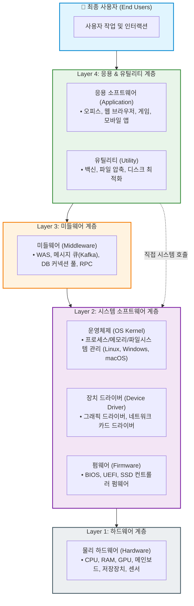
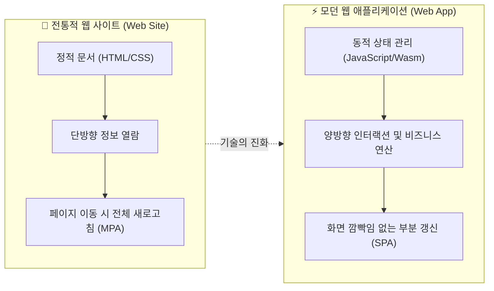
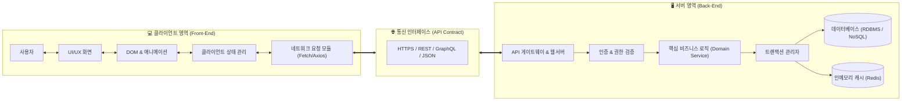
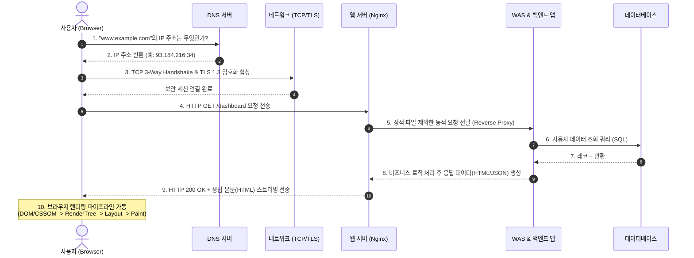
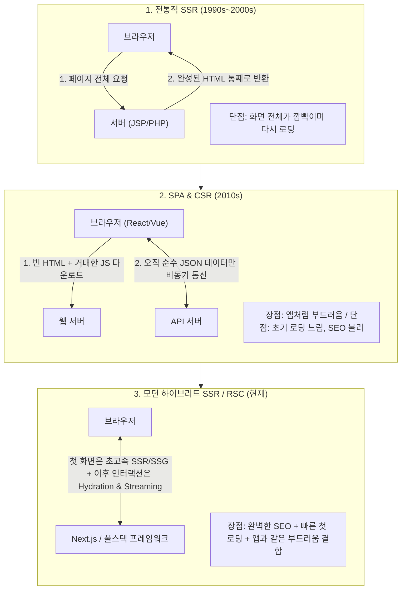
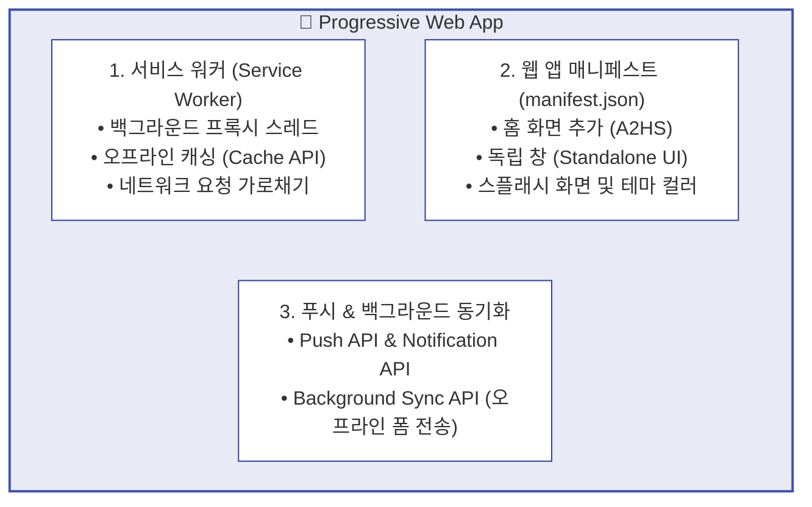

# PART 02 소프트웨어의 종류와 특징

> **"컴퓨터는 단지 믿을 수 없을 정도로 빠르고 정확한 바보일 뿐이다. 그 바보에게 생명과 지능을 불어넣는 유일한 마법이 바로 소프트웨어다."**  
> — 컴퓨터 공학의 오랜 격언

---

## 들어가며: 소프트웨어는 현대 문명의 보이지 않는 뼈대다

현대 사회에서 인간의 일상은 단 1초도 소프트웨어(Software)의 손길을 벗어나지 않습니다. 아침에 눈을 뜨며 스마트폰의 알람을 끄는 순간부터, 지하철 개찰구에 교통카드를 태그하고, 출근길에 지도 앱으로 최적 경로를 찾으며, 회사에서 클라우드 문서로 협업하고, 퇴근 후 OTT 서비스로 영화를 스트리밍하는 모든 순간에 소프트웨어가 동작하고 있습니다.

하지만 우리가 화면을 통해 손가락으로 터치하거나 마우스로 클릭하는 화려한 그래픽 인터페이스는 거대한 빙산의 일각에 불과합니다. 그 밑바닥에는 실리콘 반도체 소자를 전자기적으로 제어하는 극미세한 펌웨어부터, 수십억 줄의 코드를 조율하는 운영체제 커널, 전 세계에 흩어진 서버들을 실시간으로 연결하는 분산 미들웨어, 그리고 브라우저 상에서 초당 60프레임으로 화면을 렌더링하는 현대적 웹 엔진에 이르기까지 수많은 계층의 소프트웨어가 톱니바퀴처럼 정교하게 맞물려 돌아가고 있습니다.

소프트웨어 엔지니어나 아키텍트, 혹은 IT 기술을 깊이 있게 이해하고자 하는 사람에게 가장 먼저 요구되는 소양은 무엇일까요? 바로 **"내가 지금 작성하고 다루는 코드가 컴퓨터 시스템의 어느 계층에 위치하며, 어떤 형태의 소프트웨어로 동작하는가?"**를 입체적으로 조망하는 거시적 안목입니다.

본 파트에서는 현대 컴퓨터와 디지털 세상을 지탱하는 소프트웨어의 다채로운 분류와 본질을 탐구합니다. 시스템의 심장부에서 하드웨어를 다루는 시스템 소프트웨어부터, 사용자의 일상과 비즈니스를 혁신하는 응용 소프트웨어, 그리고 모바일과 웹 시대를 관통하는 네이티브 앱·크로스 플랫폼·하이브리드 앱·웹 애플리케이션의 아키텍처적 차이점을 완벽하게 분해해 보겠습니다.

---

## 01 소프트웨어의 종류: 컴퓨터의 영혼을 구성하는 5가지 계층

소프트웨어는 물리적 실체(Hardware)가 없는 논리적 프로그램의 집합이지만, 그 역할과 하드웨어와의 물리적 거리에 따라 매우 엄격한 위계질서(Hierarchy)를 형성하고 있습니다. 이 계층을 이해하는 것은 소프트웨어 공학의 첫걸음입니다.



---

### 1. 시스템 소프트웨어 (System Software)

시스템 소프트웨어는 **"하드웨어가 정상적으로 부팅되고, 자원을 안전하게 배분하며, 다른 응용 소프트웨어들이 안심하고 실행될 수 있는 실행 환경(Runtime Environment)을 제공하는 기반 소프트웨어"**입니다. 사용자가 직접 문서를 작성하거나 게임을 하기 위해 시스템 소프트웨어를 켜지는 않지만, 시스템 소프트웨어가 없으면 어떤 고성능 컴퓨터도 그저 뜨거운 철판과 실리콘 덩어리에 불과합니다.

시스템 소프트웨어는 내부적으로 크게 **펌웨어**, **장치 드라이버**, **운영체제**의 세 가지 단계로 세분화됩니다.

#### (1) 펌웨어 (Firmware): 하드웨어에 각인된 원초적 생명
* **정의**: 하드웨어 내부의 비휘발성 메모리(ROM, 플래시 메모리)에 영구적이거나 준영구적으로 저장되어 하드웨어를 직접 제어하는 초저수준(Low-level) 소프트웨어입니다.
* **역할 및 특징**:
  * 컴퓨터 전원 버튼을 누르는 순간 가장 먼저 실행되는 소프트웨어가 바로 펌웨어인 **BIOS(Basic Input/Output System)** 또는 최신 규격인 **UEFI(Unified Extensible Firmware Interface)**입니다.
  * CPU, 메모리, 그래픽 카드 등 필수 부품이 올바르게 장착되었는지 자가 진단(POST: Power-On Self-Test)을 수행한 후, 보조기억장치에서 운영체제 부트로더(Bootloader)를 찾아 메모리에 적재하는 역할을 맡습니다.
  * 오늘날에는 마우스, 키보드, 공유기, 가전제품, 무선 이어폰 등 단일 마이크로컨트롤러(MCU)가 탑재된 거의 모든 전자기기에 펌웨어가 탑재되어 있습니다.
  * 펌웨어 업데이트를 '소프트웨어 패치'라고 부르지 않고 '펌웨어 플래싱(Flashing)'이라고 부르는 이유는, 디스크 파일 시스템에 단순히 파일을 복사하는 것이 아니라 하드웨어 ROM 칩의 물리적 셀에 데이터를 다시 굽는 과정이기 때문입니다.

#### (2) 장치 드라이버 (Device Driver): 운영체제와 하드웨어 사이의 통역사
* **정의**: 특정 하드웨어 장치(그래픽 카드, 사운드 카드, 프린터, 웹캠, 네트워크 카드 등)와 운영체제 사이에서 명령과 데이터를 변환해 주는 전용 중계 소프트웨어입니다.
* **존재 이유**:
  * 전 세계에는 수천 개의 제조사가 만든 수만 가지 규격의 하드웨어가 존재합니다. 운영체제(예: Windows나 Linux)를 만드는 개발팀이 시중에 존재하는 모든 그래픽 칩셋이나 마우스 센서의 전기적 레지스터 신호를 코드에 직접 하드코딩해 넣는 것은 불가능합니다.
  * 따라서 운영체제는 표준화된 추상 인터페이스(API)를 정의하고, 실제 하드웨어를 만든 제조사(NVIDIA, Realtek, Samsung 등)가 그 규격에 맞춰 명령어를 변환하는 드라이버 코드를 작성하여 제공하도록 합니다.
* **동작 특성**:
  * 대부분의 드라이버는 고도의 실행 속도와 하드웨어 직접 제어가 필요하므로 운영체제의 가장 내밀한 핵심 영역인 **커널 모드(Kernel Mode)**에서 실행됩니다.
  * 따라서 드라이버 코드에 치명적인 버그나 메모리 누수가 발생하면, 운영체제 전체가 멈추며 파란 화면(Windows의 BSOD: Blue Screen of Death)이나 커널 패닉(Linux Kernel Panic)을 일으키게 됩니다.

#### (3) 운영체제 (OS, Operating System): 시스템 자원의 총사령관
* **정의**: 컴퓨터 시스템의 하드웨어 자원(CPU, 메모리, 보조기억장치, 입출력 장치)을 관리하고, 응용 프로그램에 편리한 추상화(Abstraction) 계층과 보안 장벽을 제공하는 핵심 소프트웨어입니다.
* **주요 4대 핵심 기능**:
  1. **프로세스 및 스레드 관리**: CPU 시간을 쪼개어 여러 프로그램이 마치 동시에 실행되는 것처럼 보이게 만드는 시분할 스케줄링(Context Switching, Round Robin 등).
  2. **가상 메모리 관리**: 물리 RAM의 크기 한계를 극복하고, 프로그램마다 독립된 4GB~수백TB의 주소 공간을 부여하여 서로의 메모리를 침범하지 못하도록 격리하는 페이징(Paging) 및 보호(Protection).
  3. **파일 시스템 관리**: 디스크의 0과 1 블록을 사람이 이해할 수 있는 계층적 디렉터리와 파일 구조(NTFS, ext4, APFS 등)로 추상화.
  4. **입출력(I/O) 및 시스템 호출(System Call)**: 응용 프로그램이 하드웨어에 직접 손대지 못하게 차단하고, 반드시 `sys_read()`, `sys_write()` 등의 정해진 관문을 거쳐 안전하게 하드웨어를 사용하도록 통제.
* **대표 예시**: 데스크톱/서버의 Linux, Windows, macOS, 모바일 기기의 Android, iOS 등.

---

### 2. 응용 소프트웨어 (Application Software)

응용 소프트웨어는 흔히 우리가 부르는 **'어플(App)'**이나 **'프로그램'**의 본체입니다. 컴퓨터 시스템의 유지보수나 하드웨어 제어 자체가 목적이 아니라, **"사람(최종 사용자)이 원하는 특정한 업무, 창작, 소통, 오락 등의 비즈니스 목적을 달성하기 위해 제작된 소프트웨어"**를 의미합니다.

* **특징**:
  * 하드웨어나 커널의 세부 구조를 알지 못해도 운영체제가 제공하는 API(System Call)나 런타임 위에서 손쉽게 동작합니다.
  * 사용자와 직접 만나는 **GUI(Graphical User Interface)** 또는 CLI(Command Line Interface)를 갖추고 있습니다.
* **분류 및 대표 사례**:
  * **사무 및 생산성**: Microsoft Office 365, Notion, Google Docs
  * **웹 및 인터넷**: Google Chrome, Mozilla Firefox, Safari
  * **미디어 및 창작**: Adobe Photoshop, Premiere Pro, Blender
  * **비즈니스 엔터프라이즈**: ERP(SAP), CRM(Salesforce), 결제 정산 시스템
  * **엔터테인먼트**: 3D 대작 게임(배틀그라운드, 롤), 음악/동영상 플레이어

---

### 3. 유틸리티 소프트웨어 (Utility Software)

유틸리티 소프트웨어는 응용 소프트웨어와 시스템 소프트웨어의 경계에 위치하는 독특한 소프트웨어입니다. 사용자의 직접적인 생산성 업무(예: 회계 장부 작성, 보고서 작성)를 수행하지는 않지만, **"컴퓨터 시스템의 원활한 운영, 유지보수, 보안, 성능 분석 및 최적화를 위해 보조적으로 사용되는 도구"**입니다.

* **특징**:
  * 시스템 소프트웨어처럼 하드웨어와 파일 시스템의 깊은 영역까지 접근하여 점검하지만, 운영체제 자체는 아닙니다.
  * 단일 목적에 특화되어 크기가 작고 가벼우며, 작업이 끝나면 상주하지 않거나 백그라운드 데몬으로 조용히 감시합니다.
* **대표 사례**:
  * **보안 및 진단**: 바이러스 백신(Windows Defender, V3, AhnLab), 악성코드 검사기, 방화벽 설정기
  * **저장공간 최적화**: 디스크 조각 모음, 임시 파일 정리 도구(CCleaner), 중복 파일 탐색기
  * **파일 유틸리티**: 압축 및 해제 도구(Bandizip, 7-Zip), 파일 동기화 도구
  * **시스템 분석/벤치마크**: CPU-Z, HWMonitor, 작업 관리자(Process Explorer), 패킷 캡처기(Wireshark)

---

### 4. 미들웨어 (Middleware): 분산 세상의 소프트웨어 접착제

과거에는 프로그램이 단일 컴퓨터 내부에서 OS 위에서만 실행되었기 때문에 시스템 소프트웨어와 응용 소프트웨어의 2분법으로 충분했습니다. 그러나 오늘날의 모든 서비스는 전 세계 수만 대의 컴퓨터가 네트워크로 얽힌 **분산 시스템(Distributed System)** 환경입니다. 

이때 서로 다른 이기종 운영체제(Linux, Windows), 서로 다른 프로그래밍 언어(Java, Python, Go), 서로 다른 데이터베이스 간에 데이터를 투명하게 주고받고 조율하기 위해 등장한 계층이 바로 **미들웨어(Middleware)**입니다. 미들웨어는 **"소프트웨어와 소프트웨어를 이어주는 접착제(Glue Software)"**로 불립니다.

* **핵심 역할**:
  * 서로 다른 시스템 간의 데이터 통신 프로토콜 통일
  * 동시 접속자 수십만 명을 감당하기 위한 쓰레드 풀 및 네트워크 커넥션 관리
  * 트랜잭션의 정합성 보장 및 비동기 메시지 버퍼링
* **현대 백엔드 아키텍처에서의 주요 미들웨어 군**:
  1. **WAS (Web Application Server)**: Apache Tomcat, Netty, Undertow, Node.js 엔진 등. HTTP 요청을 받아 비즈니스 로직(Java, JavaScript)을 실행하고 결과를 응답하는 웹 전용 런타임 미들웨어.
  2. **메시지 브로커 (Message Oriented Middleware - MOM)**: Apache Kafka, RabbitMQ, ActiveMQ. 대규모 시스템 간에 데이터를 실시간으로 비동기 전달하고 큐잉(Queueing)하는 파이프라인.
  3. **데이터베이스 커넥션 풀러 (Connection Pooler)**: HikariCP, PgBouncer. 애플리케이션과 DB 사이의 비싼 TCP 연결을 미리 맺어두고 재사용하는 고성능 중계기.
  4. **RPC 및 서비스 메시**: gRPC, Envoy, Istio. 마이크로서비스(MSA) 환경에서 수백 개의 서비스들이 마치 로컬 함수를 호출하듯 고속 바이너리 통신을 하도록 돕는 통신 미들웨어.

---

### 5. 임베디드 소프트웨어 (Embedded Software): 극도의 제약 속에서 피어나는 기술

임베디드 소프트웨어는 범용 컴퓨터(PC, 스마트폰, 일반 서버)가 아니라, **"특정한 목적을 위해 제작된 전용 하드웨어(Embedded System) 내부의 마이크로프로세서에서 동작하도록 내장된 소프트웨어"**입니다.

* **범용 소프트웨어와의 근본적인 차이점**:
  1. **극도의 하드웨어 자원 제약**: PC는 수십 기가바이트의 RAM을 쓰지만, 임베디드 기기는 수 킬로바이트(KB)~수 메가바이트(MB) 수준의 RAM과 저전력 MCU(ARM Cortex-M, AVR, RISC-V)에서 돌아가야 합니다. 메모리 한 바이트의 낭비도 허용되지 않습니다.
  2. **실시간성(Real-Time Guarantee)의 요구**: 일반 컴퓨터는 게임이 잠깐 0.5초 끊겨도(렉이 걸려도) 사람이 죽지 않습니다. 하지만 자동차의 에어백 제어기, 브레이크 시스템(ABS), 항공기 비행 제어기, 인공심장박동기 등의 소프트웨어는 특정 시간(예: 0.005초) 안에 연산을 끝내지 못하면 대형 인명사고로 직결됩니다. 이를 보장하기 위해 범용 OS 대신 **RTOS(Real-Time Operating System: FreeRTOS, VxWorks, QNX)**를 사용합니다.
  3. **높은 신뢰성과 무중단 실행**: 한번 제품이 양산되어 출하되거나 우주선에 탑재되면 물리적으로 소프트웨어를 수정하기 어렵기 때문에 극도로 엄격한 안전성 테스트(MISRA C 표준 등)를 거칩니다.
* **대표 분야**:
  * 자동차 전장 소프트웨어 (AUTOSAR 기반 ECU, 자율주행 센서 퓨전)
  * 스마트 가전 및 IoT (스마트 세탁기, 로봇청소기, 스마트 전구)
  * 로보틱스, 산업용 PLC, 무기 체계 및 항공우주 항공전자(Avionics)

---

### 6. 소프트웨어 5대 유형 종합 비교 분석표

| 구분 | 시스템 소프트웨어 | 응용 소프트웨어 | 유틸리티 소프트웨어 | 미들웨어 | 임베디드 소프트웨어 |
| :--- | :--- | :--- | :--- | :--- | :--- |
| **주요 목적** | 하드웨어 자원 관리 및 기본 실행 환경 제공 | 최종 사용자의 비즈니스 문제 해결 및 생산성/오락 | 시스템 관리, 유지보수, 보안 및 성능 최적화 | 분산 시스템 간의 이기종 연동 및 통신 중계 | 특수 목적 하드웨어 제어 및 실시간 반응 |
| **실행 위치** | 하드웨어 직상위 (커널 공간 / Ring 0) | 운영체제 상위 (사용자 공간 / Ring 3) | 사용자 공간 (일부 드라이버 레벨 연동) | OS와 응용 소프트웨어 사이 (네트워크 계층) | 기기 내장 ROM/플래시 메모리 (Bare-metal or RTOS) |
| **하드웨어 종속성** | **매우 높음** (CPU 아키텍처, 칩셋에 종속) | **낮음** (OS API 및 런타임에 종속) | **중간** (파일 시스템, 하드웨어 사양에 영향) | **매우 낮음** (네트워크 표준 프로토콜 기반 독립적) | **극도로 높음** (회로 설계, MCU 핀맵에 100% 종속) |
| **주요 사용자** | 운영체제 엔지니어, 응용 프로그램(간접) | 일반 최종 사용자 (소비자, 직장인 등) | 시스템 관리자, 컴퓨터 사용자 | 백엔드 엔지니어, 분산 시스템 아키텍트 | 하드웨어 엔지니어, 펌웨어 개발자 |
| **성능 병목 요인**| CPU 콘텍스트 스위칭, 인터럽트 처리 지연 | 비즈니스 알고리즘, 렌더링/UI 반응 속도 | I/O 디스크 탐색 속도, 바이러스 DB 검색 오버헤드 | 네트워크 레이턴시, 직렬화/역직렬화 비용 | CPU 클럭 제약, RAM 용량 부족, 데드라인 미달 |
| **대표 예시** | Linux 커널, Windows 11, NVIDIA 그래픽 드라이버 | Chrome, Photoshop, MS Excel, 카카오톡 | V3 백신, 알집, Bandizip, 작업 관리자 | Apache Kafka, Tomcat, Redis, gRPC | 자동차 ABS 제어기, 로봇청소기 펌웨어, 스마트워치 |

---

## 02 웹, 웹 앱, 네이티브 앱, 하이브리드 앱의 차이: 플랫폼의 선택과 진화

스마트폰의 탄생 이후 소프트웨어 개발의 무게중심은 데스크톱 단일 실행 파일(`.exe`)에서 **모바일 디바이스**와 **웹 브라우저**로 급격히 이동했습니다. 개발자와 아키텍트는 프로젝트를 시작할 때 언제나 중대한 갈림길에 섭니다.

> *"우리의 서비스를 웹으로 만들 것인가, 앱으로 만들 것인가? 앱이라면 네이티브로 짤 것인가, 크로스 플랫폼으로 만들 것인가?"*

이 질문에 올바르게 답하기 위해서는 각 플랫폼의 기술적 메커니즘과 장단점을 뼈속까지 꿰뚫고 있어야 합니다.

---

### 1. 웹 사이트 vs 웹 애플리케이션: 문서에서 소프트웨어로

우리가 매일 주소창에 URL을 치고 들어가는 웹(Web)은 지난 30년간 극적인 패러다임 변화를 겪었습니다.



* **웹 사이트 (Web Site)**:
  * **본질**: 하이퍼텍스트(Hypertext) 문서의 모음입니다. 인터넷 초기의 웹처럼 텍스트, 이미지, 링크로 구성되어 **정보를 일방향으로 읽고 탐색하는 것**이 주된 목적입니다.
  * **동작 방식**: 사용자가 링크를 클릭하면 브라우저는 서버에 완전히 새로운 HTML 문서를 요청하고, 전체 화면이 하얗게 깜빡이며 새 페이지를 처음부터 다시 그립니다(Multi-Page Application: MPA).
  * **대표 예시**: 기업 홍보용 웹페이지, 단순 블로그, 뉴스 기사 사이트, 위키백과.
* **웹 애플리케이션 (Web Application)**:
  * **본질**: 브라우저라는 가상 머신(V8 등의 JS 엔진) 위에서 실행되는 **정교한 소프트웨어**입니다.
  * **동작 방식**: 단순한 문서 열람을 넘어 사용자가 데이터를 생성하고, 편집하고, 실시간으로 통신합니다. 초기 진입 시 자바스크립트 애플리케이션 번들이 브라우저에 다운로드된 뒤, 서버와는 화면 전체가 아닌 **순수 데이터(JSON)**만을 비동기(AJAX/Fetch)로 주고받으며 UI의 특정 영역만 부드럽게 갱신합니다(Single Page Application: SPA).
  * **대표 예시**: Google Docs, Figma(웹에서 돌아가는 전문가용 2D/3D 벡터 그래픽 도구), Notion, Spotify 웹 플레이어.

---

### 2. 네이티브 앱 (Native App): 성능의 정점과 플랫폼의 지배자

* **정의**: 특정 모바일 운영체제(iOS 또는 Android)에 전적으로 특화된 프로그래밍 언어와 전용 SDK(Software Development Kit)를 사용하여 빌드된 애플리케이션입니다.
  * **iOS**: Swift 또는 Objective-C 언어 + Xcode IDE + Apple Cocoa Touch 프레임워크 (UIKit, SwiftUI)
  * **Android**: Kotlin 또는 Java 언어 + Android Studio + Android SDK (Android Views, Jetpack Compose)
* **아키텍처 원리**:
  * 소스 코드가 최종적으로 각 모바일 디바이스의 CPU(주로 ARM 아키텍처)가 직접 이해할 수 있는 기계어 바이너리(Mach-O, ELF) 또는 안드로이드 전용 가상 머신 바이트코드(ART/DEX)로 완벽하게 사전 컴파일(AOT: Ahead-Of-Time Compilation)됩니다.
  * 중간 통역사나 브릿지 없이 운영체제의 커널 및 하드웨어 API를 직통으로 호출합니다.

```
[ 네이티브 앱 아키텍처 ]
┌────────────────────────────────────────────────────────┐
│               iOS / Android Native App                 │
│              (Swift / Kotlin 코드로 작성)              │
└────────────────────────────────────────────────────────┘
                           │ (직접 호출: No Bridge)
                           ▼
┌────────────────────────────────────────────────────────┐
│           Platform SDK & UI Components                 │
│      (SwiftUI, Jetpack Compose, Metal, CoreGraphics)   │
└────────────────────────────────────────────────────────┘
                           │
                           ▼
┌────────────────────────────────────────────────────────┐
│          OS Kernel & Hardware (CPU / GPU)              │
└────────────────────────────────────────────────────────┘
```

* **장점**:
  1. **압도적인 성능과 부드러움**: 120Hz 고주사율 디스플레이(Apple ProMotion 등)에서도 프레임 드랍(Stuttering) 없는 극한의 반응 속도와 렌더링 성능을 자랑합니다.
  2. **하드웨어 100% 활용**: 카메라 하드웨어의 초점 제어, 라이다(LiDAR) 센서, Face ID, 블루투스 저전력(BLE), 백그라운드 위치 추적, 햅틱 진동 피드백 등 기기의 모든 최신 기능을 OS 업데이트 당일부터 지체 없이 사용할 수 있습니다.
  3. **완벽한 플랫폼 UI/UX 일관성**: 애플의 인간 중심 인터페이스 가이드라인(HIG)이나 구글의 머티리얼 디자인(Material You)을 완벽하게 준수하여 사용자에게 가장 친숙한 제스처와 애니메이션을 제공합니다.
* **단점**:
  1. **막대한 개발 비용과 시간**: iOS 앱과 Android 앱을 각각 완전히 다른 언어와 도구로 두 번 개발해야 하므로, 개발팀이 2배로 필요하고 유지보수 비용도 정직하게 2배가 듭니다.
  2. **앱스토어 심사 및 배포 지연**: 코드를 단 한 줄 수정하더라도 Apple App Store와 Google Play Store의 엄격한 검수 과정을 거쳐야 하며, 승인까지 수 시간에서 수일이 소요됩니다.
  3. **사용자의 업데이트 의존성**: 사용자가 스토어에서 직접 '업데이트' 버튼을 누르지 않으면 버그가 수정된 최신 버전을 강제 적용하기 어렵습니다.

---

### 3. 하이브리드 앱 & 크로스 플랫폼 앱: 타협과 혁신의 공존

네이티브 앱의 치명적인 단점인 **"높은 개발 비용과 중복 개발"**을 해결하기 위해, 하나의 소스 코드로 iOS와 Android를 동시에 정복하려는 다양한 시도가 이루어져 왔습니다.

```mermaid
flowchart TD
    subgraph Hybrid ["1. 웹뷰 기반 하이브리드 (Cordova/Capacitor)"]
        H_App["HTML/CSS/JS 코드"] --> H_WV["웹뷰 브라우저 엔진 (WebKit)"]
        H_WV -->|플러그인 브릿지| H_Native["네이티브 쉘 (Java/Obj-C)"]
        H_Native --> H_HW["기기 하드웨어"]
    end

    subgraph CrossRN ["2. JS 브릿지 크로스 플랫폼 (React Native)"]
        RN_App["React (JavaScript/TS)"] --> RN_Bridge["JSI / 비동기 브릿지"]
        RN_Bridge --> RN_NativeUI["실제 네이티브 UI 컴포넌트<br>(UIView / android.view)"]
        RN_NativeUI --> RN_HW["기기 하드웨어"]
    end

    subgraph CrossFlutter ["3. 자체 엔진 크로스 플랫폼 (Flutter)"]
        F_App["Dart 코드"] --> F_Engine["Flutter 렌더링 엔진<br>(Impeller / Skia)"]
        F_Engine -->|화면 픽셀 직접 드로잉| F_GPU["GPU / 하드웨어"]
    end

    classDef c1 fill:#FFF9C4,stroke:#FBC02D,stroke-width:2px;
    classDef c2 fill:#E1BEE7,stroke:#8E24AA,stroke-width:2px;
    classDef c3 fill:#C8E6C9,stroke:#388E3C,stroke-width:2px;

    class Hybrid c1;
    class CrossRN c2;
    class CrossFlutter c3;
```



#### (1) 웹뷰 기반 하이브리드 앱 (WebView-based Hybrid App)
* **대표 기술**: Apache Cordova(PhoneGap), Ionic, Capacitor
* **구조와 원리**:
  * 겉포장(Wrapper)만 네이티브 앱의 틀을 씌워 두고, 실제 앱 내부 화면은 **웹뷰(WebView: 모바일 브라우저 창)** 하나를 띄운 뒤 그 안에서 HTML, CSS, JavaScript로 만든 웹페이지를 실행합니다.
  * 기기의 카메라나 GPS를 써야 할 때는 자바스크립트와 네이티브 코드 사이에 미리 만들어 둔 '플러그인 브릿지'를 통해 명령을 주고받습니다.
* **장단점**:
  * **장점**: 기존에 만들어 둔 웹사이트 코드를 그대로 가져와 하루 만에 앱으로 포장할 수 있습니다. 웹 기술자만으로 모바일 앱을 출시할 수 있습니다.
  * **단점**: 스크롤 버벅임, 제스처 반응 지연 등 **사용자 경험이 극히 떨어집니다.** 브라우저 위에서 가상으로 렌더링되다 보니 스마트폰 특유의 쫀득한 스크롤링과 네이티브 감성을 흉내 내기 어렵습니다.

#### (2) 리액트 네이티브 (React Native): 네이티브 UI를 조종하는 자바스크립트
* **대표 기술**: Meta(페이스북)의 React Native
* **구조와 원리**:
  * 하이브리드 앱처럼 웹뷰에 HTML을 띄우는 것이 아닙니다.
  * 개발자는 React 문법으로 자바스크립트 코드를 작성하지만, 화면에 렌더링되는 것은 실제 iOS의 `UIView`와 안드로이드의 `android.widget` 같은 **진짜 네이티브 UI 위젯**입니다.
  * 자바스크립트 스레드와 네이티브 스레드가 **브릿지(Bridge)** 또는 최신 아키텍처의 **JSI(JavaScript Interface)**를 통해 C++ 수준에서 고속으로 소통합니다.
* **장점**: 하이브리드 앱보다 월등히 빠르며, 네이티브 앱에 준하는 준수한 UI 완성도를 가집니다. 이미 방대한 웹 개발자(React) 인력을 모바일 앱 개발로 즉시 투입할 수 있습니다.

#### (3) 플러터 (Flutter): 화면 픽셀을 직접 그리는 캔버스
* **대표 기술**: Google의 Flutter (Dart 언어 사용)
* **구조와 원리**:
  * 네이티브 UI 위젯을 빌려 쓰는 React Native와 달리, 플러터는 게임 엔진처럼 화면 전체를 하나의 도화지로 보고 자체 2D 그래픽 렌더링 엔진(**Impeller**, 구 Skia)을 통해 **화면의 모든 픽셀을 직접 그립니다(Canvas Rendering).**
* **장점**:
  * iOS든 Android든 구형 기기든 상관없이 **완벽하게 100% 동일한 UI 화면과 애니메이션**을 보장합니다.
  * 네이티브 위젯으로 변환하는 오버헤드가 없어 크로스 플랫폼 중 가장 뛰어난 초당 60~120fps의 부드러운 그래픽 성능을 발휘합니다.

---

### 4. 플랫폼 형태별 완벽 비교 분석표

| 비교 항목 | 모바일 웹 (Web) | 웹뷰 하이브리드 앱 | 크로스 플랫폼 (RN / Flutter) | 네이티브 앱 (iOS/Android) |
| :--- | :--- | :--- | :--- | :--- |
| **렌더링 방식** | 브라우저 DOM 렌더링 | 앱 내 웹뷰(WebView) 렌더링 | 네이티브 뷰 매핑(RN) / 자체 엔진 픽셀 렌더링(Flutter) | OS 네이티브 렌더링 엔진 |
| **실행 성능** | 보통 (네트워크 의존적) | 낮음 (스크롤 끊김 및 지연 발생) | **높음** (네이티브의 85~95% 수준) | **최상 (100% 하드웨어 가속)** |
| **하드웨어 접근성** | 매우 제한적 (카메라/GPS 일부) | 중간 (플러그인 지원 범위 내) | **우수함** (대부분 지원, 네이티브 모듈 연동 가능) | **완벽함 (모든 센서 및 최신 API 즉각 지원)** |
| **개발 생산성** | **최상** (단일 웹 개발) | **최상** (기존 웹 자산 100% 재활용) | **매우 높음 (단일 코드베이스로 80~90% 공유)** | **낮음 (플랫폼별 100% 별도 개발 필요)** |
| **초기 개발 비용** | 매우 저렴함 | 매우 저렴함 | **합리적 (1개 팀으로 양대 마켓 공략)** | **매우 비쌈 (iOS팀 + 안드로이드팀 별도 구성)** |
| **배포 및 업데이트** | **즉시 배포 (URL 반영)** | 즉시 배포 (웹 영역은 OTA 패치 가능) | 스토어 심사 필요 (단, JS 번들은 CodePush 지원) | **스토어 심사 필수 (수 시간~수일 소요)** |
| **앱스토어 노출** | 불가능 (검색엔진 SEO 의존) | 가능 (스토어 등록) | **가능 (스토어 등록 및 ASO 최적화)** | **가능 (스토어 피처드 선정 유리)** |
| **적합한 프로젝트** | 정보 전달형 사이트, 프로토타입 | 사내 인트라넷, 단순 쇼핑몰, 콘텐츠 뷰어 | **대부분의 스타트업 서비스, 범용 B2C/B2B 서비스** | **3D 그래픽/게임, 실시간 영상처리, 금융/보안 고도화 앱** |

---

## 03 프론트엔드와 백엔드: 보이지 않는 분업의 예술

소프트웨어 개발 분야를 처음 접하는 사람들이 가장 많이 듣는 용어가 바로 **"프론트엔드(Frontend)"**와 **"백엔드(Backend)"**입니다. 이 두 진영의 분리는 단순히 업무를 쪼갠 것이 아니라, 현대 컴퓨터 과학이 지향하는 **"관심사의 분리(Separation of Concerns)"**와 **"클라이언트-서버 모델"**이라는 근본 철학에서 비롯되었습니다.



---

### 1. 프론트엔드(Frontend): 사용자가 경험하는 시각적 우주

프론트엔드는 **"사용자의 디바이스(브라우저, 스마트폰 화면 등)에서 직접 실행되며, 사용자와 시스템 간의 시각적·촉각적 인터랙션을 담당하는 모든 영역"**을 총칭합니다.

* **핵심 책임**:
  1. **UI/UX 구현**: 디자이너의 시각적 디자인을 한 픽셀의 오차도 없이 모든 크기의 화면(스마트폰, 태블릿, 데스크톱)에 반응형(Responsive)으로 깨지지 않게 구현합니다.
  2. **상태 관리(State Management)**: 사용자가 버튼을 클릭하고, 모달창을 띄우고, 폼에 텍스트를 입력할 때 변화하는 수많은 실시간 데이터('상태')를 추적하고 화면을 일관성 있게 동기화합니다.
  3. **렌더링 성능 최적화**: 1초라도 로딩이 느리면 사용자는 이탈합니다. 이미지 최적화, 코드 분할(Code Splitting), 렌더링 트리거 최소화를 통해 첫 화면(FCP, LCP)을 번개처럼 띄워야 합니다.
  4. **인간 공학적 배려**: 웹 접근성(a11y)을 고려하여 시각 장애인도 스크린 리더기로 웹을 탐색할 수 있게 시맨틱 태그를 작성하고, 키보드 네비게이션을 지원합니다.

---

### 2. 백엔드(Backend): 시스템의 신뢰성을 담보하는 보이지 않는 심장

백엔드는 사용자의 눈에 전혀 보이지 않는 원격지의 물리적/가상화된 서버 컴퓨터 내부에서 실행됩니다. **"비즈니스의 핵심 규칙(Business Logic)을 집행하고, 데이터를 안전하게 영구 저장하며, 거대한 트래픽 속에서도 시스템이 다운되지 않도록 지탱하는 모든 영역"**을 담당합니다.

* **핵심 책임**:
  1. **비즈니스 로직(Business Rules) 구현**: 
     * 예: "계좌에 잔액이 있을 때만 출금되어야 한다", "할인 쿠폰은 1인당 1회만 발급된다", "주문이 완료되면 재고 수량을 1 차감하고 배송 시스템에 신호를 보낸다"와 같은 실제 사업의 핵심 규칙을 코드로 철통같이 집행합니다.
  2. **사용자 인증 및 인가 (AuthN & AuthZ)**:
     * 로그인한 사용자가 정말 본인이 맞는지(Authentication: JWT 토큰, OAuth2, 세션 검증) 확인하고, 그 사용자가 관리자 페이지에 접근할 자격이 있는지(Authorization) 검문합니다.
  3. **데이터의 영속성(Persistence)과 트랜잭션 보장**:
     * 전원이 꺼져도 데이터가 날아가지 않도록 데이터베이스에 저장하며, 은행 송금처럼 여러 단계의 작업이 일어날 때 중간에 에러가 나면 모든 것을 원점으로 되돌리는 **ACID 트랜잭션(Atomicity, Consistency, Isolation, Durability)**을 보장합니다.
  4. **확장성(Scalability)과 고가용성(High Availability)**:
     * 블랙프라이데이나 수강신청처럼 수십만 명의 사용자가 동시에 몰려올 때 서버가 터지지 않도록 트래픽을 여러 서버로 분산(Load Balancing)하고, 병목을 캐싱(Redis)하여 99.99% 이상의 무중단 서비스를 유지합니다.

---

### 3. 식당의 완벽한 비유: 홀(Hall)과 주방(Kitchen)

프론트엔드와 백엔드의 상호작용은 고급 레스토랑의 운영 방식과 놀라울 정도로 완벽하게 일치합니다.

```
[ 식당의 홀 (Frontend) ]                       [ 식당의 주방 (Backend) ]
┌───────────────────────────────────────┐     ┌───────────────────────────────────────┐
│ • 손님 (User)                         │     │ • 주문 접수대 (API Gateway / Controller)
│ • 테이블 & 인테리어 (UI / 레이아웃)    │     │ • 주방장 / 셰프 (Service / Business Logic)
│ • 메뉴판 (클라이언트 컴포넌트 & 라우팅)│     │ • 레시피 북 (도메인 비즈니스 룰)       │
│ • 주문표 작성 (폼 입력 & 클라이언트 유효성)│  │ • 식자재 창고 (Database: PostgreSQL) │
│                                       │     │ • 쇼케이스 신선실 (Cache: Redis)      │
│        ▼                              │     │ • 위생 검사관 (인증/인가 미들웨어)     │
│ [웨이터 (HTTP Request / Response)] ───┼─────┼──►                                    │
│ "3번 테이블 스테이크 미디움 1개 주문이요!"│   │                                       │
└───────────────────────────────────────┘     └───────────────────────────────────────┘
```

* **손님(User)**: 화면을 터치하고 서비스를 이용하는 최종 사용자입니다.
* **식당 인테리어와 테이블(UI Design & Layout)**: 손님이 쾌적함을 느끼고 서비스를 이용하기 편하도록 배치된 시각적 화면입니다.
* **메뉴판(Front-end Components)**: 손님이 주문할 수 있는 선택지 목록을 보여줍니다.
* **손님의 주문서 작성(Form Validation)**: 손님이 메뉴판에 없는 메뉴를 적으려고 하면 웨이터를 부르기도 전에 "저희 식당엔 없는 메뉴입니다"라고 미리 걸러냅니다(클라이언트 폼 유효성 검사).
* **웨이터(API / Network Protocol)**:
  * 손님이 주문을 완료하면 웨이터는 주방으로 달려가 주문서를 전달합니다(**HTTP POST 요청**).
  * 주방에서 요리가 완성되면 접시를 받아 손님 테이블로 가져다줍니다(**HTTP 응답 및 JSON 데이터 전달**).
  * 웨이터는 홀과 주방 사이의 규격화된 약속(API 명세서)에 따라 움직입니다.
* **주방 입구의 위생 검사관(Authentication & Authorization)**: 외부인이 주방에 함부로 들어오지 못하게 막고, 주문서에 위조된 결제 도장이 찍혀 있지 않은지 확인합니다.
* **요리사/주방장(Backend Service & Business Logic)**: 
  * 손님의 눈에 보이지 않는 곳에서 분주하게 움직입니다.
  * 레시피(비즈니스 룰)에 따라 화력을 조절하고, 스테이크를 굽습니다. "재고가 떨어진 고기는 판매하지 않는다"는 규칙을 엄격히 집행합니다.
* **식자재 창고(Database)**: 대량의 신선한 고기, 채소, 와인이 유통기한과 품목별로 체계적으로 정리되어 있는 대형 냉동창고입니다.
* **자주 쓰는 양념통/반찬통(Cache Server - Redis)**: 매번 먼 창고까지 가지 않고 요리사 손 바로 닿는 곳에 소금과 소스를 준비해 두어 요리 시간을 대폭 단축합니다.

---

### 4. 영역별 현대 기술 스택 (Tech Stack) 총정리

현대 IT 생태계는 고도화된 전문성을 요구하며, 프론트엔드와 백엔드 각각 방대하고 체계적인 기술 로드맵이 구축되어 있습니다.

#### (1) 프론트엔드 개발자 핵심 기술 스택
* **언어와 기초**:
  * **HTML5 / CSS3**: 웹 표준 시맨틱 태그, Flexbox 및 CSS Grid 레이아웃 시스템, 미디어 쿼리
  * **JavaScript (ES6+)**: 비동기 처리(Promise, `async/await`), 클로저, 이벤트 루프
  * **TypeScript**: 런타임 에러를 컴파일 시점에 잡아내기 위한 정적 타입 시스템 (현업의 사실상 표준)
* **모던 UI 프레임워크 & 라이브러리**:
  * **React**: 컴포넌트 기반 아키텍처와 가상 DOM(Virtual DOM)을 대중화한 전 세계 1위 라이브러리
  * **Vue.js**: 진입 장벽이 낮고 직관적인 템플릿 문법을 가진 프레임워크
  * **Svelte**: 가상 DOM 없이 빌드 타임에 순수 자바스크립트로 변환하는 고성능 신흥 강자
* **풀스택 메타 프레임워크**:
  * **Next.js (React 기반)**, **Nuxt (Vue 기반)**, **SvelteKit**: 서버 사이드 렌더링(SSR), 정적 사이트 생성(SSG), API 라우트를 통합 제공하는 모던 웹의 핵심 표준
* **상태 관리 도구**:
  * 전역 클라이언트 상태: **Zustand**, **Redux Toolkit**, Recoil
  * 서버 비동기 캐시 상태: **TanStack Query (React Query)**, SWR
* **스타일링 & 빌드 도구**:
  * 스타일: **Tailwind CSS** (유틸리티 퍼스트 CSS), Styled-Components, Emotion
  * 빌드 도구: **Vite** (초고속 ESM 기반 번들러), Turbopack, Webpack

#### (2) 백엔드 개발자 핵심 기술 스택
* **언어와 프레임워크**:
  * **Java**: **Spring Boot** (엔터프라이즈 기업, 금융, 대기업의 절대 강자, 견고한 객체지향 아키텍처)
  * **JavaScript/TypeScript**: **Node.js**, **NestJS**, Express (비동기 논블로킹 I/O, 빠른 개발 생산성)
  * **Python**: **FastAPI**, Django (간결한 문법, AI/데이터 파이프라인과의 완벽한 결합)
  * **Go (Golang)**: 경량 스레드(Goroutine) 기반 초고성능 동시성 처리, 마이크로서비스 및 인프라 도구에 널리 활용
* **데이터베이스 (Database)**:
  * **RDBMS (관계형 데이터베이스)**: **PostgreSQL**, **MySQL**, Oracle. 엄격한 스키마와 ACID 트랜잭션 보장.
  * **NoSQL (비관계형 데이터베이스)**: **MongoDB** (유연한 도큐먼트 저장), DynamoDB, Cassandra (수평 확장 분산 DB).
  * **In-Memory Cache**: **Redis** (초고속 세션 저장, 랭킹 리더보드, 캐싱 레이어).
* **통신 프로토콜 & API**:
  * **RESTful API**: HTTP 메서드(GET, POST, PUT, DELETE) 기반의 가장 널리 쓰이는 표준.
  * **GraphQL**: 클라이언트가 필요한 데이터 필드만 정확히 골라서 요청할 수 있는 쿼리 언어.
  * **gRPC / Protocol Buffers**: 고속 직렬화 바이너리 통신 (마이크로서비스 간 통신 표준).
  * **WebSocket**: 주식 차트, 실시간 채팅 등을 위한 지속적인 양방향 소켓 연결.
* **인프라, 컨테이너, 데브옵스 (DevOps)**:
  * **Docker**: 애플리케이션을 실행 환경과 함께 독립된 컨테이너로 패키징.
  * **Kubernetes (K8s)**: 수백, 수천 개의 컨테이너를 자동으로 배포, 확장, 복구하는 오케스트레이션 도구.
  * **Cloud Platform**: AWS (EC2, S3, RDS, Lambda), GCP, Azure.
  * **CI/CD 파이프라인**: GitHub Actions, Jenkins, ArgoCD (코드 커밋 시 자동 빌드, 테스트, 무중단 배포).

---

## 04 웹 애플리케이션 개발: 요청에서 픽셀까지의 대여정

우리가 브라우저 주소창에 `https://www.google.com`을 입력하고 키보드 `Enter`를 누른 뒤, 모니터에 화려한 검색 포털 화면이 나타나기까지는 단 **0.3~0.8초**의 시간이 걸립니다. 그러나 이 찰나의 순간 동안 컴퓨터 과학의 50년 역사가 압축된 경이로운 대장정이 펼쳐집니다.

이 흐름(Critical Path)을 한 치의 오차도 없이 이해하는 것은 웹 애플리케이션 개발자의 가장 중요한 기본기입니다.

---

### 1. 엔드투엔드(End-to-End) 요청-응답-렌더링 7단계 전체 흐름



#### STEP 1: 브라우저 캐시 검사 및 DNS 조회 (이름을 좌표로)
1. 사용자가 URL을 입력하면, 브라우저는 가장 먼저 자신의 내부 메모리에 해당 주소에 대한 접속 기록이 있는지 **브라우저 캐시**, **OS의 Hosts 파일**, **라우터 캐시**를 순서대로 확인합니다.
2. 캐시에 없다면 전 세계 인터넷의 전화번호부인 **DNS(Domain Name System) 서버**에 질의합니다.
   * `Root DNS` → `.com Top-Level Domain(TLD) DNS` → `example.com Authoritative DNS`를 거치며 사람이 읽는 도메인을 기계가 통신할 수 있는 IP 주소(예: `93.184.216.34`)로 번역하여 받아옵니다.

#### STEP 2: TCP 3-Way Handshake와 TLS 1.3 암호화 협상 (신뢰의 다리 놓기)
1. 획득한 IP 주소의 표준 웹 포트(HTTP는 80, HTTPS는 443)로 통신을 시작하기 위해 **전송 계층(Transport Layer)의 TCP 3-Way Handshake**를 수행합니다:
   * **SYN**: 클라이언트가 서버에 "통신을 시작하고 싶습니다(시퀀스 번호 X)" 패킷을 전송.
   * **SYN-ACK**: 서버가 "요청을 확인했습니다. 저도 통신할 준비가 되었습니다(시퀀스 번호 Y, ACK X+1)"라고 응답.
   * **ACK**: 클라이언트가 "확인했습니다(ACK Y+1)"를 보내며 가상의 신뢰성 있는 파이프라인을 엽니다.
2. 오늘날 거의 모든 웹은 보안 프로토콜인 **HTTPS**를 사용합니다. 따라서 즉시 **TLS(Transport Layer Security) 핸드셰이크**가 이어집니다.
   * 서버의 디지털 인증서를 검증하고, 비대칭키 암호화(RSA, 타원곡선 등)를 사용해 이번 세션에서만 사용할 대칭 암호화 키를 안전하게 공유합니다. 이제부터 오고 가는 모든 패킷은 제3자가 감청할 수 없게 암호화됩니다.

#### STEP 3: HTTP 요청 메시지 전송 (용건을 말하다)
보안 터널이 완성되면 브라우저는 표준 HTTP 요청 규격에 맞춰 텍스트 기반 요청 메시지를 전송합니다:
```http
GET /products/42 HTTP/1.1
Host: www.example.com
User-Agent: Mozilla/5.0 (Windows NT 10.0; Win64; x64) Chrome/128.0.0.0
Accept: text/html,application/xhtml+xml,application/json
Authorization: Bearer eyJhbGciOi... (JWT 인증 토큰)
Cookie: sessionId=abc123xyz
```

#### STEP 4 & 5: 웹 서버(Web Server)와 WAS의 협업 (관문 통과와 로직 처리)
1. 인터넷 최전선에 서 있는 **웹 서버(예: Nginx, Apache, Cloudflare)**가 요청을 수신합니다.
   * 이미지, 폰트, CSS와 같은 정적 파일(Static Assets) 요청이라면 웹 서버가 백엔드까지 가지 않고 디스크나 캐시에서 즉시 반환합니다.
   * 복잡한 데이터 조회나 로그인이 필요한 동적 요청이라면, 웹 서버는 리버스 프록시(Reverse Proxy) 역할을 하여 내부 네트워크의 **WAS(Web Application Server: Spring Boot, Express, Django 등)**로 요청을 전달합니다.
2. WAS의 컨트롤러(Controller)가 요청을 받아 파라미터를 검증하고, 서비스(Service) 레이어의 비즈니스 로직을 호출합니다.
3. 데이터베이스와 통신하여 SQL 쿼리를 실행하고(STEP 6, 7), 결과를 가공하여 최종 응답 데이터를 만듭니다.

#### STEP 6: HTTP 응답 메시지 반환 (결과를 돌려주다)
서버는 처리 결과를 HTTP 상태 코드와 함께 클라이언트로 보냅니다:
```http
HTTP/1.1 200 OK
Content-Type: text/html; charset=UTF-8
Content-Length: 15420
Cache-Control: max-age=3600

<!DOCTYPE html>
<html lang="ko">
<head> ... </head>
<body> ... </body>
</html>
```

#### STEP 7: 브라우저 렌더링 파이프라인 (Critical Rendering Path)
응답받은 HTML 바이트 스트림이 브라우저에 도착하면, 브라우저 엔진(Blink, WebKit, Gecko)이 가동되어 픽셀을 모니터에 그리는 5단계 연산을 수행합니다:

```
[ 브라우저 렌더링 엔진 파이프라인 ]
1. HTML 바이트 ──► 토큰화 ──► 노드 생성 ──► DOM 트리 구축
                                            │
2. CSS 바이트  ──► 토큰화 ──► 노드 생성 ──► CSSOM 트리 구축
                                            │
                                            ▼
3. DOM + CSSOM 결합 ─────────────► Render Tree (화면에 보일 요소만 선별)
                                            │
                                            ▼
4. Layout (Reflow) ──────────────► 각 요소의 정확한 화면 좌표/크기 계산 (px)
                                            │
                                            ▼
5. Paint & Composite ────────────► 픽셀 색칠 및 레이어 합성 후 GPU 최종 출력!
```

1. **DOM(Document Object Model) 트리 생성**: HTML 문서를 한 줄씩 읽어 내려가며 태그의 부모-자식 관계를 객체 트리 구조로 만듭니다.
2. **CSSOM(CSS Object Model) 트리 생성**: `<link>` 태그나 `<style>` 태그의 CSS를 파싱하여 스타일 규칙 트리를 만듭니다.
3. **Render Tree(렌더 트리) 생성**: DOM과 CSSOM을 결합합니다. 화면에 실제로 표시되지 않는 `<head>`, `<script>`, 또는 `display: none`이 적용된 요소는 렌더 트리에서 완전히 제외됩니다.
4. **Layout (Reflow, 배치)**: 기기의 뷰포트(Viewport) 크기를 기준으로, 각 렌더 트리의 박스가 화면의 가로 몇 픽셀, 세로 몇 픽셀에 위치해야 하는지 기하학적 좌표(Geometry)를 계산합니다.
5. **Paint & Composite (페인팅 및 합성)**: 요소의 배경색, 테두리, 그림자, 글자 폰트를 실제 픽셀 단위로 색칠합니다(Paint). 마지막으로 요소들을 여러 개의 GPU 레이어로 쪼개어 가속한 뒤 하나로 합쳐(Composite) 최종 모니터 화면에 투영합니다.

---

### 2. 웹 프론트엔드의 삼위일체: HTML, CSS, JavaScript의 역할

웹 브라우저가 화면을 그리기 위해 이해하는 원천 기술은 오직 3가지뿐입니다. 이 세 기술은 건물을 짓는 과정이나 인체 구조에 완벽하게 빗댈 수 있습니다.

```
┌─────────────────┬─────────────────┬─────────────────┐
│ HTML (구조)     │ CSS (표현)      │ JavaScript (동작)│
├─────────────────┼─────────────────┼─────────────────┤
│ • 건물의 골조/벽│ • 인테리어/도색 │ • 전기/엘리베이터│
│ • 인체의 뼈대   │ • 피부/옷/헤어  │ • 근육/신경/뇌  │
└─────────────────┴─────────────────┴─────────────────┘
```

#### (1) HTML (HyperText Markup Language): 뼈대와 의미(Semantics)
* **역할**: 웹페이지에 어떤 요소(제목, 문단, 이미지, 버튼, 표)가 존재하는지 구조를 정의하고 의미(Semantics)를 부여합니다.
* **중요성**: 단순히 `<div>` 태그로 도배하는 것이 아니라 `<header>`, `<nav>`, `<main>`, `<article>`, `<footer>`와 같은 시맨틱 태그를 올바르게 작성해야 구글 검색 로봇이 문서를 이해할 수 있고(SEO 최적화), 시각 장애인용 보조기기가 콘텐츠를 읽을 수 있습니다(접근성).

#### (2) CSS (Cascading Style Sheets): 시각적 표현과 공간의 미학
* **역할**: HTML로 세운 무미건조한 뼈대에 색상, 글꼴, 여백, 정렬, 애니메이션, 그림자 효과를 입힙니다.
* **특징**: 모바일, 태블릿, 초고해상도 모니터 등 사용자의 다양한 화면 너비에 맞춰 레이아웃을 유연하게 재배치하는 **반응형 웹 디자인(Responsive Web Design - Media Query, Flexbox, Grid)**을 가능하게 합니다.

#### (3) JavaScript (JS): 생명을 불어넣는 뇌와 신경망
* **역할**: 정적인 문서에 동적인 상호작용과 생명력을 불어넣습니다.
* **주요 동작**:
  * 사용자가 마우스를 올리거나 스크롤할 때 발생하는 이벤트(Event)를 감지하여 반응합니다.
  * 이미 렌더링된 DOM을 실시간으로 조작하여 화면을 새로고침하지 않고도 새로운 목록을 추가하거나 색상을 바꿉니다.
  * 백그라운드에서 서버와 비동기 통신(Fetch API, AJAX)을 수행하여 최신 주가 정보나 새로운 메시지를 가져옵니다.

---

### 3. 프론트엔드-백엔드 연동 방식의 진화

웹 애플리케이션 개발 방식은 브라우저의 성능 향상과 네트워크 대역폭의 증가에 발맞추어 끊임없이 진화해 왔습니다.



1. **전통적 서버 사이드 렌더링 (SSR: Server-Side Rendering) - MPA 방식**:
   * PHP, JSP, ASP.NET, Django 템플릿 방식입니다.
   * 사용자가 페이지를 이동할 때마다 서버가 데이터베이스를 조회하여 HTML 파일을 완성형으로 구워낸 뒤 브라우저에 던져줍니다.
   * 브라우저는 매번 하얀 화면을 거쳐 페이지 전체를 새로고침해야 했으므로 부드러운 사용자 경험을 제공하기 어려웠습니다.
2. **클라이언트 사이드 렌더링 (CSR: Client-Side Rendering) - SPA 방식**:
   * AJAX 기술과 React, Vue, Angular의 등장으로 대세가 된 방식입니다.
   * 서버는 초기에 껍데기뿐인 빈 `index.html`과 거대한 자바스크립트 번들 파일을 한 번만 보내줍니다.
   * 이후 브라우저에서 자바스크립트가 실행되면서 화면을 직접 만들고, 서버와는 오직 **RESTful API나 GraphQL을 통해 JSON 데이터**만 주고받습니다.
   * 화면 깜빡임이 전혀 없고 데스크톱 앱처럼 기민하게 반응하지만, 초기 자바스크립트 파일이 커서 첫 진입 속도가 느리고, HTML이 비어 있어 검색엔진(SEO) 수집 로봇에게 불리하다는 치명적인 약점이 드러났습니다.
3. **모던 풀스택 하이브리드 렌더링 (Universal Rendering / Next.js)**:
   * SSR과 CSR의 장점만을 결합한 현대 웹 아키텍처의 정점입니다.
   * 사용자가 웹사이트에 처음 방문했을 때 첫 화면은 서버에서 미리 HTML로 초고속 렌더링하여 보내줍니다(완벽한 SEO와 번개 같은 첫 화면).
   * 브라우저에 HTML이 도착한 직후, 백그라운드에서 자바스크립트 이벤트 리스너를 결합하는 **수화(Hydration)** 과정을 거쳐, 이후의 모든 페이지 이동과 상호작용은 SPA처럼 단 1ms의 깜빡임도 없이 매끄럽게 동작합니다.
   * 최근에는 React Server Components(RSC)를 통해 서버 전용 컴포넌트와 클라이언트 전용 컴포넌트를 분리하여 클라이언트로 내려가는 자바스크립트 코드의 크기를 획기적으로 줄이고 있습니다.

---

## (+) Special Topic: PWA(프로그레시브 웹 앱)는 무엇인가요?

> **"웹의 강력한 보편적 접근성(Reach)에 네이티브 앱의 탁월한 사용자 경험(Capabilities)을 더할 수는 없을까?"**

이 야심 찬 질문에서 탄생한 기술이 바로 **PWA(Progressive Web Apps: 프로그레시브 웹 앱)**입니다. 구글의 엔지니어 알렉스 러셀(Alex Russell)이 제창한 PWA는 완전히 새로운 프로그래밍 언어나 프레임워크가 아닙니다. 최신 브라우저 표준 API들을 조합하여 **"일반 웹사이트를 마치 스마트폰에 정식 설치된 네이티브 앱처럼 작동하게 만드는 웹 기술의 집대성"**입니다.

---

### 1. PWA의 탄생 배경: 모바일 앱의 피로도와 웹의 한계

스마트폰 생태계가 성숙기에 접어들며 기업들은 심각한 문제에 직면했습니다:
* **네이티브 앱의 장벽 (App Fatigue)**:
  * 사용자는 새로운 서비스를 쓰기 위해 100MB가 넘는 앱을 앱스토어에서 다운로드받기를 꺼립니다. 통계에 따르면 일반 사용자가 한 달에 새로 설치하는 앱의 수는 '0개'에 가깝습니다.
  * 구글과 애플의 30%에 달하는 인앱 결제 수수료와 까다로운 스토어 심사는 스타트업과 기업에게 큰 부담입니다.
* **기존 모바일 웹의 태생적 한계**:
  * 비행기 모드나 지하철 터널처럼 인터넷이 끊기면 공룡 게임 화면(오프라인 에러)이 뜨며 아무 작업도 할 수 없습니다.
  * 고객의 재방문을 유도할 수 있는 가장 강력한 무기인 **'푸시 알림(Push Notification)'**을 웹에서는 보낼 수 없었습니다.
  * 스마트폰 바탕화면에 앱 아이콘을 설치할 수 없어 접근성이 떨어졌습니다.

PWA는 이 두 세계의 딜레마를 완벽하게 절충합니다. 사용자는 **URL 링크를 타고 들어와 즉시 서비스를 사용**할 수 있고, 마음에 들면 단 1초 만에 **홈 화면에 앱으로 설치**할 수 있으며, **인터넷이 끊겨도 오프라인 상태에서 정상 작동**합니다.

---

### 2. PWA를 지탱하는 3대 핵심 기술 기둥



#### 기둥 1: 서비스 워커 (Service Worker) - 브라우저 속의 프라이빗 프록시 서버
서비스 워커는 PWA의 뇌에 해당합니다. 웹페이지의 메인 자바스크립트 실행 스레드와 완전히 분리된 별도의 백그라운드 스레드에서 돌아가는 자바스크립트 파일입니다.

* **동작 특성**:
  * 웹페이지가 닫혀 있어도 브라우저 백그라운드에 살아남아 실행될 수 있습니다.
  * 화면의 UI(DOM)에 직접 접근할 수는 없지만, 브라우저가 외부 인터넷으로 내보내는 **모든 네트워크 요청(Fetch)을 중간에서 가로채는(Intercept)** 강력한 권한을 가집니다.
* **오프라인 캐싱 전략 (Offline Caching)**:
  * 서비스 워커는 브라우저 내부의 `Cache Storage`에 HTML, CSS, JS, 이미지, API JSON 데이터를 마음대로 저장하고 꺼낼 수 있습니다.
  * 인터넷이 끊기면 서비스 워커가 네트워크 요청을 가로채어, 서버 대신 로컬 캐시에 저장된 화면을 즉시 띄워줍니다. 사용자는 오프라인 상태인지도 모른 채 앱을 계속 사용할 수 있습니다!

```javascript
// 서비스 워커의 네트워크 요청 가로채기 기본 예시
self.addEventListener('fetch', (event) => {
  event.respondWith(
    // 1. 먼저 로컬 캐시에서 일치하는 자원이 있는지 확인
    caches.match(event.request).then((cachedResponse) => {
      if (cachedResponse) {
        return cachedResponse; // 캐시가 있으면 즉시 반환 (오프라인 지원)
      }
      // 2. 캐시에 없으면 실제 외부 네트워크로 요청
      return fetch(event.request);
    })
  );
});
```

* **대표적인 캐싱 전략 패턴**:
  * **Cache First (캐시 우선)**: 폰트나 로고처럼 거의 바뀌지 않는 정적 자원에 적용. 캐시를 먼저 보고 없을 때만 네트워크로 이동.
  * **Network First (네트워크 우선)**: 주식 가격, 실시간 뉴스처럼 최신 데이터가 생명인 경우 적용. 네트워크를 먼저 시도하고, 오프라인으로 실패하면 캐시된 이전 데이터를 보여줌.
  * **Stale-While-Revalidate**: 가장 진보된 패턴. 캐시된 데이터를 즉시 화면에 보여주어 응답 속도를 0초로 만들면서, 동시에 백그라운드에서 네트워크로 최신 데이터를 받아와 캐시를 갱신해 둠.

#### 기둥 2: 웹 앱 매니페스트 (Web App Manifest) - 앱의 주민등록증
* **정의**: 웹사이트의 루트 경로에 위치하는 단 하나의 메타데이터 설정 파일인 `manifest.json`입니다.
* **역할**:
  * 브라우저에게 "이 사이트는 단순한 웹페이지가 아니라 설치 가능한 앱이다"라는 것을 알려줍니다.
  * 앱의 이름(`name`, `short_name`), 홈 화면에 표시될 고해상도 앱 아이콘 이미지 경로, 테마 색상(`theme_color`)을 정의합니다.
  * 가장 핵심적인 속성은 `"display": "standalone"`입니다. 이 옵션이 켜지면 앱이 실행될 때 브라우저 특유의 **상단 URL 주소창과 하단 뒤로가기 버튼 툴바가 완전히 사라지고**, 모바일 화면 전체를 채우는 완벽한 네이티브 앱 형태로 실행됩니다.

```json
{
  "name": "기술노트 공식 프로그레시브 웹 앱",
  "short_name": "기술노트",
  "start_url": "/",
  "display": "standalone",
  "background_color": "#ffffff",
  "theme_color": "#0288d1",
  "icons": [
    {
      "src": "/icons/icon-192x192.png",
      "sizes": "192x192",
      "type": "image/png"
    },
    {
      "src": "/icons/icon-512x512.png",
      "sizes": "512x512",
      "type": "image/png"
    }
  ]
}
```

#### 기둥 3: 푸시 알림 (Push API) & 백그라운드 동기화 (Background Sync)
* **Web Push API**:
  * 사용자가 웹사이트를 켜두지 않고 브라우저를 완전히 닫아두었거나 스마트폰 화면이 꺼져 있는 상태에서도, 서버에서 보낸 마케팅/알림 메시지를 수신하여 스마트폰 상단 알림 바에 네이티브 알림 형태로 띄울 수 있습니다.
* **Background Sync API**:
  * 사용자가 지하철 터널에서 댓글을 작성하거나 결제 버튼을 눌렀는데 네트워크가 끊겼다고 가정해 봅시다.
  * 일반 웹사이트라면 작성하던 글이 전부 날아가겠지만, PWA는 서비스 워커가 요청을 임시 보관해 두었다가 **스마트폰이 다시 와이파이나 LTE에 연결되는 순간 백그라운드에서 자동으로 서버로 전송**을 완료합니다.

---

### 3. PWA의 명암: 무한한 기회와 현실적 한계

#### PWA의 눈부신 장점
1. **극적인 개발 및 유지보수 비용 절감**:
   * 웹, iOS 앱, Android 앱을 따로 만들 필요 없이 **오직 하나의 웹 기술(HTML/CSS/JS) 코드베이스**로 모든 플랫폼을 통일할 수 있습니다.
2. **다운로드 저항 제로 (초경량 크기)**:
   * 네이티브 앱은 설치 용량이 보통 50MB~200MB에 달하지만, PWA는 필요한 핵심 에셋만 캐싱하므로 설치 용량이 수백 킬로바이트(KB)~수 메가바이트(MB)에 불과합니다.
3. **스토어 심사 없는 실시간 배포**:
   * 애플이나 구글의 승인을 기다릴 필요 없이, 웹 서버에 새 코드를 배포하는 순간 전 세계 사용자의 앱에 즉시 최신 기능이 반영됩니다.
4. **강력한 바이럴과 검색엔진 최적화 (SEO)**:
   * 앱스토어의 폐쇄적인 검색을 넘어, 구글이나 네이버 포털 검색창에 앱 내부의 모든 콘텐츠가 노출되며, 링크(URL) 하나로 카카오톡이나 트위터에 앱을 통째로 공유할 수 있습니다.

#### 현존하는 한계와 극복 과제
1. **애플(iOS/Safari)의 폐쇄성과 제약**:
   * 구글 안드로이드는 PWA를 전폭적으로 지원하지만, 자체 앱스토어 생태계 수익을 지키려는 애플은 사파리(WebKit)에서 PWA 지원에 상대적으로 소극적입니다.
   * iOS 환경에서는 백그라운드 동기화, 블루투스/NFC 제어 등이 엄격히 차단되며, 알림 기능(Web Push)도 최신 iOS 버전에서 홈 화면에 설치된 PWA에 한해서만 제한적으로 풀렸습니다.
2. **고성능 하드웨어 심층 제어의 한계**:
   * 3D 고사양 게임 엔진, 정밀한 카메라 센서 조작, 저수준 하드웨어 인터럽트 제어는 여전히 네이티브 앱을 따라갈 수 없습니다.

#### 글로벌 성공 사례가 증명한 PWA의 위력
* **Twitter (현 X) Lite**:
  * 트위터는 모바일 웹을 PWA로 전면 개편하여 데이터 사용량을 70% 절감하고, 앱 용량을 600KB 미만으로 줄였습니다. 그 결과 이탈률이 20% 감소하고 전 세계 트윗 전송량이 75% 폭증했습니다.
* **Pinterest**:
  * 기존 모바일 웹 경험이 너무 느려 전환율이 낮았던 핀터레스트는 PWA 도입 후 핵심 비즈니스 지표인 사용 시간(Time Spent)이 40% 증가했고, 광고 클릭 수익이 44% 급증했습니다.
* **Starbucks**:
  * 매장 방문 전 오프라인 상태에서도 메뉴판을 보고 장바구니에 음료를 담을 수 있는 초경량 PWA를 구축하여, 네이티브 iOS 앱과 거의 동일한 주문 전환율을 달성했습니다.

---

## 05 마치며: 플랫폼의 경계가 무너지는 시대를 맞이하며

지금까지 우리는 하드웨어를 깨우는 가장 밑바닥의 **시스템 소프트웨어**부터, 비즈니스를 꽃피우는 **응용 소프트웨어**, 그리고 화면과 서버를 지탱하는 **프론트엔드와 백엔드**, 나아가 모바일과 웹의 경계를 허무는 **PWA**까지 소프트웨어의 방대한 지도를 함께 여행했습니다.

현대 컴퓨터 과학의 역사는 끊임없는 **'추상화(Abstraction)'**와 **'융합(Convergence)'**의 역사였습니다.
* 과거에는 하드웨어 기종마다 어셈블리어로 드라이버를 직접 작성해야 했지만, 운영체제와 표준 API가 등장하며 소프트웨어 개발의 생산성이 폭발했습니다.
* 과거에는 데스크톱과 모바일, 웹이 서로 완전히 다른 세상이었지만, 지금은 브라우저의 성능이 비약적으로 발전하고 WebAssembly와 PWA 같은 신기술이 등장하면서 "웹 브라우저 자체가 하나의 거대한 만능 운영체제"로 진화하고 있습니다.

소프트웨어 아키텍처에는 **"모든 상황에 들어맞는 은총알(Silver Bullet)은 없다"**는 유명한 격언이 있습니다. 
최상의 3D 그래픽과 극한의 반응 속도가 필요하다면 막대한 비용을 감수하더라도 **네이티브 앱**을 선택해야 합니다. 빠른 시장 검증과 적은 예산으로 안드로이드와 아이폰 사용자를 동시에 잡아야 한다면 **크로스 플랫폼(React Native, Flutter)**이 정답일 것입니다. 설치의 장벽을 없애고 전 세계 수십억 웹 사용자에게 번개처럼 다가가고 싶다면 **모던 웹 애플리케이션과 PWA**가 최고의 무기가 될 것입니다.

본 파트에서 정립한 소프트웨어의 종류와 아키텍처적 특성은 앞으로 여러분이 마주할 데이터베이스, 네트워크 프로토콜, 클라우드 인프라, 그리고 대규모 분산 시스템 설계의 든든한 나침반이 되어줄 것입니다.
