# PART 05. 소프트웨어 공학 (Software Engineering)

> **"소프트웨어 엔지니어링이란 단순한 프로그래밍이 아닙니다. 소프트웨어 공학은 시간의 흐름 속에서 코드를 유지보수하고, 팀이 협업하며, 비즈니스의 가치를 지속적으로 창출하기 위해 적용하는 다학제적 기술과 문화의 총체입니다."**  
> — 타이터스 윈터스(Titus Winters), *Google Software Engineering* 저자

---

## 프롤로그: 소프트웨어 위기와 공학의 탄생

현대 사회에서 소프트웨어는 전 세계 경제와 일상 인프라의 심장부가 되었습니다. 하지만 처음부터 소프트웨어가 체계적인 공학적 토대 위에서 개발되었던 것은 아닙니다. 

1960년대 컴퓨터 하드웨어의 처리 속도와 용량이 급격하게 팽창하면서, 인류는 이전에 다루어보지 못한 거대하고 복잡한 소프트웨어를 요구받게 되었습니다. 당시 개발자들은 특별한 원칙이나 체계 없이 주먹구구식으로 코드를 작성하고 버그를 땜질하는 **'코드 앤 픽스(Code and Fix)'** 방식을 취했습니다. 그 결과 프로젝트는 기한을 넘기기 일쑤였고, 예산은 천문학적으로 폭증했으며, 납품된 소프트웨어는 버그 투성이로 시스템이 멈추는 일이 다반사였습니다.

이러한 재앙적인 상황을 역사에서는 **'소프트웨어 위기(Software Crisis)'**라고 부릅니다. 1968년 독일 가르미슈(Garmisch)에서 열린 NATO 콘퍼런스에서 과학자들은 선언했습니다. 
> *"토목공학이나 건축공학처럼, 소프트웨어 개발 역시 체계적인 이론과 방법론, 표준화된 절차를 갖춘 하나의 '공학(Engineering)'으로 다루어야 한다."*

이것이 바로 **소프트웨어 공학(Software Engineering)**의 출발점이었습니다. 이번 PART 05에서는 주먹구구식 개발을 벗어나 고품질의 소프트웨어를 예측 가능하게 생산하고 유지보수하기 위한 핵심 방법론, 아키텍처, 품질 관리, DevOps 문화와 현대적 도구 생태계를 깊이 있게 살펴보겠습니다.

---

## 01. 개발 방법론의 진화: 주먹구구식 개발에서 공학적 접근으로

### 1.1 주먹구구식 개발(Code and Fix)의 종말과 계획의 중요성
소프트웨어 개발 초창기에는 명확한 요구사항 분석이나 설계 없이 곧바로 에디터를 열고 코딩을 시작하는 것이 당연시되었습니다. 이를 **주먹구구식 개발(Code and Fix)** 혹은 **Ad-hoc 개발**이라고 부릅니다.

```
[아이디어] ───> [코딩(Code)] ───> [오류 수정(Fix)] ───> [출시?]
                      ▲                 │
                      └─────────────────┘ (무한 루프)
```

이 방식은 혼자서 며칠 만에 끝낼 수 있는 아주 작은 규모의 프로그램에는 적합할지 모릅니다. 하지만 팀 단위 개발이나 시스템 규모가 커지면 다음과 같은 치명적인 문제가 발생합니다.
1. **끝없는 사후 수정 비용:** 설계 없이 작성된 코드는 변경 하나가 다른 모듈에 예측 불가능한 연쇄 부작용(Side Effect)을 일으킵니다.
2. **진척도 측정 불가:** 프로젝트가 50% 진행되었는지, 90% 진행되었는지 객관적인 산출물이 없어 일정 관리가 불가능해집니다.
3. **유지보수 불능:** 작성자 본인조차 몇 달 뒤 코드를 이해할 수 없으며, 문서가 없어 담당자가 퇴사하면 시스템이 블랙박스가 됩니다.

이러한 혼란을 극복하기 위해 소프트웨어 생명주기(SDLC, Software Development Life Cycle)를 정의하고 단계별 프로세스를 정립한 첫 번째 공학적 모델이 바로 **폭포수(Waterfall) 모델**입니다.

---

### 1.2 폭포수 모델(Waterfall Model): 체계적이고 순차적인 접근
1970년 윈스턴 로이스(Winston Royce)의 논문에서 소개된 폭포수 모델은 물이 위에서 아래로 떨어지듯, **이전 단계가 완전히 완료되어 승인된 후 다음 단계로 넘어가는 순차적 모델**입니다.

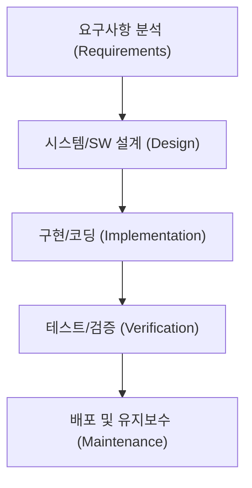

#### 폭포수 모델의 주요 단계
1. **요구사항 분석(Requirements Analysis):** 발주자(고객)와 이해관계자가 원하는 기능을 철저히 도출하여 요구사항 명세서(SRS, Software Requirement Specification)를 작성합니다.
2. **설계(Design):** 시스템 전체 구조(아키텍처), 데이터베이스 모델(ERD), 모듈 간 인터페이스, UI/UX 등을 문서화합니다.
3. **구현(Implementation):** 설계 문서를 바탕으로 개발자들이 실제 소스코드를 작성합니다.
4. **테스트(Verification):** 작성된 코드가 요구사항 명세서와 설계에 맞게 동작하는지 결함을 찾아 검증합니다.
5. **배포 및 유지보수(Maintenance):** 실제 운영 환경에 릴리스하고, 운영 중 발생하는 버그 수정 및 개선 작업을 수행합니다.

#### 폭포수 모델의 장단점

| 구분 | 장점 (Strengths) | 단점 및 한계 (Weaknesses) |
| :--- | :--- | :--- |
| **관리적 관점** | • 단계별 마일스톤과 산출물(문서)이 명확함<br>• 일정과 진척도, 비용 산정이 비교적 수월함<br>• 외주(SI) 계약 및 관리 감독에 적합함 | • 고객의 요구사항은 개발 도중 필연적으로 변하지만 이를 수용하기 극도로 어려움<br>• 문서화 작업에 지나치게 많은 리소스가 소모됨 |
| **엔지니어링 관점** | • 설계가 선행되어 시스템 구조가 비교적 정돈됨<br>• 팀원 간 역할 분담(기획-디자인-개발-QA)이 명확함 | • 프로젝트 후반부(테스트 단계)가 되어서야 동작하는 소프트웨어를 처음 목격함<br>• 치명적인 설계 결함이 후반부에 발견되면 전체를 뜯어고쳐야 함 (빅뱅 테스트의 공포) |

> [!NOTE]
> 윈스턴 로이스 박사는 원래 논문에서 순수한 일방통행식 폭포수 모델을 권장한 것이 아니라, 각 단계 사이의 피드백 루프와 두 차례의 프로토타이핑이 필수적이라고 경고했습니다. 그러나 산업계는 관리의 용이성 때문에 피드백이 배제된 채 엄격한 일방통행식 폭포수 모델을 주로 채택하여 큰 실패를 겪기도 했습니다.

---

### 1.3 V-모델(V-Model): 검증의 엄밀함을 더하다
폭포수 모델의 가장 큰 약점은 **"테스트가 너무 늦게 시작된다"**는 점이었습니다. 코딩이 다 끝난 후반부에 통합 테스트를 진행하다가 요구사항 수준의 결함이 발견되면 막대한 재작업 비용이 발생합니다.

이를 해결하기 위해 등장한 것이 **V-모델(V-Model)**입니다. V-모델은 개발 단계와 테스트 단계를 1:1로 대칭시켜, **"설계 단계마다 그에 대응하는 테스트 계획을 동시에 수립한다"**는 강력한 원칙을 제시합니다.

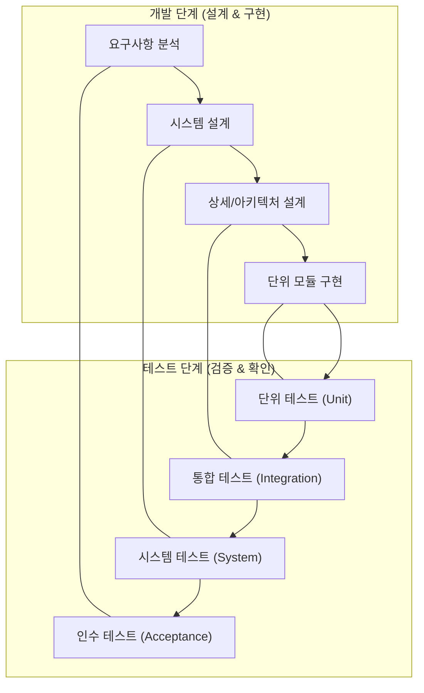

#### V-모델의 대응 구조
- **요구사항 분석 ⟷ 인수 테스트(Acceptance Test):** 사용자가 요구한 비즈니스 목표와 사용 시나리오를 충족하는지 최종 확인합니다.
- **시스템 설계 ⟷ 시스템 테스트(System Test):** 전체 시스템이 성능, 보안, 하드웨어 연동 등 비기능적 요구사항을 만족하는지 검증합니다.
- **상세/아키텍처 설계 ⟷ 통합 테스트(Integration Test):** 모듈과 모듈, 서비스와 데이터베이스 등 컴포넌트 간 인터페이스와 데이터 교환을 검증합니다.
- **단위 모듈 구현 ⟷ 단위 테스트(Unit Test):** 작성된 개별 함수, 클래스, 메서드가 명세대로 작동하는지 최소 단위로 검증합니다.

> **검증(Verification) vs 확인(Validation)**
> - **Verification (검증):** *"시스템을 올바르게 만들고 있는가? (Are we building the product right?)"* — 규격과 명세서에 부합하게 구현되었는지 엔지니어링 관점에서 점검하는 행위입니다.
> - **Validation (확인):** *"올바른 시스템을 만들었는가? (Are we building the right product?)"* — 사용자의 실제 의도와 비즈니스 요구를 만족시켰는지 고객 관점에서 점검하는 행위입니다.

---

### 1.4 나선형 모델(Spiral Model): 위험 관리의 내재화
1988년 배리 보엠(Barry Boehm)은 폭포수의 체계성과 프로토타이핑(Prototyping)의 유연성을 결합한 **나선형 모델(Spiral Model)**을 제안했습니다. 나선형 모델의 가장 핵심적인 단어는 바로 **위험 분석(Risk Analysis)**입니다.

나선형 모델은 프로젝트를 여러 차례의 사이클(나선)로 나누어 수행하며, 원의 중심에서 시작해 바깥쪽으로 회전할 때마다 소프트웨어의 완성도와 투자 비용이 점진적으로 확장됩니다.

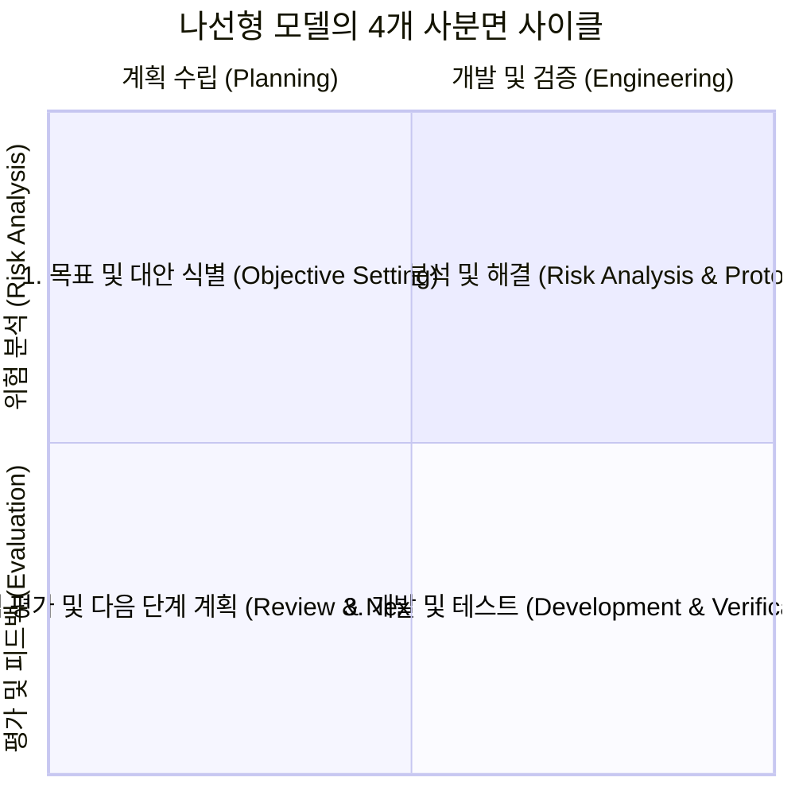

#### 나선형 모델의 4단계 반복 과정
1. **목표 설정 및 제약조건 식별:** 이번 회차에서 달성해야 할 구체적인 기능 목표와 제약사항(비용, 일정, 인프라)을 정의합니다.
2. **위험 분석 및 프로토타이핑:** 기술적 미지의 영역, 성능 병목, 보안 취약점 등 실패 요인을 분석하고 위험을 조기에 해소하기 위한 파일럿/프로토타입을 제작합니다.
3. **공학적 개발 및 검증:** 위험이 해소된 영역에 대해 폭포수나 다른 방법론을 적용하여 실제 코드를 개발하고 테스트를 거쳐 산출물을 생성합니다.
4. **고객 평가 및 다음 회차 계획:** 완성된 결과물을 고객에게 시연하고 피드백을 받아 다음 나선 사이클의 요구사항에 반영합니다.

- **장점:** 치명적인 기술적·비즈니스적 위험을 프로젝트 초기에 식별하여 대형 프로젝트의 실패 확률을 획기적으로 낮춥니다.
- **단점:** 위험 분석을 수행할 고도의 전문 인력이 필수적이며, 절차가 복잡하여 프로젝트 관리 비용이 높습니다. 항공우주, 국방, 대규모 의료 장비 등 미션 크리티컬한 시스템에 주로 사용됩니다.

---

## 02. CBD 방법론은 무엇인가요? (컴포넌트 기반 개발)

### 2.1 레고 블록 조립식 개발과 소프트웨어 부품화의 꿈
하드웨어 산업을 살펴보면, 컴퓨터 제조업체가 메인보드, CPU, RAM, 그래픽카드를 직접 실리콘 원판부터 깎아 만들지 않습니다. 인텔의 CPU, 삼성의 메모리, 엔비디아의 GPU를 표준화된 규격(PCIe, DDR 슬롯)에 맞추어 메인보드에 꽂아 조립합니다. 자동차 공장도 마찬가지입니다. 브레이크, 타이어, 배터리 등은 전문 협력업체가 제조한 표준 부품을 조립하여 완성차를 만듭니다.

> **"소프트웨어도 하드웨어처럼 잘 정의된 규격의 부품을 만들어두고, 필요할 때 레고 블록처럼 끼워 맞춰 조립할 수는 없을까?"**

이러한 문제의식에서 출발한 패러다임이 바로 **CBD(Component-Based Development, 컴포넌트 기반 개발)** 방법론입니다.

---

### 2.2 컴포넌트(Component)의 본질: 인터페이스와 구현의 분리
소프트웨어 공학에서 컴포넌트는 단순한 함수나 클래스 모음이 아닙니다. 컴포넌트는 다음과 같은 세 가지 엄격한 조건을 만족해야 합니다.

1. **독립적으로 배포 가능한 단위(Independently Deployable Unit):** 소스코드가 아닌 바이너리(컴파일된 라이브러리, JAR, DLL 등) 형태로 배포되어 독립적으로 교체될 수 있어야 합니다.
2. **명확한 인터페이스 계약(Contract):** 내부 구현 로직은 숨겨진 채(Black-box), 외부와 통신하는 통로인 입출력 명세(Interface)만이 공개되어야 합니다.
3. **제3자 조합성(Third-party Composability):** 컴포넌트 제작자와 컴포넌트 사용자가 서로를 몰라도 명세만 보고 결합할 수 있어야 합니다.

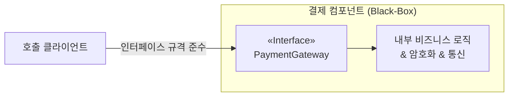

CBD에서는 내부 구현(Implementation)과 외부 인터페이스(Interface)를 철저히 분리합니다. 클라이언트는 컴포넌트 내부가 Java로 짜였는지, C++로 구현되었는지 알 필요가 없습니다. 정해진 시그니처와 데이터 포맷에 맞추어 호출하기만 하면 됩니다. 덕분에 결제 모듈을 토스페이먼츠에서 카카오페이로 교체하더라도, 인터페이스 규격이 동일하다면 호출 측 코드는 단 한 줄도 바꿀 필요가 없습니다.

---

### 2.3 CBD의 프로세스와 생산성 혁신
CBD 방법론은 프로젝트를 크게 두 가지 독립된 트랙으로 나누어 진행합니다.

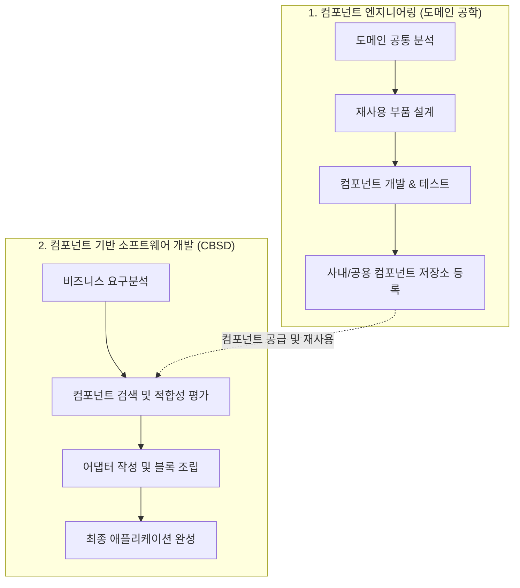

1. **컴포넌트 엔지니어링(도메인 공학):** 특정 업무 영역(예: 전자상거래, 금융)에서 반복적으로 쓰이는 공통 모듈(인증, 장바구니, 결제, 알림 등)을 발굴하여 고품질의 재사용 가능한 부품으로 제작하고 사내 컴포넌트 저장소(Repository)에 등록합니다.
2. **컴포넌트 기반 소프트웨어 개발(CBSD):** 새로운 프로젝트를 수주하거나 개발할 때, 바닥부터 코드를 짜지 않고 저장소에서 필요한 컴포넌트를 검색하여 꺼내옵니다. 인터페이스 불일치가 있다면 작은 어댑터(Adapter) 코드를 덧대어 레고처럼 조립합니다.

#### CBD가 가져온 효과
- **재사용성(Reusability) 극대화:** 이미 수많은 시스템에서 충분히 검증된 부품을 사용하므로 초기 개발 시간과 결함 발생률이 극적으로 감소합니다.
- **유지보수성 향상:** 특정 기능에 버그가 발생하면 전체 시스템을 다시 빌드할 필요 없이 해당 컴포넌트 부품만 교체(Hot-swap)할 수 있습니다.
- **분업의 전문화:** 핵심 공통 컴포넌트를 만드는 아키텍트 그룹과 이를 조립하여 비즈니스 화면을 구현하는 개발 그룹의 전문적 분업이 가능해졌습니다.

---

### 2.4 CBD의 한계와 현대적 계승: 오픈소스 라이브러리와 마이크로서비스(MSA)
과거 1990~2000년대 유행했던 초기 CBD(Microsoft COM/DCOM, Sun EJB, CORBA 등)는 몇 가지 실무적 한계에 부딪혔습니다.
- **표준 규격의 파편화와 무거움:** 당시 프레임워크 규격이 지나치게 복잡하고 런타임 오버헤드가 컸습니다.
- **비즈니스 도메인의 가변성:** 하드웨어 부품과 달리 비즈니스 요구사항은 기업마다, 부서마다 너무나도 달랐기 때문에 "완벽하게 범용적인 만능 비즈니스 컴포넌트"를 만드는 것이 환상에 가까웠습니다.

그러나 CBD의 철학은 결코 사라지지 않았습니다. 현대에 이르러 다음과 같이 세련된 형태로 완전히 일상화되었습니다.

1. **오픈소스 패키지 매니저(npm, Maven, PyPI, Go Modules):** 오늘날 개발자는 암호화, 날짜 계산, 네트워킹을 직접 코딩하지 않습니다. `npm install`, `pip install` 한 줄로 전 세계 엔지니어들이 검증한 고품질 컴포넌트(부품)를 즉시 조립합니다.
2. **프론트엔드 컴포넌트 기반 개발(React, Vue, Web Components):** 웹 프론트엔드는 이미 버튼, 드롭다운, 모달, 데이터 테이블을 완벽한 독립형 UI 컴포넌트로 분리하여 조립 개발하는 CBD의 직계 후손입니다.
3. **마이크로서비스 아키텍처(MSA):** 시스템 전체를 거대한 단일 코드베이스로 만들지 않고, 독립적으로 배포 가능한 작은 서비스 컴포넌트들로 쪼갠 뒤 REST API, gRPC 등 표준 네트워크 인터페이스로 통신하게 만드는 방식은 **네트워크 레벨로 확장된 현대의 CBD**입니다.

---

## 03. 애자일 방법론은 무엇인가요?

### 3.1 폭포수의 위기와 애자일의 탄생 배경
1990년대 후반 인터넷 혁명(Dot-com Boom)이 도래하면서 비즈니스 환경의 변화 속도는 이전과는 비교할 수 없을 정도로 빨라졌습니다. 
폭포수 방식으로 1년 동안 요구사항을 분석하고 1년 동안 설계 및 개발하여 2년 만에 소프트웨어를 출시하면, 그 사이에 시장 트렌드가 완전히 바뀌어 아무도 쓰지 않는 쓰레기 소프트웨어가 되기 일쑤였습니다.

> *"고객은 자신이 무엇을 원하는지 완성된 화면을 눈으로 직접 보기 전까지는 결코 알지 못한다."*

2001년 미국 유타주 스노우버드에 17명의 저명한 소프트웨어 전문가들(켄트 백, 마틴 파울러, 로버트 C. 마틴, 켄 슈와버, 제프 서덜랜드 등)이 모였습니다. 그들은 무겁고 관료적인 프로세스에서 벗어나, 빠르게 변화하는 환경에 민첩하고 유연하게 대처할 수 있는 새로운 개발 철학을 담아 **애자일 선언문(Agile Manifesto)**을 발표했습니다.

---

### 3.2 애자일 선언문의 4대 핵심 가치와 12대 원칙

애자일은 특정 툴이나 규정집이 아니라 **가치와 철학의 선언**입니다.

```
┌─────────────────────────────────────────────────────────────┐
│                   애자일 선언문의 4대 가치                  │
├─────────────────────────────┬───────────────────────────────┤
│    왼쪽 항목보다...         │    오른쪽 항목에 '더 큰 가치'를 둔다  │
├─────────────────────────────┼───────────────────────────────┤
│ • 공정과 도구              │ ➜  개인과 상호작용            │
│ • 포괄적인 문서             │ ➜  작동하는 소프트웨어        │
│ • 계약 협상                │ ➜  고객과의 협력              │
│ • 계획을 따르기            │ ➜  변화에 대응하기            │
└─────────────────────────────┴───────────────────────────────┘
```
> [!IMPORTANT]
> 애자일 선언문은 왼쪽의 가치(도구, 문서, 계약, 계획)를 완전히 무시하라는 뜻이 아닙니다. 왼쪽 항목도 가치가 있지만, 불확실성이 지배하는 현대 비즈니스에서는 **오른쪽 항목(인간 중심의 소통, 실제로 동작하는 코드, 지속적인 협력, 민첩한 피드백 수용)에 더 높은 우선순위**를 두어야 프로젝트가 성공한다는 뜻입니다.

#### 애자일의 12대 핵심 원칙 요약
1. 가치 있는 소프트웨어를 조기에 지속적으로 제공하여 고객을 만족시킨다.
2. 개발 후반부일지라도 요구사항 변경을 환영하라.
3. 작동하는 소프트웨어를 몇 주에서 몇 개월 주기로 짧게 자주 배포하라.
4. 비즈니스 담당자와 개발자는 프로젝트 기간 내내 매일 함께 일해야 한다.
5. 동기부여된 팀원들을 중심으로 프로젝트를 구성하고 신뢰와 환경을 지원하라.
6. 팀 내외로 정보를 전달하는 가장 효과적인 방법은 얼굴을 마주보고 대화하는 것이다.
7. 작동하는 소프트웨어가 진척도의 주된 척도이다.
8. 지속 가능한 개발 속도를 유지하여 야근과 번아웃을 방지하라.
9. 우수한 기술과 훌륭한 설계에 대한 지속적인 관심이 민첩성을 향상시킨다.
10. 단순성(단순함), 즉 하지 않아도 될 일의 양을 최대화하는 기술이 필수적이다.
11. 최고의 아키텍처, 요구사항, 설계는 자기조직화(Self-organizing)된 팀에서 나온다.
12. 팀은 정기적으로 더 효과적인 방법을 되돌아보고(회고), 행동을 조율하고 조정한다.

---

### 3.3 스프린트 중심의 스크럼(Scrum)
애자일 철학을 구체적인 실천 규칙으로 구현한 가장 대표적인 프레임워크가 바로 **스크럼(Scrum)**입니다. 럭비 경기에서 팀원들이 어깨를 겯고 한 덩어리가 되어 전진하는 대형에서 이름을 따왔습니다.

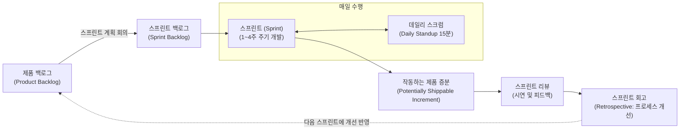

#### 스크럼의 3대 역할 (Roles)
- **제품 책임자 (Product Owner, PO):** 제품의 비즈니스 가치를 극대화하는 책임자입니다. 무엇을 먼저 개발할지 결정하는 우선순위가 매겨진 **제품 백로그(Product Backlog)**를 관리합니다.
- **스크럼 마스터 (Scrum Master, SM):** 팀이 스크럼 원칙을 잘 준수하도록 돕고, 개발을 가로막는 장애물(외부 간섭, 리소스 부족 등)을 제거해 주는 서번트 리더(Servant Leader)입니다.
- **개발팀 (Development Team):** 디자이너, 프론트엔드, 백엔드, QA 등 교차 기능(Cross-functional)을 갖춘 5~9명의 팀원으로, 스프린트 백로그를 스스로 분배하고 구현합니다.

#### 스크럼의 4대 의식 (Events)
1. **스프린트 계획 회의(Sprint Planning):** 이번 스프린트(보통 2주) 동안 달성할 목표(Sprint Goal)를 세우고 제품 백로그에서 팀의 역량(Velocity)에 맞게 스프린트 백로그로 작업을 가져옵니다.
2. **데일리 스크럼(Daily Scrum / Stand-up):** 매일 아침 전원이 서서 15분 이내로 진행합니다. *"어제 한 일, 오늘 할 일, 겪고 있는 장애물"* 세 가지만 간단히 공유하여 싱크를 맞춥니다.
3. **스프린트 리뷰(Sprint Review):** 스프린트 마지막 날, 스테이크홀더(이해관계자)들을 모아놓고 이번에 실제로 구현되어 작동하는 소프트웨어를 시연(Demo)하고 피드백을 수집합니다.
4. **스프린트 회고(Sprint Retrospective):** 팀원들끼리만 모여 지난 2주간의 프로세스, 팀워크, 도구 사용 방식을 되돌아봅니다. 잘한 점(Keep), 아쉬운 점(Problem), 다음 스프린트에 시도할 개선안(Try)을 도출합니다.

---

### 3.4 시각화와 흐름 중심의 칸반(Kanban)
스크럼이 2주라는 고정된 **타임박스(Timebox)**를 기반으로 움직인다면, **칸반(Kanban)**은 **연속적인 흐름(Continuous Flow)**을 최적화하는 방법론입니다. 일본 도요타 생산 방식(TPS)의 저스트 인 타임(JIT) 간판 시스템에서 유래했습니다.

```
┌────────────────────────────────────────────────────────────────────────┐
│                              칸반 보드 예시                             │
├───────────────┬──────────────────────┬─────────────────┬───────────────┤
│ To Do (대기)   │ In Progress (진행 중)│ Testing (테스트) │ Done (완료)    │
│               │ [WIP Limit: 3]       │ [WIP Limit: 2]  │               │
├───────────────┼──────────────────────┼─────────────────┼───────────────┤
│ [알림 푸시 기능]│ [회원가입 API]       │ [결제 연동]     │ [로그인 화면]  │
│ [검색 필터 추가]│ [장바구니 리팩토링]   │ [프로필 수정]   │ [DB 마이그레이션]
│ [배너 광고 배치]│ [비밀번호 재설정]    │                 │               │
└───────────────┴──────────────────────┴─────────────────┴───────────────┘
```

#### 칸반의 3대 핵심 실천법
1. **작업의 시각화(Visualize the Workflow):** 보이지 않는 지식 노동의 특성을 극복하기 위해 모든 태스크를 카드 형태로 보드에 올려 누구에게 어떤 일이 밀려있는지 한눈에 드러냅니다.
2. **WIP(Work In Progress, 진행 중인 작업) 제한:** 동시에 진행할 수 있는 작업의 최대 개수를 칼럼마다 엄격히 제한합니다. 새로운 일을 시작(Start)하기 전에 지금 하고 있는 일부터 끝내(Finish)도록 강제하여 멀티태스킹 비용을 없앱니다.
3. **흐름(Flow) 관리 및 사이클 타임 단축:** 요구사항 접수부터 배포까지 걸리는 전체 시간(Lead Time)과 실제 작업 착수부터 완료까지 걸리는 시간(Cycle Time)을 측정하여 병목 구간을 지속적으로 뚫어냅니다.

---

### 3.5 폭포수(Waterfall) vs 애자일(Agile) 실무 비교표

| 비교 항목 | 폭포수(Waterfall) 모델 | 애자일(Agile) 방법론 |
| :--- | :--- | :--- |
| **철학적 접근** | "완벽한 계획과 통제를 통해 예측 가능성을 높인다" | "변화를 필연으로 인정하고 빠른 피드백으로 적응한다" |
| **요구사항 확정** | 프로젝트 초기에 확정하고 이후 변경을 통제(Change Request)함 | 프로젝트 진행 중에도 지속적으로 수정, 추가, 재정의됨 |
| **문서와 산출물** | 방대한 명세서, 설계 보고서, 요구 추적표 중심 | 실제로 작동하는 소프트웨어와 자동화된 테스트 코드 중심 |
| **배포 및 출시** | 프로젝트의 가장 마지막 단계에서 단 한 번 대규모 출시(Big-Bang) | 1~4주마다 작게 쪼개어 지속적으로 출시 및 프로덕션 증분 제공 |
| **고객의 참여** | 프로젝트 착수(요구정의)와 완료(인수테스트) 시점에만 참여 | 프로젝트 전 주기에 걸쳐 PO나 사용자 피드백이 매주 반영됨 |
| **리스크 발견 시점** | 후반부 통합/테스트 단계에서 대형 결함이 한꺼번에 터짐 | 매 스프린트마다 작동을 확인하므로 리스크가 초기에 지속 노출됨 |
| **적합한 프로젝트** | 요구사항이 명확하고 변경 가능성이 적은 공공 SI, 철도/의료 하드웨어 임베디드 | 시장 반응을 빠르게 검증해야 하는 스타트업, 웹/모바일 서비스, SaaS |

---

## 04. DevOps도 개발 방법론인가요?

### 4.1 개발(Dev)과 운영(Ops)의 깊은 골: '사일로 효과(Silo Effect)'
애자일 방법론이 도입되면서 개발팀(Development)은 매주 새로운 기능을 뚝딱뚝딱 만들어낼 수 있게 되었습니다. 하지만 소프트웨어가 고객에게 전달되려면 인프라를 프로비저닝하고, 서버에 배포하고, 모니터링을 담당하는 **운영팀(Operations)**을 거쳐야만 했습니다. 여기서 심각한 조직적 장벽이 드러납니다.

```
┌────────────────────────┐                ┌────────────────────────┐
│     개발팀 (Dev)       │                │      운영팀 (Ops)      │
│  "빠르게 변화하라!"    │                │  "절대 장애를 내지마!" │
├────────────────────────┤   혼돈의 벽    ├────────────────────────┤
│ • 새로운 기능 릴리스   │  (Wall of      │ • 시스템 안정성 유지   │
│ • 코드의 빠른 변경 추구│   Confusion)   │ • 변경(Change)은 곧 리스크
│ • 스프린트 목표 달성   │ ══════════════>│ • 무중단 가동률(99.99%)│
└────────────────────────┘  "벽 너머로    └────────────────────────┘
                             던지기!"
```

- **개발팀의 KPI:** "얼마나 빠르고 많은 기능을 배포했는가?"
- **운영팀의 KPI:** "얼마나 다운타임(Downtime) 없이 시스템을 안정적으로 유지했는가?"

목표가 상충되다 보니 개발팀은 코드를 대충 패키징하여 운영팀 담장 너머로 집어던지고(`"내 로컬 컴퓨터에서는 잘 돌아갔는데요?"`), 운영팀은 안정성을 핑계로 배포 요청 승인을 몇 주씩 미루거나 장애 발생 시 서로 책임을 전가하는 **사일로 효과(Silo Effect, 부서 이기주의)**가 발생했습니다.

---

### 4.2 DevOps의 정의: 문화, 철학, 그리고 실천의 삼위일체
**DevOps(Development + Operations)**는 이러한 개발과 운영의 장벽을 허물고, 아이디어의 탄생부터 실제 프로덕션 환경의 안정적 서비스 운영까지 하나의 통합된 흐름으로 연결하려는 패러다임입니다.

> **"DevOps는 특정 도구(Docker, Kubernetes 등)나 특정 직군을 의미하는 단어가 아닙니다. DevOps는 조직의 문화(Culture)이자, 일하는 철학(Philosophy)이며, 이를 뒷받침하는 기술적 실천(Practice)의 결합입니다."**

아마존의 CTO 버너 보겔스(Werner Vogels)는 DevOps의 본질을 한 문장으로 정의했습니다.
> *"You build it, you run it (당신이 만든 서비스는 당신이 직접 운영하라)."*

개발자가 자신이 짠 코드가 어떻게 배포되고 모니터링되는지 책임지고, 운영자는 개발자가 안전하고 빠르게 배포할 수 있는 셀프서비스 플랫폼을 구축함으로써 양 팀은 하나의 공통된 목표(비즈니스 가치의 신속하고 안정적인 전달)를 공유하게 됩니다.

---

### 4.3 CALMS 프레임워크로 본 DevOps의 5대 기둥
DevOps 운동의 선구자인 존 윌리스(John Willis)와 제즈 험블(Jez Humble)은 성공적인 DevOps 도입을 위한 프레임워크로 **CALMS** 모델을 제시했습니다.

```mermaid
mindmap
  root((DevOps: CALMS))
    C["Culture (문화)"]
      신뢰와 협업
      비난 없는 사후 분석(Blameless Post-mortem)
      공유된 책임
    A["Automation (자동화)"]
      CI/CD 파이프라인
      코드형 인프라 (IaC)
      테스트 및 배포 자동화
    L["Lean (린)"]
      작은 배치(Small Batch) 배포
      프로세스 내 낭비 제거
      빠른 피드백 루프
    M["Measurement (측정)"]
      DORA 4대 핵심 지표
      서버 및 비즈니스 메트릭
      APM 및 로그 가시성
    S["Sharing (공유)"]
      지식과 베스트 프랙티스 전파
      장애 경험의 투명한 자산화
      교차 기능 협업
```

1. **Culture (문화):** 도구보다 먼저 조직 문화가 바뀌어야 합니다. 실패를 숨기거나 담당자를 징계하는 문화에서는 누구도 과감하게 배포하지 못합니다. 장애가 발생했을 때 개인을 비난하는 대신 시스템의 취약점을 분석하는 **'비난 없는 사후 분석(Blameless Post-mortem)'**이 핵심입니다.
2. **Automation (자동화):** 사람이 수동으로 서버에 접속해 커맨드를 치고 파일을 복사하는 행위는 휴먼 에러의 온상입니다. 빌드, 테스트, 인프라 생성, 배포 전 과정을 코드로 자동화합니다.
3. **Lean (린):** 제조업의 린 생산 방식처럼 한 번에 거대한 릴리스를 하지 않고, **작은 단위(Small Batch)**로 쪼개어 매일 혹은 하루에도 수십 번씩 배포함으로써 변경 단위의 위험을 최소화합니다.
4. **Measurement (측정):** 개선하려면 측정할 수 있어야 합니다. 구글 DevOps 연구 조직(DORA)이 제시한 4대 핵심 지표(배포 빈도, 변경 리드 타임, 변경 실패율, 서비스 복구 시간)를 지속적으로 추적합니다.
5. **Sharing (공유):** 장애 원인, 성능 개선 팁, 배포 노하우를 팀과 조직 전체에 투명하게 위키와 슬랙으로 공유합니다.

---

## 05. CI/CD는 무슨 일을 하는 건가요?

### 5.1 CI (Continuous Integration, 지속적 통합)
과거에는 개발자들이 각자 몇 주, 몇 달 동안 자기 브랜치에서 코드를 작성한 뒤, 마감 직전에 메인 코드베이스에 한꺼번에 합쳤습니다. 이때 발생하는 것이 그 악명 높은 **'통합 지옥(Integration Hell)'**이었습니다.

수백 개의 파일에서 소스코드 충돌이 나고, 누구의 코드가 시스템을 깨뜨렸는지 파악하는 데만 수일이 걸렸습니다.

```
[통합 지옥 (Integration Hell)]
개발자 A ─────(3주 동안 혼자 코딩)─────┐
개발자 B ─────(3주 동안 혼자 코딩)─────┼──> [동시 Merge 시도] ──> 대폭발 (수백 건 충돌 & 버그)
개발자 C ─────(3주 동안 혼자 코딩)─────┘
```

**지속적 통합(CI)**은 이를 방지하기 위한 실천법입니다.
> *"모든 개발자가 작업한 코드를 하루에 최소 1회 이상 메인 공유 브랜치(Main/Trunk)에 지속적으로 통합하고, 통합할 때마다 자동으로 빌드와 테스트를 실행하여 결함을 10분 이내에 찾아낸다."*

#### CI의 3단계 핵심 프로세스
1. **코드 커밋 & 푸시:** 개발자가 작은 단위로 기능을 완성하고 원격 저장소에 PR(Pull Request)을 생성하거나 머지합니다.
2. **자동 빌드:** CI 서버가 코드를 내려받아 컴파일하고 패키징합니다.
3. **자동화된 단위/통합 테스트 실행:** 사전에 작성된 수백~수천 개의 테스트 슈트를 돌려 새로 추가된 코드가 기존 기능을 망가뜨리지 않았는지(회귀 버그 방지) 100% 기계적으로 검증합니다.

> [!TIP]
> **CI 문화의 황금률:** CI 파이프라인에서 빌드나 테스트가 실패하여 '빨간 불'이 들어오면, 팀의 모든 개발자는 즉시 새로운 기능 개발을 멈추고 빌드를 정상화하는 데 최우선 순위를 두어야 합니다.

---

### 5.2 CD: 지속적 제공(Continuous Delivery) vs 지속적 배포(Continuous Deployment)

CI를 통과한 소프트웨어를 운영 환경으로 안전하게 릴리스하는 과정을 자동화한 것이 바로 **CD**입니다. 실무에서는 CD를 두 단계의 성숙도로 구분합니다.

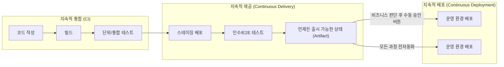

- **지속적 제공 (Continuous Delivery):** 소스코드가 테스트를 거쳐 스테이징 서버까지 완전 자동으로 배포되고 검증되지만, **최종 프로덕션(운영) 서버로 나가는 마지막 배포 스위치 클릭은 사람이 결정**합니다. 비즈니스 런칭 일정이나 마케팅 타임라인을 조율해야 할 때 적합합니다.
- **지속적 배포 (Continuous Deployment):** 개발자가 메인 브랜치에 코드를 머지하고 CI 파이프라인을 통과하는 순간, **사람의 개입(승인 절차) 없이 100% 전자동으로 프로덕션 서버에 즉시 릴리스**됩니다. 넷플릭스, 아마존, 토스 같은 성숙한 테크 기업들이 하루에도 수백 번 배포할 수 있는 비결입니다.

---

### 5.3 엔드투엔드 CI/CD 파이프라인 흐름도

현대적인 클라우드 네이티브 환경에서 작동하는 빌드-테스트-배포 파이프라인의 전체 라이프사이클을 살펴보겠습니다.

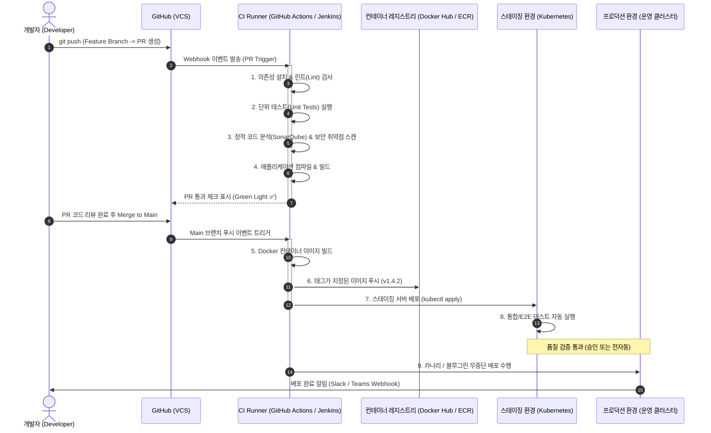

---

### 5.4 대표적인 CI/CD 도구 비교: Jenkins vs GitHub Actions

| 비교 항목 | 젠킨스 (Jenkins) | 깃허브 액션 (GitHub Actions) |
| :--- | :--- | :--- |
| **운영 형태** | 온프레미스 / 자체 호스팅 (Self-Hosted) | SaaS 완전 관리형 (Cloud Native) + 자체 러너 지원 |
| **등장 시기** | 2011년 (Hudson 포크) ~ 전통적 CI의 절대강자 | 2019년 공식 출시 ~ 현대 소프트웨어 개발의 표준화 |
| **설정 방식** | 웹 UI 설정 및 Groovy 기반의 `Jenkinsfile` | 저장소 내 `.github/workflows/*.yml` 파일로 선언 |
| **장점** | • 수천 개의 오픈소스 플러그인 생태계<br>• 온프레미스 폐쇄망 환경에 완벽 대응<br>• 복잡한 대규모 커스텀 파이프라인 구축 가능 | • GitHub 저장소와 완벽한 일체감 (PR, 이슈 연동)<br>• 마켓플레이스에서 전 세계 액션을 레고처럼 재사용<br>• 별도의 마스터 서버 관리 및 패치 부담 없음 |
| **단점 및 한계** | • 마스터/에이전트 서버를 직접 유지보수해야 함<br>• 플러그인 간 버전 충돌 및 보안 취약점 관리 부담 | • 대규모 실행 시 비용 발생 (무료 쿼터 초과 시)<br>• GitHub 플랫폼 종속성 |
| **추천 환경** | 망분리가 엄격한 금융/공공 기관, 자체 데이터센터 운영사 | 신규 스타트업, 오픈소스 프로젝트, GitHub 중심 팀 |

---

## 06. 소프트웨어 아키텍처라는 것은 무엇일까요?

### 6.1 건축 설계도 비유로 이해하는 소프트웨어 아키텍처
집을 지을 때 벽지를 무슨 색으로 바를지, 문고리를 어떤 디자인으로 달지는 살아가면서 언제든 쉽게 바꿀 수 있습니다. 하지만 건물이 지진에 버티도록 철근 콘크리트 골조를 어떻게 세울지, 상하수도 배관을 어디로 매립할지, 엘리베이터 통로를 어디에 둘지는 한 번 건물을 완공하고 나면 뜯어고치기가 불가능에 가깝습니다.

소프트웨어도 똑같습니다. 변수 이름을 바꾸거나 함수의 `if` 문 로직을 다듬는 것은 비용이 거의 들지 않습니다. 그러나 모놀리식으로 짠 시스템을 마이크로서비스로 쪼개거나, 관계형 DB(RDBMS)를 NoSQL 이벤트 스트리밍 방식으로 전면 개편하는 일은 수억 원의 비용과 수개월의 시간이 소요됩니다.

> **"소프트웨어 아키텍처란, 프로젝트 초기에 결정해야 하는 '나중에 바꾸기 극도로 어렵고 비용이 많이 드는 중요한 시스템 설계와 구조적 결정의 집합'이다."**  
> — 마틴 파울러(Martin Fowler) & 랠프 존슨(Ralph Johnson)

---

### 6.2 기능적 요구사항 vs 비기능적 요구사항
소프트웨어 요구사항은 크게 두 가지로 나뉩니다.

```
┌────────────────────────────────────────────────────────┐
│                   소프트웨어 요구사항                  │
├───────────────────────────┬────────────────────────────┤
│    기능적 요구사항        │     비기능적 요구사항      │
│  (Functional Requirements)│(Non-Functional Requirements)│
├───────────────────────────┼────────────────────────────┤
│ • "무엇을 하는가?"        │ • "어떻게 동작하는가?"     │
│ • 사용자 관점의 비즈니스  │ • 시스템의 품질 속성       │
│ • 예: 회원가입, 결제,     │ • 예: 초당 10만 건 처리,   │
│   장바구니 담기, 검색      │   99.99% 가용성, 암호화,   │
│                           │   수평적 오토스케일링      │
└───────────────────────────┴────────────────────────────┘
```

**아키텍처의 형태를 실질적으로 결정짓는 것은 기능적 요구사항이 아니라 비기능적 요구사항(품질 속성)입니다.** 
단순히 "게시판에 글을 쓰고 읽는다"는 기능은 신입 개발자가 혼자서 하루 만에 만들 수 있습니다. 그러나 **"전 세계 1억 명의 동시 접속자가 글을 쓰더라도 0.1초 내에 응답해야 하고(성능/확장성), 특정 데이터센터에 화재가 나도 데이터가 유실되지 않아야 한다(가용성/재해복구)"**는 비기능적 요구사항이 붙는 순간, 시스템 아키텍처는 캐싱 레이어(Redis), 글로벌 분산 데이터베이스, 로드밸런서, 비동기 메시지 큐(Kafka)가 결합된 고도의 복잡한 아키텍처로 진화하게 됩니다.

---

### 6.3 좋은 아키텍처를 만드는 핵심 원칙과 트레이드오프(Trade-off)

#### 1. 관심사의 분리 (Separation of Concerns, SoC)
하나의 소프트웨어를 서로 중첩되지 않는 고유한 역할을 가진 부분들로 분할하는 원칙입니다. UI 표현 로직, 비즈니스 연산 로직, 데이터베이스 영속성 로직이 한 덩어리로 섞여 있으면 코드 변경 시 파급력을 제어할 수 없습니다.

#### 2. 높은 응집도(High Cohesion)와 낮은 결합도(Low Coupling)
- **높은 응집도:** 관련된 기능과 데이터는 하나의 모듈 안에 끈끈하게 뭉쳐 있어야 합니다. 변경이 일어날 때 해당 모듈 하나만 수정하면 됩니다.
- **낮은 결합도:** 모듈과 모듈 사이의 의존성은 최소화하고 명확한 인터페이스를 통해서만 상호작용해야 합니다. 모듈 A를 교체하거나 수정해도 모듈 B에 영향이 가지 않아야 합니다.

#### 3. 아키텍처는 '트레이드오프(Trade-off)'의 예술이다
> **소프트웨어 공학의 제1법칙:** 모든 아키텍처 결정에는 정답(Silver Bullet)이 없다. 오직 트레이드오프만 존재할 뿐이다.

- 시스템의 유연성과 추상화를 높이면 ➜ 코드가 복잡해지고 초기 개발 속도가 느려집니다.
- 단일 데이터베이스로 단순함을 유지하면 ➜ 시스템의 처리 용량(확장성)에 한계가 옵니다.
- 서비스를 마이크로서비스(MSA)로 쪼개어 배포 독립성을 얻으면 ➜ 네트워크 지연, 분산 트랜잭션의 일관성 유지, 모니터링의 난이도가 기하급수적으로 폭증합니다.

훌륭한 아키텍트는 "유행하는 최신 기술"을 무조건 도입하는 사람이 아니라, 현재 비즈니스의 규모와 팀의 역량, 예산 제약 속에서 **가장 적절한 기회비용을 저울질하여 최선의 균형점을 선택하는 사람**입니다.

---

### 6.4 주요 소프트웨어 아키텍처 패턴의 진화

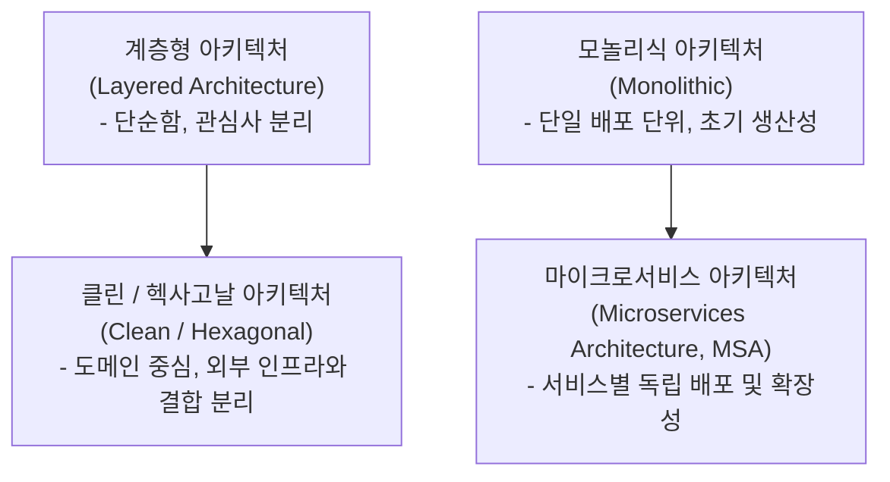

- **계층형 아키텍처(Layered Architecture):** 프레젠테이션 계층(Controller) ➔ 비즈니스 로직 계층(Service) ➔ 데이터 접근 계층(Repository)으로 책임을 수직 분리하는 가장 친숙하고 표준적인 구조입니다.
- **클린 / 헥사고날 아키텍처 (Ports & Adapters):** 핵심 비즈니스 도메인(Entity, Use Case)을 시스템의 중심에 두고, 데이터베이스나 웹 프레임워크는 외부 세부사항(Adapter)으로 취급하여 비즈니스 로직이 외부 기술 스택에 종속되지 않도록 의존성을 역전(Dependency Inversion)시킵니다.
- **모놀리식 vs MSA:** 전체 시스템을 하나의 실행 파일로 빌드하여 배포하는 모놀리식(Monolith)에서, 도메인 경계(Bounded Context)를 기준으로 수십~수백 개의 독립 서비스로 나누어 운영하는 마이크로서비스 아키텍처(MSA)로 현대 대규모 시스템은 진화하고 있습니다.

---

## (+) 부록 A: 테스트는 왜 중요한가요? (단위 테스트와 통합 테스트)

### 1. 테스트 코드가 없는 개발의 비극: '배포 공포증'
테스트 코드가 작성되지 않은 프로젝트에서 일하는 개발팀은 시간이 지날수록 심각한 공포에 시달립니다.
- 새로운 기능을 추가했는데, 3년 전에 작성된 엉뚱한 결제 모듈에서 버그가 터집니다.
- 코드를 리팩토링하여 더 깔끔하게 정리하고 싶어도, 어디가 깨질지 두려워 아무도 기존 레거시 코드를 건드리지 못합니다.
- 금요일 오후에는 절대 배포하지 못하고, 배포할 때마다 온 팀원이 야근하며 수동으로 화면을 클릭해 보아야 합니다.

테스트 코드는 단순히 버그를 잡는 도구가 아닙니다. 테스트 코드는 **개발자가 미래의 자신과 동료에게 제공하는 최고의 '안전망(Safety Net)'**입니다.

---

### 2. 마이크 콘의 테스트 피라미드(Test Pyramid)

소프트웨어 테스팅의 대가 마이크 콘(Mike Cohn)은 테스트의 비용과 속도, 신뢰성을 고려하여 테스트 스위트를 피라미드 형태로 구성해야 한다고 역설했습니다.

```
                  ┌───────────────┐
                 /     UI /        \        ▲ 비용 高, 속도 慢, 유지보수 어려움
                /   E2E Tests       \       │ (실제 브라우저 화면 클릭)
               ├─────────────────────┤      │
              /    통합 테스트        \     │ (모듈 간 결합, DB/외부 API 연동)
             /  (Integration Tests)   \    │
            ├───────────────────────────┤   │
           /         단위 테스트         \  │ 비용 低, 속도 快 (수 밀리초),
          /         (Unit Tests)         \ │ 수천 개 작성 가능 (결함 격리 우수)
         └─────────────────────────────────┘ 
```

#### 1) 단위 테스트 (Unit Test) - 피라미드의 튼튼한 기반
- **대상:** 함수, 클래스, 메서드와 같이 소프트웨어의 가장 작은 독립된 단위.
- **특징:** 외부 데이터베이스, 네트워크, 파일 시스템과 철저히 격리(Mocking/Stubbing 사용)되어 실행됩니다. 수천 개의 단위 테스트도 단 몇 초 만에 돌아가야 합니다.
- **목적:** 특정 알고리즘과 비즈니스 룰이 설계대로 정확한 입력에 대해 올바른 출력을 반환하는지 검증합니다.

#### 2) 통합 테스트 (Integration Test) - 모듈 간의 협력 검증
- **대상:** 단위 모듈들이 서로 맞물려 돌아갈 때 발생하는 상호작용.
- **특징:** 실제 인메모리 데이터베이스(H2, Testcontainers)에 SQL 쿼리를 날려 데이터가 제대로 저장되는지, 스프링 컨텍스트가 정상적으로 빈을 주입하는지 등을 검증합니다.
- **목적:** 단위 테스트로는 잡아낼 수 없는 인터페이스 규격 불일치, DB 제약조건 위반, 직렬화/역직렬화 오류를 적출합니다.

#### 3) E2E 테스트 (End-to-End / Acceptance Test) - 사용자의 시선
- **대상:** 실제 사용자의 유저 저니(User Journey).
- **특징:** Cypress, Playwright, Selenium 같은 도구를 사용해 가상 브라우저를 띄우고 사용자가 로그인하고, 상품을 장바구니에 담고, 결제 버튼을 누르는 전 과정을 처음부터 끝까지 시뮬레이션합니다.
- **목적:** 모든 시스템 인프라와 프론트-백엔드가 통합된 상태에서 비즈니스 시나리오가 완결되는지 최종 점검합니다.

> [!CAUTION]
> **아이스크림 콘 안티패턴(Ice Cream Cone Anti-pattern):** 단위 테스트는 거의 없고, 모든 검증을 무겁고 깨지기 쉬운 수동 QA나 E2E 테스트에만 의존하는 형태입니다. 빌드 시간이 수십 분으로 늘어나고, 작은 화면 변경에도 테스트가 와장창 깨지며, 버그가 발생해도 어느 컴포넌트가 원인인지 찾기 위해 수 시간을 낭비하게 됩니다.

---

### 3. TDD(테스트 주도 개발, Test-Driven Development)의 본질

많은 사람들이 TDD를 "테스트를 많이 작성하는 테스팅 기법"으로 오해합니다. 하지만 TDD의 창시자 켄트 백(Kent Beck)은 TDD가 본질적으로 **'설계 기법(Design Technique)'**이라고 말합니다.

TDD는 **실제 구현 코드를 한 줄도 작성하기 전에, 실패하는 테스트 코드부터 먼저 작성**하는 독특하고 강력한 규율입니다.

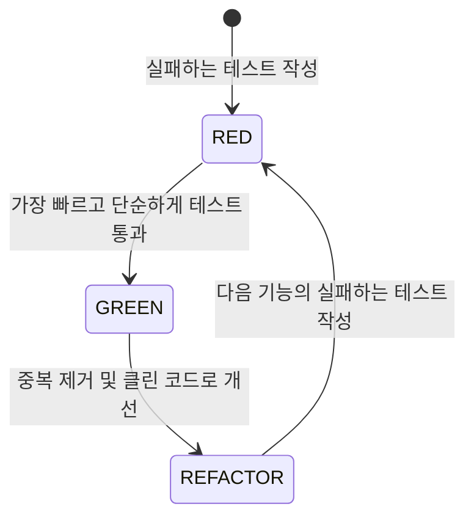

1. **RED (실패):** 아직 존재하지도 않는 기능에 대해 기대하는 동작을 정의한 테스트 코드를 작성합니다. 구현 코드가 없으므로 컴파일 에러나 실행 실패(빨간 불)가 발생하는 것이 정상입니다.
2. **GREEN (성공):** 오직 테스트를 통과하기 위한 목적만을 가진 가장 단순한 코드를 작성합니다. 심지어 상수를 하드코딩해서 통과시켜도 괜찮습니다(초록 불).
3. **REFACTOR (리팩토링):** 테스트가 통과하는 안전망이 확보되었으므로, 코드의 중복을 제거하고 가독성을 높이며 설계를 우아하게 다듬습니다. 이때 작성해 둔 테스트가 깨지지 않는지 계속 확인합니다.

#### TDD가 주는 압도적인 혜택
- **과도한 엔지니어링(Over-engineering) 방지:** 오직 테스트를 통과하는 데 필요한 최소한의 코드만 작성하므로 불필요한 기능(YAGNI, You Aren't Gonna Need It)을 만들지 않습니다.
- **테스트 가능한 고품질 인터페이스 강제:** 테스트하기 어려운 코드는 대개 결합도가 높고 의존성이 꼬여있는 나쁜 코드입니다. 테스트를 먼저 작성하면 자연스럽게 의존성 주입(DI)이 적용되고 모듈이 분리된 훌륭한 설계가 유도됩니다.

---

## (+) 부록 B: 버전 관리(Git)는 왜 중요한가요?

### 1. 시간 여행과 협업의 도구
소프트웨어 개발에서 버전 관리 시스템(VCS)이 없던 시절을 상상해 보십시오.
- `소스코드_최종.zip`
- `소스코드_최종_진짜최종.zip`
- `소스코드_최종_진짜_수정본_배포금지.zip`

동료가 메일로 압축파일을 보내주면 각자의 컴퓨터에서 바뀐 부분을 수동으로 눈으로 비교해가며 합쳐야 했습니다. 실수로 이전 코드를 덮어쓰면 복구할 방법이 없었습니다.

2005년 리눅스 토발즈(Linus Torvalds)가 리눅스 커널 개발을 위해 만든 **Git(깃)**은 전 세계 소프트웨어 엔지니어링의 문화를 근본부터 바꾼 **분산 버전 관리 시스템(DVCS, Distributed Version Control System)**입니다.

```
Git의 핵심 역할
1. 시간 여행 (Time Travel): 프로젝트의 모든 과거 시점으로 코드를 되돌리거나(Checkout/Revert) 추적할 수 있습니다.
2. 병렬 우주 생성 (Branching): 메인 코드에 영향을 주지 않고 여러 개발자가 독립된 공간에서 각자의 기능을 실험할 수 있습니다.
3. 안전한 융합 (Merging): 흩어져 작업한 결과물을 충돌 검사를 거쳐 하나의 완결된 소스로 안전하게 결합합니다.
```

---

### 2. Git의 핵심 4단계 영역 메커니즘
Git을 제대로 다루기 위해서는 파일이 이동하는 4가지 영역(Area)을 이해해야 합니다.

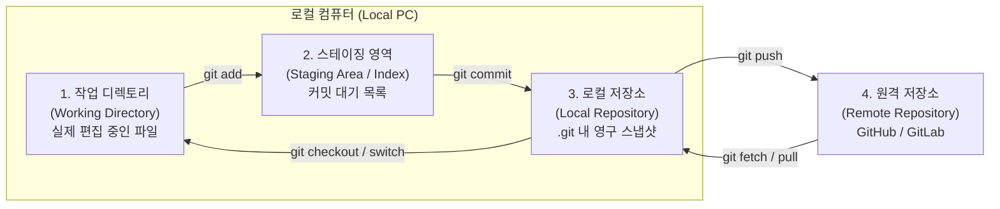

- **Working Directory:** 우리가 VS Code나 IntelliJ에서 실제로 타이핑하고 파일을 생성/수정/삭제하는 물리적 작업 폴더입니다.
- **Staging Area (Index):** 다음 커밋(스냅샷)에 포함시킬 파일들만을 골라 올려놓는 '발송 대기실'입니다. 수정된 10개의 파일 중 연관된 2개 파일만 골라 커밋할 수 있는 유연성을 제공합니다 (`git add`).
- **Local Repository:** 커밋이 확정되어 내 컴퓨터 안의 로컬 `.git` 데이터베이스에 영구적으로 안전하게 기록된 스냅샷 히스토리입니다 (`git commit`).
- **Remote Repository:** 팀원들과 코드를 공유하고 백업하기 위해 클라우드(GitHub, GitLab 등)에 호스팅된 중앙 저장소입니다 (`git push`, `git pull`).

---

### 3. 협업의 표준: GitHub PR(Pull Request) 워크플로우

현업에서 팀 단위로 일할 때 가장 널리 쓰이는 표준 개발 흐름은 **기능 브랜치 워크플로우(Feature Branch Workflow)**와 **PR(Pull Request)** 시스템입니다.

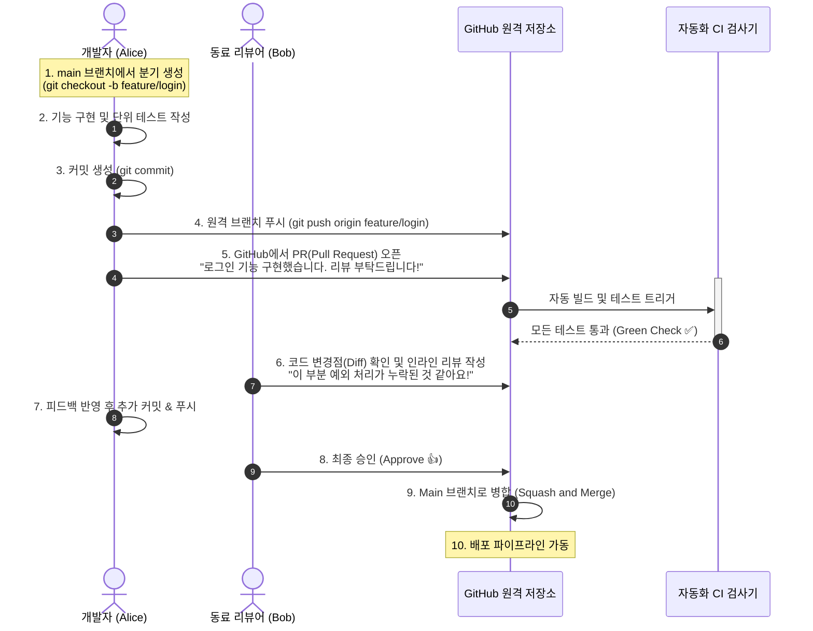

---

### 4. 머지 충돌(Merge Conflict) 해결과 건강한 코드 리뷰 문화

#### 충돌(Conflict)이 발생하는 원리와 해결 3단계
두 명의 개발자가 **동일한 파일의 동일한 코드 라인을 서로 다르게 수정**한 상태에서 브랜치를 병합하려 할 때 Git은 스스로 판단할 수 없어 충돌을 일으킵니다. 충돌은 오류나 실패가 아니며, 코드가 조용히 덮어씌워져 망가지는 것을 막아주는 Git의 보호 장치입니다.

```
<<<<<<< HEAD (현재 브랜치: 내가 수정한 내용)
const API_URL = "https://api.myapp.com/v2";
=======
const API_URL = "https://staging.myapp.com/v1";
>>>>>>> feature/login (상대방이 수정한 내용)
```

1. **상황 파악:** `git status`를 입력하여 어떤 파일에서 충돌이 났는지 확인합니다.
2. **조율 및 수정:** 팀원과 대화하여 어떤 코드가 비즈니스적으로 옳은지 결정한 뒤, 에디터에서 `<<<<<<<`, `=======`, `>>>>>>>` 표시를 지우고 올바른 최종 코드로 정리합니다.
3. **완료:** 수정된 파일을 `git add <파일명>`으로 스테이징하고 `git commit`을 완료하여 충돌 해결을 매듭짓습니다.

#### 건강한 코드 리뷰 문화를 위한 실천 가이드
- **작은 PR 크기 유지:** 1,000줄이 넘는 방대한 PR은 리뷰어가 집중력을 잃고 대충 "LGTM(Looks Good To Me)"을 누르게 만듭니다. 한 번의 PR은 200~400줄 내외로 작게 쪼개어 제출합니다.
- **사람이 아닌 코드를 향한 피드백:** *"왜 이렇게 짰어요?"* 대신 *"이 함수에서 널(null) 값이 들어오면 어떤 일이 발생할까요?"*처럼 시스템과 코드 관점에서 열린 질문을 던집니다.
- **명확한 커밋 메시지 컨벤션(Conventional Commits):**
  - `feat: 소셜 로그인(구글, 카카오) 연동 기능 추가`
  - `fix: 결제 요청 시 타임아웃 오류 수정`
  - `refactor: 유저 서비스 비즈니스 로직 중복 제거`
  - `test: 장바구니 할인 정책 단위 테스트 추가`

---

## 에필로그: 공학적 규율이 개발자에게 주는 진정한 자유

소프트웨어 공학의 다양한 방법론, 철저한 설계 원칙, DevOps 자동화 파이프라인, 촘촘한 테스트 코드, 엄격한 Git 워크플로우를 처음 접할 때 어떤 개발자들은 이를 "자유로운 코딩을 구속하는 답답한 족쇄"처럼 느끼기도 합니다.

하지만 실무 소프트웨어 개발의 진실은 정반대입니다.
- 자동화된 테스트가 없다면, 우리는 한 줄의 코드를 고칠 때마다 시스템이 깨질까 두려워 벌벌 떨어야 합니다.
- CI/CD 파이프라인이 없다면, 우리는 밤마다 터미널에 접속해 수동으로 명령어를 치며 불안에 떨어야 합니다.
- 아키텍처와 방법론이 없다면, 코드는 순식간에 스파게티 덩어리가 되어 비즈니스의 발목을 잡을 것입니다.

**소프트웨어 공학이 요구하는 규율과 실천법은 개발자를 억압하는 족쇄가 아니라, 언제든 과감하게 코드를 리팩토링하고 신속하게 프로덕션에 배포할 수 있도록 지켜주는 '가장 든든한 날개'입니다.** 기술의 유행은 빠르게 변하지만, 본 장에서 다룬 공학적 원리와 협업의 본질은 여러분이 마주할 모든 미래의 시스템 개발에서도 변치 않는 굳건한 나침반이 되어줄 것입니다.
