# PART 06. 컴퓨터 구조와 운영체제의 이해 (Computer Architecture & Operating Systems)

> **"소프트웨어 엔지니어가 컴퓨터 구조와 운영체제를 모른 채 코드를 작성하는 것은, 자동차의 엔진 구조와 변속기 원리를 모른 채 레이싱 머신을 모는 것과 같습니다. 평탄한 직선 도로에서는 차이를 느끼지 못할지 모르지만, 시스템의 성능 한계를 시험하는 극한의 코너링에 들어서는 순간 하드웨어와 운영체제에 대한 이해가 승패를 가릅니다."**

---

## 프롤로그: 물리적 기계와 추상적 논리가 만나는 경계

우리가 일상적으로 작성하는 프로그래밍 언어의 코드는 지극히 추상적이고 우아합니다. `int a = 10;`, `fetch('/api/users')`, `thread.start()`와 같은 문장들은 인간의 논리적 사고 체계에 맞추어 설계된 기호들입니다. 하지만 이 우아한 논리들이 컴파일러와 인터프리터를 거쳐 컴퓨터 내부로 들어가는 순간, 이들은 가차 없는 물리적 실체로 변환됩니다.

컴퓨터의 본질은 사실 수십억 개의 미세한 반도체 스위치(트랜지스터)가 켜지고 꺼지며 전압(예: 0V와 0.8V~3.3V)의 차이를 만들어내는 **거대한 전자 회로 덩어리**에 불과합니다.
- 그렇다면 어떻게 이 차가운 규소(Silicon) 조각과 구리 배선들이 우리가 작성한 조건문과 반복문을 이해하고, 4K 영상을 실시간으로 렌더링하며, 수만 명의 동시 접속자를 처리하는 분산 서버로 작동할 수 있을까요?
- 어떻게 수십 개의 애플리케이션이 단 하나의 물리적 메모리와 CPU 위에서 서로의 영역을 침범하지 않고 동시에 매끄럽게 동작할 수 있을까요?
- 왜 똑같은 시간 복잡도(`O(N)`)를 가진 코드라도 어떤 코드는 10밀리초 만에 끝나고, 어떤 코드는 1초 이상 걸리며 서버의 CPU 사용률을 100%로 치솟게 만들까요?

이 마법 같은 기적과 미스터리의 중심에는 컴퓨터 공학의 양대 기둥인 **컴퓨터 구조(Computer Architecture)**와 **운영체제(Operating System)**가 자리 잡고 있습니다.
- **컴퓨터 구조**는 계산을 수행하는 두뇌(CPU)와 기억을 담당하는 저장소(레지스터, 캐시, 메인 메모리, 디스크), 그리고 이들을 잇는 고속도로(시스템 버스)가 어떻게 물리적으로 설계되고 클록 신호에 맞춰 상호작용하는지를 다룹니다.
- **운영체제**는 이 한정되고 다루기 까다로운 물리적 하드웨어 자원을 수많은 프로그램들이 안전하고 공평하며 효율적으로 나누어 쓸 수 있도록 조율하는 최고 사령관이자, 개발자에게 '독립된 가상 컴퓨터'라는 마법 같은 환상(Abstraction)을 제공하는 시스템 소프트웨어입니다.

이번 PART 06에서는 단순한 면접 암기식 지식을 넘어, 컴퓨터의 탄생부터 현대 멀티코어 프로세서의 파이프라인과 분기 예측, 캐시 일관성(MESI)과 가상 메모리 페이징, 운영체제 커널과 스케줄러의 내부 구조, 그리고 멀티스레드 동기화와 Lock-Free 프로그래밍에 이르기까지 시스템의 가장 깊은 곳에서 숨 쉬고 있는 메커니즘을 단행본 수준의 깊이로 명쾌하게 파헤쳐 보겠습니다.

---

## 01. 컴퓨터와 운영체제의 역사: 거대한 계산기에서 현대 클라우드 OS까지

컴퓨터와 운영체제가 오늘날의 세련된 모습을 갖추기까지는 수많은 공학자들의 번뜩이는 아이디어와 피나는 시행착오가 축적된 드라마틱한 여정이 있었습니다. 역사의 흐름을 따라가 보면, 현대 컴퓨터가 **"왜 지금과 같은 복잡하고도 정교한 구조를 선택할 수밖에 없었는가?"**에 대한 필연적인 해답을 자연스럽게 얻을 수 있습니다.

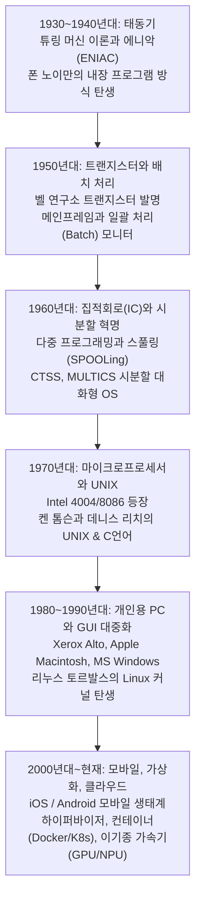

---

### 1.1 앨런 튜링의 추상 기계와 에니악(ENIAC)의 물리적 한계

현대 컴퓨터의 이론적 씨앗은 1936년 영국의 수학자 **앨런 튜링(Alan Turing)**이 발표한 논문에서 제시된 **튜링 머신(Turing Machine)**입니다. 튜링은 무한히 긴 테이프에 기호를 읽고 쓸 수 있는 헤드와 상태 전이 규칙표만 있으면 세상의 모든 수학적 알고리즘을 계산할 수 있다는 **보편 튜링 기계(Universal Turing Machine)** 개념을 증명했습니다.

이 이론이 전자공학과 결합하여 1946년 미국 펜실베이니아 대학에서 탄생한 세계 최초의 범용 전자식 디지털 컴퓨터가 바로 **에니악(ENIAC, Electronic Numerical Integrator and Computer)**입니다. 에니악은 높이 2.4m, 길이 30m, 무게 30톤에 달하는 거대한 강철 괴물이었으며, 내부에는 무려 18,000여 개의 진공관과 1,500개의 릴레이가 빼곡히 들어차 있었습니다.

에니악은 기존 기계식 계산기로는 수주일이 걸리던 포탄의 탄도 궤적 미분방정식을 단 몇 초 만에 계산해 냈지만, 치명적인 구조적 결함을 안고 있었습니다. 바로 **"프로그램(작업 로직)을 변경하려면 사람이 직접 수천 가닥의 전선을 뽑아 다른 단자에 꽂고 스위치를 수동으로 조작해야 했다"**는 점입니다.
- 당시 에니악은 **하드웨어 자체가 곧 프로그램(Hard-wired Program)**이었습니다.
- 탄도 계산을 하다가 기상 예측 계산으로 작업을 바꾸려면, 엔지니어들이 며칠 동안 설계도를 들고 전선 수백 가닥을 다시 연결해야 했습니다. 실제 계산은 5초 만에 끝나는데, 그 계산을 준비하는 배선 작업(Setup)에는 3일이 걸리는 극심한 비효율이 발생한 것입니다.

---

### 1.2 폰 노이만의 혁명: 내장 프로그램 방식(Stored-Program Concept)

이 물리적 한계를 단숨에 돌파한 인물이 20세기 최고의 천재 수학자 **존 폰 노이만(John von Neumann)**입니다. 1945년, 그는 에니악의 후속기인 에드박(EDVAC) 설계 보고서(First Draft of a Report on the EDVAC)를 통해 현대 컴퓨터의 바이블이 된 **내장 프로그램 방식(Stored-Program Concept)**을 정립합니다.

> **폰 노이만의 핵심 통찰:**  
> *"컴퓨터가 처리해야 할 '데이터(숫자)'뿐만 아니라, 컴퓨터가 수행해야 할 '명령어(프로그램 로직)' 역시 똑같이 0과 1의 이진수 형태로 인코딩하여 **동일한 전자 메모리(주기억장치)**에 함께 올려두자! 그리고 CPU가 메모리에서 명령어를 한 줄씩 순서대로 가져와(Fetch) 해석(Decode)하고 실행(Execute)하게 만들면 어떨까?"*

이 발상은 인류 문명을 바꾼 역사상 가장 거대한 패러다임 전환이었습니다.
1. **하드웨어와 소프트웨어의 완벽한 분리:** 더 이상 새로운 계산을 할 때마다 전선을 뽑고 납땜을 할 필요가 없어졌습니다.
2. **진정한 범용 컴퓨터(Universal Computer)의 탄생:** 동일한 하드웨어 기계 위에 '문서 작성 명령어 묶음'을 메모리에 올리면 워드프로세서가 되고, '게임 명령어 묶음'을 올리면 게임기가 되며, '웹 서버 명령어 묶음'을 올리면 서버가 되는 마법이 실현된 것입니다.

---

### 1.3 하드웨어 반도체 소자의 진화: 진공관에서 초고밀도 집적회로까지

폰 노이만 구조가 확립된 이후, 컴퓨터의 물리적 크기가 체육관만 한 전산실에서 우리 손바닥 위의 스마트폰과 워치로 축소될 수 있었던 것은 물리학과 반도체 소자 공학의 비약적인 발전 덕분이었습니다.

| 세대 구분 | 핵심 전자 소자 | 주요 특징 및 컴퓨터 구조적 의의 |
| :--- | :--- | :--- |
| **제1세대 (1940~1950년대 중반)** | **진공관 (Vacuum Tube)** | 유리관 내부의 진공 상태에서 열전자 방출을 이용해 스위칭 수행. 발전소 수준의 전력 소모, 엄청난 발열, 나방이 날아들거나(Bug의 유래) 필라멘트가 끊어지는 잦은 고장 발생. (ENIAC, UNIVAC I) |
| **제2세대 (1950년대 중반~1960년대 중반)** | **트랜지스터 (Transistor)** | 1947년 벨 연구소(쇼클리, 바딘, 브래튼)가 발명한 고체 반도체 소자. 진공관 대비 크기는 1/100 이하로 줄고, 전력 소모와 발열이 극적으로 감소하며 신뢰성과 스위칭 속도가 비약적으로 향상됨. (IBM 7090, 초기 메인프레임) |
| **제3세대 (1960년대 중반~1970년대 초반)** | **집적회로 (IC, Integrated Circuit)** | 잭 킬비와 로버트 노이스가 개발. 손톱만 한 실리콘 웨이퍼 조각 하나 위에 수십~수천 개의 트랜지스터와 저항, 다이오드를 화학적 식각 공정으로 한꺼번에 새겨 넣음. 컴퓨터 소형화의 시작, 미니컴퓨터(DEC PDP-8, PDP-11)와 IBM System/360 탄생. |
| **제4세대 (1970년대 중반~현재)** | **고밀도/초고밀도 집적회로 (LSI / VLSI / ULSI)** | 하나의 반도체 칩 안에 수백만~수백억 개의 트랜지스터를 집적하여 CPU 전체를 단일 칩으로 구현한 **마이크로프로세서(Microprocessor)**의 탄생. 1971년 Intel 4004를 시작으로 x86, ARM 아키텍처로 발전하며 PC, 스마트폰, 클라우드 서버 시대를 개척함. |

> [!NOTE]
> **무어의 법칙(Moore's Law)과 현대 반도체의 나노 공정 한계**  
> 인텔의 공동 창립자 고든 무어가 1965년에 주창한 **"반도체 칩에 집적되는 트랜지스터의 수가 약 18~24개월마다 2배씩 증가한다"**는 경험적 법칙은 반세기 동안 컴퓨터 성능을 기하급수적으로 끌어올렸습니다. 그러나 최근 회로 선폭이 3나노미터(nm), 2나노미터 수준(원자 수십 개 크기)에 도달하면서 전자가 절연막을 뚫고 새어 나가는 **양자 터널링 현상(Quantum Tunneling)**과 발열 밀도 한계(Dark Silicon 문제)에 직면했습니다. 현대 컴퓨터 구조가 단일 코어의 클록(GHz)을 높이는 대신 **멀티코어(Multi-Core)와 이기종 가속기(GPU, NPU)** 결합으로 방향을 튼 근본적인 물리학적 이유가 바로 여기에 있습니다.

---

### 1.4 운영체제(OS)의 눈부신 진화: 하드웨어 효율 극대화의 역사

초창기 컴퓨터에는 '운영체제'라는 소프트웨어가 아예 존재하지 않았습니다. 천문학적인 가격의 컴퓨터 하드웨어를 단 1초라도 놀리지 않고 한계까지 쥐어짜기 위한 엔지니어들의 치열한 고민 속에서 운영체제는 다음과 같은 단계를 거치며 진화해 왔습니다.

#### 1) 제0세대: 수동 순차 처리 (No OS / Bare-Metal Direct Execution)
- 1950년대 초반까지는 프로그래머가 종이에 구멍을 뚫어 만든 **천공 카드(Punched Card)** 다발을 직접 품에 안고 전산실에 들어갔습니다.
- 장부에 사용 시간을 예약한 뒤, 직접 스위치와 플러그를 조작해 프로그램을 메모리에 올리고 실행 결과를 기다렸습니다.
- **문제점:** 앞사람이 디버깅을 하거나 뒷사람이 카드를 장착하는 **준비 시간(Setup Time)** 동안, 수백억 원짜리 CPU는 아무런 연산도 하지 못한 채 멍하니 유휴(Idle) 상태로 전기를 낭비해야 했습니다.

#### 2) 제1세대: 일괄 처리 시스템 (Batch Processing System)과 상주 모니터
- 준비 시간을 줄이기 위해 전산실에 전문 **오퍼레이터(Operator)**를 두었습니다. 개발자들은 직접 기계를 만지지 못하고 오퍼레이터에게 천공 카드 뭉치를 제출만 했습니다.
- 오퍼레이터는 포트란(Fortran) 컴파일 작업, 코볼(COBOL) 작업 등 성격이 비슷한 작업들을 한 묶음(**Batch**)으로 모아서 자기 테이프에 기록한 뒤 컴퓨터에 연속으로 밀어 넣었습니다.
- 이때 앞 작업이 끝나면 사람의 개입 없이 자동으로 다음 작업을 테이프에서 읽어 들여 실행시키는 최초의 원시적 운영체제인 **상주 모니터(Resident Monitor)**가 탄생했습니다.
- **여전한 한계:** CPU의 전자적 연산 속도에 비해 기계식으로 돌아가는 카드 판독기나 라인 프린터의 입출력(I/O) 속도는 수만 배 이상 느렸습니다. 작업 도중 I/O가 발생하면 CPU는 입출력이 끝날 때까지 하염없이 멈춰 서서 기다려야 했습니다.

```
[단일 일괄 처리(Uni-batch) 시스템의 치명적 CPU 유휴 현상]
CPU 상태 : [ 연산 ] ───(느린 I/O 대기로 CPU 완전 정지)───> [ 연산 ] ───(I/O 대기)───> [ 연산 ]
I/O 장치 :          [ 디스크/테이프 읽기 및 프린터 인쇄 ]            [ 테이프 읽기 ]
```

#### 3) 제2세대: 스풀링(SPOOLing)과 다중 프로그래밍(Multiprogramming)
CPU가 I/O를 기다리며 노는 꼴을 참을 수 없었던 공학자들은 두 가지 결정적 혁신을 도입합니다.
- **스풀링 (SPOOLing, Simultaneous Peripheral Operations On-Line):**  
  느려터진 카드 리더기나 프린터를 CPU와 직접 연결하지 않고, 상대적으로 훨씬 빠른 **자기 디스크(하드디스크의 조상)**를 중간 완충 지대(Spool)로 두는 기법입니다. CPU는 출력할 데이터를 디스크에 초고속으로 던져버리고 즉시 다음 연산으로 넘어가며, 실제 프린터 인쇄는 백그라운드에서 천천히 진행됩니다. (오늘날 우리가 워드에서 문서 100장을 인쇄 누르고 곧바로 다른 작업을 할 수 있는 이유도 프린터 스풀러 덕분입니다.)
- **다중 프로그래밍 (Multiprogramming):**  
  주기억장치(RAM)를 여러 구역으로 나누어 **단 하나의 프로그램이 아니라 여러 개의 프로그램(Job A, Job B, Job C)을 동시에 메모리에 적재**해 두는 기법입니다.
  - 실행 중이던 Job A가 디스크에서 파일을 읽는 느린 I/O 요청을 발생시키면, 운영체제는 즉시 CPU를 놀리지 않고 메모리에 대기 중이던 Job B에게 CPU 제어권을 넘겨줍니다.
  - 이로써 CPU 이용률(CPU Utilization)이 사상 처음으로 80~90% 이상으로 수직 상승했습니다. 단, 이때부터 **"메모리의 어느 위치에 어떤 프로그램을 올릴 것인가(메모리 관리)"**, **"누구에게 먼저 CPU를 줄 것인가(CPU 스케줄링)"**, **"프로그램끼리 서로의 메모리를 침범하지 못하게 어떻게 막을 것인가(메모리 보호)"**라는 현대 운영체제의 핵심 과제들이 본격적으로 등장했습니다.

#### 4) 제3세대: 시분할 시스템(Time-Sharing System)과 대화형 컴퓨팅의 도래
다중 프로그래밍은 전산실 사장님을 행복하게 해 주었지만(CPU 가동률 극대화), 정작 프로그래머들의 고통은 여전했습니다. 카드 뭉치를 제출하고 오타(Syntax Error) 하나를 확인하는 데만 여전히 반나절에서 하루가 걸렸기 때문입니다.

1960년대 중반, MIT의 페르난도 코바토(Fernando Corbató) 교수 팀이 개발한 **CTSS(Compatible Time-Sharing System)**와 벨 연구소, GE가 합작한 **MULTICS**는 컴퓨팅의 목적을 '기계의 효율'에서 **'인간과의 실시간 상호작용(Interactivity)'**으로 바꾸어 놓았습니다.
- 거대한 메인프레임 한 대에 수십 대의 키보드/모니터 단말기(Terminal)를 연결합니다.
- 운영체제는 CPU의 실행 시간을 아주 잘게 쪼갠 **타임 슬라이스(Time Slice / Quantum, 예: 10밀리초~20밀리초)** 단위로 나누어, 접속해 있는 수십 명의 사용자 프로그램에 회전목마처럼 번갈아 할당합니다.
- 1초에 수십 번씩 차례가 돌아오므로, 각 단말기 앞에 앉은 개발자는 키보드를 치자마자 즉각 화면에 반응이 나타나는 것을 보며 **"이 거대한 슈퍼컴퓨터가 오직 나 혼자만을 위해 독점적으로 돌아가고 있다"**는 경이로운 환상(Illusion)을 경험하게 되었습니다.

#### 5) 제4세대: UNIX의 탄생, C 언어, 그리고 현대 OS의 계보
거대하고 야심 찼던 MULTICS 프로젝트가 지나친 복잡성으로 난항을 겪자, 벨 연구소의 젊은 천재 엔지니어였던 **켄 톰슨(Ken Thompson)**과 **데니스 리치(Dennis Ritchie)**는 1969년 방치되어 있던 미니컴퓨터 PDP-7 위에서 작고 단순하며 철학이 명확한 새로운 운영체제인 **UNIX(유닉스)**를 탄생시켰습니다.

UNIX가 컴퓨터 역사의 살아있는 전설이 된 이유는 다음 세 가지 설계 철학과 혁신 때문입니다.
1. **C 언어를 통한 커널 재작성 (1973년):**  
   당시까지 모든 운영체제는 특정 CPU 기계어에 종속된 **어셈블리어(Assembly)**로 작성되었습니다. 즉, 인텔 컴퓨터용 OS를 다른 회사 컴퓨터로 옮기려면 처음부터 끝까지 새로 짜야 했습니다. 데니스 리치는 고급 언어이면서도 하드웨어 메모리를 직접 제어할 수 있는 **C 언어**를 발명했고, UNIX 커널의 90% 이상을 C 언어로 재작성했습니다. 이제 C 컴파일러만 있으면 어떤 하드웨어로든 운영체제를 손쉽게 이식(**Portability, 이식성**)할 수 있는 대혁명이 일어난 것입니다.
2. **"모든 것은 파일이다 (Everything is a File)":**  
   일반 텍스트 문서뿐만 아니라 디렉터리, 키보드, 모니터, 하드디스크, 심지어 네트워크 소켓과 프로세스 정보까지 모두 '파일 디스크립터'라는 동일한 추상화 인터페이스로 묶어 `open()`, `read()`, `write()`, `close()`라는 단 4개의 시스템 콜로 일관되게 제어할 수 있게 설계했습니다.
3. **작은 도구들의 조합과 파이프라인 (`|`):**  
   하나의 거대한 만능 프로그램을 만드는 대신, 한 가지 일만 완벽하게 수행하는 작은 프로그램(`grep`, `sort`, `awk`, `cat`)들을 만들고 이들을 파이프(`|`)로 연결해 복잡한 작업을 처리하는 모듈화 철학을 확립했습니다.

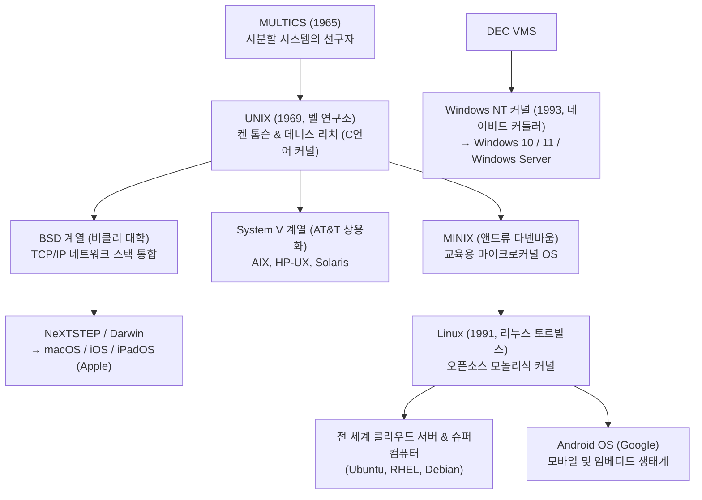

이후 1991년 핀란드의 대학생 **리누스 토르발스(Linus Torvalds)**가 UNIX 호환 표준(POSIX)을 따르는 오픈소스 커널인 **Linux(리눅스)**를 세상에 공개하면서, 오늘날 전 세계 클라우드 서버의 90% 이상, 슈퍼컴퓨터의 100%, 그리고 수십억 대의 안드로이드 스마트폰을 움직이는 현대 운영체제의 제국이 완성되었습니다. 한편 마이크로소프트는 DEC에서 VMS 운영체제를 설계했던 전설적인 아키텍트 데이비드 커틀러(Dave Cutler)를 영입하여 견고한 **Windows NT 커널**을 구축함으로써 데스크톱과 엔터프라이즈 시장을 제패하게 됩니다.

---

## 02. 컴퓨터는 어떤 구성 요소로 되어 있나요?

화려한 LED 조명이 빛나는 최신 게이밍 PC든, 아마존 웹 서비스(AWS) 데이터센터의 랙 서버든, 우리의 손목 위에 있는 스마트워치든 내부 케이스를 열어 현미경으로 들여다보면 그 본질적인 논리 구조는 폰 노이만이 설계한 뼈대에서 단 한 치도 벗어나지 않습니다.

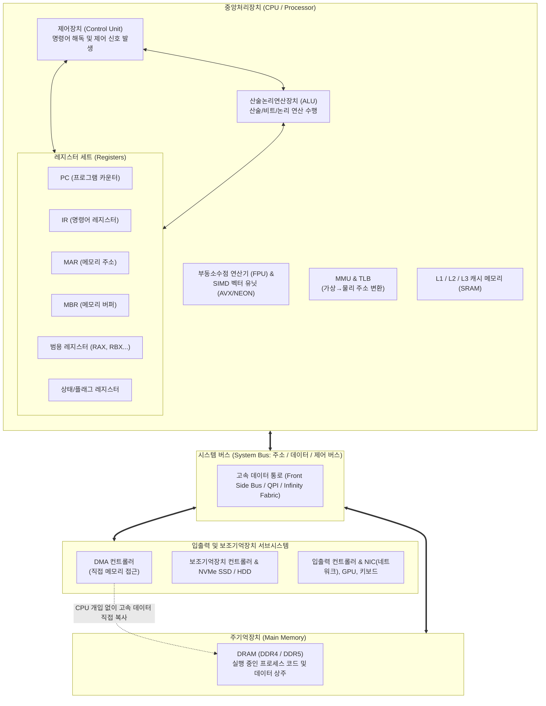

---

### 2.1 폰 노이만 구조와 하버드 구조의 결합 (Modern Hybrid Architecture)

현대 컴퓨터 구조를 깊이 이해하려면 **폰 노이만 병목 현상(Von Neumann Bottleneck)**과 이를 극복한 **수정된 하버드 구조(Modified Harvard Architecture)**를 반드시 알아야 합니다.

1. **순수 폰 노이만 구조의 한계 (메모리 병목):**  
   폰 노이만 구조에서는 '실행할 명령어(Instruction)'와 '연산할 데이터(Data)'가 하나의 메인 메모리에 섞여 있고, CPU와 메모리를 연결하는 시스템 버스도 하나뿐입니다.  
   따라서 CPU는 **"명령어를 가져오는 일(Instruction Fetch)"과 "데이터를 읽고 쓰는 일(Data Read/Write)"을 물리적으로 동시에 수행할 수 없습니다.** 아무리 CPU 내부 연산기가 빛의 속도로 계산을 끝내도, 단일 버스라는 좁은 외나무다리에서 명령어와 데이터가 줄을 서서 기다려야 하는 병목이 발생합니다.
2. **하버드 구조(Harvard Architecture)의 해법:**  
   명령어를 저장하는 메모리/버스의 물리적 배선과 데이터를 저장하는 메모리/버스의 배선을 아예 두 개로 완벽히 분리한 구조입니다. CPU가 현재 명령어의 데이터를 메모리에서 읽는 동시에, 다음번 실행할 명령어를 미리 가져올 수 있어 속도가 비약적으로 빨라집니다. 단, 메인 메모리 전체를 물리적으로 두 개로 쪼개면 메모리 공간 활용이 경직되고 메인보드 배선이 지나치게 복잡해집니다.
3. **현대 CPU의 천재적 절충안 (하이브리드 구조):**  
   오늘날의 인텔, AMD, 애플 M 시리즈 등 모든 현대 프로세서는 **외부 메인 메모리(DRAM)와 시스템 버스는 폰 노이만 구조(통합형)**로 단순하게 유지하되, **CPU 코어와 가장 맞닿아 있는 L1 캐시 메모리 단계에서는 명령어 전용 캐시(L1i, Instruction Cache)와 데이터 전용 캐시(L1d, Data Cache)로 완벽히 분리하는 하버드 구조**를 채택하고 있습니다. 이로써 비용 효율성과 초고속 동시 접근이라는 두 마리 토끼를 모두 잡았습니다.

---

### 2.2 CPU 내부의 핵심 구성 요소와 세부 레지스터 해부

CPU는 크게 **산술논리연산장치(ALU)**, **제어장치(Control Unit)**, 그리고 **레지스터 세트(Register Set)**로 이루어집니다.

#### 1) ALU (Arithmetic Logic Unit, 산술논리연산장치)
- 레지스터에 담긴 두 개의 피연산자(Operand)를 입력받아 덧셈, 뺄셈, 곱셈 같은 산술 연산과 AND, OR, XOR, NOT, 비트 시프트(Shift) 같은 논리 연산을 수행하는 순수 조합 논리 회로(가산기, 시프터 등)의 집합입니다.
- ALU는 연산 결과값만 내놓는 것이 아니라, 연산 직후의 특이 사항을 **플래그 레지스터(Flag / Status Register, x86의 EFLAGS/RFLAGS)**에 기록합니다. 우리가 작성하는 모든 `if (a == b)`나 `while (i < 100)` 같은 조건문은 사실 ALU가 뺄셈(`a - b`)을 수행한 뒤 세팅한 아래의 플래그 비트를 보고 점프(Jump)하는 방식으로 동작합니다!
  - **ZF (Zero Flag, 제로 플래그):** 연산 결과가 정확히 `0`이면 1로 세팅됩니다. (두 값이 같음을 판별: `a - b == 0`)
  - **SF (Sign Flag, 부호 플래그):** 연산 결과의 최상위 비트(MSB)가 1이면(즉, 음수이면) 1로 세팅됩니다. (대소 관계 판별: `a - b < 0`)
  - **CF (Carry Flag, 캐리 플래그):** 부호 없는(Unsigned) 연산에서 최상위 비트 바깥으로 자리올림이나 자리내림이 발생했을 때 1로 세팅됩니다.
  - **OF (Overflow Flag, 오버플로우 플래그):** 부호 있는(Signed) 2의 보수 연산에서 표현 가능한 범위를 넘어 부호 비트가 뒤집혔을 때 1로 세팅됩니다.

#### 2) 제어장치 (CU, Control Unit)
- 명령어 레지스터(IR)에 들어온 이진 기계어 비트열(Opcode + Operand)을 해독(Decode)하여, CPU 내부의 ALU와 레지스터, 그리고 외부의 메모리와 I/O 컨트롤러들에게 정확한 타이밍(클록)에 맞춰 전기적 **제어 신호(Control Signals)**를 보내는 오케스트라 지휘자입니다.

#### 3) 레지스터 (Registers): 0.5나노초의 세계
CPU가 연산을 수행하기 위해 데이터를 붙잡아 두는 CPU 코어 내부의 플립플롭 기억 소자입니다.

| 레지스터 분류 | 명칭 및 약어 | 상세 동작 원리와 시스템에서의 역할 |
| :--- | :--- | :--- |
| **특수 목적 레지스터** | **PC (Program Counter)**<br>(x86-64: `RIP`) | **다음에 메모리에서 인출(Fetch)할 명령어의 가상 주소**를 저장합니다. 명령어 하나를 가져올 때마다 명령어 길이만큼 자동으로 증가하며, 함수 호출(`CALL`)이나 조건 분기(`JMP`)가 일어나면 목적지 주소로 즉시 덮어써집니다. |
| **특수 목적 레지스터** | **IR (Instruction Register)** | 메모리에서 방금 읽어 들인 **현재 실행할 기계어 명령어 비트열 자체**를 보관합니다. 제어장치(CU)는 이 레지스터의 비트를 읽고 회로를 조작합니다. |
| **특수 목적 레지스터** | **MAR (Memory Address Register)** | CPU가 읽거나 쓰려는 메모리의 주소를 시스템 주소 버스로 내보내기 전에 일시적으로 담아두는 레지스터입니다. |
| **특수 목적 레지스터** | **MBR / MDR (Memory Buffer/Data Register)** | 메모리에서 읽어 들인 데이터나 메모리에 쓰기 위해 내보낼 데이터를 데이터 버스와 주고받는 관문 버퍼입니다. |
| **스택 관리 레지스터** | **SP (Stack Pointer)** (`RSP`) &<br>**BP (Base Pointer)** (`RBP`) | 현재 실행 중인 스레드의 스택 영역 최상단 주소(`RSP`)와 현재 함수의 스택 프레임 기준점 주소(`RBP`)를 가리킵니다. 지역 변수 접근과 함수 복귀 주소 추적의 핵심입니다. |
| **커널/특권 레지스터** | **CR3 (Control Register 3)** /<br>**TTBR (ARM)** | **현재 실행 중인 프로세스의 페이지 테이블(Page Table) 최상위 물리 주소**를 담고 있는 극비 특권 레지스터입니다. 프로세스 컨텍스트 스위칭이 일어날 때 운영체제가 이 값을 바꾸어 가상 메모리 공간을 순식간에 전환합니다. |
| **범용 레지스터** | **GPR (General Purpose Registers)**<br>(`RAX`, `RBX`, `RCX`, `RDX`, `RDI`, `RSI`, `R8`~`R15`) | 프로그래머(컴파일러)가 지역 변수 보관, 산술 연산 피연산자 저장, 함수의 매개변수 전달(`RDI`, `RSI` 등) 및 반환값 저장(`RAX`)을 위해 다목적으로 자유롭게 사용하는 초고속 작업대입니다. |

---

### 2.3 명령어 사이클과 현대 CPU의 파이프라이닝(Pipelining) 혁명

CPU가 단 하나의 기계어 명령어(예: `ADD R1, R2, [0x2000]`)를 처리하기 위해서는 내부적으로 다음 **5단계(5-Stage)**의 세부 공정을 거쳐야 합니다.

1. **IF (Instruction Fetch, 명령어 인출):** PC 레지스터가 가리키는 주소에서 명령어를 L1i 캐시(또는 메모리)로부터 가져와 IR에 넣습니다.
2. **ID (Instruction Decode, 명령어 해독 및 레지스터 읽기):** 제어장치가 명령어를 해석하고, 연산에 필요한 값을 범용 레지스터 파일에서 읽어옵니다.
3. **EX (Execute, 실행 및 주소 계산):** ALU를 가동하여 실제 산술 연산을 수행하거나, 메모리에 접근할 유효 주소(Effective Address)를 계산합니다.
4. **MEM (Memory Access, 메모리 접근):** 명령어가 메모리 읽기(`LOAD`)나 쓰기(`STORE`)인 경우 L1d 캐시나 데이터 메모리에 접근합니다.
5. **WB (Write-Back, 결과 저장):** 연산 결과나 메모리에서 읽어온 값을 목표 레지스터에 최종 기록합니다.

#### 순차 실행 vs 명령어 파이프라이닝 (Instruction Pipelining)
만약 첫 번째 명령어가 위 5단계를 모두 끝마칠 때까지(5클록 소요) 두 번째 명령어가 아무것도 하지 않고 기다린다면 어떻게 될까요? 첫 번째 명령어가 `EX(실행)` 단계에 있을 때, `IF(인출)` 회로와 `ID(해독)` 회로는 텅 빈 채로 놀게 됩니다.

이를 해결하기 위해 헨리 포드의 자동차 컨베이어 벨트 조립 라인을 CPU 내부에 그대로 이식한 기법이 바로 **명령어 파이프라이닝(Instruction Pipelining)**입니다!

```
[비파이프라인 순차 실행: 명령어 3개 처리에 15클록 소요]
클록 :  1   2   3   4   5   6   7   8   9  10  11  12  13  14  15
명령1: [IF][ID][EX][MEM][WB]
명령2:                     [IF][ID][EX][MEM][WB]
명령3:                                         [IF][ID][EX][MEM][WB]

[5단계 파이프라이닝 실행: 명령어들이 겹쳐서 실행되어 7클록 만에 완료! (이후 매 클록마다 1개씩 완료)]
클록 :  1    2    3    4    5    6    7    8
명령1: [IF] [ID] [EX] [MEM][WB]
명령2:      [IF] [ID] [EX] [MEM][WB]
명령3:           [IF] [ID] [EX] [MEM][WB]
명령4:                [IF] [ID] [EX] [MEM][WB]
```

파이프라인이 가득 차면(Full Pipeline), 개별 명령어 하나가 완료되는 시간(Latency)은 여전히 5클록이지만, **CPU 전체에서 매 1클록마다 명령어가 1개씩 쏟아져 나오는(Throughput이 5배 증가)** 마법 같은 성능 향상이 일어납니다. 현대 인텔/AMD CPU는 클록 주파수를 높이기 위해 이 파이프라인을 14~20단계 이상으로 아주 잘게 쪼갠 **슈퍼파이프라이닝(Superpipelining)** 구조를 사용합니다.

#### 파이프라인의 3대 위기: 파이프라인 해저드 (Pipeline Hazards)
하지만 컨베이어 벨트처럼 명령어를 겹쳐서 실행하다 보면, 앞 명령어와 뒤 명령어가 서로 엉켜서 파이프라인이 멈추거나(Stall / Bubble) 깨지는 위기 상황이 발생합니다. 이를 **파이프라인 해저드(Hazard)**라고 부르며, 다음 3가지가 존재합니다.

| 해저드 종류 | 발생 원인 및 구체적 상황 | 하드웨어 및 컴파일러의 해결 기법 |
| :--- | :--- | :--- |
| **1. 구조적 해저드**<br>(Structural Hazard) | 두 개의 서로 다른 명령어가 **같은 클록에 동일한 하드웨어 자원을 동시에 쓰려고 할 때** 발생.<br>(예: 명령어1이 `MEM` 단계에서 메모리의 데이터를 읽으려는데, 명령어4가 동시에 `IF` 단계에서 같은 메모리의 명령어를 읽으려 할 때) | **하버드 구조 도입:** L1 캐시를 명령어 캐시(L1i)와 데이터 캐시(L1d)로 물리적으로 분리하여 충돌을 원천 제거함. |
| **2. 데이터 해저드**<br>(Data Hazard) | **앞 명령어의 연산 결과가 아직 레지스터에 저장(`WB`)되지 않았는데, 바로 뒤 명령어가 그 레지스터 값을 읽어서(`ID`/`EX`) 계산하려고 할 때** 발생.<br>예: `ADD R1, R2, R3` 직후 `SUB R4, R1, R5` 실행 시, `R1`의 새 값이 아직 반영 전임(RAW: Read After Write 의존성). | **전달 / 포워딩 (Forwarding / Bypassing):** 앞 명령어의 `WB` 단계가 끝날 때까지 기다리지 않고, `EX` 단계의 ALU 출력선에서 나온 따끈따끈한 결과값을 내부 우회 배선을 통해 뒤 명령어의 ALU 입력단으로 즉시 직접 꽂아 넣어 줌! |
| **3. 제어 해저드**<br>(Control / Branch Hazard) | `if`, `for`, `while` 같은 **조건 분기문(Branch) 때문에 다음에 실행할 명령어가 바로 아랫줄인지, 저 멀리 점프한 주소인지 알 수 없을 때** 발생.<br>분기 여부는 앞 명령어가 `EX` 단계에 가봐야 비로소 결정되는데, 파이프라인은 이미 그 뒷줄 명령어들을 `IF`, `ID`에 잔뜩 집어넣은 상태임! | **분기 예측 (Branch Prediction)** 및 **투기적 실행 (Speculative Execution)** 기법으로 해결 (아래에서 심층 해부). |

---

### 2.4 슈퍼스칼라(Superscalar), 비순차 실행(OoOE), 그리고 분기 예측의 비밀

현대 CPU는 단순한 1차선 파이프라인에 만족하지 않고 성능을 극한까지 끌어올리기 위해 세 가지 초고도화 기술을 탑재하고 있습니다.

1. **슈퍼스칼라 (Superscalar):**  
   CPU 코어 내부에 컨베이어 벨트(파이프라인)와 ALU 연산기를 1개가 아니라 **4~8개씩 병렬로 배치**한 구조입니다. 이를 통해 한 클록에 명령어 1개가 아니라 **한 클록에 동시에 4~6개의 명령어를 한꺼번에 인출하고 실행(IPC > 1)**할 수 있습니다.
2. **비순차 실행 (Out-of-Order Execution, OoOE):**  
   프로그래머가 짠 코드 순서대로만 정직하게 실행하면, 앞선 명령어가 캐시 미스(Cache Miss)로 메모리에서 데이터를 기다리는 수백 클록 동안 뒤따르는 모든 명령어가 함께 멈춰 서야 합니다.  
   현대 CPU는 명령어 창(Instruction Window / Reorder Buffer)을 두고 뒤쪽 명령어들을 미리 훑어본 뒤, **앞 명령어와 데이터 의존성이 없는 독립적인 뒤쪽 명령어들을 먼저 새치기해서 실행**해 버리고, 나중에 결과만 원래 코드 순서대로 조립하여 반영합니다.
3. **분기 예측 (Branch Prediction)과 투기적 실행 (Speculative Execution):**  
   조건문(`if`)을 만났을 때 결과가 나올 때까지 파이프라인을 멈추면 성능 손실이 너무 큽니다. 따라서 CPU 내부의 **분기 예측기(Branch Predictor)**는 과거 수천 번의 분기 이력(Branch History Table)을 통계적으로 학습하여 **"이번에도 99% 확률로 `if` 조건이 참(True)일 것이다!"라고 도박(예측)을 걸고, 결과가 나오기도 전에 참일 때의 코드들을 미리 파이프라인에 밀어 넣어 실행(투기적 실행)**합니다.
   - **예측 성공 시:** 단 1클록의 지연도 없이 빛의 속도로 코드가 이어집니다.
   - **예측 실패 시 (Branch Misprediction Penalty):** 아차 싶어서 이미 파이프라인에 집어넣어 실행 중이던 15~20단계의 작업물을 **전부 쓰레기통에 버리고(Pipeline Flush)**, 올바른 주소에서 처음부터 다시 명령어를 가져와야 합니다. 이때 약 **15~20클록 이상의 막대한 시간 페널티**가 발생합니다!

#### [실무 코드 사례] 왜 '정렬된 배열'이 '비정렬 배열'보다 조건문 루프에서 5배 이상 빠를까?
스택오버플로우(StackOverflow) 역사상 가장 높은 추천 수를 기록한 전설적인 질문이자, 컴퓨터 구조를 아는 개발자와 모르는 개발자의 차이를 극명하게 보여주는 벤치마크 코드를 살펴보겠습니다.

 크기가 10만 개인 정수 배열 `data[]`에 `0 ~ 255` 사이의 난수가 들어있고, 그중 **`128` 이상인 숫자들만 골라 합계(`sum`)를 구하는 똑같은 `for` 루프**입니다.

```cpp
#include <algorithm>
#include <iostream>

// 배열 크기 100,000개 (값의 범위: 0 ~ 255)
int data[100000];
long long sum = 0;

// [실험 1] 정렬하지 않은(Unsorted) 배열에서 루프 실행 -> 소요 시간: 약 11.5초 (10만 번 반복 시)
// [실험 2] std::sort(data, data + 100000)로 정렬한(Sorted) 뒤 동일한 루프 실행 -> 소요 시간: 약 2.3초!
for (int c = 0; c < 100000; ++c) {
    if (data[c] >= 128) {   // <-- 바로 이 조건 분기문(Branch)이 핵심입니다!
        sum += data[c];
    }
}
```

도대체 왜 덧셈하는 횟수도 똑같고 배열을 읽는 횟수도 똑같은데, **배열을 미리 정렬해 두었다는 이유만으로 실행 속도가 5배나 빨라지는 것일까요?** 해답은 CPU의 **분기 예측기(Branch Predictor)**에 있습니다!

```
[비정렬 배열 (Unsorted Data): 분기 예측기가 완전히 멘붕에 빠짐]
data[] 값 :  250,   42,  189,   12,   99,  210,  130,   55 ...
조건(>=128): True, False, True, False, False, True, True, False ...
CPU 예측  : 완전한 50:50 동전 던지기! 절반의 확률로 예측이 빗나가며 끊임없이 파이프라인 플러시(Flush) 발생!

[정렬된 배열 (Sorted Data): 분기 예측 적중률 99.99% 달성!]
data[] 값 :    2,    5,   19, ...  127,  128,  129,  240,  255
조건(>=128): False, False, False ... False, True, True, True, True
CPU 예측  : 처음 5만 번은 계속 False로 예측해 100% 적중! 128을 만나는 딱 한 번만 틀리고, 이후 5만 번은 계속 True로 예측해 100% 적중!
```

> [!TIP]
> **실무 고성능 최적화 팁 (Branchless Programming):**  
> 만약 데이터를 정렬할 수 없는 실시간 처리 환경에서 분기 예측 실패 페널티를 없애고 싶다면, 조건문(`if`)을 아예 제거하고 비트 연산이나 CPU의 **조건부 이동 명령어(`CMOV`, Conditional Move)**가 생성되도록 삼항 연산자나 산술식을 활용하는 **Branchless 코드**를 작성하면 비정렬 상태에서도 정렬된 배열과 동일한 최고 속도를 낼 수 있습니다.

---

### 2.5 명령어 집합 구조(ISA): CISC(x86) vs RISC(ARM / RISC-V)

CPU가 이해할 수 있는 기계어 명령어들의 설계 규격서를 **ISA(Instruction Set Architecture, 명령어 집합 구조)**라고 부릅니다. 현대 프로세서 생태계는 크게 두 진영으로 나뉩니다.

| 비교 항목 | CISC (Complex Instruction Set Computer) | RISC (Reduced Instruction Set Computer) |
| :--- | :--- | :--- |
| **대표 아키텍처** | **Intel, AMD (x86 / x86-64)** | **ARM (Apple M1~M4, 스마트폰), RISC-V**, MIPS |
| **설계 철학** | **"하드웨어가 복잡해지더라도, 명령어 하나로 복합적인 작업을 한 방에 처리하자!"** | **"명령어의 종류와 기능을 극도로 단순화하여, 하드웨어 파이프라인을 빠르고 저전력으로 돌리자!"** |
| **명령어 길이 및 규격** | **가변 길이 명령어 (1바이트 ~ 15바이트)**<br>명령어마다 길이가 제각각이라 해독(Decode) 회로가 매우 복잡함 | **고정 길이 명령어 (정확히 4바이트 = 32비트)**<br>명령어 규격이 일정하여 해독 회로가 극도로 단순하고 파이프라이닝에 최적임 |
| **메모리 접근 방식** | 연산 명령어(`ADD`)가 메모리 주소에 직접 접근하여 읽고 계산하고 쓰는 것까지 한 번에 수행 가능 | **Load-Store 구조:** 오직 `LOAD`와 `STORE` 명령어만 메모리에 접근 가능. 모든 산술 연산은 반드시 레지스터 안에서만 수행됨 |
| **전력 소모 및 발열** | 복잡한 디코더 회로로 인해 **전력 소모와 발열이 높음** (데스크톱, 서버에 주로 사용) | 트랜지스터 효율이 뛰어나 **전성비(전력 대비 성능)가 압도적으로 높음** (모바일, 최신 노트북 및 클라우드 서버로 영역 확장 중) |
| **현대의 수렴 진화** | 현대 x86 CPU는 외부적으로는 가변 길이 CISC 명령어를 받지만, 내부 디코더에서 이를 RISC 형태의 잘게 쪼개진 **마이크로 연산(μops, Micro-operations)**으로 변환하여 슈퍼스칼라 파이프라인으로 실행함! | 현대 ARM 프로세서 역시 고성능을 위해 SIMD 벡터 명령어와 비순차 실행(OoOE)을 대거 탑재하며 두 진영의 내부 마이크로아키텍처가 서로 닮아가고 있음. |

---

### 2.6 연산 장치의 분화: CPU vs GPU vs NPU(TPU) 아키텍처 비교

과거에는 CPU가 컴퓨터의 모든 연산을 도맡아 처리했지만, 고해상도 3D 그래픽과 현대 생성형 AI(거대언어모델 LLM, 딥러닝 행렬 연산)의 시대가 도래하면서 연산 장치의 패러다임이 완전히 분화되었습니다.

```
[CPU 아키텍처: 소수의 천재 박사님 (Latency-Oriented)]
┌─────────────────────────┬─────────────────────────┐
│     거대한 ALU 코어 1     │     거대한 ALU 코어 2     │  <-- 복잡한 분기 예측기와 거대한 제어장치(CU)
├─────────────────────────┴─────────────────────────┤
│            거대한 L1 / L2 / L3 캐시 메모리          │  <-- 지연 시간(Latency)을 줄이기 위해 면적의 절반을 캐시에 투자!
└───────────────────────────────────────────────────┘

[GPU 아키텍처: 수천 명의 성실한 초등학생 군단 (Throughput-Oriented)]
┌───┬───┬───┬───┬───┬───┬───┬───┬───┬───┬───┬───┬───┐
│ALU│ALU│ALU│ALU│ALU│ALU│ALU│ALU│ALU│ALU│ALU│ALU│ALU│  <-- 수천~수만 개의 작고 단순한 코어(CUDA Core)를 빽빽하게 배치!
├───┼───┼───┼───┼───┼───┼───┼───┼───┼───┼───┼───┼───┤      (제어장치와 캐시는 최소화하고 단순 반복 병렬 연산에 올인)
│ALU│ALU│ALU│ALU│ALU│ALU│ALU│ALU│ALU│ALU│ALU│ALU│ALU│
└───┴───┴───┴───┴───┴───┴───┴───┴───┴───┴───┴───┴───┘

[NPU / TPU 아키텍처: 행렬 곱셈 전용 컨베이어 공장 (Systolic Array)]
┌───────────────────────────────────────────────────┐
│  [MAC] → [MAC] → [MAC] → [MAC] (데이터가 심장 박동처럼 │  <-- 레지스터/메모리 왕복 없이 옆 연산기로 데이터를 바로 토스하며
│    ↓       ↓       ↓       ↓    연산기 배열을 흘러가며 │      (A × B + C) 행렬 곱셈-누산 연산만 극한의 효율로 수행!
│  [MAC] → [MAC] → [MAC] → [MAC]  초고속 텐서 연산 수행) │
└───────────────────────────────────────────────────┘
```

| 비교 항목 | CPU (Central Processing Unit) | GPU (Graphics Processing Unit) | NPU / TPU (Neural / Tensor Processing Unit) |
| :--- | :--- | :--- | :--- |
| **핵심 설계 목표** | **지연 시간 최소화 (Low Latency)**<br>단일 작업(직렬 코드)을 가장 빠르게 끝내는 것 | **처리량 극대화 (High Throughput)**<br>대규모의 동일한 병렬 데이터를 한꺼번에 처리하는 것 | **AI 텐서/행렬 연산 특화 (Domain-Specific)**<br>딥러닝의 핵심인 행렬 곱셈과 합성곱(MAC)의 전성비 극대화 |
| **코어 수 및 구조** | 수 개 ~ 수십 개 (4 ~ 128 코어)<br>코어 하나하나가 거대하고 독립적인 제어장치 보유 | 수천 ~ 수만 개 (예: RTX 4090은 16,384개 CUDA 코어)<br>수십 개의 코어가 하나의 제어장치를 공유(**SIMT** 구조) | 수천 개의 **MAC(Multiply-Accumulate)** 유닛이 그물망처럼 연결된 **시스톨릭 어레이(Systolic Array)** 구조 |
| **캐시 및 제어 회로 비중** | 칩 면적의 **60% 이상**을 L1/L2/L3 캐시와 복잡한 분기 예측기, 비순차 실행 회로가 차지함 | 칩 면적의 **80% 이상**을 순수 연산기(ALU)에 할애하고, 캐시와 제어 로직은 최소한으로 축소함 | 분기 예측이나 복잡한 캐시 일관성 회로를 아예 제거하고, 고속 온칩 SRAM 버퍼와 행렬 연산기에만 집중 |
| **메모리 시스템** | 대용량 범용 **DDR4 / DDR5 DRAM**<br>(지연 시간이 낮고 용량 확장이 쉬움) | 초고대역폭 **GDDR6 / HBM(고대역폭 메모리)**<br>(한 번에 수천 비트 폭으로 데이터를 폭포수처럼 쏟아부음) | 온칩 대용량 스크래치패드 메모리 + **HBM3 / LPDDR5X** |
| **최적의 워크로드** | 운영체제 커널 구동, 복잡한 `if-else` 비즈니스 로직, 데이터베이스 트랜잭션, I/O 제어 | 3D 그래픽 픽셀 렌더링, 물리 시뮬레이션, 대규모 딥러닝 모델 학습(Training) 및 병렬 과학 연산 | LLM 추론(Inference), 실시간 음성/비전 AI 인식, 온디바이스 AI (스마트폰/자율주행 저전력 추론) |

---

## 03. 왜 모든 데이터를 메모리에 올리지 못하나요?

초보 개발자나 비전공자들은 종종 이런 합리적인 의문을 품습니다.  
*"컴퓨터가 느려지는 원인의 99%가 느려터진 SSD나 하드디스크에서 파일을 읽어오는 시간 때문이라면, 아예 컴퓨터에 초고속 캐시 메모리(SRAM)나 메인 메모리(DRAM)를 10테라바이트쯤 꽂아두고 운영체제와 모든 데이터를 평생 그 위에서만 돌리면 안 되나요?"*

이 상상은 이상적이지만, **반도체 물리학의 근본적인 한계**와 **경제학적 비용 법칙**이라는 두 개의 거대한 벽에 부딪히게 됩니다.

---

### 3.1 휘발성(Volatile) vs 비휘발성(Non-Volatile)의 물리학적 구조 차이

첫 번째 장벽은 전기가 끊겼을 때 데이터를 지킬 수 있는가 하는 **휘발성**의 문제입니다. 각 저장 소자가 1비트(`0` 또는 `1`)를 물리적으로 어떻게 기억하는지 내부 회로를 들여다보면 그 이유가 명확해집니다.

```
[1. SRAM (캐시 메모리): 6개의 트랜지스터 플립플롭]
  전원이 켜져 있는 동안 전하 충/방전 없이 전압 상태가 즉시 유지됨 → 초고속(1ns), 리프레시 불필요!
  단점: 1비트 만드는 데 트랜지스터가 6개나 들어가서 면적이 너무 크고 가격이 금값임.

[2. DRAM (메인 메모리): 1개의 트랜지스터 + 1개의 커패시터(축전기)]
  조그만 양동이(커패시터)에 전자(물)를 채우면 1, 비우면 0. 구조가 단순해 수십 GB 대용량 제작 가능!
  단점: 양동이에 미세한 구멍(누설 전류)이 있어서 수십 밀리초(ms)마다 전자가 줄줄 새어 나감!
        → 64ms마다 끊임없이 전기를 다시 채워주는 '리프레시(Refresh)'가 필수이며, 전원 차단 즉시 데이터 100% 증발!

[3. NAND Flash SSD (보조기억장치): 플로팅 게이트 / 전하 포획층(CTF)]
  두꺼운 절연체(산화막) 감옥 안에 고전압(양자 터널링)으로 전자를 억지로 밀어 넣어 가둠.
  장점: 전원을 뽑아도 절연체 벽에 갇힌 전자가 탈출하지 못해 10년 이상 데이터 영구 보존(비휘발성)!
  단점: 두꺼운 절연체 벽 너머로 전자를 밀어 넣고 빼는 데 시간이 너무 오래 걸리고(수십 μs),
        반복해서 쓰면 절연체 벽이 헐거워져 수명이 다함(수명 한계 존재).
```

#### NAND 플래시(SSD)가 메인 메모리(RAM)를 대체할 수 없는 결정적 이유: '덮어쓰기 불가'와 비대칭성
전원을 꺼도 데이터가 안 날아가는 SSD(NAND Flash)를 그냥 메인 메모리처럼 쓰면 안 될까요? 절대 불가능합니다.
- **DRAM(메인 메모리)**은 바이트(Byte) 단위로 원하는 번지에 즉시 새로운 값을 **덮어쓰기(In-place Overwrite)**할 수 있으며, 읽기와 쓰기 속도가 둘 다 수십 나노초(ns)로 대칭적입니다.
- 반면 **NAND 플래시(SSD)**는 물리적 특성상 **기존 데이터 위에 바로 덮어쓰기가 불가능(No In-place Update)**합니다!
  - SSD에서 데이터를 읽거나 쓰는 최소 단위는 **페이지(Page, 보통 4KB ~ 16KB)**이지만, 기존 데이터를 지우는(Erase) 최소 단위는 페이지 수백 개가 묶인 거대한 **블록(Block, 보통 4MB ~ 8MB)** 단위입니다.
  - 만약 단 1바이트만 수정하고 싶어도, 기존 블록 전체를 읽어서 다른 빈 페이지에 새로 기록한 뒤, 나중에 가비지 컬렉션(Garbage Collection)을 통해 블록 통째로 고전압을 가해 지워야 합니다. 이 때문에 SSD 내부에는 이를 관리하는 별도의 미니 컴퓨터인 **FTL(Flash Translation Layer) 컨트롤러**와 웨어 레벨링(Wear Leveling, 수명 균등화) 알고리즘이 들어가며, 지연 시간이 DRAM보다 **약 1,000배 이상 느립니다.**

---

### 3.2 비용-속도-용량의 황금 삼각형과 거리(Distance)의 물리학

설령 돈이 무한대로 많은 억만장자가 나타나서 *"나는 1비트당 트랜지스터 6개가 들어가는 가장 빠른 SRAM으로 100기가바이트짜리 메모리를 특별 주문 제작하겠다!"*라고 선언하더라도, 이 메모리는 절대 1나노초(ns)의 속도로 동작할 수 없습니다. **빛의 속도와 물리적 거리(Physical Distance)의 한계** 때문입니다.

- **빛(전기 신호)이 구리 도선을 타고 이동하는 속도**는 진공에서의 빛의 속도보다 느린 약 **초당 20만 km**입니다.
- 현대 3GHz CPU의 1클록 주기는 약 **0.33나노초(ns)**입니다. 0.33나노초 동안 전기 신호가 이동할 수 있는 최대 물리적 거리는 고작 **6.6센티미터(cm)**, 왕복으로 치면 **3.3센티미터**에 불과합니다!
- 즉, CPU가 1~2클록(1ns 이내) 만에 데이터를 읽어오려면, 그 기억장치는 무조건 **CPU 연산 코어로부터 수 밀리미터(mm) 이내의 코앞**에 붙어 있어야만 합니다.
- 만약 SRAM으로 100GB를 만들면 칩의 크기가 책상만 해질 텐데, 책상 끝에서 CPU까지 전기 신호가 걸어오는 데만 이미 수십 나노초가 걸려버려 SRAM 특유의 초고속 이점이 완전히 사라지게 됩니다.

결국 **"빠른 메모리는 물리적으로 반드시 작아야만 하고(CPU 코어 내부에 들어가야 하므로), 큰 메모리는 물리적으로 CPU에서 멀어질 수밖에 없으므로 느려진다"**는 것은 인간의 기술력 부족이 아니라 우주의 물리 법칙이 강제하는 숙명입니다.

---

### 3.3 저장장치 계층 구조 (Memory Hierarchy) 총정리

이 물리학적 숙명과 경제적 비용을 완벽하게 조화시킨 컴퓨터 공학 최고의 걸작이 바로 **저장장치 계층 구조(Memory Hierarchy)**입니다.

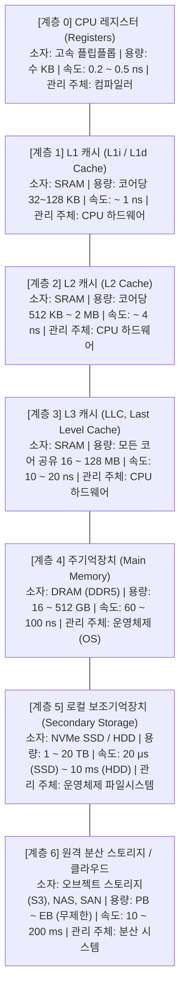

#### 계층 간 지연 시간의 체감 격차와 관리 주체 비교
각 계층을 누가 통제하며, 개발자가 코드를 짤 때 어떤 점에 유의해야 하는지 한눈에 비교해 보겠습니다.

| 계층 | 실제 접근 지연 시간 | CPU 1클록(0.3ns)을 인간 시간 '1초'로 환산 시 | 바이트당 비용 | 데이터 이동 단위 | 제어 및 관리 주체 |
| :--- | :--- | :--- | :--- | :--- | :--- |
| **레지스터** | ~ 0.3 ns | **1초** (눈 깜짝할 사이) | 측정 불가 (최고) | 워드 (4B / 8B) | **컴파일러** (레지스터 할당 최적화) |
| **L1 / L2 캐시** | 1 ~ 4 ns | **3초 ~ 13초** (책상 위 커피 마시기) | 극도로 비쌈 | **캐시 라인 (64 Byte)** | **CPU 하드웨어 컨트롤러** (투명하게 자동 동작) |
| **L3 공유 캐시** | 15 ~ 20 ns | **50초 ~ 1분** (옆자리 동료에게 물어보기) | 매우 비쌈 | **캐시 라인 (64 Byte)** | **CPU 하드웨어 컨트롤러** (MESI 일관성 프로토콜) |
| **메인 메모리 (DRAM)** | 60 ~ 100 ns | **3분 20초 ~ 5분 30초** (편의점 다녀오기) | 보통 (GB당 수천 원) | **페이지 (4 KB)** (OS 기준) | **운영체제 커널 & MMU** (가상 메모리 매핑) |
| **NVMe SSD** | 20 ~ 50 μs | **18시간 ~ 2일** (주말 여행 다녀오기) | 저렴 (GB당 백 원대) | 블록 / 페이지 (4KB~) | **운영체제 VFS & 디바이스 드라이버** |
| **하드디스크 (HDD)** | 5 ~ 10 ms | **6개월 ~ 1년** (1년 치 휴직하고 돌아오기) | 매우 저렴 | 섹터 / 블록 (512B/4KB) | **운영체제 VFS & 디스크 스케줄러** |

이 표가 우리에게 주는 교훈은 명확합니다. **"데이터가 DRAM에서 캐시로 올라와 있느냐(수초), 아니면 SSD에 박혀 있느냐(이틀)"**가 프로그램의 응답 속도를 수만 배 가른다는 사실입니다. 그렇다면 컴퓨터는 어떻게 이 거대한 속도 격차를 극복하고 마치 모든 데이터가 L1 캐시에 있는 것처럼 빠르게 동작할 수 있을까요? 바로 다음 절에서 다룰 **캐시 메모리와 가상 메모리의 정교한 메커니즘** 덕분입니다.

---

## 04. 메모리는 왜 캐시 메모리, 메인 메모리, 가상 메모리로 나뉘어 사용되나요?

저장장치 계층 구조가 단순한 이론에 그치지 않고 실제 컴퓨터에서 경이로운 성능을 발휘할 수 있는 이유는, 세상 모든 컴퓨터 프로그램의 실행 패턴에 놀라운 통계적 규칙성이 존재하기 때문입니다. 이를 **참조의 지역성(Principle of Locality)**이라고 부릅니다.

또한 물리적인 RAM(메인 메모리)을 있는 그대로 쓰지 않고, 그 앞단에는 하드웨어가 관리하는 **캐시 메모리(Cache Memory)**를, 그 뒷단에는 운영체제가 관리하는 **가상 메모리(Virtual Memory)**를 두어 **'속도의 한계'와 '용량/보안의 한계'를 동시에 격파**합니다.

---

### 4.1 캐시 메모리(Cache Memory)와 참조의 지역성

CPU 코어와 메인 메모리(DRAM) 사이에는 약 60~100배에 달하는 속도 격차, 이른바 **메모리 장벽(Memory Wall)**이 존재합니다. 이를 메우기 위해 CPU 내부에는 SRAM으로 만들어진 L1, L2, L3 캐시가 존재합니다. 용량이 고작 수십 KB에서 수십 MB에 불과한 이 작은 캐시가 어떻게 16GB~64GB짜리 메인 메모리의 요청을 **95% 이상의 확률(Cache Hit Ratio)**로 미리 알고 받아낼 수 있을까요?

그 비결은 인간이 작성하는 소프트웨어 코드가 결코 메모리를 무작위(Random)로 뛰어다니지 않고, 다음 두 가지 지역성을 철저히 따른다는 데 있습니다.

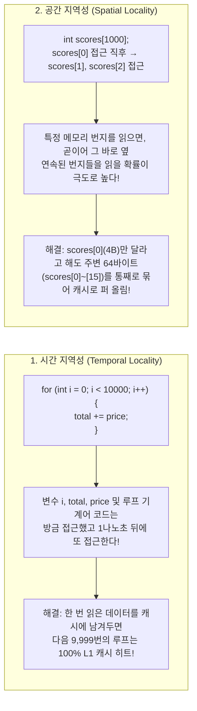

#### 캐시 라인(Cache Line)과 캐시 히트/미스(Cache Hit / Miss)의 동작 원리
CPU가 메모리에서 데이터를 가져올 때 1바이트나 4바이트씩 찔끔찔끔 가져오지 않습니다. 캐시와 메인 메모리 사이에 데이터를 주고받는 최소 묶음 단위를 **캐시 라인(Cache Line, 또는 Cache Block)**이라고 부르며, 현대 x86 및 ARM 프로세서의 표준 캐시 라인 크기는 **64바이트(64 Bytes)**입니다.

1. **캐시 히트 (Cache Hit):** CPU가 원하는 메모리 주소의 데이터가 이미 L1/L2/L3 캐시 라인에 올라와 있는 경우입니다. 메인 메모리까지 갈 필요 없이 몇 클록 만에 즉시 데이터를 가져옵니다.
2. **캐시 미스 (Cache Miss):** 원하는 데이터가 캐시에 없는 경우입니다. 이때는 어쩔 수 없이 느린 메인 메모리(DRAM)까지 내려가서 해당 주소가 포함된 **64바이트 묶음 전체를 캐시 라인으로 복사**해 온 뒤 CPU에 전달합니다. 캐시 미스는 발생 원인에 따라 **3C 미스**로 분류됩니다.
   - **강제 미스 (Compulsory / Cold Miss):** 해당 데이터를 프로그램 실행 후 **맨 처음 접근할 때** 필연적으로 발생하는 미스입니다. (예열 단계)
   - **용량 미스 (Capacity Miss):** 캐시 메모리의 물리적 전체 용량이 작아서, 작업 중인 데이터 세트(Working Set)를 다 담지 못해 기존 데이터를 밀어내고 다시 불러오며 발생하는 미스입니다.
   - **충돌 미스 (Conflict Miss):** 캐시에 빈자리는 남아 있지만, 해시 테이블의 해시 충돌처럼 서로 다른 두 메모리 주소가 **캐시 내의 동일한 자리(Set)에 배정(Mapping)**되어 서로를 쫓아내며 발생하는 미스입니다. (현대 CPU는 이를 줄이기 위해 8-way 또는 16-way **집합 연관 매핑(Set-Associative Mapping)** 방식을 사용합니다.)

#### 캐시 쓰기 정책 (Write Policy): Write-Through vs Write-Back
CPU가 캐시에 있는 변수 값을 `a = 20;`으로 수정했을 때, 저 아래에 있는 메인 메모리(DRAM)의 원본 값은 언제 수정해야 할까요?
- **즉시 쓰기 (Write-Through):** 캐시에 값을 쓸 때마다 **동시에 메인 메모리에도 즉시 내려가서 값을 기록**하는 방식입니다. 데이터 일관성은 완벽하지만, 값을 바꿀 때마다 느린 DRAM 속도(100ns)에 발목이 잡혀 CPU가 멈추는 치명적 단점이 있습니다. (이를 완화하기 위해 중간에 Write Buffer를 둡니다.)
- **나중 쓰기 (Write-Back / Copy-Back):** 값을 수정할 때 **오직 빠른 캐시 메모리에만 반영**하고, 해당 캐시 라인에 **"수정됨(Dirty Bit = 1)"** 표시만 해둡니다. 그러다 나중에 이 캐시 라인이 공간 부족으로 캐시에서 쫓겨날 때(Eviction), 그때 딱 한 번만 메인 메모리에 최종 값을 덮어씁니다. 같은 변수를 루프 안에서 1만 번 수정해도 DRAM 쓰기는 단 1번만 일어나므로 현대 CPU는 대부분 **Write-Back** 방식을 기본으로 채택하고 있습니다.

---

### 4.2 멀티코어의 숙명: 캐시 일관성 프로토콜(MESI)과 거짓 공유(False Sharing)

과거 싱글 코어 시절에는 Write-Back 방식을 써도 아무런 문제가 없었습니다. 캐시를 쓰는 주체가 오직 코어 1개뿐이었기 때문입니다.  
하지만 현대의 CPU는 코어가 8개, 16개, 64개씩 들어있는 **멀티코어(Multi-Core)** 구조이며, **L1 캐시와 L2 캐시는 각 코어마다 독립적으로 따로 소유**하고 있습니다!

여기서 끔찍한 문제가 발생합니다. 메인 메모리의 `count = 0`이라는 변수를 **코어 1**과 **코어 2**가 동시에 각자의 L1 캐시로 복사해 갔습니다. 직후 코어 1이 자신의 L1 캐시에서 `count = 1`로 값을 수정(Write-Back)했습니다. 이때 코어 2의 L1 캐시에는 여전히 옛날 값인 `count = 0`(**Stale Data, 상한 데이터**)이 남아 있는 **캐시 불일치(Cache Incoherence)** 사태가 벌어집니다!

#### 1) 하드웨어 캐시 일관성 해결사: MESI 프로토콜과 버스 스누핑(Bus Snooping)
이를 해결하기 위해 현대 멀티코어 CPU는 하드웨어 수준에서 모든 캐시 라인(64B)마다 다음 **4가지 상태(M, E, S, I)** 중 하나를 꼬리표로 붙여 관리하며, 다른 코어가 버스에 날리는 신호를 실시간으로 엿듣는 **버스 스누핑(Bus Snooping)**을 수행합니다. 이를 **MESI 프로토콜**이라고 부릅니다.

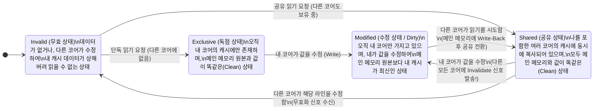

- **MESI의 핵심 동작:** 만약 여러 코어가 함께 읽고 있던(`Shared`) 캐시 라인의 값을 코어 1이 수정하려고 하면, 코어 1은 버스를 통해 다른 모든 코어에게 **"내가 이 64바이트 캐시 라인을 수정할 거니까, 너희가 가진 복사본은 지금 당장 전부 쓰레기(`Invalid`)로 만들어버려!"**라는 **무효화 신호(Invalidate Message)**를 쏩니다. 이후 코어 2가 그 데이터를 읽으려 하면 캐시 미스(`Invalid`)가 나면서 코어 1이 수정한 최신 값을 다시 받아오게 됩니다.

#### 2) 멀티스레드 성능을 파괴하는 은밀한 암살자: 거짓 공유 (False Sharing)
MESI 프로토콜을 이해하면, 멀티스레드 프로그래밍에서 가장 기괴하고 찾기 힘든 성능 저하 버그인 **거짓 공유(False Sharing)**의 정체를 꿰뚫어 볼 수 있습니다.

> **거짓 공유(False Sharing)란?**  
> 두 스레드가 논리적으로는 **완전히 서로 다른 독립된 변수(`x`와 `y`)**를 수정하고 있어서 락(Lock)도 걸지 않았는데, 하필 그 두 변수가 메모리상에서 나란히 선언되어 **동일한 64바이트 캐시 라인 안에 동거**하게 된 상황을 말합니다.  
> 캐시 일관성(MESI)은 변수가 아니라 **64바이트 캐시 라인 전체 단위**로만 작동하기 때문에, 코어 1이 `x`만 고쳐도 코어 2의 `y`가 들어있는 캐시 라인 전체가 강제로 무효화(`Invalid`)되며 코어 간에 캐시 라인을 미친 듯이 뺏고 빼앗기는 **캐시 핑퐁(Cache Ping-Pong / Bouncing)** 현상이 발생하는 참사입니다!

```
[거짓 공유(False Sharing) 발생 메커니즘: 64바이트 캐시 라인의 비극]
┌─────────────────────────────────────────────────────────────────────────┐
│                    동일한 64바이트 캐시 라인 (Cache Line)                 │
│  [ long countA (8B) ]  [ long countB (8B) ]  [ ... 나머지 48바이트 ... ] │
└───────────▲─────────────────────▲───────────────────────────────────────┘
            │                     │
     코어 1 (스레드 1)       코어 2 (스레드 2)
   countA++ 만 계속 수행    countB++ 만 계속 수행

1. 코어 1이 countA를 수정(M) → 코어 2의 캐시 라인 전체가 강제로 무효화(Invalid)됨!
2. 직후 코어 2가 countB를 수정하려고 보니 캐시가 Invalid 상태! → L3/RAM에서 다시 읽어오며 코어 1의 캐시를 무효화!
3. 결과: 아무런 데이터도 공유하지 않았는데, 매 루프마다 L1 캐시가 깨지며 실행 속도가 10배 이상 폭락함!
```

##### [실전 코드 비교] 거짓 공유 발생 코드 vs 캐시 라인 패딩(Padding) 해결 코드
이 문제를 해결하려면 두 변수 사이에 의미 없는 더미 변수(Padding)를 끼워 넣거나 메모리 정렬 지시자(`alignas(64)`)를 사용하여, **두 변수가 물리적으로 서로 다른 64바이트 캐시 라인에 떨어지도록 강제 격리**해야 합니다.

```cpp
// [나쁜 코드: False Sharing 발생!] -> 2개 스레드 각각 1억 번 증가 시 소요 시간: 약 650 ms
struct BadCounters {
    volatile long long countA; // 스레드 1 전용 (0~7 바이트)
    volatile long long countB; // 스레드 2 전용 (8~15 바이트) -> countA와 같은 64B 캐시 라인에 묶임!
};

// [좋은 코드: 캐시 라인 정렬(Padding)로 False Sharing 완벽 제거!] -> 소요 시간: 약 85 ms (약 8배 빨라짐!)
struct GoodCounters {
    alignas(64) volatile long long countA; // 무조건 64바이트 경계 주소에서 시작 (독립 캐시 라인 1)
    alignas(64) volatile long long countB; // 다음 64바이트 경계 주소에서 시작 (독립 캐시 라인 2)
};
```
> [!TIP]
> Java 진영에서도 고성능 동시성 라이브러리(`ConcurrentHashMap`, `LongAdder`, LMAX Disruptor 등)를 구현할 때 이 거짓 공유를 막기 위해 클래스 필드 앞뒤로 56바이트의 더미 `long p1, p2, p3, p4, p5, p6, p7;` 변수를 채워 넣거나 JVM 내부 어노테이션인 `@jdk.internal.vm.annotation.Contended`를 사용하여 캐시 라인을 분리합니다.

---

### 4.3 가상 메모리(Virtual Memory)와 다단계 페이지 테이블(Multi-level Paging)

캐시 메모리가 CPU와 RAM 사이의 속도 격차를 해결한 하드웨어의 마법이라면, **가상 메모리(Virtual Memory)**는 RAM과 보조기억장치(SSD)를 하나로 묶어 용량의 한계를 부수고 프로세스 간 완벽한 보안 격리를 달성한 운영체제와 MMU의 합작품입니다.

#### 1) 가상 메모리가 만들어내는 3가지 위대한 환상
1. **독립된 광활한 주소 공간의 환상:**  
   컴퓨터에 실제 물리 RAM이 8GB밖에 없더라도, 운영체제는 실행되는 모든 프로세스 각각에게 **"자, 여기 0번지부터 끝 번지까지 너 혼자 쓸 수 있는 거대한 통짜 메모리(32비트에서는 4GB, 64비트에서는 128TB~256TB)가 있다!"**라는 가상 주소 공간(Virtual Address Space)을 부여합니다.
2. **완벽한 프로세스 격리 (Memory Isolation):**  
   프로세스 A의 가상 주소 `0x400000`번지와 프로세스 B의 가상 주소 `0x400000`번지는 숫자는 완전히 똑같지만, MMU의 페이지 테이블을 거치면 실제 물리 RAM에서는 완전히 서로 다른 프레임(예: `0x102000`번지와 `0x885000`번지)으로 변환됩니다. 따라서 해커가 프로세스 A에서 아무리 포인터를 조작해도 프로세스 B나 다른 프로그램의 메모리를 절대 읽거나 덮어쓸 수 없습니다.
3. **외부 단편화(External Fragmentation)의 완전한 종식:**  
   과거 연속 메모리 할당 방식에서는 프로그램들이 생겼다 지워지기를 반복하면 물리 메모리 곳곳에 애매한 크기의 빈 구멍들이 숭숭 뚫려, 전체 빈 공간 합계는 충분한데도 큰 프로그램을 올리지 못하는 **외부 단편화** 문제가 심각했습니다.  
   **페이징(Paging)** 기법은 가상 메모리를 **4KB 크기의 페이지(Page)**로, 물리 RAM을 똑같은 **4KB 크기의 프레임(Frame)**으로 잘게 쪼갠 뒤, 물리 프레임이 여기저기 흩어져 있더라도 페이지 테이블로 연결만 해주어 가상 주소상에서는 완벽히 연속된 메모리처럼 보이게 만듭니다.

#### 2) 왜 '단일 페이지 테이블' 대신 '다단계 페이지 테이블(Multi-level Page Table)'을 쓸까?
가상 주소는 어떻게 물리 주소로 바뀔까요? 4KB(`2¹²` 바이트) 페이지 환경에서 가상 주소는 상위 비트인 **가상 페이지 번호(VPN, Virtual Page Number)**와 하위 12비트인 **페이지 내부 오프셋(Offset, 0~4095)**으로 나뉩니다. 오프셋은 그대로 두고 VPN만 페이지 테이블에서 찾아 물리 프레임 번호(PFN)로 치환하면 됩니다.

그런데 여기서 심각한 수학적 딜레마가 발생합니다!
- 만약 32비트 시스템(4GB 가상 공간)에서 1단계(단일) 배열로 페이지 테이블을 만든다면, 총 페이지 개수는 `4GB / 4KB = 1,048,576개(약 100만 개)`이고 각 항목(PTE)이 4바이트이므로 프로세스 1개당 무조건 **4MB의 연속된 페이지 테이블 메모리**가 필요합니다. 프로세스 100개면 페이지 테이블만 400MB를 먹습니다.
- 더 끔찍한 것은 **64비트 시스템(48비트 가상 주소 = 256TB)**입니다. `256TB / 4KB = 2³⁶개(약 687억 개)`의 페이지가 존재하므로, 단일 페이지 테이블을 만들면 **프로세스 1개를 띄울 때마다 페이지 테이블 크기만 무려 512GB의 RAM이 필요**하다는 황당한 결론이 나옵니다! 정작 프로세스가 실제로 쓰는 메모리는 몇 MB뿐인데 말입니다.

이를 해결하기 위해 현대 운영체제(Linux, Windows)와 CPU(x86-64, ARM64)는 전화번호부를 '시/도 → 시/군/구 → 읍/면/동 → 번지'의 트리 구조로 나누어, **실제로 사용하는 영역의 하위 번호부만 동적으로 생성**하는 **다단계 페이지 테이블(Multi-level Page Table, x86-64 기준 4단계 페이징)**을 사용합니다.

```
[x86-64 리눅스의 4단계 페이지 테이블 (4-Level Paging) 주소 변환 구조]
가상 주소 (48비트 사용): [ PGD (9bit) | PUD (9bit) | PMD (9bit) | PTE (9bit) | Offset (12bit) ]
                            │            │            │            │             │
CR3 레지스터 ───────────────►▼            ▼            ▼            ▼             ▼
                        [ 1단계 ] ──► [ 2단계 ] ──► [ 3단계 ] ──► [ 4단계 ] ──► [ 실제 물리 프레임 (4KB) ]
                        (PGD 디렉터리) (PUD 디렉터리) (PMD 디렉터리) (페이지 테이블) + Offset(12bit) 결합!

* 핵심 이점: 프로세스가 사용하지 않는 광활한 가상 주소 구역은 1단계(PGD)에서 포인터를 NULL로 비워두어,
             그 아래 2, 3, 4단계 테이블을 아예 메모리에 만들지 않음! (수백 GB가 아닌 수십 KB만으로 페이지 테이블 유지 가능)
```

#### 3) TLB(Translation Lookaside Buffer)와 Huge Page의 위력
다단계 페이지 테이블은 메모리를 극적으로 아껴주었지만, 반대로 **"메모리의 변수 하나를 읽으려고 1단계 → 2단계 → 3단계 → 4단계 페이지 테이블까지 메모리를 무려 4번이나 먼저 읽어야 하는(Page Table Walk)"** 속도 저하를 유발합니다.

이를 구원하는 하드웨어가 바로 MMU 내부에 존재하는 초고속 주소 변환 캐시인 **TLB(Translation Lookaside Buffer)**입니다.
- CPU가 가상 주소를 내밀면 MMU는 가장 먼저 **TLB**를 조회합니다.
- **TLB Hit (적중률 98% 이상):** 4단계 페이지 테이블을 거칠 필요 없이 **단 0.5~1클록 만에 즉시 물리 프레임 주소를 반환**합니다!
- **TLB Miss:** TLB에 없을 때만 하드웨어 페이지 워크(Page Table Walk)를 통해 4단계 테이블을 탐색한 뒤 결과를 TLB에 캐싱합니다.

> [!TIP]
> **대용량 서버(Oracle, Redis, JVM, Kafka)의 필수 튜닝: Huge Pages (대형 페이지)**  
> 기본 페이지 크기가 **4KB**로 너무 작다 보니, 만약 64GB 메모리를 쓰는 데이터베이스나 JVM 프로세스가 뜨면 페이지 개수만 1,600만 개에 달해 작은 TLB 캐시가 감당하지 못하고 끊임없이 **TLB Miss**가 터지며 CPU가 느려집니다.  
> 이때 운영체제의 **Huge Pages** 기능을 켜서 페이지 단위를 4KB 대신 **2MB 또는 1GB**로 큼직하게 묶어주면, TLB 엔트리 하나로 커버할 수 있는 메모리 면적이 512배~26만 배 넓어져 **TLB Miss가 거의 0에 수렴하고 애플리케이션 처리량이 10~30% 이상 상승**합니다!

---

### 4.4 요구 페이징(Demand Paging)과 페이지 폴트(Page Fault) 완벽 해부

운영체제는 프로그램을 실행할 때 수 기가바이트짜리 실행 파일 전체를 무식하게 RAM에 다 올리지 않습니다. 철저하게 **"CPU가 실제로 그 페이지에 접근하여 달라고 요구(Demand)할 때만 그때그때 메모리에 올리는"** 게으르고도 현명한 전략을 쓰는데, 이를 **요구 페이징(Demand Paging)**이라고 합니다.

그렇다면 CPU가 특정 가상 주소에 접근했는데, 그 페이지가 아직 물리 RAM에 올라와 있지 않다면(페이지 테이블 엔트리의 **Valid Bit = 0**) 컴퓨터 내부에서는 어떤 일이 벌어질까요? 이때 발생하는 하드웨어 트랩(예외)을 **페이지 폴트(Page Fault)**라고 합니다.

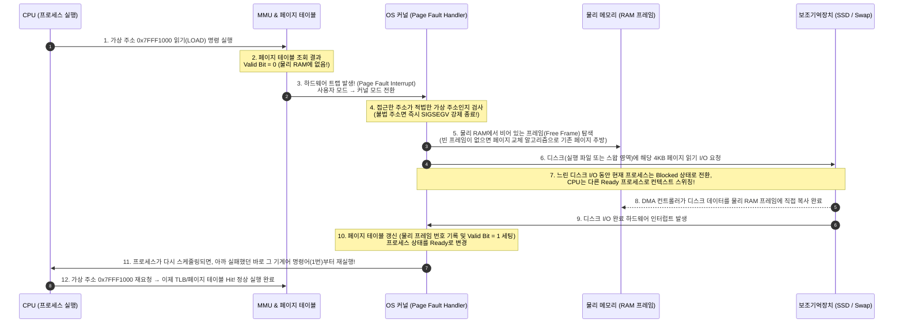

#### 기술 면접 & 실무 핵심: 페이지 폴트의 3가지 종류 (Minor vs Major vs Invalid)
"페이지 폴트가 발생했다"고 해서 무조건 느린 디스크(SSD)를 읽는 것이 아닙니다! 리눅스 성능 분석 도구(`top`, `ps`, `sar -B`, `perf`)에서는 페이지 폴트를 다음 3가지로 엄격히 구분합니다.

| 구분 | 명칭 | 발생 원인 및 디스크 I/O 유무 | 처리 속도 및 시스템 영향 |
| :--- | :--- | :--- | :--- |
| **1. 마이너 페이지 폴트**<br>(Minor / Soft Page Fault) | **소프트 폴트** | 프로세스의 페이지 테이블에는 아직 매핑되지 않았지만(`Valid=0`), **실제 데이터는 이미 물리 RAM 어딘가에 존재할 때** 발생!<br>- 사례 1: `malloc()`으로 메모리를 할당받은 뒤 **최초로 값을 쓸 때** (OS가 빈 물리 프레임을 연결만 해줌)<br>- 사례 2: 다른 프로세스가 이미 메모리에 올려둔 공유 라이브러리(`libc.so`)나 페이지 캐시를 내 페이지 테이블에 연결만 할 때<br>- 사례 3: `fork()` 직후 **Copy-on-Write(CoW)**로 메모리를 복제할 때 | **디스크 I/O가 전혀 없음!**<br>커널이 메모리 안에서 페이지 테이블 포인터만 이어주면 끝나므로 **수 마이크로초(μs) 이내에 초고속 처리**됨. |
| **2. 메이저 페이지 폴트**<br>(Major / Hard Page Fault) | **하드 폴트** | 요청한 페이지가 물리 RAM 어디에도 없어서, **실제로 느린 보조기억장치(SSD/HDD의 파일 또는 Swap 영역)에서 데이터를 읽어와야 할 때** 발생! | **실제 디스크 I/O 발생!**<br>밀리초(ms) 단위의 엄청난 지연이 발생하며, 초당 Major Fault 수치(`majflt/s`)가 치솟으면 서버 응답이 멈추는 **스래싱(Thrashing)**의 전조 증상임. |
| **3. 무효 페이지 폴트**<br>(Invalid Page Fault) | **메모리 보호 위반** | 프로세스가 할당받지도 않은 엉뚱한 주소(예: `NULL` 포인터 역참조 `0x0`)에 접근하거나, **읽기 전용(Code 영역) 페이지에 강제로 쓰기(Write)를 시도했을 때** 발생! | 커널이 이를 버그 또는 해킹 시도로 판단하여 해당 프로세스에 **`SIGSEGV` (Segmentation Fault)** 시그널을 보내 **즉시 강제 종료**시킴! |

---

### 4.5 페이지 교체 알고리즘(Page Replacement)과 스래싱(Thrashing)

물리 RAM의 모든 프레임이 꽉 찬 상태에서 새로운 페이지를 메모리에 올려야 한다면, 운영체제는 눈물을 머금고 **기존에 RAM에 올라와 있던 페이지 중 하나를 골라 디스크(Swap 영역)로 쫓아내야(Victim Page 선정)** 합니다.

이때 **"앞으로 가장 오랫동안 쓰이지 않을 페이지를 정확히 골라내어 메이저 페이지 폴트를 최소화하는 것"**이 페이지 교체 알고리즘의 목표입니다.

```
[대표적인 페이지 교체 알고리즘 5선 비교]

1. Optimal (최적 교체 알고리즘 - 벨라디의 알고리즘)
   - 원리: "앞으로 미래에 가장 오랫동안 참조되지 않을 페이지"를 내쫓음.
   - 특징: 페이지 폴트를 가장 적게 일으키는 수학적 이상향이지만, 운영체제가 미래를 예언할 수 없으므로 실제 구현은 불가능함! (다른 알고리즘의 성능을 평가하는 기준점으로만 사용)

2. FIFO (First-In First-Out, 선입선출)
   - 원리: "메모리에 가장 먼저 들어왔던 가장 오래된 페이지"를 무조건 내쫓음.
   - 치명적 결함: 프로그램 시작부터 끝까지 계속 쓰이는 핵심 전역 변수 페이지가 단지 '일찍 들어왔다'는 이유만으로 쫓겨남.
   - 벨라디의 모순 (Belady's Anomaly): 상식적으로는 물리 RAM 프레임 개수를 늘려주면 페이지 폴트가 줄어야 하는데, FIFO에서는 프레임을 더 줬더니 오히려 페이지 폴트가 늘어나는 기괴한 역설이 발생함!

3. LRU (Least Recently Used, 최근 최소 사용)
   - 원리: 시간 지역성에 입각하여 "과거를 돌아봤을 때, 가장 오랫동안 참조되지 않고 방치된 페이지"를 내쫓음.
   - 특징: 최적(Optimal) 알고리즘에 근접하는 매우 뛰어난 성능을 보임. 단, 메모리 접근이 일어날 때마다(초당 수십억 번) 모든 페이지의 최근 접근 시각(타임스탬프)이나 연결 리스트 순서를 갱신해야 하므로 순수 LRU는 하드웨어 오버헤드가 너무 큼.

4. LFU (Least Frequently Used, 최소 빈도 사용)
   - 원리: "지금까지 참조된 총횟수(빈도)가 가장 적은 페이지"를 내쫓음.
   - 한계: 프로그램 초기화 단계에서 1만 번 집중적으로 쓰이고 앞으로는 영원히 안 쓰일 페이지가 높은 카운트 때문에 메모리에 계속 눌러앉아 있는 문제 발생.

5. Clock 알고리즘 (NUR: Not Used Recently / 2차 기회 알고리즘) -> [실제 현대 OS의 선택!]
   - 원리: 순수 LRU의 막대한 오버헤드를 해결한 근사(Approximation) 알고리즘.
   - 동작: 물리 프레임들을 시계판처럼 원형 큐로 연결하고, 각 페이지마다 하드웨어가 자동으로 세팅하는 1비트짜리 참조 비트(Reference Bit: 최근에 읽히면 1, 아니면 0)만 둠.
     시계바늘(포인터)이 돌면서 참조 비트가 1인 페이지를 만나면 "한 번은 봐준다(2차 기회 부여)!"며 비트를 0으로 내리고 다음으로 넘어가고, 바늘이 다시 돌아올 때까지도 참조 비트가 0인 페이지를 만나면 즉시 내쫓음!
   - 리눅스 커널은 이를 더욱 발전시켜 리스트를 Active List(열심히 쓰이는 페이지)와 Inactive List(교체 후보 페이지) 두 개로 나누어 관리하는 2Q / Clock-Pro 변형 알고리즘을 사용함.
```

#### 스래싱(Thrashing): 컴퓨터가 디스크만 긁으며 얼어붙는 재앙
다중 프로그래밍 환경에서 욕심을 부려 너무 많은 프로그램을 동시에 실행하면 어떤 일이 일어날까요?

```
[다중 프로그래밍 정도(동시 실행 프로세스 수)에 따른 CPU 이용률 변화와 스래싱]

CPU 이용률 (%)
 100% │                  ...................
      │             ..../                   \
      │         .../                         \  <-- 임계점 돌파! 스래싱(Thrashing) 발생!
      │      ../                              \     (모든 프로세스가 최소한의 프레임조차 확보하지 못해
      │    ./                                  \     실행하자마자 Page Fault 발생 → 디스크 Swap I/O만 무한 반복!)
      │  ./                                     \________________________
   0% └──────────────────────────────────────────────────────────────────►
      0                 적정 수준               임계점(λ)                 동시 실행 프로세스 수 (MPD)
```

1. 처음에는 동시 실행 프로세스 수를 늘릴수록 I/O 대기 시간을 서로 메워주어 **CPU 이용률**이 꾸준히 올라갑니다.
2. 하지만 어느 임계점(Threshold)을 넘어 프로세스가 너무 많아지면, 각 프로세스에게 할당되는 물리 RAM 프레임 개수가 프로세스가 정상적으로 돌아가는 데 필요한 최소한의 개수 이하로 떨어집니다.
3. 그 순간 모든 프로세스가 명령어 한 줄 실행할 때마다 **메이저 페이지 폴트(Page Fault)**를 일으킵니다!
4. 부족한 프레임을 확보하려고 다른 프로세스의 당장 쓸 페이지를 디스크로 스왑 아웃(Swap-out)시키면, 0.001초 뒤에 그 프로세스가 깨어나서 방금 쫓겨난 자기 페이지를 다시 스왑 인(Swap-in)하느라 또 다른 프로세스의 페이지를 쫓아냅니다.
5. 결국 **시스템 전체가 실제 프로그램 연산은 단 1%도 하지 못하고, 하루 종일 SSD/하드디스크에 페이지를 넣었다 뺐다(Swapping) 하는 일에 99%의 시간을 쓰며 컴퓨터가 완전히 멈춘 것처럼 얼어붙는 현상**, 이것이 바로 **스래싱(Thrashing)**입니다. (이마저도 스왑 공간까지 꽉 차면 리눅스 커널은 최후의 수단으로 **OOM Killer(Out-Of-Memory Killer)**를 발동시켜 메모리를 가장 많이 먹는 프로세스를 강제로 사살해 버립니다.)

#### 스래싱을 예방하는 운영체제의 두 가지 무기
- **워킹셋 모델 (Working Set Model):**  
  데닝(Peter Denning)이 제안한 모델로, 참조의 지역성에 따라 프로세스가 특정 시간 구간(`Δ`) 동안 집중적으로 참조하는 페이지들의 집합을 **워킹셋(Working Set)**이라고 정의합니다. 운영체제는 각 프로세스의 워킹셋 크기만큼의 물리 프레임을 **무조건 보장**해 주고, 만약 물리 RAM이 부족해 모든 프로세스의 워킹셋 합계를 감당할 수 없다면 어설프게 쪼개 주는 대신 **특정 프로세스 하나를 통째로 일시 중단(Suspend)시켜 동시 실행 수를 조절**합니다.
- **페이지 폴트 빈도 (PFF, Page Fault Frequency):**  
  워킹셋을 일일이 추적하는 대신, 프로세스의 **초당 페이지 폴트 발생 횟수**의 상한선(Upper Bound)과 하한선(Lower Bound)을 정해둡니다. 페이지 폴트가 상한선보다 자주 터지면 그 프로세스에 물리 프레임을 더 쥐여주고, 하한선보다 적게 터지면 남아도는 프레임을 회수하여 동적으로 균형을 맞춥니다.

---

### 4.6 `fork()` 시스템 콜과 Copy-on-Write(CoW, 쓰기 시 복사)의 마법

가상 메모리와 페이지 테이블, 그리고 마이너 페이지 폴트가 어우러져 만들어낸 현대 운영체제 최고의 예술 작품이 바로 **`fork()` 시스템 콜의 Copy-on-Write(CoW, 쓰기 시 복사)** 기법입니다.

리눅스/유닉스에서 새로운 프로세스를 생성할 때는 부모 프로세스가 `fork()`를 호출하여 자신과 판박이인 자식 프로세스를 복제합니다.
여기서 실무적인 의문이 생깁니다.  
*"만약 현재 물리 메모리를 **10GB**나 점유하고 있는 거대한 인메모리 데이터베이스(예: **Redis**) 프로세스가 백그라운드 스냅샷(RDB 저장)을 뜨기 위해 `fork()`를 호출한다면 어떻게 될까요? 부모의 10GB 메모리를 자식에게 통째로 복사하느라 서버가 수십 초 동안 멈추고, RAM이 당장 20GB가 필요해서 메모리가 터져버리지 않을까요?"*

놀랍게도 실제로는 `fork()`가 **단 수 밀리초(ms) 만에 즉시 완료**되며, 추가 물리 메모리도 **거의 0바이트**만 소모됩니다! 그 비결이 바로 **Copy-on-Write(CoW)**입니다.

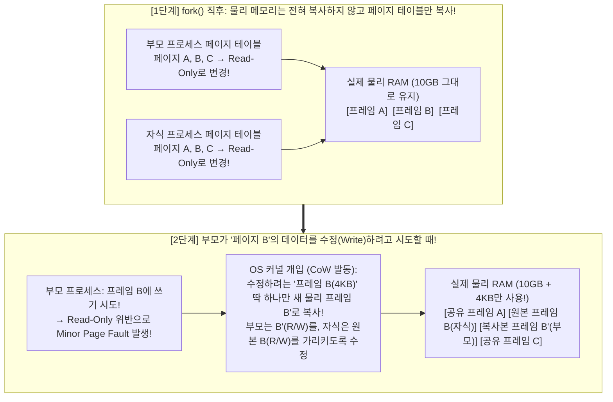

#### Copy-on-Write의 3단계 동작 메커니즘
1. **물리 복사 생략 및 페이지 테이블 공유:**  
   `fork()`가 호출되면 운영체제는 10GB에 달하는 실제 물리 프레임들은 손끝 하나 건드리지 않습니다. 대신 부모의 **페이지 테이블(수 MB 수준)**만 자식에게 복사해 주어, 부모와 자식의 가상 주소가 **완전히 동일한 물리 RAM 프레임들을 함께 가리키도록(공유)** 만듭니다.
2. **읽기 전용(Read-Only) 덫 깔아두기:**  
   단, 이 공유된 페이지 테이블의 모든 항목(PTE)에 있는 권한 비트를 **'쓰기 금지(Read-Only)'**로 살짝 바꾸어 놓습니다. 부모와 자식이 데이터를 읽기(Read)만 하는 동안에는 메모리 복사가 단 1바이트도 일어나지 않고 평화롭게 10GB를 공유합니다.
3. **쓰기 시도 시 Minor Page Fault와 4KB 개별 복사:**  
   어느 순간 부모 프로세스(예: Redis 메인 스레드)가 특정 변수의 값을 수정하려고 **쓰기(Write)** 명령을 실행하면, 읽기 전용 페이지에 쓰기를 시도했으므로 CPU의 MMU가 즉시 **페이지 폴트(Page Fault)** 트랩을 발생시킵니다.  
   커널이 달려와 확인해 보니 진짜 불법 접근이 아니라 CoW 표시가 된 페이지임을 알게 됩니다. 커널은 **10GB 전체가 아니라, 방금 수정하려고 건드린 바로 그 4KB짜리 페이지 딱 1개만** 새로운 물리 프레임으로 복사해 준 뒤 쓰기 권한(`Read/Write`)을 풀어줍니다!

> [!IMPORTANT]
> **Copy-on-Write가 현대 시스템 공학에 미친 영향**  
> 1. **`fork()` 후 `exec()` 패턴의 극적인 가속:** 쉘(bash)에서 명령어를 칠 때마다 `fork()`로 프로세스를 복제하고 즉시 `execve()`로 새 프로그램을 덮어쓰는데, 만약 CoW가 없었다면 곧바로 버릴 부모의 메모리를 매번 전부 복사하느라 엄청난 낭비가 발생했을 것입니다.  
> 2. **Redis `BGSAVE` 스냅샷의 원리:** Redis가 서비스를 멈추지 않고 디스크에 백업을 뜰 수 있는 이유는 `fork()`를 통해 CoW로 자식 프로세스를 만든 뒤, 자식은 멈춰 있는 과거 시점의 메모리 원본을 느긋하게 디스크에 쓰고 부모는 새로운 클라이언트 요청만 4KB 단위로 복사하며 처리하기 때문입니다. (그래서 Redis 서버는 CoW 복사 여유분을 위해 전체 RAM의 20~30%를 비워두는 것이 철칙입니다!)

---

## 05. 여러 프로그램이 동시에 실행되는 원리는 무엇인가요?

우리는 코딩을 하면서 백그라운드에 스포티파이 음악을 틀어놓고, 도커(Docker) 컨테이너 수십 개를 띄운 채 크롬 브라우저로 기술 문서를 검색합니다. 코어가 8개뿐인 노트북에서 어떻게 300개가 넘는 프로세스와 3,000개가 넘는 스레드가 단 1초의 끊김도 없이 동시에 돌아갈 수 있을까요?

---

### 5.1 동시성(Concurrency) vs 병렬성(Parallelism)의 본질적 차이

시스템 아키텍처를 설계할 때 가장 먼저 정립해야 할 개념이 바로 **동시성(Concurrency)**과 **병렬성(Parallelism)**입니다.

> **롭 파이크(Rob Pike, Go 언어 창시자)의 명언:**  
> *"동시성(Concurrency)은 한 번에 많은 일을 **다루는(Dealing with)** 논리적 구조에 관한 것이고, 병렬성(Parallelism)은 한 번에 많은 일을 실제로 **수행하는(Doing)** 물리적 실행에 관한 것이다."*

```
[1. 동시성 (Concurrency): 코어 1개가 타이머 인터럽트로 초고속 교차 실행 (논리적 동시 진행)]
시간 흐름 ───────────────────────────────────────────────────────────────────►
CPU 코어 1 : [프로세스 A] → (Context Switch) → [프로세스 B] → (Switch) → [프로세스 C] → [프로세스 A]
* 10ms마다 빛의 속도로 번갈아 실행하므로, 인간 눈에는 A, B, C가 동시에 돌아가는 것처럼 보임!

[2. 병렬성 (Parallelism): 여러 코어가 같은 물리적 시각에 각자 실행 (물리적 동시 실행)]
시간 흐름 ───────────────────────────────────────────────────────────────────►
CPU 코어 1 : [ 프로세스 A ────────────────────────────────────────────────── ]
CPU 코어 2 : [ 프로세스 B ────────────────────────────────────────────────── ]
CPU 코어 3 : [ 프로세스 C ────────────────────────────────────────────────── ]
* 실제로 같은 1나노초의 순간에 3개의 명령어가 물리적으로 함께 처리됨!
```

| 비교 기준 | 동시성 (Concurrency) | 병렬성 (Parallelism) |
| :--- | :--- | :--- |
| **핵심 정의** | 작업들의 실행 시간이 서로 겹치도록(Interleaving) 교차 배치하여 **논리적으로 동시에 진행되게 만드는 설계 속성** | 물리적으로 다수의 연산 장치(Multi-Core, GPU)를 동원해 **같은 시각에 여러 연산을 실제로 동시에 처리하는 실행 상태** |
| **단일 코어 가능 여부** | **가능함!** (시분할 스케줄링, 컨텍스트 스위칭, 비동기 이벤트 루프 `epoll`/`async-await`로 구현) | **절대 불가능함!** (물리적 코어나 프로세서가 반드시 2개 이상 존재해야만 달성 가능) |
| **해결하려는 문제** | I/O 대기로 인해 CPU가 노는 시간을 없애고, 모든 사용자에게 **빠른 응답성(Responsiveness)**과 공정한 기회를 제공 | 막대한 계산량이 필요한 작업(동영상 인코딩, 행렬 곱셈, 대용량 정렬)을 쪼개어 **절대적인 소요 시간(Latency)을 단축** |
| **대표적 기술/패턴** | 시분할 OS 스케줄러, Node.js 단일 스레드 이벤트 루프, 코루틴(Coroutine) | 멀티코어 멀티스레딩, OpenMP, SIMD 벡터 연산, GPU CUDA, MapReduce 분산 처리 |

---

### 5.2 하드웨어 타이머 인터럽트와 컨텍스트 스위칭(Context Switching)

단일 코어에서 동시성을 구현하려면 운영체제가 실행 중인 프로세스로부터 CPU를 빼앗아 다른 프로세스에게 넘겨주는 **선점형 멀티태스킹(Preemptive Multitasking)**이 작동해야 합니다.

#### 1) 하드웨어 타이머 인터럽트 (Timer Interrupt / Tick)
만약 운영체제가 프로세스 A에게 CPU를 넘겨주어 사용자 모드에서 A의 코드가 돌아가고 있다면, **그 순간 운영체제 커널 코드는 CPU에서 실행되고 있지 않은 상태(잠들어 있는 상태)**입니다!  
스스로 실행되고 있지도 않은 운영체제가 어떻게 버그로 무한 루프(`while(1);`)에 빠진 프로세스 A로부터 CPU를 강제로 빼앗아 올 수 있을까요?

그 구원투수가 바로 메인보드와 CPU 내부(Local APIC Timer)에 장착된 **하드웨어 타이머 칩(Programmable Interval Timer)**입니다.
1. 하드웨어 타이머는 실행 중인 소프트웨어와 무관하게, 정해진 클록 주기(예: `1000Hz` 설정 시 정확히 **1밀리초(1ms)**마다)가 되면 무조건 CPU의 인터럽트 핀에 전기적 신호(**Timer Interrupt**)를 쏩니다.
2. CPU 하드웨어는 이 전기 신호를 감지하는 즉시, 실행 중이던 무한 루프 코드를 강제로 멈추고 **특권 모드를 커널 모드(Ring 0)로 전환**한 뒤, 메모리에 고정된 운영체제의 **타이머 인터럽트 서비스 루틴(ISR)** 주소로 PC 레지스터를 강제 점프시킵니다.
3. 이렇게 하드웨어의 도움으로 깨어난 운영체제 커널(스케줄러)은 현재 프로세스가 할당받은 타임 슬라이스(Time Quantum)를 다 썼는지 확인하고, 다 썼다면 가차 없이 **컨텍스트 스위칭(Context Switching)**을 단행합니다.

#### 2) 컨텍스트 스위칭(Context Switching)의 정밀 해부
컨텍스트 스위칭이란 현재 CPU를 점유하고 있던 프로세스 A의 실행 상태(**Context, 문맥**)를 커널 메모리의 **PCB(Process Control Block)**에 백업하고, 다음에 실행할 프로세스 B의 PCB에서 이전 실행 상태를 CPU 레지스터로 복구하여 실행 흐름을 갈아끼우는 과정입니다.

```
[컨텍스트 스위칭의 직접 비용(Direct Cost)과 간접 비용(Indirect Cost)]

1. 직접 비용 (수백 나노초 ~ 수 마이크로초 소요)
   - 현재 CPU의 범용 레지스터(RAX~R15), PC(RIP), 스택 포인터(RSP), 플래그 레지스터를 P1의 PCB(커널 스택)에 저장(Save)
   - OS 스케줄러 알고리즘 실행 (다음 실행할 P2 탐색)
   - 페이지 테이블 베이스 레지스터(CR3)에 P2의 최상위 페이지 디렉터리 물리 주소 적재
   - P2의 PCB로부터 레지스터 값들을 CPU에 복원(Restore)

2. 간접 비용 (성능에 훨씬 더 치명적인 숨은 비용! - 수십 마이크로초 동안 체감 속도 저하)
   - TLB 플러시 (TLB Flush): CR3 레지스터가 바뀌어 가상 주소 공간이 통째로 달라졌으므로, 기존 TLB 캐시가 무효화됨!
     (단, 최신 CPU는 TLB 엔트리마다 프로세스 식별 태그(PCID / ASID)를 붙여 전체 플러시를 완화함)
   - CPU 캐시 오염 (Cache Pollution / Cold Cache): P1이 열심히 모아둔 L1/L2 캐시 데이터가 P2에게는 아무 쓸모가 없음!
     P2가 실행을 재개한 직후 수천 클록 동안 연쇄적인 캐시 미스(Cache Miss) 폭탄을 맞으며 느리게 동작함!
```

---

### 5.3 CPU 스케줄링 알고리즘: 고전 알고리즘부터 현대 Linux CFS까지

메모리의 Ready Queue에는 당장 CPU를 쓰고 싶어 줄을 서 있는 수십 개의 프로세스가 있습니다. 운영체제의 **CPU 스케줄러(Scheduler)**는 누구에게 먼저, 그리고 얼마나 오래 CPU를 줄 것인가를 결정해야 합니다.

이때 작업의 성격은 크게 두 가지로 나뉩니다.
- **I/O 바운드 프로세스 (I/O-Bound Process):** CPU 계산은 잠깐(1ms)만 하고, 대부분의 시간을 디스크 읽기나 네트워크 응답, 사용자의 마우스/키보드 입력을 기다리는 데 쓰는 작업입니다(예: 웹 서버, 워드프로세서, 채팅 앱). 사용자와 상호작용하므로 **CPU를 짧게 쓰더라도 요청 즉시 바로바로 CPU를 배정해 주어야(응답 시간 최소화)** 화면이 버벅거리지 않습니다.
- **CPU 바운드 프로세스 (CPU-Bound Process):** 입출력은 거의 없이 CPU를 100% 풀가동하여 하루 종일 수학 연산만 수행하는 작업입니다(예: 동영상 렌더링, 딥러닝 학습, 암호화 해시 계산). 컨텍스트 스위칭 횟수를 줄이고 **묵직하게 오랫동안 CPU를 몰아주어야(처리량 극대화)** 전체 작업이 빨리 끝납니다.

이 상충하는 요구사항을 해결하기 위해 발전해 온 **대표적인 CPU 스케줄링 알고리즘 6가지**를 완벽히 비교해 보겠습니다.

| 알고리즘 명칭 | 선점 여부 | 핵심 동작 원리 | 치명적 단점 및 한계 | 해결책 및 현대적 의의 |
| :--- | :--- | :--- | :--- | :--- |
| **1. FCFS**<br>(First-Come First-Served, 선입선출) | 비선점<br>(Non-Preemptive) | 준비 큐에 **도착한 순서대로** CPU를 할당하고, 그 프로세스가 스스로 끝날 때까지 기다림. | **호위 효과 (Convoy Effect):** 실행 시간이 10시간 걸리는 CPU 바운드 작업이 1등으로 들어오면, 그 뒤에 줄 선 1ms짜리 마우스 클릭 작업 수백 개가 10시간 동안 꼼짝없이 뒤따라가며 평균 대기 시간이 폭발함! | 일괄 처리(Batch) 시스템에서만 유효하며 현대 대화형 OS에서는 단독 사용 불가. |
| **2. SJF / SRTF**<br>(Shortest Job / Remaining Time First) | 비선점(SJF) /<br>선점(SRTF) | **CPU 실행 시간(Burst Time)이 가장 짧은 작업**에게 무조건 먼저 CPU를 몰아줌. | 1. **기아 현상 (Starvation):** 짧은 작업들이 계속 새치기해 들어오면, 긴 작업은 영원히 CPU를 받지 못해 굶어 죽음.<br>2. **구현 불가능성:** 프로세스가 앞으로 CPU를 몇 초나 쓸지 미래를 미리 정확히 알 수 없음(과거 지수 평균으로 예측만 가능). | **평균 대기 시간을 수학적으로 최소화하는 최적(Optimal) 기준점** 역할을 수행함. |
| **3. 우선순위 스케줄링**<br>(Priority Scheduling) | 선점 / 비선점 | 프로세스마다 중요도(Priority) 숫자를 부여하여 **우선순위가 가장 높은 프로세스**부터 실행함. | **기아 현상 (Starvation):** 우선순위가 낮은 백그라운드 프로세스는 영원히 실행되지 못함.<br>(+ 부가 문제: 우선순위 역전 현상 Priority Inversion) | **에이징 (Aging, 노화 기법):** 아무리 우선순위가 낮아도 **기다린 시간에 비례해 조금씩 우선순위를 높여주어** 언젠가는 반드시 실행되게 보장함! |
| **4. 라운드 로빈**<br>(Round Robin, RR) | **선점**<br>(Preemptive) | 시분할 시스템의 기본! 모든 프로세스에게 동일한 **타임 슬라이스(Time Quantum, 예: 10ms)**를 주고 돌아가며 공평하게 실행함. 시간 내에 못 끝내면 큐의 맨 뒤로 보냄. | **타임 슬라이스(`q`) 크기의 딜레마:**<br>- 너무 크게 잡으면(`q → ∞`): 사실상 FCFS와 똑같아져서 응답성이 나빠짐.<br>- 너무 작게 잡으면(`q = 0.01ms`): 실제 일하는 시간보다 **컨텍스트 스위칭 오버헤드**가 더 커져서 시스템이 마비됨! | 통상 `10ms ~ 100ms` 사이로 설정하며, 모든 프로세스의 응답 시간을 보장하는 현대 스케줄러의 뼈대. |
| **5. 다단계 피드백 큐**<br>(MLFQ, Multi-Level Feedback Queue) | **선점**<br>(Preemptive) | 우선순위가 다른 여러 개의 큐를 두고, **프로세스의 행동 패턴을 보고 큐 사이를 동적으로 강등/승격**시킴! | 설계와 파라미터 튜닝이 복잡하며, 악의적인 프로그램이 타임 슬라이스가 끝나기 직전(9.9ms)에 고의로 짧은 I/O를 호출해 최상위 우선순위를 독점하는 게이밍(Gaming) 공격 가능. | 미래 실행 시간을 몰라도 **I/O 바운드 작업은 자동으로 우대하고 CPU 바운드 작업은 후순위로 빼는** 범용 OS(Windows NT 등)의 표준 모델! |
| **6. 리눅스 CFS**<br>(Completely Fair Scheduler, 완전 공정 스케줄러) | **선점**<br>(Preemptive) | 고정된 타임 슬라이스를 없애고, 각 프로세스가 지금까지 CPU를 사용한 누적 시간인 **가상 런타임(`vruntime`)이 가장 작은 프로세스**에게 무조건 CPU를 줌! | 레드-블랙 트리 관리 오버헤드가 약간 존재하나 `O(log N)`으로 극도로 최적화됨. (최신 Linux 6.6+에서는 이를 더 개선한 **EEVDF** 스케줄러로 진화) | **현대 Linux 커널의 기본 스케줄러!** 가중치(nice 값)와 공정성을 수학적으로 완벽히 달성함. |

#### 심화 탐구 1: 다단계 피드백 큐(MLFQ)는 어떻게 미래를 예언하지 않고도 짧은 작업을 우대할까?
SJF는 "누가 짧은 작업인지 미리 알 수 없다"는 한계가 있었습니다. **다단계 피드백 큐(MLFQ)**는 이를 역발상으로 해결합니다.

```
[다단계 피드백 큐 (MLFQ)의 동적 강등 및 승격 구조]

[큐 0: 최고 우선순위 (Time Quantum = 8ms)]  ──(8ms 동안 다 못 끝내면 CPU 바운드로 판단하여 강등!)──┐
                                                                                                 ▼
[큐 1: 중간 우선순위 (Time Quantum = 16ms)] ──(16ms 동안 또 다 못 끝내면 한 단계 더 강등!)──────┐
                                                                                                 ▼
[큐 2: 최저 우선순위 (FCFS 또는 긴 RR)]     ──(일정 주기 S마다 기아 방지를 위해 전체 큐 0으로 승격 Boost!)
```
1. 새로 들어온 모든 프로세스는 일단 가장 높은 **최상위 큐(큐 0, 타임 슬라이스 8ms)**에 넣어줍니다.
2. **I/O 바운드 작업(대화형 앱):** CPU를 고작 1ms만 쓰고 스스로 I/O 대기 상태로 빠지므로 타임 슬라이스(8ms)를 다 쓰지 않습니다. 따라서 평생 **최상위 큐(큐 0)**에 머물면서 깨어날 때마다 즉시 CPU를 배정받아 환상적인 응답 속도를 누립니다!
3. **CPU 바운드 작업(무거운 연산):** 8ms를 꽉 채워 쓰고도 안 끝나면 스케줄러는 *"아하, 너는 무거운 CPU 바운드 작업이구나!"*라고 간파하고 **하위 큐(큐 1, 타임 슬라이스 16ms)**로 한 단계 강등시킵니다. 거기서도 안 끝나면 최저 큐(큐 2)로 내려보내어, 대화형 작업들이 없을 때 큼직한 타임 슬라이스로 묵직하게 실행되게 만듭니다.

#### 심화 탐구 2: 현대 리눅스 커널의 심장, CFS(Completely Fair Scheduler)와 레드-블랙 트리
현대 리눅스 서버가 수천 개의 프로세스를 공평하게 돌리는 비결은 **CFS(완전 공정 스케줄러)**와 그 내부의 **가상 런타임(`vruntime`, Virtual Runtime)**에 있습니다.

- **핵심 원리 (`vruntime`):**  
  CFS는 모든 프로세스마다 "지금까지 CPU를 사용한 누적 시간"을 나노초(ns) 단위로 기록한 **`vruntime`** 변수를 관리합니다. 단, 실제 흐른 물리적 시간을 그대로 더하지 않고 프로세스의 중요도(**`nice` 값: `-20`(최고 우대) ~ `+19`(최저 우대), 기본값 `0`**)에 따라 가중치를 다르게 매깁니다!
  - **우선순위가 높은 프로세스(`nice = -10`):** 실제 CPU를 10ms 써도 `vruntime` 장부에는 **2ms만 쓴 것처럼 천천히 증가**시킵니다.
  - **우선순위가 낮은 프로세스(`nice = +10`):** 실제 CPU를 10ms 쓰면 `vruntime` 장부에는 **50ms를 쓴 것처럼 빠르게 증가**시킵니다.
- **스케줄링 규칙과 레드-블랙 트리 (Red-Black Tree):**  
  스케줄러의 규칙은 단 한 줄입니다. **"현재 대기 중인 모든 프로세스 중 `vruntime` 숫자가 가장 작은(즉, 가장 억울하게 CPU를 덜 쓴) 프로세스를 골라 CPU를 준다!"**  
  수천 개의 프로세스 중에서 `vruntime` 최솟값을 `O(1)`에 가깝게 즉시 찾기 위해, CFS는 실행 가능한 프로세스들을 `vruntime`을 키(Key)로 하는 자가 균형 이진 탐색 트리인 **레드-블랙 트리(Red-Black Tree)**에 정렬해 두고, **트리의 가장 왼쪽 끝 노드(Leftmost Node, 최솟값)**를 캐싱해 두었다가 즉시 꺼내어 실행합니다!

```
[Linux CFS 스케줄러의 레드-블랙 트리 (Red-Black Tree) 구조]
                   [ 프로세스 B (vruntime = 45ms) ]
                        /                    \
      [ 프로세스 A (vruntime = 22ms) ]    [ 프로세스 D (vruntime = 80ms) ]
             /
  ★ [ 프로세스 C (vruntime = 12ms) ]  <-- 가장 왼쪽 끝 노드 (Leftmost Node = 최소 vruntime!)
                                         CFS는 고민 없이 이 노드를 즉시 픽업하여 CPU 할당!
```
이로써 리눅스는 복잡한 휴리스틱 없이도 모든 프로세스에 가중치 비례 공정성을 수학적으로 보장하며, I/O 대기로 오랫동안 잠들어 있던 프로세스는 자연스럽게 `vruntime`이 작게 유지되므로 깨어나는 즉시 트리의 맨 왼쪽에 배치되어 즉각적인 응답성을 얻게 됩니다.

---

## 06. 운영체제는 무슨 일을 하나요?

운영체제(Operating System)의 역할을 한 문장으로 정의하면 다음과 같습니다.
> **"아래로는 다루기 까다롭고 이기적인 물리적 하드웨어 자원(CPU, RAM, 디스크, NIC)을 통제하는 냉혹한 독재자(Resource Manager)이며, 위로는 응용 프로그램들에게 하드웨어의 지저분한 세부 사항을 완벽히 감추고 우아하고 통일된 API를 제공하는 친절한 마법사(Abstractor / Virtual Machine)이다."**

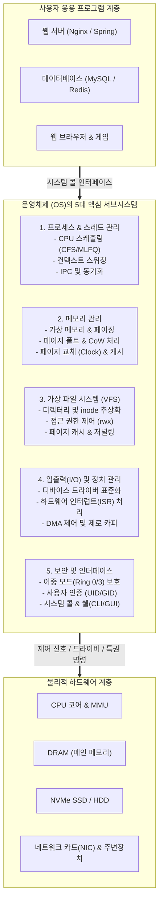

앞선 04~05절에서 프로세스 스케줄링과 메모리 관리를 깊이 살펴보았으므로, 이번 06절에서는 백엔드 및 시스템 엔지니어링의 성능을 좌우하는 나머지 두 기둥인 **파일 시스템(VFS와 inode)**과 **입출력 서브시스템(ISR, DMA, Zero-Copy)**의 내부 동작을 집중적으로 해부하겠습니다.

---

### 6.1 가상 파일 시스템(VFS)과 아이노드(inode)의 비밀

우리가 파이썬이나 C 언어로 파일을 읽을 때 `read(fd, buf, 1024)`라는 똑같은 함수를 호출하면, 그 파일이 로컬 NVMe SSD(ext4 파일시스템)에 있든, 윈도우 외장 하드(NTFS)에 있든, USB 메모리(FAT32)에 있든, 심지어 지구 반대편 서버의 네트워크 폴더(NFS)에 있든 단 한 줄의 코드 수정 없이 완벽하게 동작합니다. 어떻게 이런 일이 가능할까요?

#### 1) VFS (Virtual File System, 가상 파일 시스템): 객체지향적 추상화의 극치
리눅스/유닉스 커널은 실제 물리 파일 시스템들 앞단에 **VFS(가상 파일 시스템)**라는 거대한 추상화 인터페이스 계층(C 언어의 함수 포인터 테이블 구조체)을 두었습니다.
- 애플리케이션이 `open()`, `read()`, `write()` 시스템 콜을 호출하면, 커널의 **VFS**가 이를 먼저 받습니다.
- VFS는 해당 경로에 마운트(Mount)된 실제 파일 시스템이 `ext4`인지, `XFS`인지, `NTFS`인지, 아니면 네트워크 소켓인지 확인한 뒤, 그 파일 시스템 드라이버가 구현해 둔 실제 읽기/쓰기 함수로 요청을 토스(다형성 위임)합니다.
- 덕분에 유닉스의 위대한 철학인 **"모든 것은 파일이다(Everything is a File)"**가 커널 코드 수준에서 실현됩니다.

#### 2) 파일의 진짜 정체: 아이노드(inode)와 디렉터리 엔트리(dentry)
초보자들은 흔히 *"파일 안에 파일 이름(`report.pdf`)과 데이터 내용이 함께 들어있다"*고 생각합니다. 하지만 유닉스/리눅스 파일 시스템(ext4 등)을 열어보면 충격적이게도 **파일(inode) 안에는 '파일 이름'이 아예 들어있지 않습니다!**

리눅스 파일 시스템은 파일의 구성 요소를 다음 세 가지로 철저히 분리하여 저장합니다.

```
[리눅스 파일 시스템(ext4)의 3대 핵심 구조: dentry → inode → Data Blocks]

1. 디렉터리 (dentry 테이블: 사람이 부르는 '파일 이름'과 'inode 번호'를 매핑하는 단순 전화번호부!)
┌───────────────────────────┬────────────────┐
│ 파일 이름 (File Name)      │ inode 고유 번호 │
├───────────────────────────┼────────────────┤
│ "server.log"              │     #10482     │ ──┐
│ "hardlink_to_server.log"  │     #10482     │ ──┼──► (두 이름이 완벽히 동일한 inode #10482를 가리킴!)
│ "config.yaml"             │     #10483     │   │
└───────────────────────────┴────────────────┘   │
                                                 ▼
2. 아이노드 (inode #10482: 파일의 모든 메타데이터와 실제 데이터 블록의 위치 주소를 가진 진짜 실체!)
┌────────────────────────────────────────────────────────────────────────────┐
│ - 파일 타입 및 접근 권한 (Mode): -rw-r--r-- (일반 파일, 소유자 읽기/쓰기)     │
│ - 소유자 ID (UID: 1000), 그룹 ID (GID: 1000)                               │
│ - 파일 크기 (Size): 104,857,600 Bytes (100 MB)                             │
│ - 타임스탬프: 생성/상태변경(ctime), 최종 수정(mtime), 최종 접근(atime)       │
│ - 하드 링크 카운트 (Link Count): 2 (이 inode를 가리키는 파일 이름이 2개임!)   │
│ - 데이터 블록 포인터 (Extent Tree / Direct & Indirect Block Pointers) ─────┼──┐
└────────────────────────────────────────────────────────────────────────────┘  │
                                                                                ▼
3. 데이터 블록 (Data Blocks: 디스크에 4KB 단위로 저장된 실제 파일의 알맹이 바이트들!)
   [ 블록 #501 (4KB) ]  [ 블록 #502 (4KB) ]  [ 블록 #503 (4KB) ] ...
```

- **아이노드 (inode, Index Node):**  
  파일 하나가 생성될 때마다 부여받는 고유 주민등록번호(inode 번호)와 **파일의 모든 신상 정보(메타데이터 + 실제 데이터가 디스크 몇 번 블록에 있는지를 가리키는 포인터)**를 담고 있는 256바이트짜리 핵심 자료구조입니다.
- **디렉터리 (Directory / dentry):**  
  디렉터리 역시 사실은 특별한 종류의 파일일 뿐입니다. 그 안에는 오직 **`[사람이 기억하기 쉬운 문자열 파일 이름 : inode 번호]`**의 짝(Mapping) 목록만 적혀 있습니다.

> [!IMPORTANT]
> **실무 장애 포인트 1: "디스크 용량(`df -h`)은 50%나 남았는데 왜 `No space left on device` 에러가 나며 파일 생성이 안 될까요?"**  
> 파일 시스템은 포맷할 때 생성할 수 있는 **최대 아이노드(inode) 개수**가 정해져 있습니다. 만약 수바이트짜리 아주 작은 임시 파일이나 세션 파일을 수천만 개 만들어 두면, 실제 디스크 용량(Data Block)은 텅 비어 있는데 **아이노드 번호표가 100% 고갈(`df -i`로 확인 가능)**되어 단 1바이트짜리 새 파일도 만들지 못하는 심각한 서버 장애가 발생합니다!
>
> **실무 핵심 포인트 2: 하드 링크(`ln`) vs 심볼릭 링크(`ln -s`)의 완벽한 차이**  
> - **하드 링크 (Hard Link):** 디렉터리 전화번호부에 **기존 파일과 똑같은 `inode 번호`를 가리키는 새로운 파일 이름 한 줄을 추가**하는 것입니다(위 그림의 `hardlink_to_server.log`). 원본 파일 이름을 지워도(`rm server.log`), 하드 링크 카운트가 `2 → 1`로 줄어들 뿐 실제 `inode #10482`와 데이터는 디스크에 멀쩡히 살아남습니다!  
> - **심볼릭 링크 (Symbolic / Soft Link):** 윈도우의 '바로가기 아이콘'과 같습니다. 완전히 새로운 별도의 `inode`를 하나 만들고, 그 데이터 블록 안에 **원본 파일의 경로 문자열(`"/var/log/server.log"`)**만 적어둔 것입니다. 따라서 원본 파일을 삭제하거나 이동하면 심볼릭 링크는 없는 주소를 가리키는 깨진 링크(Dangling Link)가 됩니다.

#### 3) 페이지 캐시(Page Cache)와 `fsync()`: 왜 `write()`가 끝났는데도 전원이 꺼지면 데이터가 날아갈까?
운영체제는 느린 디스크(SSD/HDD) 입출력을 최소화하기 위해, 남는 물리 RAM 공간을 전부 디스크 데이터의 임시 보관소인 **페이지 캐시(Page Cache)**로 활용합니다.
1. 프로그램이 `write()` 시스템 콜을 호출해 파일에 데이터를 쓰면, 커널은 느린 SSD까지 내려가지 않고 **물리 RAM의 페이지 캐시에만 데이터를 쓱 적어둔 뒤(Dirty Page 표시) 단 몇 마이크로초 만에 프로그램에게 "쓰기 성공!"이라고 거짓말(Buffered I/O)을 하고 리턴**합니다.
2. 그리고 나중에 커널의 백그라운드 스레드(pdflush / flusher threads)가 주기적으로(예: 5초~30초마다) 또는 더티 페이지 비율이 높아졌을 때 몰아서 SSD에 실제 기록(**Write-back**)을 수행합니다.
3. 따라서 은행 계좌 이체 같은 데이터베이스(MySQL Redo Log, Kafka 등)가 데이터 유실을 0%로 막으려면, `write()` 호출 직후 반드시 **`fsync()` 시스템 콜**을 호출하여 **"페이지 캐시에만 두지 말고 지금 당장 물리 SSD 플래시 셀까지 확실하게 밀어 넣고 돌아와라!"**라고 강제 플러시(Flush)를 명령해야 합니다.

---

### 6.2 입출력(I/O) 관리: 인터럽트(ISR), DMA, 그리고 제로 카피(Zero-Copy)

CPU는 1나노초 단위로 움직이는 초음속 제트기이고, 네트워크 카드(NIC)나 디스크, 키보드는 마이크로초~밀리초 단위로 움직이는 달팽이입니다. 이 엄청난 속도 차이를 극복하기 위해 운영체제와 컴퓨터 구조는 세 단계의 입출력 혁신을 이루어냈습니다.

#### 1) 폴링(Polling)에서 인터럽트(Interrupt)와 ISR로
- **폴링 (Polling / Programmed I/O):** CPU가 입출력 장치에게 일을 시켜놓고, 1나노초마다 장치 상태 레지스터를 찾아가 *"다 끝났니? 다 끝났니? 아직도 안 끝났니?"*라고 무한 루프를 돌며 직접 확인하는 방식입니다. I/O가 끝날 때까지 비싼 CPU가 100% 낭비됩니다.
- **인터럽트 기반 I/O (Interrupt-Driven I/O):** CPU는 장치 컨트롤러에게 *"디스크 100번 블록 좀 읽어놔라. 다 읽으면 내 인터럽트 핀에 벨 눌러라!"*라고 명령만 내린 뒤, 즉시 다른 프로세스의 연산을 수행하러 갑니다. 나중에 장치가 작업을 마치면 하드웨어 인터럽트 신호를 보내고, CPU는 **인터럽트 벡터 테이블(Interrupt Vector Table / IDT)**을 참조해 해당 장치의 **ISR(Interrupt Service Routine, 인터럽트 핸들러)** 함수를 실행합니다.

> [!NOTE]
> **리눅스 커널의 인터럽트 처리 이원화: Top-Half vs Bottom-Half**  
> 네트워크 카드에서 패킷이 초당 수십만 개씩 쏟아져 들어올 때, 인터럽트 핸들러(ISR)가 다른 인터럽트를 막아둔 채 패킷 분석과 복사를 느긋하게 다 처리하면 다른 중요한 하드웨어 인터럽트(타이머, 키보드 등)가 무시되어 시스템이 마비됩니다.  
> 그래서 리눅스 커널은 ISR을 두 단계로 쪼갭니다!  
> 1. **Top-Half (전반부 처리 / Hard IRQ):** 인터럽트가 발생하면 **즉시 실행되어 하드웨어 레지스터의 데이터만 메모리에 후다닥 복사하고 하드웨어 인터럽트 핀을 리셋**하는 최소한의 필수 작업만 수 마이크로초 내에 끝내고 복귀합니다.  
> 2. **Bottom-Half (후반부 처리 / SoftIRQ, Tasklet, Workqueue):** 시간 여유가 필요한 무거운 후속 작업(TCP/IP 헤더 파싱, 소켓 버퍼 전달 등)은 스케줄링 가능한 백그라운드 작업으로 미루어 처리함으로써 시스템의 반응성을 극대화합니다.

#### 2) DMA (Direct Memory Access, 직접 메모리 접근): CPU를 단순 노동에서 해방시키다!
인터럽트 방식 덕분에 CPU가 기다리는 시간은 사라졌지만, 여전히 심각한 문제가 남아 있었습니다.
만약 디스크에서 **1기가바이트(1GB)**짜리 동영상 파일을 읽어 메인 메모리(RAM)로 옮겨야 한다면, 인터럽트만 있는 시스템에서는 **CPU가 직접 디스크 컨트롤러 버퍼에서 8바이트씩 읽어서 자기 레지스터에 담았다가 다시 RAM에 쓰는 단순 복사 심부름을 무려 1억 3천만 번이나 반복(PIO 방식)**해야 했습니다! 고성능 수학 연산을 해야 할 천재 박사님(CPU)이 하루 종일 택배 상하차만 하고 있는 꼴입니다.

이 문제를 완벽히 해결하기 위해 메인보드에 도입된 특수 외주 하드웨어 칩이 바로 **DMA 컨트롤러(Direct Memory Access Controller)**입니다!

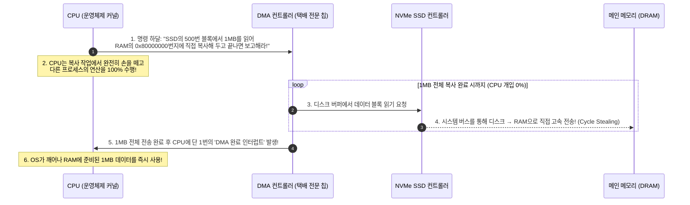

- **사이클 스틸링 (Cycle Stealing):** DMA 컨트롤러가 시스템 버스를 사용해 RAM에 데이터를 쓰는 순간에만 CPU가 메모리 버스를 한 템포 양보하는 현상입니다. CPU는 캐시 메모리 안에서 자기 연산을 계속 수행하므로 속도 저하가 거의 없으며, 1GB 전송이 다 끝났을 때 **딱 한 번만 인터럽트**를 받으면 됩니다.

#### 3) [고급 실무] 카프카(Kafka)와 Nginx가 초고속인 비결: 제로 카피 (Zero-Copy, `sendfile`)
DMA를 이해하면 백엔드 대용량 트래픽 처리의 핵심 기술인 **제로 카피(Zero-Copy)**를 완벽하게 이해할 수 있습니다.
웹 서버나 카프카 브로커가 **"디스크에 있는 100MB짜리 파일을 읽어서 네트워크 소켓(NIC)으로 클라이언트에게 그대로 전송"**할 때, 전통적인 방식(`read()` 후 `write()`)과 제로 카피 방식(`sendfile()`)이 내부적으로 어떻게 다른지 비교해 보겠습니다.

```
[전통적인 방식: read(file_fd, buf) + write(socket_fd, buf) 호출 시] -> 데이터 복사 4번 + 모드 전환 4번 발생!
  (사용자 모드)                      [ 2. 애플리케이션 유저 버퍼 (User Space) ]
                                          ▲                           │
  ========================================│====== (커널/유저 경계) =====│====================
                                    (CPU 복사!)                 (CPU 복사!)
  (커널 모드)                             │                           ▼
                     [ 1. 커널 페이지 캐시 (Read Buffer) ]      [ 3. 커널 소켓 버퍼 (Socket Buffer) ]
                                          ▲                           │
  ========================================│====== (하드웨어 경계) ======│====================
                                    (DMA 복사 1)                (DMA 복사 2)
  (하드웨어)                              │                           ▼
                                   [ 디스크 (SSD) ]            [ 네트워크 카드 (NIC) ]

  * 문제점: 데이터를 단 1바이트도 수정하지 않고 그대로 보낼 건데도, 커널 → 유저 공간 → 커널 공간으로
           CPU가 관여하는 무의미한 메모리 복사(2번, 3번)가 두 번이나 일어나고 컨텍스트 스위칭이 4번 발생함!

───────────────────────────────────────────────────────────────────────────────────────────

[제로 카피(Zero-Copy) 방식: sendfile(socket_fd, file_fd) 시스템 콜 사용 시] -> CPU 복사 0번! 모드 전환 2번!
  (사용자 모드)      sendfile() 시스템 콜 딱 1번 호출! (데이터가 유저 공간으로 아예 올라오지 않음!)
  =============================================== (커널/유저 경계) ==========================
  (커널 모드)        [ 커널 페이지 캐시 (Page Cache) ] ──(메모리 주소/길이 디스크립터만 전달)──┐
                                    ▲                                                      │
  ==================================│============ (하드웨어 경계) =========================│=
                              (DMA 복사 1)                                     (SG-DMA 직접 복사 2)
  (하드웨어)                        │                                                      ▼
                             [ 디스크 (SSD) ]                                      [ 네트워크 카드 (NIC) ]

  * 핵심 혁신: CPU가 메모리를 복사하는 횟수가 정확히 '0번(Zero-Copy)'!
              SSD에서 DMA로 페이지 캐시에 올린 데이터를, 네트워크 카드의 Scatter-Gather DMA가 페이지 캐시에서
              직접 읽어 랜선으로 쏘아버림! (Apache Kafka, Nginx, Netty가 수십 Gbps 속도를 내는 절대 비결!)
```

---

## 07. 커널(Kernel)이란 무엇인가요?

우리가 흔히 "리눅스를 설치했다", "윈도우를 쓴다"라고 말할 때의 운영체제(OS)는 사실 거대한 종합 선물 세트입니다. 그 안에는 파일 탐색기, 바탕화면 GUI(Window Manager), 명령어 해석기인 쉘(bash, zsh, PowerShell), 컴파일러, 시스템 라이브러리들이 잔뜩 포함되어 있습니다.

이 모든 주변부 외투를 전부 벗겨내고 남은 **운영체제의 가장 핵심적인 심장부 실행 코드**, 즉 **컴퓨터가 부팅될 때 물리 메모리(RAM)의 가장 안전한 구역에 올라가서 전원이 꺼질 때까지 절대 내려오지 않고 상주(Resident)하며 하드웨어를 직접 통제하는 유일무이한 프로그램**을 **커널(Kernel, 씨앗의 알맹이)**이라고 부릅니다. (엄밀히 말해 'Linux'는 운영체제 전체가 아니라 리눅스 토르발스가 만든 이 '커널'만을 뜻하며, 여기에 GNU 프로젝트의 도구들을 합친 전체 운영체제를 **GNU/Linux**라고 부릅니다.)

---

### 7.1 이중 모드(Dual-Mode)와 하드웨어 보호 링(Protection Rings)

사용자 애플리케이션이 실수로든 악의적으로든 커널의 메모리나 하드웨어를 직접 건드리지 못하도록, CPU는 하드웨어 회로 수준에서 **특권 등급(Privilege Level)**을 엄격하게 강제합니다. 인텔 x86 아키텍처에서는 이를 동심원 형태의 **보호 링(Protection Rings: Ring 0 ~ Ring 3)**으로 구현하며, 현대 OS는 이를 단순화하여 **커널 모드(Ring 0)**와 **사용자 모드(Ring 3)**의 **이중 모드(Dual-Mode)**로 사용합니다. (최근에는 가상화 하이퍼바이저를 위한 **Ring -1 (VMX Root Mode)**까지 존재합니다.)

```
[x86 아키텍처의 하드웨어 보호 링 (Protection Rings)과 특권 명령어 제어]

        ┌───────────────────────────────────────────────────┐
        │                  Ring 3: 사용자 모드               │  - 일반 애플리케이션 (Chrome, JVM, Python, 게임)
        │             (User Mode, Mode Bit = 1)             │  - 자신의 가상 메모리 공간만 접근 가능
        │   ┌───────────────────────────────────────────┐   │  - 하드웨어 제어/특권 명령어 실행 시 즉시 강제 종료!
        │   │        Ring 1 & 2: 디바이스 드라이버       │   │
        │   │       (현대 OS는 거의 사용하지 않음)       │   │
        │   │   ┌───────────────────────────────────┐   │   │
        │   │   │         Ring 0: 커널 모드          │   │   │  - OS 커널 (스케줄러, MMU 제어, 파일시스템, 드라이버)
        │   │   │    (Kernel Mode, Mode Bit = 0)    │   │   │  - 모든 물리 RAM 접근 및 CPU 특권 명령어 100% 실행 가능!
        │   │   │   ┌───────────────────────────┐   │   │   │
        │   │   │   │  Ring -1: 하이퍼바이저     │   │   │   │  - 가상 머신 모니터 (KVM, VMware ESXi, Hyper-V)
        │   │   │   └───────────────────────────┘   │   │   │
        │   │   └───────────────────────────────────┘   │   │
        │   └───────────────────────────────────────────┘   │
        └───────────────────────────────────────────────────┘
```

#### 특권 명령어 (Privileged Instructions)란 무엇인가?
CPU가 가진 수백 개의 기계어 명령어 중에는 시스템 전체의 운명을 좌우하는 위험천만한 명령어들이 있습니다.
- 예: 페이지 테이블 베이스 레지스터(`CR3`) 값을 변경하는 명령어 (이게 뚫리면 남의 프로세스 메모리를 마음대로 훔쳐볼 수 있음!)
- 예: 하드웨어 인터럽트를 무시(`CLI`)하거나 CPU를 정지(`HLT`)시키는 명령어 (이게 뚫리면 타이머 인터럽트를 꺼버리고 CPU를 영구 독점할 수 있음!)
- 예: 하드웨어 I/O 포트에 직접 데이터를 읽고 쓰는 명령어(`IN`, `OUT`)

CPU의 제어장치(CU)는 이러한 **특권 명령어**를 실행하기 직전에 반드시 CPU 상태 레지스터의 **모드 비트(Mode Bit / CPL)**를 확인합니다. 만약 현재 모드가 사용자 모드(`Ring 3`, Mode Bit = 1)인데 특권 명령어를 실행하려 했다면, CPU 하드웨어가 그 즉시 실행을 거부하고 커널에게 **일반 보호 위반 예외(General Protection Fault, `#GP`)** 트랩을 던져 해당 애플리케이션을 가차 없이 처형(Kill)합니다.

---

### 7.2 커널 아키텍처의 대격돌: 모놀리식 커널 vs 마이크로커널 vs 하이브리드 커널

그렇다면 커널(Ring 0) 안에는 어디까지의 기능을 집어넣어야 할까요? 이 설계 철학을 두고 1992년 MINIX의 창시자 앤드류 타넨바움(Andrew Tanenbaum) 교수와 청년 리누스 토르발스(Linus Torvalds) 사이에 컴퓨터 역사상 가장 유명한 세기의 논쟁이 벌어졌습니다.

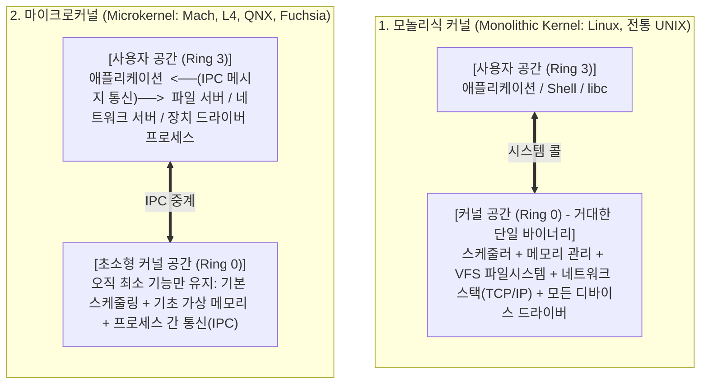

| 비교 항목 | 모놀리식 커널 (Monolithic Kernel) | 마이크로커널 (Microkernel) | 하이브리드 커널 (Hybrid Kernel) |
| :--- | :--- | :--- | :--- |
| **핵심 설계 철학** | **"성능이 최우선이다!"**<br>프로세스 관리, 메모리, 파일 시스템, 네트워크(TCP/IP), 수천 개의 디바이스 드라이버를 **전부 하나의 커널 주소 공간(Ring 0)에 통합**해 넣음. | **"안정성과 보안이 최우선이다!"**<br>커널(Ring 0)에는 스케줄링, 기초 메모리, IPC라는 **절대 최소한의 기능만 남기고**, 파일 시스템, 네트워크, 드라이버는 전부 **사용자 공간(Ring 3)의 일반 서버 프로세스로 격리**함. | **"실용적인 타협!"**<br>구조적으로는 마이크로커널처럼 모듈화하고 계층을 나누되, 성능 저하를 막기 위해 파일 시스템과 주요 드라이버들을 **전부 커널 공간(Ring 0) 안에서 실행**시킴. |
| **장점 (Pros)** | 커널 내부 컴포넌트(예: 네트워크 스택 ↔ 파일 시스템) 간에 통신할 때 **단순한 C 함수 호출 한 번으로 끝나므로 속도가 압도적으로 빠름!** | 그래픽 드라이버나 파일 시스템에 버그가 나서 죽더라도 **커널 전체가 패닉(Kernel Panic)에 빠지지 않고 해당 드라이버 프로세스만 재시작하면 됨!** (극강의 안정성) | 모듈화된 깔끔한 설계 구조와 모놀리식 수준의 빠른 실행 성능을 동시에 추구함. |
| **단점 (Cons)** | 커널 코드가 수천만 줄로 비대해지며, **서드파티 장치 드라이버 하나에서 널 포인터 버그가 터지면 커널 전체가 크래시(블루스크린/커널 패닉)**됨. | 애플리케이션이 파일을 하나 읽으려 해도 `[앱 → 커널 → 파일 서버 → 커널 → 디스크 드라이버 → 커널 → 앱]`으로 **수없이 많은 IPC와 컨텍스트 스위칭이 일어나 성능이 크게 떨어짐.** | 엄밀한 의미의 마이크로커널 격리 이점(드라이버 크래시 시 생존)은 상당 부분 포기해야 함. |
| **현대의 보완 및 채택 OS** | **Linux, FreeBSD, Solaris**<br>*보완:* 커널을 재컴파일하지 않고도 런타임에 드라이버를 꽂았다 뺐다 할 수 있는 **동적 커널 모듈(LKM, Loadable Kernel Module)** 기법으로 유연성을 완벽히 확보함! | **QNX (자동차 자율주행/의료기기 실시간 OS), seL4 (항공/국방), Google Fuchsia (Zircon)**<br>절대 죽으면 안 되는 미션 크리티컬 임베디드 분야에서 맹활약 중. | **Windows NT (Windows 10/11), Apple XNU (macOS / iOS)**<br>(Apple XNU는 Mach 마이크로커널 기반 위에 BSD 모놀리식 계층을 한 주소 공간으로 합친 구조임) |

---

### 7.3 시스템 콜(System Call) 실전 추적: `strace`로 들여다보는 커널의 민낯

우리가 작성한 프로그램이 커널과 실제로 어떻게 대화하는지 눈으로 직접 확인하는 가장 강력한 도구가 리눅스의 **`strace` (System Call Tracer)**입니다.  
단 한 줄짜리 명령어인 `cat hello.txt` (파일을 읽어 화면에 출력하는 프로그램)를 실행했을 때, 물 밑에서 벌어지는 실제 시스템 콜의 생생한 대화를 추적해 보겠습니다.

```c
// [추적 대상 동작 요약: hello.txt 파일을 열어서 내용을 읽고 화면에 출력한 뒤 종료]
// 터미널 실행 명령: strace cat hello.txt
```

```text
1. execve("/usr/bin/cat", ["cat", "hello.txt"], 0x7ffd30 /* 24 vars */) = 0
   → [프로세스 적재] 쉘이 fork()한 자식 프로세스가 커널에게 "/usr/bin/cat 실행 파일로 내 메모리를 덮어써서 실행해 달라"고 요청!

2. brk(NULL)                               = 0x55a1b2c00000
   mmap(NULL, 8192, PROT_READ|PROT_WRITE, MAP_PRIVATE|MAP_ANONYMOUS, -1, 0) = 0x7f8e9a400000
   → [가상 메모리 할당] 프로그램 초기 구동에 필요한 힙(Heap) 영역 시작점을 확인(brk)하고, 동적 링커가 쓸 익명 가상 메모리를 매핑(mmap)함.

3. openat(AT_FDCWD, "/lib/x86_64-linux-gnu/libc.so.6", O_RDONLY|O_CLOEXEC) = 3
   mmap(NULL, 2029592, PROT_READ|PROT_EXEC, MAP_PRIVATE|MAP_DENYWRITE, 3, 0) = 0x7f8e9a000000
   close(3)                                = 0
   → [공유 라이브러리 연결] 표준 C 라이브러리(libc.so.6) 파일을 열어 내 가상 주소 공간에 읽기/실행 권한으로 매핑한 뒤 파일 디스크립터(3번)를 닫음.

4. openat(AT_FDCWD, "hello.txt", O_RDONLY) = 3
   → [대상 파일 열기] 현재 디렉터리에서 "hello.txt"를 읽기 전용으로 열어달라고 커널 VFS에 요청! 커널은 파일 디스크립터 번호 '3'을 반환함.

5. fstat(3, {st_mode=S_IFREG|0644, st_size=13, ...}) = 0
   → [아이노드(inode) 조회] 3번 파일의 inode 메타데이터를 읽어 파일 크기가 13바이트임을 확인함.

6. read(3, "Hello World!\n", 131072)       = 13
   → [파일 읽기] 3번 파일에서 데이터를 읽어달라고 요청! 커널이 페이지 캐시(또는 SSD)에서 "Hello World!\n" 13바이트를 유저 버퍼로 복사해 주고 읽은 바이트 수(13)를 반환함.

7. write(1, "Hello World!\n", 13)          = 13
   → [화면 출력] 1번 파일 디스크립터(표준 출력, stdout = 터미널 모니터)에 13바이트를 써달라고 요청! 화면에 글자가 찍힘.

8. read(3, "", 131072)                     = 0
   → [EOF 확인] 혹시 남은 내용이 더 있는지 다시 읽기를 시도했으나 0바이트(End Of File)가 반환됨.

9. close(3)                                = 0
   exit_group(0)                           = ?
   → [자원 반납 및 종료] 3번 파일을 닫고, 커널에게 종료 코드 0(정상 종료)을 반납하며 프로세스의 모든 스레드와 메모리를 회수해 달라고 요청!
```

> [!TIP]
> **고성능 시스템의 비밀 병기: 시스템 콜조차 느리다! `vDSO` (Virtual Dynamic Shared Object)**  
> 시스템 콜(`syscall`)은 사용자 모드(Ring 3)에서 커널 모드(Ring 0)로 특권 레벨을 바꾸고 레지스터와 커널 스택을 교체해야 하므로, 아무리 빨라도 수백 클록의 오버헤드가 발생합니다.  
> 그런데 서버 프로그램이 로그를 남기려고 현재 시각을 묻는 **`gettimeofday()`**나 **`clock_gettime()`**을 초당 수백만 번 호출할 때마다 매번 커널 모드로 진입한다면 서버 성능이 크게 떨어질 것입니다. 현재 시각을 "읽기"만 하는 일은 보안을 해치지 않는데 말입니다!  
> 그래서 리눅스 커널은 부팅 시 **현재 시각 정보 등이 담긴 커널 메모리 페이지 하나를 모든 사용자 프로세스의 가상 주소 공간에 '읽기 전용(Read-Only)'으로 미리 매핑(`vDSO`)**해 줍니다. 덕분에 `gettimeofday()`를 호출하면 **커널 모드 전환(System Call)이 아예 일어나지 않고, 사용자 모드 안에서 일반 메모리 변수를 읽듯 몇 나노초 만에 초고속으로 현재 시각을 가져올 수 있습니다!**

---

## 08. 프로그램, 프로세스, 프로세서의 차이가 무엇인가요?

발음이 비슷해 헷갈리기 쉬운 이 세 가지 용어는 컴퓨터 시스템에서 **정적 파일(Storage) → 동적 실행 객체(Memory) → 물리적 연산 하드웨어(Silicon)**라는 완벽한 삼각편대를 이룹니다.

```
[프로세서 (Processor: 하드웨어 CPU 코어)]
  │  "기계어 명령어를 매 클록마다 인출하고 실행하는 물리적 실리콘 두뇌 (요리사)"
  ▼ (스케줄링 & 디스패치)
[프로세스 (Process: RAM 위에서 살아 움직이는 실행 인스턴스)]
  ▲  "독립된 가상 메모리(Code/Data/Heap/Stack)와 커널의 PCB를 부여받은 동적 생명체 (조리 중인 요리)"
  │ (OS 로더의 적재 Loading & 프로세스 생성 fork/exec)
[프로그램 (Program: SSD/HDD에 잠들어 있는 실행 바이너리 파일)]
     "ELF(리눅스) 또는 PE(윈도우) 규격으로 포장된 기계어와 데이터의 정적 묶음 (책꽂이의 레시피 북)"
```

---

### 8.1 프로그램(ELF/PE 바이너리)이 프로세스로 탄생하는 정밀 해부

우리가 작성한 `main.c` 파일은 컴파일러와 어셈블러, 링커(Linker)를 거쳐 보조기억장치(SSD)에 **실행 파일(Executable Binary: 리눅스는 `ELF` 포맷, 윈도우는 `PE(.exe)` 포맷)**로 저장됩니다. 이 상태가 바로 **프로그램(Program)**입니다.

이 실행 파일 내부를 뜯어보면 단순한 기계어만 있는 것이 아니라, 운영체제 로더(Loader)에게 **"나를 메모리에 올릴 때 이렇게 배치해 주세요"**라고 알려주는 정교한 설계도가 들어있습니다.
- **ELF Header:** 이 파일이 64비트용인지, 어떤 CPU 아키텍처(x86-64, ARM64)용인지, 그리고 프로그램의 첫 시작 명령어(**Entry Point, `_start` 주소**)가 몇 번지인지를 기록한 머리말입니다.
- **`.text` 섹션:** 컴파일된 순수 기계어 명령어들 (→ 프로세스의 **Code 영역**이 됨)
- **`.rodata` 섹션:** `"Hello World"` 같은 수정 불가능한 문자열 리터럴과 `const` 상수들 (→ 읽기 전용 데이터 영역이 됨)
- **`.data` 섹션:** 초기값이 지정된 전역 변수와 `static` 변수들 (`int max_users = 500;`)
- **`.bss` 섹션:** 초기화되지 않은 전역 변수들 (`int cache[10000];`). 디스크 파일 용량을 아끼기 위해 실행 파일 안에는 실제 0을 1만 개 채우지 않고 *"메모리에 올릴 때 40,000바이트만큼 0으로 채운 공간을 만들어라"*라는 크기 숫자만 적혀 있습니다!

사용자가 이 프로그램을 실행하면 운영체제 커널은 **`PCB(Process Control Block)`**(리눅스 커널 소스코드에서는 `struct task_struct`라는 약 1.7KB~수 KB 크기의 거대한 C 구조체)를 생성하고, 독립된 가상 메모리 주소 공간을 매핑한 뒤 Ready Queue에 올려놓음으로써 비로소 살아 숨 쉬는 **프로세스(Process)**가 탄생합니다.

---

### 8.2 부모와 자식 프로세스: 좀비 프로세스(Zombie)와 고아 프로세스(Orphan)

운영체제에서 모든 프로세스는 최초의 조상 프로세스(리눅스의 `systemd` 또는 `init`, PID = 1)로부터 트리(Tree) 형태로 복제(`fork()`)되어 태어납니다. 이때 부모 프로세스와 자식 프로세스의 종료 타이밍이 어긋나면 실무 서버 운영에서 종종 마주치는 두 가지 특수한 프로세스가 나타납니다.

| 구분 | 좀비 프로세스 (Zombie / Defunct Process) | 고아 프로세스 (Orphan Process) |
| :--- | :--- | :--- |
| **발생 상황** | **자식 프로세스는 실행을 마치고 죽었는데(`exit()`), 부모 프로세스가 자식의 종료 상태값을 아직 수거(`wait()` / `waitpid()`)해 가지 않은 상태!** | **자식 프로세스가 아직 열심히 실행 중인데, 부모 프로세스가 먼저 죽어버린 상태!** |
| **존재 이유와 메커니즘** | 자식 프로세스가 종료되면 자식이 쓰던 메모리(Code, Heap, Stack)와 파일은 즉시 100% 반납됩니다. 하지만 부모가 나중에 *"내 자식이 정상 종료(0)했나, 에러(-1)로 죽었나?"*를 물어볼 수 있도록, 커널은 **자식의 PCB(`task_struct`) 껍데기와 PID 번호, 종료 코드만 커널 테이블에 남겨둡니다.** 이 껍데기만 남은 상태(`Z` 상태, `<defunct>`)가 바로 좀비입니다. | 부모가 사라진 자식이 나중에 종료될 때 아무도 `wait()`를 호출해 주지 않으면 영원히 좀비가 될 위험이 있습니다. |
| **시스템에 미치는 영향 및 해결책** | 좀비는 메모리나 CPU는 거의 먹지 않지만, **귀중한 PID 번호와 커널 프로세스 테이블 슬롯을 계속 점유**합니다! 부모 프로그램의 코딩 실수로 좀비가 수만 개 쌓이면 서버에서 더 이상 새로운 프로세스나 스레드를 생성(`fork`)할 수 없는 대형 장애가 발생합니다.<br>- **해결:** 부모 코드에서 반드시 `waitpid()`나 `SIGCHLD` 시그널 핸들러를 구현해야 하며, 이미 발생한 좀비는 `kill -9`로도 안 죽으므로(이미 죽은 시체이므로!) **부모 프로세스를 죽여서 `init(PID 1)`이 수거하게 만들어야** 사라집니다. | 운영체제 커널은 부모를 잃은 고아 프로세스를 즉시 **최초의 조상 프로세스인 `init` / `systemd` (PID = 1)의 양자로 입양(Re-parenting)**시킵니다.<br>`init` 프로세스는 주기적으로 `wait()`를 호출해 양자들의 종료 상태를 깔끔하게 수거해 주므로, 고아 프로세스는 시스템에 해를 끼치지 않고 안전하게 정리됩니다. |

---

### 8.3 프로세스 간 통신 (IPC, Inter-Process Communication) 6대 기법 완전 정복

원칙적으로 프로세스들은 가상 메모리에 의해 철통같이 격리되어 있으므로, 프로세스 A는 프로세스 B의 변수를 절대 볼 수 없습니다. 하지만 실무에서는 웹 서버(Nginx)가 WAS(Python/Node)에게 요청을 넘기거나, 크롬의 브라우저 프로세스가 렌더러 프로세스에게 화면 데이터를 넘기는 등 **프로세스끼리 데이터를 주고받아야 하는 일**이 끊임없이 발생합니다.

이를 위해 운영체제 커널이 합법적으로 마련해 준 통로가 바로 **IPC(Inter-Process Communication)**입니다. 실무와 기술 면접에서 가장 중요한 **6대 IPC 기법**의 내부 동작 원리와 장단점, 그리고 **언제 무엇을 써야 하는지**를 완벽히 비교해 보겠습니다.

```
[IPC의 두 가지 근본적인 구현 모델]

모델 1: 메시지 전달 (Message Passing - 파이프, 메시지 큐, 소켓)
  [프로세스 A] ──(1. write 시스템콜 복사)──► [OS 커널 메모리 버퍼] ──(2. read 시스템콜 복사)──► [프로세스 B]
  * 특징: 커널이 중간에서 큐와 동기화를 다 챙겨주므로 안전하고 구현이 쉽지만, 데이터가 커널을 거쳐 2번 복사되므로 대용량 전송 시 오버헤드가 있음.

모델 2: 메모리 공유 (Shared Memory - 공유 메모리, mmap)
  [프로세스 A 가상 주소] ──┐
                           ├──► [동일한 물리 RAM 프레임 (공유 영역)] (커널 개입 0%! 포인터로 즉시 읽고 씀!)
  [프로세스 B 가상 주소] ──┘
  * 특징: 최초 설정 이후에는 시스템 콜이나 커널 복사 없이 빛의 속도로 대용량 데이터를 주고받음! 단, 동시 수정 충돌을 막기 위해 개발자가 직접 세마포어/뮤텍스 동기화를 구현해야 함.
```

#### 6대 IPC 기법 상세 비교표

| IPC 기법 | 통신 방향 | 데이터 복사 횟수 | 핵심 동작 원리 및 특징 | 실무 사용처 및 선택 기준 (When to use?) |
| :--- | :--- | :--- | :--- | :--- |
| **1. 익명 파이프**<br>(Anonymous Pipe, `\|`) | **단방향**<br>(Half-Duplex) | 2회<br>(A → 커널 → B) | 커널 메모리에 작은 원형 버퍼(보통 64KB)를 만들고, 부모 프로세스가 `fork()`로 낳은 **부모-자식 또는 형제 관계의 프로세스끼리만** 파일 디스크립터를 물려받아 바이트 스트림을 흘려보냄. | **리눅스 쉘 파이프라인 (`ps aux \| grep nginx`)**처럼 부모-자식 관계의 프로세스 간에 가장 단순하게 일방향 데이터를 흘려보낼 때 사용. (양방향 통신을 원하면 파이프 2개를 열어야 함) |
| **2. 네임드 파이프**<br>(Named Pipe / FIFO) | 단방향<br>(일반적) | 2회<br>(A → 커널 → B) | 익명 파이프는 혈연관계(부모-자식)가 아니면 쓸 수 없다는 한계를 극복하기 위해, **`mkfifo`를 통해 파일 시스템 경로(예: `/tmp/my_pipe`)에 특수 파일 이름을 부여한 파이프**임. (실제 디스크에는 안 쓰이고 커널 메모리로만 통신) | **전혀 남남인(Unrelated) 두 로컬 프로세스**가 파일 열기(`open/read/write`)처럼 아주 간단한 코드로 스트림 데이터를 주고받고 싶을 때 사용. |
| **3. 메시지 큐**<br>(Message Queue: System V / POSIX) | 단방향 / 다대다 가능 | 2회<br>(A → 커널 → B) | 파이프가 경계 없는 '물줄기(Byte Stream)'라면, 메시지 큐는 커널 메모리에 번호표(Type/Priority)가 붙은 **'구조체 편지 봉투(Message Packet)' 단위로 넣고 빼는 연결 리스트 큐**임. | 프로세스 간에 단순 바이트가 아니라 **정해진 규격의 명령 패킷을 우선순위(Priority)나 타입별로 골라서 비동기적으로 처리**해야 할 때 사용. |
| **4. 공유 메모리**<br>(Shared Memory: `shmget` / `mmap`) | **양방향 자유 접근** | **0회!**<br>(직접 접근) | 두 프로세스의 페이지 테이블이 **완전히 동일한 물리 RAM 프레임을 함께 가리키도록 매핑**해 주는 기법. 한쪽이 배열 값을 바꾸면 1나노초 만에 반대쪽에서 즉시 보임! | **현존하는 모든 IPC 중 압도적 1위의 속도!**<br>크롬 브라우저가 수십 MB짜리 렌더링 비트맵 화면을 GPU 프로세스로 넘기거나, PostgreSQL 등 DB 프로세스들이 거대한 버퍼 풀을 공유할 때 필수 사용. (**단, 세마포어를 통한 직접 동기화 필수!**) |
| **5. 소켓**<br>(Socket: Unix Domain Socket / TCP·UDP) | **양방향**<br>(Full-Duplex) | 2회 | - **TCP/IP 소켓:** 네트워크 스택을 거쳐 **서로 다른 물리 서버(원격 호스트)**의 프로세스까지 통신 가능.<br>- **유닉스 도메인 소켓 (UDS, `AF_UNIX`):** 같은 컴퓨터 내부에서 IP/포트 대신 파일 경로(예: `/var/run/docker.sock`)를 주소로 쓰며, 복잡한 TCP/IP 헤더 포장과 체크섬 계산을 생략해 로컬 TCP 루프백(`127.0.0.1`)보다 **약 2배 빠름!** | 1. 추후 서버를 여러 대로 분리(분산 확장)할 가능성이 있다면 **TCP/IP 소켓**.<br>2. 같은 서버 안의 **Nginx ↔ PHP-FPM/Gunicorn**, **Docker CLI ↔ Docker Daemon**, **애플리케이션 ↔ 로컬 MySQL(`mysql.sock`)** 연동에는 무조건 **유닉스 도메인 소켓(UDS)**이 표준! |
| **6. 시그널**<br>(Signal: `kill`, `sigaction`) | 단방향<br>(단순 알림) | 0회<br>(정수 번호만 전달) | 대용량 데이터를 보내는 것이 아니라, 특정 프로세스에게 **"야, 지금 이벤트 터졌어!"라고 비동기적으로 알려주는 소프트웨어 인터럽트**(1~64번 정수 번호).<br>- `SIGINT` (2번): `Ctrl + C` 종료 요청<br>- `SIGTERM` (15번): 정중한 정상 종료 요청 (Graceful Shutdown 가능)<br>- `SIGKILL` (9번): 프로세스가 절대 무시하거나 가로챌 수 없는 커널의 즉결 처형! | 쿠버네티스(Kubernetes)나 배포 시스템이 서버를 내릴 때 먼저 **`SIGTERM`**을 보내 진행 중인 DB 트랜잭션을 안전하게 마무리(Graceful Shutdown)하게 한 뒤, 30초 뒤에도 안 죽으면 **`SIGKILL`**로 강제 종료시키는 생명 주기 제어에 사용. |

---

## 09. 프로세스와 스레드의 차이는 무엇인가요?

**"프로세스와 스레드의 차이가 무엇인가요?"**  
이 질문은 신입 개발자부터 시니어 아키텍트 면접에 이르기까지 단 한 번도 빠지지 않는 컴퓨터 공학 최고의 핵심 질문입니다. 단순히 *"프로세스는 실행 중인 프로그램이고 스레드는 그 안의 작업 단위입니다"*라는 한 줄 대답을 넘어, **메모리 레이아웃(Stack/Heap)의 물리적 이유**와 **커널 스레드 vs 유저 스레드(코루틴/고루틴)의 매핑 아키텍처**까지 꿰뚫어야 진정한 시스템 엔지니어라 할 수 있습니다.

---

### 9.1 프로세스의 4대 메모리 영역과 스레드가 '스택(Stack)'만 독립적으로 갖는 이유

하나의 프로세스가 생성되면 운영체제는 그 프로세스에게 독립된 가상 주소 공간을 부여하고, 이를 용도에 따라 **Code(Text), Data(Data/BSS), Heap, Stack**의 4개 구역으로 나눕니다.

만약 하나의 프로세스 안에서 **스레드(Thread) 3개**를 생성하면 메모리 구조는 어떻게 변할까요?

```
[멀티스레드 프로세스의 가상 메모리 주소 공간 상세 레이아웃]
높은 주소 (0x7FFF...) ┌───────────────────────────────────────────────────────────┐
                      │  [스레드 1 전용 Stack] (기본 1MB~8MB: 지역변수, 복귀주소)  │ ◄── 스레드 1의 RSP 레지스터
                      ├───────────────────────────────────────────────────────────┤
                      │  [스레드 2 전용 Stack] (독립된 함수 호출 체인 유지)        │ ◄── 스레드 2의 RSP 레지스터
                      ├───────────────────────────────────────────────────────────┤
                      │  [스레드 3 전용 Stack] (독립된 함수 호출 체인 유지)        │ ◄── 스레드 3의 RSP 레지스터
                      ├───────────────────────────────────────────────────────────┤
                      │                            │                              │
                      │              (여유 가상 주소 공간 및 mmap 영역)            │
                      │                            ▲                              │
                      ├───────────────────────────────────────────────────────────┤
                      │  [공유 힙 영역 (Shared Heap)]                              │
                      │   - new / malloc()으로 생성된 모든 객체와 동적 데이터      │ ◄── 모든 스레드가 100% 공유!
                      ├───────────────────────────────────────────────────────────┤
                      │  [공유 데이터 영역 (Shared Data & BSS)]                    │
                      │   - 전역 변수(Global), 정적 변수(static)                   │ ◄── 모든 스레드가 100% 공유!
                      ├───────────────────────────────────────────────────────────┤
                      │  [공유 코드 영역 (Shared Code / Text)]                     │
                      │   - 컴파일된 기계어 명령어 (Read-Only)                     │ ◄── 모든 스레드가 100% 공유!
낮은 주소 (0x0040...) └───────────────────────────────────────────────────────────┘
```

#### 심화 질문: "스레드들은 왜 Heap은 공유하면서, Stack과 PC 레지스터는 반드시 따로 가져야만 할까요?"
1. **왜 PC(Program Counter)와 레지스터 세트를 따로 가져야 하는가?**  
   스레드 1은 지금 웹 요청을 파싱하는 `parseHttp()` 함수의 10번째 줄을 실행 중이고, 스레드 2는 데이터베이스 결과를 집계하는 `calcSum()` 함수의 50번째 줄을 실행 중일 수 있습니다. 각 스레드가 현재 코드의 어디를 실행하고 있는지(`PC`), 그리고 직전 연산의 중간값이 무엇인지(`범용 레지스터`)를 독립적으로 기억하지 못한다면 독립적인 실행 흐름 자체가 불가능합니다.
2. **왜 스택(Stack) 영역을 반드시 독립적으로 가져야 하는가?**  
   스택은 **함수 호출의 역사(Call History: `main() → funcA() → funcB()`)와 함수가 끝났을 때 돌아갈 복귀 주소(Return Address), 그리고 함수 내부의 지역 변수**가 쌓이는 LIFO(후입선출) 공간입니다.  
   만약 두 스레드가 하나의 스택을 공유한다면, 스레드 1이 `funcA()`를 호출해 복귀 주소를 스택에 넣어둔 직후 스레드 2가 끼어들어 `funcZ()`를 호출해 스택 위에 자기 데이터를 쌓아버립니다. 그 순간 스레드 1이 함수를 마치고 돌아가려(`RET`) 할 때 엉뚱한 스레드 2의 복귀 주소로 점프해 버려 프로그램의 실행 흐름이 산산조각 나게 됩니다! 따라서 **독립된 함수 호출 흐름을 보장하려면 스레드마다 독립된 스택은 선택이 아닌 필수**입니다.

> [!NOTE]
> **스레드 간의 보안 격리는 존재하는가? + TLS(Thread Local Storage)**  
> 프로세스 간에는 가상 메모리와 MMU가 하드웨어적으로 다른 프로세스의 메모리 접근을 원천 차단합니다. 반면, **같은 프로세스 안의 스레드들 사이에는 하드웨어적인 메모리 보호 장벽이 전혀 없습니다!** 스레드 1의 스택은 논리적으로 분리되어 있을 뿐 같은 가상 주소 공간 안에 있으므로, 만약 C/C++에서 스레드 1이 자기 지역 변수의 포인터 주소를 스레드 2에게 넘겨주면 스레드 2가 스레드 1의 스택 값을 읽고 고칠 수도 있습니다. 이 때문에 한 스레드에서 발생한 메모리 오염 버그나 널 포인터 참조(`SIGSEGV`)는 **즉시 프로세스 전체의 동반 사망**으로 이어집니다.  
> 한편, 전역 변수처럼 함수 어디서나 편하게 접근하고 싶지만 다른 스레드와 섞이지 않는 **'스레드 나만의 전용 전역 변수'**가 필요할 때는 **TLS(Thread Local Storage, Java의 `ThreadLocal`, C++의 `thread_local`)** 영역을 사용합니다.

---

### 9.2 멀티프로세스(Multi-Process) vs 멀티스레드(Multi-Thread) 실무 아키텍처 비교

동시성 서버를 구축할 때 두 방식의 특성을 정확히 비교한 표입니다.

| 비교 항목 | 멀티프로세스 (Multi-Process) | 멀티스레드 (Multi-Thread) |
| :--- | :--- | :--- |
| **생성 시스템 콜 (Linux)** | `fork()` / `clone(SIGCHLD)` | `pthread_create()` → 내부적으로 `clone(CLONE_VM \| CLONE_FILES \| ...)` 호출! |
| **메모리 및 자원 격리** | 각 프로세스가 고유한 주소 공간, 페이지 테이블, 파일 디스크립터 테이블을 가짐 (**완벽한 격리**) | 가상 주소 공간(Code, Data, Heap)과 열린 파일/소켓들을 **모든 스레드가 공유**함 |
| **생성 및 메모리 비용** | 프로세스당 PCB와 페이지 테이블 생성 비용이 크고 메모리 점유량이 높음 (무거움) | TCB와 독립 스택(Linux 기본 8MB, Java 기본 1MB)만 할당하므로 **생성 속도가 수십 배 빠르고 가벼움** |
| **컨텍스트 스위칭 오버헤드** | **매우 큼!** `CR3` 레지스터(페이지 테이블)가 바뀌므로 **TLB 캐시가 플러시(Flush)**되고 CPU 캐시 적중률이 급락함 | **매우 작음!** 같은 프로세스 내 스레드 전환 시 가상 주소 공간(`CR3`)이 그대로 유지되므로 **TLB 플러시가 전혀 일어나지 않음!** |
| **데이터 통신 방법** | 커널을 거치는 **IPC(파이프, 소켓, 공유메모리 등)**를 사용해야 하므로 구현이 복잡하고 오버헤드 발생 | 공유된 **Heap이나 Data 영역의 변수/큐를 그냥 읽고 쓰면 되므로** 통신 비용이 사실상 0에 가까움 |
| **치명적 약점 (Risk)** | 프로세스 수에 비례하여 서버 RAM이 빠르게 고갈됨 | 1. **단일 장애점:** 스레드 하나가 미처리 예외나 세그멘테이션 폴트를 내면 **전체 서버 프로세스가 죽음!**<br>2. **동기화 지옥:** 공유 자원에 대한 경쟁 상태(Race Condition)와 데드락을 막기 위해 정교한 락(Lock) 설계 필수! |
| **대표적 채택 소프트웨어** | **Google Chrome**(탭별 프로세스 격리), **Nginx / PostgreSQL**(마스터-워커 프로세스 구조), **Python Gunicorn**(GIL 우회를 위한 멀티프로세스 워커) | **Java Spring Boot (Tomcat)**, **MySQL (InnoDB)**, **게임 엔진**, **고성능 C++/Rust 서버** |

> [!TIP]
> **리눅스 커널의 비밀: "리눅스 커널 입장에서는 프로세스와 스레드의 구분이 없다?!"**  
> 놀랍게도 리눅스 커널 내부에는 스레드를 위한 별도의 스케줄링 자료구조가 따로 존재하지 않습니다! 리눅스 커널은 프로세스든 스레드든 똑같이 **`task_struct` (LWP: Light-Weight Process)**라는 하나의 실행 단위로 취급합니다.  
> 단지 `clone()` 시스템 콜을 호출할 때 *"부모와 가상 메모리 주소 공간(`CLONE_VM`), 파일 테이블(`CLONE_FILES`), 시그널 핸들러(`CLONE_SIGHAND`)를 공유해라!"*라는 플래그를 켜서 생성하면 그것이 **스레드**가 되고, 공유하지 않고 새로 복제하면 **프로세스**가 되는 우아한 통합 설계를 가지고 있습니다.

---

### 9.3 커널 레벨 스레드(KLT) vs 유저 레벨 스레드(ULT, 그린 스레드 / 고루틴)와 매핑 모델

스레드가 프로세스보다 가볍다고는 하지만, 만약 동시 접속자 100만 명(C1000K 문제)을 처리하기 위해 OS 스레드를 100만 개 만들면 어떻게 될까요?  
스레드 1개당 스택 메모리를 1MB씩만 잡아도 **RAM이 1,000GB(1TB)가 필요**하며, OS 커널이 100만 개의 스레드를 컨텍스트 스위칭하느라 CPU가 100% 마비되어 서버가 즉사합니다.

이 한계를 돌파하기 위해 현대 프로그래밍 언어(Go, Kotlin, Java 21+, Python, Node.js)들은 **커널이 관리하는 무거운 스레드(KLT)** 위에 **언어 런타임이 사용자 공간에서 직접 관리하는 초경량 유저 스레드(ULT / Green Thread / Coroutine)**를 얹는 혁신을 이루어냈습니다!

#### 1) KLT (Kernel-Level Thread) vs ULT (User-Level Thread)
- **커널 레벨 스레드 (KLT / OS Native Thread):**  
  운영체제 커널이 직접 생성하고 스케줄링하는 스레드입니다(예: C의 `pthread`, Java의 전통적 `java.lang.Thread`). 커널이 존재를 알고 있으므로 멀티코어에 병렬 배치가 가능하지만, 스레드 생성과 전환 시마다 **커널 모드 진입(System Call)과 커널 스케줄링(수 마이크로초)**이 발생하며 고정 스택(1~8MB)을 차지해 무겁습니다.
- **유저 레벨 스레드 (ULT / Green Thread / 코루틴):**  
  운영체제 커널은 그 존재조차 전혀 모르고, 오직 **사용자 모드(Ring 3)의 프로그래밍 언어 런타임이나 라이브러리가 힙(Heap) 메모리 안에서 자체적으로 만들고 스케줄링하는 가상의 실행 흐름**입니다!  
  커널 모드로 넘어가는 시스템 콜 없이 사용자 공간에서 레지스터 몇 개만 바꾸면 스위칭이 끝나므로 **컨텍스트 스위칭 속도가 수십 나노초(ns)로 수십 배 빠르며**, 초기 스택 크기가 고작 **2KB ~ 수 KB(가변 확장)**에 불과해 컴퓨터 한 대에 **수백만 개를 동시에 띄울 수 있습니다!**

#### 2) 3대 스레드 매핑 모델 (N:1, 1:1, M:N 모델) 비교

유저 스레드(ULT)가 실제로 CPU에서 실행되려면 결국 커널 스레드(KLT)와 연결(Mapping)되어야 합니다. 역사적으로 발전해 온 3가지 매핑 모델입니다.

```
[1. 다대일 (N:1) 모델 - 초기 그린 스레드]     [2. 일대일 (1:1) 모델 - 전통적 OS 스레드]     [3. 다대다 (M:N) 하이브리드 모델 - 현대의 제왕!]
   (유저) [ULT] [ULT] [ULT]                    (유저) [ULT]   [ULT]   [ULT]                 (유저) [G1] [G2] [G3] [G4] [G5] (수백만 개)
             \    │    /                                │       │       │                            \   │   /   \   │  /  (유저 스케줄러)
   ===========\===│===/===========             =========│=======│=======│=========          ==========\──┼──/─────\──┼─/========== (커널 경계)
   (커널)       [KLT 1개]                       (커널) [KLT 1] [KLT 2] [KLT 3]               (커널)     [KLT 1]       [KLT 2] (CPU 코어 수만큼)
```

| 매핑 모델 | 구조 및 핵심 원리 | 치명적 단점 또는 한계 | 대표 사례 및 현대적 발전 |
| :--- | :--- | :--- | :--- |
| **1. N : 1 모델**<br>(Many-to-One) | 수백 개의 유저 스레드(ULT)를 **단 1개의 커널 스레드(KLT)**에 몰아서 매핑함. 스위칭이 유저 공간에서만 일어나 극도로 빠름. | 1. **멀티코어 활용 불가:** 커널 스레드가 1개뿐이라 CPU 코어가 64개여도 오직 1개 코어만 씀!<br>2. **블로킹 동반 마비:** 유저 스레드 하나가 블로킹 I/O 시스템 콜을 호출하면 유일한 KLT가 멈춰서 **모든 유저 스레드가 한꺼번에 멈춤!** | 초창기 Java 1.1의 Green Thread, 고전 C 코루틴 라이브러리 (현재는 단독으로 거의 쓰이지 않고 비동기 I/O 이벤트 루프와 결합됨). |
| **2. 1 : 1 모델**<br>(One-to-One) | 유저 스레드 1개를 만들 때마다 **커널 스레드(KLT)를 1:1로 정확히 하나씩 매핑**함. | 멀티코어를 100% 병렬 활용하고 하나가 블로킹되어도 남들은 잘 돌지만, **스레드 생성과 컨텍스트 스위칭마다 OS 커널이 개입해 무겁고, 수만 개 이상 생성 시 메모리(OOM)와 스케줄링 부하로 서버가 죽음.** | C/C++ `pthread`, Windows Thread, Linux 기본 스레드, **Java 1.2 ~ Java 20까지의 기본 플랫폼 스레드(`Thread`)**. |
| **3. M : N 모델**<br>(Many-to-Many) | **CPU 코어 개수만큼만 적은 수의 커널 스레드(`N`개)**를 띄워두고, 그 위에 **수십만~수백만 개의 초경량 유저 스레드(`M`개)를 언어 런타임 스케줄러가 동적으로 갈아끼우며(Work-Stealing) 실행**함! | 언어 런타임 내부에 정교한 스케줄러와 비동기 I/O 폴러(Netpoller)를 직접 구현해야 하므로 런타임 설계 난이도가 매우 높음. | **Go 언어의 고루틴(Goroutine: GMP 모델)**, **Kotlin 코루틴(Coroutine)**, **Java 21+의 가상 스레드(Virtual Thread / Project Loom)**, Erlang 프로세스! |

> [!IMPORTANT]
> **왜 현대 백엔드(Go 고루틴, Java 21 가상 스레드)는 M:N 모델에 열광하는가?**  
> 예를 들어 8코어 서버에서 **Go의 고루틴(Goroutine)**이나 **Java 21의 Virtual Thread**를 사용하면, 운영체제 커널 스레드(KLT)는 딱 코어 개수인 **8개**만 생성됩니다. 그리고 그 위에 2KB짜리 고루틴/가상 스레드를 **100만 개** 띄웁니다.  
> 만약 고루틴 A가 DB 쿼리나 네트워크 I/O를 요청해 기다려야 하면, 언어 런타임이 **커널 스레드를 멈추지(Block) 않고 고루틴 A만 커널 스레드에서 쏙 빼내어 대기열에 둔 뒤, 0.00001초 만에 대기 중이던 고루틴 B를 그 커널 스레드에 태워 계속 CPU를 100% 돌립니다!**  
> 즉, **"코드는 이해하기 쉬운 동기(Synchronous) 방식 그대로 짜면서, 실제 성능은 OS 컨텍스트 스위칭이 거의 0에 수렴하는 비동기 논블로킹(Non-blocking)의 극한 처리량을 동시에 얻는 기적"**이 바로 M:N 유저 스레드의 본질입니다.

---

## 10. 멀티 스레드를 활용한 동시 수행과 동기화(Synchronization)

멀티스레드 프로그래밍은 CPU 멀티코어의 성능을 끝까지 쥐어짜는 강력한 기술이지만, 공유 메모리(Heap, Data)를 여러 스레드가 동시에 건드리는 순간 **인간이 디버깅하기 가장 고통스러운 비결정론적(Non-deterministic) 동시성 버그**의 판도라 상자가 열립니다.

---

### 10.1 경쟁 상태(Race Condition)와 하드웨어 수준에서의 비원자성

어떤 작업이 **원자적(Atomic, 더 이상 쪼갤 수 없는 입자)**이라는 것은, 그 작업이 **"완벽히 100% 수행되거나 아예 시작조차 안 된 상태 두 가지만 존재하며, 실행 도중에 다른 스레드가 절대로 끼어들거나 어정쩡한 중간 상태를 볼 수 없음"**을 뜻합니다.

문제는 우리가 고급 언어에서 한 줄로 작성하는 `count++;` (또는 `balance += 100;`)가 **절대로 원자적 연산이 아니라는 점**입니다!

```
[고급 언어의 단 한 줄 'count++'가 CPU 어셈블리어에서 3단계로 쪼개지는 과정]
1단계 (Read)   : MOV EAX, [count]   ; 메모리(또는 캐시)의 count 값을 CPU 내부 레지스터 EAX로 가져옴
2단계 (Modify) : INC EAX            ; CPU의 ALU에서 EAX 레지스터 값을 1 증가시킴
3단계 (Write)  : MOV [count], EAX   ; 증가된 EAX 값을 다시 메모리 [count] 번지에 덮어씀
```

만약 초기값 `count = 0`인 상태에서 두 스레드가 동시에 `count++`를 각각 1만 번씩 수행하면 결과는 `20,000`이 나와야겠지만, 실제로는 실행할 때마다 `13,421`, `16,890`처럼 매번 엉뚱한 값이 나옵니다. 1단계(`Read`)와 3단계(`Write`) 사이의 찰나에 타이머 인터럽트로 컨텍스트 스위칭이 일어나거나 다른 코어가 동시에 같은 값을 읽어 가면서 서로의 증가분을 덮어씌워 증발시키는 **경쟁 상태(Race Condition)**와 **갱신 손실(Lost Update)**이 발생하기 때문입니다.

따라서 공유 자원에 접근하는 코드 블록인 **임계 구역(Critical Section)**은 반드시 다음 3가지 원칙을 지켜 보호해야 합니다.
1. **상호 배제 (Mutual Exclusion):** 한 순간에 오직 단 하나의 스레드만 임계 구역에 진입할 수 있다.
2. **진행 (Progress):** 임계 구역이 비어있다면 진입하려는 스레드를 불필요하게 막아서는 안 된다.
3. **한정 대기 (Bounded Waiting):** 진입을 요청한 스레드가 무한정 순번에서 밀려 굶어 죽는 기아(Starvation)가 발생해서는 안 된다.

---

### 10.2 CPU 명령어 재배치(Instruction Reordering)와 메모리 가시성(`volatile`)

많은 중급 개발자들이 *"락(Lock)을 안 걸어도, 스레드 1은 변수에 쓰기(`flag = true`)만 하고 스레드 2는 읽기(`while(!flag)`)만 하면 아무 문제 없지 않나?"*라고 착각합니다. 그러나 현대 컴퓨터 구조에서는 이 단순한 코드조차 **영원히 끝나지 않는 무한 루프**에 빠지거나 엉뚱한 값을 출력하는 충격적인 버그를 일으킵니다!

그 원인은 컴퓨터 구조의 두 가지 비밀, **메모리 가시성(Memory Visibility)**과 **명령어 재배치(Instruction Reordering)**에 있습니다.

#### 1) 메모리 가시성 (Memory Visibility) 문제
스레드 1(코어 1)이 종료 신호를 보내기 위해 `stopRequested = true;`라고 값을 바꿨습니다. 하지만 코어 1은 성능을 위해 이 값을 즉시 메인 메모리나 캐시에 반영하지 않고 코어 내부의 임시 대기열인 **스토어 버퍼(Store Buffer)**나 레지스터에만 들고 있을 수 있습니다. 또한 컴파일러가 스레드 2의 `while (!stopRequested)` 루프를 최적화하면서 *"어? 루프 안에서 `stopRequested`를 수정하는 코드가 없네? 매번 메모리에서 읽지 말고 처음 한 번만 CPU 레지스터에 읽어들여서 계속 비교하자!"*라고 코드를 멋대로 바꿔버립니다.  
그 결과 스레드 1이 아무리 `true`로 바꿔도 스레드 2는 평생 `false`만 바라보며 **영원히 루프를 탈출하지 못합니다!**

#### 2) CPU와 컴파일러의 명령어 재배치 (Instruction Reordering)
더 소름 끼치는 현상을 보겠습니다. 아래 코드를 실행하면 과연 `r1 == 0 && r2 == 0`이라는 결과가 나올 수 있을까요?

```java
// 초기 상태: 공유 변수 x = 0, y = 0
// [스레드 1 (코어 1)]          // [스레드 2 (코어 2)]
x = 1;           // (A)        y = 1;           // (C)
int r1 = y;      // (B)        int r2 = x;      // (D)
```
상식적으로는 (A)와 (C) 중 하나가 먼저 실행될 테니 절대 `r1 = 0, r2 = 0`이 동시에 나올 수 없을 것 같습니다. 하지만 실제로 수만 번 돌리면 **`r1 == 0 && r2 == 0`이 버젓이 출력됩니다!**
- **이유:** 스레드 1 입장에서 `x = 1`(쓰기)과 `r1 = y`(읽기)는 서로 다른 변수를 다루므로 데이터 의존성이 전혀 없습니다. 현대 CPU(비순차 실행 + Store Buffer)와 컴파일러는 쓰기 작업(`x = 1`)이 스토어 버퍼에서 지연되는 동안, 속도를 높이기 위해 **아랫줄의 읽기 명령어(`r1 = y`)를 윗줄보다 먼저 새치기해서 실행(Reordering)**해 버립니다! 결국 (B)와 (D)가 (A), (C)보다 먼저 실행되어 둘 다 `0`을 읽는 기괴한 현상이 벌어지는 것입니다.

#### 해결책: 메모리 배리어(Memory Barrier / Fence)와 `volatile` 키워드
이러한 하드웨어의 자의적인 최적화를 통제하기 위해 등장한 것이 프로그래밍 언어의 **`volatile` 키워드**(Java/C#)와 CPU의 **메모리 배리어(Memory Barrier / Memory Fence, x86의 `MFENCE` 명령어)**입니다.
1. **가시성 강제 보장:** 변수에 `volatile`을 선언하면 컴파일러가 레지스터 캐싱 최적화를 포기하고, 값을 읽고 쓸 때 스토어 버퍼를 즉시 비워(Flush) 다른 모든 코어가 항상 최신 값을 즉시 볼 수 있게 보장합니다.
2. **명령어 재배치 금지 (Happens-Before 보장):** `volatile` 변수 읽기/쓰기 지점 앞뒤로 CPU **메모리 배리어(장벽)** 명령어를 삽입하여, 장벽 위의 코드가 장벽 아래로 내려가거나 아래 코드가 위로 새치기하는 하드웨어 비순차 실행을 엄격히 금지합니다. (단, `volatile`은 가시성과 순서만 보장할 뿐 `count++` 같은 복합 연산의 원자성은 보장하지 못하므로, 여러 스레드가 동시에 값을 증감할 때는 반드시 락이나 원자적 연산(`Atomic`)을 써야 합니다!)

---

### 10.3 동기화 도구의 진화: 뮤텍스, 세마포어, 모니터, 그리고 CAS와 Lock-Free

임계 구역을 안전하게 지키는 동기화 메커니즘은 **비관적 락(Blocking / Pessimistic)**에서 **하드웨어 기반 비차단(Lock-Free / Optimistic)** 방식으로 진화해 왔습니다.

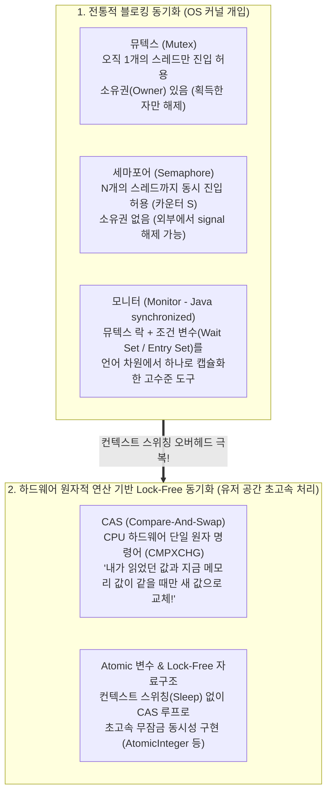

#### 1) 뮤텍스(Mutex) vs 세마포어(Semaphore) vs 모니터(Monitor) 핵심 비교
| 구분 | 뮤텍스 (Mutex) | 세마포어 (Semaphore) | 모니터 (Monitor, 예: Java `synchronized`) |
| :--- | :--- | :--- | :--- |
| **동시 진입 허용 수** | **오직 1개** (이진 락) | **1개 ~ N개** (카운팅 세마포어) | **오직 1개** |
| **락 소유권 (Ownership)** | **있음!** 락을 건(`lock`) 바로 그 스레드만 락을 풀(`unlock`) 수 있음. | **없음!** 스레드 A가 `wait(P)`로 줄인 카운터를 스레드 B가 `signal(V)`로 올려줄 수 있음. | **있음!** 블록에 진입한 스레드가 블록을 빠져나갈 때 자동으로 락 해제. |
| **핵심 용도** | 공유 변수나 자료구조의 **상호 배제(단독 수정 보호)** | **한정된 개수의 자원 풀 관리**(예: DB 커넥션 풀 10개 제한) 및 스레드 간 **실행 순서 제어(신호 전달)** | 객체 지향 언어에서 개발자가 락 해제 실수를 하지 않도록 **상호 배제 + `wait()/notify()` 조건 대기를 통합 제공** |

> [!TIP]
> **현실의 뮤텍스는 어떻게 구현되어 있을까? 리눅스의 `Futex` (Fast Userspace Mutex)**  
> 과거에는 뮤텍스 락을 걸 때마다 무조건 무거운 OS 시스템 콜을 호출했습니다. 하지만 실무에서는 99%의 경우 다른 스레드가 락을 잡고 있지 않아 경합(Contention)이 없습니다.  
> 그래서 현대 리눅스의 **`Futex`(휴텍스)**는 **일단 사용자 모드(User Space)에서 아래에 설명할 초고속 `CAS` 연산으로 락 획득을 시도**합니다! 만약 아무도 락을 안 잡고 있으면 **시스템 콜 없이 단 몇 나노초 만에 락을 획득**하고, 이미 누군가 락을 잡고 있어 **충돌이 발생했을 때만 비로소 커널 시스템 콜을 호출해 스레드를 재웁니다(Sleep).**

#### 2) Lock-Free 프로그래밍의 심장: 하드웨어 원자적 연산 CAS (Compare-And-Swap)
뮤텍스로 스레드를 재우면(Blocked) 컨텍스트 스위칭 비용이 수 마이크로초씩 발생합니다. 고작 변수 하나에 `1`을 더하자고 스레드를 재웠다 깨우는 것은 모기를 잡으려고 대포를 쏘는 격입니다.

이를 해결하기 위해 현대 모든 CPU(x86의 `LOCK CMPXCHG`, ARM의 `LDREX/STREX`)는 **메모리 읽기-비교-쓰기의 3단계를 하드웨어 회로 차원에서 누구도 끼어들 수 없는 단 하나의 원자적(Atomic) 기계어 명령으로 묶어 둔 `CAS (Compare-And-Swap)` 명령어**를 제공합니다!

```c
// [CPU 하드웨어가 단일 클록/원자적으로 보장하는 CAS(Compare-And-Swap)의 논리적 동작]
// - targetAddr : 수정하려는 공유 메모리의 주소
// - expectedVal: "내가 아까 읽었을 때의 값(이 값이어야만 아직 남이 안 건드린 것이다!)"
// - newVal     : 새로 덮어쓸 값
bool hardware_atomic_CAS(int* targetAddr, int expectedVal, int newVal) {
    // === 이 블록 전체는 CPU 하드웨어가 캐시 라인(또는 버스)에 락을 걸어 100% 원자적으로 실행함! ===
    if (*targetAddr == expectedVal) {
        *targetAddr = newVal; // 아무도 안 건드렸으므로 새 값으로 안전하게 교체!
        return true;          // 성공 반환!
    } else {
        return false;         // 그사이에 다른 스레드가 값을 바꿨음! 쓰기를 포기하고 실패 반환!
    }
}
```

##### `AtomicInteger.incrementAndGet()`이 락(Lock) 없이 `count++`를 수행하는 방법:
```java
// 락(synchronized)을 전혀 쓰지 않는 Lock-Free 증가 연산의 내부 구현 원리
public final int incrementAndGet() {
    while (true) {
        int current = get();          // 1. 현재 값(예: 100)을 읽음
        int next = current + 1;       // 2. 새 값(101)을 계산함
        if (compareAndSet(current, next)) { // 3. 하드웨어 CAS 실행: "지금도 100이면 101로 바꿔라!"
            return next;              // 성공하면 즉시 종료! (컨텍스트 스위칭 0회!)
        }
        // 만약 그 찰나에 다른 스레드가 101로 바꿨다면 CAS가 false를 반환하며,
        // 스레드가 잠들지 않고 즉시 루프를 한 바퀴 다시 돌아 101 -> 102로 재시도!
    }
}
```
> [!WARNING]
> **CAS의 유일한 사각지대: ABA 문제 (ABA Problem)와 해결법**  
> 스레드 1이 연결 리스트 헤드의 주소값 `A`를 읽은 직후 잠깐 멈춘 사이, 스레드 2가 `A`를 `B`로 바꿨다가 다시 메모리 주소를 재활용해 **`A`로 되돌려 놓는(`A → B → A`)** 상황이 발생할 수 있습니다. 뒤늦게 깨어난 스레드 1이 CAS를 수행하면 *"어? 지금 값도 `A`네? 아무 일도 없었구나!"*라고 착각하여 이미 내부 구조가 바뀐 리스트를 망가뜨리는 버그가 **ABA 문제**입니다.  
> 이를 막기 위해 실무에서는 값 옆에 **버전 번호(Stamp: `1A → 2B → 3A`)**를 함께 붙여 비교하는 `AtomicStampedReference` 기법을 사용합니다.

---

### 10.4 [실무 아키텍처 공식] 스레드 풀(Thread Pool)의 적정 크기는 몇 개로 잡아야 할까?

백엔드 서버(Tomcat, DB 커넥션 풀, 비동기 워커 풀)를 튜닝할 때 엔지니어들이 가장 많이 하는 실수가 *"동시 요청이 많으니까 스레드 풀 크기를 무작정 2,000개로 늘리자!"*입니다.  
스레드가 너무 많으면 실제 요청을 처리하는 시간보다 **컨텍스트 스위칭과 CPU 캐시 무효화로 허비하는 시간이 더 길어져 서버 처리량(TPS)이 수직 낙하**합니다. 작업의 성격(CPU 바운드 vs I/O 바운드)에 따라 컴퓨터 공학적으로 검증된 황금 공식은 다음과 같습니다.

```
[스레드 풀(Thread Pool) 적정 크기 산정 공식 (브라이언 고츠 Brian Goetz 공식 & 리틀의 법칙)]

1. CPU 바운드 작업 (암호화, 이미지 리사이징, 인메모리 복잡 연산 등 I/O 대기가 거의 없는 경우)
   ★ 적정 스레드 수 = (물리 CPU 코어 수 N_cpu) + 1
   - 이유: 스레드가 쉬지 않고 CPU를 100% 쓰므로, 코어 수보다 스레드가 많으면 무의미한 컨텍스트 스위칭만 발생함!
          (+1을 더하는 이유는 간혹 발생하는 페이지 폴트 등으로 한 스레드가 멈칫할 때 유휴 코어를 메우기 위함)

2. I/O 바운드 작업 (일반 웹 API 서버: DB 쿼리 대기, 외부 REST API 호출, 디스크 읽기 등 대기가 많은 경우)
   ★ 적정 스레드 수 = N_cpu × 목표 CPU 사용률(U) × ( 1 + [평균 I/O 대기 시간(W) / 평균 순수 CPU 연산 시간(C)] )
   - 실전 계산 예시:
     * 서버 사양: 8코어 CPU (N_cpu = 8), 목표 CPU 최대 사용률: 100% (U = 1.0)
     * API 요청 1건 처리 시: 순수 CPU 계산 시간(C)은 5ms인데, DB 쿼리 응답 기다리는 시간(W)이 45ms 걸림! (총 50ms)
     * 계산: 8 × 1.0 × (1 + [45ms / 5ms]) = 8 × (1 + 9) = 80개 스레드!
   - 원리: 한 스레드가 50ms 중 45ms(90%의 시간) 동안 DB를 기다리며 잠들기(Blocked) 때문에,
          코어 1개당 10개의 스레드를 배치해 두어야 앞 스레드가 잠든 동안 뒷 스레드들이 빈틈없이 CPU를 100% 가동할 수 있음!
```

---

### 10.5 데드락(Deadlock, 교착 상태) 실전 발생 코드와 완벽한 해결 패턴

데드락은 앞서 살펴본 **4대 필수 조건(상호 배제, 점유와 대기, 비선점, 환형 대기)**이 동시에 만족될 때 발생합니다. 그중 실무 코드에서 데드락이 터지는 원인의 99%는 **"두 스레드가 두 개의 락(Lock A, Lock B)을 서로 반대 순서로 획득하려고 할 때(환형 대기, Circular Wait)"** 발생합니다!

가장 대표적인 실무 데드락 사례인 **'계좌 이체(Account Transfer)'** 코드를 통해 문제점과 해결책을 직접 비교해 보겠습니다.

```java
// [최악의 데드락 발생 코드!]
// 상황: 스레드 1은 '철수 -> 영희'에게 송금 호출: transfer(철수계좌, 영희계좌, 10000)
//       스레드 2는 동시에 '영희 -> 철수'에게 송금 호출: transfer(영희계좌, 철수계좌, 5000)
public void transferBad(Account fromAcc, Account toAcc, int amount) {
    synchronized (fromAcc) {             // 1. 스레드 1은 '철수계좌' 락 획득! / 동시에 스레드 2는 '영희계좌' 락 획득!
        synchronized (toAcc) {           // 2. 스레드 1은 '영희계좌' 락 대기... / 스레드 2는 '철수계좌' 락 대기...
            fromAcc.withdraw(amount);    // --> 환형 대기(Circular Wait) 완성! 두 스레드 모두 영원히 멈춤(Deadlock)!
            toAcc.deposit(amount);
        }
    }
}

// =========================================================================================

// [완벽한 해결 코드: 락 획득 순서 강제 (Lock Ordering) - 환형 대기 조건 원천 파괴!]
// 원리: 누가 누구에게 송금하든 상관없이, 무조건 계좌 고유 번호(id)가 작은 계좌의 락부터 먼저 잡도록 순서를 통일함!
public void transferGood(Account fromAcc, Account toAcc, int amount) {
    // 1. 계좌 고유 ID를 비교하여 항상 작은 ID의 계좌를 firstLock, 큰 ID의 계좌를 secondLock으로 정렬!
    Account firstLock  = (fromAcc.getId() < toAcc.getId()) ? fromAcc : toAcc;
    Account secondLock = (fromAcc.getId() < toAcc.getId()) ? toAcc : fromAcc;

    // 2. 스레드 1이든 스레드 2든 무조건 '철수계좌(ID=101)' 락을 먼저 잡고 -> '영희계좌(ID=202)' 락을 잡음!
    synchronized (firstLock) {
        synchronized (secondLock) {
            fromAcc.withdraw(amount);
            toAcc.deposit(amount);
        }
    }
}
```

> [!TIP]
> **락 순서를 정할 수 없을 때의 대안: `tryLock(timeout)`을 통한 비선점 조건 파괴**  
> 만약 동적으로 락 순서(Lock Ordering)를 정하기 어려운 복잡한 비즈니스 로직이라면, 무한정 기다리는 `synchronized` 대신 `ReentrantLock.tryLock(100, TimeUnit.MILLISECONDS)`를 사용합니다.  
> 두 번째 락을 100ms 동안 기다려도 얻지 못하면, **이미 쥐고 있던 첫 번째 락까지 스스로 깔끔하게 내려놓고(비선점 조건 파괴) 잠시 후 재시도(Backoff)**하게 만들면 데드락을 100% 회피할 수 있습니다.

---

## (+) 32비트와 64비트는 무엇이 다른가요?

컴퓨터의 아키텍처가 32비트(x86, IA-32)에서 64비트(x86-64 / AMD64, ARM64)로 넘어온 것은 단순한 숫자의 2배 증가가 아닙니다. CPU의 한 클록당 연산 폭(Word Size), 메모리 주소 지정 한계, 그리고 현대 런타임(JVM 등)의 포인터 관리 방식까지 송두리째 바꾼 혁명이었습니다.

---

### 11.1 워드(Word) 크기와 '4GB 메모리 장벽'의 수학적 진실

컴퓨터 구조에서 **워드(Word)**란 CPU가 한 번의 클록 명령으로 레지스터에 담아 처리할 수 있는 **기본 데이터 단위**입니다.
- **32비트 CPU:** 범용 레지스터(`EAX`, `EBX` 등)의 폭이 32비트(4바이트)이고, 메모리 주소를 가리키는 포인터의 크기도 32비트입니다.
- **64비트 CPU:** 범용 레지스터(`RAX`, `RBX` 등)의 폭이 64비트(8바이트)로 넓어졌으며, 레지스터의 개수도 기존 8개에서 16개(`R8`~`R15` 추가)로 두 배 늘어나 함수 매개변수를 느린 스택 메모리 대신 빠른 레지스터로 전달할 수 있게 되었습니다!

#### 왜 32비트 운영체제는 RAM을 16GB나 꽂아도 3.2GB~4GB밖에 못 쓸까?
메모리는 1바이트(Byte)마다 고유한 번지수(Address)가 매겨진 거대한 사물함입니다.
- **32비트 주소 체계:** 32자리의 이진수로 표현할 수 있는 사물함 번호표의 총개수는 정확히 **`2³² = 4,294,967,296개`**입니다. 사물함 1칸이 1바이트이므로, 번호표를 붙일 수 있는 최대 메모리 용량은 **`4,294,967,296 바이트 = 정확히 4GB`**에서 끝납니다! 그 이상의 물리 RAM을 꽂아도 그 사물함을 가리킬 주소 번호표 자체가 존재하지 않아 CPU가 접근할 수 없습니다.
- **64비트 주소 체계:** 64자리의 이진수로 만들 수 있는 사물함 번호표는 무려 **`2⁶⁴ = 18,446,744,073,709,551,616개 = 16 엑사바이트(EB) = 약 1,717만 테라바이트(TB)`**입니다!  
  (현실의 x86-64 및 ARM64 CPU는 트랜지스터 절감과 페이지 테이블 효율을 위해 하위 **48비트(256TB)** 또는 **57비트(128PB)**만 실제 주소선으로 사용하는 **정규 주소(Canonical Address)** 체계를 쓰며, 이조차도 32비트 대비 6만 5천 배 이상 광활한 공간입니다.)

---

### 11.2 메모리에 바이트가 쌓이는 순서: 빅 엔디안(Big Endian) vs 리틀 엔디안(Little Endian)

32비트(4바이트)나 64비트(8바이트) 정수를 1바이트 단위의 메모리 사물함에 나누어 넣을 때, **"가장 큰 자릿수(MSB)부터 낮은 번지에 넣을 것인가, 아니면 가장 작은 일의 자릿수(LSB)부터 낮은 번지에 넣을 것인가?"** 하는 바이트 정렬 순서를 **엔디안(Endianness, 바이트 오더)**이라고 부릅니다.

예를 들어 32비트 16진수 정수 **`0x12345678`** (총 4바이트: 상위 바이트 `12`, 그다음 `34`, `56`, 최하위 바이트 `78`)을 메모리 `0x100`번지부터 저장할 때 두 방식은 정반대로 저장합니다!

```
[대상 4바이트 정수: 0x12345678]  (MSB 최상위 바이트 = 0x12  /  LSB 최하위 바이트 = 0x78)

1. 빅 엔디안 (Big-Endian): 사람이 글씨를 쓰는 순서 그대로! 큰 단위(MSB)가 가장 낮은 주소에 먼저 들어감
   메모리 주소 :  [ 0x100 ]   [ 0x101 ]   [ 0x102 ]   [ 0x103 ]
   저장된 값   :    0x12        0x34        0x56        0x78
   - 직관적 장점: 메모리 덤프를 눈으로 읽을 때 사람이 읽는 숫자 순서와 똑같아서 디버깅이 편하고 대소 비교가 빠름.
   - 사용처: **TCP/IP 모든 네트워크 프로토콜 표준 (Network Byte Order)**, 과거 메인프레임/SPARC/PowerPC.

2. 리틀 엔디안 (Little-Endian): 거꾸로 뒤집어 저장! 작은 일의 자리 단위(LSB)가 가장 낮은 주소(0x100)에 들어감
   메모리 주소 :  [ 0x100 ]   [ 0x101 ]   [ 0x102 ]   [ 0x103 ]
   저장된 값   :    0x78        0x56        0x34        0x12
   - 컴퓨터 구조적 장점:
     1) ALU가 덧셈/뺄셈을 할 때 어차피 1의 자리(LSB, 0x100번지)부터 계산하고 자리올림을 하므로 회로 설계에 유리함!
     2) **타입 캐스팅(Type Casting) 시 메모리 주소를 바꿀 필요가 없음!**
        예를 들어 4바이트 정수(0x00000078)를 1바이트(char)로 줄여 읽을 때, 빅 엔디안은 시작 주소를 +3(0x103)으로
        옮겨야 하지만, 리틀 엔디안은 시작 주소(0x100) 그대로 1바이트만 읽으면 즉시 0x78이 나옴!
   - 사용처: **Intel / AMD (x86, x86-64) 전체**, **현대 ARM (Apple Silicon, Android, iOS) 기본 모드**.
```

> [!WARNING]
> **네트워크 프로그래밍 필수 주의사항 (`htonl` / `ntohl`):**  
> 내 컴퓨터(x86/ARM)는 **리틀 엔디안**인데, 인터넷 표준(TCP/IP 헤더, 바이너리 패킷)은 **빅 엔디안(Network Byte Order)**을 사용합니다! 따라서 소켓으로 정수 데이터를 그대로 전송하면 상대방 컴퓨터가 `0x12345678`을 `0x78563412`라는 괴상한 숫자로 읽는 대형 사고가 터집니다. 바이너리 패킷 통신 시에는 반드시 `htonl()`(Host to Network Long)과 `ntohl()` 함수로 엔디안을 변환하거나, JSON/Protobuf 같은 직렬화 프로토콜을 사용해야 합니다.

---

### 11.3 [백엔드 실무 꿀팁] 64비트의 그림자와 JVM의 Compressed OOPs (왜 힙을 32GB로 주면 안 되는가!)

64비트로 넘어오면서 메모리를 무한히 쓸 수 있게 되었지만, 세상에 공짜 점심은 없습니다.
- 32비트 시절에는 객체의 주소를 가리키는 **포인터(Pointer / Reference)** 변수의 크기가 **4바이트**였지만, 64비트 환경에서는 모든 포인터의 크기가 **8바이트**로 정확히 2배가 되었습니다!
- 특히 Java(JVM)나 Python처럼 모든 데이터와 컬렉션이 객체 참조(포인터)로 이루어진 언어에서는, 똑같은 코드를 64비트 JVM에서 돌리면 포인터가 뚱뚱해져서 **힙(Heap) 메모리 소모량이 1.3배~1.5배 이상 급증**하고, 64바이트 CPU 캐시 라인 안에 들어가는 포인터 개수가 절반으로 줄어들어 **CPU 캐시 히트율까지 떨어지는 부작용**이 발생했습니다.

#### JVM 엔지니어들의 천재적 트릭: Compressed OOPs (압축 참조 포인터)
이 문제를 해결하기 위해 64비트 JVM(Java 6u23 이상 기본 활성화)은 **"64비트 환경에서도 포인터 크기를 8바이트가 아닌 4바이트(32비트)로 압축해서 쓰자!"**라는 **Compressed OOPs(Ordinary Object Pointers)** 기법을 도입했습니다.

그런데 어떻게 32비트(`2³² = 4GB`) 포인터로 **최대 32GB**까지의 힙 메모리를 가리킬 수 있을까요? 비밀은 **8바이트 메모리 정렬(Byte Alignment)과 3비트 시프트(`<< 3`)**에 있습니다!

```
[JVM Compressed OOPs가 32비트(4바이트) 포인터로 32GB 메모리를 가리키는 수학적 마법!]

1. 전제 조건: JVM이 힙(Heap)에 생성하는 모든 객체는 무조건 8바이트의 배수 주소(0, 8, 16, 24, 32...)에 정렬되어 배치됨!
2. 이진수의 비밀: 8의 배수인 모든 숫자는 이진수로 쓰면 **맨 끝 하위 3비트가 무조건 `000`으로 똑같음!**
   - 0번지  = ...0000_000 (하위 3비트는 항상 000!)
   - 8번지  = ...0001_000 (하위 3비트는 항상 000!)
   - 16번지 = ...0010_000 (하위 3비트는 항상 000!)

3. 압축 저장 (Heap에 저장할 때):
   "어차피 맨 끝 3비트는 무조건 000이니까 저장할 때 버리자! (오른쪽으로 3비트 시프트 >> 3)"
   즉, 바이트 주소가 아니라 '몇 번째 8바이트 블록인가?'만 32비트(4바이트)에 저장함!

4. 압축 해제 (CPU가 읽을 때):
   메모리에서 32비트 값을 읽어온 뒤, CPU 레지스터에서 왼쪽으로 3비트만 밀어주면(<< 3, 즉 × 8) 원래의 35비트 주소 복원!

★ 최종 결과: 32비트 포인터(`2³²`개) × 8바이트 단위 = 4GB × 8 = 최대 **32GB (2³⁵ 바이트)**까지 4바이트 포인터로 커버 가능!
```

#### [실무 장애 방지 골든 룰] 왜 JVM이나 Elasticsearch의 힙(`-Xmx`)을 `32GB`로 설정하면 절대 안 될까?
이 원리를 알면 실무 백엔드 서버와 Elasticsearch 공식 문서에 적힌 유명한 경고문인 **"절대로 JVM 힙 크기를 32GB~47GB 사이로 설정하지 마시오! 차라리 31GB로 줄이시오!"**의 이유를 완벽하게 이해할 수 있습니다.

| JVM 힙 크기 설정 (`-Xmx`) | Compressed OOPs 작동 여부 | 참조 포인터 1개 크기 | 실제로 힙에 담을 수 있는 최대 객체 수 비교 |
| :--- | :--- | :--- | :--- |
| **`-Xmx31g` (31 GB 설정)** | **작동함! (ON)**<br>(32GB 미만이므로 압축 가능) | **4 Byte** (32비트) | **약 100% 기준 (최대 효율 + 높은 CPU 캐시 적중률!)** |
| **`-Xmx32g` (32 GB 설정)** | **꺼짐! (OFF)**<br>(32GB 한계 돌파로 압축 해제!) | **8 Byte** (64비트) | 포인터 크기가 갑자기 2배로 뻥튀기되면서, 메모리는 1GB 더 줬는데 **실제 저장 가능한 객체 수는 31GB일 때보다 오히려 15~20% 줄어들고 GC 시간과 CPU 캐시 미스가 급증함!** |
| **`-Xmx48g` 이상** | 꺼짐 (OFF) | 8 Byte (64비트) | 비로소 31GB일 때보다 더 많은 객체를 담을 수 있는 손익분기점 통과! |

따라서 실무에서 Java 서버나 빅데이터 엔진의 힙 메모리를 튜닝할 때는 **반드시 `30GB ~ 31GB` 이하로 맞추거나, 아니면 아예 `48GB ~ 64GB` 이상으로 훌쩍 뛰어넘어야지, 어중간하게 `32GB ~ 46GB` 구간을 설정하는 것은 메모리를 버리고 성능을 깎아 먹는 최악의 안티 패턴**임을 명심해야 합니다.

---

## 에필로그: 추상화의 마법을 지배하는 엔지니어가 되는 길

우리는 지금까지 진공관 시대의 에니악과 폰 노이만 구조에서 출발하여, CPU 파이프라이닝과 분기 예측의 미시 세계, L1/L2/L3 캐시 일관성(MESI)과 거짓 공유, 가상 메모리와 다단계 페이징 및 Copy-on-Write의 정교한 설계, 운영체제 커널의 스케줄러(CFS)와 가상 파일 시스템(inode), 제로 카피(Zero-Copy) I/O, 그리고 멀티스레드 동기화(CAS)와 64비트 메모리 구조에 이르기까지 컴퓨터 시스템의 전 영역을 관통하는 대장정을 마쳤습니다.

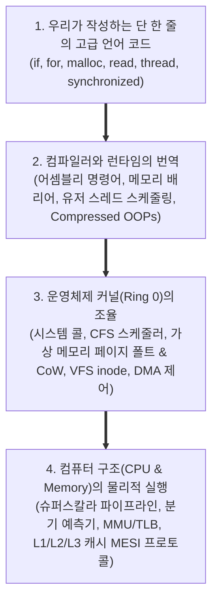

현대의 프레임워크와 클라우드 인프라가 아무리 발전하더라도, **결국 모든 소프트웨어는 물리적인 CPU 코어와 캐시 라인, 그리고 운영체제 커널 위에서 실행됩니다.**
- 왜 내 루프 코드가 느린지 의문이 들 때 **CPU 분기 예측과 캐시 지역성(Locality)**을 떠올릴 수 있는 엔지니어,
- 왜 서버의 CPU는 남는데 응답이 멈추는지 분석할 때 **메이저 페이지 폴트(스래싱)와 스레드 풀 경합, 컨텍스트 스위칭**을 의심할 수 있는 엔지니어,
- 왜 대용량 트래픽 처리에서 **제로 카피(`sendfile`)와 Lock-Free(`CAS`), 그리고 M:N 경량 스레드(고루틴/가상 스레드)**가 압도적인 성능을 내는지 하드웨어 수준에서 설명할 수 있는 엔지니어는 어떤 새로운 기술 트렌드가 밀려와도 흔들리지 않는 가장 단단한 뿌리를 가진 아키텍트로 성장할 것입니다.
