# PART 06. 컴퓨터 구조와 운영체제의 이해 (Computer Architecture & Operating Systems)

> **"소프트웨어 엔지니어가 컴퓨터 구조와 운영체제를 모른 채 코드를 작성하는 것은, 자동차의 엔진 구조와 변속기 원리를 모른 채 레이싱 머신을 모는 것과 같습니다. 평탄한 직선 도로에서는 차이를 느끼지 못할지 모르지만, 시스템의 성능 한계를 시험하는 극한의 코너링에 들어서는 순간 하드웨어와 운영체제에 대한 이해가 승패를 가릅니다."**

---

## 프롤로그: 물리적 기계와 추상적 논리가 만나는 경계

우리가 일상적으로 작성하는 프로그래밍 언어의 코드는 지극히 추상적이고 우아합니다. `int a = 10;`, `fetch('/api/users')`, `thread.start()`와 같은 문장들은 인간의 논리적 언어에 가깝습니다. 하지만 이 우아한 논리들이 컴퓨터 안으로 들어가는 순간, 이들은 가차 없는 물리적 실체로 변환됩니다.

컴퓨터의 본질은 사실 수십억 개의 미세한 전등 스위치(트랜지스터)가 켜지고 꺼지며 전압(0V와 3.3V)의 차이를 만들어내는 **거대한 전자 회로 덩어리**에 불과합니다. 
- 그렇다면 어떻게 이 차가운 규소(Silicon) 조각과 구리선들이 우리가 작성한 조건문과 반복문을 이해하고, 유튜브 영상을 실시간으로 재생하며, 수만 명의 동시 접속자를 처리하는 웹 서버로 작동할 수 있을까요?
- 어떻게 수십 개의 프로그램이 단 하나의 화면에서 충돌 없이 동시에 매끄럽게 동작할 수 있을까요?

이 마법 같은 기적의 중심에는 컴퓨터 공학의 양대 기둥인 **컴퓨터 구조(Computer Architecture)**와 **운영체제(Operating System)**가 자리 잡고 있습니다.
- **컴퓨터 구조**는 계산을 수행하는 두뇌(CPU)와 기억을 담당하는 저장소(메모리), 그리고 이들을 잇는 통로(버스)가 어떻게 물리적으로 설계되고 상호작용하는지를 다룹니다.
- **운영체제**는 이 한정된 물리적 하드웨어 자원을 수많은 프로그램들이 평화롭고 효율적으로 나누어 쓸 수 있도록 조율하는 최고 사령관이자 마법 같은 환상(Abstraction)을 만들어내는 지휘자입니다.

이번 PART 06에서는 단순한 암기식 지식을 넘어, 컴퓨터의 기원부터 현대 멀티코어 운영체제에 이르기까지 시스템의 가장 깊은 곳에서 돌아가는 메커니즘을 친절하고 깊이 있게 탐험해 보겠습니다.

---

## 01. 컴퓨터와 운영체제의 역사: 거대한 계산기에서 현대 GUI OS까지

컴퓨터와 운영체제가 오늘날의 세련된 모습을 갖추기까지는 수많은 천재들의 번뜩이는 아이디어와 기술적 혁신이 축적된 드라마틱한 여정이 있었습니다. 역사를 이해하면 현대 컴퓨터가 "왜 지금과 같은 구조를 선택했는가?"에 대한 답을 자연스럽게 얻을 수 있습니다.

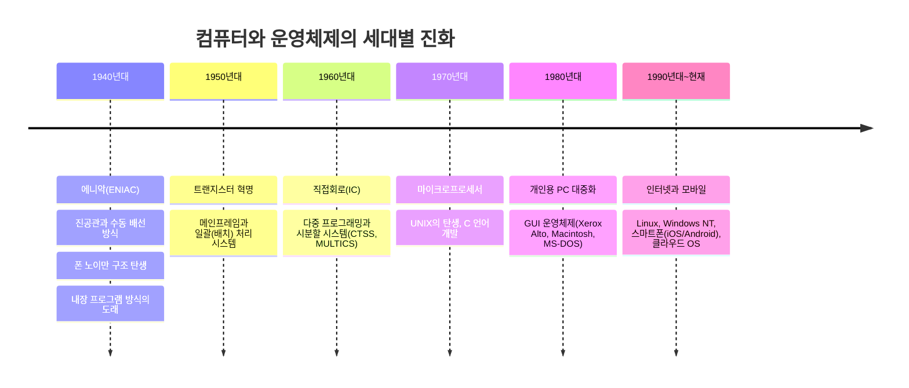

---

### 1.1 에니악(ENIAC)과 진공관: 선을 일일이 꽂아야 했던 거인
1946년 미국 펜실베이니아 대학에서 완성된 **에니악(ENIAC, Electronic Numerical Integrator and Computer)**은 세계 최초의 범용 전자식 디지털 컴퓨터로 인정받습니다. 에니악은 높이 2.4m, 길이 30m, 무게 30톤에 달하는 거대한 괴물이었습니다. 내부에는 무려 18,000여 개의 진공관이 빼곡히 들어차 있었습니다.

에니악은 탄도 궤적 계산 등 엄청난 연산을 순식간에 수행할 수 있었지만, 치명적인 약점이 있었습니다. **"프로그램을 변경하려면 사람이 직접 전선을 뽑아 다른 단자에 꽂아야 했다"**는 점입니다.
- 당시 컴퓨터는 하드웨어와 프로그램이 완전히 한 몸으로 결합되어 있었습니다.
- 덧셈을 하다가 미분 방정식을 풀려면 수천 개의 스위치를 손으로 내리고 전선 수백 가닥을 재배치해야 했습니다. 계산 자체는 몇 초 만에 끝났지만, 프로그래밍(배선 작업)에는 며칠 혹은 몇 주가 걸렸습니다.

---

### 1.2 폰 노이만의 혁명: 내장 프로그램 방식(Stored-Program Concept)
이 답답한 구조를 단숨에 혁신한 인물이 바로 20세기 최고의 천재 수학자 **존 폰 노이만(John von Neumann)**입니다. 1945년, 그는 에드박(EDVAC)에 대한 보고서에서 현대 컴퓨터의 설계 표준이 된 **내장 프로그램 방식(Stored-Program Concept)**을 제안합니다.

> **폰 노이만의 핵심 발상:**  
> *"계산할 '데이터'뿐만 아니라, 컴퓨터가 수행할 '명령어(프로그램)' 역시 메모리에 숫자의 형태로 함께 올려두고 차례대로 읽어서 실행하면 되지 않는가?"*

이 발상은 컴퓨터 역사상 가장 거대한 패러다임 전환이었습니다.
1. 하드웨어 전선을 손댈 필요가 완전히 사라졌습니다.
2. 실행하고 싶은 소프트웨어를 메모리에 적재(Load)하기만 하면, 하나의 컴퓨터가 워드프로세서도 되었다가 계산기도 되고 게임기도 될 수 있는 진정한 **범용 컴퓨터(Universal Computer)**의 시대가 열린 것입니다.

---

### 1.3 하드웨어 소자의 진화: 진공관에서 마이크로프로세서까지
컴퓨터의 물리적 크기가 방 하나 크기에서 우리 손바닥 안의 스마트폰으로 줄어들 수 있었던 것은 반도체 소자의 비약적인 발전 덕분이었습니다.

| 세대 | 핵심 소자 | 특징 및 역사적 의의 |
| :--- | :--- | :--- |
| **제1세대 (1940~50년대)** | **진공관 (Vacuum Tube)** | 엄청난 전력 소모, 극심한 발열, 필라멘트 단선으로 잦은 고장 |
| **제2세대 (1950~60년대)** | **트랜지스터 (Transistor)** | 벨 연구소의 혁명. 크기와 발열이 극적으로 감소, 신뢰성 비약적 향상 |
| **제3세대 (1960~70년대)** | **집적회로 (IC, Integrated Circuit)** | 하나의 실리콘 칩에 수십~수천 개의 트랜지스터를 집적. 미니컴퓨터의 탄생 |
| **제4세대 (1970년대~현재)** | **초고밀도 집적회로 (VLSI / ULSI)** | 칩 하나에 CPU 전체를 구현한 **마이크로프로세서(Intel 4004, 8086)** 등장. PC 혁명의 시초 |

---

### 1.4 운영체제의 눈부신 진화 과정

컴퓨터가 처음 등장했을 때는 '운영체제'라는 개념 자체가 없었습니다. 값비싼 하드웨어를 한 순간도 쉬게 하지 않고 최대한 쥐어짜기 위한 고민 속에서 운영체제는 다음과 같이 진화해 왔습니다.

#### 1) 초기 순차 처리 (Direct Processing / No OS)
- 프로그래머가 손수 펀치 카드(천공 카드)를 들고 전산실에 들어가 컴퓨터를 독점 예약하고 실행했습니다.
- 앞사람의 작업이 끝나고 뒷사람이 기계를 세팅하는 준비 시간(Setup Time) 동안 그 천문학적으로 비싼 컴퓨터가 멍하니 놀고 있어야 했습니다.

#### 2) 일괄 처리 시스템 (Batch Processing System)
- 프로그래머들이 제출한 펀치 카드 뭉치들을 오퍼레이터(전산실 관리자)가 모아, 성격이 비슷한 작업끼리 한 묶음(Batch)으로 묶어 컴퓨터에 한 번에 집어넣는 방식입니다.
- 최초의 원시적 운영체제인 **상주 모니터(Resident Monitor)**가 메모리 한구석에 상주하며 작업이 끝나면 다음 작업을 자동으로 읽어 들였습니다.
- **치명적 문제:** 컴퓨터의 연산 속도에 비해 종이 카드를 읽고 프린터로 찍는 I/O(입출력) 속도가 수만 배 이상 느렸습니다. CPU는 I/O가 끝날 때까지 하염없이 기다려야 했습니다.

```
[배치 처리의 유휴 시간 문제]
CPU 동작: [ 연산 ] ───(I/O 대기로 CPU 멈춤)───> [ 연산 ] ───(I/O 대기)───> [ 연산 ]
I/O 장치:          [ 카드 읽기/인쇄 ]                      [ 카드 읽기/인쇄 ]
```

#### 3) 다중 프로그래밍(Multiprogramming)과 스풀링(SPOOLing)
- **스풀링(SPOOLing, Simultaneous Peripheral Operations On-Line):** 느린 테이프나 프린터 작업을 중간에 자기 디스크(빠른 보조기억장치)에 임시로 저장하여 CPU의 대기 시간을 줄였습니다.
- **다중 프로그래밍(Multiprogramming):** 메모리에 프로그램 여러 개를 동시에 올려둡니다. 프로그램 A가 디스크에서 데이터를 읽어오는 I/O 작업을 수행하느라 CPU를 쓰지 않는 동안, CPU가 놀지 않고 메모리에 있는 프로그램 B의 연산을 가로채서 수행합니다. 이로써 CPU 활용률이 극적으로 향상되었습니다.

#### 4) 시분할 시스템 (Time-Sharing System): 대화형(Interactive) 컴퓨터의 탄생
- 다중 프로그래밍은 CPU 효율을 극대화했지만, 인간 개발자의 답답함은 여전했습니다. 카드를 제출하고 결과를 받기까지 반나절에서 하루가 걸렸기 때문입니다.
- 1960년대 중반, MIT의 페르난도 코바토(Fernando Corbató) 등이 **시분할 시스템(CTSS, Multics)**을 제안합니다.
- CPU의 시간을 아주 미세한 조각(Time Slice, 예: 10ms)으로 쪼개어, 터미널에 앉아 있는 수십~수백 명의 사용자에게 번갈아 할당합니다.
- 워낙 빠르게 화면이 전환되다 보니, 각 사용자는 **"이 거대한 컴퓨터가 오직 나 혼자만을 위해 실시간으로 응답하고 있다"**는 환상(Illusion)을 경험하게 되었습니다. 이것이 바로 현대 멀티태스킹 OS의 모태입니다.

#### 5) UNIX의 탄생과 C 언어의 축복
- 1969년 벨 연구소의 켄 톰슨(Ken Thompson)과 데니스 리치(Dennis Ritchie)는 Multics의 복잡성을 걷어내고 작고 우아한 시스템인 **UNIX**를 창시했습니다.
- 특히 1973년, 하드웨어에 종속적이던 어셈블리어를 탈피하여 **C 언어로 UNIX 커널 전체를 재작성**하는 역사적 사건이 일어납니다. 이로써 운영체제는 하드웨어 기종에 구애받지 않고 어디로든 이식(Porting)될 수 있는 불멸의 날개를 달게 되었으며, 현대 Linux, macOS, iOS, Android의 위대한 족보가 여기서 탄생했습니다.

#### 6) 개인용 PC와 GUI(그래픽 사용자 인터페이스) 혁명
- 제록스 파크(Xerox PARC) 연구소의 Alto 컴퓨터가 마우스와 창(Window), 아이콘, 메뉴로 구성된 **GUI(Graphical User Interface)**를 세계 최초로 선보였습니다.
- 이를 눈여겨본 스티브 잡스가 1984년 **Apple Macintosh**를 통해 상용화했고, 마이크로소프트의 빌 게이츠가 **Windows** 시리즈(Windows 95, Windows NT)로 전 세계 가정과 오피스를 정복하며 오늘날 우리가 사용하는 현대적 OS 생태계가 완성되었습니다.

---

## 02. 컴퓨터는 어떤 구성 요소로 되어 있나요?

컴퓨터를 한 대의 데스크톱 본체로 바라보면 화려한 그래픽 카드와 쿨러, 수많은 단자가 얽혀 있어 복잡해 보이지만, 본질적인 논리 구조는 70여 년 전 폰 노이만이 정의한 뼈대에서 단 한 발자국도 벗어나지 않았습니다.

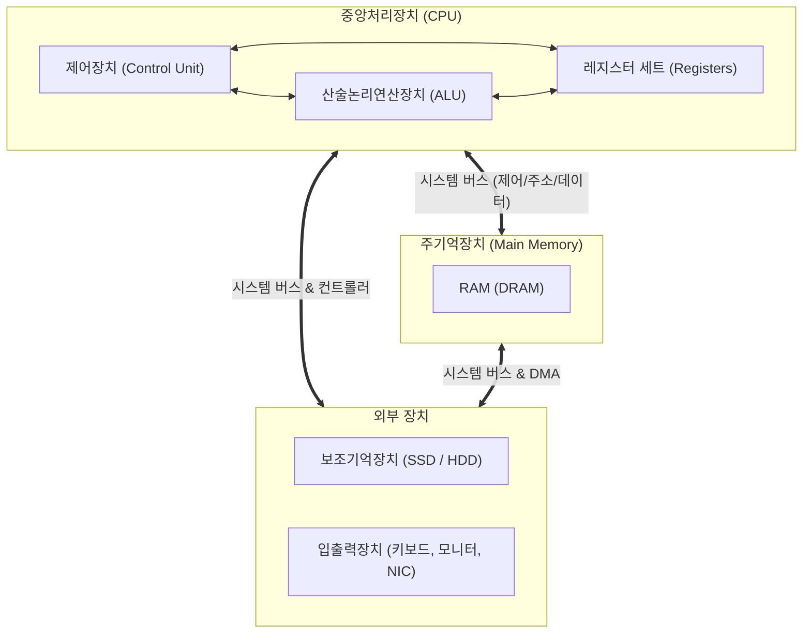

---

### 2.1 폰 노이만 구조의 3대 핵심 기둥

현대 컴퓨터는 아무리 작거나 거대해도 다음 세 가지 기본 원리로 구동됩니다.
1. **내장 프로그램 방식:** 처리할 데이터와 소프트웨어 프로그램 명령어가 동일한 메모리 공간에 함께 저장됩니다.
2. **순차적 명령어 실행:** CPU는 메모리에 저장된 명령어를 한 번에 하나씩 차례대로 가져와 실행합니다.
3. **버스 기반 상호연결:** CPU, 메모리, 주변 장치들이 시스템 버스를 통해 데이터를 주고받습니다.

> [!NOTE]
> **폰 노이만 구조 vs 하버드 구조(Harvard Architecture)**  
> - **폰 노이만 구조:** 명령어(Instruction)와 데이터(Data)가 **하나의 메모리와 단일 버스**를 공유합니다. 설계가 단순하지만, 명령어와 데이터를 동시에 읽을 수 없는 '폰 노이만 병목(Bottleneck)'이 존재합니다.
> - **하버드 구조:** 명령어 전용 메모리/버스와 데이터 전용 메모리/버스가 **물리적으로 완전히 분리**되어 있습니다. 동시에 명령어 인출과 데이터 읽기가 가능하여 속도가 빠릅니다.
> - **현대 컴퓨터의 절충안:** 메인 메모리 수준에서는 통합된 폰 노이만 구조를 취하지만, CPU 내부 캐시 메모리 단계에서는 L1 명령어 캐시(L1i)와 L1 데이터 캐시(L1d)를 분리하는 **하버드 구조를 결합한 하이브리드 형태**를 채택하고 있습니다.

---

### 2.2 CPU(Central Processing Unit): 컴퓨터의 심장과 두뇌
CPU는 메모리에 적재된 프로그램의 기계어 명령어를 인출(Fetch)하고 해석(Decode)하여 실행(Execute)하는 초고속 연산 장치입니다. 내부적으로 3개의 핵심 모듈로 구성됩니다.

#### 1) ALU (산술논리연산장치, Arithmetic Logic Unit)
- 말 그대로 산술 연산(덧셈, 뺄셈, 곱셈 등)과 논리 연산(AND, OR, NOT, XOR, 시프트 등)을 실제로 수행하는 전자 계산기입니다.
- 연산의 결과와 함께 현재 상태를 나타내는 플래그(부호 플래그, 제로 플래그, 오버플로우 플래그, 캐리 플래그 등)를 출력하여 플래그 레지스터에 기록합니다.

#### 2) 제어장치 (Control Unit, CU)
- 컴퓨터의 모든 구성 요소를 총괄하는 지휘자입니다.
- 메모리에서 명령어를 가져와 기계어 비트 패턴을 해독(Decoding)한 뒤, ALU, 레지스터, 메모리, 입출력 장치에 "지금 덧셈을 해라", "메모리 0x1000번지의 데이터를 읽어와라" 같은 **제어 신호(Control Signal)**를 발생시킵니다.

#### 3) 레지스터 (Registers)
- CPU 내부에 위치한 **가장 작고, 가장 비싸며, 상상을 초월할 정도로 빠른 초고속 임시 기억장소**입니다.
- CPU가 연산을 수행하려면 메모리에서 값을 가져와 반드시 레지스터에 올려두어야 합니다.

| 핵심 레지스터 명칭 | 역할 및 기능 |
| :--- | :--- |
| **PC (Program Counter)** | **다음에 인출하여 실행할 명령어의 메모리 주소**를 가리킵니다. 명령어를 하나 가져올 때마다 자동으로 증가합니다. |
| **IR (Instruction Register)** | 메모리에서 방금 인출해 온 **현재 실행 중인 기계어 명령어 자체**를 임시로 담아두는 곳입니다. |
| **MAR (Memory Address Register)** | CPU가 읽거나 쓰고자 하는 **메모리의 물리 주소**를 잠시 보관하는 레지스터입니다. 주소 버스와 직결됩니다. |
| **MBR (Memory Buffer Register / MDR)** | 메모리에서 읽어온 데이터나, 메모리에 기록하기 위해 보낼 **실제 데이터 값**을 담는 버퍼입니다. 데이터 버스와 직결됩니다. |
| **AC (Accumulator, 누산기)** | ALU의 연산 결과나 중간 연산 데이터를 일시적으로 누적하여 저장하는 레지스터입니다. |
| **SP (Stack Pointer)** | 메모리의 스택 영역에서 가장 최근에 푸시된(최상단) 데이터의 주소를 추적합니다. |
| **Status / Flag Register** | 직전 연산 결과가 0인지(Z), 음수인지(S), 자리올림이 났는지(C), 오버플로우가 났는지(V) 등의 CPU 상태 정보를 비트 단위로 보관합니다. |

---

### 2.3 CPU의 명령어 실행 주기 (Instruction Cycle)
CPU가 전원이 들어와서 꺼질 때까지 무한히 반복하는 기본 사이클은 다음과 같습니다.

```
[인출 (Fetch)] ──> [해독 (Decode)] ──> [실행 (Execute)] ──> [저장 (Writeback)]
      ▲                                                              │
      └────────────────── (인터럽트 확인 후 반복) ─────────────────────┘
```

1. **인출 (Fetch):** PC가 가리키는 메모리 주소를 MAR로 보내고, 메모리에서 해당 명령어를 MBR을 거쳐 IR(명령어 레지스터)로 가져옵니다. PC는 다음 명령어를 가리키도록 증가합니다.
2. **해독 (Decode):** 제어장치(CU)가 IR에 실린 기계어 비트를 분석하여 어떤 연산인지, 피연산자(Operand)가 어디에 있는지 파악합니다.
3. **실행 (Execute):** 제어 신호에 따라 ALU가 연산을 수행하거나 레지스터 간 데이터를 복사합니다.
4. **저장 / 인터럽트 검사 (Writeback & Interrupt):** 연산 결과를 레지스터나 메모리에 쓰고, 외부 장치로부터 인터럽트 요청이 들어왔는지 확인합니다.

---

### 2.4 주기억장치(메모리), 보조기억장치, 입출력장치

- **주기억장치 (Main Memory, RAM):** CPU가 직접 주소를 지정하여 접근할 수 있는 작업 공간입니다. 임의의 위치라도 주소만 알면 동일한 시간 내에 접근할 수 있어 **RAM(Random Access Memory)**이라고 부릅니다. 현재 실행 중인 프로그램 코드와 데이터가 상주합니다.
- **보조기억장치 (Secondary Storage, SSD/HDD):** RAM은 전원이 차단되면 데이터가 날아가므로, 파일과 운영체제 바이너리를 영구적으로 보관하기 위한 대용량 비휘발성 저장소입니다.
- **입출력장치 (I/O Devices):** 모니터, 키보드, 마우스, 네트워크 인터페이스 카드(NIC) 등 컴퓨터 외부 세계와 인간, 네트워크를 이어주는 장치입니다. CPU에 비해 동작 속도가 현저히 느려 특별한 입출력 제어기(Controller)를 통해 연결됩니다.

---

### 2.5 시스템 버스 (System Bus): 데이터의 고속도로
CPU, 메모리, 입출력 장치 사이에 신호와 데이터가 오가는 물리적 배선 묶음을 **시스템 버스**라고 부르며, 기능에 따라 3가지로 나뉩니다.

```
[ CPU ] ══════════════════════════════════════════ [ 메모리 & I/O ]
           ┌───────────────────────────────────┐
           │ 주소 버스 (Address Bus)    ───>   │ (단방향: CPU가 주소 지정)
           │ 데이터 버스 (Data Bus)     <───>  │ (양방향: 명령어 및 데이터 전달)
           │ 제어 버스 (Control Bus)    <───>  │ (양방향: Read/Write, Interrupt 제어)
           └───────────────────────────────────┘
```

1. **주소 버스 (Address Bus):** CPU가 메모리나 I/O 장치에 접근할 때 "몇 번지에 접근할 것인가?"를 지정하는 전선입니다. CPU에서 외부로 나가는 단방향 성격을 가집니다. 주소 버스의 폭(가닥 수)이 32가닥이면 $2^{32}(4\text{GB})$, 64가닥이면 이론상 $2^{64}$바이트의 주소를 지정할 수 있습니다.
2. **데이터 버스 (Data Bus):** 실제 명령어와 데이터가 오고 가는 양방향 도로입니다. 데이터 버스의 폭이 64비트라면 한 번의 클록 신호에 8바이트의 데이터를 통째로 실어나를 수 있습니다.
3. **제어 버스 (Control Bus):** 지금 주소 버스에 올린 주소의 데이터를 "읽을 것인가(Read)" 아니면 "쓸 것인가(Write)"를 알리는 제어 신호, 클록 신호, 입출력 완료를 알리는 인터럽트 신호 등이 흐르는 지휘용 통로입니다.

---

## 03. 왜 모든 데이터를 메모리에 올리지 못하나요?

초보 프로그래머들은 종종 이런 상상을 합니다.  
*"SSD나 하드디스크는 너무 느린데, 그냥 컴퓨터에 RAM을 100테라바이트쯤 꽂아두고 모든 파일과 데이터베이스를 몽땅 올려두면 세상 모든 소프트웨어가 빛의 속도로 동작하지 않을까?"*

이 질문은 아주 자연스럽지만, 물리학적 현실과 경제학적 법칙 앞에서 가로막히게 됩니다.

---

### 3.1 비휘발성(Non-volatile) vs 휘발성(Volatile)의 근본적 차이

가장 치명적인 이유는 **물리적 데이터 보존 능력** 때문입니다.

```
[휘발성 메모리 (DRAM)]                [비휘발성 저장장치 (NAND Flash SSD)]
   ┌───────────┐                         ┌───────────┐
   │ 전하 충전 │ ──(전원 차단)──> 소멸   │ 전하 포획 │ ──(전원 차단)──> 영구 보존
   └───────────┘ (휘발성, Volatile)       └───────────┘ (비휘발성, Non-volatile)
```

- **휘발성 메모리 (RAM, 특히 DRAM):**  
  우리가 주기억장치로 사용하는 DRAM(Dynamic RAM)은 초소형 트랜지스터 1개와 커패시터(축전기, Capacitor) 1개로 1비트의 정보를 저장합니다. 커패시터에 전하가 충전되어 있으면 1, 방전되어 있으면 0으로 인식합니다.  
  문제는 커패시터가 극도로 미세하여 전하가 1초에도 수천 번씩 자연 방전된다는 점입니다. 따라서 컴퓨터가 켜져 있는 동안에도 주기적으로 전하를 재충전(Refresh)해주어야 합니다. 만약 컴퓨터의 전원 플러그를 뽑는 순간, 커패시터의 전하는 수 밀리초 만에 흔적도 없이 사라져 버립니다. 모든 데이터를 RAM에만 보관한다면, 정전 한 번에 국가 전산망과 개인의 모든 사진, 문서가 영구 소멸할 것입니다.
- **비휘발성 저장장치 (NAND Flash SSD, HDD):**  
  NAND 플래시 메모리는 플로팅 게이트(Floating Gate)나 전하 포획층(Charge Trap Nitride)이라는 절연체 속에 전자를 가두어 둡니다. 전원이 차단되어도 물리적으로 전자가 빠져나가지 못하므로 수년 동안 데이터가 안전하게 유지됩니다.

---

### 3.2 비용-용량-속도의 트레이드오프 (The Golden Triangle)

두 번째 이유는 반도체 제조 원가와 물리적 속도의 반비례 관계입니다.

$$
\text{속도가 극도로 빠름} \iff \text{소자가 복잡하고 큼} \iff \text{비용이 극도로 비쌈} \iff \text{대용량 제작 불가}
$$

- **SRAM (Static RAM, 캐시 메모리에 사용):**  
  트랜지스터를 무려 4~6개 엮어 만든 플립플롭(Flip-Flop) 회로로 1비트를 저장합니다. 전하를 충전할 필요 없이 전압 상태만으로 데이터를 유지하므로 DRAM보다 수십 배 빠르고 리프레시도 필요 없습니다. 하지만 회로 면적이 너무 넓어 칩 안에 많이 집어넣을 수 없고, 가격이 천문학적으로 비쌉니다. (수십 메가바이트(MB) 수준만 탑재)
- **DRAM (Dynamic RAM, 메인 메모리에 사용):**  
  트랜지스터 1개와 커패시터 1개로 구성되어 SRAM보다 집적도가 훨씬 높아 기가바이트(GB) 단위로 만들 수 있지만, SRAM보다 느립니다.
- **NAND Flash / HDD (보조기억장치):**  
  속도는 DRAM보다 수천~수만 배 느리지만, 테라바이트(TB) 단위를 저렴한 가격에 대량 생산할 수 있습니다.

---

### 3.3 저장장치 계층 구조 (Memory Hierarchy Pyramid)

컴퓨터 공학자들은 이 상충 관계(Trade-off)를 해결하기 위해 천재적인 타협안을 고안해 냈습니다. 바로 **저장장치 계층 구조(Memory Hierarchy)**입니다.

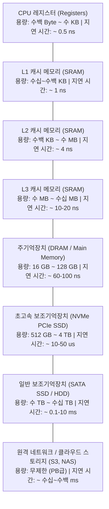

#### 인간의 체감 시간으로 환산한 저장장치 지연 시간 비교
컴퓨터의 1나노초($10^{-9}$초)는 인간에게 너무 찰나의 순간이라 감이 오지 않습니다. 만약 **CPU가 레지스터에 접근하는 시간(0.5ns)을 인간의 체감 시간 '1초'로 환산**한다면 세상은 어떻게 보일까요?

| 저장장치 종류 | 실제 지연 시간 (Latency) | 인간의 체감 시간 환산 (0.5ns = 1초) | 비유적 공간 거리 |
| :--- | :--- | :--- | :--- |
| **CPU 레지스터** | 0.5 ns | **1초** | 내 손안에 쥐고 있는 연필 |
| **L1 캐시** | 1 ~ 1.5 ns | **2 ~ 3초** | 책상 위에 놓인 책 |
| **L2 캐시** | 4 ~ 5 ns | **8 ~ 10초** | 방 안의 책꽂이 |
| **L3 캐시** | 15 ~ 20 ns | **30 ~ 40초** | 거실 서재 |
| **메인 메모리 (DRAM)**| 60 ~ 100 ns | **2분 ~ 3분 20초** | 아파트 1층 우편함까지 다녀오기 |
| **NVMe SSD** | 20 ~ 50 $\mu$s | **11시간 ~ 1.1일** | 다른 도시로 기차 타고 출장 다녀오기 |
| **전통적 HDD** | 5 ~ 10 ms | **3.8개월 ~ 7.6개월** | 지구 반대편으로 항해 다녀오기 |
| **원격 인터넷 왕복** | 100 ms | **6.3년** | 대학교 입학해서 학사/석사 졸업하기 |

이 표를 보면 CPU 입장에서 보조기억장치(SSD나 HDD)에서 데이터를 읽어오는 행위가 얼마나 고통스러울 정도로 긴 영겁의 세월인지 절감할 수 있습니다. 
컴퓨터는 이 계층 구조를 두고, **"자주 쓰는 소량의 데이터는 위쪽(캐시/레지스터)에 바짝 끌어다 두고, 거의 안 쓰는 방대한 데이터는 아래쪽(SSD/HDD)에 묻어두는 전략"**을 취함으로써, **"마치 컴퓨터 전체가 레지스터처럼 빠르면서도 SSD처럼 거대한 저장 공간을 가진 것처럼"** 작동하게 만듭니다.

---

## 04. 메모리는 왜 캐시 메모리, 메인 메모리, 가상 메모리로 나뉘어 사용되나요?

앞서 살펴본 저장장치 계층 구조가 마법처럼 성공할 수 있는 이유는 컴퓨터 프로그램의 실행 패턴에 기가 막힌 물리학적/통계학적 특성이 존재하기 때문입니다. 이를 **참조의 지역성(Principle of Locality)**이라고 부릅니다.

---

### 4.1 캐시 메모리와 참조의 지역성 (Locality of Reference)

CPU의 연산 속도는 무어의 법칙에 따라 수십 년간 수만 배 폭발적으로 증가했지만, DRAM(메인 메모리)의 속도는 그에 훨씬 미치지 못했습니다. 이 둘 사이의 성능 격차를 **메모리 장벽(Memory Wall)**이라고 부릅니다. CPU가 아무리 빨라도 메모리에서 데이터를 가져오느라 세월을 보낸다면 고성능 CPU는 무용지물이 됩니다.

이를 막기 위해 CPU 칩 내부에 SRAM으로 만든 **L1, L2, L3 캐시 메모리**를 심어둡니다.
캐시 메모리는 메인 메모리에서 앞으로 CPU가 사용할 것 같은 데이터를 미리 뭉텅이로 가져와 보관합니다. 캐시의 적중률(Hit Ratio)이 보통 90~95%를 넘어가는데, 이것이 가능한 비결이 바로 두 가지 지역성 원리입니다.

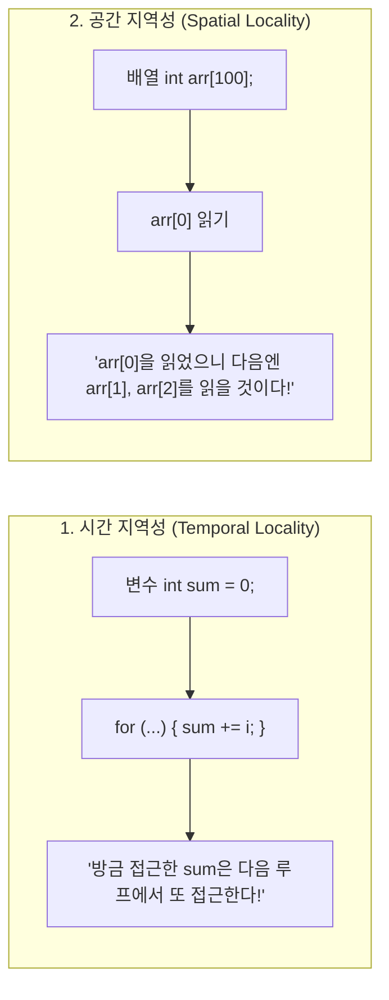

1. **시간 지역성 (Temporal Locality):**  
   한 번 참조된 메모리 영역은 **가까운 미래에 다시 참조될 가능성이 매우 높다**는 원리입니다.  
   - 예: `for` 루프에서 반복 횟수를 세는 변수 `i`, 누적 변수 `sum`, 빈번히 호출되는 유틸리티 함수 코드.
2. **공간 지역성 (Spatial Locality):**  
   어떤 메모리 위치가 참조되면, **그 인접한 주변 주소가 곧이어 참조될 가능성이 매우 높다**는 원리입니다.  
   - 예: 배열의 연속된 요소 순회, CPU가 순차적으로 실행하는 일련의 기계어 코드 라인들.  
   - CPU는 메모리에서 데이터를 가져올 때 달랑 1바이트만 가져오지 않고, **캐시 라인(Cache Line, 통상 64바이트)** 단위로 주변 데이터를 한꺼번에 통째로 긁어옵니다.

#### [실무 예시] 2차원 배열 순회: 지역성을 무시한 코드의 대참사
C나 C++, Java와 같은 언어는 2차원 배열을 메모리에 행 단위로 연속해서 배치하는 **행 우선(Row-Major)** 방식을 사용합니다. 다음 두 코드는 논리적으로 완벽히 동일한 연산을 수행하지만 실행 속도는 최대 수십 배 차이가 납니다.

```c
#define SIZE 10000
int arr[SIZE][SIZE];

// [코드 A] 행 우선 순회 (공간 지역성 극대화 -> 압도적으로 빠름)
for (int i = 0; i < SIZE; i++) {
    for (int j = 0; j < SIZE; j++) {
        arr[i][j] = 1; // 메모리에 연속된 주소를 차례로 방문하므로 캐시 히트(Cache Hit) 폭발
    }
}

// [코드 B] 열 우선 순회 (공간 지역성 파괴 -> 극도로 느림)
for (int j = 0; j < SIZE; j++) {
    for (int i = 0; i < SIZE; i++) {
        arr[i][j] = 1; // 한 번 쓸 때마다 메모리 주소를 수만 바이트씩 점프하므로 캐시 미스(Cache Miss) 연속 발생
    }
}
```
> [!TIP]
> 똑같은 $O(N^2)$ 알고리즘이라도 하드웨어 캐시 라인과 공간 지역성을 이해하고 짠 코드(A)와 그렇지 않은 코드(B)는 실무 빅데이터 및 대규모 연산에서 천양지차의 성능 차이를 만들어냅니다.

---

### 4.2 가상 메모리(Virtual Memory)와 페이징(Paging)

만약 8GB RAM이 장착된 컴퓨터에서 4GB짜리 포토샵, 3GB짜리 3D 게임, 3GB짜리 웹 브라우저를 동시에 띄우면 어떻게 될까요? 단순 합산하면 10GB이므로 메모리가 부족해 즉시 컴퓨터가 다운되어야 할 것 같지만, 실제로는 아무 문제 없이 모두 실행됩니다. 이것을 가능하게 해주는 운영체제의 기적이 바로 **가상 메모리(Virtual Memory)**입니다.

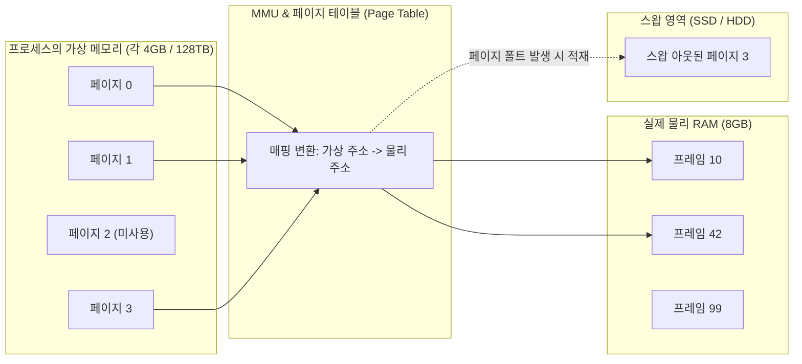

#### 가상 메모리가 해결한 3대 난제
1. **메모리 용량의 한계 극복:** 물리 RAM보다 훨씬 큰 프로그램도 실행할 수 있습니다.
2. **프로세스 격리와 메모리 보호:** 각 프로세스는 "내가 컴퓨터의 0번지부터 끝 번지까지 모든 메모리를 독점하고 있다"는 환상적인 **독립 가상 주소 공간(Logical Address Space)**을 부여받습니다. 따라서 악성 프로그램이나 버그가 있는 프로그램이 다른 프로그램의 메모리 번지를 엿보거나 덮어쓰는 사고가 원천 차단됩니다.
3. **불연속 메모리 할당 (외부 단편화 해결):** 물리 메모리의 빈 조각들이 여기저기 흩어져 있어도, 가상 주소에서는 깔끔하게 연속된 하나의 공간처럼 이어 붙여 쓸 수 있습니다.

#### 페이징(Paging)과 페이지 폴트(Page Fault)
- **페이징 기법:** 운영체제는 가상 메모리를 일정한 고정 크기 블록으로 쪼개는데 이를 **페이지(Page, 일반적으로 4KB)**라고 부릅니다. 그리고 물리 RAM 역시 정확히 똑같은 4KB 크기로 쪼개며 이를 **프레임(Frame)**이라고 부릅니다.
- **페이지 테이블(Page Table):** 가상 주소의 몇 번 페이지가 실제 물리 RAM의 몇 번 프레임에 들어가 있는지를 1:1로 기록해 둔 지도입니다.
- **페이지 폴트 (Page Fault):**  
  프로그램 전체가 항상 RAM에 올라와 있을 필요는 없습니다. 지금 당장 쓰지 않는 기능(예: 포토샵의 인쇄 다이얼로그 코드)은 SSD의 스왑(Swap) 영역에 그대로 둡니다.  
  프로그램이 실행되다가 RAM에 없는 페이지를 요구하면 CPU에 **페이지 폴트(Page Fault)**라는 하드웨어 예외 인터럽트가 발생합니다. 운영체제는 즉시 개입하여 SSD에서 해당 페이지를 읽어 빈 RAM 프레임에 적재하고, 페이지 테이블을 갱신한 뒤 프로그램을 정상 재개시킵니다.

---

### 4.3 하드웨어의 초고속 조력자: MMU와 TLB

가상 주소를 물리 주소로 바꾸는 일은 프로그램이 메모리에 접근할 때마다, 즉 **초당 수십억 번** 일어나야 합니다. 이를 소프트웨어(운영체제 코드)가 일일이 계산하고 있다면 컴퓨터는 굼벵이처럼 느려질 것입니다.

- **MMU (Memory Management Unit):**  
  CPU 칩 내부에 내장된 하드웨어 장치로, CPU가 내뱉는 가상 주소를 물리 주소로 실시간 하드웨어 변환합니다.
- **TLB (Translation Lookaside Buffer):**  
  MMU가 가상 주소를 물리 주소로 바꾸려면 메모리에 있는 페이지 테이블을 매번 뒤져봐야 합니다. 결국 "메모리를 한 번 읽으려고 메모리를 두 번 방문하는" 병목이 생깁니다.  
  이를 방지하기 위해 **페이지 변환 주소 자체를 캐싱해 두는 초고속 특수 하드웨어 캐시**가 바로 **TLB**입니다.
  - **TLB Hit:** TLB에 매핑 정보가 있으면 즉시 1클록 만에 물리 주소 획득.
  - **TLB Miss:** TLB에 없으면 실제 메모리의 페이지 테이블을 탐색(Page Table Walk)하여 주소를 변환하고 TLB를 갱신.

---

## 05. 여러 프로그램이 동시에 실행되는 원리는 무엇인가요?

우리는 음악을 들으면서 웹 서핑을 하고, 백그라운드에서는 대용량 파일을 다운로드받으며, 메신저로 친구와 대화를 나눕니다. 컴퓨터 안에서는 도대체 어떤 마술이 일어나고 있기에 이 모든 일들이 동시에 일어나는 것일까요?

---

### 5.1 동시성(Concurrency) vs 병렬성(Parallelism)

기술 면접과 아키텍처 설계에서 가장 빈번하게 혼동되는 두 개념을 명확하게 분리해야 합니다.

```
[동시성 (Concurrency)] - 싱글 코어의 시분할
코어 1: [ 작업 A ]─>[ 작업 B ]─>[ 작업 A ]─>[ 작업 C ]─>[ 작업 B ]
(인간의 눈에는 동시에 돌아가는 것처럼 보임)

[병렬성 (Parallelism)] - 멀티 코어의 물리적 동시 처리
코어 1: [ 작업 A 계속 실행 중 ............................ ]
코어 2: [ 작업 B 계속 실행 중 ............................ ]
(물리적으로 같은 찰나의 순간에 두 작업이 함께 돌아감)
```

| 구분 | 동시성 (Concurrency) | 병렬성 (Parallelism) |
| :--- | :--- | :--- |
| **핵심 개념** | 여러 작업이 **동시에 진행되는 것처럼 다루는 논리적 구조** | 여러 작업이 **동일한 순간에 실제로 동시에 실행되는 물리적 현상** |
| **하드웨어 요구**| **단일 코어(Single Core)**에서도 시분할을 통해 완벽히 달성 가능 | **반드시 멀티 코어(Multi-Core)나 멀티 프로세서**가 필요함 |
| **주요 목적** | CPU 유휴 시간을 줄이고 응답성(Responsiveness)을 극대화 | 대규모 연산 처리를 나누어 처리 시간(Throughput)을 단축 |
| **비유** | 한 명의 바리스타가 주문받고, 원두 갈고, 우유 스팀을 재빠르게 번갈아 처리 | 두 명의 바리스타가 각자 커피 머신 한 대씩 잡고 동시에 추출 |

---

### 5.2 시분할(Time-Sharing)과 타이머 인터럽트

단일 코어가 동시성을 구현하는 비결은 **시분할(Time-sharing)** 시스템에 있습니다. 운영체제는 1초를 수백 조각으로 쪼개어(예: 10ms 단위의 타임 슬라이스) 프로그램 A, B, C에 번갈아 CPU를 넘겨줍니다.

여기서 아주 중요한 질문이 생깁니다.  
*"만약 어떤 프로그램이 악의적이거나 버그로 인해 `while(true) {}` 같은 무한 루프에 빠져 CPU를 자발적으로 반납하지 않는다면, 운영체제는 어떻게 제어권을 강제로 빼앗아 올 수 있을까요?"*

그 비결이 바로 하드웨어가 제공하는 **타이머 인터럽트(Timer Interrupt)**입니다.
1. 메인보드에는 일정한 주기(클록)마다 전기적 펄스를 발생시키는 하드웨어 타이머 칩이 장착되어 있습니다.
2. 타임 슬라이스(예: 10ms)가 만료되면 타이머 칩이 CPU의 인터럽트 라인에 전기 신호를 쏩니다.
3. CPU는 실행 중이던 사용자 프로그램의 명령어를 즉시 중단하고, 하드웨어적으로 **인터럽트 서비스 루틴(ISR)**, 즉 운영체제의 스케줄러 코드로 강제 점프합니다.
4. 운영체제는 "너 시간 다 썼어"라며 CPU 제어권을 회수하고 다음 대기 프로그램에 넘겨줍니다. 이 하드웨어 타이머 덕분에 어떤 프로그램도 컴퓨터 전체를 독점하여 멈추게 할 수 없습니다.

---

### 5.3 컨텍스트 스위칭(Context Switching)과 PCB

CPU가 실행 중이던 프로세스 A를 멈추고 프로세스 B로 전환하는 일련의 과정을 **컨텍스트 스위칭(Context Switching, 문맥 교환)**이라고 부릅니다.

여기서 **컨텍스트(Context, 문맥)**란, 프로세스가 다음번에 다시 CPU를 잡았을 때 아무 일도 없었던 것처럼 정확히 이어서 실행하기 위해 필요한 **CPU의 모든 상태 정보(PC 값, 각종 레지스터에 들어있던 연산 중간값, 스택 포인터 등)**를 의미합니다.

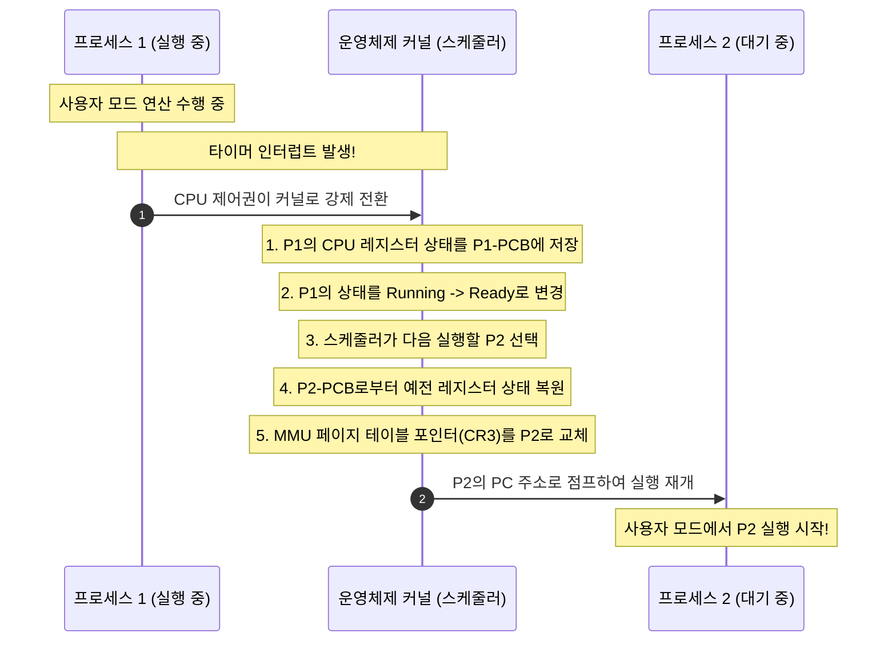

#### PCB (Process Control Block, 프로세스 제어 블록)
운영체제가 프로세스를 관리하기 위해 커널 메모리 영역에 생성하는 일종의 '프로세스 신분증'입니다.
- **PID (Process ID):** 프로세스 고유 식별 번호
- **프로세스 상태:** 생성(New), 준비(Ready), 실행(Running), 대기(Blocked), 종료(Terminated)
- **PC (Program Counter):** 다음에 실행할 명령어 주소
- **CPU 레지스터 복사본:** 직전까지 레지스터에 들어있던 값들
- **메모리 관리 정보:** 페이지 테이블 베이스 주소(CR3 레지스터 값)
- **할당된 자원 목록:** 열려 있는 파일 디스크립터(File Descriptors), 소켓 정보 등

#### 컨텍스트 스위칭의 숨은 비용 (Overhead)
컨텍스트 스위칭은 마법 같지만 공짜가 아닙니다. 너무 자주 일어나면 배보다 배꼽이 더 커집니다.
1. **순수 CPU 클록 낭비:** 레지스터를 메모리(PCB)에 덤프하고 다시 읽어오는 동안에는 순수한 사용자 프로그램 연산이 완전히 멈춥니다.
2. **캐시 플러시와 캐시 오염 (Cache Invalidation / Pollution):**  
   프로세스 A가 쓰던 따끈따끈한 데이터로 가득 차 있던 L1/L2 캐시 메모리가, 프로세스 B가 들어오는 순간 전부 쓸모없는 쓰레기가 됩니다. 프로세스 B는 실행 초기 필연적으로 수많은 캐시 미스를 겪으며 느리게 동작해야 합니다.
3. **TLB 플러시:** 가상 주소 체계가 프로세스마다 완전히 다르므로, 페이지 테이블 베이스 레지스터를 바꾸는 순간 기존 TLB 캐시를 싹 비워야(Flush) 합니다.

---

## 06. 운영체제는 무슨 일을 하나요?

운영체제(Operating System)는 컴퓨터라는 복잡한 하드웨어 왕국의 **최고 자원 관리자(Resource Manager)**이자, 소프트웨어 개발자들에게 복잡한 하드웨어를 감추고 표준화된 인터페이스를 제공하는 **가상 머신(Virtual Machine 추상화자)**입니다.

```mermaid
mindmap
  root((운영체제의<br>5대 핵심 기능))
    프로세스 & 스레드 관리
      CPU 스케줄링 (FCFS, RR, 우선순위)
      동기화 및 IPC 통신
      프로세스 생성/소멸 관리
    메모리 관리
      가상 메모리 및 페이징 기법
      물리 RAM 할당 및 회수
      페이지 교체 알고리즘 (LRU, Clock)
    파일 시스템 관리
      디렉토리 계층 구조 추상화
      파일 읽기/쓰기/권한 제어
      디스크 블록 할당 및 저널링
    입출력 (I/O) 장치 관리
      장치 드라이버 표준화
      버퍼링, 캐싱, 스풀링
      인터럽트 처리 및 DMA 제어
    보안 및 인터페이스 제공
      이중 모드 보호 (커널/사용자)
      사용자 인증 및 접근 제어
      CLI (Shell) 및 GUI 제공
```

---

### 6.1 프로세스 및 스레드 관리 (CPU 자원 분배)
- 수많은 프로그램이 한정된 CPU를 공평하고 효율적으로 나누어 쓸 수 있도록 스케줄링 알고리즘(Round Robin, Multi-level Feedback Queue 등)을 실행합니다.
- 프로세스의 생성부터 종료까지의 생명 주기를 통제하고, 뒤에서 다룰 프로세스 간 통신(IPC)과 동기화 도구를 제공합니다.

### 6.2 메모리 관리 (RAM 공간 분배)
- 어떤 프로세스에게 RAM의 어느 공간을 내어줄지 동적으로 할당하고, 프로세스가 종료되면 즉시 회수합니다.
- 앞서 배운 페이징 기법과 가상 메모리를 총괄하며, 물리 메모리가 꽉 찼을 때 어떤 페이지를 디스크로 쫓아낼지 결정하는 **페이지 교체 알고리즘(LRU, LFU, Clock 등)**을 가동합니다.

### 6.3 파일 시스템 관리 (데이터의 추상화)
- 보조기억장치는 사실 수십억 개의 섹터(Sector)와 블록(Block)에 불과한 0과 1의 연속된 연속체입니다.
- 운영체제는 이 삭막한 하드웨어 블록 위에 **디렉토리(폴더)와 파일**이라는 인간 친화적인 트리(Tree) 구조를 구축해 줍니다.
- 파일의 생성, 삭제, 이름 변경, 읽기/쓰기 권한(Permission)을 통제하며, 시스템이 급작스럽게 꺼져도 파일이 깨지지 않도록 변경 이력을 먼저 기록하는 **저널링(Journaling)** 기법을 수행합니다.

### 6.4 입출력(I/O) 장치 관리 (장치 독립성 제공)
- 세상에는 수천 가지 제조사의 마우스, 키보드, 그래픽카드, 프린터가 존재하며 저마다 제어하는 전기 신호 규격이 제각각입니다.
- 운영체제는 하드웨어 제조사가 제공하는 **장치 드라이버(Device Driver)**를 운영체제 표준 입출력 서브시스템에 등록시킵니다.
- 개발자는 하드웨어가 로지텍 마우스든 삼성 마우스든 상관없이, 운영체제가 제공하는 표준 API(`read()`, `write()`)를 통해 일관된 방식으로 장치를 다룰 수 있는 **장치 독립성(Device Independence)**을 누립니다.
- CPU의 개입 없이 I/O 장치와 메모리가 대용량 데이터를 직접 고속으로 주고받을 수 있도록 **DMA(Direct Memory Access, 직접 메모리 접근)** 컨트롤러를 제어합니다.

### 6.5 시스템 보호 및 사용자 인터페이스
- 악의적인 프로그램이 다른 프로그램이나 시스템 전체를 파괴하지 못하도록 접근 권한을 감시합니다.
- 인간 사용자가 명령을 내릴 수 있도록 터미널 기반의 **CLI(Shell)**나 마우스/터치 기반의 **GUI(Desktop Environment)**를 제공합니다.

---

## 07. 커널(Kernel)이란 무엇인가요?

운영체제를 설치하면 수많은 유틸리티 프로그램(텍스트 편집기, 파일 탐색기, 계산기, 제어판)이 함께 깔립니다. 하지만 이 모든 것들이 운영체제의 알맹이는 아닙니다. 운영체제에서 껍데기(Shell, GUI 앱)를 모두 벗겨내고 남은 **가장 핵심적인 심장부 코드 덩어리**를 우리는 **커널(Kernel, 알맹이라는 뜻)**이라고 부릅니다.

커널은 컴퓨터가 부팅될 때 메모리에 가장 먼저 적재되어, 전원이 꺼지는 순간까지 **항상 RAM에 상주(Resident)**하며 하드웨어를 직접 지배합니다.

```
+-------------------------------------------------------------+
|                사용자 애플리케이션 (Chrome, Word, Game)       |
+-------------------------------------------------------------+
|    표준 C 라이브러리 (libc) / 시스템 콜 래퍼 API              |  사용자 모드 (Ring 3)
======================= [ 시스템 콜 (System Call) ] =============
|                   운영체제 커널 (Kernel)                     |
|  - 프로세스 스케줄러   - 가상 메모리 관리자                  |  커널 모드 (Ring 0)
|  - 파일 시스템 드라이버 - 네트워크 프로토콜 스택             |
+-------------------------------------------------------------+
|                  하드웨어 (CPU, RAM, SSD, NIC)               |
+-------------------------------------------------------------+
```

---

### 7.1 커널 모드(Kernel Mode) vs 사용자 모드(User Mode): 이중 모드 보호 메커니즘

만약 초보 개발자가 만든 버그투성이 C 프로그램이 실수로 포인터 연산을 잘못해서 운영체제의 페이지 테이블 주소를 건드리거나, 하드디스크의 0번 섹터(부팅 영역)를 마음대로 포맷해 버릴 수 있다면 어떻게 될까요? 컴퓨터는 하루에도 수십 번씩 파란 화면(BSOD)을 띄우며 뻗어버릴 것입니다.

이런 재앙을 하드웨어 차원에서 원천 봉쇄하기 위해 CPU 제조사(Intel, ARM 등)는 **CPU 하드웨어 레벨에서 특권 수준을 분리하는 이중 모드(Dual-Mode)**를 제공합니다. (x86 아키텍처에서는 이를 Ring 0 ~ Ring 3의 보호 링(Protection Ring) 구조로 부릅니다.)

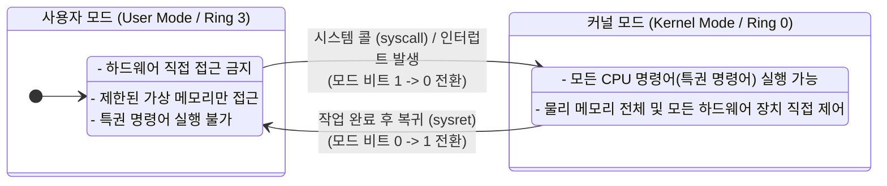

- **모드 비트 (Mode Bit):** CPU 내부 레지스터에 존재하는 플래그 비트입니다.
  - **사용자 모드 (Mode Bit = 1):** 일반 응용 프로그램이 실행되는 모드입니다. 하드웨어를 직접 건드리는 특권 명령어(I/O 포트 제어, 인터럽트 금지, MMU 레지스터 조작 등)를 실행하려 하면 CPU 하드웨어가 즉시 **일반 보호 오류(General Protection Fault)** 예외를 발생시키고 해당 프로그램을 강제 종료(Kill)시킵니다.
  - **커널 모드 (Mode Bit = 0):** 운영체제 커널 코드가 실행되는 최고 권한의 모드입니다. CPU의 모든 기계어 명령어를 제약 없이 실행할 수 있고, 물리 메모리의 모든 번지에 접근할 수 있습니다.

---

### 7.2 시스템 콜(System Call): 안전한 관공서 창구

그렇다면 사용자 모드에서 실행되는 우리의 웹 브라우저는 어떻게 하드디스크에 파일을 다운로드하고, 화면에 그래픽을 띄우며, 네트워크 카드(NIC)로 패킷을 쏠 수 있을까요?

사용자 프로그램은 하드웨어를 직접 건드릴 수 없으므로, **"원하는 작업을 대신 수행해 달라고 운영체제 커널에게 정중하게 부탁"**해야 합니다. 이 공식적인 요청 창구를 **시스템 콜(System Call)**이라고 부릅니다.

> **관공서 비유:**  
> 일반 시민(사용자 프로그램)이 주민등록등본을 발급받기 위해 국가 전산망 데이터베이스 서버실(하드웨어)에 직접 문을 따고 들어갈 수는 없습니다. 대신 관공서 민원 창구(시스템 콜 인터페이스)에 가서 서류를 작성하여 제출하면, 공무원(커널)이 신분증을 확인하고 적법한 권한이 있는지 심사한 뒤 대신 출력해서 건네줍니다.

#### 시스템 콜의 구체적 동작 흐름

우리가 C 언어로 `printf("Hello World");`를 호출하거나 Python으로 `file.write()`를 호출할 때 일어나는 내부 메커니즘을 시퀀스로 살펴보겠습니다.

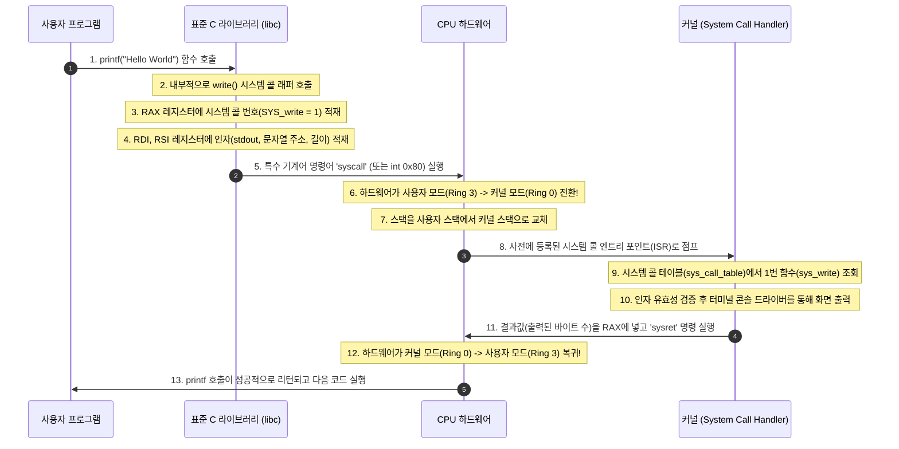

이처럼 하드웨어 이중 모드와 시스템 콜이라는 강력한 관문 덕분에, 현대의 컴퓨터는 수많은 검증되지 않은 프로그램들이 돌아가는 상황에서도 전체 시스템의 안정성과 보안을 철통같이 유지할 수 있습니다.

---

## 08. 프로그램, 프로세스, 프로세서의 차이가 무엇인가요?

이 세 단어는 발음과 철자가 매우 비슷하여 컴퓨터 공학 입문자들을 가장 곤혹스럽게 만드는 용어 삼총사입니다. 하지만 이들의 물리적 실체는 완전히 다릅니다.

```
[프로세서 (Processor)]  ───(실행)───>  [프로세스 (Process)]  <───(적재)───  [프로그램 (Program)]
   (물리적 CPU 칩)                  (메모리의 동적 인스턴스)              (저장장치의 정적 바이너리)
      "요리사"                               "요리 중인 요리"                         "레시피 책"
```

| 구분 | 물리적 형태 / 위치 | 상태 | 비유 |
| :--- | :--- | :--- | :--- |
| **프로그램 (Program)** | 보조기억장치 (SSD / HDD)에 저장된 실행 파일 (`.exe`, ELF 바이너리) | **정적(Static)인 상태**<br>(아직 실행되지 않고 잠들어 있는 코드와 데이터 덩어리) | 백종원의 **요리 레시피 책** |
| **프로세스 (Process)** | 메인 메모리(RAM)에 올라와 CPU와 메모리를 할당받은 **실행 인스턴스** | **동적(Dynamic)인 상태**<br>(생명 주기를 가지며 실시간으로 상태가 변하는 개체) | 레시피를 보고 **실제 주방에서 끓고 있는 요리** |
| **프로세서 (Processor)**| 메인보드 소켓에 꽂혀 있는 **물리적 연산 장치 (CPU 칩 / 코어)** | **하드웨어(Hardware)**<br>(기계어 명령어를 인출하고 실행하는 주체) | 주방에서 칼을 쥐고 요리를 만드는 **요리사** |

---

### 8.1 프로그램이 프로세스로 태어나는 과정 (Loading)

더블 클릭을 통해 SSD에 저장된 `chrome.exe` 프로그램을 실행하면 다음과 같은 운영체제 로더(Loader)의 작업이 순식간에 진행됩니다.

1. **바이너리 파일 분석:** OS 로더가 실행 파일의 헤더(PE 포맷 또는 ELF 포맷)를 읽어 코드의 크기, 데이터의 크기, 필요한 동적 라이브러리(DLL / `.so`) 목록을 확인합니다.
2. **가상 메모리 주소 공간 확보:** 운영체제가 이 프로세스만을 위한 독립된 4GB(32비트) 또는 수백 TB(64비트)의 가상 주소 공간을 만듭니다.
3. **메모리 적재 (Mapping):** 실행 파일의 기계어 코드를 가상 메모리의 Code 영역에, 전역 변수를 Data 영역에 매핑합니다.
4. **스택 및 힙 초기화:** 런타임에 사용할 스택(Stack)과 힙(Heap) 메모리 공간을 세팅합니다.
5. **PCB 생성 및 등록:** 운영체제 커널이 이 프로세스를 관리하기 위한 신분증인 **PCB(Process Control Block)**를 커널 메모리에 생성하고 고유 PID를 부여한 뒤, CPU 실행 대기열인 **Ready Queue**에 등록합니다.
6. **실행 시작:** CPU 스케줄러가 이 프로세스를 선택하면 `main()` 함수의 첫 번째 명령어 주소를 CPU의 PC(Program Counter) 레지스터에 로드함으로써 마침내 살아 숨 쉬는 '프로세스'가 됩니다.

---

### 8.2 프로세스의 생명 주기와 상태 전이 (Process Life Cycle)

프로세스는 생성되어 소멸할 때까지 운영체제의 엄격한 통제 아래 여러 상태를 오가게 됩니다.

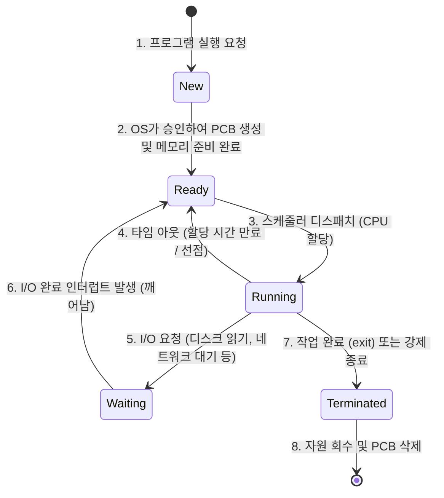

1. **생성 상태 (New):** 프로세스가 막 생성되어 OS 커널이 PCB를 만들고 메모리 구조를 준비하는 단계입니다.
2. **준비 상태 (Ready):** CPU만 할당받으면 즉시 연산을 시작할 수 있는 상태로, 메모리에 모든 준비를 마치고 **Ready Queue**에서 대기 중인 상태입니다.
3. **실행 상태 (Running):** CPU 제어권을 얻어 실제로 기계어 명령어를 수행하고 있는 상태입니다.
4. **대기 / 블록 상태 (Waiting / Blocked):** 프로세스가 디스크에서 파일 읽기, 키보드 입력, 네트워크 패킷 수신 등 **느린 I/O 작업이 끝나기를 기다리는 상태**입니다. 이 상태에서는 CPU를 주어도 아무 일도 할 수 없으므로, OS는 CPU를 뺏어 다른 Ready 프로세스에 넘깁니다.
5. **종료 상태 (Terminated):** 프로세스가 모든 실행을 마치고 `exit()`을 호출했거나 오류로 종료된 상태입니다. OS는 할당했던 메모리와 자원을 회수하고 최종적으로 PCB를 정리합니다.

---

## 09. 프로세스와 스레드의 차이는 무엇인가요?

면접관이 컴퓨터 공학 전공자에게 던지는 단골 질문 1위이자, 실무 백엔드/시스템 프로그래밍의 성패를 가르는 가장 중요한 기초 개념입니다.

---

### 9.1 프로세스의 메모리 구조 (4대 영역)

운영체제가 하나의 프로세스를 메모리에 띄울 때, 그 가상 주소 공간은 다음과 같이 용도별로 엄격하게 4개 영역으로 분할됩니다.

```
+------------------------------------+  높은 메모리 주소 (0xFFFFFFFF...)
|            스택 (Stack)            |  ↓ 함수 호출 시 아래로 자람
|  (지역 변수, 매개변수, 복귀 주소)     |
+------------------------------------+
|                 │                  |
|                 ▼                  |
|          (동적 여유 공간)          |
|                 ▲                  |
|                 │                  |
+------------------------------------+
|             힙 (Heap)              |  ↑ 동적 할당(malloc/new) 시 위로 자람
+------------------------------------+
|      BSS 영역 (초기화 안 된 전역변수) |
+------------------------------------+
|      데이터 (Data) (초기화된 전역변수) |
+------------------------------------+
|            코드 (Text/Code)        |  (읽기 전용, 컴파일된 기계어 코드)
+------------------------------------+  낮은 메모리 주소 (0x00000000...)
```

1. **코드 영역 (Code / Text Segment):**  
   우리가 작성한 소스코드가 컴파일되어 번역된 순수한 기계어 명령어가 저장되는 공간입니다. 프로그램 실행 중에 코드가 스스로 바뀌면 대혼란이 일어나므로, 하드웨어적으로 **읽기 전용(Read-Only)**으로 보호됩니다.
2. **데이터 영역 (Data & BSS Segment):**  
   프로그램이 시작될 때 할당되어 프로그램이 완전히 종료될 때까지 메모리에 남아있는 **전역 변수(Global Variable)**와 **정적 변수(Static Variable)**가 저장됩니다.
   - **Data 영역:** 초기값이 있는 전역 변수 (예: `int count = 100;`)
   - **BSS 영역:** 초기값이 없는 전역 변수 (예: `int buffer[1024];` - 파일 크기를 줄이기 위해 실행 파일에는 크기 정보만 넣고 메모리 적재 시 0으로 일괄 초기화됨)
3. **힙 영역 (Heap Segment):**  
   프로그래머가 런타임에 필요에 따라 동적으로 할당하고 해제하는 메모리 공간입니다. C의 `malloc()/free()`, C++의 `new/delete`, Java나 Python의 객체 생성 시 사용됩니다. 낮은 주소에서 높은 주소 방향으로 자라납니다.
4. **스택 영역 (Stack Segment):**  
   함수 호출과 밀접하게 연관된 임시 메모리 공간입니다. 함수가 호출될 때 그 함수만의 **스택 프레임(Stack Frame)**이 생겨 지역 변수, 매개변수, 함수가 끝난 후 돌아갈 복귀 주소(Return Address)가 푸시(Push)되고, 함수가 종료되면 팝(Pop)되어 흔적도 없이 사라집니다. 높은 주소에서 낮은 주소 방향으로 거꾸로 자라납니다.

> [!NOTE]
> **스택 오버플로우(Stack Overflow)와 힙 오버플로우(Heap Overflow)**  
> 힙은 아래에서 위로 자라고, 스택은 위에서 아래로 자라납니다. 두 영역이 가운데 빈 공간을 공유하며 마주 보며 자라다가 서로의 영역을 침범하는 사건을 각각 오버플로우라고 부릅니다. 특히 재귀 함수가 종료 조건 없이 무한히 호출되면 스택 영역이 한계를 넘어 프로그램이 비정상 종료되는 스택 오버플로우가 발생합니다.

---

### 9.2 스레드(Thread): 프로세스 안의 실행 흐름

과거의 운영체제는 작업의 기본 단위를 오직 프로세스로만 다루었습니다. 하지만 인터넷과 멀티미디어가 발전하면서 문제가 발생했습니다.  
웹 브라우저를 예로 들면, 웹 페이지에서 이미지를 다운로드받으면서 동시에 사용자의 스크롤 입력을 받고, 플래시 동영상도 재생해야 합니다. 이를 전부 독립된 프로세스로 띄우자니 메모리가 너무 낭비되고 프로세스 간 전환 비용이 너무 컸습니다.

그래서 탄생한 경량화된 실행 단위가 바로 **스레드(Thread)**입니다. 스레드는 흔히 **"경량 프로세스(Light-Weight Process, LWP)"**라고 불립니다.

```
[프로세스 A (멀티 스레드 구조)]
┌───────────────────────────────────────────────────────────────┐
│  코드 영역 (Code)      데이터 영역 (Data)      힙 영역 (Heap)   │ <── 모든 스레드가 공유!
└───────────────────────────────────────────────────────────────┘
         │                       │                      │
   ┌─────┴─────┐           ┌─────┴─────┐          ┌─────┴─────┐
   │ 스레드 1  │           │ 스레드 2  │          │ 스레드 3  │
   │- PC 레지스터│          │- PC 레지스터│         │- PC 레지스터│
   │- 독립 스택 │           │- 독립 스택 │          │- 독립 스택 │
   └───────────┘           └───────────┘          └───────────┘
```

- **스레드가 공유하는 자원:**  
  같은 프로세스에 속한 스레드들은 **코드(Code), 데이터(Data), 힙(Heap) 영역, 그리고 프로세스에 열린 파일 디스크립터 등의 시스템 자원을 100% 공유**합니다.
- **스레드가 독립적으로 갖는 고유 자원:**  
  스레드마다 독립적인 함수 호출과 독립적인 실행 흐름을 가져야 하므로, 오직 **자신만의 스택(Stack) 영역**과 현재 어디까지 코드를 실행했는지를 나타내는 **PC(Program Counter) 레지스터 및 범용 레지스터 세트**, 그리고 커널의 **TCB(Thread Control Block)**만을 독자적으로 보유합니다.

---

### 9.3 멀티프로세스 vs 멀티스레드 심층 비교

소프트웨어를 설계할 때 동시 작업을 처리하기 위해 "프로세스를 여러 개 띄울 것인가(Multi-Process)", 아니면 "하나의 프로세스 안에 스레드를 여러 개 둘 것인가(Multi-Thread)"는 매우 중대한 엔지니어링 결정입니다.

| 비교 항목 | 멀티프로세스 (Multi-Process) | 멀티스레드 (Multi-Thread) |
| :--- | :--- | :--- |
| **메모리 독립성** | 완전히 독립된 메모리 공간을 가짐 (격리성 완벽) | Code, Data, Heap 공간을 모든 스레드가 공유 |
| **자원 소모량** | 프로세스마다 별도의 가상 메모리와 PCB가 필요해 **자원 소모 큼** | 스택 영역만 별도로 할당하므로 **메모리 오버헤드가 극히 적음** |
| **컨텍스트 스위칭 속도**| **느림.** 캐시 플러시, TLB 비우기, 페이지 테이블 교체 수반 | **매우 빠름.** 메모리 매핑이 동일하므로 캐시/TLB를 그대로 활용 가능 |
| **통신 비용 (IPC)** | 프로세스 간 벽이 높아 파이프, 소켓, 공유메모리 등 **복잡하고 느린 IPC 필요** | 힙(Heap)이나 전역 변수를 통해 **극도로 빠르고 간단하게 데이터 교환** |
| **안정성과 장애 격리 (Fault Isolation)** | **매우 뛰어남.** 한 프로세스가 크래시되어 죽어도 다른 프로세스는 멀쩡함 | **치명적.** 한 스레드가 메모리를 오염시키거나 죽으면 **프로세스 전체가 다운됨** |
| **동기화 이슈** | 프로세스 간 메모리가 분리되어 있어 데이터 충돌 위험 적음 | 공유 자원을 동시에 수정할 때 **경쟁 상태(Race Condition)와 데드락 위험 상존** |

#### [실제 아키텍처 사례] 구글 크롬 브라우저의 위대한 선택
과거의 웹 브라우저(인터넷 익스플로러 등)는 단일 프로세스 멀티스레드 구조였습니다. 이 방식은 메모리를 적게 먹었지만, 열어둔 10개의 탭 중 단 하나의 탭에서 플래시 오류나 무한 루프가 발생하면 **브라우저 전체가 한꺼번에 강제 종료**되며 작업 중이던 모든 탭이 날아가는 악몽을 유발했습니다.

구글은 2008년 **크롬(Chrome)**을 출시하면서 **멀티프로세스 아키텍처**를 도입했습니다.
- 브라우저의 메인 UI 프로세스, 렌더러 프로세스, GPU 프로세스, 플러그인 프로세스를 완전히 분리했습니다.
- 심지어 **웹 브라우저의 탭(Tab) 하나하나를 완전히 독립된 개별 프로세스**로 띄웠습니다.
- 그 결과 크롬은 RAM을 훨씬 많이 먹는다는 비판을 받았지만, 한 탭이 먹통이 되어도 "앗, 이런! 이 탭이 충돌했습니다"라는 메시지만 띄우고 다른 모든 탭은 아무 일 없다는 듯 쾌적하게 유지되는 압도적인 안정성을 무기로 전 세계 브라우저 시장을 평정했습니다.

---

## 10. 멀티 스레드를 활용한 동시 수행과 동기화

멀티스레드는 메모리를 절약하고 속도를 비약적으로 끌어올리는 강력한 무기이지만, 양날의 검입니다. 모든 스레드가 하나의 힙과 데이터 영역을 공유하기 때문에, **"두 개 이상의 스레드가 동일한 자원에 동시에 접근하여 쓰기 작업을 수행할 때"** 상상을 초월하는 버그가 발생합니다.

---

### 10.1 임계 구역(Critical Section)과 경쟁 상태(Race Condition)

#### 은행 계좌 잔액의 비극 (Race Condition 예제)
어느 은행 계좌에 잔액 $1,000가 들어있습니다.  
스레드 A는 100달러를 입금(`balance += 100`)하려 하고, 스레드 B는 50달러를 출금(`balance -= 50`)하려 합니다.  
정상적으로 처리된다면 최종 잔액은 $1,050가 되어야 합니다.

하지만 고급 프로그래밍 언어의 한 줄(`balance += 100`)은 CPU 기계어 수준에서는 3단계로 쪼개집니다.
1. `LOAD balance, R1` (메모리의 잔액을 CPU 레지스터 R1으로 읽어옴)
2. `ADD R1, 100` (레지스터 R1의 값에 100을 더함)
3. `STORE R1, balance` (계산된 레지스터 값을 메모리의 balance에 저장함)

만약 스레드 A와 B가 절묘한 타이밍에 CPU 컨텍스트 스위칭을 겪는다면 어떤 일이 벌어질까요?

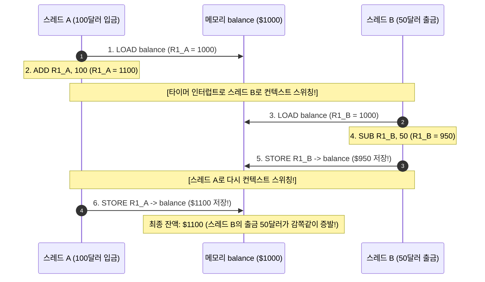

- **경쟁 상태 (Race Condition):** 두 개 이상의 스레드가 공유 자원에 동시에 접근하여 타이밍이나 실행 순서에 따라 결과값이 매번 달라지는 불안정한 상태입니다.
- **임계 구역 (Critical Section):** 위 예시에서 `balance` 변수처럼, **둘 이상의 스레드가 동시에 접근해서는 절대로 안 되는 공유 자원을 접근/수정하는 코드 영역**을 의미합니다.

#### 임계 구역 문제 해결을 위한 3대 필수 조건
운영체제와 동시성 이론에서 임계 구역을 올바르게 보호하기 위해서는 다음 3가지 수학적 조건이 반드시 충족되어야 합니다.
1. **상호 배제 (Mutual Exclusion):** 어떤 스레드가 임계 구역 안에서 코드를 실행 중이라면, 다른 어떤 스레드도 이 임계 구역에 들어올 수 없다.
2. **진행 (Progress):** 임계 구역에 들어가 있는 스레드가 아무도 없다면, 들어가고자 하는 스레드들 중에서 누가 들어갈지 지체 없이 결정해야 한다. (아무도 못 들어가는 무한 대착 상태 방지)
3. **한정 대기 (Bounded Waiting):** 어떤 스레드가 임계 구역에 들어가겠다고 요청한 후부터 허가를 받을 때까지, 다른 스레드들이 임계 구역에 들어가는 횟수에는 제한이 있어야 한다. (특정 스레드가 영원히 들어가지 못하고 굶어 죽는 기아 상태(Starvation) 방지)

---

### 10.2 동기화 기법: 뮤텍스(Mutex)와 세마포어(Semaphore)

임계 구역에 하나의 스레드만 안전하게 들어갈 수 있도록 통제하는 대표적인 동기화 도구들입니다.

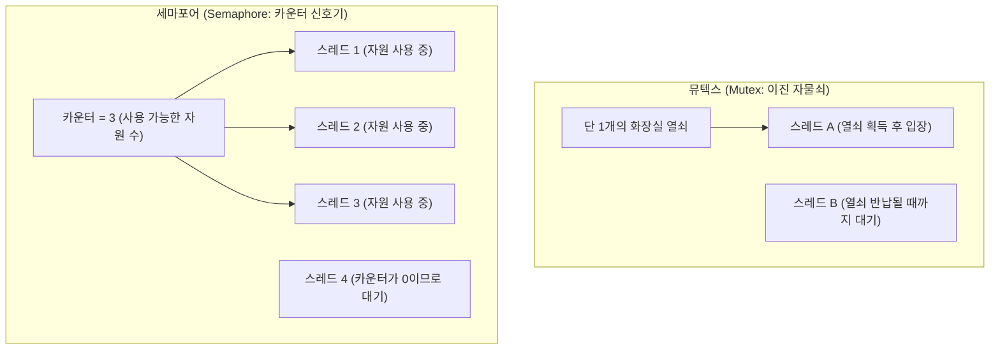

#### 1) 뮤텍스 (Mutex, Mutual Exclusion)
- **비유:** 식당의 **화장실 열쇠 1개**.
- 화장실에 들어가려는 손님(스레드)은 반드시 카운터에서 열쇠를 쥐고 들어가 문을 걸어 잠가야 합니다. 다른 손님은 열쇠가 반납될 때까지 화장실 밖에서 기다려야 합니다.
- **특징:** 오직 **열쇠를 획득한 바로 그 스레드만이 락을 해제(Unlock)**할 수 있습니다. (소유권 개념 존재)

#### 2) 세마포어 (Semaphore)
- **비유:** 화장실 칸이 3개 있고, 입구 전광판에 잔여 칸 수가 표시되는 고속도로 휴게소 화장실.
- 1965년 에츠허르 다익스트라(Edsger Dijkstra)가 제안한 동기화 도구로, 공유 자원의 개수가 여러 개(N개)일 때 사용합니다.
- 정수형 카운터 변수 $S$와 두 개의 원자적(Atomic) 연산으로 구성됩니다.
  - **`P()` 혹은 `wait()`:** 자원을 요청합니다. 카운터 $S$를 1 감소시킵니다. 만약 $S$가 음수가 되면 자원이 없다는 뜻이므로 대기 큐에 들어갑니다.
  - **`V()` 혹은 `signal()`:** 자원을 반납합니다. 카운터 $S$를 1 증가시키고, 대기 큐에서 기다리던 스레드 하나를 깨워줍니다.
- **특징:** 락을 건 스레드가 아니더라도, 다른 스레드가 신호(`signal()`)를 보내 카운터를 올려줄 수 있습니다. (소유권이 없음)
  - 카운터가 1인 세마포어를 **이진 세마포어(Binary Semaphore)**라고 부르며, 뮤텍스와 유사하게 동작합니다.

> [!TIP]
> **스핀락(Spinlock) vs 블로킹(Blocking) 뮤텍스**  
> - **스핀락:** 락을 얻을 때까지 CPU를 100% 쓰면서 `while(!lock)` 루프를 맹렬히 도는 방식(바쁜 대기, Busy Waiting). 락이 아주 짧은 시간(수십 나노초) 안에 풀릴 것이 확실하다면 컨텍스트 스위칭 비용이 없어 유리합니다.
> - **블로킹 뮤텍스:** 락을 얻지 못하면 프로세스를 즉시 대기(Sleep/Blocked) 상태로 전환하고 CPU를 다른 작업에 양보합니다. 임계 구역이 길거나 I/O가 포함되어 있다면 무조건 블로킹 방식을 써야 CPU 낭비를 막을 수 있습니다.

---

### 10.3 데드락(Deadlock, 교착 상태): 영원히 끝나지 않는 대치

멀티스레드 환경에서 자원을 보호하겠다고 락(Lock)을 남발하다 보면, 모든 스레드가 서로가 쥐고 있는 자원이 풀리기만을 기다리며 시스템 전체가 얼어붙는 최악의 참사가 일어납니다. 이를 **데드락(Deadlock, 교착 상태)**이라고 부릅니다.

#### 철학자들의 만찬 문제 (Dining Philosophers Problem)
원형 식탁에 다섯 명의 철학자가 앉아 있고, 철학자들 사이마다 포크가 하나씩 총 5개 놓여 있습니다. 철학자는 스파게티를 먹기 위해 **반드시 양옆의 포크 2개를 모두 쥐어야만** 식사를 할 수 있습니다.

만약 모든 철학자가 동시에 배가 고파서 **동시에 자신의 왼쪽에 있는 포크를 집어 들었다면** 어떻게 될까요?
- 모든 철학자가 왼쪽 포크를 쥔 채, 오른쪽 포크가 놓여지기만을 멍하니 기다립니다.
- 아무도 포크를 먼저 내려놓지 않으므로, 다섯 명 모두 영원히 식사를 하지 못하고 굶어 죽고 맙니다.

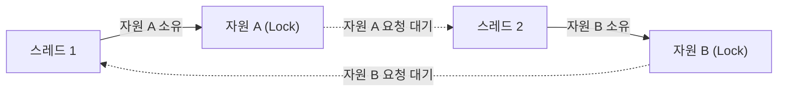

#### 데드락 발생의 4대 필수 조건 (Coffman Conditions)
데드락은 다음 4가지 조건이 **동시에 성립할 때만** 발생합니다. 단 하나라도 깨뜨릴 수 있다면 데드락은 절대 일어나지 않습니다.

| 데드락 성립 조건 | 의미 | 타파(해결) 전략 |
| :--- | :--- | :--- |
| **1. 상호 배제 (Mutual Exclusion)** | 한 번에 한 스레드만 자원을 독점할 수 있어야 한다. | 읽기 전용 자원은 공유를 허용하거나, Lock-free 알고리즘 사용 |
| **2. 점유와 대기 (Hold and Wait)** | 자원을 하나 쥔 채로, 다른 스레드가 쥔 자원을 추가로 요구하며 대기한다. | 스레드가 시작할 때 필요한 모든 자원을 한꺼번에 할당받거나, 아무것도 쥐지 않은 상태에서만 요청 허용 |
| **3. 비선점 (No Preemption)** | 다른 스레드가 쥐고 있는 자원을 강제로 빼앗을 수 없다. | 우선순위가 높은 스레드가 필요로 하면 기존 스레드의 자원을 강제로 선점(회수)할 수 있게 허용 |
| **4. 환형 대기 (Circular Wait)** | 대기하는 스레드들의 관계가 원형 고리(Cycle)를 이루고 있다. | **가장 실무적인 해결책!** 모든 자원에 고유한 일련번호를 매기고, **반드시 번호가 낮은 순서에서 높은 순서대로만 자원을 획득하도록 규칙을 강제함** |

#### 데드락 처리의 실무적 접근법
1. **예방 (Prevention):** 위 4대 조건 중 하나가 성립하지 못하도록 사전에 시스템 규칙을 설계합니다. (가장 널리 쓰이는 방법은 자원 할당 순서의 번호 매기기입니다.)
2. **회피 (Avoidance):** 자원을 요청할 때마다 다익스트라의 **은행원 알고리즘(Banker's Algorithm)** 등을 가동하여, 이 자원을 줬을 때 시스템이 안전 상태(Safe State)를 유지할 수 있을 때만 빌려줍니다.
3. **검출 및 회복 (Detection & Recovery):** 데드락을 사전에 막지 않고 내버려 두었다가, 주기적으로 자원 할당 그래프(Resource Allocation Graph)에 사이클이 생겼는지 검사합니다. 데드락이 발견되면 관련 프로세스 중 하나를 강제 종료(Kill)하거나 자원을 강탈하여 회복합니다.
4. **무시 (타조 알고리즘, Ostrich Algorithm):** 머리를 모래 속에 파묻고 위험을 무시하는 타조처럼, "데드락은 아주 드물게 발생하므로 이를 막기 위해 엄청난 성능 오버헤드를 감수하느니 그냥 모른 척하고 발생하면 재부팅한다"는 실용주의적 접근입니다. 놀랍게도 Windows나 Linux 같은 범용 현대 OS는 대부분 이 방식을 채택하고 있으며, 동기화 버그 방지는 애플리케이션 개발자의 몫으로 넘깁니다.

---

## (+) 32비트와 64비트는 무엇이 다른가요?

컴퓨터를 살 때나 운영체제를 설치할 때, 혹은 프로그래밍 언어를 설치할 때 우리는 항상 "32-bit (x86)"과 "64-bit (x64 / ARM64)" 중 하나를 선택하라는 질문을 마주합니다. 도대체 이 32와 64라는 숫자는 무엇을 의미하며, 소프트웨어 세계에 어떤 거대한 차이를 만들어낼까요?

---

### 11.1 '비트(bit)'의 근본적 의미: CPU의 연산 폭과 도로 폭

여기서 말하는 32비트, 64비트는 CPU가 한 번의 사이클에 처리할 수 있는 **기본 데이터 단위(워드, Word의 크기)**이자, **내부 범용 레지스터의 크기**, 그리고 메모리 주소를 가리키는 **주소 버스의 폭**을 의미합니다.

```
[32비트 CPU 레지스터]
┌────────────────────────────────┐
│ 32비트 (4바이트)               │  (한 번에 0 ~ 42억까지의 정수 연산 가능)
└────────────────────────────────┘

[64비트 CPU 레지스터]
┌────────────────────────────────────────────────────────────────┐
│ 64비트 (8바이트)                                               │  (한 번에 0 ~ 1,844경까지의 정수 연산 가능)
└────────────────────────────────────────────────────────────────┘
```

1. **연산 능력의 차이:**  
   32비트 CPU는 정수를 표현할 때 $2^{32} = 4,294,967,296$ (약 42억)까지의 수치만 한 번에 계산할 수 있습니다. 그보다 큰 64비트 정수를 계산하려면 레지스터를 두 개 엮어서 여러 번 나누어 연산해야 하므로 성능이 떨어집니다.  
   반면 64비트 CPU는 $2^{64} = 18,446,744,073,709,551,616$ (약 1,844경)이라는 천문학적인 숫자를 단 한 클록에 연산해 냅니다.
2. **데이터 버스 대역폭:**  
   메모리에서 CPU로 데이터를 퍼 나를 때 32비트는 한 번에 4바이트씩 나르지만, 64비트는 한 번에 8바이트씩 두 배의 폭으로 퍼 나릅니다.

---

### 11.2 주소 지정 가능 메모리 한계의 수학적 원리 (4GB의 벽)

32비트에서 64비트로의 전환을 강제한 가장 결정적인 원인은 바로 **메모리(RAM) 용량의 한계**였습니다.

컴퓨터에서 메모리의 각 바이트(1 Byte)는 자신만의 고유한 일련번호(주소)를 가집니다.  
우편배달부가 편지를 배달하려면 집집마다 고유한 도로명 주소가 있어야 하듯, CPU가 메모리에 데이터를 읽고 쓰려면 그 바이트의 주소를 지정할 수 있어야 합니다.

#### 32비트 주소 체계의 수학적 한계
32비트 CPU의 주소 레지스터와 주소 버스는 32가닥의 전선으로 이루어져 있습니다.  
각 전선이 0 또는 1의 전기 신호를 띨 수 있으므로, 32비트로 표현할 수 있는 서로 다른 주소의 총 가짓수는 정확히 다음과 같습니다.

$$
2^{32} = 4,294,967,296 \text{ 개 (주소)}
$$

각 주소마다 1바이트씩 대응되므로, 32비트 CPU가 물리적으로 가리킬 수 있는 최대 메모리 용량은:

$$
4,294,967,296 \text{ 바이트} = 4,194,304 \text{ KB} = 4,096 \text{ MB} = \mathbf{4\text{ GB}}
$$

이것이 바로 컴퓨터 역사에서 악명 높았던 **"4GB의 벽"**입니다.  
2000년대 후반, 컴퓨터에 8GB나 16GB RAM을 꽂아도 32비트 윈도우를 깔면 컴퓨터가 **최대 3.25GB ~ 3.5GB밖에 인식하지 못하는 기현상**이 발생했습니다. 4GB 공간 중 상위 수백 MB 영역을 그래픽카드나 메인보드 하드웨어 장치를 제어하기 위한 주소(MMIO, Memory-Mapped I/O)로 예약해 두었기 때문에 실제 쓸 수 있는 RAM은 3GB 남짓에 불과했던 것입니다.

#### 64비트 주소 체계의 신세계
그렇다면 64비트 CPU가 표현할 수 있는 주소 공간은 얼마나 될까요?

$$
2^{64} \text{ 바이트} = 18,446,744,073,709,551,616 \text{ 바이트} = 16 \text{ 엑사바이트 (EB)}
$$

16 엑사바이트는 **약 1,700만 테라바이트(TB)**에 달하는 상상을 초월하는 용량입니다. 인류가 앞으로 수십 년 동안 컴퓨터 한 대에 물리적으로 꽂을 수 있는 양을 아득히 초월합니다.

> [!NOTE]
> **현실의 64비트 구현: 48비트 / 57비트 가상 주소**  
> CPU 제조사들은 하드웨어 회로 비용과 페이지 테이블 크기를 최적화하기 위해, 64비트 주소 중 하위 48비트(256TB) 혹은 57비트(128PB)만을 실제 가상 주소선으로 구현하고 있습니다. 이것만으로도 현재와 미래의 모든 대규모 데이터센터와 슈퍼컴퓨터를 감당하기에 차고 넘칩니다.

---

### 11.3 64비트가 소프트웨어 개발자와 실무에 미치는 영향

| 비교 항목 | 32비트 환경 (x86) | 64비트 환경 (x64 / ARM64) | 실무적 영향 및 주의점 |
| :--- | :--- | :--- | :--- |
| **포인터(Pointer) 크기**| **4 바이트 (32비트)** | **8 바이트 (64비트)** | 64비트로 컴파일하면 메모리 주소를 담는 모든 포인터 변수의 크기가 두 배로 늘어납니다. 따라서 동일한 프로그램이라도 64비트 버전이 **RAM을 약 20~30% 더 많이 소모**하며, 캐시 효율이 약간 떨어질 수 있습니다. |
| **대용량 인메모리 DB** | 프로세스당 최대 2~4GB 메모리 제약으로 대규모 데이터 처리 불가능 | 수백 GB~수 TB의 데이터를 메모리에 통째로 올려두고 초고속 연산 가능 | Redis, Elasticsearch, 대규모 RDBMS 및 AI 딥러닝 프레임워크 구동의 절대적 전제 조건입니다. |
| **2038년 문제 (Year 2038 Problem)** | **시한폭탄 존재**<br>(32비트 부호 있는 정수로 시간 표현 시 2038년 오버플로우 발생) | **영구 해결**<br>(64비트 정수로 시간 표현 시 약 2,920억 년 동안 안전) | 1970년 1월 1일 0시(Unix Epoch)부터 흐른 초를 32비트 정수(`int32_t`)로 세면 **2038년 1월 19일 03시 14분 07초**에 최댓값($2,147,483,647$)을 치고 음수(-21억)로 롤오버되어 1901년으로 타임슬립하는 재앙이 발생합니다. 64비트 시스템은 이 문제를 완전히 종식시켰습니다. |

---

## 에필로그: 코드는 물리적 실체 위에서 춤춘다

우리는 지금까지 컴퓨터의 기원인 에니악부터 시작하여, 폰 노이만의 하드웨어 아키텍처, 캐시와 가상 메모리의 마법, 동시성과 병렬성, 운영체제 커널의 이중 모드 보호, 그리고 멀티스레드 동기화와 64비트의 광활한 주소 체계까지 숨 가쁘게 달려왔습니다.

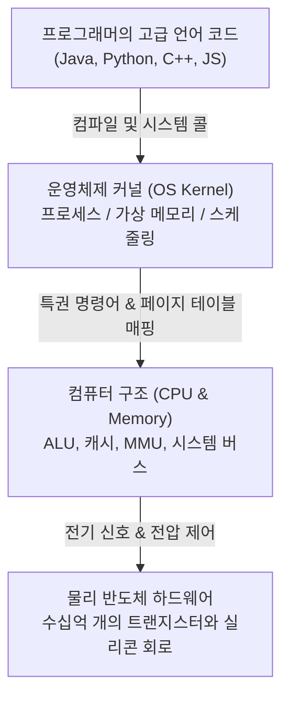

현대의 고수준 프레임워크와 클라우드 환경은 소프트웨어 엔지니어에게 하드웨어의 복잡성을 거의 완벽하게 감추어 줍니다. 덕분에 우리는 메모리 주소 하나 직접 지정하지 않고도 복잡한 비즈니스 웹 서비스를 뚝딱 만들어낼 수 있습니다.

하지만 시스템이 극한의 트래픽을 감당해야 하는 대규모 분산 환경에 들어서거나, 원인을 알 수 없는 간헐적인 메모리 누수와 교착 상태를 디버깅해야 할 때, 혹은 데이터베이스 쿼리의 병목을 극복해야 하는 순간이 오면 **언제나 해답은 가장 낮은 곳, 컴퓨터 구조와 운영체제의 기본 원리 속에 숨어 있습니다.**

우리가 작성한 코드는 추상적인 관념이 아니라, 물리적인 전압과 실리콘 칩, 그리고 운영체제의 정교한 지휘 아래 움직이는 물리적 실체입니다. 이 원리를 마음 깊이 새긴 엔지니어는 결코 하드웨어와 타협하지 않는 견고하고 우아한 시스템을 설계해 낼 수 있을 것입니다.
