# PART 07. 데이터베이스 기술 (Database Technologies)

> **"데이터는 현대 비즈니스의 가장 값진 원유이며, DBMS는 이를 안전하게 정제하고 지켜내는 거대한 금고입니다."**  
> 오늘날 우리가 사용하는 모든 소프트웨어의 궁극적인 목적은 데이터를 처리하고 영구히 보존하며 유의미한 가치로 환원하는 것입니다. 프론트엔드의 화려한 UI나 백엔드의 복잡한 비즈니스 로직도, 밑바닥에서 데이터를 신뢰성 있게 지탱해 주는 데이터베이스가 없다면 모래 위에 지은 성에 불과합니다.  
> 이번 파트에서는 전통적인 파일 시스템의 원초적 한계부터 시작하여, SQL 한 줄이 데이터베이스 엔진 내부(파서 → 옵티마이저 → 스토리지 엔진)에서 실행되는 아키텍처, MySQL(InnoDB)과 PostgreSQL의 구조적 차이, 관계형 데이터베이스(RDBMS)의 수학적 설계 철학과 실전 ERD 물리 모델링(UUID v7/ULID/Snowflake ID 클러스터링 비교 및 Soft Delete 설계), 무결성을 수호하는 트랜잭션과 동시성 제어(비관적 락 vs 낙관적 락, 데드락 분석), 디스크 I/O를 획기적으로 줄이는 B+Tree 인덱스와 실행 계획(`EXPLAIN`) 해독 및 대용량 페이징 최적화, 안전하고 확장 가능한 3-Tier 아키텍처와 HikariCP 커넥션 풀 및 JPA N+1 문제 해결, 대규모 분산 트래픽을 견디는 NoSQL과 DB 확장 아키텍처(Replication, Partitioning, Sharding), 데이터 중복을 제거하는 정규화와 CDC 기반 실전 반정규화 정합성 유지, 그리고 무중단 스키마 변경(Online DDL, `gh-ost`)과 재해 복구(DR/HA) 백업 전략까지 현업 수석 DBA 및 데이터 아키텍트의 깊이 있는 실전 노하우를 총망라하여 전달합니다.

---

## 01. 데이터베이스(DBMS)의 이해
> **파일 시스템의 치명적 한계, DBMS의 탄생과 3단계 데이터 독립성, SQL 쿼리 엔진 내부 아키텍처, 그리고 MySQL(InnoDB) vs PostgreSQL 심층 비교**

현대 애플리케이션의 뒤편에는 언제나 데이터베이스가 존재합니다. 하지만 컴퓨터 공학의 태동기에는 전용 데이터베이스라는 소프트웨어가 존재하지 않았습니다. 당시 프로그래머들은 운영체제가 제공하는 일반 파일 시스템(File System)에 데이터를 텍스트나 바이너리 형태로 직접 읽고 썼습니다. 과연 파일 시스템에는 어떤 치명적인 한계가 있었기에 데이터베이스 관리 시스템(DBMS)이라는 거대한 시스템 소프트웨어가 탄생하게 되었을까요? 그리고 우리가 날린 SQL 한 줄은 DBMS 내부에서 어떤 과정을 거쳐 실행될까요?

---

### 1.1 파일 시스템(File System)의 한계와 고통

과거에는 인사 관리 프로그램, 급여 계산 프로그램, 사원 복지 프로그램이 각각 자신만의 텍스트 파일(`emp_hr.txt`, `emp_pay.txt`, `emp_welfare.txt`)이나 구조체 바이너리 파일을 생성하여 사원 정보를 관리했습니다. 이러한 파일 처리 방식은 서비스 규모가 커지면서 다음과 같은 재앙적인 문제들을 야기했습니다.

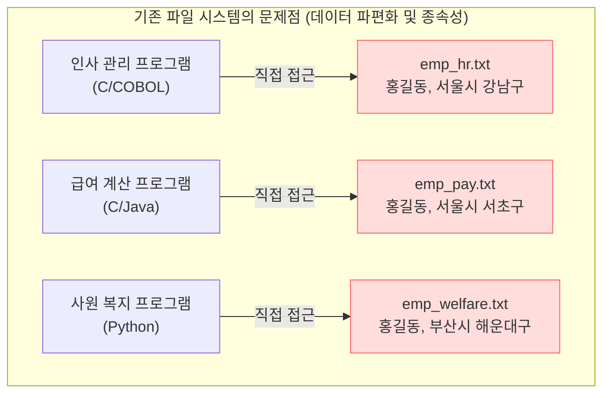

1. **데이터 중복성(Data Redundancy)**
   - 동일한 사원의 기본 정보(사번, 이름, 주소, 연락처)가 부서별·업무별 파일에 중복되어 저장됩니다. 이는 고가의 디스크 저장 장치를 낭비할 뿐만 아니라 데이터 관리 비용을 기하급수적으로 가중시킵니다.
2. **데이터 불일치 및 무결성 결여(Data Inconsistency & Lack of Integrity)**
   - 사원이 이사를 하여 주소가 바뀌었을 때, 인사 담당자가 `emp_hr.txt`의 주소만 수정하고 급여 담당자가 `emp_pay.txt`를 수정하지 않는다면 동일 인물의 주소가 시스템마다 서로 달라지는 **데이터 불일치(Inconsistency)**가 발생합니다. 이처럼 데이터가 지켜야 할 엄격한 규칙(예: 급여는 음수가 될 수 없다, 사번은 중복될 수 없다)을 파일 시스템 스스로 강제할 수 없어 데이터의 신뢰성(Integrity)이 완전히 무너집니다.
3. **데이터 종속성(Data Dependency)**
   - 응용 프로그램이 파일의 물리적 저장 구조(데이터 구분자 `,` 또는 `|`, 바이트 오프셋, 레코드 순서)에 강하게 결합(Tightly Coupled)됩니다. 만약 사번 체계가 5자리 정수에서 8자리 영문+숫자 문자열로 변경되거나, 전화번호 필드가 중간에 추가되면, 그 파일을 읽고 쓰던 수십 개의 응용 프로그램 소스 코드를 일일이 찾아 파싱(Parsing) 로직을 재작성하고 재컴파일해야 했습니다.
4. **동시성 제어(Concurrency Control)의 부재**
   - 두 개 이상의 프로그램이나 프로세스가 동일한 파일의 같은 줄에 동시에 쓰기(Write) 작업을 수행하면, 운영체제 파일 잠금(File Lock)은 파일 전체를 통째로 잠그거나 아예 잠그지 않아 데이터가 덮어씌워지거나 파일 포맷이 깨지는 경쟁 상태(Race Condition)가 발생합니다.
5. **장애 회복(Crash Recovery) 및 세밀한 보안(Granular Security)의 부재**
   - 데이터를 파일에 기록하던 도중 서버 정전이나 운영체제 커널 패닉이 발생하면, 절반만 쓰인(Partial Write) 파일이 손상되어 원상 복구할 방법이 없습니다. 또한 운영체제 파일 권한(`rwx`)은 파일 전체 단위로만 부여될 뿐, 특정 사용자에게 '급여 컬럼'만 숨기거나 '특정 부서의 행(Row)'만 조회하게 하는 세밀한 접근 제어가 불가능했습니다.

---

### 1.2 DBMS의 정의와 ANSI/SPARC 3단계 데이터 독립성

**DBMS(Database Management System, 데이터베이스 관리 시스템)**는 이러한 파일 시스템의 근원적 한계를 극복하기 위해 등장했습니다. 여러 응용 프로그램과 다수의 사용자가 대규모 데이터를 체계적으로 공유, 저장, 검색, 갱신할 수 있도록 중앙에서 통합 관리해 주는 거대한 시스템 소프트웨어입니다.

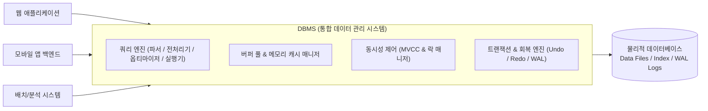

#### ANSI/SPARC 3단계 계층 구조와 데이터 독립성
DBMS가 소프트웨어 공학에 선사한 가장 위대한 철학적 가치는 **데이터 독립성(Data Independence)**입니다. 하위 계층의 데이터 구조나 물리적 저장 방식이 바뀌더라도 상위 계층의 응용 프로그램은 영향을 받지 않도록 격리하는 것입니다. 1975년 미국표준협회(ANSI/X3/SPARC)는 이를 위해 데이터베이스를 3단계 스키마(Schema) 계층으로 추상화했습니다.

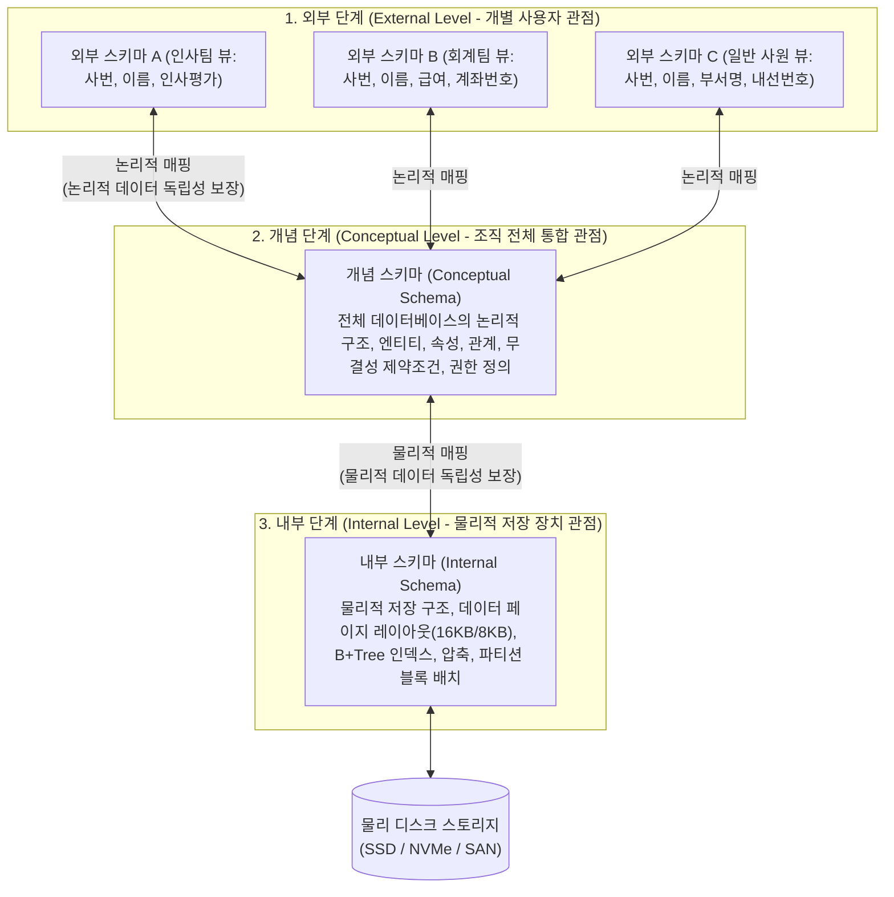

1. **논리적 데이터 독립성(Logical Data Independence)**
   - **개념 스키마(Conceptual Schema)**가 변경(예: 기존 테이블에 새로운 컬럼 추가, 신규 테이블 생성, 테이블 분할 후 뷰 제공)되어도, 이를 바라보는 **외부 스키마(External Schema / View)**나 응용 프로그램의 SQL 코드를 수정할 필요가 없는 특성입니다.
   - 단, 애플리케이션에서 `SELECT * FROM users`처럼 와일드카드(`*`)로 모든 컬럼을 조회하는 습관을 들이면 컬럼 순서 변경이나 추가 시 애플리케이션 매핑이 깨질 수 있으므로, 실무에서는 반드시 필요한 컬럼을 명시(`SELECT id, name, email FROM users`)해야 논리적 독립성을 온전히 누릴 수 있습니다.
2. **물리적 데이터 독립성(Physical Data Independence)**
   - 성능 튜닝이나 인프라 확장을 위해 디스크 저장 경로(Tablespace)를 변경하거나, 새로운 B+Tree 인덱스를 추가·삭제하거나, 데이터 페이지 압축 방식을 바꾸는 등 **내부 스키마(Internal Schema)**를 대폭 수정하더라도 개념 스키마와 응용 프로그램의 비즈니스 로직은 단 한 줄도 수정할 필요가 없는 특성입니다.

---

### 1.3 RDBMS의 특징과 수학적 관계 모델

1970년 IBM 산호세 연구소의 에드거 F. 코드(Edgar F. Codd) 박사는 《대규모 공유 데이터 뱅크를 위한 데이터의 관계형 모델(A Relational Model of Data for Large Shared Data Banks)》이라는 역사적인 논문을 발표했습니다. 그는 기존 계층형(Hierarchical) 및 망형(Network) 데이터베이스의 복잡한 포인터 탐색 구조를 비판하며, 수학의 **집합론(Set Theory)**과 **1차 술어 논리(First-Order Predicate Logic)**를 기반으로 한 **관계형 데이터 모델(Relational Model)**을 정립했습니다. 이것이 오늘날 전 세계 데이터베이스 시장을 지배하는 **RDBMS(Relational DBMS)**의 근간입니다.

#### 관계형 모델의 핵심 구성 개념과 수학적 성질
- **릴레이션(Relation)**: 데이터를 행과 열로 구성된 2차원 테이블 형태로 표현한 수학적 집합입니다. (실무 용어: `Table`)
- **튜플(Tuple)**: 릴레이션을 구성하는 각각의 행으로, 현실 세계의 독립된 개체(Entity) 인스턴스 하나를 나타냅니다. (실무 용어: `Row`, `Record`)
- **속성(Attribute)**: 릴레이션의 열로, 개체가 가지는 고유한 성질이나 필드를 정의합니다. (실무 용어: `Column`, `Field`)
- **도메인(Domain)**: 하나의 속성이 가질 수 있는 원자값(Atomic Value)들의 유효한 집합이자 데이터 타입 범위입니다. (예: `성별` 도메인은 `{'M', 'F'}`, `나이` 도메인은 `0 ~ 150 사이의 정수`)
- **차수(Degree)**: 한 릴레이션에 포함된 속성(열)의 총개수입니다. 유효한 릴레이션의 최소 차수는 1입니다.
- **카디널리티(Cardinality)**: 한 릴레이션에 포함된 튜플(행)의 총개수입니다. 데이터 삽입/삭제에 따라 시시각각 변하며 0이 될 수도 있습니다.

| 학술적 용어 (관계 대수) | RDBMS 실무 용어 | 파일 시스템 대응 용어 | 수학적 특징 및 제약사항 |
| :--- | :--- | :--- | :--- |
| **릴레이션 (Relation)** | 테이블 (Table) | 파일 (File) | 튜플들의 집합(Set)이므로 중복된 튜플이 존재할 수 없음 |
| **튜플 (Tuple)** | 행, 레코드 (Row, Record) | 레코드 (Record) | 튜플 간의 물리적 순서(Order)는 논리적으로 무의미함 |
| **속성 (Attribute)** | 열, 컬럼 (Column, Field) | 필드 (Field) | 모든 속성 값은 더 이상 쪼갤 수 없는 원자값(Atomic Value)이어야 함 |
| **도메인 (Domain)** | 데이터 타입 및 제약조건 | 데이터 형식 | 속성에 입력 가능한 값의 범위와 형태를 강제함 |

#### 키(Key)의 5단계 계층 구조와 무결성 제약조건
관계형 데이터베이스는 집합론에 기반하므로 완전히 동일한 두 개의 튜플이 존재할 수 없습니다. 특정 튜플을 유일하게 식별하고 테이블 간의 관계를 맺기 위해 **키(Key)**라는 수학적 식별 체계를 사용합니다.

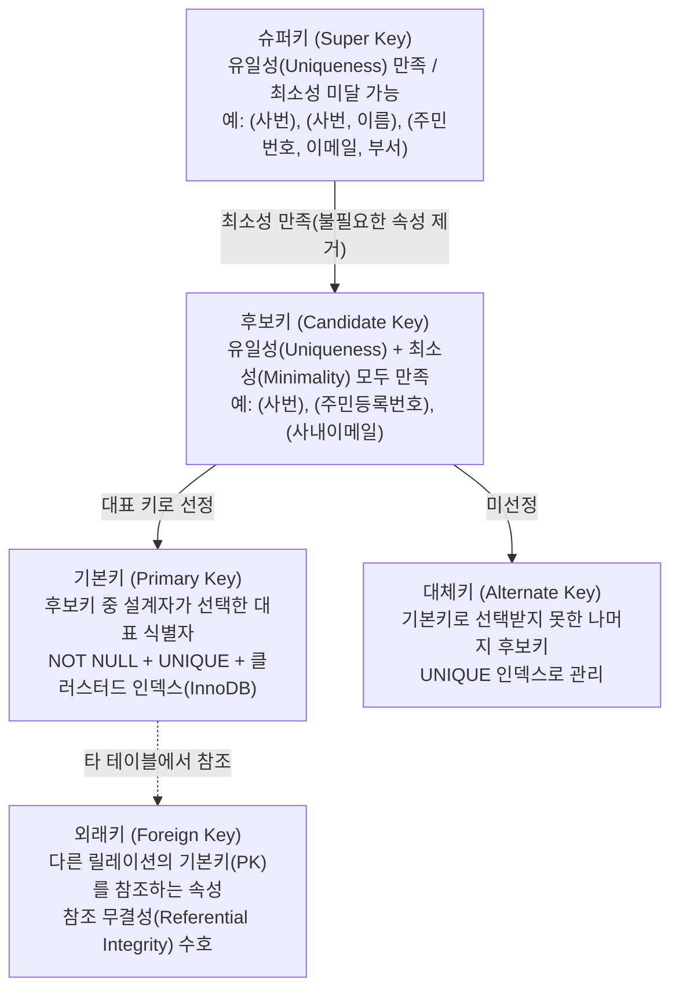

1. **개체 무결성 제약조건(Entity Integrity Constraint)**: 기본키(PK)를 구성하는 모든 속성은 어떠한 경우에도 `NULL` 값을 가질 수 없으며, 테이블 내에서 중복된 값을 가질 수 없습니다.
2. **참조 무결성 제약조건(Referential Integrity Constraint)**: 외래키(FK) 값은 반드시 참조하는 부모 테이블의 기본키 값으로 실제 존재하는 값이어야 하거나, 아니면 `NULL`(비식별 선택 관계인 경우)이어야 합니다.
3. **도메인 무결성 제약조건(Domain Integrity Constraint)**: 각 컬럼의 값은 선언된 데이터 타입, 길이, `NOT NULL`, `CHECK` 범위 내에 속해야 합니다.

---

### 1.4 SQL 쿼리 한 줄이 DB 엔진 내부에서 실행되는 과정 (Query Processing Architecture)

개발자가 애플리케이션에서 `SELECT id, name FROM users WHERE email = 'architect@company.com';`이라는 SQL 쿼리 한 줄을 전송했을 때, 데이터베이스 내부에서는 과연 어떤 일이 벌어질까요? 이 내부 파이프라인을 정확히 이해하는 것이 쿼리 튜닝과 아키텍처 설계의 출발점입니다.

상용 및 오픈소스 RDBMS(MySQL 기준)는 크게 **DBMS 서버 엔진(SQL 처리 계층)**과 **스토리지 엔진(데이터 저장/추출 계층)**의 두 계층으로 분리되어 동작합니다.

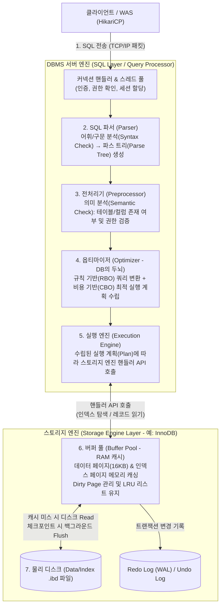

#### 단계별 내부 동작 상세 해부

1. **커넥션 핸들러(Connection Handler)**
   - 클라이언트(WAS)가 보내온 패킷을 수신하여 DB 계정과 비밀번호, 접근 호스트 권한을 검증하고 해당 요청을 전담할 워커 스레드(MySQL) 또는 백엔드 프로세스(PostgreSQL)를 할당합니다.
2. **SQL 파서(Parser) - 문법 검증 및 트리 변환**
   - 전송된 SQL 텍스트 문자열을 `SELECT`, `FROM`, `WHERE`, 식별자, 연산자 등의 최소 의미 단위인 **토큰(Token)**으로 쪼개는 어휘 분석(Lexical Analysis)을 수행합니다.
   - 이어서 SQL 표준 문법(Syntax)에 어긋난 오타(예: `SELEC`, 괄호 미닫음)가 없는지 검사하고, 엔진이 이해할 수 있는 자료구조인 **파스 트리(Parse Tree / AST)**를 메모리에 생성합니다.
3. **전처리기(Preprocessor) - 의미론적 검증(Semantic Validation)**
   - 파스 트리를 순회하며 문법적으로는 맞지만 실제로 실행 불가능한 요소를 걸러냅니다.
   - `FROM users`의 `users` 테이블과 `email` 컬럼이 데이터베이스 메타데이터(Data Dictionary)에 실제로 존재하는지 확인하고, 현재 접속한 DB 계정이 해당 테이블과 컬럼에 대해 `SELECT` 권한을 가지고 있는지 최종 검증합니다.
4. **옵티마이저(Optimizer) - 데이터베이스의 심장이자 두뇌**
   - 전처리기를 통과한 파스 트리를 입력받아 **"어떻게 하면 가장 적은 디스크 I/O와 CPU 비용으로 데이터를 가져올 것인가?"**를 결정하여 **실행 계획(Execution Plan)**을 만들어냅니다.
   - **RBO(Rule-Based Optimizer, 규칙 기반 옵티마이저)** vs **CBO(Cost-Based Optimizer, 비용 기반 옵티마이저)**:
     - 과거 초기 DBMS는 "조건절에 인덱스가 있으면 무조건 인덱스를 탄다"와 같은 고정된 우선순위 규칙(Rule)만 따르는 **RBO**를 사용했습니다. 하지만 전체 데이터의 90%가 `'서울'`인 테이블에서 `WHERE region = '서울'`을 인덱스로 읽으면 풀 테이블 스캔보다 오히려 수십 배 느려지는 참사가 발생했습니다.
     - 현대의 모든 RDBMS는 **비용 기반 옵티마이저(CBO)**를 사용합니다(단, 내부적으로 불필요한 조건절 제거나 서브쿼리 조인 변환 등에서는 RBO의 휴리스틱 규칙을 함께 결합합니다). CBO는 테이블의 총 행 수, 인덱스의 카디널리티, 데이터 분포 히스토그램(Histogram), 메모리에 올라와 있는 페이지 비율 등의 **통계 정보(Statistics)**를 바탕으로 여러 실행 경로의 **비용(Cost: 디스크 I/O 비용 + CPU 연산 비용)**을 수치로 계산한 뒤 가장 비용이 낮은 단 하나의 실행 계획을 최종 선택합니다.
5. **실행 엔진(Execution Engine)과 스토리지 엔진 핸들러 API**
   - 옵티마이저가 세운 실행 계획은 그 자체로는 설계도일 뿐입니다. 실행 엔진은 이 계획에 따라 스토리지 엔진에게 **"A 인덱스의 루트부터 탐색해서 조건에 맞는 첫 번째 레코드를 가져와라"**, **"그다음 레코드를 순서대로 10건 읽어와라"**, **"두 결과를 메모리 해시 테이블에서 조인하라"**와 같이 저수준 핸들러 API(Handler API)를 반복 호출하여 최종 결과 집합(Result Set)을 조립합니다.
6. **스토리지 엔진(Storage Engine)과 버퍼 풀(Buffer Pool)**
   - 스토리지 엔진(예: InnoDB)은 데이터를 가져올 때 절대 디스크부터 직접 뒤지지 않습니다. 먼저 RAM 메모리에 할당된 거대한 캐시 영역인 **버퍼 풀(Buffer Pool)**에 해당 데이터 페이지(기본 16KB 블록 단위)가 올라와 있는지 확인합니다.
   - **버퍼 풀 히트(Cache Hit)**: 원하는 페이지가 메모리에 있다면 디스크 I/O 없이 수 나노~마이크로초 만에 즉시 읽어 반환합니다. (잘 튜닝된 운영 DB의 Buffer Pool Hit Ratio는 항상 **99% 이상**을 유지해야 합니다.)
   - **버퍼 풀 미스(Cache Miss)**: 메모리에 없다면 디스크의 `.ibd` 파일에서 해당 16KB 페이지를 읽어 버퍼 풀의 LRU(Least Recently Used) 리스트에 적재한 뒤 실행 엔진에 전달합니다.
   - 만약 `UPDATE`나 `INSERT` 쿼리라면 버퍼 풀 내의 메모리 페이지만 먼저 수정하여 **더티 페이지(Dirty Page)**로 표시하고, 디스크에는 **리두 로그(Redo Log / WAL)**만 순차 기록한 뒤 즉시 커밋 응답을 반환합니다. 이후 백그라운드 스레드(Page Cleaner)가 체크포인트(Checkpoint) 시점에 더티 페이지들을 모아서 디스크 데이터 파일에 일괄 반영(Flush)합니다.

---

### 1.5 표준 SQL 언어 체계와 실무 쿼리 패턴

**SQL(Structured Query Language)**은 RDBMS와 대화하기 위해 국제 표준화 기구(ISO/ANSI)에서 제정한 선언적(Declarative) 질의 언어입니다. 목적에 따라 크게 4가지 하위 언어로 엄격히 분류됩니다.

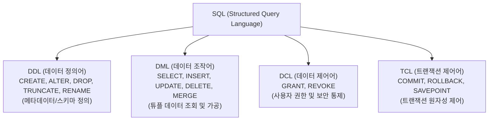

```sql
-- 1. DDL (Data Definition Language) : 테이블 스키마 정의 및 제약조건 설정
CREATE TABLE department (
    dept_id INT PRIMARY KEY,
    dept_name VARCHAR(50) NOT NULL,
    created_at TIMESTAMP DEFAULT CURRENT_TIMESTAMP
);

CREATE TABLE employee (
    emp_id BIGINT AUTO_INCREMENT PRIMARY KEY,
    emp_name VARCHAR(50) NOT NULL,
    email VARCHAR(100) NOT NULL UNIQUE,
    salary DECIMAL(12, 2) NOT NULL CHECK (salary >= 0),
    dept_id INT,
    CONSTRAINT fk_emp_dept FOREIGN KEY (dept_id) REFERENCES department(dept_id)
        ON DELETE SET NULL ON UPDATE CASCADE
);

-- 2. DML (Data Manipulation Language) : 데이터 입력, 수정, 삭제, 조회
INSERT INTO department (dept_id, dept_name) VALUES (10, '데이터플랫폼팀');
INSERT INTO employee (emp_name, email, salary, dept_id) 
VALUES ('김데이터', 'kim@company.com', 85000000.00, 10);

-- 윈도우 함수(Window Function)와 집계를 결합한 고급 분석 DML 조회
SELECT 
    d.dept_name,
    e.emp_name,
    e.salary,
    AVG(e.salary) OVER (PARTITION BY e.dept_id) AS dept_avg_salary,
    RANK() OVER (PARTITION BY e.dept_id ORDER BY e.salary DESC) AS salary_rank
FROM department d
INNER JOIN employee e ON d.dept_id = e.dept_id;

-- 3. DCL (Data Control Language) : 최소 권한 원칙(Least Privilege)에 따른 권한 부여 및 회수
GRANT SELECT, INSERT, UPDATE ON company_db.employee TO 'app_service_user'@'10.0.%';
REVOKE UPDATE ON company_db.employee FROM 'app_service_user'@'10.0.%';

-- 4. TCL (Transaction Control Language) : 트랜잭션 확정, 부분 롤백 및 취소
START TRANSACTION;
UPDATE employee SET salary = salary * 1.10 WHERE dept_id = 10;
SAVEPOINT after_dept_10_raise;
UPDATE employee SET salary = salary * 1.20 WHERE dept_id = 20;
-- 20번 부서 인상에 문제가 발견된 경우 10번 부서 인상 상태까지만 부분 롤백:
ROLLBACK TO SAVEPOINT after_dept_10_raise;
COMMIT;
```

---

### 1.6 양대 오픈소스 RDBMS 완벽 해부: MySQL(InnoDB) vs PostgreSQL 내부 아키텍처 차이

현업에서 백엔드 아키텍트가 가장 많이 마주하는 질문 중 하나는 **"우리 서비스에는 MySQL이 맞을까요, PostgreSQL이 맞을까요?"**입니다. 두 데이터베이스는 겉으로는 똑같이 표준 SQL을 지원하는 RDBMS처럼 보이지만, 내부 엔진 아키텍처와 스토리지 구조는 정반대에 가까울 정도로 큰 차이를 보입니다.

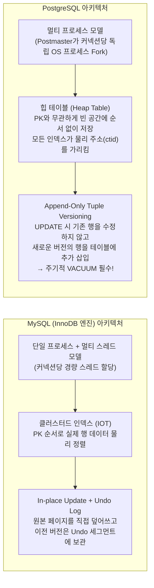

#### MySQL(InnoDB) vs PostgreSQL 내부 아키텍처 상세 비교표

| 비교 영역 | MySQL (InnoDB 스토리지 엔진) | PostgreSQL | 실무 아키텍처 및 운영상의 영향 |
| :--- | :--- | :--- | :--- |
| **동시성 연결 모델** | **멀티 스레드(Multi-Thread)**<br/>단일 `mysqld` 데몬 프로세스 내에서 커넥션마다 스레드를 생성 | **멀티 프로세스(Multi-Process)**<br/>마스터(`postmaster`)가 커넥션마다 독립된 OS 프로세스(`postgres`)를 `fork()` | MySQL은 커넥션 생성/문맥 교환이 가볍고 메모리 오버헤드가 적음. PostgreSQL은 프로세스 격리로 안정성이 높으나 커넥션당 메모리(약 5~10MB) 소모가 커서 **PgBouncer** 같은 외부 커넥션 풀러가 필수적임 |
| **테이블 저장 구조** | **클러스터드 인덱스(Clustered Index / IOT)**<br/>PK B+Tree의 리프 노드 자체가 실제 데이터 레코드임 | **힙 파일(Heap Table)**<br/>데이터가 PK 순서와 무관하게 입력 순서/빈 공간대로 힙에 저장됨 | MySQL은 PK 기반 범위 조회(`BETWEEN`)가 압도적으로 빠름. 단, 랜덤 PK(UUID v4) 사용 시 페이지 분할로 쓰기 성능이 폭락함 |
| **세컨더리 인덱스 구조** | 리프 노드에 **인덱스 키 + PK 값**을 저장<br/>(데이터 접근 시 PK 트리를 다시 타는 **더블 룩업** 발생) | 리프 노드에 **인덱스 키 + 물리적 튜플 위치(`ctid`: 페이지번호+오프셋)**를 직접 저장 | PostgreSQL은 세컨더리 인덱스 조회 시 힙 페이지를 바로 찾아가므로 단건 랜덤 조회가 빠름. 반면 행이 `UPDATE`되어 `ctid`가 바뀌면 모든 인덱스를 갱신해야 하는 쓰기 증폭(Write Amplification)이 발생할 수 있음(HOT 업데이트로 일부 완화) |
| **MVCC 구현 방식** | **In-place Update + Undo Log**<br/>데이터 페이지의 원본 행을 즉시 덮어쓰고, 변경 전 데이터를 별도의 **Undo Log** 영역에 기록 | **Append-Only (Out-of-place Update)**<br/>`UPDATE` 시 기존 튜플(`xmin`, `xmax` 마킹)은 그대로 두고 **새로운 버전의 튜플을 힙 테이블에 새로 `INSERT`** 함 | MySQL은 `ROLLBACK` 시 Undo Log를 읽어야 해서 대량 롤백이 느리지만 테이블 비대화가 적음. PostgreSQL은 롤백이 즉각적(`xmax` 상태만 무효화)이나, 죽은 튜플(Dead Tuple)이 테이블에 계속 쌓여 디스크가 부풀어 오르는 **Table Bloat** 현상이 발생함 |
| **가비지 컬렉션** | **Purge Thread**<br/>더 이상 어떤 트랜잭션도 참조하지 않는 Undo Log를 백그라운드에서 정리 | **Autovacuum (VACUUM 프로세스)**<br/>힙 테이블과 인덱스에 흩어진 Dead Tuple을 주기적으로 청소하여 공간 재사용 | 대규모 업데이트가 빈번한 서비스에서 PostgreSQL의 `autovacuum` 튜닝이 실패하면 디스크 풀(Full)이나 **Transaction ID Wraparound**로 인한 DB 멈춤 장애가 발생할 수 있음 |
| **조인(JOIN) 알고리즘** | Nested Loop Join 중심<br/>(MySQL 8.0.18+부터 Hash Join 추가 지원, Merge Join 미지원) | **Nested Loop + Hash Join + Sort-Merge Join** 모두 완벽 지원 및 병렬 쿼리(Parallel Query) 탁월 | 수십 개 테이블이 얽힌 복잡한 OLAP 분석 쿼리, 대규모 통계 집계, 서브쿼리 최적화에서는 PostgreSQL의 옵티마이저가 한 수 위의 성능을 발휘함 |
| **확장성 및 특수 타입** | JSON 지원, 기본 GIS 지원 | **JSONB(바이너리 인덱싱)**, 배열(Array), **PostGIS(공간정보 표준)**, **pgvector(AI 벡터 검색)** 등 최강의 확장 생태계 | 단순하고 예측 가능한 대규모 OLTP 웹 서비스는 MySQL이 운영 안정성 면에서 유리하며, 지리정보(GIS)·복합 검색·AI 임베딩·복잡한 분석이 결합된 서비스는 PostgreSQL이 압도적으로 유리함 |

---

## 02. ERD(개체-관계 다이어그램)는 무엇인가요?
> **데이터 모델링 청사진, 카디널리티와 식별/비식별 관계, 실무 물리 설계(Auto Increment vs UUID v4 vs UUID v7 / ULID / Snowflake ID 완벽 비교), 그리고 Soft Delete 설계 패턴**

집을 지을 때 건축 구조 설계도면이 없으면 기둥의 위치가 어긋나 건물이 붕괴하듯, 소프트웨어 시스템을 구축할 때 데이터 모델링 설계도면이 없으면 스키마가 꼬여 데이터 정합성이 파괴됩니다. 데이터베이스 설계의 가장 표준적인 시각적 도면이 바로 **ERD(Entity-Relationship Diagram, 개체-관계 다이어그램)**이며, 이를 실제 디스크 위에서 가장 빠르게 동작하는 테이블로 구현하는 작업이 **물리적 데이터 모델링**입니다.

---

### 2.1 데이터베이스 설계 3단계와 ERD의 역할

데이터베이스 모델링은 현실 세계의 복잡한 비즈니스 규칙을 컴퓨터 디스크의 2차원 테이블 구조로 변환해 나가는 정교한 추상화 과정입니다.


1. **개념적 데이터 모델링(Conceptual Modeling)**
   - 비즈니스 도메인의 핵심 엔티티(예: 회원, 상품, 주문, 결제, 배송)를 도출하고 엔티티 간의 거시적인 관계를 규명합니다. 타겟 DBMS의 종류와 무관하게 현업 기획자와 개발자가 도메인 지식을 맞추는 단계입니다.
2. **논리적 데이터 모델링(Logical Modeling)**
   - 모든 속성(Attribute)을 빠짐없이 정의하고, 주식별자(PK)와 외래식별자(FK)를 지정하며, 제3정규화(3NF)/BCNF를 거쳐 데이터 중복을 제거합니다. 시스템의 비즈니스 규칙을 완벽히 표현한 청사진입니다.
3. **물리적 데이터 모델링(Physical Modeling)**
   - 목표 DBMS(MySQL, PostgreSQL 등)의 스토리지 엔진 특성과 하드웨어 I/O 성능을 고려하여 `BIGINT`, `VARCHAR(100)`, `DECIMAL(15,2)` 등의 구체적 컬럼 타입을 지정하고, PK 클러스터링 전략, 세컨더리 인덱스 설계, 파티셔닝, 반정규화를 수행합니다.

---

### 2.2 ERD의 3대 핵심 구성 요소와 카디널리티(Cardinality)

ERD는 1976년 피터 첸(Peter Chen) 교수가 제안한 이래로 **개체(Entity)**, **속성(Attribute)**, **관계(Relationship)**라는 세 가지 기둥으로 구성됩니다.

- **개체(Entity)**: 조직이 관리하고자 하는 유의미한 정보를 가진 대상입니다. 테이블로 변환되며 인스턴스는 행(Row)이 됩니다. 발생 시점과 성격에 따라 **기본 엔티티(키 엔티티: 회원, 상품)**, **중심 엔티티(기본 엔티티로부터 파생되어 업무의 중심이 되는 엔티티: 주문, 계약)**, **행위 엔티티(두 개 이상의 엔티티가 상호작용하며 지속해서 발생하는 내역/로그 엔티티: 주문상세, 결제이력, 배송추적)**로 분류됩니다.
- **속성(Attribute)**: 개체가 가지는 고유한 성질이며 컬럼으로 변환됩니다. 업무에서 본래 도출된 **기본 속성(상품명, 단가)**, 시스템 운영을 위해 고안된 **설계 속성(주문상태코드, 삭제여부플래그)**, 다른 속성들로부터 계산되는 **파생 속성(총결제금액, 누적리뷰수)**으로 나뉩니다.
- **관계(Relationship)와 카디널리티**: 두 엔티티 사이의 논리적 연관성이며 `1:1`, `1:N`, `N:M`의 관계 차수(Cardinality)를 가집니다.

#### N:M(다대다) 관계의 물리적 해소와 교차 엔티티(Associative Entity)
관계형 데이터베이스의 2차원 테이블에서는 하나의 컬럼에 여러 개의 외래키 값을 배열(`101, 102, 105`) 형태로 넣을 수 없으며(제1정규형 위반), 하나의 외래키가 동시에 여러 행을 가리킬 수도 없습니다. 따라서 개념적으로 도출된 `N:M` 관계는 물리적 모델링 단계에서 **반드시 중간에 교차 테이블(Mapping / Associative Table)을 두어 `1:N`과 `N:1` 관계로 분해**해야 합니다.

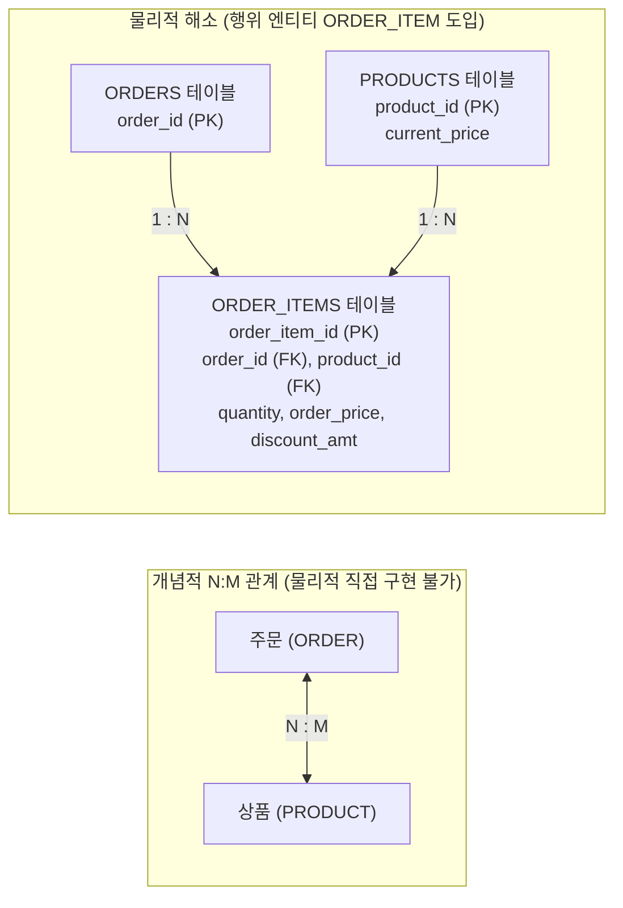

> **💡 실무 아키텍처 핵심: 교차 테이블의 스냅샷 속성 보존**  
> 초보 설계자들이 가장 많이 저지르는 실수는 `order_items` 테이블에 `(order_id, product_id, quantity)`만 넣고, 상품 가격은 `products` 테이블을 조인해서 가져오도록 설계하는 것입니다. 만약 고객이 어제 10,000원에 상품을 구매했는데 오늘 판매자가 상품 가격을 15,000원으로 인상하면 어떻게 될까요? 과거 고객의 주문 내역 금액이 15,000원으로 뒤바뀌어 회계 대사(Reconciliation)가 완전히 틀어집니다! 따라서 교차 테이블에는 반드시 **"주문 시점의 스냅샷 단가(`order_price`)", "주문 시점 상품명(`product_name_snapshot`)"**을 함께 저장해야 합니다.

---

### 2.3 식별 관계(Identifying) vs 비식별 관계(Non-identifying)

부모 테이블의 기본키(PK)를 자식 테이블이 외래키(FK)로 물려받을 때, 그 외래키를 자식 테이블의 기본키(PK) 구성원으로 포함할 것인가에 따라 식별 관계와 비식별 관계로 나뉩니다.

```mermaid
classDiagram
    direction LR
    class Identifying_Parent {
        +bigint order_id PK
        datetime order_date
    }
    class Identifying_Child {
        +bigint order_id PK, FK
        +int item_seq PK
        bigint product_id FK
    }
    Identifying_Parent <|-- Identifying_Child : 실선 (식별 관계: 부모 PK가 자식 PK의 일부)

    class NonIdentifying_Parent {
        +bigint order_id PK
        datetime order_date
    }
    class NonIdentifying_Child {
        +bigint order_item_id PK (독립 대리키)
        bigint order_id FK (일반 속성)
        bigint product_id FK
    }
    NonIdentifying_Parent <|.. NonIdentifying_Child : 점선 (비식별 관계: 부모 PK는 일반 FK 컬럼)
```

| 구분 | 식별 관계 (Identifying Relationship) | 비식별 관계 (Non-identifying Relationship) |
| :--- | :--- | :--- |
| **정의** | 부모의 기본키(PK)가 자식의 **기본키(PK)이자 외래키(FK)**로 흡수됨 | 부모의 기본키(PK)가 자식의 **일반 컬럼(FK)**으로만 참조됨 |
| **ERD 표기** | **실선 (Solid Line)** | **점선 (Dashed Line)** |
| **존재 종속성** | **강한 종속**: 부모 레코드 없이는 자식 레코드가 생성조차 될 수 없음 (`NOT NULL` 강제) | **약한 종속**: 부모 레코드와 생명주기를 분리할 수 있으며 선택적(`NULL` 허용) 관계 표현 가능 |
| **장점** | 부모 PK가 자식 PK의 선행 컬럼이 되므로, 부모 PK 기준 조회 시 클러스터드 인덱스 로컬리티(Locality)가 극대화됨 | 자식 테이블이 단일 대리키(`id`)를 가지므로 스키마 변경에 유연하고 ORM(JPA) 매핑이 매우 깔끔함 |
| **단점** | 계층이 3~4단계로 깊어지면 손자·증손자 테이블의 복합 PK 컬럼이 4~5개로 불어나 인덱스 크기가 폭증하고 SQL 조인 조건이 복잡해짐 | 부모의 상위 계층 조건으로 조회할 때 부모 테이블과의 조인(JOIN)이 추가로 필요할 수 있음 |

---

### 2.4 실무 이커머스 도메인(회원-주문-상품-결제-배송) 통합 ERD와 물리 설계

실제 프로덕션 환경의 이커머스 핵심 도메인(회원, 상품, 주문, 주문상세, 결제, 배송)을 까마귀 발 표기법(Crow's Foot Notation)으로 모델링한 전체 ERD입니다.

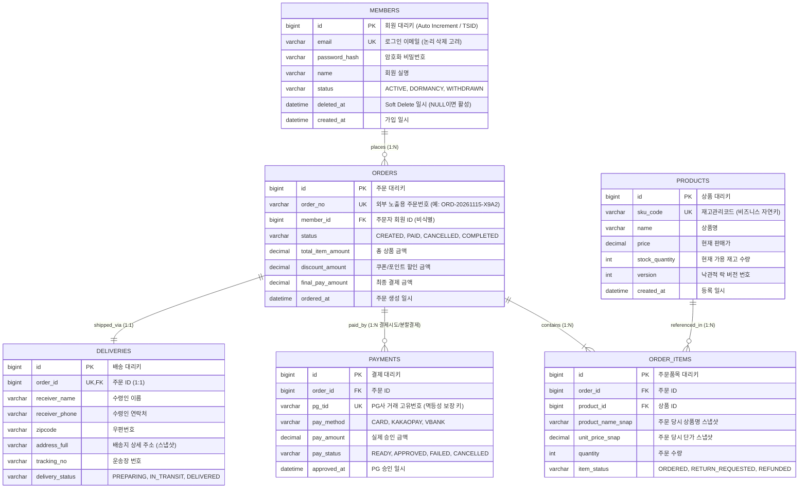

#### 실무 물리적 테이블 설계 시 반드시 챙겨야 할 4대 디테일
1. **내부 조인용 PK(`id`)와 외부 노출용 식별자(`order_no`)의 철저한 분리**:
   - 주문 테이블의 PK인 `id = 100452`를 URL(`/orders/100452`)이나 고객 영수증에 그대로 노출하면 경쟁사가 하루 주문량을 정확히 역산할 수 있고, URL 숫자를 1씩 증감하며 타인의 주문을 찔러보는 **IDOR(Insecure Direct Object Reference)** 보안 취약점에 노출됩니다.
   - 따라서 테이블 간 내부 FK 조인은 8바이트 정수인 `id BIGINT`로 빠르게 수행하되, 외부 API나 화면에는 `order_no`(`ORD-20261115-8F9A2B` 또는 UUID v7)와 같은 난수화된 대체키(Unique Key)를 노출해야 합니다.
2. **배송지(`DELIVERIES`)는 회원 테이블의 주소를 참조(FK)하면 안 된다**:
   - 만약 배송 테이블이 회원의 주소록 ID만 FK로 참조한다면, 회원이 상품을 주문한 뒤 마이페이지에서 기본 배송지를 수정했을 때 이미 발송 중인 과거 주문의 배송지까지 함께 바뀌어버리는 대형 사고가 발생합니다. 배송 테이블에는 반드시 주문 시점의 수령인 이름, 연락처, 주소를 텍스트 값 자체(Snapshot)로 복사해 두어야 합니다.
3. **금액 컬럼은 절대 `FLOAT`이나 `DOUBLE`을 쓰지 않는다**:
   - IEEE 754 부동소수점 타입은 이진수 근사치를 저장하므로 `0.1 + 0.2 = 0.30000000000000004`와 같은 정밀도 오차가 발생합니다. 화폐와 결제 금액은 반드시 정확한 십진수를 보장하는 **`DECIMAL(15, 2)`** 또는 소수점이 없는 원화(KRW)의 경우 **`BIGINT`**를 사용해야 합니다.
4. **결제(`PAYMENTS`)의 멱등성(Idempotency) 보장**:
   - 사용자가 결제 버튼을 연타하거나 네트워크 타임아웃으로 재요청이 들어올 때 중복 결제를 막기 위해, PG사 거래 번호(`pg_tid`)나 클라이언트가 발급한 `idempotency_key` 컬럼에 반드시 **`UNIQUE` 제약조건**을 걸어 데이터베이스 레벨에서 이중 저장을 원천 차단해야 합니다.

---

### 2.5 자연키(Natural Key) vs 대리키(Surrogate Key): Auto Increment vs UUID v4 vs UUID v7 / ULID / Snowflake ID의 B+Tree 클러스터링 성능 격차 완벽 비교

물리적 데이터베이스 설계에서 가장 치열하게 논의되는 주제는 **"기본키(PK)를 무엇으로 설정할 것인가?"**입니다.

#### 1. 자연키(Natural Key) vs 대리키(Surrogate Key)
- **자연키(Natural Key)**: 비즈니스 도메인 자체에서 자연스럽게 발생하는 고유 식별자입니다(예: 주민등록번호, 이메일, 사업자등록번호, ISBN).
  - **한계**: **"세상에 절대 변하지 않는 비즈니스 키는 없다."** 과거 많은 시스템이 주민등록번호를 회원 테이블의 PK로 썼다가, 개인정보보호법 개정으로 주민번호 수집이 전면 금지되면서 수백 개의 자식 테이블 외래키(FK)를 통째로 뜯어고치는 재앙을 겪었습니다. 또한 문자열(`VARCHAR`) 자연키는 정수형(`BIGINT`, 8Byte)에 비해 크기가 크고 가변적이어서, 이를 참조하는 모든 세컨더리 인덱스와 자식 테이블의 용량을 수 배로 팽창시킵니다.
- **대리키(Surrogate Key / 인조키)**: 비즈니스 의미와 완전히 분리되어 오직 레코드 식별만을 위해 시스템이 인위적으로 채번한 키입니다(예: `Auto Increment`, `UUID`, `ULID`, `Snowflake ID`). 현대 데이터베이스 아키텍처에서는 **모든 테이블의 PK로 대리키를 사용하고, 비즈니스 고유성은 `UNIQUE` 제약조건(대체키)으로 강제하는 것**이 확고한 표준입니다.

#### 2. 왜 MySQL(InnoDB)에서 `UUID v4`를 PK로 쓰면 시스템이 마비될까요?
분산 환경이나 마이크로서비스(MSA)에서는 DB에 `INSERT` 하기 전에 애플리케이션에서 고유 ID를 미리 생성하거나 여러 샤드(Shard) 간에 ID 충돌을 피하기 위해 `UUID`(128비트, 16바이트)를 자주 고려합니다. 하지만 완전 난수 기반인 **`UUID v4`(`550e8400-e29b-41d4-a716-446655440000`)를 MySQL InnoDB의 PK로 지정하면 데이터 건수가 수백만 건을 넘어가는 순간 쓰기(INSERT) 성능이 10분의 1 이하로 폭락**합니다.

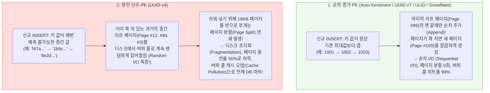

1. **랜덤 I/O와 버퍼 풀 캐시 오염(Buffer Pool Pollution)**:
   - InnoDB의 클러스터드 인덱스는 반드시 PK 순서대로 물리적 정렬을 유지해야 합니다. `Auto Increment`는 항상 가장 큰 값이 들어오므로 메모리에 상주해 있는 **가장 오른쪽 끝(Right-most) 리프 페이지 1~2개**만 수정하면 됩니다.
   - 반면 `UUID v4`는 매번 완벽한 난수가 생성되므로, 전체 B+Tree의 첫 페이지부터 마지막 페이지까지 아무 위치나 무작위로 찔러 넣어야 합니다. 테이블 크기가 버퍼 풀 메모리(예: 32GB)를 초과하는 순간, `INSERT`를 한 번 할 때마다 디스크에 잠자고 있던 과거 페이지를 메모리로 퍼 올리고 기존 핫(Hot) 페이지를 쫓아내는 **디스크 랜덤 I/O**가 폭발합니다.
2. **치명적인 페이지 분할(Page Split)과 공간 단편화**:
   - 이미 데이터가 꽉 찬 중간 페이지에 새로운 UUID v4 레코드를 우겨넣으려면, InnoDB는 새 16KB 페이지를 할당받고 기존 페이지의 데이터 절반을 새 페이지로 복사해 옮기며 상위 브랜치 노드의 포인터까지 갱신하는 무거운 **페이지 분할(Page Split)** 작업을 수행합니다. 이로 인해 테이블 공간의 절반 가까이가 빈 구멍으로 남는 단편화(Fill Factor 저하)가 발생합니다.
3. **세컨더리 인덱스 크기 2배 이상 비대화**:
   - InnoDB의 모든 세컨더리 인덱스는 리프 노드에 PK 값을 함께 들고 있습니다. `BIGINT`는 8바이트이지만, `UUID`를 `BINARY(16)`으로 저장하면 2배(16바이트), 만약 문자열 `CHAR(36)`으로 저장하면 무려 4.5배(36바이트)의 용량을 모든 세컨더리 인덱스마다 중복으로 잡아먹습니다.

#### 3. 해결책: 시간순 정렬이 보장되는 차세대 분산 식별자 (UUID v7, ULID, Snowflake ID)
"분산 환경에서 DB 통신 없이 애플리케이션이 독립적으로 생성할 수 있으면서도, B+Tree 인덱스에서 `Auto Increment`처럼 완벽하게 시간순(Monotonic Increasing)으로 정렬되는 식별자는 없을까요?" 이 요구사항을 완벽히 해결하기 위해 등장한 것이 **UUID v7**, **ULID**, 그리고 **Snowflake ID(TSID)**입니다.

```
[1. UUID v4 (128-bit) : 전체가 완전 난수 → 정렬 불가, B+Tree 최악]
+-------------------------------------------------------------------+
|                     122-bit Random (+ 6-bit ver/var)              |
+-------------------------------------------------------------------+

[2. UUID v7 (128-bit, IETF RFC 9562 표준) : 앞부분이 타임스탬프 → 시간순 정렬 완벽 보장!]
+----------------------------+-------+------------------------------+
|  48-bit Unix Timestamp(ms) | 4-bit |      74-bit Random/Seq       |
|   (밀리초 단위 생성 시각)     | ver=7 |     (충돌 방지 난수 및 카운터)   |
+----------------------------+-------+------------------------------+

[3. ULID (128-bit, Base32 26글자) : 사전순(Lexicographical) 정렬 가능한 타임스탬프+난수]
+----------------------------+--------------------------------------+
|  48-bit Unix Timestamp(ms) |          80-bit Randomness           |
+----------------------------+--------------------------------------+

[4. Twitter Snowflake ID / TSID (64-bit BIGINT) : 8바이트 정수에 시간+노드+시퀀스 압축!]
+-+--------------------------+---------------+----------------------+
|0| 41-bit Timestamp (ms)    |10-bit Node ID | 12-bit Sequence No   |
+-+--------------------------+---------------+----------------------+
```

#### 실무 대리키(PK) 5대 전략 완벽 비교표

| 비교 항목 | `Auto Increment` (`BIGINT`) | `UUID v4` (완전 난수) | `UUID v7` (RFC 9562 표준) | `ULID` | `Snowflake ID` / `TSID` |
| :--- | :--- | :--- | :--- | :--- | :--- |
| **데이터 크기** | **8 Byte** (`BIGINT`) | 16 Byte (`BINARY(16)`) / 36 Byte (`CHAR(36)`) | **16 Byte** (`BINARY(16)` 또는 `UUID` 타입) | 16 Byte (`BINARY(16)`) / 26 Byte (`CHAR(26)`) | **8 Byte** (`BIGINT`) |
| **시간순 정렬 (B+Tree 친화성)** | **완벽 (순차 증가)** | **불가 (완전 무작위)** | **완벽 (상위 48비트 타임스탬프)** | **완벽 (상위 48비트 타임스탬프)** | **완벽 (상위 41비트 타임스탬프)** |
| **InnoDB INSERT 성능** | **최고 (100% 기준)** | **최악 (데이터 증가 시 10~20% 수준으로 폭락)** | **매우 우수 (약 85~92% 수준 유지)** | **매우 우수 (약 85~92% 수준 유지)** | **최고 (Auto Increment와 거의 동등, 95~99%)** |
| **분산 채번 (무충돌 독립 생성)** | 불가 (단일 DB에 의존, 샤딩 시 충돌) | 가능 (클라이언트/WAS에서 즉시 생성) | **가능 (서버 간 조율 없이 WAS에서 즉시 생성)** | **가능 (WAS에서 즉시 생성, 초당 동일 ms 내 단조 증가 지원)** | 가능 (단, 워커 노드 ID 10비트 할당 관리 필요 - TSID는 난수로 대체 가능) |
| **보안성 (외부 추측 난이도)** | 취약 (경쟁사가 증가량으로 매출/가입자 수 역산 가능) | 매우 안전 | 안전 (생성 시각은 노출되나 하위 74비트가 난수여서 타인 ID 추측 불가) | 안전 (하위 80비트가 난수) | 보통 (생성 시각+시퀀스 구조여서 대략적 유추 가능, 외부 노출 시 암호화/Base62 인코딩 권장) |
| **아키텍트 최종 권장도** | 단일 DB 환경의 내부 조인용 PK로 최고 | **클러스터드 PK로 절대 사용 금지!** | **16바이트 표준 UUID가 필요한 모든 현대 시스템의 1순위 표준!** | 문자열 상태로도 URL/로그에서 깔끔한 정렬이 필요할 때 추천 | **8바이트 `BIGINT`의 공간/성능 효율과 분산 채번을 동시에 원할 때 1순위 추천!** |

> **💡 MySQL 8.0+에서 UUID v7을 PK로 사용할 때의 실무 팁**  
> UUID를 절대 `VARCHAR(36)`이나 `CHAR(36)` 문자열로 저장하지 마십시오! 하이픈(`-`)을 제거하고 16바이트 이진 데이터인 **`BINARY(16)`**으로 저장해야 저장 공간이 절반 이하로 줄고 비교 연산이 빨라집니다. MySQL 8.0 이상에서는 내장 함수 `UUID_TO_BIN(uuid_str)`과 `BIN_TO_UUID(bin_val)`을 제공하여 손쉽게 변환할 수 있습니다.

---

### 2.6 Soft Delete(`deleted_at`) vs Hard Delete 설계 패턴과 유니크 인덱스 충돌 해결법

사용자가 회원 탈퇴를 하거나 게시글을 삭제했을 때, 데이터베이스에서 실제로 `DELETE FROM members WHERE id = 100;`을 실행해야 할까요?

1. **Hard Delete (물리적 삭제)**:
   - `DELETE` 문을 실행하여 디스크에서 레코드를 실제로 제거하는 방식입니다.
   - **장점**: 테이블 크기가 작게 유지되고, 개인정보 파기 법령 준수가 명확하며, 유니크 제약조건 충돌이 없습니다.
   - **단점**: 실수로 삭제했을 때 복구가 극도로 어렵고, 부모 레코드(회원)를 물리 삭제하면 이를 참조하던 자식 레코드(주문, 결제 내역)의 외래키 무결성이 깨지거나 연쇄 삭제(`ON DELETE CASCADE`)되어 기업의 회계/정산 데이터까지 증발할 위험이 있습니다.
2. **Soft Delete (논리적 삭제)**:
   - 레코드를 물리적으로 지우지 않고 `is_deleted BOOLEAN DEFAULT FALSE` 또는 **`deleted_at DATETIME NULL`** 컬럼을 두어 `UPDATE members SET deleted_at = NOW() WHERE id = 100;`으로 상태만 갱신하는 방식입니다.
   - **장점**: 삭제 일시를 정확히 추적(Audit)할 수 있고, 고객 변심 시 즉시 복구할 수 있으며, 과거 주문/결제 테이블과의 참조 무결성이 완벽히 보존됩니다.

#### Soft Delete 도입 시 발생하는 치명적 함정: UNIQUE 인덱스 충돌과 NULL 문제!
Soft Delete를 도입할 때 모든 개발팀이 반드시 겪는 장애 시나리오가 있습니다.
- `members` 테이블의 `email` 컬럼에 `UNIQUE` 인덱스가 걸려 있습니다.
- 홍길동(`hong@test.com`) 회원이 탈퇴하여 `deleted_at = '2026-11-15 10:00:00'`으로 Soft Delete 처리되었습니다.
- 며칠 뒤 홍길동이 똑같은 이메일(`hong@test.com`)로 **재가입(`INSERT`)**을 시도합니다.
- **문제 1**: 단순 `UNIQUE (email)` 인덱스가 걸려 있으면, 이미 탈퇴한 레코드가 테이블에 남아 있으므로 `Duplicate entry 'hong@test.com' for key 'uk_email'` 에러가 터지며 **재가입이 불가능**해집니다!
- **문제 2**: 이를 해결하려고 `UNIQUE (email, is_deleted)`로 복합 유니크 인덱스를 걸면, 첫 번째 탈퇴(`is_deleted = 1`) 후 재가입(`is_deleted = 0`)은 되지만, **두 번째 탈퇴를 하는 순간** 기존에 있던 첫 번째 탈퇴 레코드(`hong@test.com, 1`)와 충돌하여 **두 번째 탈퇴(`UPDATE`)가 실패**합니다!
- **문제 3**: 그렇다면 `UNIQUE (email, deleted_at)`으로 걸면 어떨까요? ANSI SQL 표준과 MySQL(InnoDB), PostgreSQL의 기본 동작에서 **`UNIQUE` 인덱스는 `NULL` 값끼리의 중복을 허용(`NULL != NULL`)**합니다! 즉, 활성 회원(`deleted_at IS NULL`)이 `hong@test.com`으로 100번 중복 가입을 해도 `('hong@test.com', NULL)`이 무한정 `INSERT` 되어 **유니크 제약조건이 완전히 무력화**됩니다!

```sql
-- =====================================================================
-- [해결책 1] deleted_at의 기본값을 NULL 대신 특수 타임스탬프 상수로 설정 (MySQL / 범용 표준)
-- =====================================================================
-- 활성 상태일 때 NULL 대신 '1970-01-01 00:00:01' (또는 UNIX_TIMESTAMP 0)을 기본값으로 부여합니다.
-- 이렇게 하면 활성 회원은 ('hong@test.com', '1970-01-01 00:00:01')로 단 1명만 존재할 수 있고,
-- 여러 번 탈퇴하더라도 탈퇴 시점의 타임스탬프가 매번 다르므로 무한 재가입/재탈퇴가 완벽히 동작합니다!
CREATE TABLE members (
    id BIGINT AUTO_INCREMENT PRIMARY KEY,
    email VARCHAR(100) NOT NULL,
    name VARCHAR(50) NOT NULL,
    deleted_at DATETIME NOT NULL DEFAULT '1970-01-01 00:00:01',
    UNIQUE KEY uk_members_email_deleted (email, deleted_at)
);

-- =====================================================================
-- [해결책 2] MySQL 8.0+ 가상 생성 컬럼(Virtual Generated Column)을 활용한 우아한 격리
-- =====================================================================
-- deleted_at이 NULL(활성 회원)일 때만 이메일 값을 반환하고, 탈퇴 회원이면 NULL을 반환하는
-- 가상 컬럼(active_email)을 만든 뒤 여기에 UNIQUE 인덱스를 겁니다.
-- UNIQUE 인덱스는 NULL 중복을 허용하므로 탈퇴 회원은 몇 명이든 중복 가능하고, 활성 회원은 1명만 허용됩니다!
CREATE TABLE members_v2 (
    id BIGINT AUTO_INCREMENT PRIMARY KEY,
    email VARCHAR(100) NOT NULL,
    deleted_at DATETIME NULL DEFAULT NULL,
    active_email VARCHAR(100) GENERATED ALWAYS AS (IF(deleted_at IS NULL, email, NULL)) VIRTUAL,
    UNIQUE KEY uk_members_active_email (active_email)
);

-- =====================================================================
-- [해결책 3] PostgreSQL의 부분 유니크 인덱스 (Partial Unique Index) - 가장 이상적인 해법
-- =====================================================================
-- PostgreSQL은 인덱스 생성 시 WHERE 조건절을 부여할 수 있습니다.
-- deleted_at IS NULL인 활성 레코드에 대해서만 유니크 인덱스를 유지하므로 인덱스 크기도 최소화됩니다!
CREATE UNIQUE INDEX uk_members_email_active 
ON members (email) 
WHERE deleted_at IS NULL;
```

> **💡 아키텍트의 실무 조언: 탈퇴/삭제 데이터 아카이브 분리 패턴**  
> Soft Delete된 데이터가 전체 테이블의 30~50%를 넘어가면, 모든 조회 쿼리에 `WHERE deleted_at IS NULL` 조건을 매번 붙여야 하고(누락 시 삭제된 데이터가 화면에 노출되는 대형 보안 사고 발생!), 인덱스 크기가 비대해져 조회 성능이 떨어집니다. 따라서 실무에서는 **활성 테이블(`members`)에는 현재 살아있는 데이터만 유지하고, 삭제/탈퇴 시 트랜잭션 내에서 별도의 이력/아카이브 테이블(`members_withdrawn_history`)로 레코드를 `INSERT` 한 뒤 원본 테이블에서는 `DELETE` 하는 이관(Archiving) 패턴**을 가장 권장합니다.

---

## 03. 트랜잭션과 ACID란 무엇인가요?
> **논리적 최소 작업 단위, ACID와 Undo/Redo Log, 동시성 이상 현상과 4대 격리 수준, MVCC, 비관적 락 vs 낙관적 락 실전 동시성 제어, 그리고 데드락(Deadlock) 로그 해독법**

금융, 전자상거래, 티켓 예매, 선착순 쿠폰 발급 시스템 등 현대 IT 서비스에서 데이터 무결성을 보장하는 가장 위대한 논리적 장치는 바로 **트랜잭션(Transaction)**과 **락(Lock)**입니다. 수천 명의 사용자가 동시에 마지막 남은 1개의 재고를 결제하려 할 때, 트랜잭션과 동시성 제어가 올바로 작동하지 않는다면 잔고가 증발하거나 재고가 마이너스로 떨어지는 치명적인 결함이 발생합니다.

---

### 3.1 트랜잭션의 본질: 계좌 이체 시나리오

트랜잭션은 **"더 이상 쪼갤 수 없는 논리적인 작업의 최소 단위(Logical Unit of Work)"**를 의미합니다. 하나의 비즈니스 행위를 완성하기 위해 수행되는 여러 개의 세부 데이터베이스 연산(SQL)들이 모여 하나의 온전한 운명 공동체를 이룹니다.

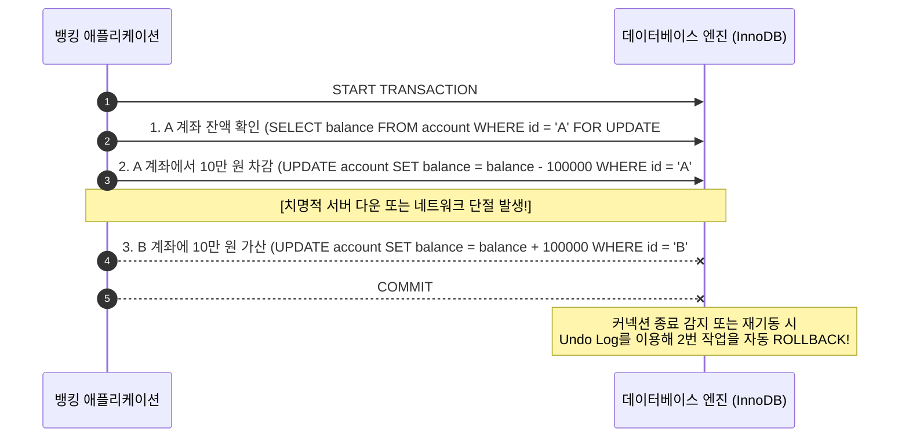

트랜잭션은 **"모든 연산이 완벽하게 성공하여 영구 반영(COMMIT)되거나, 도중에 단 하나라도 실패하면 시작하기 전 상태로 완벽히 되돌린다(ROLLBACK)"**는 **All-or-Nothing** 원칙을 보장합니다.

---

### 3.2 데이터베이스의 4대 수호신: ACID 특성과 내부 로그 엔진

RDBMS가 트랜잭션의 신뢰성을 증명하기 위해 준수하는 네 가지 핵심 원칙을 **ACID**라고 부릅니다. 이 네 가지 원칙은 추상적인 선언이 아니라 DBMS 내부의 정교한 스토리지 로그 엔진(**Undo Log**, **Redo Log / WAL**, **MVCC**, **Lock Manager**)에 의해 물리적으로 구현됩니다.

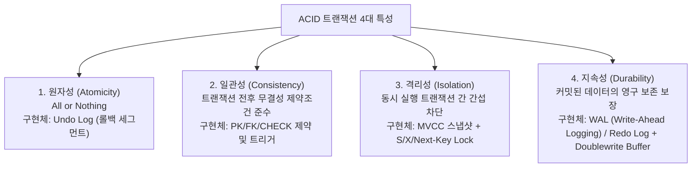

#### 1. 원자성 (Atomicity)과 Undo Log
- **정의**: 트랜잭션에 포함된 모든 작업은 전부 반영되거나, 아니면 전혀 반영되지 않아야 합니다.
- **내부 구현**: DBMS는 데이터를 수정할 때 변경 전의 원본 데이터(Before Image)를 **언두 로그(Undo Log)**에 먼저 기록합니다. 실행 도중 예외가 발생하거나 사용자가 `ROLLBACK`을 호출하면, 엔진은 Undo 로그를 역순으로 읽어 버퍼 풀의 데이터 페이지를 수정 이전 상태로 완벽히 복원합니다.

#### 2. 일관성 (Consistency)과 무결성 검증
- **정의**: 트랜잭션이 시작하기 전과 완료된 후 모두 데이터베이스는 미리 정의된 모든 도메인 규칙과 무결성 제약조건(`NOT NULL`, `UNIQUE`, `FOREIGN KEY`, `CHECK`)을 완벽히 만족하는 유효한 상태(Valid State)여야 합니다.
- **예시**: 송금 전 A(100만 원)와 B(50만 원)의 잔액 합계가 150만 원이었다면, 송금 트랜잭션이 끝난 후에도 두 계좌의 합계는 반드시 150만 원이어야 하며 어떠한 경우에도 `balance >= 0` 제약조건을 위배할 수 없습니다.

#### 3. 격리성 (Isolation)과 동시성 제어
- **정의**: 동시에 실행되는 여러 트랜잭션들이 서로의 중간 연산 결과에 끼어들어 데이터를 오염시키지 못하도록 고립시키는 성질입니다.
- **내부 구현**: 읽기 작업에는 **MVCC(다중 버전 동시성 제어)**를 통해 락 없는 스냅샷 읽기를 제공하고, 쓰기 충돌 구간에는 **공유 락(S-Lock)**, **배타 락(X-Lock)**, **갭 락(Gap Lock)**을 결합하여 동시성을 통제합니다.

#### 4. 지속성 (Durability)과 WAL(Write-Ahead Logging) / Redo Log
- **정의**: 일단 `COMMIT` 응답을 반환한 트랜잭션의 결과는 그 직후 서버 전원이 뽑히거나 OS가 크래시되더라도 단 1바이트의 유실 없이 영구 보존되어야 합니다.
- **내부 구현 (`WAL`: 로그 선기록 원칙)**:
  - 디스크의 곳곳에 흩어져 있는 실제 데이터 파일(`.ibd`)에 변경된 16KB 페이지를 매번 직접 찾아가 기록하는 것은 **랜덤 I/O(Random I/O)**이므로 속도가 극도로 느립니다.
  - 따라서 DBMS는 데이터 변경 시 메모리(Buffer Pool)만 수정한 뒤, **"어느 페이지의 몇 번 오프셋이 어떤 값으로 바뀌었다(After Image)"**는 내역을 **리두 로그(Redo Log / WAL)** 파일의 맨 끝에 **순차 I/O(Sequential Append)**로 빠르게 기록하고 디스크 동기화(`fsync`)를 수행한 뒤 즉시 `COMMIT` 완료를 선언합니다.
  - 만약 버퍼 풀의 더티 페이지가 실제 데이터 파일에 내려쓰기(Flush)되기 전에 정전이 발생하더라도, 서버 재부팅 시 InnoDB가 디스크의 Redo Log를 읽어 미반영된 변경 내역을 그대로 재실행(**Roll-Forward / Replay**)함으로써 커밋된 데이터를 100% 복구해 냅니다. (MySQL InnoDB에서는 `innodb_flush_log_at_trx_commit = 1` 설정을 통해 매 커밋마다 Redo 로그의 디스크 `fsync`를 보장합니다.)

---

### 3.3 동시성 제어 실패 시 발생하는 5대 이상 현상과 4대 격리 수준(Isolation Levels)

여러 트랜잭션이 동시에 작동할 때 격리 수준이 낮으면 다음과 같은 5가지 이상 현상(Read/Write Phenomena)이 발생합니다.

1. **Dirty Read (더티 리드)**: 트랜잭션 A가 수정 중이고 아직 `COMMIT` 하지 않은 데이터를 트랜잭션 B가 읽어가는 현상입니다. 직후 A가 `ROLLBACK` 해버리면 B는 존재하지도 않았던 거짓 데이터를 기반으로 비즈니스 로직을 수행하게 됩니다.
2. **Non-Repeatable Read (반복 가능하지 않은 읽기)**: 한 트랜잭션 내에서 **동일한 단일 행(`WHERE id = 1`)을 두 번 `SELECT`** 했는데, 그 사이에 다른 트랜잭션이 그 행을 `UPDATE` 또는 `DELETE` 후 커밋하여 첫 번째 조회와 두 번째 조회의 결과값이 달라지는 현상입니다.
3. **Phantom Read (유령 읽기)**: 한 트랜잭션 내에서 **일정 범위(`WHERE age BETWEEN 20 AND 30`)를 두 번 `SELECT`** 했는데, 그 사이에 다른 트랜잭션이 해당 조건에 속하는 새로운 행을 `INSERT`하고 커밋하여 두 번째 조회 때 첫 번째에는 없던 '유령 행(Phantom Row)'이 나타나는 현상입니다.
4. **Dirty Write (더티 라이트)**: 아직 커밋되지 않은 다른 트랜잭션의 수정 데이터를 덮어쓰는 현상입니다. 롤백 체인이 깨지므로 모든 DBMS는 격리 수준과 무관하게 배타 락(X-Lock)으로 이를 원천 차단합니다.
5. **Lost Update (갱신 손실)**: 두 트랜잭션이 동시에 같은 재고 데이터(`stock = 10`)를 읽은 뒤 각자 애플리케이션 메모리에서 `10 - 1 = 9`를 계산하여 `UPDATE`를 수행함으로써, 재고가 2개 차감되어 `8`이 되어야 하는데 나중에 커밋한 트랜잭션이 덮어써서 `9`가 되어버리는 치명적인 현상입니다.

#### ANSI/ISO SQL 표준 4대 격리 수준 비교표

| 격리 수준 (Isolation Level) | Dirty Read | Non-Repeatable Read | Phantom Read | 동시 처리량 | DBMS별 기본값 및 실무 특징 |
| :--- | :---: | :---: | :---: | :---: | :--- |
| **READ UNCOMMITTED** (Lv 0) | **발생** | **발생** | **발생** | 최고 | 정합성이 전혀 보장되지 않으므로 실무 OLTP 환경에서는 **절대 사용 금지** |
| **READ COMMITTED** (Lv 1) | 방지 | **발생** | **발생** | 매우 높음 | **Oracle, PostgreSQL, MS SQL Server의 기본값**<br/>매 `SELECT` 쿼리 실행 시점마다 새로운 스냅샷(Read View)을 생성하여 커밋된 최신 데이터를 읽음 |
| **REPEATABLE READ** (Lv 2) | 방지 | 방지 | **발생 (InnoDB는 방지\*)** | 높음 | **MySQL InnoDB의 기본값**<br/>트랜잭션 내 첫 `SELECT` 시점에 생성한 하나의 Read View를 트랜잭션이 끝날 때까지 계속 재사용함 |
| **SERIALIZABLE** (Lv 3) | 방지 | 방지 | 방지 | 최저 (병목 심함) | 단순 `SELECT`에도 공유 락(`LOCK IN SHARE MODE`)을 걸거나 SSI(Serializable Snapshot Isolation)를 강제함 |

> **💡 심화 주의: MySQL InnoDB의 `REPEATABLE READ`에서 Phantom Read가 발생하는 유일한 예외 케이스!**  
> MySQL InnoDB는 `REPEATABLE READ` 수준에서 일반 `SELECT`(Consistent Nonlocking Read)를 수행할 때는 시작 시점의 Undo Log 스냅샷만 읽으므로 다른 트랜잭션이 새 행을 `INSERT`해도 유령 행이 보이지 않습니다. 또한 처음부터 `SELECT ... FOR UPDATE`(Locking Read)를 수행하면 **넥스트 키 락(Next-Key Lock = Record Lock + Gap Lock)**으로 인덱스 간격(Gap)을 잠가버려 타 트랜잭션의 `INSERT` 자체를 막아냅니다.  
> **그러나!** 트랜잭션이 시작된 후 처음에는 일반 `SELECT`를 수행했다가, 그 사이에 다른 트랜잭션이 새 행을 `INSERT` 및 `COMMIT` 했고, 이후 원래 트랜잭션이 해당 범위(또는 새 행)에 대해 **`UPDATE`나 `SELECT ... FOR UPDATE`(현재 읽기, Current Read)**를 실행하면 최신 커밋본을 읽어오면서 그 유령 행이 현재 트랜잭션의 스냅샷에 편입되어 갑자기 눈에 보이게 됩니다! 따라서 잠금이 필요한 트랜잭션이라면 반드시 **첫 번째 조회부터 `SELECT ... FOR UPDATE`**를 사용해야 합니다.

---

### 3.4 현대 RDBMS의 꽃: MVCC(Multi-Version Concurrency Control) 내부 구조

전통적인 2단계 잠금(2PL: Two-Phase Locking)만 사용하던 시절에는 누군가 데이터를 수정하고 있으면 읽으려는 사용자까지 락이 풀릴 때까지 하염없이 기다려야 했습니다. 현대 DBMS는 **MVCC(다중 버전 동시성 제어)**를 통해 **"읽기 작업은 쓰기 작업을 막지 않고, 쓰기 작업도 읽기 작업을 막지 않는"** 비잠금 일관성 읽기(Non-blocking Consistent Read)를 달성했습니다.

MySQL InnoDB는 모든 행(Row)의 내부에 눈에 보이지 않는 3개의 숨겨진 시스템 컬럼을 유지합니다.
- **`DB_TRX_ID` (6 Byte)**: 이 행을 마지막으로 삽입하거나 수정한 트랜잭션의 고유 번호입니다.
- **`DB_ROLL_PTR` (7 Byte, 롤 포인터)**: 이 행이 수정되기 직전의 이전 버전 데이터(Undo Log Record)가 저장된 언두 세그먼트의 메모리/디스크 주소를 가리키는 포인터입니다.
- **`DB_ROW_ID` (6 Byte)**: 테이블에 명시적인 PK나 NOT NULL UNIQUE 키가 없을 때 InnoDB가 내부 클러스터드 인덱스를 만들기 위해 자동 생성하는 숨겨진 행 식별자입니다.

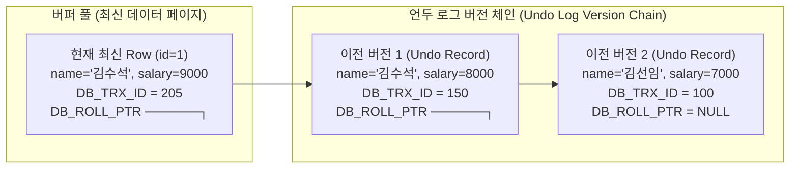

- 만약 `Tx_ID = 180`인 트랜잭션(`REPEATABLE READ`)이 `id = 1`인 사원을 조회할 때, 버퍼 풀의 최신 데이터는 `DB_TRX_ID = 205`(자신보다 미래에 발생한 트랜잭션)이므로 읽을 수 없습니다.
- 이때 엔진은 `DB_ROLL_PTR` 포인터를 타고 Undo Log 체인을 거슬러 내려가 자신의 스냅샷 기준(`Read View`)에서 볼 수 있는 가장 최근 커밋 버전인 `DB_TRX_ID = 150`(`salary = 8000`)을 찾아내어 아무런 락 대기 없이 즉시 반환합니다!

---

### 3.5 실전 동시성 제어: 비관적 락(Pessimistic Lock) vs 낙관적 락(Optimistic Lock)

MVCC는 '단순 조회(SELECT)'의 성능을 극대화해 주지만, **"재고 차감", "선착순 쿠폰 발급", "포인트 출금"**처럼 여러 트랜잭션이 동시에 데이터를 읽고 수정(Read-Modify-Write)하는 상황에서는 **갱신 손실(Lost Update)**을 막기 위해 명시적인 동시성 제어 전략이 필요합니다.

#### 1. InnoDB의 락 종류: S-Lock vs X-Lock, 그리고 Record / Gap / Next-Key Lock
데이터베이스가 제공하는 물리적 잠금(Lock)은 호환성(Compatibility)과 잠금 범위에 따라 다음과 같이 구분됩니다.

| 잠금 구분 | 공유 락 (Shared Lock, S-Lock) | 배타 락 (Exclusive Lock, X-Lock) |
| :--- | :--- | :--- |
| **SQL 구문** | `SELECT ... FOR SHARE` (구 `LOCK IN SHARE MODE`) | `SELECT ... FOR UPDATE`, `UPDATE`, `DELETE` |
| **목적** | "내가 읽고 있는 동안 남들도 읽는 건 허용하지만, **절대 수정/삭제하지 마라!**" | "내가 수정하려고 읽었으니, 내가 커밋할 때까지 **남들은 수정은 물론 잠금 읽기도 하지 마라!**" |
| **S-Lock 요청 시** | **호환 가능 (즉시 획득)** | **대기 (Blocking)** |
| **X-Lock 요청 시** | **대기 (Blocking)** | **대기 (Blocking)** |

또한 InnoDB는 **테이블의 행(Row) 그 자체를 잠그는 것이 아니라, 인덱스의 레코드와 그 사이 간격을 잠근다**는 사실을 반드시 기억해야 합니다!
- **레코드 락(Record Lock)**: 인덱스의 특정 레코드 1건 자체만 정확히 잠급니다(예: PK나 Unique 인덱스로 동치 조건 검색 시).
- **갭 락(Gap Lock)**: 인덱스 레코드와 레코드 사이의 **빈 간격(Gap)**을 잠가서 그 사이에 새로운 데이터가 `INSERT` 되는 것을 원천 차단합니다.
- **넥스트 키 락(Next-Key Lock)**: `레코드 락 + 갭 락`이 결합된 형태로, `REPEATABLE READ` 격리 수준에서 범위 검색 잠금을 수행할 때 기본으로 적용되어 Phantom Read를 방지합니다.

> **⚠️ 실무 1순위 장애 주의보: 인덱스가 없는 컬럼으로 `SELECT ... FOR UPDATE`를 실행하면?**  
> InnoDB는 인덱스를 잠급니다! 만약 인덱스가 걸려 있지 않은 일반 컬럼(`WHERE coupon_name = 'WELCOME'`)으로 `SELECT ... FOR UPDATE`를 실행하면, 옵티마이저가 풀 테이블 스캔(Full Table Scan)을 수행하면서 **테이블에 존재하는 모든 행의 클러스터드 인덱스 레코드와 모든 갭(Gap)에 전부 배타 락(X-Lock)을 걸어버립니다!** 사실상 테이블 전체가 잠겨버려 서비스 전체가 멈추므로, `FOR UPDATE`나 `UPDATE/DELETE`의 `WHERE` 절에는 **반드시 인덱스가 타는지 확인**해야 합니다.

#### 2. 비관적 락(Pessimistic Lock) vs 낙관적 락(Optimistic Lock) 비교

```mermaid
sequenceDiagram
    autonumber
    participant T1 as 사용자 A (Tx 1)
    participant DB as 데이터베이스 (재고 stock=1, version=1)
    participant T2 as 사용자 B (Tx 2)

    rect rgb(235, 245, 255)
    Note over T1,T2: [방식 1] 비관적 락 (Pessimistic Lock - SELECT ... FOR UPDATE)
    T1->>DB: SELECT stock FROM product WHERE id=10 FOR UPDATE; (X-Lock 획득, stock=1)
    T2->>DB: SELECT stock FROM product WHERE id=10 FOR UPDATE; (X-Lock 대기... Blocking!)
    T1->>DB: UPDATE product SET stock = 0 WHERE id=10;
    T1->>DB: COMMIT; (X-Lock 해제!)
    DB-->>T2: 대기 해제 후 최신 값 반환 (stock=0) → T2는 '품절'로 정상 예외 처리!
    end

    rect rgb(255, 245, 235)
    Note over T1,T2: [방식 2] 낙관적 락 (Optimistic Lock - version 컬럼 CAS 검증)
    T1->>DB: SELECT stock, version FROM product WHERE id=10; (락 없음! stock=1, ver=1)
    T2->>DB: SELECT stock, version FROM product WHERE id=10; (락 없음! stock=1, ver=1)
    T1->>DB: UPDATE product SET stock=0, version=2 WHERE id=10 AND version=1;
    DB-->>T1: Updated Rows = 1 (성공! COMMIT)
    T2->>DB: UPDATE product SET stock=0, version=2 WHERE id=10 AND version=1;
    DB-->>T2: Updated Rows = 0 (버전이 이미 2로 바뀌어 조건 불일치!) → 애플리케이션에서 ObjectOptimisticLockingFailureException 발생!
    end
```

| 비교 항목 | 비관적 락 (Pessimistic Lock) | 낙관적 락 (Optimistic Lock) |
| :--- | :--- | :--- |
| **핵심 철학** | "동시 충돌이 무조건 발생할 것이라고 **비관적으로 가정**하고, 읽는 순간부터 DB 물리 락(X-Lock)을 건다." | "충돌이 거의 없을 것이라고 **낙관적으로 가정**하고, DB 락 없이 읽은 뒤 `UPDATE` 시점에 `version` 컬럼으로 변경 여부를 검증(CAS)한다." |
| **구현 방법** | `SELECT ... FOR UPDATE` (`@Lock(LockModeType.PESSIMISTIC_WRITE)`) | 테이블에 `version INT` 컬럼 추가 후 `WHERE id = ? AND version = ?` (`@Version`) |
| **충돌 시 동작** | 후발 트랜잭션은 선행 트랜잭션이 커밋할 때까지 **DB 내부에서 순서대로 대기**한 뒤 최신 데이터를 받아 성공 처리함 | 후발 트랜잭션은 `Affected Rows = 0`을 반환받아 **즉시 실패(예외 발생)**하며, 재시도(Retry)하려면 애플리케이션 코드로 루프를 직접 구현해야 함 |
| **장점** | 충돌이 극심한 환경에서도 순차 처리가 보장되어 데이터 정합성이 확실하고 재시도 폭풍이 없음 | DB 레벨에서 락을 잡고 대기하지 않으므로 충돌이 드문 환경에서 커넥션 점유 시간과 처리량이 매우 우수함 |
| **단점** | 락 대기로 인해 커넥션 풀 고갈 위험이 있으며, 다중 리소스 잠금 시 **데드락(Deadlock)** 발생 가능성이 높음 | 동시 요청 1,000건이 몰리면 1건만 성공하고 999건이 실패하여 재시도 쿼리가 DB를 폭격하는 **Retry Storm** 발생 |
| **실무 권장 시나리오** | **선착순 타임딜 재고 차감, 계좌 잔액 출금, 좌석/숙박 동시 예약** 등 충돌 빈도가 높고 순차 처리가 중요한 핵심 도메인 | **관리자 화면의 게시글/상품 정보 수정, 회원 개인 설정 변경** 등 동시 수정 확률이 낮고 충돌 시 "다른 사용자가 이미 수정했습니다"라고 안내하면 되는 도메인 |

#### 3. 실전 코드 비교: 재고 차감 동시성 제어 (SQL & Spring Data JPA)

```sql
-- [방법 A: 원자적 UPDATE 쿼리 (단일 테이블 단순 차감 시 가장 빠르고 안전한 실무 1순위 기법)]
-- 애플리케이션에서 조회 후 계산하지 않고, UPDATE 문의 WHERE 절에서 재고 조건(stock >= :qty)을 함께 검사합니다!
-- UPDATE 문 자체가 해당 레코드에 X-Lock을 걸고 현재 값(Current Read)을 평가하므로 별도의 FOR UPDATE 없이도 음수 재고를 완벽히 차단합니다.
UPDATE products 
SET stock_quantity = stock_quantity - 1 
WHERE id = 100 
  AND stock_quantity >= 1;
-- 실행 결과 Affected Rows가 1이면 차감 성공, 0이면 재고 부족(품절)으로 즉시 판별!
```

복잡한 비즈니스 검증(회원 등급 확인, 쿠폰 적용, 주문서 생성 등)이 수반되어 엔티티 조회 후 차감해야 하는 경우의 Spring Boot / JPA 실전 코드는 다음과 같습니다.

```java
// 1. 비관적 락 (Pessimistic Write Lock) Repository & Service 구현
public interface ProductRepository extends JpaRepository<Product, Long> {

    @Lock(LockModeType.PESSIMISTIC_WRITE)
    @QueryHints({@QueryHint(name = "jakarta.persistence.lock.timeout", value = "3000")}) // 3초 이상 락 대기 시 빠른 실패로 커넥션 풀 보호!
    @Query("SELECT p FROM Product p WHERE p.id = :id")
    Optional<Product> findByIdWithPessimisticLock(@Param("id") Long id);
}

@Service
@RequiredArgsConstructor
public class OrderConcurrencyService {
    private final ProductRepository productRepository;

    @Transactional
    public void decreaseStockPessimistic(Long productId, int quantity) {
        // 실행 SQL: SELECT ... FROM products WHERE id = ? FOR UPDATE
        Product product = productRepository.findByIdWithPessimisticLock(productId)
                .orElseThrow(() -> new IllegalArgumentException("상품이 존재하지 않습니다."));
        
        product.decreaseStock(quantity); // 내부에서 stock < quantity 이면 예외 발생
        // 트랜잭션 커밋 시 UPDATE products SET stock_quantity = ? WHERE id = ? 실행 후 X-Lock 해제
    }
}
```

```java
// 2. 낙관적 락 (Optimistic Lock) Entity & 재시도 퍼사드(Facade) 구현
@Entity
@Table(name = "products")
public class Product {
    @Id @GeneratedValue(strategy = GenerationType.IDENTITY)
    private Long id;

    private int stockQuantity;

    @Version // JPA 낙관적 락 활성화: UPDATE 시 자동으로 version = version + 1 및 WHERE version = ? 조건 추가
    private Long version;

    public void decreaseStock(int quantity) {
        if (this.stockQuantity < quantity) {
            throw new IllegalStateException("재고가 부족합니다.");
        }
        this.stockQuantity -= quantity;
    }
}

// 주의: 낙관적 락 재시도(Retry)는 반드시 @Transactional 바깥의 별도 퍼사드 계층에서 수행해야 새로운 트랜잭션과 최신 스냅샷으로 재시도됩니다!
@Component
@RequiredArgsConstructor
public class OptimisticStockFacade {
    private final OrderConcurrencyService orderService;

    public void decreaseStockWithRetry(Long productId, int quantity) throws InterruptedException {
        int maxRetries = 5;
        for (int attempt = 1; attempt <= maxRetries; attempt++) {
            try {
                orderService.decreaseStockOptimistic(productId, quantity);
                return; // 성공 시 즉시 종료
            } catch (ObjectOptimisticLockingFailureException e) {
                if (attempt == maxRetries) throw e;
                Thread.sleep(30L * attempt); // 지수 백오프(Exponential Backoff) 대기 후 재시도
            }
        }
    }
}
```

---

### 3.6 데드락(Deadlock, 교착 상태) 발생 원리와 실전 로그 분석법

**데드락(Deadlock)**은 두 개 이상의 트랜잭션이 각각 자신이 보유한 락을 놓지 않은 채, 상대방이 보유한 락이 풀리기만을 무한정 기다리는 교착 상태입니다.

```mermaid
sequenceDiagram
    autonumber
    participant T1 as 트랜잭션 1 (계좌 10번 → 20번 이체)
    participant DB as InnoDB 락 매니저 (Wait-for Graph)
    participant T2 as 트랜잭션 2 (계좌 20번 → 10번 이체)

    T1->>DB: UPDATE account SET balance = balance - 100 WHERE id = 10; (id=10 X-Lock 획득!)
    T2->>DB: UPDATE account SET balance = balance - 100 WHERE id = 20; (id=20 X-Lock 획득!)
    T1->>DB: UPDATE account SET balance = balance + 100 WHERE id = 20; (T2가 쥔 id=20 락 대기...)
    T2->>DB: UPDATE account SET balance = balance + 100 WHERE id = 10; (T1이 쥔 id=10 락 대기...)
    
    Note over DB: [순환 대기(Cycle) 감지! Deadlock 발생!]<br/>InnoDB가 언두 로그 크기(가중치)가 더 작은 트랜잭션을<br/>희생양(Victim)으로 선정하여 강제 ROLLBACK!
    DB-->>T2: ERROR 1213 (40001): Deadlock found when trying to get lock; try restarting transaction
    DB-->>T1: T2 롤백으로 id=20 락 해제됨 → T1 정상 실행 완료 및 COMMIT!
```

#### InnoDB 데드락 로그(`SHOW ENGINE INNODB STATUS`) 실전 해독 가이드
운영 환경에서 `Deadlock found` 에러가 발생했을 때, DBA는 즉시 `SHOW ENGINE INNODB STATUS\G` 명령을 실행하여 **`LATEST DETECTED DEADLOCK`** 섹션을 분석합니다.

```text
------------------------
LATEST DETECTED DEADLOCK
------------------------
2026-11-15 14:22:10 0x7f8b9c123700
*** (1) TRANSACTION:
TRANSACTION 482910, ACTIVE 2 sec starting index read
mysql tables in use 1, locked 1
LOCK WAIT 3 lock struct(s), heap size 1136, 2 row lock(s), undo log entries 1
MySQL thread id 842, OS thread handle 14023, query id 99281 10.0.1.15 app_user updating
UPDATE accounts SET balance = balance + 100 WHERE id = 20

*** (1) HOLDS THE LOCK(S):
RECORD LOCKS space id 58 page no 4 n bits 72 index PRIMARY of table `bank`.`accounts` trx id 482910 lock_mode X locks rec but not gap
Record lock, heap no 2 PHYSICAL RECORD: n_fields 4; compact format; info bits 0
 0: len 8; hex 800000000000000a; asc         ;; -- (해독: 0x0a = 10번 PK의 X-Lock을 보유 중!)

*** (1) WAITING FOR THIS LOCK TO BE GRANTED:
RECORD LOCKS space id 58 page no 4 n bits 72 index PRIMARY of table `bank`.`accounts` trx id 482910 lock_mode X locks rec but not gap waiting
Record lock, heap no 3 PHYSICAL RECORD: n_fields 4; compact format; info bits 0
 0: len 8; hex 8000000000000014; asc         ;; -- (해독: 0x14 = 20번 PK의 X-Lock을 기다리는 중!)

*** (2) TRANSACTION:
TRANSACTION 482911, ACTIVE 1 sec starting index read
mysql tables in use 1, locked 1
3 lock struct(s), heap size 1136, 2 row lock(s), undo log entries 1
MySQL thread id 845, OS thread handle 14028, query id 99285 10.0.1.16 app_user updating
UPDATE accounts SET balance = balance + 100 WHERE id = 10

*** (2) HOLDS THE LOCK(S):
RECORD LOCKS space id 58 page no 4 n bits 72 index PRIMARY of table `bank`.`accounts` trx id 482911 lock_mode X locks rec but not gap
 -- (해독: 0x14 = 20번 PK의 X-Lock을 보유 중!)

*** (2) WAITING FOR THIS LOCK TO BE GRANTED:
RECORD LOCKS space id 58 page no 4 n bits 72 index PRIMARY of table `bank`.`accounts` trx id 482911 lock_mode X locks rec but not gap waiting
 -- (해독: 0x0a = 10번 PK의 X-Lock을 기다리는 중!)

*** WE ROLL BACK TRANSACTION (2)
```

- **핵심 해독 포인트**:
  1. `index PRIMARY of table bank.accounts`: 어느 테이블의 어느 인덱스에서 충돌이 났는가? (`PRIMARY` 클러스터드 인덱스)
  2. `lock_mode X locks rec but not gap`: 어떤 종류의 락인가? (`locks rec but not gap` = 순수 **Record Lock**, `locks gap before rec` = **Gap Lock**, 아무 수식어가 없으면 **Next-Key Lock**)
  3. `WE ROLL BACK TRANSACTION (2)`: 누가 강제 롤백되었는가? (2번 트랜잭션이 Victim으로 선정되어 에러가 반환됨)

#### 실무 데드락 예방 4대 철칙
1. **잠금 획득 순서(Lock Ordering)를 항상 일정하게 강제하라**: 두 개 이상의 행이나 테이블을 수정할 때는 무조건 **PK 오름차순(`ORDER BY id ASC`)**으로 정렬하여 락을 획득하십시오. 위 이체 예시에서도 무조건 번호가 작은 계좌(`10번`)부터 먼저 잠그고 큰 계좌(`20번`)를 잠그도록 코드 규칙을 통일하면 순환 대기가 원천적으로 발생할 수 없습니다!
2. **트랜잭션의 크기와 실행 시간을 극단적으로 짧게 유지하라**: 트랜잭션 내부에서 외부 API를 호출하거나 무거운 연산을 수행하지 마십시오. 락을 쥐고 있는 시간이 100ms에서 5ms로 줄어들면 데드락 확률은 기하급수적으로 감소합니다.
3. **불필요한 갭 락(Gap Lock) 경합이 심하다면 `READ COMMITTED` 격리 수준을 검토하라**: `REPEATABLE READ`는 범위 조건 수정이나 유니크 인덱스 중복 체크 과정에서 갭 락과 넥스트 키 락을 광범위하게 걸어 예상치 못한 INSERT 데드락을 유발합니다. 실무 대규모 서비스에서는 갭 락을 비활성화하기 위해 격리 수준을 `READ COMMITTED`로 낮추어 운영하는 경우가 매우 많습니다.
4. **데드락은 100% 박멸할 수 있는 버그가 아니라 자연스러운 현상임을 인정하고 재시도(Retry) 로직을 갖추라**: 고도의 동시성 환경에서는 인덱스 페이지 분할이나 외래키 S-Lock 전파로 인해 우발적 데드락이 언제든 발생할 수 있습니다. 데드락 예외(`CannotAcquireLockException`, Error 1213) 발생 시 애플리케이션에서 1~2회 자동 재시도하도록 설계하면 사용자는 아무런 에러도 느끼지 못합니다.

---

## 04. 인덱스(Index)는 왜 필요한가요?
> **Full Table Scan vs Index Scan, B+Tree 인덱스 구조와 커버링 인덱스, 실행 계획(`EXPLAIN`) 완벽 해독 가이드, 그리고 대용량 페이징 최적화(No-Offset & 지연 조인)**

데이터베이스 성능 튜닝의 9할은 인덱스에서 시작하여 인덱스로 끝납니다. 1,000만 건의 데이터가 담긴 테이블에서 특정 레코드를 조회할 때, 인덱스가 없으면 수 초 이상의 디스크 I/O가 발생하여 서버가 멈추지만, 올바른 인덱스 하나만 존재하면 단 수 밀리초(0.001초) 만에 결과를 반환합니다. 인덱스의 내부 자료구조부터 실행 계획 해독, 그리고 수천만 건 테이블의 페이징 쿼리 튜닝까지 완벽히 마스터해 봅시다.

---

### 4.1 책의 색인(Index) 비유와 풀 테이블 스캔 vs 인덱스 스캔

우리가 1,500페이지 분량의 두꺼운 《데이터베이스 시스템》 전공 서적에서 **"트랜잭션 격리 수준"**이라는 주제를 찾는다고 가정해 봅시다.

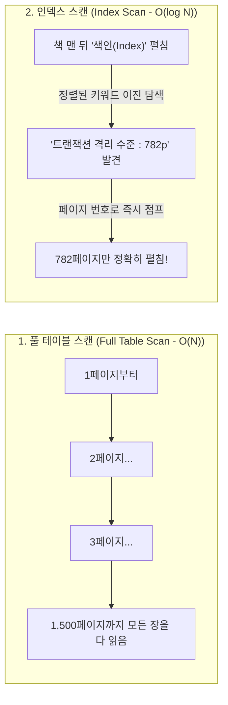

- **풀 테이블 스캔(Full Table Scan)**: 인덱스가 없거나, 조회해야 할 데이터가 전체 테이블의 상당 비율(통상 15~25% 이상)을 차지할 때 옵티마이저가 선택하는 방식입니다. 디스크의 첫 블록부터 끝 블록까지 연속된 페이지들을 한 번에 여러 블록씩(Multi-block Read / Sequential I/O) 읽어 내려갑니다.
- **인덱스 스캔(Index Scan)**: 키 값이 정렬되어 있는 별도의 B+Tree 인덱스 구조체를 루트부터 리프까지 탐색(`O(log N)`)하여 조건에 부합하는 데이터의 위치(PK 또는 물리 주소)를 알아낸 뒤, 해당 데이터 페이지만 디스크에서 콕 집어 랜덤 I/O(Single-block Random I/O)로 읽어옵니다.

---

### 4.2 B-Tree와 B+Tree 구조와 검색 원리

관계형 데이터베이스 엔진이 가장 보편적으로 사용하는 표준 인덱스 자료구조는 **B+Tree(Balanced Tree의 확장판)**입니다. 이진 탐색 트리(Binary Search Tree)는 자식 노드가 최대 2개뿐이어서 데이터가 1,000만 건이면 트리 높이가 24 이상 깊어지고 한쪽으로 편향될 위험이 있지만, B+Tree는 하나의 노드(16KB 페이지)에 수백~수천 개의 키를 담아 **자가 균형(Self-Balancing)**을 유지하므로 1억 건의 데이터가 들어있어도 트리 높이(Depth)가 **3~4 단계**를 넘지 않습니다.

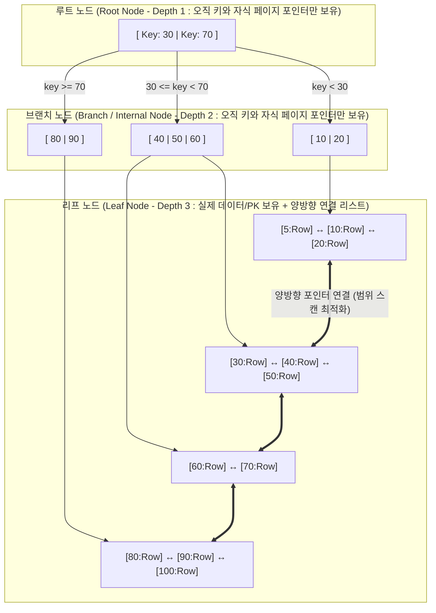

#### 왜 오리지널 B-Tree가 아닌 B+Tree를 사용할까요?
1. **비단말 노드의 팬아웃(Fan-out) 극대화로 트리 높이 최소화**:
   - 오리지널 B-Tree는 루트 노드와 브랜치 노드에도 실제 데이터 값(Data Payload)을 함께 저장합니다. 데이터 크기가 크면 한 페이지(16KB)에 들어가는 자식 포인터 수(Fan-out)가 급격히 줄어들어 트리 높이가 깊어집니다.
   - 반면 **B+Tree**는 루트와 브랜치 노드에는 데이터를 일절 넣지 않고 **오직 인덱스 키(Key)와 자식 페이지 번호(Pointer)**만 저장합니다. 덕분에 16KB 노드 하나가 수백 개의 자식 노드를 거느릴 수 있어, 단 3~4번의 페이지 접근만으로 수억 건 중 원하는 위치를 찾아냅니다.
2. **리프 노드 간의 양방향 연결 리스트(Doubly Linked List)를 통한 범위 검색(`BETWEEN`, `>`, `<`) 혁신**:
   - 오리지널 B-Tree에서 `WHERE id BETWEEN 20 AND 80`을 수행하려면 루트와 브랜치를 오르내리는 중위 순회(In-order Traversal)를 반복해야 합니다.
   - 반면 **B+Tree**는 모든 데이터가 최하단 리프 노드에 모여 있고, 리프 노드 페이지끼리 앞뒤 포인터(Prev/Next Page Pointer)로 촘촘히 연결되어 있습니다. 따라서 루트에서 `20`이 위치한 첫 리프 노드만 딱 한 번 찾으면, 그다음부터는 트리를 다시 탈 필요 없이 리프 노드의 연결 리스트를 따라 오른쪽으로 쭉 읽기만 하면(`Index Range Scan`) 끝납니다!

---

### 4.3 클러스터드 인덱스 vs 세컨더리 인덱스와 커버링 인덱스(Covering Index)

MySQL InnoDB 스토리지 엔진에서 인덱스는 **클러스터드 인덱스(Clustered Index)**와 **세컨더리 인덱스(Secondary Index / 보조 인덱스)** 두 가지로 명확히 구분됩니다.

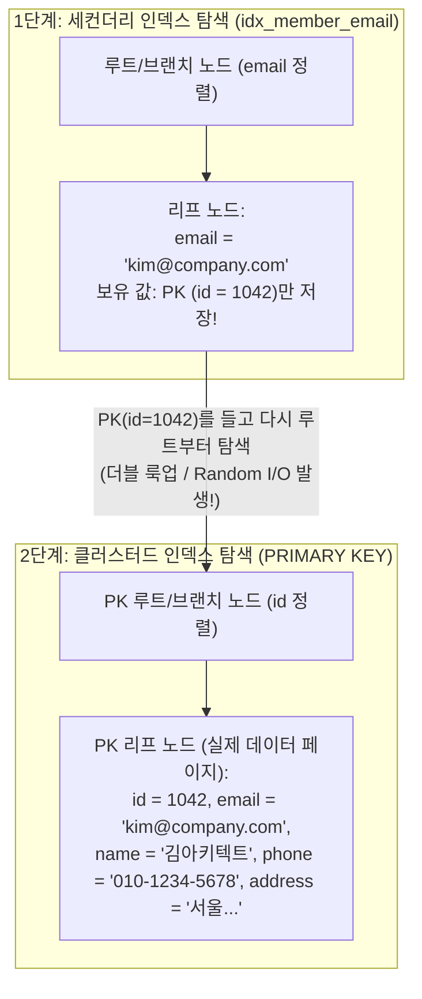

| 비교 항목 | 클러스터드 인덱스 (Clustered Index) | 세컨더리 인덱스 (Secondary / Non-Clustered Index) |
| :--- | :--- | :--- |
| **생성 기준 및 개수** | 테이블당 **오직 1개**만 존재 (`PRIMARY KEY` 기준 자동 생성) | 테이블당 **여러 개** 생성 가능 (`CREATE INDEX` / `UNIQUE`) |
| **리프 노드의 정체** | **실제 테이블의 데이터 레코드( 모든 컬럼 포함 ) 그 자체** | **인덱스 컬럼 값 + 해당 행의 PK 값(주소 역할)** |
| **물리적 정렬 여부** | PK 값이 바뀔 때마다 실제 데이터 행의 물리적 저장 위치가 이동함 | 실제 데이터 위치와 무관하게 별도의 인덱스 트리 공간에서만 정렬됨 |
| **조회 메커니즘** | PK 트리를 1회 탐색하면 리프 노드에서 즉시 모든 컬럼 획득 | 세컨더리 인덱스 트리에서 PK를 찾은 뒤, 다시 클러스터드 인덱스 트리를 타서 실제 행을 읽는 **더블 룩업(Double Lookup)** 수행 |

#### 왜 세컨더리 인덱스는 실제 데이터의 물리 주소(메모리/디스크 포인터) 대신 PK 값을 저장할까요?
만약 세컨더리 인덱스가 레코드의 물리적 디스크 주소(Page 번호 + Offset)를 직접 가리키고 있다면, 클러스터드 인덱스에 새로운 행이 `INSERT` 되어 **페이지 분할(Page Split)**이 일어나는 순간 수백 개의 레코드의 물리적 주소가 한꺼번에 바뀝니다. 그러면 테이블에 걸려 있는 5~10개의 모든 세컨더리 인덱스를 전부 뒤져서 바뀐 물리 주소를 일일이 수정해야 하는 끔찍한 오버헤드가 발생합니다. 따라서 InnoDB는 물리 주소가 바뀌더라도 변하지 않는 논리적 주소인 **PK 값**을 세컨더리 인덱스 리프 노드에 저장하는 설계를 택했습니다.

#### 쿼리 튜닝의 절대 비기: 커버링 인덱스(Covering Index)
세컨더리 인덱스 검색이 느려지는 가장 큰 원인은 리프 노드에서 얻은 PK를 가지고 실제 데이터 페이지(클러스터드 인덱스)를 디스크에서 랜덤 I/O로 읽어오는 **더블 룩업(Table Lookup)** 과정 때문입니다.  
만약 `SELECT` 절에서 조회하려는 컬럼과 `WHERE`, `ORDER BY`, `GROUP BY`에 사용되는 **모든 컬럼이 이미 하나의 세컨더리 인덱스 안에 전부 포함되어 있다면** 어떨까요? 엔진은 실제 데이터 테이블(`.ibd`의 데이터 영역)에는 단 한 번도 접근하지 않고 **오직 작고 가벼운 세컨더리 인덱스 리프 노드만 읽어서 쿼리를 즉시 끝내버립니다!** 이를 **커버링 인덱스(Covering Index)**라고 하며, 실행 계획(`EXPLAIN`)의 `Extra` 컬럼에 **`Using index`**라고 표시됩니다.

---

### 4.4 인덱스의 CUD 오버헤드와 설계 황금률

인덱스는 조회(`SELECT`) 성능을 극대화하지만, 쓰기(`INSERT`, `UPDATE`, `DELETE`) 성능을 깎아 먹는 양날의 검입니다. 테이블 하나에 인덱스가 8개 걸려 있다면, `INSERT` 문 1개를 실행할 때 데이터 저장 1번 + 인덱스 트리 8개 수정 및 페이지 분할까지 내부적으로 총 9번의 쓰기 작업이 일어납니다. 따라서 실무에서는 **한 테이블당 인덱스 개수를 최대 4~5개 이내로 엄격히 통제**하며 다음 4대 설계 황금률을 준수합니다.

1. **카디널리티(Cardinality, 고유값의 수)가 높고 선택도(Selectivity)가 낮은 컬럼을 선두에 배치하라**: 성별(`M/F`), 삭제 여부(`Y/N`)처럼 고유값이 2개뿐인 컬럼은 단일 인덱스를 걸어도 쓸모가 없습니다. 이메일, 회원번호, 주문일시처럼 값의 종류가 다양한 컬럼에 인덱스를 걸어야 합니다.
2. **복합 인덱스(Composite Index)는 `동치(=) 조건 컬럼 → 범위(>, <, BETWEEN) 조건 컬럼 → 정렬(ORDER BY) 컬럼` 순서로 구성하라**:
   - 복합 인덱스 `INDEX idx_dept_sal (dept_id, salary)`는 먼저 `dept_id`로 정렬하고, **`dept_id`가 같은 레코드들 안에서만 `salary` 오름차순으로 정렬**됩니다.
   - 만약 선행 컬럼인 `dept_id`를 빼먹고 `WHERE salary > 5000`으로 조회하면 인덱스의 정렬 순서를 전혀 탈 수 없습니다(**Left-most Prefix 원칙**).
   - 또한 선행 컬럼에 범위 조건(`WHERE dept_id > 10 AND salary = 5000`)을 사용하면, `dept_id > 10` 구간에서는 `salary`가 전역적으로 정렬되어 있지 않으므로 두 번째 컬럼인 `salary`는 인덱스 탐색 조건(Access Predicate)으로 쓰이지 못하고 단순 필터링 조건(Filter Predicate)으로 전락합니다!
3. **인덱스 컬럼(좌변)을 절대 가공하거나 암묵적 형변환을 유발하지 마라**:
   - `WHERE YEAR(order_date) = 2026` → `WHERE order_date >= '2026-01-01 00:00:00' AND order_date < '2027-01-01 00:00:00'`으로 우변을 가공해야 인덱스를 탑니다.
   - **암묵적 형변환(Implicit Type Conversion) 참사**: `phone VARCHAR(20)` 문자열 컬럼에 인덱스가 걸려 있는데, 개발자가 실수로 따옴표 없이 숫자형으로 `WHERE phone = 01012345678`을 날리면, MySQL은 문자열 컬럼 전체에 `CAST(phone AS DOUBLE)` 함수를 씌워 숫자로 변환한 뒤 비교하므로 **인덱스가 완전히 깨지고 Full Table Scan이 발생**합니다!

---

### 4.5 실행 계획(`EXPLAIN` / `EXPLAIN ANALYZE`) 완벽 해독 가이드

쿼리를 작성한 뒤 반드시 `EXPLAIN SELECT ...`를 실행하여 옵티마이저가 수립한 실행 계획을 검증해야 합니다. 또한 MySQL 8.0.18+ 및 PostgreSQL에서 지원하는 **`EXPLAIN ANALYZE`**를 사용하면 옵티마이저의 '예측치'뿐만 아니라 쿼리를 실제로 실행하여 측정한 **실제 소요 시간(Actual Time)과 실제 읽은 행 수(Actual Rows)**까지 정확히 대조할 수 있습니다.

```sql
EXPLAIN
SELECT o.id, o.order_no, o.final_pay_amount
FROM orders o
INNER JOIN members m ON o.member_id = m.id
WHERE m.email = 'architect@company.com'
  AND o.ordered_at >= '2026-01-01 00:00:00'
ORDER BY o.ordered_at DESC;
```

#### 1. `EXPLAIN` 핵심 출력 컬럼 의미
- **`id`**: `SELECT` 쿼리 단위의 실행 식별 번호입니다. 조인(JOIN)은 같은 `id` 번호를 가지며, 서브쿼리나 `UNION`이 포함되면 `id` 번호가 나뉩니다.
- **`select_type`**: 쿼리의 유형입니다(`SIMPLE`: 단순 쿼리/조인, `PRIMARY`: 가장 바깥쪽 쿼리, `DERIVED`: `FROM` 절 내부의 인라인 뷰 서브쿼리로 임시 테이블 생성, `SUBQUERY`: `WHERE/SELECT` 절의 서브쿼리).
- **`type` (★ 가장 중요한 핵심 지표)**: 스토리지 엔진이 테이블의 데이터를 어떤 방식(Access Method)으로 찾았는지를 나타냅니다. **위에서 아래로 갈수록 성능이 느려지며, 실무에서는 최소 `range` 이상을 목표로 튜닝**해야 합니다!

#### 2. `type` 컬럼(접근 방식) 성능 순위 완벽 해독표 (빠른 순 → 느린 순)

| 순위 | `type` 값 | 의미 및 동작 메커니즘 | 실무 판정 및 발생 조건 |
| :---: | :--- | :--- | :--- |
| **1** | **`system`** | 테이블에 레코드가 0건 또는 단 1건만 존재하는 특수한 경우 | 최상 (메모리 상수 수준) |
| **2** | **`const`** | **PK 또는 Unique 인덱스**의 모든 컬럼을 동치(`=`) 조건으로 검색하여 **결과가 반드시 최대 1건**임이 보장되는 방식 | **최상!** 옵티마이저가 실행 계획 수립 단계에서 아예 해당 행을 읽어 상수로 치환해 버림 (`WHERE id = 100`) |
| **3** | **`eq_ref`** | 여러 테이블을 **JOIN** 할 때, 드리븐(Driven, 뒤쪽) 테이블의 **PK 또는 Unique Not Null 인덱스**를 동치(`=`) 조건으로 매칭하여 매번 정확히 1건씩만 조인하는 방식 | **조인 시 최상의 성능!** (`INNER JOIN members m ON o.member_id = m.id`) |
| **4** | **`ref`** | PK나 Unique가 아닌 **일반 세컨더리 인덱스**를 동치(`=`) 조건으로 검색하는 방식 (중복된 값이 있을 수 있어 결과가 여러 건일 수 있음) | **매우 우수!** 실무에서 가장 흔히 사용하는 동치 인덱스 스캔 (`WHERE member_id = 50`) |
| **5** | **`range`** | 인덱스를 사용하여 특정 범위(`BETWEEN`, `>`, `<`, `IN (...)`, `LIKE 'abc%'`)의 레코드들을 스캔하는 방식 | **우수 (실무 마지노선)!** B+Tree 리프 노드의 연결 리스트를 타는 Index Range Scan |
| **6** | **`index`** | **인덱스 풀 스캔(Full Index Scan)**: 인덱스의 처음부터 끝까지 모든 리프 노드를 다 읽는 방식 | **주의/위험!** 테이블 풀 스캔(`ALL`)보다는 파일 크기가 작아 조금 낫지만, 사실상 인덱스 전체를 다 훑으므로 대용량에선 튜닝 대상임 |
| **7** | **`ALL`** | **풀 테이블 스캔(Full Table Scan)**: 인덱스를 전혀 타지 못하고 테이블의 모든 데이터 페이지를 처음부터 끝까지 다 읽는 방식 | **최악 (즉시 튜닝 필수)!** OLTP 온라인 서비스에서 수백만 건 테이블에 `ALL`이 뜨면 장애의 직접적 원인이 됨 |

#### 3. `key`, `key_len`, `rows`, `filtered` 및 `Extra` 컬럼 완벽 해독표

- **`possible_keys` vs `key`**: `possible_keys`는 옵티마이저가 후보로 검토한 인덱스 목록이고, **`key`는 실제로 최종 선택된 인덱스**입니다. `key`가 `NULL`이면 인덱스를 전혀 못 탄 것입니다.
- **`key_len`**: 복합 인덱스에서 실제로 몇 바이트(몇 개의 컬럼)까지 인덱스 탐색에 활용되었는지를 알려주는 결정적 단서입니다. 예를 들어 `(col1 INT NOT NULL, col2 INT NOT NULL)` 복합 인덱스에서 `key_len`이 `4`로 찍혔다면 첫 번째 `col1`(4Byte)만 인덱스를 탔고 `col2`는 타지 못했다는 뜻이며, `8`로 찍혔다면 두 컬럼 모두 인덱스를 완벽히 탔다는 뜻입니다!
- **`rows`**: 옵티마이저가 이 쿼리를 처리하기 위해 스토리지 엔진에서 읽어야 할 것으로 **예측한 레코드 건수**입니다.

| `Extra` 컬럼 출력 문구 | 내부 동작 의미 | 튜닝 판정 및 대처법 |
| :--- | :--- | :--- |
| **`Using index`** | **커버링 인덱스(Covering Index)**로 동작함! 데이터 파일을 전혀 읽지 않고 인덱스만으로 쿼리 완료 | **최고의 축복!** 극강의 조회 성능을 보장함 |
| **`Using index condition`** | **ICP(Index Condition Pushdown)** 작동. 복합 인덱스에서 범위 조건 뒤쪽 컬럼의 필터링을 스토리지 엔진 레벨에서 먼저 걸러내어 불필요한 테이블 랜덤 I/O를 대폭 줄임 | **양호!** MySQL 5.6+의 핵심 최적화 기능이 정상 작동 중 |
| **`Using where`** | 스토리지 엔진에서 읽어온 레코드를 MySQL 서버 엔진(Executor) 계층에서 `WHERE` 조건으로 한 번 더 걸러냄(Filtering) | 보통. 단, `rows` 수치는 10만 건인데 최종 결과는 10건이라면 인덱스에 조건 컬럼을 추가하여 스토리지 엔진 단계에서 걸러내도록 개선 필요 |
| **`Using temporary`** | 쿼리 중간 결과를 담기 위해 메모리 또는 디스크에 **임시 테이블(Temporary Table)**을 생성함 (`GROUP BY`, `DISTINCT`, `UNION` 등) | **위험!** 특히 디스크 임시 테이블이 생성되면 성능이 급락하므로 인덱스를 활용해 그룹핑을 유도해야 함 |
| **`Using filesort`** | 인덱스의 정렬 순서를 활용하지 못해, 읽어온 레코드들을 별도의 메모리(Sort Buffer)나 디스크 파일에 올린 뒤 **강제 정렬(Quick/Merge Sort)**을 수행함 | **매우 위험 (튜닝 1순위)!** 대량 데이터를 정렬하면 CPU와 메모리가 폭발하므로 `ORDER BY` 컬럼까지 포함된 복합 인덱스로 정렬을 생략해야 함 |

---

### 4.6 대용량 페이징(Pagination) 최적화: Offset의 재앙과 No-Offset / 커버링 인덱스 지연 조인(Deferred Join)

게시판이나 상품 목록, 주문 내역에서 흔히 작성하는 `LIMIT 20 OFFSET 0` 방식의 페이징 쿼리는 앞페이지(1~10페이지)에서는 아무런 문제가 없습니다. 하지만 데이터가 1,000만 건 쌓인 테이블에서 누군가 50,001번째 페이지(**`LIMIT 20 OFFSET 1000000`**)를 조회하는 순간 쿼리 응답 시간이 5~10초 이상 걸리며 DB CPU가 치솟습니다. 왜 그럴까요?

```mermaid
flowchart TD
    subgraph BadOffset["1. 전통적 Offset 페이징 (LIMIT 20 OFFSET 1,000,000)의 대참사"]
        O1["세컨더리 인덱스(idx_created_at)에서 1,000,020건을 스캔"] --> O2["앞의 1,000,000건에 대해서도 전부 클러스터드 인덱스(데이터 페이지)를 찾아가는<br/>100만 번의 랜덤 I/O (더블 룩업) 수행!"]
        O2 --> O3["가져온 100만 건의 완성된 행을 그냥 쓰레기통에 버리고(Discard)<br/>마지막 20건만 클라이언트에 반환! (수 초 소요)"]
    end

    subgraph GoodNoOffset["2. No-Offset (커서 기반) 페이징 : O(1)에 수렴하는 극강의 속도"]
        N1["직전 페이지의 마지막 ID(last_id)를 조건절로 전달:<br/>WHERE id < :last_id ORDER BY id DESC LIMIT 20"] --> N2["B+Tree에서 :last_id 위치를 단 한 번에 찾은 뒤<br/>정확히 20건만 읽고 즉시 종료! (1페이지든 10만 페이지든 항상 0.001초!)"]
    end

    subgraph GoodDeferred["3. 커버링 인덱스 지연 조인 (Deferred Join) : 페이지 번호 이동이 필수일 때"]
        D1["인라인 뷰(서브쿼리)에서 오직 PK(id)만 조회하여 커버링 인덱스(Using index) 작동!<br/>→ 1,000,020건을 인덱스 리프 노드에서만 초고속 스캔하여 최종 20개의 id만 추출"] --> D2["추출된 딱 20개의 id에 대해서만 원본 테이블과 JOIN(더블 룩업 단 20회!)하여<br/>전체 컬럼 완성! (기존 대비 20~50배 속도 향상!)"]
    end

    style BadOffset fill:#ffdddd,stroke:#ff6666
    style GoodNoOffset fill:#eef9ee,stroke:#55aa55
    style GoodDeferred fill:#eef5ff,stroke:#4488ff
```

#### 대용량 페이징 3대 방식 실전 SQL 비교

```sql
-- =================================================================================
-- ❌ [안티패턴] 1. 일반 Offset 페이징 : 뒤쪽 페이지로 갈수록 랜덤 I/O 100만 회로 DB 사망
-- =================================================================================
-- 실행 시간 (1,000만 건 테이블 기준): 약 4.85초 (EXPLAIN 시 rows = 1,000,020, Extra = Using where)
SELECT id, member_id, title, content, created_at
FROM boards
WHERE category_id = 10
ORDER BY id DESC
LIMIT 20 OFFSET 1000000;


-- =================================================================================
-- ⭕ [해법 1] No-Offset (Cursor-based / Keyset Pagination) : 무한 스크롤 & '더보기'의 표준!
-- =================================================================================
-- 핵심 원리: OFFSET을 아예 제거하고, 직전 페이지의 마지막 레코드 PK(:last_seen_id)를 WHERE 조건의 시작점으로 삼습니다.
-- 앞의 100만 건을 세어 건너뛸 필요가 전혀 없으므로 1페이지든 50만 번째 페이지든 똑같이 0.001초가 걸립니다!
-- 실행 시간: 0.001초 (EXPLAIN 시 rows = 20)
SELECT id, member_id, title, content, created_at
FROM boards
WHERE category_id = 10
  AND id < 8999980 -- 직전 페이지의 20번째 마지막 행의 id 값
ORDER BY id DESC
LIMIT 20;

-- [심화] 만약 정렬 기준이 고유하지 않은 날짜(created_at DESC, id DESC) 복합 정렬이라면?
-- 튜플 비교나 복합 조건절로 유실 없는 커서 페이징을 구현합니다:
SELECT id, member_id, title, content, created_at
FROM boards
WHERE category_id = 10
  AND (
      created_at < '2026-11-10 15:30:00' 
      OR (created_at = '2026-11-10 15:30:00' AND id < 8999980)
  )
ORDER BY created_at DESC, id DESC
LIMIT 20;


-- =================================================================================
-- ⭕ [해법 2] 커버링 인덱스 지연 조인 (Deferred Join) : UI 요구사항상 [1][2]...[50000] 페이지 번호 점프가 필수일 때!
-- =================================================================================
-- 전제 인덱스: CREATE INDEX idx_boards_category_id ON boards (category_id, id DESC);
-- 핵심 원리: 안쪽 서브쿼리(covering)에서는 SELECT id 만 조회하므로 데이터 페이지 접근(랜덤 I/O)이 0회입니다(Using index).
-- 가벼운 인덱스 리프 노드만 훑어 20개의 id만 건져 올린 뒤, 바깥쪽에서 딱 20번만 원본 테이블(b)과 조인합니다!
-- 실행 시간: 약 0.12초 (일반 Offset 대비 약 40배 이상 성능 향상!)
SELECT b.id, b.member_id, b.title, b.content, b.created_at
FROM (
    SELECT id
    FROM boards
    WHERE category_id = 10
    ORDER BY id DESC
    LIMIT 20 OFFSET 1000000
) AS covering
INNER JOIN boards b ON covering.id = b.id
ORDER BY b.id DESC;
```

> **💡 대용량 게시판/목록 서비스 아키텍트의 추가 팁: `COUNT(*)` 쿼리 제거하기!**  
> 페이지 번호 네비게이션을 그리려면 전체 건수를 세는 `SELECT COUNT(*) FROM boards WHERE category_id = 10` 쿼리가 매번 함께 실행되어야 하는데, 천만 건 테이블에서 `COUNT(*)`는 그 자체로 수 초가 걸리는 무거운 작업입니다. 따라서 실무에서는:  
> 1) **구글 검색이나 최신 커머스처럼 '전체 페이지 수'를 표시하지 않고 `[이전] [다음]`(또는 무한 스크롤)으로 UI를 전환**하거나(`LIMIT 21`로 1건 더 조회하여 다음 페이지 존재 여부만 확인하는 `Slice` 방식),  
> 2) 최근 3개월 데이터까지만 정확한 페이징을 제공하고 그 이전 과거 데이터는 검색/필터를 유도하거나,  
> 3) 전체 건수가 꼭 필요하다면 별도의 카운트 요약 테이블이나 `EXPLAIN`의 근사치 통계 값을 활용합니다.

---

## 05. 왜 앱과 DB를 바로 연동하지 않나요?
> **2-Tier vs 3-Tier 아키텍처, HikariCP 커넥션 풀 핵심 공식, 외부 API 호출 시 발생하는 커넥션 풀 고갈(Exhaustion) 대참사와 해결 코드, 그리고 ORM(JPA) N+1 문제 완벽 정복**

과거 사내 인트라넷용 클라이언트-서버(C/S) 프로그램 시절에는 PC에 설치된 실행 파일(.exe)이 데이터베이스에 직접 접속하여 쿼리를 날리곤 했습니다. 하지만 오늘날 수백만 명이 사용하는 모바일 앱(iOS/Android)이나 웹 브라우저(React/Vue)가 데이터베이스(3306, 5432 포트)에 직접 접속하는 아키텍처는 단 한 곳도 없습니다. 왜 반드시 중간에 백엔드 애플리케이션 서버(WAS)를 두는 **3-Tier 아키텍처**를 사용해야 하며, WAS와 DB 사이의 **커넥션 풀(Connection Pool)**과 **ORM**은 어떻게 튜닝해야 할까요?

---

### 5.1 2-Tier vs 3-Tier 아키텍처와 직통 연동 금지 4대 사유

```mermaid
flowchart TD
    subgraph TwoTier["1. 과거의 2-Tier 아키텍처 (보안 붕괴 & 커넥션 폭발)"]
        App1["스마트폰 앱 / 브라우저 1"] -->|"공인 인터넷망 직통 접속<br/>DB 계정 하드코딩<br/>SELECT/UPDATE 직접 실행"| DB1[("데이터베이스<br/>공인 IP 노출 / 세션 폭발")]
        App2["스마트폰 앱 2"] -->|"직통 접속"| DB1
        AppN["스마트폰 앱 100,000..."] -->|"10만 개 동시 TCP 연결 시도!"| DB1
    end

    subgraph ThreeTier["2. 현대의 3-Tier 아키텍처 (표준 보안 & 커넥션 풀링 & 무상태 확장)"]
        C1["클라이언트 1"] -->|"HTTPS REST / gRPC"| WAS["애플리케이션 계층 (WAS)<br/>인증/인가 & 비즈니스 로직 검증<br/>HikariCP 커넥션 풀 (예: 20~30개 고정)"]
        C2["클라이언트 2"] -->|"HTTPS REST / gRPC"| WAS
        CN["클라이언트 100,000..."] -->|"경량 HTTP 멀티플렉싱"| WAS
        WAS -->|"VPC 사설망(Private Subnet) 통신<br/>미리 맺어둔 소수의 커넥션 재사용"| DB2[("데이터베이스<br/>외부 인터넷 완전 차단")]
    end
```

1. **치명적인 보안성 붕괴 (DB 마스터 계정 탈취 및 네트워크 노출)**:
   - 모바일 앱 바이너리나 프론트엔드 자바스크립트 코드는 사용자의 단말기에서 실행되므로 누구나 리버스 엔지니어링(디컴파일)과 패킷 스니핑으로 내부를 들여다볼 수 있습니다. 앱에 DB 접속 정보(Host, ID, Password)를 넣는 순간 전 세계 해커에게 DB 루트 열쇠를 나눠주는 것과 같으며, DB를 공인 IP(Public Subnet)에 열어두어야 하므로 즉각적인 해킹의 표적이 됩니다.
2. **비즈니스 로직 위·변조 방어와 중앙 집중화**:
   - 결제 금액 계산, 쿠폰 유효성 검증, 권한 체크를 클라이언트에서 수행하여 곧바로 `INSERT INTO orders`를 날리게 하면, 악성 사용자가 메모리 변조 툴로 100만 원짜리 상품을 100원으로 조작해 결제할 수 있습니다. 3-Tier에서는 모든 검증과 트랜잭션 경계가 서버 측(WAS)에 격리되어 무결성을 수호합니다.
3. **무상태(Stateless) 수평 확장성(Scale-Out)과 캐싱 계층 도입**:
   - WAS 계층이 중간에 위치해야만 L4/L7 로드 밸런서를 통한 오토스케일링(Auto-scaling), Redis 캐시 적용(Look-aside Caching), 읽기/쓰기 DB 라우팅(Replication Routing) 등 현대적인 분산 아키텍처를 구현할 수 있습니다.
4. **DB 커넥션 수립 비용 절감과 커넥션 고갈 방지**:
   - 클라이언트가 DB와 새로운 커넥션을 하나 맺으려면 `TCP 3-Way Handshake → TLS 핸드셰이크 → DB 계정 인증 및 권한 조회 → 전용 세션 메모리/스레드 할당`이라는 무거운 과정을 거쳐야 하며 수십 밀리초가 소모됩니다. 더군다나 DB가 감당할 수 있는 동시 연결 수(`max_connections`)는 제한되어 있으므로, 10만 명의 유저가 직접 붙으면 DB는 즉시 다운됩니다.

---

### 5.2 HikariCP 커넥션 풀(Connection Pool) 동작 원리와 핵심 파라미터 튜닝 공식

Java/Spring 진영의 표준 커넥션 풀인 **HikariCP**는 애플리케이션 시작 시점에 DB와 미리 정해진 개수만큼 물리적 TCP 연결을 맺어 풀(Pool)에 보관해 두고, 스레드가 DB 작업이 필요할 때마다 빌려주었다가(`getConnection()`) 트랜잭션이 끝나면 연결을 끊지 않고 풀로 돌려받아(`close()` 오버라이딩) 수만 번 재사용합니다.

```mermaid
flowchart LR
    T1["워커 스레드 1"] -->|"1. 커넥션 대여 요청"| Pool
    T2["워커 스레드 2"] -->|"1. 커넥션 대여 요청"| Pool
    T3["워커 스레드 3 (대기)"] -.->|"풀에 유휴 커넥션이 없으면<br/>connectionTimeout(3초) 동안 대기"| Pool

    subgraph Pool["HikariCP Connection Pool (maximumPoolSize = 10)"]
        C1["Conn #1 (Active)"]
        C2["Conn #2 (Active)"]
        C3["Conn #3 (Idle)"]
        C10["... Conn #10 (Idle)"]
    end

    Pool <===>|"영속적 TCP 연결 유지 및 재사용"| DB[("RDBMS (max_connections = 200)")]
```

#### "커넥션 풀 크기는 무조건 크게 잡을수록 좋을까요?" → 절대 아닙니다!
많은 초보 개발자가 동시 접속자가 많다는 이유로 `maximumPoolSize`를 `200`, `500`으로 높게 설정합니다. 하지만 DB 서버의 CPU 코어가 8개뿐인데 500개의 커넥션이 동시에 쿼리를 던지면, OS 커널은 실제 쿼리를 처리하는 시간보다 500개의 스레드/프로세스를 바쁘게 교체하는 **문맥 교환(Context Switching) 오버헤드와 디스크 헤드 경합, L1/L2 CPU 캐시 미스**에 모든 자원을 낭비하여 전체 처리량(Throughput)이 오히려 급락합니다!

PostgreSQL 커뮤니티와 HikariCP 창시자(Brett Wooldridge)가 수많은 벤치마크 끝에 증명한 **최적의 커넥션 풀 크기 산정 공식**은 다음과 같습니다.

```text
[HikariCP 권장 DB 서버 당 총 활성 커넥션 수 공식]
Total Connections = ((Core_Count * 2) + Effective_Spindle_Count)

- Core_Count : DB 서버의 물리 CPU 코어 수 (하이퍼스레딩 논리 코어가 아닌 물리 코어 기준)
- Effective_Spindle_Count : 하드디스크 플래터 수 (단, 현대의 SSD/NVMe 환경에서는 디스크 탐색 지연이 거의 없으므로 보통 0 또는 1로 계산)
```

- **예시**: DB 서버가 **8 Core CPU(SSD)** 사양이라면, 이 DB 서버가 동시에 가장 빠르게 쿼리를 쳐낼 수 있는 최적의 총 동시 활성 커넥션 수는 `(8 * 2) + 1 = 약 17~20개` 수준입니다!
- 만약 이 DB 하나에 백엔드 WAS 인스턴스 **4대**가 붙어 있다면, 각 WAS 인스턴스의 `maximumPoolSize`는 `10 ~ 15`(4대 합산 최대 40~60개, DB의 `max_connections`는 여유 있게 `200` 이상 설정) 수준으로 설정하는 것이 가장 이상적입니다.

#### HikariCP 6대 핵심 파라미터 실무 설정 가이드

| 파라미터 명 | 기본값 | 실무 권장 설정값 | 상세 역할 및 튜닝 주의사항 |
| :--- | :--- | :--- | :--- |
| **`maximumPoolSize`** | `10` | **`10 ~ 30`**<br/>(트래픽 및 코어 비례) | 풀이 유지할 수 있는 최대 커넥션 개수입니다. WAS 인스턴스 수 × `maximumPoolSize`가 반드시 DB의 `max_connections`보다 작아야 합니다. |
| **`minimumIdle`** | `maximumPoolSize`와 동일 | **`maximumPoolSize`와 동일하게 고정 권장** | 풀에 유지할 최소 유휴 커넥션 수입니다. 트래픽 급증(Spike) 시 즉각 대응하기 위해 HikariCP 공식 문서는 `minimumIdle`을 따로 줄이지 말고 `maximumPoolSize`와 같은 값으로 두어 **고정 크기 풀(Fixed-size Pool)**로 운영할 것을 강력히 권장합니다. |
| **`connectionTimeout`** | `30000` (30초) | **`3000 ~ 5000` (3~5초)** | 풀에 남는 커넥션이 없을 때 스레드가 커넥션을 얻기 위해 기다리는 최대 시간입니다. 기본값 30초는 너무 길어서 장애 시 톰캣 스레드까지 연쇄 고갈시키므로, **3~5초**로 줄여 빠른 실패(Fail-Fast)를 유도해야 합니다. |
| **`maxLifetime`** | `1800000` (30분) | **DB의 `wait_timeout`보다 3~5초 짧게 설정** | 커넥션의 최대 수명입니다. MySQL이나 중간 방화벽/NAT 게이트웨이가 유휴 연결을 강제로 끊는 시간(`wait_timeout`)보다 HikariCP의 `maxLifetime`이 길면, 이미 끊어진 죽은 커넥션을 잡았다가 `Communications link failure` 에러가 터집니다! |
| **`idleTimeout`** | `600000` (10분) | 기본값 유지 (`minimumIdle == maximumPoolSize`이면 미작동) | `minimumIdle`이 `maximumPoolSize`보다 작게 설정된 경우에만 유휴 커넥션을 정리하는 시간입니다. |
| **`leakDetectionThreshold`** | `0` (비활성화) | 개발/스테이징: **`2000` (2초)** | 커넥션이 대여된 후 지정된 시간 내에 반납되지 않으면 **커넥션 누수(Connection Leak)**로 의심하여 스택 트레이스 경고 로그를 찍어줍니다. 롱 트랜잭션을 잡아내는 최고의 탐지기입니다! |

---

### 5.3 현업 1순위 장애 안티패턴: `@Transactional` 내부의 외부 API 호출로 인한 커넥션 풀 고갈(Connection Pool Exhaustion) 대참사!

수석 아키텍트로서 현업에서 마주하는 장애의 절반 이상은 DB 자체가 느려서가 아니라, **개발자가 `@Transactional` 어노테이션을 아무 생각 없이 메서드 전체에 붙여놓아 발생하는 커넥션 풀 고갈(Connection Pool Exhaustion)** 때문입니다.

#### 대참사가 발생하는 과정 (결제 승인 API 시나리오)
1. 개발자가 `OrderService.placeOrder()` 메서드에 `@Transactional`을 선언했습니다.
2. 스프링의 `TransactionInterceptor`가 DB 커넥션을 하나 대여하여 트랜잭션을 시작하고 주문 데이터를 조회/검증합니다(소요 시간: **3ms**).
3. 이어서 같은 `@Transactional` 메서드 안에서 **외부 PG사(카드사) 결제 승인 HTTP API**를 호출하고, 완료되면 **카카오 알림톡 발송 API**를 호출합니다.
4. 어느 날 외부 PG사나 알림톡 서버에 네트워크 지연이 발생하여 응답이 오는 데 **3초(3,000ms)**가 걸리기 시작했습니다!
5. 이 3초 동안 DB는 아무런 일도 하지 않고 놀고 있지만, **WAS의 워커 스레드는 외부 HTTP 응답이 돌아올 때까지 DB 커넥션을 풀에 반납하지 않고 인질로 꽉 쥐고 있습니다!**
6. `maximumPoolSize = 10`인 상태에서 초당 10명만 결제 버튼을 눌러도, **단 1초 만에 10개의 DB 커넥션이 전부 외부 API 응답 대기 상태로 묶여 고갈**됩니다!
7. 그 순간 결제가 아닌 **단순 상품 목록 조회나 로그인을 시도하던 다른 수만 명의 일반 사용자 요청까지 DB 커넥션을 얻지 못해 `SQLTransientConnectionException: HikariPool-1 - Connection is not available, request timed out after 3000ms` 에러를 뿜으며 서비스 전체가 전멸**합니다!

```mermaid
sequenceDiagram
    autonumber
    participant User as 클라이언트
    participant WAS as OrderService (워커 스레드)
    participant Pool as HikariCP (Pool Size = 10)
    participant DB as 데이터베이스
    participant PG as 외부 PG사 / 알림톡 API (응답 지연 3초!)

    rect rgb(255, 230, 230)
    Note over User,PG: ❌ [안티패턴] @Transactional 안에서 외부 API 호출 → 커넥션 3초간 인질 감금!
    User->>WAS: 주문 및 결제 요청
    WAS->>Pool: 1. getConnection() (커넥션 #1 대여 시작!)
    WAS->>DB: 2. 재고 확인 및 임시 주문 생성 (3ms 소요)
    WAS->>PG: 3. 외부 PG사 결제 API 호출 (DB 커넥션을 쥔 채로 3,000ms 동안 블로킹 대기!!)
    Note over Pool: 10명이 동시 요청하면 10개 커넥션 전원 감금!<br/>일반 회원 조회/로그인까지 전체 서비스 마비!
    PG-->>WAS: 3초 뒤 응답 도착
    WAS->>DB: 4. 결제 완료 상태 UPDATE 및 COMMIT (2ms 소요)
    WAS->>Pool: 5. 커넥션 반납 (총 점유 시간: 3,005ms!)
    end

    rect rgb(230, 255, 235)
    Note over User,PG: ⭕ [모범 해법] 트랜잭션 분리 (Facade 패턴 / TransactionTemplate) → 커넥션 점유 5ms!
    User->>WAS: 주문 및 결제 요청
    WAS->>Pool: 1. [Tx 1 시작] 커넥션 대여 → 임시 주문(PENDING) 저장 (3ms) → 즉시 COMMIT 및 커넥션 반납!
    Note over WAS,PG: 2. DB 커넥션이 전혀 없는 상태(No Transaction)에서 외부 PG사 API 호출 (3,000ms 대기해도 DB 풀은 100% 안전!)
    WAS->>PG: 외부 PG사 결제 API 호출 및 응답 수신
    WAS->>Pool: 3. [Tx 2 시작] 커넥션 대여 → 주문 상태(PAID) UPDATE (2ms) → 즉시 COMMIT 및 커넥션 반납!
    end
```

#### 실전 해결 코드: 외부 I/O와 DB 트랜잭션의 철저한 분리

```java
// ❌ [최악의 안티패턴 코드] : 절대 이렇게 작성하면 안 됩니다!
@Service
@RequiredArgsConstructor
public class BadOrderService {
    private final OrderRepository orderRepository;
    private final PgPaymentClient pgPaymentClient; // 외부 HTTP 통신 클라이언트
    private final KakaoAlimTalkClient alimTalkClient;

    @Transactional // 메서드 진입 시점부터 끝날 때까지 DB 커넥션을 독점 점유!
    public OrderResponse placeOrderBad(OrderRequest req) {
        Order order = orderRepository.save(Order.createPending(req)); // DB 작업 (3ms)
        
        // 🚨 대참사 지점: DB 커넥션을 물고 있는 상태에서 외부 네트워크 HTTP 호출 수행 (수 초 대기!)
        PgApproveResult pgResult = pgPaymentClient.requestPayment(order.getOrderNo(), req.getAmount());
        
        order.markAsPaid(pgResult.getPgTid()); // DB 작업 (2ms)
        
        // 🚨 또 한 번 외부 API 호출! 게다가 알림톡이 실패하면 이미 승인된 결제 DB까지 롤백되어 돈만 빠져나감!
        alimTalkClient.sendOrderCompleteMessage(req.getPhone(), order.getOrderNo());
        
        return OrderResponse.from(order);
    }
}
```

```java
// ⭕ [수석 아키텍트의 모범 해법 코드] : 퍼사드(Facade) 또는 TransactionTemplate으로 트랜잭션 경계 최소화!
@Service
@RequiredArgsConstructor
public class GoodOrderFacade {
    private final OrderTxService orderTxService; // 순수 DB 트랜잭션 전담 컴포넌트
    private final PgPaymentClient pgPaymentClient;
    private final ApplicationEventPublisher eventPublisher; // 비동기 알림 발송용 이벤트

    // 바깥 메서드에는 @Transactional을 붙이지 않습니다! (No DB Connection)
    public OrderResponse placeOrderGood(OrderRequest req) {
        // 1단계 [짧은 Tx 1]: 주문서 생성 및 재고 선점 (커넥션 3ms 사용 후 즉시 반납!)
        Order order = orderTxService.createPendingOrderAndReserveStock(req);

        // 2단계 [무트랜잭션 구간]: DB 커넥션을 전혀 점유하지 않은 상태에서 외부 PG사 API 호출!
        // PG사가 5초 동안 응답이 늦어져도 우리 DB 커넥션 풀은 단 1개도 소모되지 않습니다!
        PgApproveResult pgResult;
        try {
            pgResult = pgPaymentClient.requestPayment(order.getOrderNo(), req.getAmount());
        } catch (Exception e) {
            // 외부 결제 실패 시 보상 트랜잭션(Compensating Tx)으로 선점했던 재고 원복 및 주문 취소 처리
            orderTxService.failOrderAndRestoreStock(order.getId());
            throw new PaymentFailedException("결제 승인에 실패했습니다.", e);
        }

        // 3단계 [짧은 Tx 2]: 결제 승인 정보 반영 및 주문 확정 (커넥션 2ms 사용 후 즉시 반납!)
        Order paidOrder = orderTxService.completeOrderPayment(order.getId(), pgResult.getPgTid());

        // 4단계 [비동기 이벤트]: 알림톡 발송은 트랜잭션 커밋 이후(@TransactionalEventListener(phase = AFTER_COMMIT)) 비동기로 실행!
        eventPublisher.publishEvent(new OrderCompletedEvent(paidOrder.getId(), req.getPhone()));

        return OrderResponse.from(paidOrder);
    }
}
```

> **💡 반드시 기억할 DB 커넥션 보호 원칙**:  
> **`@Transactional` 블록 내부에서는 오직 빠른 메모리 연산과 RDBMS 쿼리만 수행하십시오!** 외부 REST API 호출(`RestTemplate`, `WebClient`, `FeignClient`), AWS S3 파일 업로드, 이메일/SMS/알림톡 발송, 무거운 PDF 생성, 심지어 느린 Redis/Elasticsearch 조회조차도 반드시 트랜잭션 시작 전이나 종료 후로 분리해야 합니다.

---

### 5.4 ORM(JPA/Hibernate)의 N+1 문제 발생 원리와 3대 완벽 해결법

현대 백엔드 개발에서는 SQL을 직접 문자열로 작성하는 대신 객체와 관계형 테이블을 매핑해 주는 **ORM(Object-Relational Mapping, 예: JPA / Hibernate, TypeORM, Prisma)**을 표준으로 사용합니다. 하지만 ORM의 내부 동작을 이해하지 못하고 쓰면 데이터베이스에 수백~수천 개의 쿼리 폭탄을 던지는 **N+1 문제**를 일으키게 됩니다.

#### 1. N+1 문제란 무엇이며 왜 발생할까요?
`Team`(팀, 1)과 `Member`(회원, N)가 `1:N` 양방향 연관관계를 맺고 있다고 가정합시다.
- 개발자가 모든 팀 목록을 조회하기 위해 **`SELECT * FROM team`** 쿼리를 **딱 1번** 날렸습니다. 결과로 **10개의 팀(`N = 10`)**이 조회되었습니다.
- 이어서 화면에 각 팀에 소속된 팀원들의 이름을 출력하기 위해 자바 코드에서 루프를 돌며 `team.getMembers().size()`를 호출합니다.
- 이때 JPA는 지연 로딩(`FetchType.LAZY`) 프록시를 초기화하기 위해 각 팀마다 개별적으로 **`SELECT * FROM member WHERE team_id = ?`** 쿼리를 **10번(`N번`) 추가로 실행**합니다! (심지어 즉시 로딩 `FetchType.EAGER`로 설정해 두어도, JPQL `select t from Team t`를 실행할 때는 우선 `Team`만 단일 조회한 뒤 즉시 로딩을 채우기 위해 그 즉시 `N`번의 추가 쿼리가 나갑니다!)
- 즉, **처음 날린 쿼리 `1`번 + 조회된 결과 행 수 `N`번만큼의 추가 쿼리가 연쇄적으로 발생하는 현상이 바로 `1 + N (N+1)` 문제**입니다. 만약 조회된 팀이 1,000개라면 화면 하나를 그리는 데 총 **1,001번**의 DB 네트워크 왕복(Round-trip)이 발생하여 서비스가 마비됩니다.

```sql
-- [N+1 문제 발생 시 실제 실행되는 SQL 로그]
-- 1. 첫 번째 쿼리 (1번 실행) -> 결과로 Team 10건 반환 (id = 1 ~ 10)
SELECT t.id, t.name FROM team t;

-- 2. 루프를 돌며 각 팀의 연관 엔티티(members)에 접근할 때마다 N번(10번) 추가 쿼리 폭발!
SELECT m.id, m.name, m.team_id FROM member m WHERE m.team_id = 1;
SELECT m.id, m.name, m.team_id FROM member m WHERE m.team_id = 2;
SELECT m.id, m.name, m.team_id FROM member m WHERE m.team_id = 3;
...
SELECT m.id, m.name, m.team_id FROM member m WHERE m.team_id = 10;
```

#### 2. JPA N+1 문제 3대 해결법과 컬렉션 페이징 시의 치명적 주의사항

| 해결 기법 | 동작 방식 및 실행 SQL | 장점 | 단점 및 주의사항 (★ 매우 중요) |
| :--- | :--- | :--- | :--- |
| **1. `JOIN FETCH`<br/>(페치 조인)** | JPQL에서 `SELECT t FROM Team t JOIN FETCH t.members`로 선언.<br/>SQL **`INNER JOIN`** (또는 `LEFT JOIN`)으로 한 방에 조회하여 영속성 컨텍스트에 적재 (**총 쿼리: 1회**) | 단 1번의 쿼리로 부모와 자식 엔티티를 모두 가져오므로 네트워크 왕복이 최소임 | **1) `1:N`(컬렉션) 페치 조인 시 페이징(`setFirstResult`/`setMaxResults`) 절대 사용 금지!**<br/>**2) 둘 이상의 `1:N` 컬렉션에 동시에 페치 조인 불가 (`MultipleBagFetchException` 발생)** |
| **2. `@EntityGraph`** | Repository 메서드 위에 `@EntityGraph(attributePaths = {"members"})` 선언.<br/>내부적으로 **`LEFT OUTER JOIN`** 페치 조인을 자동 생성 (**총 쿼리: 1회**) | JPQL 문자열을 길게 작성하지 않고 어노테이션만으로 깔끔하게 페치 조인 적용 가능 | 페치 조인과 본질이 같으므로 `1:N` 컬렉션 페이징 불가 및 카테시안 곱 중복 주의사항이 동일함 |
| **3. `@BatchSize` /<br/>`default_batch_fetch_size`** | 지연 로딩(`LAZY`)을 그대로 유지하되, 프록시 초기화 시 `N`번 개별 쿼리를 날리는 대신 **`WHERE team_id IN (1, 2, ..., 100)`** 쿼리로 묶어서 일괄 조회 (**총 쿼리: `1 + 1 = 2회`**) | **`1:N` 컬렉션 페이징과 완벽 호환됨!** 여러 개의 `1:N` 컬렉션이 있어도 카테시안 곱 폭발 없이 깔끔하게 `IN` 절로 해결됨 | 쿼리가 1번이 아니라 연관 계층 수만큼(보통 2~3번) 실행되나, 데이터 중복 전송이 없어 실무에서 가장 안전하고 범용적임 |

#### 왜 `1:N`(OneToMany) 컬렉션을 `JOIN FETCH` 하면서 페이징(`Pageable`)을 하면 OOM으로 서버가 죽을까요?
- `Team(1)`과 `Member(N)`를 조인하면 팀 1개에 멤버가 5명일 때 DB 결과 행(Row)이 5줄로 뻥튀기됩니다.
- 이 상태에서 DB 쿼리에 `LIMIT 10`을 걸어버리면 팀 10개가 아니라 멤버 기준으로 행이 짤려버려 어떤 팀의 멤버 데이터가 누락되는 심각한 정합성 오류가 발생합니다.
- 따라서 Hibernate는 `1:N` 페치 조인에 페이징 요청이 들어오면 **`HHH90003004: firstResult/maxResults specified with collection fetch; applying in memory!`**라는 무시무시한 경고 로그를 남기고, 쿼리에서 `LIMIT`을 아예 빼버린 채 **테이블의 전체 데이터(수백만 건)를 전부 WAS 메모리(RAM)로 퍼 올린 뒤 애플리케이션 메모리에서 페이징을 시도**하다가 즉시 **`OutOfMemoryError(OOM)`**로 서버가 폭발합니다!

```java
// =========================================================================
// ⭕ [실무 표준 해법] ToOne(N:1, 1:1) 관계는 전부 JOIN FETCH로 한 방에 가져오고,
//    ToMany(1:N) 컬렉션은 지연 로딩(LAZY) + hibernate.default_batch_fetch_size로 해결한다!
// =========================================================================

// 1. application.yml 글로벌 설정 (가장 추천하는 실무 마법의 설정!)
// spring:
//   jpa:
//     properties:
//       hibernate:
//         default_batch_fetch_size: 100  # 지연 로딩 시 최대 100개씩 IN (?, ?, ...) 쿼리로 묶어서 조회!

// 2. Repository 구현: ToOne 관계(Member, Delivery)만 안전하게 JOIN FETCH 하고, 1:N(OrderItems)은 건드리지 않음!
public interface OrderRepository extends JpaRepository<Order, Long> {

    @Query("SELECT o FROM Order o " +
           "JOIN FETCH o.member m " +
           "JOIN FETCH o.delivery d")
    Page<Order> findOrdersWithMemberAndDelivery(Pageable pageable);
}

// [실제 실행되는 최적화된 SQL (단 2번의 쿼리로 페이징과 N+1 동시 완벽 해결!)]
// 쿼리 1 (Order + Member + Delivery는 1:1/N:1 관계이므로 Row 수가 뻥튀기되지 않아 DB LIMIT 페이징 완벽 동작!):
// SELECT o.*, m.*, d.* FROM orders o 
// INNER JOIN members m ON o.member_id = m.id 
// INNER JOIN deliveries d ON o.id = d.order_id 
// LIMIT 20 OFFSET 0;  --> 결과로 20개의 Order 조회됨 (order_id = 101 ~ 120)

// 쿼리 2 (루프에서 order.getOrderItems() 호출 시 20번 쿼리가 나가는 대신, IN 절로 단 1번에 20개 주문의 상세품목 일괄 조회!):
// SELECT oi.* FROM order_items oi 
// WHERE oi.order_id IN (101, 102, 103, ..., 120);
```

---

## 06. NoSQL은 SQL이 아닌가요?
> **Not Only SQL의 본질, 4대 NoSQL 데이터 모델과 LSM-Tree, CAP/PACELC 이론과 BASE 철학, 그리고 대용량 데이터베이스 확장 아키텍처(Replication, Partitioning, Sharding & Consistent Hashing)**

빅데이터와 초거대 실시간 분산 시스템의 시대가 열리며 전 세계 소프트웨어 아키텍처를 뒤흔든 키워드는 바로 **NoSQL**과 **데이터베이스 수평 확장(Scale-Out)**이었습니다. 흔히 NoSQL을 "SQL을 쓰지 않는 데이터베이스"로 좁게 해석하곤 하지만, 현대 아키텍처에서 NoSQL의 진정한 의미는 **"Not Only SQL"**, 즉 "관계형 데이터베이스(RDBMS)만을 만능 망치로 고집하지 않고, 트래픽 특성과 데이터 구조에 가장 최적화된 다중 저장소를 적재적소에 조합한다(Polyglot Persistence)"는 기술적 실용주의를 뜻합니다.

---

### 6.1 RDBMS의 수평 확장(Scale-Out) 한계와 NoSQL의 태동

전통적인 RDBMS는 단일 서버(Single Node) 환경에서 ACID 트랜잭션과 데이터의 정규화를 극한까지 추구하도록 설계되었습니다. 트래픽이 늘어날 때 RDBMS는 CPU 코어와 RAM 용량을 늘리는 **수직 확장(Scale-Up)**으로 대응해 왔으나, 하드웨어 스펙이 올라갈수록 비용은 기하급수적으로 폭증하고 결국 물리적인 한계에 봉착합니다.

```mermaid
flowchart TD
    subgraph ScaleUp["1. 전통적 수직 확장 (Scale-Up : 단일 거대 서버)"]
        DB_Small["일반 DB 서버<br/>8 Core / 32GB RAM"] -->|"하드웨어 스펙 업그레이드"| DB_Giant["초고가 하이엔드 서버<br/>128 Core / 2TB RAM<br/>비용이 수십 배로 폭증하며<br/>단일 장애점(SPOF) 및 물리적 한계 봉착!"]
    end

    subgraph ScaleOut["2. 분산 수평 확장 (Scale-Out : 범용 서버 클러스터)"]
        Node1["범용 노드 1"] --- Node2["범용 노드 2"]
        Node2 --- Node3["범용 노드 3"]
        Node3 --- NodeN["트래픽 증가 시 노드를 수십~수백 대로 선형 증설!"]
        style ScaleOut fill:#eef9ee,stroke:#55aa55
    end
```

RDBMS를 여러 대의 서버로 수평 확장하려 할 때 맞닥뜨리는 3대 장벽은 다음과 같습니다.
1. **분산 조인(Distributed JOIN)의 네트워크 병목**: 정규화된 테이블들이 여러 물리 서버에 쪼개져 있으면, `JOIN` 쿼리 한 번을 수행하기 위해 기가바이트 단위의 중간 데이터를 네트워크 너머로 주고받아야 하므로 응답 시간이 수십 초로 치솟습니다.
2. **분산 트랜잭션(2PC: Two-Phase Commit)의 처리량 급감**: 여러 노드에 걸친 강한 ACID 일관성을 유지하기 위해 2단계 커밋(Prepare → Commit) 프로토콜을 수행하면, 가장 느린 노드의 응답 속도에 전체 시스템이 묶여 처리량(TPS)이 급격히 하락합니다.
3. **고정 스키마(Rigid Schema)와 B+Tree의 쓰기 한계**: 수억 건의 IoT 센서 로그나 채팅 메시지처럼 초당 수십만 건의 쓰기(Write)가 쏟아지는 환경에서는 B+Tree의 랜덤 디스크 I/O와 페이지 분할이 심각한 쓰기 병목을 유발합니다.

NoSQL은 이 장벽을 넘기 위해 **"복잡한 테이블 간 JOIN과 엄격한 전역 ACID를 과감히 포기하는 대신, 비정규화된 문서/컬럼 구조와 수평 확장(Auto-Sharding), 그리고 초고속 읽기/쓰기 처리량을 얻겠다"**는 철학으로 탄생했습니다.

---

### 6.2 NoSQL의 4대 데이터 모델과 B+Tree vs LSM-Tree 스토리지 엔진 비교

NoSQL은 데이터를 메모리에 담고 디스크에 영속화하는 자료구조에 따라 4가지 모델로 나뉩니다.

```mermaid
flowchart TD
    NoSQL["NoSQL 4대 데이터 모델"]
    
    NoSQL --> KV["1. Key-Value 저장소<br/>Redis, Memcached, DynamoDB<br/>O(1) 해시 테이블 탐색<br/>세션, 캐싱, 분산 락, 실시간 리더보드"]
    NoSQL --> Doc["2. Document 저장소<br/>MongoDB, Couchbase, Firestore<br/>JSON/BSON 계층형 문서 및 중첩 배열<br/>상품 카탈로그, CMS, 유저 프로필"]
    NoSQL --> WC["3. Wide-Column 저장소<br/>Apache Cassandra, HBase, ScyllaDB, Bigtable<br/>LSM-Tree 기반 초고속 대규모 쓰기<br/>시계열 로그, 채팅 내역, IoT 센서 수집"]
    NoSQL --> Graph["4. Graph 데이터베이스<br/>Neo4j, Amazon Neptune<br/>Node-Edge 인덱스 프리 인접성<br/>소셜 네트워크 관계망, 이상거래탐지(FDS), 추천 엔진"]
```

| 구분 | Key-Value (예: Redis) | Document (예: MongoDB) | Wide-Column (예: Cassandra) | Graph (예: Neo4j) |
| :--- | :--- | :--- | :--- | :--- |
| **핵심 데이터 구조** | 고유 `Key`와 단일/복합 `Value` 쌍 (String, List, Set, Sorted Set, Hash) | `JSON`/`BSON` 포맷의 계층적 문서(Document) | `Row Key` + `Clustering Key` + 유연한 `Column Family` | 정점(`Node`), 간선(`Edge`), 속성(`Property`) |
| **조회 패턴** | 반드시 `Key`를 통한 `O(1)` 직접 조회 | 문서 내부의 중첩 필드에 대한 풍부한 세컨더리 인덱스 쿼리 및 집계 지원 | 파티션 키와 클러스터링 키 순서에 맞춘 시계열 범위 조회에 최적화 | 한 정점에서 연결된 포인터를 타고 `N`단계 깊이의 관계망을 `O(1)`로 순회 |
| **스키마 및 조인** | 스키마 없음 / 조인 불가 | 동적 스키마(Schema-less) / 임베딩(Embedding)으로 조인 대체 (`$lookup` 제한적 지원) | 테이블 골격은 있으나 행마다 컬럼 구성 유연 / 조인 절대 불가 | 스키마 유연 / 관계를 물리적 간선 포인터로 미리 저장하여 런타임 조인 불필요 |
| **실무 대표 유스케이스** | DB 앞단 캐시, 인증 토큰/세션 저장소, 선착순 대기열 큐(Sorted Set), 분산 락(Redisson) | 다품종 속성이 상이한 이커머스 상품 상세 정보, 게시글/댓글 통합 저장, 게임 유저 인벤토리 | 디스코드/카카오톡 대규모 메시지 영구 저장, 자율주행/IoT 초당 수백만 건 센서 수집 | 금융 자금 세탁 및 사기 탐지(FDS), 지식 그래프(Knowledge Graph), 친구 추천 |

#### 왜 Wide-Column NoSQL(Cassandra, HBase, RocksDB)은 쓰기(Write)가 RDBMS보다 수십 배 빠를까요? (B+Tree vs LSM-Tree)
RDBMS가 채택한 **B+Tree**는 읽기(`SELECT`)에는 최강이지만, 데이터를 쓸 때는 정렬된 페이지 위치를 찾아 디스크를 무작위로 헤집는 **랜덤 I/O(Random Write)**를 수행해야 합니다.  
반면 Cassandra, HBase, RocksDB 등 대규모 쓰기 지향 NoSQL은 **LSM-Tree(Log-Structured Merge-Tree)** 스토리지 엔진을 사용합니다.
1. 데이터가 들어오면 디스크의 기존 파일을 절대 수정하지 않고, 오직 디스크의 **Commit Log(WAL) 끝에 순차 추가(Sequential Append)**한 뒤 인메모리 정렬 트리인 **`MemTable`(SkipList 또는 Red-Black Tree)**에 즉시 기록하고 쓰기를 끝냅니다! (디스크 랜덤 I/O가 **0회**이므로 쓰기 속도가 메모리 속도 수준으로 빠릅니다!)
2. `MemTable`이 일정 크기(예: 64MB)로 차면, 이를 수정 불가능한(Immutable) 정렬 파일인 **`SSTable(Sorted String Table)`**로 디스크에 한 번에 쭉 내려씁니다(Sequential Write).
3. 백그라운드에서 여러 개의 `SSTable` 파일들을 병합 정렬하여 정리하는 **컴팩션(Compaction)**과, 존재하지 않는 키를 디스크 접근 없이 걸러내는 **블룸 필터(Bloom Filter)**를 결합하여 읽기 성능 저하를 방어합니다.

---

### 6.3 분산 시스템의 절대 법칙: CAP 이론, PACELC 정리, 그리고 BASE 철학

에릭 브루어(Eric Brewer) 교수가 발표한 **CAP 정리**는 분산 데이터베이스가 동시에 만족할 수 있는 한계를 규명했습니다.

```mermaid
flowchart TD
    subgraph CAP["CAP 이론 (분산 네트워크 분할 P 발생 시 C와 A 중 택일)"]
        P["Partition Tolerance (분할 내구성 - 필수 전제)<br/>노드 간 네트워크 단절/지연이 발생해도 시스템은 동작해야 함"]
        C["Consistency (일관성 - CP 시스템)<br/>네트워크 단절 시 구버전 데이터 반환을 거부하고 에러를 띄워서라도<br/>모든 노드의 최신 데이터 정합성을 완벽히 수호!<br/>대표: MongoDB, Redis Cluster, HBase, ZooKeeper"]
        A["Availability (가용성 - AP 시스템)<br/>네트워크가 단절되어 다른 노드와 통신할 수 없어도<br/>살아있는 노드는 (비록 약간 예전 데이터일지언정) 무조건 성공 응답 반환!<br/>대표: Apache Cassandra, AWS DynamoDB, CouchDB"]
    end

    P -->|"일관성 선택 (가용성 일부 양보)"| C
    P -->|"가용성 선택 (일시적 불일치 감수)"| A
```

- **PACELC 정리 (다니엘 아바디 교수의 CAP 확장 모델)**:
  - CAP 이론은 "네트워크 단절(`P`: Partition)이 발생했을 때의 극단적 상황"만 설명합니다. 하지만 실제 운영 시간의 99.9%는 네트워크가 정상(`E`: Else)인 상태입니다.
  - **PACELC**는 **"네트워크 분할(`P`) 시에는 가용성(`A`)과 일관성(`C`) 중 하나를 선택하고, 평상시 정상 상태(`E`: Else)에서는 지연 시간(`L`: Latency, 빠른 응답을 위해 복제 완료 전 즉시 응답)과 일관성(`C`: Consistency, 복제 노드까지 모두 기록될 때까지 대기) 중 하나를 선택해야 한다"**는 정리입니다. (예: Cassandra와 DynamoDB는 기본 `PA/EL` 시스템, MongoDB는 기본 `PC/EC` 시스템)
- **BASE 철학 (ACID의 대척점)**:
  - **Basically Available (기본적 가용성)**: 일부 노드가 죽어도 서비스는 멈추지 않고 응답한다.
  - **Soft State (유연한 상태)**: 외부 입력이 없어도 노드 간 백그라운드 복제에 의해 상태가 갱신된다.
  - **Eventual Consistency (궁극적 일관성)**: 쓰기 직후 수십 밀리초 동안은 노드마다 값이 다를 수 있으나, 결과적으로는 모든 노드가 동일한 최신 값으로 수렴한다.

---

### 6.4 대용량 데이터베이스 확장 아키텍처 3대장: 레플리케이션(Replication), 파티셔닝(Partitioning), 샤딩(Sharding)

단일 RDBMS 서버 한 대가 감당할 수 있는 트래픽 임계치를 넘어섰을 때, 데이터베이스 아키텍트는 다음 3단계 확장 전략을 순차적으로 도입합니다.

---

#### 1단계: 레플리케이션 (Replication - Master/Slave 또는 Primary/Replica 구조)

일반적인 웹/모바일 서비스의 데이터베이스 트래픽 비율을 분석해 보면 **읽기(`SELECT`)가 80~90%, 쓰기(`INSERT/UPDATE/DELETE`)가 10~20%**를 차지합니다. 따라서 모든 쓰기 작업은 단일 **Primary(Master) DB**에서 전담하고, Primary의 변경 내역(Binlog / WAL)을 실시간으로 복제받는 여러 대의 **Read Replica(Slave) DB**를 두어 무거운 `SELECT` 조회와 통계 쿼리를 분산시키는 아키텍처입니다.

```mermaid
flowchart LR
    WAS["애플리케이션 서버 (WAS)<br/>@Transactional(readOnly = false / true) 라우팅"]
    
    WAS -->|"1. 쓰기 쿼리 (INSERT / UPDATE / DELETE)"| Primary[("Primary (Master) DB<br/>쓰기 전담 + Binlog 기록")]
    
    Primary -->|"2. Binlog Dump 스레드 전송<br/>(비동기 / 반동기 복제)"| Rep1[("Read Replica 1<br/>(I/O Thread → Relay Log → SQL Thread)")]
    Primary -->|"2. Binlog 복제"| Rep2[("Read Replica 2")]
    Primary -->|"2. Binlog 복제"| Rep3[("Read Replica 3 (통계/배치 전담)")]

    WAS -.->|"3. 단순 조회 (SELECT - readOnly = true)"| Rep1
    WAS -.->|"3. 단순 조회 (SELECT - readOnly = true)"| Rep2
```

##### MySQL 복제 내부 메커니즘과 복제 방식 비교
1. Primary DB에서 트랜잭션이 커밋되면 변경 내역이 **바이너리 로그(Binary Log, Binlog)**에 기록됩니다.
2. Replica DB의 **I/O Thread**가 Primary에 접속하여 Binlog 이벤트를 읽어와 자신의 로컬 디스크인 **릴레이 로그(Relay Log)** 파일에 저장합니다.
3. Replica DB의 **SQL Thread(Worker Thread)**가 Relay Log를 순서대로 읽으면서 자신의 데이터에 그대로 재실행(Replay)하여 데이터를 동기화합니다.
   - **비동기 복제(Asynchronous Replication - 기본값)**: Primary는 Replica가 데이터를 받았는지 신경 쓰지 않고 자기 혼자 커밋 후 즉시 WAS에 응답합니다. 가장 빠르지만, Primary가 갑자기 불타버리면 아직 전송되지 못한 최근 수 밀리초의 트랜잭션이 유실될 수 있습니다.
   - **반동기 복제(Semi-Synchronous Replication)**: Primary가 커밋할 때 **최소 1대 이상의 Replica가 Relay Log에 기록했다는 응답(ACK)**을 받을 때까지 기다렸다가 WAS에 성공 응답을 줍니다. 성능 저하를 최소화하면서 Primary 장애 시 데이터 무손실(Zero Data Loss)을 보장하는 실무 표준 방식입니다.

##### 🚨 현업 필수 해결 과제: 복제 지연(Replication Lag)으로 인한 `Read-your-writes` 불일치 문제!
- **문제 상황**: 사용자가 게시글 작성하기 버튼을 눌러 Primary DB에 `INSERT`하고 `COMMIT`을 완료했습니다. 직후 브라우저가 작성된 게시글 상세 페이지(`/posts/500`)로 리다이렉트(Redirect)되어 WAS에 `SELECT` 요청을 보냈고, WAS는 읽기 전용인 **Read Replica**로 쿼리를 보냈습니다. 그런데 네트워크 지연이나 대량 배치 작업으로 인해 Replica에 아직 0.2초 전의 `INSERT` Binlog가 반영되지 않았다면(**Replication Lag**)? 사용자는 방금 자기가 쓴 글인데도 **"존재하지 않는 게시글입니다(404 Not Found)"**라는 황당한 에러 화면을 보게 됩니다!
- **실무 4대 해결 전략**:
  1. **쓰기 직후 이어지는 조회는 강제로 Primary DB에서 읽기(Monotonic / Read-your-writes Routing)**: 결제 완료 직후의 주문 내역 확인이나, 게시글 작성 직후의 상세 조회처럼 **'내가 방금 쓴 데이터를 즉시 다시 읽어야 하는 핵심 플로우'**에서는 `@Transactional(readOnly = false)`를 지정하여 Replica가 아닌 Primary DB에서 직접 읽도록 라우팅합니다.
  2. **세션/캐시 기반 Primary 고정 라우팅(Sticky Routing)**: 특정 사용자가 쓰기(`POST/PUT/DELETE`) 요청을 수행하면, Redis나 쿠키에 해당 사용자 ID를 **TTL 2~3초**로 마킹해 둡니다. 이후 2~3초 이내에 해당 사용자로부터 들어오는 모든 `GET` 조회 요청은 무조건 Primary DB로 보내고, 3초가 지나(복제가 완료된 후) 마킹이 만료되면 다시 Read Replica로 보냅니다!
  3. **복제 지연 모니터링 및 서킷 브레이커(`Seconds_Behind_Master`)**: 프로록시 계층(ProxySQL, AWS RDS Proxy)에서 각 Replica의 복제 지연 시간(`Seconds_Behind_Master`)을 실시간 감시하다가, 지연이 임계치(예: 1초)를 넘어가면 해당 Replica를 로드 밸런싱 풀에서 일시 제외하고 Primary나 다른 정상 Replica로 우회시킵니다.
  4. **멀티 스레드 병렬 복제(MTS: Multi-Threaded Slave) 활성화**: Replica에서 단일 SQL Thread가 순차 재생하느라 밀리는 현상을 막기 위해 `slave_parallel_workers`(`replica_parallel_workers`)를 설정하여 논리적 시계(`LOGICAL_CLOCK`) 기반으로 병렬 재생하도록 튜닝합니다.

---

#### 2단계: 파티셔닝 (Partitioning - 단일 DB 인스턴스 내의 물리적 테이블 분할)

테이블 하나에 데이터가 5억 건(수백 GB)을 넘어가면 B+Tree 인덱스의 깊이(Depth)가 깊어지고, 인덱스 크기가 버퍼 풀 메모리를 초과하여 급격한 성능 저하가 시작됩니다. 이때 **논리적으로는 여전히 하나의 테이블(`orders`)처럼 SQL로 조회하지만, 단일 DB 서버 내부의 물리적 디스크 파일(`.ibd`)은 여러 조각으로 쪼개어 저장하는 기법**이 바로 **파티셔닝(Partitioning)**입니다.

```mermaid
flowchart TD
    subgraph Vertical["1. 수직 파티셔닝 (Vertical Partitioning : 컬럼 단위 분리)"]
        V_Orig["원본 테이블: articles<br/>(id, title, view_count, content LONGTEXT)"] --> V_Meta["articles_meta (자주 읽는 가벼운 컬럼)<br/>id, title, view_count (버퍼 풀 상주 효율 극대화!)"]
        V_Orig --> V_Body["articles_detail (상세 진입 시에만 읽는 대용량 LOB)<br/>article_id, content LONGTEXT"]
    end

    subgraph Horizontal["2. 수평 파티셔닝 (Horizontal Partitioning : 행 단위 물리 분할 & Partition Pruning)"]
        H_Query["쿼리: SELECT * FROM orders WHERE ordered_at = '2026-11-15'"] --> H_Engine["옵티마이저 파티션 프루닝 (Partition Pruning)<br/>2024년, 2025년 파티션은 아예 열어보지도 않고 스킵!"]
        H_Engine -.->|"Skip!"| P2024[("p_2024.ibd")]
        H_Engine -.->|"Skip!"| P2025[("p_2025.ibd")]
        H_Engine ==>|"오직 2026년 11월 파티션만 스캔!"| P2026[("p_2026_11.ibd")]
    end
```

##### 수평 파티셔닝의 4대 분할 기준과 주의사항
1. **Range 파티셔닝 (범위 분할 - 실무 90% 이상 사용)**: 날짜/시간(`ordered_at`)이나 연속된 숫자 범위를 기준으로 월별·연도별 분할합니다.
   - **최대 장점**: 보관 주기가 지난 과거 데이터(예: 5년 전 접속 로그 1억 건)를 지울 때, `DELETE FROM logs WHERE created_at < '2022-01-01'`을 실행하면 Undo/Redo 로그가 폭발하며 수 시간 동안 DB가 뻗지만, Range 파티셔닝이 되어 있으면 **`ALTER TABLE logs DROP PARTITION p_2021;`** 명령 한 줄로 **단 0.01초 만에 락 없이 1억 건의 디스크 파일을 깔끔하게 삭제**할 수 있습니다!
2. **List 파티셔닝 (목록 분할)**: 국가 코드(`KR`, `US`, `JP`)나 카테고리 코드처럼 명확히 떨어지는 이산 값(Discrete Value) 목록을 기준으로 분할합니다.
3. **Hash 파티셔닝 (해시 분할)**: 뚜렷한 날짜나 지역 기준이 없을 때, 특정 컬럼 값에 해시 함수를 적용(`MOD(hash(user_id), 4)`)하여 데이터를 `N`개의 파티션에 균등하게 흩뿌립니다.
4. **핵심 제약사항**:
   - MySQL 등에서 파티셔닝된 테이블의 **모든 `PRIMARY KEY`와 `UNIQUE KEY`는 반드시 파티션 기준 컬럼(Partition Key)을 포함해야만 합니다!** (예: `ordered_at`으로 파티셔닝하려면 PK가 단일 `(id)`일 수 없고 반드시 복합키 **`PRIMARY KEY (id, ordered_at)`**이어야 합니다.)
   - 또한 조회 쿼리의 `WHERE` 절에 파티션 키(`ordered_at`) 조건을 빠뜨리면, 옵티마이저가 **파티션 프루닝(Partition Pruning: 불필요한 파티션 소거)**을 하지 못하고 쪼개진 수십 개의 파티션 파일을 전부 다 뒤지는 **Full Partition Scan**이 발생하여 파티셔닝 전보다 오히려 훨씬 느려집니다!

---

#### 3단계: 샤딩 (Sharding - 다수의 독립된 DB 서버로 데이터를 수평 분산)

파티셔닝은 아무리 잘 쪼개도 결국 **한 대의 물리적인 DB 서버 안**에 디스크 파일을 나누는 것일 뿐이므로, 그 서버의 CPU나 디스크 I/O 대역폭이 한계에 도달하면 더 이상 버틸 수 없습니다.  
이때 **동일한 스키마를 가진 테이블 데이터를 서로 다른 다수의 독립된 물리 DB 서버(Shard 1, Shard 2, ..., Shard N)로 쪼개어 분산 저장함으로써 쓰기(Write)와 읽기(Read) 부하를 모두 무한히 수평 확장(Scale-Out)하는 궁극의 아키텍처**가 바로 **샤딩(Sharding)**입니다.

데이터를 어느 샤드 서버에 넣고 찾을 것인가를 결정하는 **샤딩 라우팅(Sharding Strategy) 3대 방식**의 장단점과 진화 과정을 살펴봅시다.

```mermaid
flowchart TD
    subgraph RangeShard["1. Range Sharding (범위 기반 샤딩)"]
        R_Router["라우터: user_id 범위 확인"]
        R_Router -->|"1 ~ 1,000만"| RS1[("Shard 1")]
        R_Router -->|"1,001만 ~ 2,000만"| RS2[("Shard 2")]
        R_Router -->|"2,001만 ~ 3,000만 (신규 가입자 집중!)"| RS3[("Shard 3<br/>🔥 Hot Spot 병목 발생!")]
    end

    subgraph ModShard["2. Modular / Hash Sharding (모듈러 연산: user_id % N)"]
        M_Router["라우터: user_id % 3 계산"]
        M_Router -->|"나머지 0"| MS1[("Shard 0")]
        M_Router -->|"나머지 1"| MS2[("Shard 1")]
        M_Router -->|"나머지 2"| MS3[("Shard 2")]
        Note_Mod["⚠️ 치명적 단점: 서버를 3대 → 4대(user_id % 4)로 증설하는 순간,<br/>전체 데이터의 75%의 나머지 값이 바뀌어 대규모 데이터 대이동(Rebalancing) 재앙 발생!"]
    end

    subgraph ConsistentHash["3. Consistent Hashing (안정 해시 : Hash Ring + Virtual Nodes)"]
        CH_Ring["0 ~ 2^32 - 1 원형 해시 링 (Hash Ring)<br/>서버 노드와 데이터 키를 동일한 해시 링 위에 배치하고<br/>시계 방향(Clockwise)으로 만나는 첫 번째 노드에 저장!"]
        CH_Ring --> CH_Benefit["✨ 압도적 장점: 새 노드(Shard 4)를 추가하거나 기존 노드가 죽어도,<br/>오직 인접한 구간의 데이터(1/N 수준)만 이동할 뿐 나머지 대다수 데이터는 이동 불필요!"]
    end

    style ConsistentHash fill:#eef9ee,stroke:#55aa55
```

##### 샤딩 3대 라우팅 알고리즘 완벽 비교표

| 비교 항목 | Range Sharding (범위 기반) | Modular Sharding (`Key % N`) | Consistent Hashing (안정 해시) |
| :--- | :--- | :--- | :--- |
| **분산 원리** | 샤드 키의 값 범위(예: ID 1~1000만, 월별, 지역별)에 따라 지정된 샤드로 라우팅 | `Hash(Shard_Key) % 서버_대수(N)`의 나머지 값으로 샤드 결정 | `0 ~ 2^32-1`의 원형 해시 링(Ring) 위에 노드와 키를 매핑하여 시계 방향 인접 노드에 할당 |
| **데이터 균등 분포** | **불균형 심함**: 최근 가입자나 특정 인기 구간 샤드 하나에만 트래픽이 몰리는 **데이터 쏠림(Data Skew / Hot Spot)** 발생 | **매우 균등함**: 해시 함수 특성상 모든 샤드에 데이터가 고르게 분산됨 | **매우 균등함**: 물리 노드 하나당 수백 개의 **가상 노드(Virtual Node, VNode)**를 링 위에 촘촘히 배치하여 편차 제거 |
| **범위 검색 (`BETWEEN`)** | **매우 유리**: 인접 데이터가 같은 샤드에 모여 있어 범위 쿼리 효율적 | **불리**: 연속된 데이터가 모든 샤드에 뿔뿔이 흩어져 있어 전체 샤드 브로드캐스트(Scatter-Gather) 필요 | **불리**: 해시 기반이므로 단일 키 조회에 특화됨 (복합 키의 클러스터링 키로 보완) |
| **노드 증설/축소 시 데이터 재배치(Rebalancing) 비용** | **매우 낮음**: 새로운 범위(3,001만~4,000만)를 담당할 새 샤드만 옆에 붙이면 기존 데이터 이동 불필요 | **최악 (데이터의 `(N-1)/N` 이동)**: 3대에서 4대로 늘리면 기존 데이터의 **약 75%**를 다른 서버로 옮겨야 해서 무중단 확장이 극도로 힘듦 | **최상 (데이터의 `1/N`만 최소 이동)**: 노드가 `N`개일 때 1대 증설 시 오직 **`1/N` 비율의 데이터만** 인접 노드에서 옮겨오면 끝남! (Cassandra, DynamoDB, Redis Cluster의 핵심 엔진) |

---

## (+) 정규화(Normalization)란 무엇인가요?
> **데이터 중복이 부르는 3대 이상 현상, 제1정규형에서 BCNF까지의 실전 분해, 반정규화(De-normalization) 4대 기법, 그리고 실무 반정규화 시 데이터 정합성 유지 아키텍처(CDC Debezium & Event Sourcing)**

관계형 데이터베이스 설계의 가장 근본적이면서도 강력한 수학적 정제 기법이 바로 **정규화(Normalization)**입니다. 잘못 설계된 하나의 비대한 테이블은 사소한 데이터 변경에도 치명적인 데이터 오염을 일으킵니다. 정규화를 통해 무결성을 확보하는 원리부터, 대규모 트래픽 성능을 위해 의도적으로 반정규화를 수행할 때 깨지기 쉬운 데이터 정합성을 어떻게 실시간으로 동기화하는지까지 완벽히 파헤쳐 봅시다.

---

### 1. 데이터 중복이 낳는 괴물: 3대 이상 현상(Anomalies)

정규화되지 않고 학생, 수강 과목, 학과, 지도교수 정보가 하나의 거대한 테이블(`수강신청_비정규`)에 모두 뭉쳐 있는 상황을 살펴봅시다.

| 학번 (PK) | 학생명 | 학과명 | 학과사무실 | 지도교수 | 과목코드 (PK) | 과목명 | 성적 |
| :--- | :--- | :--- | :--- | :--- | :--- | :--- | :--- |
| `202601` | 김철수 | 컴퓨터공학과 | 공학관 301호 | 이튜링 | `CS101` | 데이터베이스 | A+ |
| `202601` | 김철수 | 컴퓨터공학과 | 공학관 301호 | 이튜링 | `CS102` | 운영체제 | A0 |
| `202602` | 박영희 | 컴퓨터공학과 | 공학관 301호 | 이튜링 | `CS101` | 데이터베이스 | B+ |
| `202603` | 최민수 | 인공지능학과 | 미래관 502호 | 한제프리 | `AI201` | 딥러닝개론 | A+ |

이 테이블은 데이터 중복으로 인해 다음과 같은 **3대 이상 현상(Anomalies)**을 필연적으로 발생시킵니다.

```mermaid
flowchart TD
    Anomaly["비정규 테이블의 데이터 중복이 유발하는 3대 이상 현상"]
    
    Anomaly --> Insert["1. 삽입 이상 (Insertion Anomaly)<br/>원치 않는 불필요한 데이터를 억지로 함께 넣지 않으면<br/>꼭 필요한 신규 데이터를 테이블에 삽입조차 할 수 없음!<br/>예: 아직 수강 신청한 과목이 없는 '신입생'이나, 수강생이 0명인 '신설 과목'은<br/>복합 PK(학번, 과목코드)의 일부가 NULL이 되어 개체 무결성 위반으로 INSERT 불가!"]
    
    Anomaly --> Delete["2. 삭제 이상 (Deletion Anomaly)<br/>특정 튜플을 삭제했을 때, 그 튜플에 함께 묶여 있던<br/>절대 지워져선 안 될 중요한 다른 정보까지 연쇄 증발함!<br/>예: 최민수(202603) 학생이 자퇴하여 수강 내역을 DELETE 하는 순간,<br/>우리 대학에 '인공지능학과(미래관 502호)'와 'AI201(딥러닝개론)'이 존재한다는 사실 자체가 DB에서 영구 소멸됨!"]
    
    Anomaly --> Update["3. 갱신 이상 (Update Anomaly)<br/>중복 저장된 데이터 중 일부 행만 수정되고 나머지가 누락되어<br/>데이터베이스 내부의 사실 관계가 모순(불일치)에 빠짐!<br/>예: 컴퓨터공학과 사무실이 '공학관 405호'로 이전했을 때 3건 중 2건만 수정되면,<br/>같은 컴퓨터공학과인데 학생마다 학과사무실 위치가 다르게 조회됨!"]
```

---

### 2. 함수 종속성(Functional Dependency)과 결정자

정규화의 핵심 도구는 **함수 종속성(Functional Dependency)**입니다.  
어떤 릴레이션 R에서 속성 X의 값을 알면 속성 Y의 값이 오직 하나로 유일하게 결정될 때, **"Y는 X에 함수적으로 종속된다"**고 말하며 **`X → Y`**로 표기합니다. 이때 화살표의 왼쪽(`X`)을 **결정자(Determinant)**, 오른쪽(`Y`)을 **종속자(Dependent)**라고 부릅니다.

- `학번 → 학생명, 학과명, 학과사무실, 지도교수` (학번을 알면 학생의 이름과 소속 학과가 하나로 결정됨)
- `과목코드 → 과목명` (과목코드를 알면 과목명이 하나로 결정됨)
- **`(학번, 과목코드) → 성적`** (성적은 학번만 알아서도 안 되고 과목코드만 알아서도 안 되며, 반드시 두 속성이 합쳐져야만 하나로 결정됨 = **완전 함수 종속**)

---

### 3. 단계별 정규화 과정 완벽 해부 (1NF → 2NF → 3NF → BCNF → 4NF/5NF)

비정규 테이블의 잘못된 함수 종속 고리를 하나씩 끊어내며 테이블을 분해(Decomposition)하는 단계별 과정입니다.이때 테이블을 쪼개더라도 다시 조인(JOIN)했을 때 원래 데이터가 손실이나 가짜 데이터(Spurious Tuple) 없이 100% 복원되는 **무손실 분해(Lossless-Join Decomposition)** 원칙을 지켜야 합니다.

```mermaid
flowchart LR
    UnNorm["비정규 릴레이션"] -->|"1. 모든 도메인이 원자값<br/>(반복/다중값 제거)"| NF1["제1정규형 (1NF)"]
    NF1 -->|"2. 부분 함수 종속 제거<br/>(복합 PK의 일부에만 종속된 컬럼 분리)"| NF2["제2정규형 (2NF)"]
    NF2 -->|"3. 이행적 함수 종속 제거<br/>(일반 컬럼끼리의 X→Y→Z 종속 분리)"| NF3["제3정규형 (3NF)"]
    NF3 -->|"4. 모든 결정자가 후보키<br/>(후보키 아닌 결정자 분리)"| BCNF["보이스-코드 정규형 (BCNF)"]
    BCNF -->|"5. 다치 종속(MVD) 및<br/>조인 종속 제거"| NF45["제4/제5정규형 (4NF/5NF)"]
```

#### ① 제1정규형 (1NF: First Normal Form) - 도메인의 원자성 확보
- **규칙**: 릴레이션에 속한 모든 속성의 도메인이 더 이상 쪼갤 수 없는 **원자값(Atomic Value)**으로만 구성되어야 합니다.
- **위반 및 해결**: 한 행의 `수강과목` 컬럼에 `'CS101, CS102'`처럼 콤마로 여러 값을 우겨넣거나, `과목1, 과목2, 과목3`처럼 반복되는 컬럼을 두는 것을 금지하고 각각을 독립된 행으로 분리합니다.

#### ② 제2정규형 (2NF: Second Normal Form) - 부분 함수 종속(Partial Functional Dependency) 제거
- **규칙**: 제1정규형을 만족하면서, 기본키가 아닌 모든 속성이 **기본키 전체에 완전 함수 종속**되어야 합니다. (단일 컬럼 PK인 테이블은 자동으로 제2정규형을 만족합니다.)
- **위반 진단**: 앞서 본 테이블의 복합 기본키는 `(학번, 과목코드)`입니다. `성적`은 `(학번, 과목코드)` 전체에 완전 종속되지만, **`과목명`은 오직 `과목코드`에만 종속**되고 `학생명, 학과명, 학과사무실`은 오직 **`학번`에만 부분 종속**되어 있습니다!
- **분해 결과**:
  1. **`수강` 테이블**: `(학번 [PK/FK], 과목코드 [PK/FK], 성적)`
  2. **`과목` 테이블**: `(과목코드 [PK], 과목명)`
  3. **`학생` 테이블**: `(학번 [PK], 학생명, 학과명, 학과사무실, 지도교수)`

#### ③ 제3정규형 (3NF: Third Normal Form) - 이행적 함수 종속(Transitive Functional Dependency) 제거
- **규칙**: 제2정규형을 만족하면서, 기본키가 아닌 일반 속성들 사이에 성립하는 **이행적 함수 종속(`X → Y` 이고 `Y → Z` 일 때 결과적으로 `X → Z`가 되는 현상)**을 제거해야 합니다.
- **위반 진단**: 2NF로 분리된 `학생` 테이블에서 **`학번(X) → 학과명(Y)`** 이고, **`학과명(Y) → 학과사무실(Z)`** 이 성립합니다. 기본키가 아닌 일반 컬럼(`학과명`)이 다른 일반 컬럼(`학과사무실`)을 결정하고 있으므로 학과 정보가 학생 수만큼 계속 중복됩니다.
- **분해 결과**:
  1. **`학생` 테이블**: `(학번 [PK], 학생명, 학과명 [FK])`
  2. **`학과` 테이블**: `(학과명 [PK], 학과사무실)`

#### ④ 보이스-코드 정규형 (BCNF: Boyce-Codd Normal Form) - 모든 결정자는 후보키여야 한다!
- **규칙**: 제3정규형을 만족하면서, 테이블 내에 존재하는 **모든 함수 종속 관계 `X → Y`에서 결정자 `X`가 반드시 후보키(Candidate Key)**여야 합니다. (강화된 제3정규형이라고도 부릅니다.)
- **위반 시나리오**:
  - `특강수강(학번, 특강이름, 담당교수)` 테이블이 있습니다.
  - 규칙 1: 한 학생은 같은 특강을 중복 수강할 수 없고, 특정 학번과 특강이름을 알면 담당교수가 결정됩니다 → `(학번, 특강이름) → 담당교수` (후보키)
  - 규칙 2: 한 특강에는 여러 교수가 배정될 수 있지만, **한 교수는 오직 단 하나의 특강만 전담**합니다 → **`담당교수 → 특강이름`**!
  - 여기서 `담당교수`는 테이블 전체를 식별하는 후보키가 아님에도 불구하고 `특강이름`을 결정하는 **결정자(Determinant)** 역할을 하고 있습니다! (제3정규형은 만족하지만 BCNF는 위반!)
- **분해 결과**: 후보키가 아닌 결정자(`담당교수`)를 기준으로 테이블을 두 개로 쪼갭니다.
  1. **`학생_교수` 테이블**: `(학번 [PK], 담당교수 [PK/FK])`
  2. **`교수_특강` 테이블**: `(담당교수 [PK], 특강이름)`

> **💡 실무에서는 몇 정규형까지 적용하나요?**  
> 일반적인 엔터프라이즈 OLTP 데이터베이스 설계에서는 **제3정규형(3NF) 또는 BCNF까지 수행하는 것을 표준 완료 기준**으로 삼습니다. (다치 종속을 제거하는 4NF와 조인 종속을 제거하는 5NF는 학술적이거나 극히 특수한 다대다 독립 속성이 한 테이블에 3개 이상 얽힌 경우에만 적용합니다.)

---

### 4. 성능을 위한 반정규화(De-normalization)와 데이터 정합성 유지 3대 아키텍처

정규화를 완벽하게 마친 데이터베이스는 중복이 전혀 없고 CUD 정합성이 완벽하지만, **대규모 조회(Read) 시 다중 테이블 조인(JOIN)과 실시간 집계(`COUNT`, `SUM`)로 인한 심각한 성능 병목**을 겪을 수 있습니다.  
예를 들어 인스타그램 피드나 대형 커뮤니티 게시판 목록에서 20개의 게시글을 보여줄 때마다 수억 건이 들어있는 `likes`(좋아요) 테이블과 `comments`(댓글) 테이블을 실시간으로 `GROUP BY COUNT(*)` 조인한다면 DB는 단 1분도 버티지 못하고 뻗어버립니다.

이때 의도적으로 `posts` 테이블에 **`like_count INT`**, **`comment_count INT`**, **`writer_nickname VARCHAR(50)`** 같은 중복·파생 컬럼을 추가하여 조인과 집계 연산을 완전히 제거하는 기법이 바로 **반정규화(De-normalization / 역정규화)**입니다.

#### 반정규화의 최대 난제: "원본이 바뀔 때 복제본의 정합성을 어떻게 맞출 것인가?"
반정규화로 중복 컬럼을 만든 순간부터 개발팀은 **"원본 데이터와 반정규화된 복제 데이터 간의 정합성(Consistency) 유지"**라는 무거운 책임을 떠안게 됩니다. 현업에서 사용하는 3가지 정합성 유지 아키텍처의 장단점과 진화 과정을 비교해 봅시다.

```mermaid
flowchart TD
    subgraph Method1["1. DB 트리거(Trigger) 또는 동일 트랜잭션 이중 쓰기(Dual Write)"]
        M1_In["댓글 INSERT 트랜잭션"] --> M1_Update["같은 트랜잭션 안에서<br/>UPDATE posts SET comment_count = comment_count + 1 실행"]
        M1_Update --> M1_Warn["⚠️ 한계: 인기 게시글 하나에 초당 1,000명이 댓글을 달면,<br/>모두 같은 posts 행의 X-Lock을 잡으려다 심각한 Hot Row 경합 발생!<br/>또한 MSA 환경(다른 DB)에서는 단일 트랜잭션 및 트리거 사용 불가능!"]
    end

    subgraph Method2["2. 인메모리 버퍼링 (Redis Write-Back) + 스케줄링 배치 보정 (Reconciliation)"]
        M2_In["좋아요/조회수 클릭 폭주"] --> M2_Redis["Redis INCR 연산으로 메모리에서 초고속 합산"]
        M2_Redis --> M2_Batch["1분/5분 주기 스케줄러(Spring Batch)가 변경분을 모아<br/>DB에 Bulk UPDATE 반영 + 새벽 주기적 원본 COUNT(*) 대사(Reconciliation) 보정"]
    end

    subgraph Method3["3. Transactional Outbox 패턴 + CDC (Debezium + Kafka) 이벤트 파이프라인"]
        M3_Service["회원 서비스 DB: 닉네임 변경 UPDATE<br/>(+ Outbox 이벤트 기록 또는 Binlog 발생)"] --> M3_CDC["Debezium (CDC 커넥터)<br/>DB의 Binlog / WAL을 실시간 스트리밍 감지"]
        M3_CDC --> M3_Kafka["Apache Kafka 토픽 발행<br/>(MemberNicknameChangedEvent)"]
        M3_Kafka --> M3_Consumer["게시판/주문/리뷰 컨슈머 서비스<br/>반정규화된 writer_nickname 컬럼이나<br/>읽기 전용 조회 모델(CQRS / Elasticsearch)을 비동기(Eventual Consistency)로 안전하게 갱신!"]
    end

    style Method3 fill:#eef9ee,stroke:#55aa55
```

1. **DB 트리거(Trigger) 방식 (현대 대규모 아키텍처에서는 지양)**:
   - 과거에는 `AFTER INSERT ON comments` 트리거를 걸어 DB가 알아서 `posts.comment_count`를 올리게 했습니다. 하지만 트리거는 애플리케이션 코드(Git)에서 보이지 않는 **숨겨진 암묵적 로직(Hidden Logic)**이어서 장애 추적이 극도로 어렵고, 원본 트랜잭션의 락 점유 시간을 늘리며, DB 샤딩이나 MSA 분리 시 동작하지 않아 현대 아키텍처에서는 사용을 금기시합니다.
2. **애플리케이션 동기 갱신 + 야간 대사 배치(Batch Reconciliation)**:
   - 일반적인 트래픽에서는 서비스 코드에서 댓글 저장 시 카운트 증가 쿼리를 함께 실행하고, 만약 동시성 오류나 예외로 인해 숫자가 미세하게 어긋나는 현상을 방지하기 위해 새벽 저부하 시간대에 `UPDATE posts p SET comment_count = (SELECT COUNT(*) FROM comments c WHERE c.post_id = p.id)`와 같은 **정합성 보정 배치(Reconciliation Job)**를 돌려 오차를 바로잡습니다.
3. **CDC(Change Data Capture - Debezium + Kafka)와 CQRS 패턴 (대규모 분산 시스템의 표준)**:
   - 원본 테이블(Command Model)은 제3정규형/BCNF로 깔끔하게 정규화하여 쓰기 무결성을 100% 지키고, 데이터베이스의 트랜잭션 로그(MySQL Binlog / PostgreSQL WAL)를 실시간으로 읽어내는 **Debezium(CDC)**과 **Kafka**를 통해 변경 이벤트를 발행합니다.
   - 컨슈머가 이 이벤트를 받아 조인이 모두 풀어진 **반정규화 조회 전용 테이블(Read Model)이나 MongoDB / Elasticsearch 인덱스**를 비동기적으로 갱신(**CQRS: Command and Query Responsibility Segregation**)함으로써, 정규화의 무결성과 반정규화의 극강 조회 성능을 동시에 달성합니다!

---

## (+) 데이터베이스 백업은 왜 중요한가요?
> **재해 복구(DR)의 최후 보루, 물리 vs 논리 백업, 전체/증분/차등 백업, RPO/RTO와 시점 복구(PITR), 무중단 스키마 변경(Online DDL & `gh-ost`), 그리고 고가용성(HA Failover & Multi-AZ) 아키텍처**

"세상에는 두 종류의 엔지니어가 있습니다. 백업과 복구 훈련을 완료한 엔지니어와, 아직 처절한 데이터 유실을 경험해보지 못한 엔지니어입니다." 하드웨어 SSD는 언제든 고장 날 수 있고, 랜섬웨어는 언제든 침투할 수 있으며, 피곤한 새벽 배포 중에 개발자가 실수로 날린 `DELETE FROM users;`(WHERE 절 누락!) 또는 1억 건 테이블에 실행한 `ALTER TABLE` 한 줄은 서비스 전체를 멈추고 기업의 존폐를 위협합니다.

---

### 1. 백업 방식 분류 1: 논리 백업(Logical) vs 물리 백업(Physical)

데이터베이스 백업은 추출하는 형태에 따라 크게 논리 백업과 물리 백업으로 나뉩니다.

```mermaid
flowchart LR
    subgraph Logical["1. 논리 백업 (mysqldump / pg_dump)"]
        L_DB[("운영 DB")] -->|"SELECT 쿼리로 데이터를 읽어<br/>SQL 문자열로 변환"| L_File["backup.sql 텍스트 파일<br/>CREATE TABLE ...;<br/>INSERT INTO ... VALUES (...);"]
    end

    subgraph Physical["2. 물리 백업 (Percona XtraBackup / pg_basebackup / EBS Snapshot)"]
        P_DB[("운영 DB 디스크")] -->|"데이터 파일(.ibd) 블록과<br/>Redo/WAL 로그를 바이트 단위로 직접 복사"| P_File["바이너리 데이터 디렉토리 사본<br/>(트랜잭션 LSN 정합성 유지)"]
    end
```

| 비교 항목 | 논리 백업 (Logical Backup) | 물리 백업 (Physical / Hot Backup) |
| :--- | :--- | :--- |
| **대표 도구** | `mysqldump`, `mysqlpump`, `mydumper`, `pg_dump` | **Percona XtraBackup**, MySQL Enterprise Backup, **`pg_basebackup`**, AWS RDS/EBS 스토리지 스냅샷 |
| **동작 원리** | DB 엔진에 쿼리를 날려 데이터를 읽은 뒤 `CREATE`, `INSERT` SQL 문장이나 CSV 텍스트로 직렬화하여 저장 | OS 파일 시스템의 물리적 데이터 파일(`.ibd`, 데이터 블록)과 백업 도중 발생한 Redo/WAL 로그를 그대로 복사 |
| **백업 중 서비스 영향** | 대량 데이터 추출 시 CPU 및 Buffer Pool 오염 유발 (`--single-transaction` 옵션 필수!) | 디스크 블록 스트리밍 복사 방식으로 CPU 부하가 적고 무중단 온라인 백업(Hot Backup)에 최적화 |
| **복구 속도 (★ 핵심)** | **극도로 느림**: 500GB DB 복원 시 수억 줄의 `INSERT` SQL을 파싱하고 B+Tree 인덱스를 처음부터 다시 만드느라 **수 시간 ~ 수일 소요 (RTO 초과!)** | **압도적으로 빠름**: 이미 만들어진 데이터/인덱스 파일 블록을 디스크에 그대로 복사하고 Redo 로그만 짧게 Apply 하므로 **수 분 ~ 수십 분 내 즉각 기동!** |
| **실무 권장 기준** | 수십 GB 미만의 소규모 DB, 특정 테이블 단위 추출, 이종 DBMS/버전 간 마이그레이션 | **100GB ~ 수십 TB 규모의 모든 엔터프라이즈 프로덕션 데이터베이스 표준** |

> **⚠️ `mysqldump` 실행 시 반드시 넣어야 하는 생명줄 옵션: `--single-transaction`**  
> 만약 기본 옵션으로 `mysqldump`를 실행하면 백업 도중 데이터가 바뀌지 않도록 테이블 전체에 읽기 잠금(`LOCK TABLES ... READ`)을 걸어버려 백업이 끝날 때까지 서비스의 모든 회원가입과 주문(`INSERT/UPDATE`)이 멈추는 대형 장애가 발생합니다! InnoDB 환경에서는 반드시 **`mysqldump --single-transaction --master-data=2`** 옵션을 주어야 MVCC 스냅샷을 활용하여 락 없이(Non-locking) 일관된 백업과 현재 Binlog 좌표 기록을 동시에 수행할 수 있습니다.

---

### 2. 백업 방식 분류 2: 전체 백업(Full) vs 증분 백업(Incremental) vs 차등 백업(Differential)

```mermaid
flowchart TD
    subgraph Full["전체 백업 (Full Backup)"]
        F0["일요일 00시: 전체 백업 (100GB)"]
    end

    subgraph Incremental["증분 백업 (Incremental : 직전 백업 이후 변경분만 저장)"]
        I1["월요일: 일요일 이후 변경분 (10GB)"]
        I2["화요일: 월요일 이후 변경분 (12GB)"]
        I3["수요일: 화요일 이후 변경분 (8GB)"]
        I_Note["백업 용량 최소(총 130GB), 복구 시 [일+월+화+수] 모두 순서대로 필요 (하나라도 깨지면 복구 실패)"]
        I1 --> I2 --> I3 --> I_Note
    end

    subgraph Differential["차등 백업 (Differential : 마지막 전체 백업 이후 누적 변경분 저장)"]
        D1["월요일: 일요일 이후 누적 (10GB)"]
        D2["화요일: 일요일 이후 누적 (22GB)"]
        D3["수요일: 일요일 이후 누적 (30GB)"]
        D_Note["백업 용량 다소 큼(총 162GB), 복구 시 [일요일 Full + 수요일 Diff] 딱 2개만 있으면 초고속 복원!"]
        D1 --> D2 --> D3 --> D_Note
    end
```

---

### 3. 재해 복구(DR)의 2대 절대 지표(RPO / RTO)와 시점 복구(PITR: Point-In-Time Recovery)

- **RPO (Recovery Point Objective, 목표 복구 시점)**: **"얼마나 많은 데이터 손실을 감내할 수 있는가? (과거 시점)"**
  - 예: 매일 새벽 4시에만 하루 1번 백업하고 트랜잭션 로그(Binlog/WAL) 아카이빙을 켜두지 않았다면, 오후 3시에 디스크가 파괴되었을 때 새벽 4시 이후 11시간 동안의 결제 데이터는 영원히 복구할 수 없습니다(`RPO = 11시간`).
  - 반면 전체 백업과 함께 **실시간 Binlog/WAL 아카이빙**이나 동기/반동기 복제를 구성해 두면 사고 직전 1초 전까지 복구할 수 있습니다(`RPO ≈ 0초`).
- **RTO (Recovery Time Objective, 목표 복구 시간)**: **"장애 발생 후 서비스를 정상 재개하기까지 얼마나 걸리는가? (소요 시간)"**
  - 수작업으로 백업 파일을 다운받아 복원하면 `RTO = 2~4시간`이 걸리지만, Multi-AZ 자동 장애 조치(Auto Failover) 클러스터를 구축해 두면 `RTO = 30초 ~ 1분 이내`로 단축됩니다.

#### 실전 시점 복구(PITR: Point-In-Time Recovery) 명령 흐름
오후 2시 14분 35초(`2026-11-15 14:14:35`)에 운영자의 실수로 `DROP TABLE orders;` 또는 조건 없는 `DELETE FROM orders;`가 실행되었을 때, **단 1건의 데이터 유실 없이 사고 직전(`14:14:34`)으로 되돌리는 PITR 절차**는 다음과 같습니다.

```bash
# 1단계: 오늘 새벽 00:00:00에 받아둔 물리/논리 전체 백업(Full Backup)을 복구용 신규 DB 인스턴스에 먼저 복원합니다.
# (백업 파일 메타데이터에서 당시의 Binlog 파일명과 포지션 좌표를 확인: 예 mysql-bin.000105, Position 154)
xtrabackup --copy-back --target-dir=/backup/2026-11-15_full/

# 2단계: 새벽 00:00:00(Pos 154)부터 사고 발생 직전 시각인 '2026-11-15 14:14:34' (또는 DROP 직전 GTID/Position)까지의
# 바이너리 로그(Binlog)를 추출하여 복구 DB에 롤포워드(Replay) 적용합니다!
mysqlbinlog \
  --start-position=154 \
  --stop-datetime="2026-11-15 14:14:34" \
  /var/log/mysql/mysql-bin.000105 \
  /var/log/mysql/mysql-bin.000106 | mysql -u root -p

# 결과: 14:14:35에 실행된 재앙적인 DROP/DELETE 쿼리 바로 직전 상태까지 모든 트랜잭션이 완벽히 되살아납니다!
```

---

### 4. 수억 건 테이블의 무중단 스키마 변경: Online DDL과 `gh-ost` / `pt-online-schema-change`

서비스가 성장하여 `orders` 테이블에 데이터가 **1억 건(약 150GB)** 쌓였습니다. 기획팀의 요청으로 새로운 컬럼이나 인덱스를 추가하기 위해 아무 생각 없이 운영 시간 중에 `ALTER TABLE orders ADD COLUMN memo VARCHAR(200);`을 실행하면 어떤 일이 벌어질까요?

#### 1. 무방비 `ALTER TABLE`이 부르는 메타데이터 락(MDL) 서비스 전면 중단 참사
- 과거 방식(Copy 알고리즘)으로 대용량 테이블에 `ALTER TABLE`을 실행하면, 테이블 전체 데이터를 새 구조로 복사하는 **수십 분~수 시간 동안 테이블에 메타데이터 배타 락(MDL: Metadata Lock)이 걸리거나 디스크 I/O와 CPU를 100% 고갈**시킵니다.
- 더 무서운 것은 **MDL 대기 큐(Wait Queue) 현상**입니다! 만약 5초짜리 느린 조회 쿼리 하나가 `orders` 테이블을 읽고 있는 도중에 DBA가 `ALTER TABLE`을 던지면, `ALTER TABLE`은 선행 조회 쿼리가 끝날 때까지 **MDL 배타 락을 얻기 위해 줄을 서서 대기**합니다. 그리고 **그 순간부터 뒤이어 들어오는 일반 고객들의 모든 `SELECT`, `INSERT`, `UPDATE` 쿼리들이 `ALTER TABLE` 뒤로 줄줄이 블로킹(`Waiting for table metadata lock`)되어 단 3초 만에 커넥션 풀이 전멸하고 전체 서비스가 뻗어버립니다!**

#### 2. MySQL 8.0 InnoDB Online DDL의 3대 알고리즘 (`INSTANT`, `INPLACE`, `COPY`)
MySQL 8.0은 스키마 변경 시 `ALGORITHM`과 `LOCK` 옵션을 명시하여 DDL 동작 방식을 제어할 수 있습니다.

| Online DDL 알고리즘 | 내부 동작 메커니즘 | 소요 시간 (1억 건 기준) | 중첩 DML 허용 여부 및 적용 가능 작업 |
| :--- | :--- | :--- | :--- |
| **`ALGORITHM=INSTANT`**<br/>(MySQL 8.0.12+) | 실제 데이터 파일(`.ibd`)은 전혀 건드리지 않고, **데이터 딕셔너리의 메타데이터만 즉시 수정**함! | **0.01초 (즉시 완료!)** | **완벽한 무중단!** 컬럼 추가(MySQL 8.0.29+부터 중간 위치 추가 및 컬럼 삭제도 지원), 기본값 변경 등에 최우선 사용 |
| **`ALGORITHM=INPLACE`** | 임시 테이블로 전체 복사하지 않고 원본 파일 내부에서 재구성하거나 온라인 변경 로그(Row Log)를 버퍼링하며 수행 (`LOCK=NONE` 병행) | 수 분 ~ 수십 분 | DDL 도중에도 서비스의 읽기/쓰기(`DML`)가 블로킹 없이 가능함 (세컨더리 인덱스 추가/삭제, 컬럼 타입 확장 등). 단, **디스크 I/O 부하와 Read Replica 복제 지연(Lag) 폭증 문제**는 여전히 존재함! |
| **`ALGORITHM=COPY`** | 새 구조의 임시 테이블을 만든 뒤 원본 테이블의 1억 건을 한 줄씩 복사하는 레거시 방식 | 수십 분 ~ 수 시간 | **쓰기(`INSERT/UPDATE/DELETE`) 전면 차단(읽기만 허용)!** 운영 중 절대 단독 실행 금지 (컬럼 데이터 타입 변경 등) |

```sql
-- 💡 실무 철칙: 운영 DB에서 ALTER TABLE을 직접 실행할 때는 반드시 ALGORITHM과 LOCK을 명시하여,
-- 만약 INSTANT나 무중단(LOCK=NONE) 처리가 불가능한 쿼리라면 테이블을 잠그는 대신 즉시 에러를 내고 멈추도록 방어해야 합니다!
ALTER TABLE orders 
ADD COLUMN delivery_memo VARCHAR(200) NULL DEFAULT NULL, 
ALGORITHM=INSTANT;

-- 인덱스 추가 시 무중단(INPLACE + LOCK=NONE) 강제 지정:
ALTER TABLE orders 
ADD INDEX idx_orders_member_ordered (member_id, ordered_at), 
ALGORITHM=INPLACE, LOCK=NONE;
```

#### 3. 왜 대형 테크 기업들은 Online DDL 대신 `gh-ost`나 `pt-online-schema-change`를 사용할까요?
`INSTANT`가 불가능한 무거운 테이블 재구성이나 인덱스 추가 작업을 `ALGORITHM=INPLACE`로 실행하면 두 가지 큰 문제가 발생합니다.
1. InnoDB 내부 엔진이 최고 속도로 디스크를 읽고 쓰느라 스로틀링(속도 조절)이 불가능하여 **운영 DB의 CPU와 디스크 I/O가 치솟아 응답 지연**이 발생합니다.
2. **Read Replica 복제 지연(Replication Lag) 대참사**: Primary DB에서 30분 걸려 끝난 `ALTER TABLE` 구문이 커밋 직후 Binlog를 타고 Read Replica로 넘어가면, Replica에서는 그제야 똑같이 30분 동안 `ALTER TABLE`이 실행되면서 **30분간 복제 지연이 발생**합니다!

이를 완벽히 해결하기 위해 Percona의 **`pt-online-schema-change(pt-osc)`**와 GitHub이 개발한 **`gh-ost(GitHub's Online Schema Transmogrifier)`**라는 외부 무중단 스키마 마이그레이션 도구를 사용합니다.

```mermaid
sequenceDiagram
    autonumber
    participant App as 서비스 WAS (무중단 DML)
    participant DB as 운영 DB (원본 orders & 그림자 _orders_gho)
    participant Ghost as gh-ost (무중단 마이그레이션 데몬)

    Ghost->>DB: 1. 변경할 새 스키마로 빈 그림자 테이블(_orders_gho) 생성 (0.01초)
    
    loop 2. 청크 단위 백필 복사 + 실시간 Binlog 스트리밍 반영 (스로틀링 지원!)
        App->>DB: 서비스 실시간 INSERT / UPDATE / DELETE (원본 orders에 정상 수행!)
        Ghost->>DB: 원본 orders 데이터를 1,000건씩 잘라서(Chunk) _orders_gho로 천천히 복사
        DB-->>Ghost: 복제 스트림(Binlog)을 통해 복사 도중 발생한 실시간 변경분을 감지하여 _orders_gho에 동기화!
        Note over Ghost,DB: DB CPU 부하가 높거나 Replica 복제 지연이 1초라도 감지되면<br/>gh-ost가 스스로 작업을 일시 정지(Throttling)하여 운영 서비스 100% 보호!
    end

    Ghost->>DB: 3. 1억 건 동기화 100% 완료 시점 → RENAME TABLE orders TO _orders_del, _orders_gho TO orders; (원자적 스왑, 0.01초!)
    Note over App,DB: 무중단 스키마 변경 완료! (최종 확인 후 구 테이블 _orders_del 안전 삭제)
```

- **`pt-online-schema-change` vs `gh-ost`**:
  - `pt-osc`는 원본 테이블에 `INSERT/UPDATE/DELETE` **트리거(Trigger)** 3개를 설치하여 그림자 테이블로 변경분을 동기화합니다.
  - 반면 **`gh-ost`**는 원본 테이블에 부담을 주는 **트리거를 일절 사용하지 않고**, 자신이 마치 Read Replica인 것처럼 DB의 **바이너리 로그(Binlog) 스트림을 읽어서** 그림자 테이블에 비동기로 반영합니다. 덕분에 작업 도중 언제든 부하를 동적으로 조절(Dynamic Throttling)하거나 일시 정지/취소할 수 있어 현업 대규모 MySQL 운영의 확고한 표준으로 자리 잡았습니다.

---

### 5. 고가용성(HA: High Availability) 자동 장애 조치(Failover)와 재해 복구(DR) 아키텍처

백업은 이미 사고가 터진 뒤 데이터를 되살리는 사후 대책입니다. 미션 크리티컬한 서비스에서는 Primary DB 서버의 하드웨어가 갑자기 불타거나 데이터센터 정전이 발생하더라도, **사람의 개입 없이 수십 초 이내에 대기 중이던 예비 DB 서버가 새로운 Primary로 승격(Promotion)되어 서비스를 이어받는 고가용성(HA: High Availability) 아키텍처**를 구축해야 합니다.

```mermaid
flowchart TD
    subgraph AppLayer["애플리케이션 계층"]
        WAS["백엔드 WAS 클러스터"]
    end

    subgraph ProxyLayer["DB 라우팅 / 엔드포인트 계층 (VIP / DNS / ProxySQL / Orchestrator)"]
        Endpoint["단일 Writer 엔드포인트 (VIP 또는 클러스터 DNS)<br/>db-writer.internal.company.com"]
    end

    subgraph AZ_A["가용 영역 A (Availability Zone A - 데이터센터 1)"]
        Primary[("Primary (Active) DB<br/>평상시 모든 쓰기 처리<br/>⚡ 갑작스러운 하드웨어 다운 발생!")]
    end

    subgraph AZ_B["가용 영역 B (Availability Zone B - 데이터센터 2)"]
        Standby[("Standby / Replica DB<br/>실시간 반동기/스토리지 복제 대기 중<br/>👑 장애 감지 즉시 New Primary로 자동 승격(Failover)!")]
    end

    WAS --> Endpoint
    Endpoint -.->|"1. 평상시 라우팅 (장애로 연결 끊김!)"| Primary
    Primary <===>|"실시간 데이터 복제 (Multi-AZ Sync)"| Standby
    Endpoint ==>|"2. 자동 Failover 감지 (30~60초 내)<br/>Writer 엔드포인트를 승격된 새 Primary로 즉시 전환!"| Standby

    style Standby fill:#eef9ee,stroke:#55aa55
```

#### 1. HA 자동 페일오버(Auto Failover) 시 가장 위험한 재앙: 스플릿 브레인(Split-Brain)과 방지책
- **스플릿 브레인(Split-Brain)이란?**
  - Primary DB(AZ-A)가 실제로 죽은 것이 아니라, 일시적인 네트워크 순단(Network Partition)이나 과부하로 인해 몇 초간 헬스체크(Heartbeat) 응답만 못 보냈다고 가정해 봅시다.
  - 이때 모니터링 매니저가 Primary가 죽었다고 성급히 판단하여 Standby DB(AZ-B)를 새로운 Primary로 승격(Promotion)시켜 버렸습니다.
  - 그런데 1초 뒤 기존 구 Primary의 네트워크가 복구되면서, **하나의 클러스터 안에 두 대의 DB가 서로 자신이 진짜 Primary(Master)라고 주장하며 각자 다른 쓰기(`INSERT/UPDATE`) 트랜잭션을 받아들이는 끔찍한 상태**가 됩니다! 양쪽의 PK와 데이터가 서로 갈라져 충돌하므로 데이터 정합성이 완전히 파괴됩니다.
- **스플릿 브레인 3대 물리적 방어 메커니즘**:
  1. **쿼럼(Quorum, 과반수 투표 합의)**: Raft나 Paxos 합의 알고리즘에 기반하여, 반드시 전체 감시 노드(Sentinel / Orchestrator / ZooKeeper / etcd)를 **홀수 대(최소 3대 또는 5대)**로 여러 가용 영역에 분산 배치하고, **과반수(`N/2 + 1` 이상, 예: 3대 중 2대 이상, 5대 중 3대 이상)**가 동시에 Primary의 사망에 동의하고 투표했을 때만 승격을 허용합니다.
  2. **펜싱(Fencing) 및 STONITH ("Shoot The Other Node In The Head")**: 새 Standby를 승격시키기 전에, 구 Primary 노드가 절대 디스크에 쓰기를 하거나 네트워크로 패킷을 보내지 못하도록 구 노드의 전원을 강제로 차단(IPMI/클라우드 API 전원 Off)하거나, 공유 스토리지 접근 권한을 박탈하고 `super_read_only = ON`으로 강제 격리(Fencing)한 것을 확인한 뒤에야 새 Primary의 쓰기 문을 엽니다.

#### 2. 엔터프라이즈 재해 복구(DR: Disaster Recovery) 센터 4대 등급 비교

지진, 홍수, 전쟁, 리전 전체 정전과 같은 광역 재해에 대비하여 원격지(예: 서울 리전 ↔ 도쿄/부산 리전)에 구축하는 DR 센터의 4가지 등급입니다.

| DR 등급 | 구성 방식 | RTO (목표 복구 시간) | RPO (목표 복구 시점) | 구축/유지 비용 및 실무 적용 |
| :--- | :--- | :---: | :---: | :--- |
| **1. Mirror Site**<br/>(Active-Active / 동기 복제) | 주 센터와 원격지 DR 센터에 동일한 시스템을 구동하고 실시간 동기 복제 수행 | **즉시 (수 초 이내)** | **0초 (무손실)** | **극최상**: 제1금융권 코어 뱅킹, 증권 거래소 등 단 1건의 유실도 허용되지 않는 초특급 시스템 |
| **2. Hot Site**<br/>(Active-Standby / 비동기·반동기) | DR 센터에 동일한 사양의 DB를 대기 상태로 켜두고 실시간 비동기/반동기 스트리밍 복제 유지 | **수 분 ~ 1시간 이내** | **수 초 ~ 수 분** | **높음**: 대형 핀테크, 메이저 이커머스, 글로벌 SaaS의 Multi-AZ / Cross-Region 표준 구성 |
| **3. Warm Site** | DR 센터에 중요도가 높은 일부 서버만 축소 확보해 두고 주기적(일/시간 단위) 백업본을 전송 보관 | **수 시간 ~ 수일** | **수 시간 ~ 1일** | **보통**: 일반 기업 기간계 시스템, 내부 ERP |
| **4. Cold Site** | 원격지에 물리적 전산실 공간이나 S3 백업 버킷만 확보해 두고, 재해 발생 시 서버를 새로 프로비저닝하여 백업 복원 | **수일 ~ 수주** | **수일 ~ 1주** | **최저**: 실시간성이 낮거나 복구 여유가 있는 일반 서비스 (클라우드 환경에서는 IaC + S3 백업으로 Warm/Cold 경계 단축) |

---

## 💡 PART 07 총정리: 수석 아키텍트가 전하는 데이터베이스 설계 및 운영 7계명

1. **데이터의 무결성과 스키마는 비즈니스의 최후 보루다**: 애플리케이션 코드는 수백 번 재배포되고 프레임워크는 유행을 타며 바뀌지만, 데이터베이스에 한 번 쌓인 데이터와 스키마는 10년 이상 살아남습니다. 대리키(`Auto Increment`, `UUID v7`, `Snowflake ID`)를 중심으로 클러스터드 인덱스 로컬리티를 확보하고, 금액에는 `DECIMAL`/`BIGINT`를, 멱등성 키에는 `UNIQUE` 제약을 걸어 데이터베이스 레벨에서 일차적인 방어선을 구축하십시오.
2. **옵티마이저의 눈으로 쿼리를 작성하고 반드시 `EXPLAIN`으로 증명하라**: 인덱스 컬럼의 좌변 가공과 암묵적 형변환을 절대 금기시하고, 복합 인덱스는 `동치(=) → 범위(>, <) → 정렬(ORDER BY)` 순서를 철저히 지키십시오. 대용량 테이블의 뒤쪽 페이징에는 `OFFSET`을 버리고 **No-Offset(커서 페이징)**이나 **커버링 인덱스 지연 조인(Deferred Join)**을 적용하십시오.
3. **트랜잭션의 범위를 바늘구멍처럼 좁혀 커넥션 풀을 수호하라**: `@Transactional` 안에서 외부 HTTP API를 호출하거나 무거운 파일 I/O를 수행하는 것은 서비스 전체를 죽이는 시한폭탄입니다. DB 트랜잭션은 순수 DB 연산에만 국한하여 수 밀리초 내에 반납하게 만들고, 동시성 충돌 구간에는 도메인 특성에 맞춰 원자적 `UPDATE`, 비관적 락(`FOR UPDATE`), 낙관적 락(`@Version`)을 정교하게 구분하여 사용하십시오.
4. **ORM의 편리함 뒤에 숨은 SQL을 항상 감시하라**: JPA/Hibernate를 사용할 때는 모든 연관관계를 지연 로딩(`LAZY`)으로 통일하고, `ToOne` 관계는 `JOIN FETCH`로, `ToMany` 컬렉션 페이징은 `default_batch_fetch_size`(`IN` 쿼리)로 **N+1 문제**와 메모리 OOM을 동시에 해결하십시오.
5. **정규화로 무결성을 먼저 세우고, 병목이 증명된 곳에만 반정규화를 도입하라**: 처음부터 섣부른 반정규화를 하면 데이터 이상 현상(Anomalies)의 늪에 빠집니다. 제3정규형/BCNF로 탄탄한 모델을 먼저 완성한 뒤, 실측된 조회 병목 구간에 한해 반정규화를 적용하고 **CDC(Debezium + Kafka)나 배치 대사(Reconciliation)**로 정합성을 끝까지 책임지십시오.
6. **트래픽 규모에 맞춰 단계적으로 확장하고 적재적소에 NoSQL을 조합하라**: 단일 DB 인덱스 튜닝 → **Read Replica(복제 지연 라우팅 제어)** → **파티셔닝(Partition Pruning)** → **샤딩(Consistent Hashing)**의 순서로 아키텍처를 확장하십시오. 캐시와 분산 락에는 Redis를, 초고속 대용량 쓰기에는 LSM-Tree 기반 NoSQL을 조합하는 폴리글랏 아키텍처를 지향하십시오.
7. **운영 중 `ALTER TABLE`을 두려워하고, 복구 훈련 없는 백업을 믿지 마라**: 수천만 건 이상의 운영 테이블에는 반드시 `ALGORITHM=INSTANT` 또는 **`gh-ost`**를 통한 무중단 스키마 변경을 수행하십시오. 또한 물리 백업(XtraBackup / 스냅샷)과 실시간 Binlog/WAL 아카이빙을 결합하여 언제든 **PITR(시점 복구)**과 **Multi-AZ Auto Failover**가 정상 작동하는지 주기적으로 모의 훈련을 수행하십시오.
