# PART 07. 데이터베이스 기술 (Database Technologies)

> **"데이터는 현대 비즈니스의 가장 값진 원유이며, DBMS는 이를 안전하게 정제하고 지켜내는 거대한 금고입니다."**  
> 오늘날 우리가 사용하는 모든 소프트웨어의 궁극적인 목적은 데이터를 처리하고 영구히 보존하며 유의미한 가치로 환원하는 것입니다. 프론트엔드의 화려한 UI나 백엔드의 복잡한 비즈니스 로직도, 밑바닥에서 데이터를 신뢰성 있게 지탱해 주는 데이터베이스가 없다면 모래 위에 지은 성에 불과합니다.  
> 이번 파트에서는 전통적인 파일 시스템의 원초적 한계부터 시작하여, 관계형 데이터베이스(RDBMS)의 수학적 설계 철학과 ERD 모델링, 무결성을 수호하는 트랜잭션과 ACID, 디스크 I/O를 획기적으로 줄이는 B-Tree 인덱스 튜닝, 안전하고 확장 가능한 3-Tier 아키텍처의 설계 미학, 대규모 분산 트래픽을 견디는 NoSQL의 혁신, 데이터 중복을 제거하는 정규화와 실전 반정규화, 그리고 재해 복구(DR)의 최후 보루인 데이터베이스 백업 전략까지 현업 DBA 및 데이터 아키텍트의 깊이 있는 실전 노하우를 총망라하여 전달합니다.

---

## 01. 데이터베이스(DBMS)의 이해
> **파일 시스템의 치명적 한계, DBMS의 탄생과 3단계 데이터 독립성, RDBMS의 관계 대수와 SQL 체계**

현대 애플리케이션의 뒤편에는 언제나 데이터베이스가 존재합니다. 하지만 컴퓨터 공학의 태동기에는 전용 데이터베이스라는 소프트웨어가 존재하지 않았습니다. 당시 프로그래머들은 운영체제가 제공하는 일반 파일 시스템(File System)에 데이터를 텍스트나 바이너리 형태로 직접 읽고 썼습니다. 과연 파일 시스템에는 어떤 치명적인 한계가 있었기에 데이터베이스 관리 시스템(DBMS)이라는 거대한 소프트웨어가 탄생하게 되었을까요?

---

### 1.1 파일 시스템(File System)의 한계와 고통

과거에는 인사 관리 프로그램, 급여 계산 프로그램, 사원 복지 프로그램이 각각 자신만의 텍스트 파일(`emp_hr.txt`, `emp_pay.txt`, `emp_welfare.txt`)을 생성하여 사원 정보를 관리했습니다. 이러한 파일 처리 방식은 서비스 규모가 커지면서 다음과 같은 재앙적인 문제들을 야기했습니다.

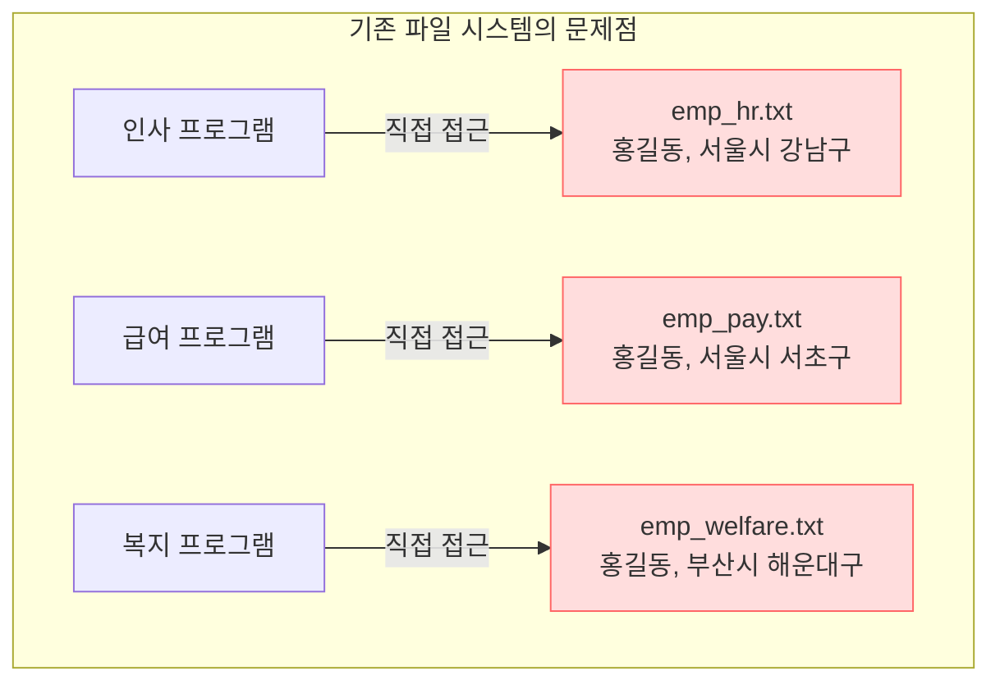

1. **데이터 중복성(Data Redundancy)**
   - 동일한 사원의 기본 정보(사번, 이름, 주소, 연락처)가 여러 파일에 중복되어 저장됩니다. 이는 고가의 저장 장치를 낭비할 뿐만 아니라 저장 비용을 가중시킵니다.
2. **데이터 불일치 및 무결성 결여(Data Inconsistency & Lack of Integrity)**
   - 사원이 이사를 하여 주소가 바뀌었을 때, 인사 담당자가 `emp_hr.txt`의 주소만 수정하고 급여 담당자가 `emp_pay.txt`를 수정하지 않는다면 동일 인물의 주소가 시스템마다 서로 달라지는 **데이터 불일치(Inconsistency)**가 발생합니다. 데이터의 신뢰성(Integrity)이 완전히 무너집니다.
3. **데이터 종속성(Data Dependency)**
   - 응용 프로그램이 파일의 물리적 저장 구조(데이터 구분자, 바이트 오프셋, 레코드 순서)에 종속됩니다. 만약 사번 체계가 5자리 숫자에서 8자리 문자열로 변경되면, 그 파일을 읽고 쓰던 수십 개의 응용 프로그램 코드를 일일이 찾아 열고 소스 코드를 재작성 및 재컴파일해야 했습니다.
4. **동시성 제어(Concurrency Control)의 부재**
   - 두 개 이상의 프로그램이나 프로세스가 동일한 파일에 동시에 쓰기 작업을 수행하면 데이터가 덮어씌워지거나 파일 포맷이 깨지는 경쟁 상태(Race Condition)가 발생합니다.
5. **장애 회복(Crash Recovery) 및 보안(Security) 제어의 부재**
   - 데이터를 쓰던 도중 컴퓨터 정전이나 운영체제 크래시가 발생하면 파일이 손상되어 복구할 방법이 없습니다. 또한 파일 단위의 단순 권한(읽기/쓰기)만 제공될 뿐, 특정 사용자에게 '급여 컬럼'만 숨기는 것과 같은 세밀한 컬럼/행 단위 접근 제어가 불가능했습니다.

---

### 1.2 DBMS의 정의와 3단계 데이터 독립성

**DBMS(Database Management System, 데이터베이스 관리 시스템)**는 이러한 파일 시스템의 한계를 극복하기 위해 등장했습니다. 여러 응용 프로그램과 다수의 사용자가 대규모 데이터를 체계적으로 공유, 저장, 검색, 갱신할 수 있도록 중앙에서 통합 관리해 주는 전용 미들웨어 소프트웨어입니다.

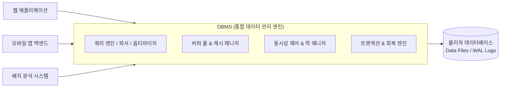

#### ANSI/SPARC 3단계 계층 구조와 데이터 독립성
DBMS가 제공하는 가장 위대한 철학적 가치는 **데이터 독립성(Data Independence)**입니다. 1975년 미국표준협회(ANSI)는 데이터베이스 시스템을 3단계 계층으로 모델링하는 표준 구조를 제안했습니다.

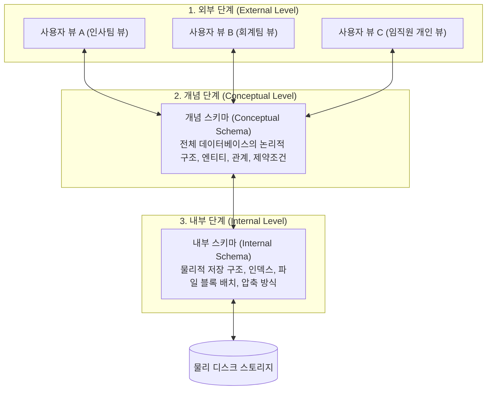

- **논리적 데이터 독립성(Logical Data Independence)**: 개념 스키마가 변경(예: 새로운 컬럼 추가, 새로운 엔티티 생성)되어도, 기존 외부 뷰(사용자 화면이나 응용 프로그램)는 영향을 받지 않고 그대로 유지될 수 있는 특성입니다.
- **물리적 데이터 독립성(Physical Data Independence)**: 성능 향상을 위해 디스크 저장 경로를 바꾸거나, B-Tree 인덱스를 새로 추가하거나, 테이블스페이스 블록 크기를 조정하는 등 내부 스키마를 변경하더라도 개념 스키마와 응용 프로그램 소스 코드는 전혀 수정할 필요가 없는 특성입니다.

---

### 1.3 RDBMS의 특징과 수학적 관계 모델

1970년 IBM 연구원 에드거 F. 코드(Edgar F. Codd) 박사는 집합론(Set Theory)과 1차 술어 논리(First-Order Predicate Logic)를 기반으로 한 **관계형 데이터 모델(Relational Model)** 논문을 발표했습니다. 이것이 오늘날 전 세계 데이터베이스 시장을 지배하는 **RDBMS(Relational DBMS)**의 시초입니다.

#### 관계형 모델의 핵심 구성 개념
- **릴레이션(Relation)**: 데이터를 2차원 테이블 형태로 표현한 수학적 집합입니다. (실무 용어: 테이블)
- **튜플(Tuple)**: 릴레이션을 구성하는 각각의 행(Row)으로, 독립된 하나의 개체(엔티티) 데이터를 나타냅니다. (실무 용어: 레코드/행)
- **속성(Attribute)**: 릴레이션의 열(Column)로, 데이터의 성질이나 필드를 정의합니다. (실무 용어: 컬럼/필드)
- **도메인(Domain)**: 하나의 속성이 가질 수 있는 원자값(Atomic Value)들의 유효한 집합입니다. (예: `나이`의 도메인은 0 이상의 정수)
- **차수(Degree)**: 한 릴레이션에 포함된 속성(열)의 개수입니다.
- **카디널리티(Cardinality)**: 한 릴레이션에 포함된 튜플(행)의 총 개수입니다.

| 학술적 용어 (관계 대수) | 데이터베이스 실무 용어 | 파일 시스템 대응 용어 |
| :--- | :--- | :--- |
| **릴레이션 (Relation)** | 테이블 (Table) | 파일 (File) |
| **튜플 (Tuple)** | 행, 레코드 (Row, Record) | 레코드 (Record) |
| **속성 (Attribute)** | 열, 필드, 컬럼 (Column, Field) | 필드 (Field) |
| **도메인 (Domain)** | 데이터 타입 및 제약 (Data Type & Constraint) | 데이터 형식 (Data Type) |

#### 키(Key)의 계층 구조
관계형 데이터베이스에서는 중복된 행을 허용하지 않으며, 특정 튜플을 유일하게 식별하기 위해 **키(Key)**라는 수학적 식별 체계를 사용합니다.

1. **슈퍼키(Super Key)**: 튜플을 고유하게 식별할 수 있는 속성들의 집합 (유일성은 만족하나 최소성은 만족하지 않을 수 있음. 예: `(사번, 이메일, 이름)`)
2. **후보키(Candidate Key)**: 튜플을 유일하게 식별할 수 있는 최소한의 속성 집합 (유일성과 최소성을 모두 만족. 예: `사번`, `이메일`)
3. **기본키(Primary Key, PK)**: 여러 후보키 중 데이터베이스 설계자가 테이블의 대표 식별자로 선택한 키 (중복 불가, NULL 값 불가)
4. **대체키(Alternate Key)**: 후보키 중 기본키로 선택되지 못한 나머지 키
5. **외래키(Foreign Key, FK)**: 다른 테이블의 기본키(또는 유니크 키)를 참조하는 속성으로, 테이블 간의 연결 고리와 참조 무결성(Referential Integrity)을 보장합니다.

---

### 1.4 표준 SQL 언어 체계

**SQL(Structured Query Language)**은 RDBMS와 대화하기 위해 국제 표준화 기구(ISO/ANSI)에서 제정한 선언적(Declarative) 질의 언어입니다. 명령형(Imperative) 언어(C, Java, Python 등)처럼 "데이터를 어떻게(How) 루프를 돌며 찾을 것인가"를 기술하지 않고, "어떤(What) 데이터를 원하는가"만 선언하면 DBMS 내부의 **비용 기반 옵티마이저(Cost-Based Optimizer, CBO)**가 최적의 실행 경로를 스스로 찾아냅니다.

SQL은 목적에 따라 크게 4가지 하위 언어로 엄격히 분류됩니다.

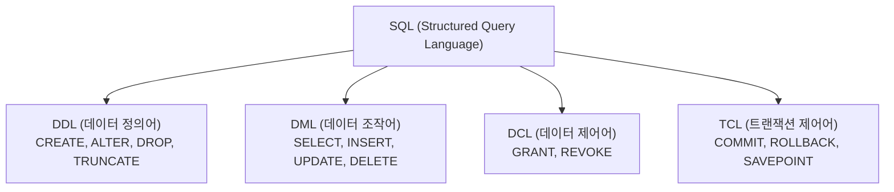

#### SQL 분류별 문법과 실무 예제

```sql
-- 1. DDL (Data Definition Language) : 테이블 스키마 정의 및 변경
CREATE TABLE department (
    dept_id INT PRIMARY KEY,
    dept_name VARCHAR(50) NOT NULL,
    created_at TIMESTAMP DEFAULT CURRENT_TIMESTAMP
);

CREATE TABLE employee (
    emp_id INT AUTO_INCREMENT PRIMARY KEY,
    emp_name VARCHAR(50) NOT NULL,
    email VARCHAR(100) UNIQUE,
    salary DECIMAL(10, 2) CHECK (salary >= 0),
    dept_id INT,
    CONSTRAINT fk_emp_dept FOREIGN KEY (dept_id) REFERENCES department(dept_id)
        ON DELETE SET NULL ON UPDATE CASCADE
);

-- 2. DML (Data Manipulation Language) : 데이터 입력, 수정, 삭제, 조회
INSERT INTO department (dept_id, dept_name) VALUES (10, '데이터플랫폼팀');
INSERT INTO employee (emp_name, email, salary, dept_id) 
VALUES ('김데이터', 'kim@company.com', 7500000.00, 10);

-- 집계 및 조인을 활용한 DML 조회
SELECT d.dept_name, COUNT(e.emp_id) AS total_emp, AVG(e.salary) AS avg_salary
FROM department d
LEFT JOIN employee e ON d.dept_id = e.dept_id
GROUP BY d.dept_id, d.dept_name
HAVING COUNT(e.emp_id) > 0;

-- 3. DCL (Data Control Language) : 권한 부여 및 회수
GRANT SELECT, INSERT ON employee TO 'developer_readonly'@'%';
REVOKE INSERT ON employee FROM 'developer_readonly'@'%';

-- 4. TCL (Transaction Control Language) : 트랜잭션 확정 및 취소
START TRANSACTION;
UPDATE employee SET salary = salary * 1.10 WHERE dept_id = 10;
-- 만약 이상 징후가 발견되면: ROLLBACK;
COMMIT;
```

---

## 02. ERD(개체-관계 다이어그램)는 무엇인가요?
> **데이터 모델링 청사진, 개체-속성-관계의 3대 요소, 카디널리티 표기법 및 식별/비식별 관계의 물리적 본질**

집을 지을 때 건축 설계도면이 없으면 기둥의 위치가 어긋나 건물이 붕괴하듯, 소프트웨어 시스템을 구축할 때 데이터 모델링 설계도면이 없으면 스키마가 꼬여 데이터 정합성이 파괴됩니다. 데이터베이스 설계의 가장 표준적인 시각적 도면이 바로 **ERD(Entity-Relationship Diagram, 개체-관계 다이어그램)**입니다.

---

### 2.1 데이터베이스 설계 3단계와 ERD의 역할

데이터베이스 모델링은 현실 세계의 복잡한 비즈니스 규칙을 컴퓨터 디스크의 2차원 테이블 구조로 변환해 나가는 정교한 추상화 과정입니다.

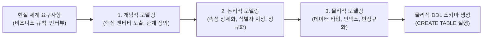

1. **개념적 데이터 모델링(Conceptual Modeling)**
   - 비즈니스 도메인의 핵심 엔티티를 도출하고 엔티티 간의 거시적인 관계를 규명합니다. DBMS의 종류(MySQL, Oracle 등)와 무관하게 작성됩니다.
2. **논리적 데이터 모델링(Logical Modeling)**
   - 모든 속성(Attribute)을 상세히 정의하고, 기본키(PK)와 외래키(FK)를 지정하며, 제3정규화(3NF)를 거쳐 중복을 제거합니다. 누가 보아도 시스템의 비즈니스 로직을 완벽히 이해할 수 있는 청사진 단계입니다.
3. **물리적 데이터 모델링(Physical Modeling)**
   - 목표 DBMS의 물리적 하드웨어 특성과 성능을 고려하여 `VARCHAR`, `INT`, `BIGINT` 등의 구체적 컬럼 타입을 지정하고, 인덱스 설계, 파티셔닝 전략, 성능 향상을 위한 반정규화를 적용합니다.

---

### 2.2 ERD의 3대 핵심 구성 요소

ERD는 피터 첸(Peter Chen) 교수가 1976년에 제안한 이후 다양한 표기법으로 발전해 왔으며, 기본적으로 세 가지 요소로 구성됩니다.

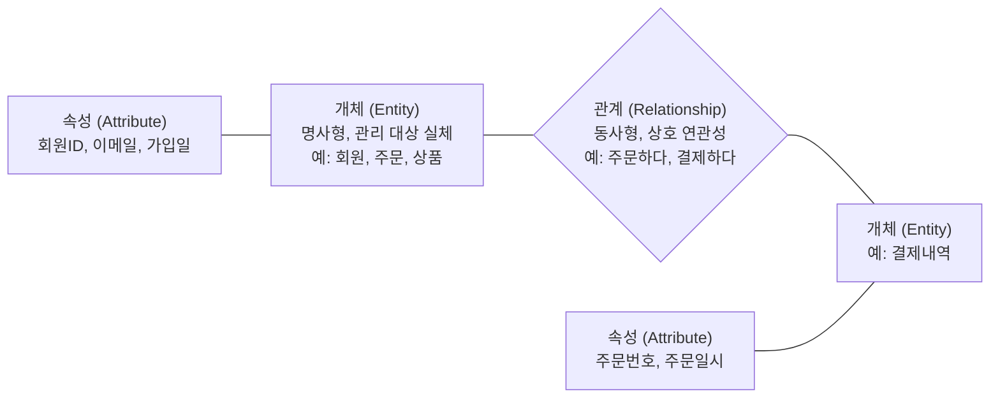

1. **개체(Entity)**
   - 조직이 관리하고자 하는 유의미한 정보를 가진 대상(사람, 장소, 사물, 사건, 개념)입니다.
   - 릴레이션(테이블)으로 변환되며, 엔티티의 인스턴스는 행(Row)이 됩니다.
   - 예: `Customer`(고객), `Product`(상품), `Order`(주문)
2. **속성(Attribute)**
   - 개체가 가지는 고유한 성질, 상태, 특징입니다. 테이블의 컬럼(Column)으로 변환됩니다.
   - **기본 속성(Basic Attribute)**: 업무로부터 원래 도출된 속성 (예: 상품명, 가격)
   - **설계 속성(Designed Attribute)**: 업무에는 없었으나 설계 편의를 위해 인위적으로 부여한 속성 (예: `order_status_code`)
   - **파생 속성(Derived Attribute)**: 다른 속성의 계산을 통해 동적으로 생성되는 속성 (예: `total_order_amount`, `member_count`)
3. **관계(Relationship)**
   - 두 엔티티 사이의 논리적인 연관성이나 상호작용입니다.
   - "고객이 상품을 **주문한다**", "직원이 부서에 **소속된다**"와 같이 동사형으로 표현됩니다.

---

### 2.3 관계의 카디널리티(Cardinality)와 N:M의 해소

관계 차수(Cardinality)는 한 엔티티의 인스턴스가 다른 엔티티의 인스턴스와 몇 대 몇으로 연결될 수 있는지를 나타냅니다.

#### 1. 1:1 관계 (일대일)
- 하나의 A 개체가 오직 하나의 B 개체와 연결됩니다.
- 예: `User`(사용자 계정) ↔ `UserProfileDetail`(사용자 상세 프로필 / 민감 개인정보)
- 실무에서는 대부분 한 테이블로 합치지만, 개인정보 보호 법령에 따른 물리적 암호화 분리나 성능상 LOB(Large Object) 데이터 격리를 위해 1:1 테이블 분리를 적용합니다.

#### 2. 1:N 관계 (일대다)
- 하나의 A 개체가 여러 개의 B 개체를 가질 수 있으나, B 개체는 오직 하나의 A 개체에만 속합니다.
- 예: `Department`(부서, 1) ↔ `Employee`(직원, N), `Customer`(고객, 1) ↔ `Order`(주문, N)
- RDBMS에서 가장 보편적이고 자연스러운 관계입니다. 항상 'N' 쪽에 외래키(FK) 컬럼이 위치합니다.

#### 3. N:M 관계 (다대다)와 교차 테이블(Mapping Table)
- 하나의 A 개체가 여러 B 개체를 가질 수 있고, 하나의 B 개체도 여러 A 개체를 가질 수 있는 형태입니다.
- 예: `Student`(학생) ↔ `Course`(과목), `Order`(주문) ↔ `Product`(상품)
- **RDBMS의 물리적 한계**: 관계형 데이터베이스의 2차원 테이블 구조에서는 한 컬럼에 여러 개의 FK 값을 배열처럼 저장할 수 없습니다(제1정규형 위반). 따라서 N:M 관계는 물리적으로 직접 연결할 수 없습니다.

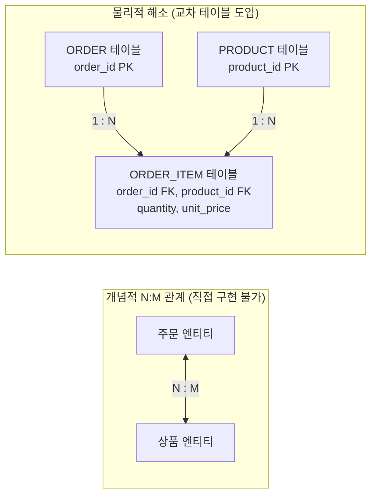

> **💡 실무 핵심: 교차 테이블(Associative / Mapping Entity)**  
> N:M 관계는 반드시 중간에 **연결 테이블(교차 테이블)**을 두어 **`1:N` 및 `N:1`의 두 개 관계**로 분해해야 합니다. 단순히 두 부모의 PK만 결합하는 것이 아니라, `order_item` 테이블처럼 **"해당 시점의 구매 수량(`quantity`)", "주문 당시의 할인 적용 단가(`unit_price`)"**와 같은 고유한 비즈니스 속성을 가질 수 있도록 설계해야 합니다.

---

### 2.4 식별 관계 vs 비식별 관계의 본질적 차이

부모 테이블과 자식 테이블이 외래키로 맺어질 때, 그 외래키를 자식 테이블의 어디에 둘 것인가에 따라 식별과 비식별 관계로 나뉩니다.

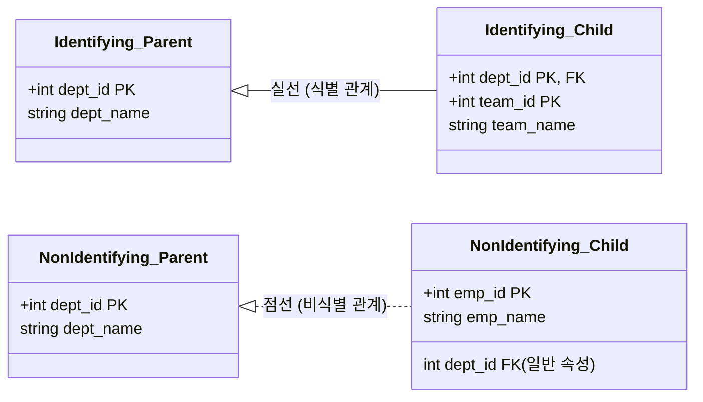

| 구분 | 식별 관계 (Identifying Relationship) | 비식별 관계 (Non-identifying Relationship) |
| :--- | :--- | :--- |
| **정의** | 부모의 기본키(PK)가 자식의 **기본키(PK)이자 외래키(FK)**로 흡수됨 | 부모의 기본키(PK)가 자식의 **일반 컬럼(FK)**으로만 참조됨 |
| **다이어그램 표기** | **실선 (Solid Line)** | **점선 (Dashed Line)** |
| **존재 종속성** | **강한 종속**: 부모가 없으면 자식은 존재할 수 없음 | **약한 종속**: 부모 없이도 자식 데이터가 독립 존재 가능 |
| **자식 테이블 PK** | 복합 기본키 (부모 PK + 자식 식별자) | 단독 인조키(Surrogate Key, 예: Auto-increment ID) |
| **장점** | 상위 테이블의 PK를 계속 물려받으므로 조인 없이도 손자 테이블에서 조부모 PK 확인 가능 | 스키마 구조가 유연하며, 복합 PK 누적에 따른 인덱스 크기 비대화 방지 |
| **단점** | 계층이 깊어질수록 자식 테이블의 PK 컬럼 수가 기하급수적으로 증가하여 SQL 복잡도 및 인덱스 비용 폭증 | 상위 정보를 확인하려면 부모 테이블과의 추가적인 조인(JOIN) 필요 |

> **💡 현대 데이터 아키텍처의 트렌드**  
> 과거에는 식별 관계를 과도하게 사용하는 경향이 있었으나, 최근 대규모 백엔드 시스템에서는 **비식별 관계를 표준으로 권장**합니다. 각 테이블마다 단일 기본키(`id BIGINT AUTO_INCREMENT` 또는 `UUID`)를 인조키로 두고 부모 키는 일반 외래키 컬럼으로 참조함으로써 ORM(JPA, TypeORM) 매핑의 복잡도를 낮추고 테이블 간 결합도를 느슨하게 유지합니다.

---

### 2.5 까마귀 발 표기법(Crow's Foot Notation) 실전 ERD

현대 데이터베이스 모델링 툴(ERwin, DBeaver, MySQL Workbench, Mermaid 등)에서 가장 널리 쓰이는 표기법은 **까마귀 발 표기법(IE 표기법)**입니다.

- `||` : 1과 오직 하나 (Mandatory One, 정확히 1개)
- `O|` : 0 또는 1 (Optional One, 없거나 1개)
- `|<` : 1 이상 (Mandatory Many, 최소 1개 이상)
- `O<` : 0 이상 (Optional Many, 없거나 여러 개)

다음은 전형적인 이커머스(전자상거래) 도메인의 실전 ERD 다이어그램입니다.

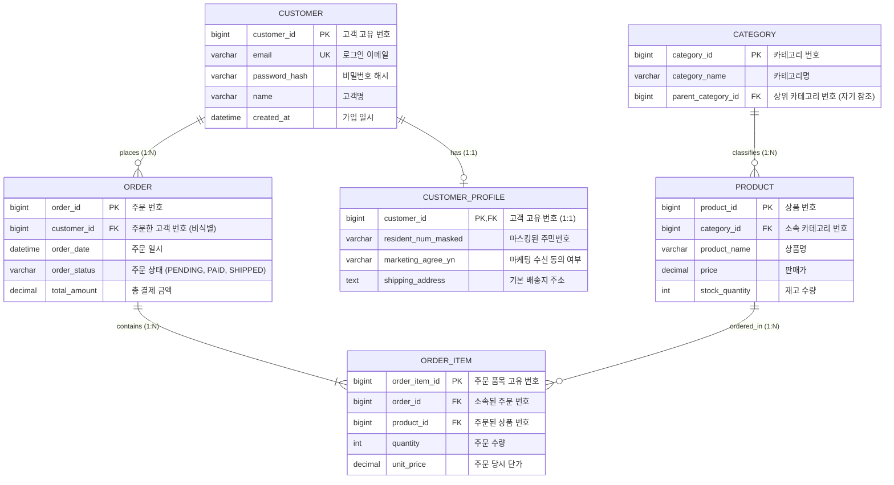

---

## 03. 트랜잭션과 ACID란 무엇인가요?
> **데이터베이스의 논리적 최소 작업 단위, ACID 원칙, 동시성 이상 현상 및 4대 격리 수준의 MVCC 내부 메커니즘**

금융, 전자상거래, 예약 시스템 등 현대 IT 서비스에서 데이터 무결성을 보장하는 가장 위대한 논리적 장치는 바로 **트랜잭션(Transaction)**입니다. 트랜잭션이 보장되지 않는다면 동시 다발적인 사용자 요청 속에서 잔고가 사라지거나 재고가 마이너스로 떨어지는 치명적인 결함이 발생하게 됩니다.

---

### 3.1 트랜잭션의 본질: 계좌 이체 시나리오

트랜잭션은 **"더 이상 쪼갤 수 없는 논리적인 작업의 최소 단위(Unit of Work)"**를 의미합니다. 하나의 비즈니스 행위를 완성하기 위해 수행되는 여러 개의 세부 데이터베이스 연산(SQL)들이 모여 하나의 온전한 묶음을 이룹니다.

가장 대표적인 예시는 **은행 계좌 이체(A가 B에게 10만 원을 송금)**입니다.

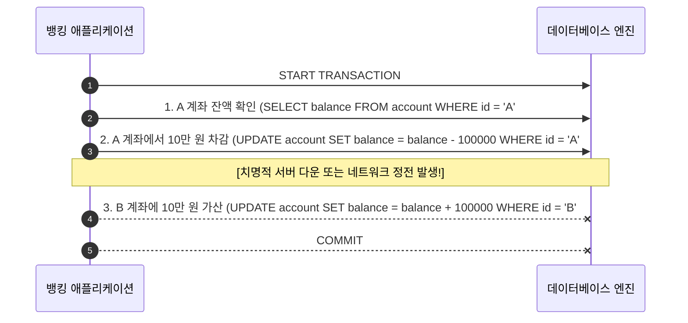

만약 트랜잭션이라는 개념이 없다면 2번 단계에서 서버가 다운되었을 때 A의 계좌에서는 10만 원이 인출되었지만, B의 계좌에는 입금되지 않은 채 돈이 공중으로 증발하게 됩니다.  
트랜잭션은 이러한 상황에서 **"모든 연산이 완벽하게 성공(COMMIT)하거나, 도중에 하나라도 실패하면 시작하기 전 상태로 완벽히 되돌린다(ROLLBACK)"**는 원칙을 제공합니다.

---

### 3.2 데이터베이스의 4대 수호신: ACID 특성

RDBMS가 트랜잭션의 신뢰성을 증명하기 위해 준수하는 네 가지 핵심 원칙을 **ACID**라고 부릅니다.

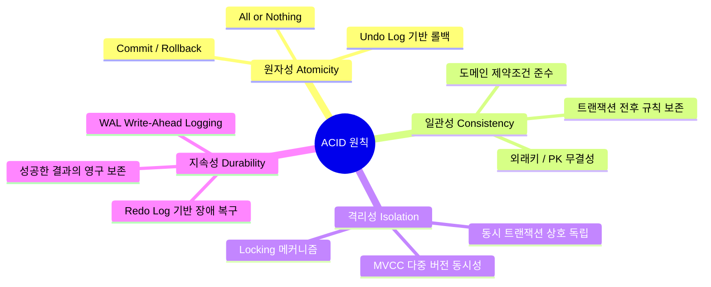

#### 1. 원자성 (Atomicity)
- **정의**: 트랜잭션에 포함된 모든 작업은 완전히 수행(All)되거나, 아니면 전혀 수행되지 않아야(Nothing) 합니다.
- **내부 구현 메커니즘**: DBMS는 데이터 변경을 수행할 때 변경 전의 원래 데이터를 메모리의 **언두 로그(Undo Log)** 버퍼에 먼저 기록합니다. 트랜잭션 도중 에러가 발생하거나 사용자가 `ROLLBACK`을 호출하면, 이 Undo 로그를 역순으로 실행하여 데이터를 완벽하게 원래 상태로 복원합니다.

#### 2. 일관성 (Consistency)
- **정의**: 트랜잭션이 성공적으로 완료되면 데이터베이스는 언제나 정의된 모든 무결성 제약조건(기본키 중복 불가, 외래키 참조 무결성, NOT NULL, CHECK 조건 등)을 완벽히 만족하는 유효한 상태를 유지해야 합니다.
- **예시**: '잔액' 컬럼의 도메인이 0 이상이어야 한다는 제약조건이 있다면, 어떤 트랜잭션도 잔액을 음수로 만들고 커밋할 수 없습니다. 위반 시 트랜잭션은 즉시 중단되고 롤백됩니다.

#### 3. 격리성 (Isolation)
- **정의**: 여러 트랜잭션이 동시에 실행될 때, 각 트랜잭션은 다른 트랜잭션의 중간 연산 과정에 간섭받지 않고 마치 혼자 독립적으로 실행되는 것처럼 동작해야 합니다.
- **내부 구현 메커니즘**: 비관적 락(Pessimistic Lock: 배타 락, 공유 락)이나 현대적인 **MVCC(Multi-Version Concurrency Control)**를 통해 트랜잭션 간의 데이터 충돌을 제어합니다. 격리성을 완벽히 보장할수록 동시 처리 성능(Throughput)이 떨어지므로, 현실에서는 격리 수준을 조정하는 타협점을 둡니다.

#### 4. 지속성 (Durability)
- **정의**: 성공적으로 커밋된 트랜잭션의 결과는 시스템에 정전, 운영체제 충돌, 디스크 오류 등 치명적인 재해가 발생해도 영구적으로 보존되어야 합니다.
- **내부 구현 메커니즘**: 데이터베이스는 성능을 위해 디스크 파일에 직접 쓰지 않고 메모리(버퍼 풀)에서 먼저 수정합니다. 디스크에 실제 데이터 파일이 쓰이기 전에 정전이 나더라도 커밋된 데이터를 잃어버리지 않도록, 순차 쓰기(Sequential Write) 방식으로 매우 빠르게 기록되는 **리두 로그(Redo Log / WAL: Write-Ahead Logging)**를 디스크에 강제 플러시(Flush)합니다. 재부팅 시 Redo 로그를 재생(Replay)하여 메모리에만 남아있던 변경 사항을 디스크 파일에 완벽히 복원합니다.

---

### 3.3 동시성 제어 실패 시 발생하는 5대 이상 현상(Anomalies)

여러 사용자가 동일한 데이터에 동시에 접근할 때 적절한 격리성을 제공하지 않으면 다음과 같은 데이터 왜곡 현상이 발생합니다.

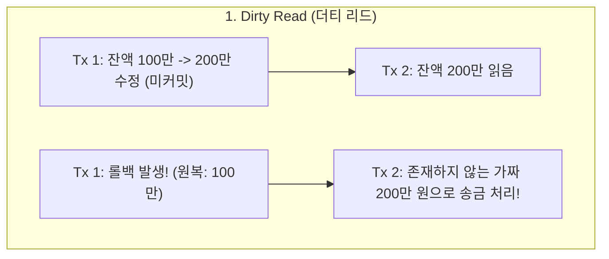

1. **Dirty Read (더티 리드)**
   - 트랜잭션 A가 데이터를 수정하고 아직 `COMMIT`하지 않았는데, 트랜잭션 B가 이 수정된 중간 데이터를 읽어가는 현상입니다. 만약 트랜잭션 A가 롤백되면 트랜잭션 B는 세상에 존재하지도 않았던 '유령 데이터'를 기반으로 잘못된 비즈니스 판단을 내리게 됩니다.
2. **Non-Repeatable Read (Fuzzy Read)**
   - 한 트랜잭션 내에서 **동일한 단일 레코드를 두 번 조회**했는데, 그 사이에 다른 트랜잭션이 해당 데이터를 `UPDATE` 또는 `DELETE`하고 커밋하여 두 번의 조회 결과가 서로 다르게 나오는 현상입니다.
3. **Phantom Read (팬텀 리드)**
   - 한 트랜잭션 내에서 **특정 조건의 범위(Range)를 두 번 조회**했는데, 그 사이에 다른 트랜잭션이 해당 범위에 부합하는 새로운 행을 `INSERT`하고 커밋하여 두 번째 조회 때 없던 유령(Phantom) 행이 불쑥 튀어나오는 현상입니다.
4. **Dirty Write (더티 라이트)**
   - 아직 커밋되지 않은 트랜잭션이 수정한 데이터를 다른 트랜잭션이 덮어쓰는 현상입니다. 롤백 시 어떤 상태로 되돌려야 할지 모호해지므로 모든 현대 DBMS는 격리 수준과 무관하게 이를 무조건 차단합니다.
5. **Lost Update (갱신 손실)**
   - 두 트랜잭션이 동일한 행을 동시에 읽은 후 각각 수정하여 저장할 때, 나중에 저장된 트랜잭션이 먼저 저장된 트랜잭션의 수정 내용을 덮어써서 지워버리는 현상입니다. (비관적/낙관적 락으로 해결)

---

### 3.4 ANSI/ISO SQL 표준 트랜잭션 4대 격리 수준(Isolation Levels)

데이터베이스 표준은 격리성과 동시성 성능 간의 트레이드오프를 고려하여 4단계의 격리 수준을 정의했습니다.

| 격리 수준 (Isolation Level) | Dirty Read | Non-Repeatable Read | Phantom Read | 일반적인 성능 | 실무 권장 사용 환경 |
| :--- | :---: | :---: | :---: | :---: | :--- |
| **READ UNCOMMITTED** (Lv 0) | **발생** | **발생** | **발생** | 가장 빠름 | 데이터 정확도가 중요치 않은 대규모 통계/로그 집계 |
| **READ COMMITTED** (Lv 1) | 방지 | **발생** | **발생** | 매우 빠름 | **Oracle, PostgreSQL, SQL Server의 기본값** |
| **REPEATABLE READ** (Lv 2) | 방지 | 방지 | **발생\*** | 보통 | **MySQL InnoDB의 기본값** (MVCC로 Phantom Read도 대다수 방지) |
| **SERIALIZABLE** (Lv 3) | 방지 | 방지 | 방지 | 가장 느림 | 금융 결제, 암호화폐 이체 등 극도의 정합성이 요구되는 구간 |

*\* 참고: ANSI 표준에서는 REPEATABLE READ에서 Phantom Read가 발생한다고 명시하지만, MySQL InnoDB는 넥스트 키 락(Next-Key Lock)과 MVCC 언두 로그를 활용하여 일반적인 조회 시 Phantom Read를 원천 차단합니다.*

---

### 3.5 현대 RDBMS의 핵심: MVCC(Multi-Version Concurrency Control)

과거 데이터베이스는 격리성을 위해 읽기 작업에도 공유 락(Shared Lock), 쓰기 작업에 배타 락(Exclusive Lock)을 걸어 **"읽는 동안 쓰지 못하고, 쓰는 동안 읽지 못하는"** 심각한 병목을 겪었습니다.  
현대의 고성능 DBMS(MySQL InnoDB, PostgreSQL, Oracle)는 **MVCC(다중 버전 동시성 제어)**를 통해 이 문제를 우아하게 해결했습니다.

```mermaid
sequenceDiagram
    autonumber
    participant T1 as 트랜잭션 1 (조회)
    participant Engine as InnoDB 엔진 (버퍼풀 & 언두로그)
    participant T2 as 트랜잭션 2 (수정)

    Note over Engine: 원래 데이터: id=1, age=20 (DB_TRX_ID=100)
    T1->>Engine: START TRANSACTION (Tx_ID=200);
    T1->>Engine: SELECT age FROM user WHERE id=1; -> 반환: 20
    
    T2->>Engine: START TRANSACTION (Tx_ID=201);
    T2->>Engine: UPDATE user SET age=30 WHERE id=1;
    Note over Engine: 버퍼풀: age=30 (DB_TRX_ID=201)<br/>언두로그: age=20 (이전 버전 보존)
    T2->>Engine: COMMIT;

    T1->>Engine: SELECT age FROM user WHERE id=1;
    Note over Engine: T1은 자신의 시작 시점(스냅샷)보다 미래의 Tx_ID(201)는 무시하고<br/>언두로그의 이전 버전(age=20)을 읽음!
    Engine-->>T1: 반환: 20 (일관된 스냅샷 읽기!)
```

> **💡 MVCC의 불문율**  
> **"읽기(Read)는 쓰기(Write)를 블로킹하지 않고, 쓰기(Write)는 읽기(Read)를 블로킹하지 않는다."**  
> 트랜잭션이 데이터를 읽을 때 락을 거는 대신, 자신의 트랜잭션 ID보다 이전에 커밋된 스냅샷(Undo 영역)을 읽음으로써 수천 건의 동시 쓰기 요청이 발생하는 와중에도 대기 시간(Lock Wait) 없이 초고속으로 일관된 조회를 수행합니다.

---

## 04. 인덱스(Index)는 왜 필요한가요?
> **책의 색인 비유, Full Table Scan vs Index Scan, B+Tree 인덱스 구조와 검색 원리, CUD 오버헤드와 튜닝 4대 황금률**

데이터베이스 튜닝의 8할은 인덱스에서 결정됩니다. 100만 건의 데이터가 담긴 테이블에서 특정 레코드를 조회할 때, 인덱스가 없으면 수 초 이상의 시간이 걸려 서비스가 멈추지만, 올바른 인덱스 하나만 존재하면 단 수 밀리초(0.002초) 만에 결과를 반환합니다. 인덱스는 대체 어떤 원리로 동작할까요?

---

### 4.1 책의 색인(Index)과 풀 테이블 스캔

우리가 1,500페이지 분량의 두꺼운 《데이터베이스 개론》 전공 서적에서 **"트랜잭션 격리 수준"**이라는 단어를 찾는다고 가정해 봅시다.

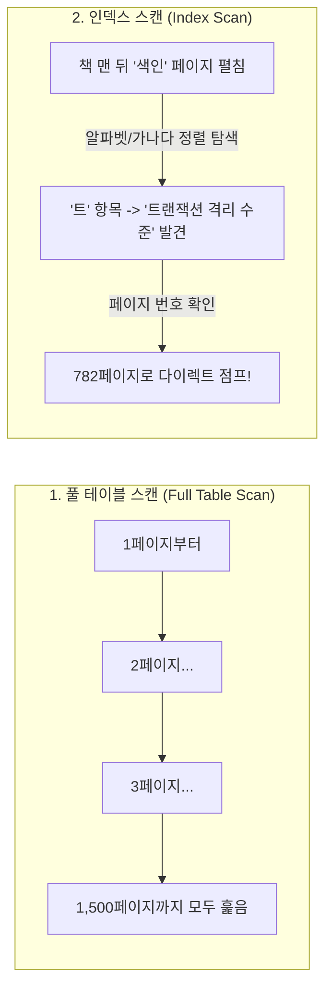

- **풀 테이블 스캔(Full Table Scan)**: 인덱스가 없는 테이블을 조회할 때 발생합니다. 디스크의 처음 블록부터 끝 블록까지 모든 데이터 블록을 하나도 빠짐없이 순차적으로 I/O(Sequential I/O)합니다. 데이터 건수가 수천만 건으로 늘어날수록 선형적으로 소요 시간이 증가합니다.
- **인덱스 스캔(Index Scan)**: 데이터가 정렬되어 있는 별도의 인덱스 구조체를 먼저 탐색하여 데이터의 물리적 위치(주소 또는 PK)를 알아낸 뒤, 해당 페이지만 콕 집어 디스크에서 랜덤 I/O(Random I/O)로 읽어옵니다.

---

### 4.2 B-Tree와 B+Tree 구조와 검색 원리

관계형 데이터베이스 엔진이 가장 사랑하는 표준 인덱스 알고리즘은 **B+Tree(Balanced Tree의 변형)**입니다.

일반적인 이진 탐색 트리(Binary Search Tree)는 최악의 경우 한쪽으로 노드가 쏠려 $O(N)$의 시간 복잡도로 퇴화하지만, B-Tree 계열은 스스로 균형을 맞추는 자가 균형 트리(Self-Balancing Tree)로서 어떤 값을 찾더라도 언제나 $O(\log N)$의 성능을 보장합니다.

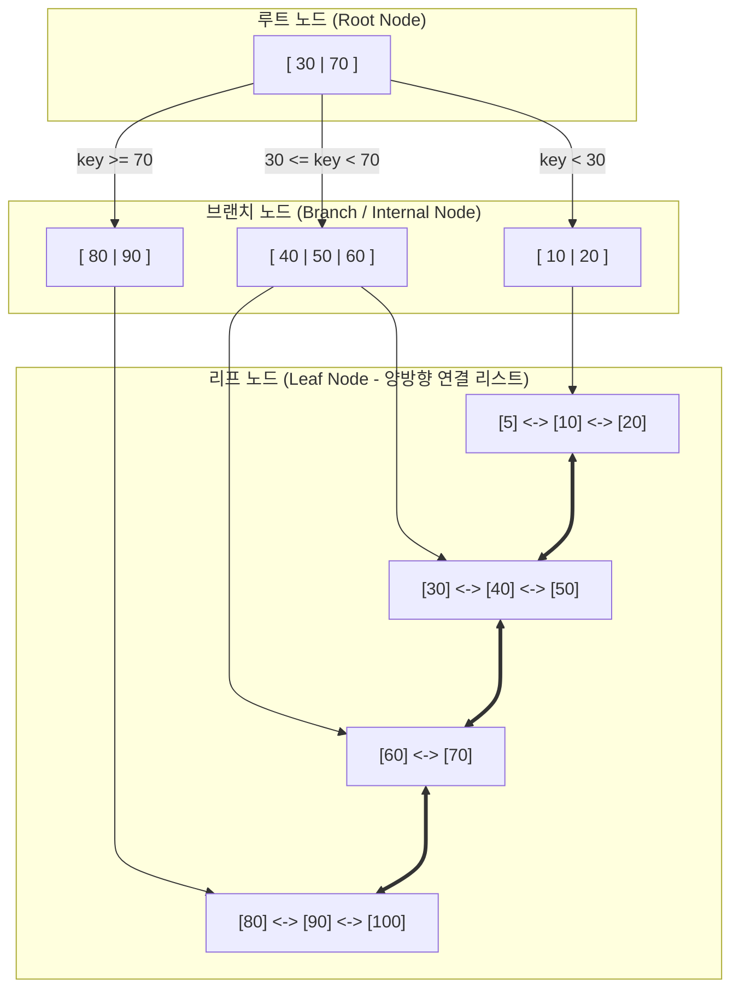

#### 왜 B-Tree가 아닌 B+Tree를 사용할까요?
1. **리프 노드에만 실제 데이터 포인터 저장**
   - 기존 B-Tree는 루트와 브랜치 노드에도 실제 데이터 포인터를 저장하여 한 블록(보통 16KB)에 담을 수 있는 키의 개수가 적었습니다.
   - B+Tree는 루트와 브랜치 노드에 **오직 키(Key)와 자식 노드 포인터(Child Pointer)**만 저장합니다. 따라서 한 블록에 수백~수천 개의 인덱스 키를 우겨넣을 수 있어 트리의 높이(Depth)가 3~4 수준으로 극단적으로 낮아집니다. (트리 높이가 3이면 수천만 건의 데이터를 단 3번의 I/O만으로 찾습니다!)
2. **리프 노드 간의 양방향 연결 리스트(Doubly Linked List)**
   - 모든 실제 데이터 포인터는 최하단의 **리프 노드(Leaf Node)**에만 존재하며, 리프 노드들끼리는 서로 포인터로 연결되어 있습니다.
   - `WHERE age BETWEEN 20 AND 40`과 같은 **범위 검색(Range Scan)**을 수행할 때, 루트부터 매번 트리를 다시 탈 필요 없이 첫 번째 시작점(20)만 찾은 뒤 리프 노드의 연결 리스트를 타고 순차 탐색(Sequential Scan)을 진행하므로 압도적인 속도를 자랑합니다.

---

### 4.3 클러스터드 인덱스 vs 세컨더리(넌클러스터드) 인덱스

MySQL InnoDB 엔진을 기준으로 인덱스는 크게 두 종류로 나뉩니다.

```mermaid
flowchart TD
    subgraph ClusteredIndex["1. 클러스터드 인덱스 (PK 기반)"]
        CPK[인덱스 키: PK 순서대로 정렬] --> CData[리프 노드 = 실제 행 데이터 자체<br/>(테이블당 단 1개만 존재)]
    end

    subgraph SecondaryIndex["2. 세컨더리 인덱스 (보조 인덱스)"]
        SPK[인덱스 키: email 순서 정렬] --> SData[리프 노드 = 실제 행 대신 PK 값 저장<br/>(테이블당 여러 개 생성 가능)]
    end
    
    SData -.->|PK로 다시 탐색 (더블 룩업)| CPK
```

| 비교 항목 | 클러스터드 인덱스 (Clustered Index) | 세컨더리 인덱스 (Non-Clustered / Secondary Index) |
| :--- | :--- | :--- |
| **테이블당 개수** | **오직 1개** (기본키 PK, 없으면 첫 Unique Not Null) | **여러 개 생성 가능** (업무 요건에 맞춰 추가) |
| **물리적 데이터 정렬** | 실제 데이터 레코드 자체가 인덱스 키 순서로 디스크에 정렬 저장 | 인덱스 페이지만 정렬되어 있고 실제 데이터는 별도 저장 |
| **리프 노드 저장 내용** | **실제 데이터 행의 모든 컬럼 (Row Data)** | **해당 인덱스 컬럼 값 + 클러스터드 키(PK) 값** |
| **조회 성능** | PK 조회 시 단 한 번의 트리 탐색으로 데이터 즉시 획득 (극상) | 인덱스 탐색 후 찾아낸 PK로 클러스터드 인덱스를 한 번 더 탐색 (**더블 룩업**) |

> **💡 성능 최적화의 꽃: 커버링 인덱스(Covering Index)**  
> 세컨더리 인덱스로 검색할 때, 쿼리가 요구하는 모든 컬럼(`SELECT email, name FROM user WHERE email = ?`)이 이미 세컨더리 인덱스 리프 노드에 모두 포함되어 있다면, 굳이 실제 데이터 페이지(클러스터드 인덱스)를 찾아가는 **더블 룩업(Random I/O)**을 생략합니다. 이를 커버링 인덱스라고 부르며 실무 쿼리 튜닝에서 수십 배의 성능 향상을 가져옵니다.

---

### 4.4 인덱스는 공짜가 아니다: CUD 성능 트레이드오프

인덱스를 많이 생성하면 조회(SELECT)는 빨라지지만, 데이터 변경(CUD: INSERT, UPDATE, DELETE)에는 치명적인 대가가 따릅니다.

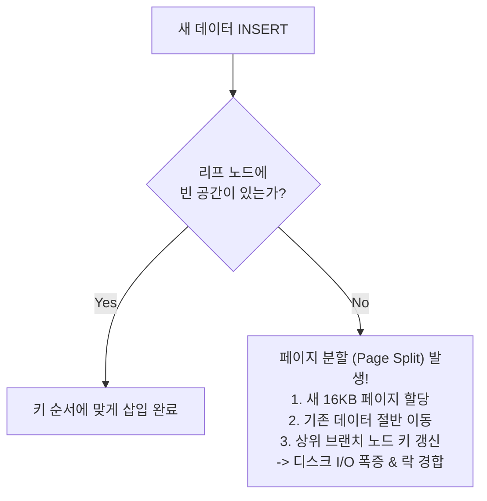

1. **INSERT 오버헤드와 페이지 분할(Page Split)**
   - 인덱스는 항상 정렬 상태를 유지해야 합니다. 새로운 레코드가 들어갈 리프 노드 페이지가 꽉 차 있으면, 엔진은 새로운 페이지를 할당받고 기존 데이터를 절반 옮겨 담는 **페이지 분할(Page Split)**을 수행합니다. 이는 대량의 디스크 I/O와 락(Lock)을 유발하여 시스템을 급격히 느려지게 만듭니다.
2. **DELETE 오버헤드와 인덱스 단편화(Fragmentation)**
   - 인덱스에서 행을 삭제하면 노드에서 실제로 데이터를 즉시 지우지 않고 **'사용 안 함(Deleted)'** 마킹만 해둡니다. 실제 데이터는 10만 건인데 인덱스 크기는 1,000만 건 분량을 차지하는 인덱스 비대화 및 단편화가 발생합니다.
3. **UPDATE 오버헤드**
   - 인덱스에 포함된 컬럼이 수정되면, 엔진은 내부적으로 기존 인덱스 키를 삭제 마킹하고 새로운 키 위치에 새로 삽입하는 이중 작업을 처리해야 합니다.

---

### 4.5 실전 인덱스 설계 및 튜닝 4대 황금률

1. **카디널리티(Cardinality)와 선택도(Selectivity)가 높은 컬럼을 선택하라**
   - **카디널리티**: 고유한 값(Unique Value)의 개수입니다.
   - 성별(`남`, `여`)처럼 카디널리티가 극히 낮은 컬럼에 인덱스를 걸면 전체 데이터의 50%를 읽어야 하므로 옵티마이저는 인덱스를 버리고 풀 테이블 스캔을 선택합니다.
   - 주민등록번호, 이메일, 주문번호처럼 **중복도가 낮고 유니크한 컬럼(선택도 5~10% 이하)**에 인덱스를 걸어야 최고의 효율을 발휘합니다.
2. **복합 인덱스(Composite Index)는 컬럼 순서가 생명이다**
   - 두 개 이상의 컬럼으로 인덱스를 구성할 때, **선행 컬럼이 정렬되어야 후행 컬럼이 정렬**됩니다.
   - 전화번호부에서 `(성, 이름)` 순으로 정렬되어 있다면 `WHERE 성 = '김'`은 찾을 수 있지만, 성은 모르고 `WHERE 이름 = '길동'`만으로는 전화번호부 색인을 탈 수 없습니다.
   - **규칙**: 동치 조건(`=`)으로 자주 조회되는 컬럼을 앞쪽에, 범위 조건(`<`, `>`, `BETWEEN`, `LIKE`)으로 조회되는 컬럼을 뒤쪽에 배치해야 합니다.
3. **인덱스 컬럼의 좌변을 가공하지 마라 (최악의 안티패턴)**
   - DBMS는 인덱스 키의 원본 값을 정렬해 두었지, 함수로 가공된 결과를 저장하고 있지 않습니다.

```sql
-- ❌ 나쁜 예: 인덱스 컬럼을 함수로 감싸거나 연산함 (Full Table Scan 발생!)
SELECT * FROM users WHERE SUBSTRING(name, 1, 3) = 'Kim';
SELECT * FROM orders WHERE total_price * 1.1 > 100000;
SELECT * FROM members WHERE DATE(created_at) = '2026-09-20';

-- ⭕ 좋은 예: 인덱스 컬럼은 원본 그대로 두고 우변(비교값)을 가공함 (Index Range Scan 정상 동작)
SELECT * FROM users WHERE name LIKE 'Kim%';
SELECT * FROM orders WHERE total_price > 100000 / 1.1;
SELECT * FROM members WHERE created_at >= '2026-09-20 00:00:00' 
                        AND created_at < '2026-09-21 00:00:00';
```

4. **실행 계획(EXPLAIN)을 통해 인덱스 사용 여부를 반드시 검증하라**
   - SQL 앞에 `EXPLAIN`을 붙여 옵티마이저가 어떤 인덱스를 타는지 확인합니다.
   - `type` 컬럼이 `const`, `ref`, `range`라면 인덱스를 정상적으로 활용하는 것이며, `ALL`(Full Table Scan) 또는 `index`(Full Index Scan)라면 즉시 쿼리나 인덱스 설계를 수정해야 합니다.

---

## 05. 왜 앱과 DB를 바로 연동하지 않나요?
> **2-Tier vs 3-Tier 아키텍처 비교, DB 보안성, 비즈니스 로직 중앙 집중화, 커넥션 풀(HikariCP) 고갈 방지 및 무상태 확장성**

과거 클라이언트-서버(C/S) 소프트웨어 시절에는 Visual Basic이나 Delphi로 개발된 클라이언트 프로그램이 데이터베이스에 직접 접속하여 쿼리를 날리곤 했습니다. 하지만 오늘날 수천만 명이 사용하는 모바일 앱이나 웹 서비스에서는 스마트폰이나 브라우저가 데이터베이스에 직접 접속하는 시스템을 절대로 만들지 않습니다. 왜 반드시 중간에 백엔드 API 서버(WAS)를 두어야만 할까요?

---

### 5.1 2-Tier vs 3-Tier 아키텍처의 구조적 대결

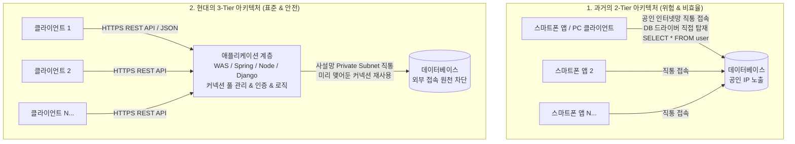

2-Tier 아키텍처는 클라이언트가 데이터베이스의 드라이버(JDBC, ODBC)를 직접 품고 SQL을 직접 실행하는 구조입니다. 반면 3-Tier 아키텍처는 **클라이언트(Presentation Tier)**와 **데이터베이스(Data Tier)** 사이에 **비즈니스 로직 서버(Application Tier / WAS)**를 필수적인 완충재로 배치합니다.

---

### 5.2 직통 연동을 금지하는 4대 핵심 사유

#### 1. 치명적인 보안성 붕괴 (DB 계정 탈취 및 공인 IP 노출)
- 스마트폰 앱의 APK나 바이너리 파일은 누구나 디컴파일(Decompile)하여 내부 문자열을 뜯어볼 수 있습니다. 만약 앱이 DB에 직접 연동한다면, 소스 코드에 하드코딩된 **데이터베이스 접속 주소, 포트(3306), 유저 ID, 비밀번호**가 전 세계에 고스란히 유출됩니다.
- 공격자는 즉시 데이터베이스에 접속하여 `DROP DATABASE`를 실행하거나 고객의 모든 민감 데이터를 유출할 수 있습니다.
- 또한 전 세계 누구나 접속할 수 있도록 DB 서버를 공인 인터넷(Public IP)에 노출해야 하므로 디도스(DDoS)와 무차별 대입 공격(Brute Force)의 먹잇감이 됩니다. 3-Tier에서는 DB를 인터넷과 완전히 단절된 **사설 서브넷(Private Subnet)**에 격리하고 방화벽으로 오직 WAS의 사설 IP만 허용합니다.

#### 2. 비즈니스 로직과 데이터 무결성의 붕괴
- 비즈니스 정책(예: "VIP 회원은 결제 시 10% 할인되며, 재고가 0이면 주문할 수 없다")을 클라이언트 앱 내부에 작성해 두면, 해커가 루팅된 스마트폰에서 클라이언트 코드를 조작하여 100만 원짜리 명품 시계를 0원으로 `INSERT INTO order` 쿼리를 조작해 날릴 수 있습니다.
- 3-Tier 아키텍처에서는 모든 유효성 검증(Validation), 권한 인가(Authorization), 트랜잭션 비즈니스 로직이 안전한 백엔드 서버에서 실행되므로 클라이언트의 데이터 위·변조를 완벽히 통제할 수 있습니다.
- 또한 로직이 수정되었을 때, 2-Tier는 모든 사용자에게 앱스토어 업데이트를 강제해야 하지만, 3-Tier는 백엔드 서버만 단 한 번 재배포하면 즉시 모든 클라이언트에 새로운 비즈니스 정책이 적용됩니다.

#### 3. DB 커넥션 풀(Connection Pool) 고갈과 시스템 크래시

데이터베이스에 새로운 TCP 연결(Connection)을 맺는 것은 운영체제 관점에서 대단히 무거운 고비용 작업입니다.

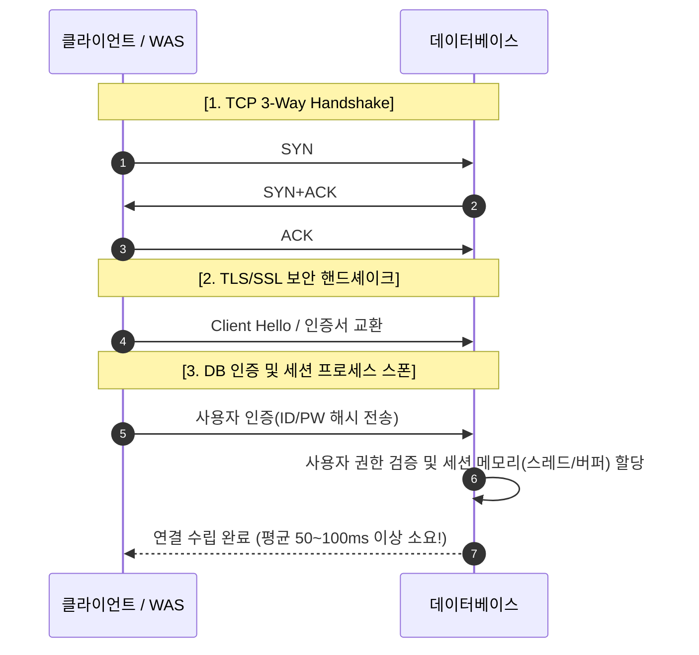

- 데이터베이스 엔진이 동시에 유지할 수 있는 최대 연결 개수(`max_connections`)는 하드웨어 메모리 한계로 인해 보통 수백 개에서 최대 수천 개 수준으로 엄격히 제한됩니다.
- 만약 모바일 앱 사용자 10만 명이 앱을 켜면서 각자 DB와 직접 연결을 맺으려 한다면, DB는 수 초 만에 메모리가 바닥나 `ERROR 1040: Too many connections` 에러를 뿜으며 즉시 프로세스가 다운(OOM Crash)됩니다.
- **해결책**: 백엔드 서버(WAS) 계층에서 **커넥션 풀(Connection Pool, 예: HikariCP)**을 도입합니다. WAS가 시작될 때 미리 정해진 적정 개수(예: 30~50개)의 DB 연결을 미리 맺어 풀에 담아두고, 수만 명의 사용자로부터 들어오는 가벼운 HTTP/JSON 요청들을 번갈아 가며 빠르게 처리한 뒤 즉시 반납받아 재사용합니다.

#### 4. 시스템 수평 확장성(Scale-out)의 확보
- 데이터베이스는 상태(Stateful)를 저장하는 시스템이므로 무한정 서버를 늘리기(Scale-Out)가 매우 어렵습니다.
- 반면 백엔드 API 서버는 사용자 세션을 외부 캐시(Redis)로 분리하면 완벽한 **무상태(Stateless)** 서버가 됩니다. 트래픽이 폭증하면 L4 로드 밸런서 뒤에 WAS 서버 인스턴스를 10대, 100대로 자유롭게 오토스케일링(Scale-Out)하여 트래픽을 분산할 수 있습니다.
- 또한 WAS 계층이 존재해야만 Redis 캐시 계층을 두어 DB 부하를 90% 이상 덜어내거나, 쓰기 전용 DB(Master)와 읽기 전용 DB(Read Replica)로 쿼리를 라우팅하는 정교한 분산 아키텍처를 구현할 수 있습니다.

---

## 06. NoSQL은 SQL이 아닌가요?
> **Not Only SQL의 진정한 본질, RDBMS의 스케일아웃 한계 극복, 4대 NoSQL 데이터 모델 완벽 비교 및 CAP/BASE 이론**

빅데이터와 실시간 분산 시스템의 시대가 열리며 전 세계 소프트웨어 아키텍처를 뒤흔든 키워드는 바로 **NoSQL**이었습니다. 흔히 NoSQL을 "SQL을 쓰지 않는 데이터베이스"로 오해하곤 합니다. 하지만 NoSQL의 진정한 의미는 **"Not Only SQL"**, 즉 "관계형 데이터베이스(SQL)뿐만 아니라, 상황에 맞는 다양한 최적의 데이터 저장소를 함께 쓰자"는 기술적 유연성을 뜻합니다.

---

### 6.1 RDBMS의 수평 확장(Scale-out) 한계와 NoSQL의 태동

전통적인 RDBMS는 단일 서버 환경에서 ACID 트랜잭션과 데이터의 정규화를 극한까지 추구하도록 설계되었습니다.

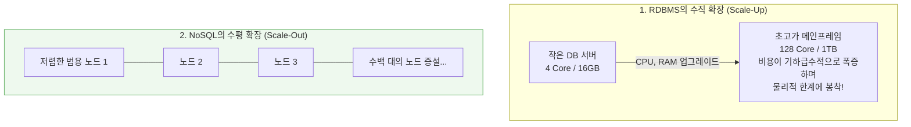

트래픽이 폭증할 때 RDBMS가 맞닥뜨리는 한계는 다음과 같습니다.
1. **샤딩(Sharding)의 극단적 복잡성**: 테이블을 여러 DB 서버에 쪼개어 저장(샤딩)하는 순간, 여러 노드에 걸친 분산 조인(Distributed JOIN) 연산은 네트워크 병목으로 인해 쿼리 수행 시간이 수십 초로 곤두박질칩니다.
2. **분산 트랜잭션(2-Phase Commit)의 비용**: 서로 다른 물리 서버에 위치한 데이터의 ACID를 보장하기 위해 2PC를 사용하면 노드 간 네트워크 왕복 지연으로 인해 시스템 처리량이 10분의 1 이하로 급감합니다.
3. **고정된 스키마(Rigid Schema)의 경직성**: 소셜 미디어 게시글, IoT 센서 데이터, 게임 로그처럼 필드가 시시각각 변하고 비정형적인 데이터를 다루기에는 엄격한 테이블 DDL 구조가 개발 생산성을 가로막습니다.

NoSQL은 이러한 한계를 돌파하기 위해 **"엄격한 관계와 복잡한 조인을 포기하는 대신, 수평 확장(Scale-out)과 초고속 읽기/쓰기를 얻겠다"**는 사상으로 탄생했습니다.

---

### 6.2 NoSQL의 4대 데이터 모델 완벽 비교

NoSQL은 데이터를 저장하는 자료구조에 따라 4가지 진영으로 뚜렷하게 나뉩니다.

```mermaid
mindmap
  root((NoSQL 4대 모델))
    Key-Value 저장소
      Redis / Memcached / DynamoDB
      O 1 초고속 해시 탐색
      세션 / 캐싱 / 순위표
    Document 저장소
      MongoDB / Couchbase
      JSON / BSON 반정형 문서
      유연한 스키마 / 전자상거래 카탈로그
    Wide-Column 저장소
      Apache Cassandra / HBase
      컬럼 패밀리 / LSM-Tree
      초고속 대규모 쓰기 / IoT 센서 / 시계열
    Graph 저장소
      Neo4j / Amazon Neptune
      노드 Node 와 엣지 Edge
      인덱스 프리 인접성 / SNS 관계 / 추천
```

#### 1. Key-Value 저장소 (Key-Value Store)
- **대표 제품**: Redis, Memcached, AWS DynamoDB
- **특징**: 고유한 키(Key)와 이에 매핑되는 임의의 값(Value)만을 저장하는 가장 단순하고 빠른 모델입니다. 내부적으로 해시 테이블(Hash Table)을 사용하여 $O(1)$의 초고속 조회를 보장합니다.
- **적합한 유스케이스**: 사용자 로그인 세션 관리, 실시간 랭킹 순위표, API 응답 캐싱, 장바구니.

#### 2. Document 저장소 (Document Store)
- **대표 제품**: MongoDB, Couchbase
- **특징**: 데이터를 JSON 또는 BSON(Binary JSON) 포맷의 자기 기술적(Self-describing) 문서 형태로 저장합니다. 문서 내부에 중첩된 객체(Nested Object)와 배열(Array)을 자유롭게 포함할 수 있어 객체지향 프로그래밍의 객체 모델과 1:1로 자연스럽게 매핑됩니다.
- **적합한 유스케이스**: 스키마가 수시로 변하는 이커머스 상품 카탈로그, CMS(콘텐츠 관리 시스템), 모바일 앱 백엔드.

#### 3. Wide-Column / Column-Family 저장소
- **대표 제품**: Apache Cassandra, Google Bigtable, Apache HBase
- **특징**: 구글의 Bigtable 논문을 기반으로 발전했습니다. 전통적인 RDBMS가 행(Row) 단위로 데이터를 디스크에 연속 저장하는 것과 달리, **컬럼 단위(Column-Family)**로 묶어 연속 저장합니다. LSM-Tree(Log-Structured Merge-tree) 구조를 취하여 수평 노드 수백 대에 걸쳐 초당 수백만 건의 쓰기(Write) 연산을 병목 없이 처리합니다.
- **적합한 유스케이스**: 대규모 IoT 센서 데이터 수집, 금융 시계열(Time-series) 데이터, 접속 로그 분석.

#### 4. Graph 데이터베이스 (Graph Database)
- **대표 제품**: Neo4j, Amazon Neptune
- **특징**: 데이터를 **노드(Node: 개체)**와 **엣지(Edge: 관계)**, 그리고 **프로퍼티(Property: 속성)**로 표현합니다. RDBMS는 관계를 추적할 때마다 무거운 JOIN을 반복하지만, 그래프 DB는 데이터 간의 관계를 물리적인 메모리 포인터로 미리 연결해 두는 **인덱스 프리 인접성(Index-Free Adjacency)**을 제공합니다. 친구의 친구의 친구를 탐색하는 복잡한 다단계 관계 조회가 $O(1)$에 가깝게 동작합니다.
- **적합한 유스케이스**: 페이스북/인스타그램의 소셜 네트워크 관계망, 금융 이상 거래 탐지(FDS: Fraud Detection), 실시간 상품 추천 엔진.

| 구분 | Key-Value (Redis) | Document (MongoDB) | Wide-Column (Cassandra) | Graph (Neo4j) |
| :--- | :--- | :--- | :--- | :--- |
| **데이터 모델** | Key-Value 쌍 | JSON/BSON 계층 문서 | 키-컬럼 패밀리 맵 | 노드-관계 그래프 |
| **스키마 유연성** | 무스키마 (자유로움) | 유연한 동적 스키마 | 컬럼 단위 동적 스키마 | 노드/엣지 속성 자유 |
| **트랜잭션 지원** | 단일 키 수준 보장 | 단일 문서(다중 지원 확대) | 조정 가능한 일관성 (Tunable) | 완전한 ACID 지원 |
| **수평 확장성** | 매우 뛰어남 (클러스터) | 매우 뛰어남 (샤딩) | **환상적 (선형적 확장)** | 분산 클러스터링 다소 복잡 |
| **주요 장점** | 극단적인 처리 속도 ($O(1)$) | 직관적 개발 생산성 | 막대한 대용량 쓰기 처리 | 복잡한 관계망 초고속 탐색 |

---

### 6.3 분산 시스템의 절대 법칙: CAP 이론과 BASE 철학

에릭 브루어(Eric Brewer) 교수가 제안한 **CAP 정리**는 분산 네트워크 환경에서 데이터베이스 시스템이 직면하는 물리적 한계를 수학적으로 규명했습니다.

```mermaid
flowchart TD
    subgraph CAP["CAP 이론 (세 가지 중 최대 2가지만 충족 가능)"]
        C["Consistency (일관성)<br/>모든 노드는 어느 순간이든<br/>완벽히 동일한 데이터를 반환함"]
        A["Availability (가용성)<br/>일부 노드가 다운되어도 모든 요청은<br/>언제나 에러 없이 응답을 반환함"]
        P["Partition Tolerance (분할 내구성)<br/>노드 간 네트워크 단절이 발생해도<br/>전체 시스템은 계속 동작함"]
    end
    
    C --- CA["CA 시스템<br/>(RDBMS: Oracle, MySQL 단일)<br/>*분산 환경에선 네트워크 분할(P)이<br/>필연적이므로 실질적 선택 불가"] --- A
    A --- AP["AP 시스템<br/>(가용성 최우선)<br/>Cassandra, DynamoDB, CouchDB"] --- P
    P --- CP["CP 시스템<br/>(일관성 최우선)<br/>MongoDB, HBase, Redis Cluster"] --- C
```

1. **일관성 (Consistency)**: 어떤 노드에 읽기 요청을 보내도 가장 최근에 쓰인 동일한 최신 데이터를 반환해야 합니다.
2. **가용성 (Availability)**: 시스템의 일부 노드에 장애가 발생하더라도 정상 노드들은 클라이언트의 요청에 대해 언제나 실패(Error) 없이 성공 응답을 반환해야 합니다.
3. **분할 내구성 (Partition Tolerance)**: 노드와 노드 사이를 잇는 네트워크 케이블이 끊어지거나 패킷이 유실되어도 전체 분산 클러스터는 멈추지 않고 동작해야 합니다.

> **분산 시스템의 냉혹한 현실**  
> 전 세계 데이터센터를 잇는 분산 네트워크에서 네트워크 장애(Partition)는 피할 수 없는 현실입니다. 따라서 **분할 내구성(P)은 필수 전제**가 되며, 결국 모든 분산 데이터베이스는 **일관성을 지키기 위해 가용성을 일부 포기하는 CP 시스템**이 될 것인지, 아니면 **가용성을 지키기 위해 일관성을 일부 양보하는 AP 시스템**이 될 것인지 선택해야 합니다.

#### ACID에 대항하는 NoSQL의 철학: BASE
NoSQL은 완벽한 즉시 일관성(ACID)을 고집하지 않는 대신 다음과 같은 **BASE** 모델을 지향합니다.
- **Basically Available (기본적 가용성)**: 시스템에 장애가 발생해도 부분적인 가용성을 항상 보장합니다.
- **Soft State (유연한 상태)**: 외부의 새로운 갱신 입력이 없더라도 노드 간의 데이터 동기화 과정으로 인해 데이터의 상태가 시간에 따라 변할 수 있습니다.
- **Eventual Consistency (궁극적 일관성)**: 쓰기 작업 직후에는 일시적으로 노드 간 데이터 불일치가 발생할 수 있으나, 일정 시간(수백 밀리초)이 흐르고 네트워크 동기화가 완료되면 결국 모든 노드의 데이터가 완벽히 동일해집니다.

---

## (+) 정규화(Normalization)란 무엇인가요?
> **데이터 중복이 부르는 3대 이상 현상, 제1정규형에서 BCNF까지의 단계별 분해, 실전 반정규화(De-normalization) 전략**

관계형 데이터베이스 설계의 가장 기초적이면서도 강력한 수학적 정제 기법이 바로 **정규화(Normalization)**입니다. 잘못 설계된 하나의 비대한 테이블은 사소한 데이터 변경에도 치명적인 부작용을 일으킵니다. 정규화는 과연 어떤 원리로 데이터 무결성을 구원할까요?

---

### 1. 데이터 중복이 낳는 괴물: 3대 이상 현상(Anomalies)

정규화되지 않고 모든 정보(학생, 학과, 교수)가 하나의 거대한 테이블에 뒤섞여 있는 상황을 살펴봅시다.

| 학번 (PK) | 학생명 | 수강과목코드 (PK) | 과목명 | 지도교수 | 학과위치 |
| :--- | :--- | :--- | :--- | :--- | :--- |
| 202601 | 김철수 | CS101 | 컴퓨터개론 | 홍길동 | IT관 301호 |
| 202601 | 김철수 | CS102 | 자료구조 | 홍길동 | IT관 301호 |
| 202602 | 이영희 | CS101 | 컴퓨터개론 | 홍길동 | IT관 301호 |

이 테이블은 다음과 같은 **3대 이상 현상(Anomalies)**을 유발합니다.

```mermaid
flowchart TD
    Anomaly["데이터 중복으로 인한 3대 이상 현상"]
    
    Anomaly --> Insert["1. 삽입 이상 (Insertion Anomaly)<br/>불필요한 정보를 함께 넣지 않으면<br/>원하는 데이터를 삽입할 수 없음!<br/>(예: 학생 없는 신설 과목 개설 불가 - PK 학번이 NULL이 됨)"]
    Anomaly --> Delete["2. 삭제 이상 (Deletion Anomaly)<br/>한 데이터를 지웠을 때 원치 않는<br/>중요한 다른 정보까지 함께 영구 소멸됨!<br/>(예: 이영희가 수강 취소 시 CS101 과목 정보가 통째로 삭제될 위험)"]
    Anomaly --> Update["3. 갱신 이상 (Update Anomaly)<br/>중복된 튜플 중 일부만 수정되어<br/>데이터 간 불일치가 발생함!<br/>(예: 홍길동 교수의 학과위치가 바뀌었을 때 1건만 수정되면 같은 교수인데 방이 달라짐)"]
```

---

### 2. 함수 종속성(Functional Dependency)의 기초

정규화는 **함수 종속성(Functional Dependency)**을 분석하여 연관된 속성끼리 테이블을 쪼개어 나가는 과정입니다.  
어떤 릴레이션에서 속성 $X$의 값을 알면 속성 $Y$의 값이 오직 하나로 결정될 때, **"$Y$는 $X$에 함수적으로 종속된다"**고 말하며 기호로는 **$X \rightarrow Y$** ($X$: 결정자, $Y$: 종속자)로 표기합니다. (예: `주민등록번호` $\rightarrow$ `이름, 생년월일, 성별`)

---

### 3. 단계별 정규화 과정 (1NF ~ BCNF)

실무에서 데이터 무결성을 보장하기 위해 준수하는 1단계부터 BCNF까지의 정규화 과정을 명쾌하게 정리합니다.

```mermaid
flowchart LR
    UnNorm[비정규 테이블] -->|도메인이 원자값| 1NF[제1정규형 1NF]
    1NF -->|부분 함수 종속 제거| 2NF[제2정규형 2NF]
    2NF -->|이행적 함수 종속 제거| 3NF[제3정규형 3NF]
    3NF -->|모든 결정자가 후보키| BCNF[보이스-코드 BCNF]
```

#### 제1정규형 (1NF: First Normal Form)
- **원칙**: 테이블의 모든 컬럼 도메인이 더 이상 쪼갤 수 없는 **원자값(Atomic Value)**으로만 구성되어야 합니다. (반복 그룹 및 다중값 제거)
- **위반 사례**: 한 회원의 `취미` 컬럼에 `"축구, 독서, 영화"`처럼 쉼표로 구분된 다중값이 들어있는 경우.
- **해결**: 다중값을 가진 컬럼을 별도의 행으로 분리하거나 자식 테이블로 독립시킵니다.

#### 제2정규형 (2NF: Second Normal Form)
- **원칙**: 제1정규형을 만족하고, 기본키가 아닌 모든 일반 속성이 기본키 전체에 **완전 함수 종속(Full Functional Dependency)**해야 합니다. 즉, **부분 함수 종속(Partial Functional Dependency)**을 제거합니다.
- **발생 조건**: 기본키가 2개 이상의 컬럼으로 묶인 **복합키(Composite PK)**일 때 주로 발생합니다.
- **위반 사례**: 복합 기본키가 `(학번, 과목코드)`인데, `과목명` 컬럼은 학번과는 무관하고 오직 `과목코드`에만 종속되는 경우.
- **해결**: 부분 종속되는 속성(`과목코드`, `과목명`)을 별도의 테이블로 분리합니다.

#### 제3정규형 (3NF: Third Normal Form)
- **원칙**: 제2정규형을 만족하고, 기본키가 아닌 일반 속성들 간의 **이행적 함수 종속(Transitive Functional Dependency)**을 제거해야 합니다.
- **개념**: $A \rightarrow B$ 이고 $B \rightarrow C$ 일 때, 논리적으로 $A \rightarrow C$ 가 성립하는 종속 관계를 의미합니다.
- **위반 사례**: `학번(PK)` $\rightarrow$ `학과코드` 이고, `학과코드` $\rightarrow$ `학과사무실위치` 일 때, 학과사무실위치는 학번에 이행적으로 종속됩니다.
- **해결**: 이행 종속을 유발하는 `(학과코드, 학과사무실위치)`를 별도의 `학과` 테이블로 분리합니다.

#### 보이스-코드 정규형 (BCNF: Boyce-Codd Normal Form)
- **원칙**: 제3정규형을 만족하고, 테이블 내의 **모든 결정자(Determinant)가 반드시 후보키(Candidate Key)**여야 합니다.
- **개념**: 한 테이블에 여러 후보키가 존재하고 서로 중첩될 때 발생합니다. 후보키가 아닌 일반 컬럼이 다른 컬럼을 결정하고 있다면 이를 분리해야 합니다.

---

### 4. 성능을 위한 반정규화(De-normalization / 역정규화)

이론적으로는 3NF나 BCNF까지 정규화를 완료하는 것이 가장 이상적입니다. 하지만 실무 시스템에서 극단적으로 정규화를 진행하면 다음과 같은 심각한 성능 저하가 발생합니다.

> **과도한 정규화의 함정: JOIN 폭탄과 CPU/IO 고갈**  
> 고객의 주문 내역 화면 하나를 보여주기 위해 `주문`, `고객`, `배송지`, `주문상세`, `상품`, `카테고리`, `쿠폰`, `결제` 등 8개 이상의 테이블을 다중 조인(Multi-way JOIN)해야 한다면, 데이터가 수백만 건을 넘어설 때 데이터베이스는 기하급수적인 CPU 부하와 디스크 랜덤 I/O를 감당하지 못하고 다운됩니다.

**반정규화(De-normalization)**는 데이터 무결성을 약간 양보하는 대신, **시스템의 조회 성능(Throughput)을 비약적으로 끌어올리기 위해 의도적으로 중복, 통합, 분리를 적용하는 엔지니어링 기법**입니다.

```mermaid
flowchart TD
    DeNorm["실전 반정규화 4대 기법"]
    
    DeNorm --> Col1["1. 중복 컬럼 추가<br/>자주 조인되는 부모 컬럼을 자식 테이블에 복제<br/>(예: 주문상세 테이블에 상품명 중복 저장 -> 상품 JOIN 제거)"]
    DeNorm --> Col2["2. 파생 / 집계 컬럼 추가<br/>매번 COUNT/SUM 연산하는 비용 절감<br/>(예: 게시글 테이블에 '댓글 수(comment_count)' 컬럼 유지)"]
    DeNorm --> Table1["3. 테이블 수직 분할 (Vertical Partitioning)<br/>자주 쓰는 기본 컬럼과 거의 안 쓰는 대용량 텍스트/BLOB 분리<br/>(예: 회원 기본 정보 vs 회원 장문의 자기소개/이력서 분리)"]
    DeNorm --> Table2["4. 테이블 수평 분할 (Horizontal Partitioning)<br/>동일 스키마 데이터를 기간별/지역별로 물리 분할<br/>(예: 2026년 결제 테이블, 2025년 결제 테이블 파티셔닝)"]
```

> **⚠️ 반정규화의 대가: 데이터 정합성 유지 비용**  
> 반정규화는 공짜 점심이 아닙니다. 중복 컬럼(`상품명`)을 두면 원본 상품명이 변경될 때 수십만 건의 주문상세 데이터도 일괄 업데이트해야 하는 동기화 비용이 발생합니다. 따라서 반정규화는 **"조회 빈도가 쓰기 빈도보다 압도적으로 높고(Read Heavy), 인덱스나 캐싱으로도 성능 해결이 불가능한 병목 구간"**에 한하여 제한적으로 적용해야 합니다.

---

## (+) 데이터베이스 백업은 왜 중요한가요?
> **재해 복구(DR)의 최후 보루, 물리 백업 vs 논리 백업, 3대 백업 전략 비교 및 RPO/RTO 지표와 시점 복구(PITR)**

"세상에는 두 종류의 엔지니어가 있습니다. 백업을 하고 있는 엔지니어와, 아직 처절한 데이터 유실을 경험해보지 못한 엔지니어입니다." 하드웨어 디스크는 언제든 망가질 수 있고, 랜섬웨어는 언제든 침투할 수 있으며, 사람이 작성한 배포 스크립트나 실수로 실행한 `DELETE FROM user;` 한 줄은 기업의 존폐를 가릅니다. 백업은 데이터베이스의 생명줄입니다.

---

### 1. 백업의 근본 목적과 재해 복구(Disaster Recovery)

데이터베이스 백업은 단순한 파일 복사가 아닙니다. 서비스 운영 중 발생할 수 있는 모든 형태의 치명적 사고로부터 비즈니스를 영속시키는 **재해 복구(DR: Disaster Recovery)**의 핵심 축입니다.

1. **인적 오류(Human Error) 구제**: 가장 흔한 데이터 유실 원인은 DBA나 개발자의 실수(`WHERE` 절 없는 `UPDATE`/`DELETE` 실행, 잘못된 마이그레이션 스크립트 실행)입니다.
2. **랜섬웨어 및 악의적 침해 대응**: 해커가 데이터베이스를 암호화하거나 인질로 잡았을 때 유일한 해결책은 감염 직전의 클린 백업본으로 복원하는 것입니다.
3. **하드웨어 및 인프라 물리 재해**: 데이터센터 화재, 전력 공급 중단, 디스크 컨트롤러 고장 시 새로운 하드웨어에 데이터를 즉각 복구해야 합니다.

---

### 2. 백업 방식 분류 1: 물리 백업 vs 논리 백업

백업을 어떤 포맷으로 추출하는가에 따라 물리 백업과 논리 백업으로 나뉩니다.

```mermaid
flowchart TD
    subgraph Logical["1. 논리 백업 (Logical Backup)"]
        L1[DB 쿼리 엔진] -->|SELECT 실행| L2[SQL 텍스트 파일 생성<br/>CREATE TABLE...<br/>INSERT INTO... VALUES...]
    end

    subgraph Physical["2. 물리 백업 (Physical Backup)"]
        P1[OS 스토리지 엔진] -->|바이트 블록 직접 복사| P2[물리 데이터 파일 그대로 복제<br/>.ibd, Tablespace, LSN 블록<br/>+ Redo / WAL 로그]
    end
```

| 비교 항목 | 논리 백업 (Logical Backup) | 물리 백업 (Physical Backup) |
| :--- | :--- | :--- |
| **추출 도구** | `mysqldump`, `pg_dump`, `mydumper` | Percona XtraBackup, `pg_basebackup`, 스토리지 스냅샷 |
| **저장 포맷** | **SQL 텍스트 파일** (DDL + INSERT 구문) | **바이너리 원본 데이터 파일** (OS 레벨 파일) |
| **백업 속도** | 느림 (모든 데이터를 쿼리로 읽어 텍스트로 직렬화) | **매우 빠름** (디스크 블록을 바이트 단위로 직접 복사) |
| **복구 속도** | 매우 느림 (수억 건의 INSERT SQL을 엔진이 일일이 재실행) | **초고속** (데이터 파일을 원래 디렉토리에 복사 후 기동) |
| **호환성** | **극상** (이종 OS, 다른 DB 마이너 버전, 텍스트 편집 가능) | 낮음 (동일한 OS, 동일한 DBMS 버전/아키텍처 간에만 가능) |
| **실무 권장** | 데이터 크기가 수십 GB 이하인 소규모 DB | **수백 GB ~ 수십 TB 이상의 엔터프라이즈 프로덕션 DB** |

---

### 3. 백업 방식 분류 2: 백업 주기에 따른 3대 전략

백업을 수행하는 주기에 따라 전체 백업, 증분 백업, 차등 백업으로 나뉩니다.

```mermaid
flowchart TD
    subgraph Full["전체 백업 (Full Backup)"]
        F1["일요일: 전체 데이터 백업 (100GB)"]
    end

    subgraph Diff["차등 백업 (Differential Backup)"]
        D1["월요일: 일요일 이후 변경분 백업 (10GB)"]
        D2["화요일: 일요일 이후 변경분 백업 (20GB)"]
        D3["수요일: 일요일 이후 변경분 백업 (30GB)"]
    end

    subgraph Inc["증분 백업 (Incremental Backup)"]
        I1["월요일: 일요일 대비 변경분 (10GB)"]
        I2["화요일: 월요일 대비 변경분 (10GB)"]
        I3["수요일: 화요일 대비 변경분 (10GB)"]
    end
```

1. **전체 백업 (Full Backup)**
   - 데이터베이스의 모든 데이터를 통째로 백업합니다.
   - **장점**: 복구 시 오직 이 백업본 하나만 밀어 넣으면 되므로 복구 절차가 가장 간단하고 신속합니다.
   - **단점**: 백업할 때마다 막대한 시간과 스토리지 디스크 용량을 소모합니다.
2. **증분 백업 (Incremental Backup)**
   - **'직전 백업(전체 백업 또는 이전 증분 백업)' 이후 변경된 데이터만** 백업합니다.
   - **장점**: 백업 소요 시간과 백업 파일 용량이 가장 작습니다.
   - **단점**: 수요일 데이터로 복구하려면 `일요일(Full) + 월요일(Inc) + 화요일(Inc) + 수요일(Inc)` 백업본을 순서대로 하나도 빠짐없이 모두 적용해야 합니다. 중간에 화요일 백업본 하나만 깨져도 수요일 상태로 복구할 수 없습니다.
3. **차등 백업 (Differential Backup)**
   - **'마지막 전체 백업' 이후 변경된 모든 데이터를 누적하여** 백업합니다.
   - **장점**: 복구할 때 `일요일(Full) + 복구 직전의 최신 차등 백업 1개`만 있으면 복원되므로 증분 백업보다 복구가 훨씬 빠르고 안전합니다.
   - **단점**: 일요일 전체 백업 이후 시간이 지날수록 백업 용량이 점점 커집니다.

---

### 4. 재해 복구의 2대 절대 지표: RPO와 RTO

DBA와 인프라 아키텍트가 재해 복구 계획을 수립할 때 경영진과 반드시 합의해야 하는 두 가지 핵심 지표가 있습니다.

```mermaid
flowchart LR
    subgraph Timeline["시간 흐름과 재해 복구 지표"]
        direction LR
        Past["정기 백업 시점<br/>(14:00)"] --- Disaster["[치명적 재해 발생!]<br/>(14:35)"]
        Disaster --- Recovered["서비스 완전 정상화<br/>(15:05)"]
    end

    Past -.->|35분간 데이터 손실<br/>= RPO 지표| Disaster
    Disaster -.->|복구 소요 30분<br/>= RTO 지표| Recovered
```

1. **RPO (Recovery Point Objective, 목표 복구 시점)**
   - **"재해 발생 시 감당할 수 있는 최대 데이터 유실 허용 시간"**입니다.
   - "우리의 RPO는 1시간이다" $\rightarrow$ 백업 주기가 1시간이므로 재해가 나면 최대 1시간 전 데이터로 복원되며, 최근 1시간 치 데이터는 유실됨을 감수한다는 뜻입니다.
   - 금융 시스템의 RPO 목표는 통상 **0초(단 1건의 결제 유실도 불허)**이며, 이를 위해 다중 데이터센터 간 동기식 복제(Sync Replication)를 구축합니다.
2. **RTO (Recovery Time Objective, 목표 복구 시간)**
   - **"재해가 발생한 순간부터 시스템을 다시 정상 가동할 때까지 걸리는 최대 허용 시간"**입니다.
   - "우리의 RTO는 30분이다" $\rightarrow$ 서버가 불타도 30분 이내에는 백업본 복원과 DNS 스위치오버를 완료하여 서비스를 재개해야 한다는 뜻입니다.

> **💡 RPO/RTO와 비용(Cost)의 기하급수 곡선**  
> RPO와 RTO를 0에 가깝게 줄이려 할수록 인프라 구축 비용은 선형이 아니라 기하급수적으로 폭증합니다. 비즈니스의 중요도(미션 크리티컬 여부)에 따라 적절한 RPO/RTO 수준을 산정하는 것이 아키텍트의 역량입니다.

---

### 5. 마법 같은 정밀 복구: 시점 복구(PITR: Point-In-Time Recovery)

"오늘 오후 2시 14분 35초에 신입 개발자가 실수로 운영 DB의 고객 테이블을 DROP했습니다!"  
이때 어제 밤 12시 전체 백업본으로 복원하면 오늘 오전에 결제된 수만 건의 데이터가 함께 날아갑니다. 어떻게 해야 할까요? 바로 **시점 복구(PITR: Point-In-Time Recovery)** 기술을 사용합니다.

```mermaid
flowchart LR
    FullBkp["1. 가장 최근 전체 백업 복원<br/>(어제 밤 00:00 시점 베이스라인)"] --> BinlogReplay["2. WAL / Binlog 순차 롤포워드 (Replay)<br/>(00:00:01 ~ 14:14:34 까지의 모든 SQL 재생)"]
    BinlogReplay --> StopRightBefore["3. 사고 직전 1초에서 재생 중단!<br/>(14:14:35 DROP TABLE 명령 직전 멈춤!)"]
    StopRightBefore --> PerfectDB["완벽한 데이터 복원 완료!<br/>(유실 데이터: 0건)"]
```

#### PITR의 동작 메커니즘
1. **베이스라인 복원**: 사고 시점 직전의 가장 최신 전체 백업(Full Backup, 예: 어제 밤 12시)을 임시 서버에 복원합니다.
2. **트랜잭션 로그 확보**: 백업 시점부터 사고 발생 순간까지 데이터베이스에 기록된 모든 변경 내역인 **바이너리 로그(MySQL Binlog)** 또는 **WAL(PostgreSQL Write-Ahead Log)**을 가져옵니다.
3. **롤포워드(Roll-Forward)와 정밀 타겟팅**: 트랜잭션 로그를 순서대로 재생(Replay)하다가, 사고를 유발한 치명적인 쿼리(`DROP TABLE`)의 정확한 타임스탬프(또는 트랜잭션 번호 LSN/GTID) 바로 직전인 **`2026-09-20 14:14:34`**에서 로그 재생을 정확히 중단합니다.
4. **결과**: 단 1초의 오차도 없이 사고 발생 직전 상태로 데이터를 100% 온전하게 되살려 냅니다.

---

## 💡 PART 07 총정리: 엔지니어가 기억해야 할 데이터베이스 원칙 5계명

1. **데이터의 무결성은 타협할 수 없다**: 파일 시스템의 혼돈에서 벗어나게 해 준 RDBMS의 키(PK/FK)와 제약조건을 신뢰하고, 애플리케이션 이전에 데이터베이스 계층에서 일차적인 정합성을 수호하십시오.
2. **트랜잭션의 ACID를 이해하고 격리 수준을 현명하게 선택하라**: 비즈니스에 맞는 격리 수준(대부분 READ COMMITTED 또는 REPEATABLE READ)을 선택하고, MVCC의 동작 원리를 파악하여 락 병목 없는 동시성을 설계하십시오.
3. **인덱스는 양날의 검이다**: 카디널리티가 높은 컬럼에 인덱스를 걸고 좌변 가공을 금지하되, CUD 오버헤드와 페이지 분할을 항상 경계하며 `EXPLAIN`으로 실행 계획을 상시 검증하십시오.
4. **계층 간의 경계를 엄격히 지켜라**: 앱과 DB의 직통 연동을 원천 금지하고, 3-Tier 아키텍처와 커넥션 풀(HikariCP)을 통해 보안성과 수평 확장성을 철저히 확보하십시오.
5. **백업 없는 데이터는 존재하지 않는 데이터다**: 물리/논리 백업의 장단점을 파악하고, 명확한 RPO와 RTO 기준 아래 주기적인 PITR 시점 복원 훈련을 실전처럼 수행하십시오.
