# PART 09. 아키텍처 (System Architecture & Scalability)

> **"소프트웨어 아키텍처는 시스템이 무너지지 않고 비즈니스의 폭발적인 성장을 견뎌내도록 받쳐주는 뼈대이자, 시간이 흘러도 변경하기 가장 어려운 전략적 의사결정의 총체입니다."**  
> 초기 스타트업의 작은 토이 프로젝트는 단 한 대의 컴퓨터로도 완벽하게 동작합니다. 하지만 사용자가 수만 명, 수백만 명, 수천만 명으로 늘어나고, 초당 수십만 건의 결제와 트래픽이 쏟아져 들어오면 시스템은 완전히 다른 차원의 도전에 직면합니다.  
> 아무리 알고리즘과 코드를 최적화해도 단일 서버의 CPU와 메모리는 물리적 한계에 도달하고, 데이터베이스는 디스크 I/O와 락(Lock) 경합으로 비명을 지르며, 사소한 네트워크 지연 하나가 연쇄 장애(Cascading Failure)를 일으켜 서비스 전체를 일순간에 마비시키기도 합니다.  
> 이번 파트에서는 전통적인 티어(Tier) 아키텍처의 분리부터, 실전 용량 산정(Capacity Estimation) 기법, 사용자 1명에서 1,000만 명까지 확장해 나가는 단계별 아키텍처 진화 시나리오, 스타벅스 매장을 통해 이해하는 대규모 트래픽 분산 처리와 대기열/배압 제어 비유, Redis 자료구조·영속성·클러스터 및 캐시 3대 장애 방어 전략, 모놀리식과 MSA의 현실적 트레이드오프(Outbox, CQRS, Service Mesh, Strangler Fig), 무중단 배포와 DB 스키마 하위 호환성(Expand and Contract), API Gateway와 Rate Limiting 4대 알고리즘, 그리고 관측 가능성(Observability)과 카오스 엔지니어링까지 대규모 분산 시스템 아키텍트가 갖추어야 할 핵심 지식과 실무 인사이트를 총망라하여 깊이 있게 해설합니다.

---

## 01. 서버와 클라이언트 구성
> **1-Tier, 2-Tier(클라이언트-DB), 3-Tier(프레젠테이션-비즈니스-데이터) 아키텍처의 발전과 분리 이유**

컴퓨터 시스템의 역사는 **"어떻게 책임을 나누고, 어디에 데이터를 두며, 어떻게 물리적 부하를 격리할 것인가?"**에 대한 끊임없는 탐구 과정이었습니다. 우리가 스마트폰 앱이나 웹 브라우저에서 버튼을 클릭했을 때 일어나는 일련의 과정은 지난 수십 년 동안 거대한 진화를 거쳐 왔습니다.

---

### 1.1 티어(Tier)와 레이어(Layer)의 명확한 구분

소프트웨어 공학에서 흔히 혼용되는 두 개념인 **계층(Layer)**과 **티어(Tier)**는 아키텍처를 설계하고 논의할 때 반드시 명확히 구분해야 합니다.

* **논리적 계층 (Logical Layer)**: 소프트웨어 코드와 책임의 구조적인 분리를 의미합니다. 단일 실행 바이너리(예: 하나의 `.jar` 파일) 내부에서도 컨트롤러 계층(Presentation Layer), 서비스 계층(Business Logic Layer), 데이터 접근 계층(Data Access / Repository Layer)으로 코드를 분리할 수 있습니다. 이들은 **동일한 운영체제 프로세스, 동일한 물리 머신 안에서 메모리 참조와 함수 호출(Call Stack)**을 통해 동작합니다.
* **물리적 티어 (Physical Tier)**: 애플리케이션의 구성 요소가 **서로 다른 물리적(또는 가상화된) 하드웨어 장비 및 독립된 네트워크 노드**로 분리되어 구동되는 배포 단위를 의미합니다. 각 티어 간에는 메모리 주소를 공유할 수 없으므로 반드시 **네트워크 통신(TCP/IP, HTTP/HTTPS, gRPC, DB Wire Protocol)**과 직렬화/역직렬화(Serialization/Deserialization) 과정이 수반됩니다.

```
+-----------------------------------------------------------------------------+
| [논리적 계층 (Logical Layer)]      vs      [물리적 티어 (Physical Tier)]    |
|                                                                             |
|  [ Layer: 코드 관심사의 논리적 분리 ]       [ Tier: 물리적 인프라의 분리 ]  |
|  +--------------------------------+         +--------------+                |
|  | Controller (Presentation Layer)|         |   Tier 1     | (스마트폰/PC)  |
|  +--------------------------------+         +------+-------+                |
|  | Service (Business Logic Layer) |                | (인터넷망 / HTTPS)     |
|  +--------------------------------+         +------+-------+                |
|  | Repository (Data Access Layer) |         |   Tier 2     | (클라우드 WAS) |
|  +--------------------------------+         +------+-------+                |
|                                                    | (사설 VPC망 / TCP)     |
|  * 특징: 동일 JVM/프로세스 내부             +------+-------+                |
|  * 통신: 나노초(ns) 단위의 함수 호출        |   Tier 3     | (전용 DB 서버) |
|  * 목적: 코드 유지보수성, 테스트 용이성     +--------------+                |
|                                             * 특징: 독립된 하드웨어/OS      |
|                                             * 통신: 밀리초(ms) 네트워크 I/O |
|                                             * 목적: 보안 격리, 독립적 확장  |
+-----------------------------------------------------------------------------+
```

> **핵심 인사이트**: "3-Layer 아키텍처로 코드를 짰다"는 말은 단일 서버(1-Tier) 안에서도 얼마든지 가능합니다. 반면 "3-Tier 아키텍처로 구축했다"는 말은 클라이언트 단말기, 애플리케이션 서버(WAS), 데이터베이스 서버가 물리적으로 분리된 3개의 네트워크 노드로 구성되어 있음을 뜻합니다.

---

### 1.2 1-Tier 아키텍처: 모든 것이 하나의 컴퓨터 안에

1-Tier 아키텍처는 화면 표시(Presentation), 비즈니스 연산(Business Logic), 그리고 데이터 영구 저장(Data Storage)이 **단 한 대의 컴퓨터**에서 일괄 처리되는 구조입니다.

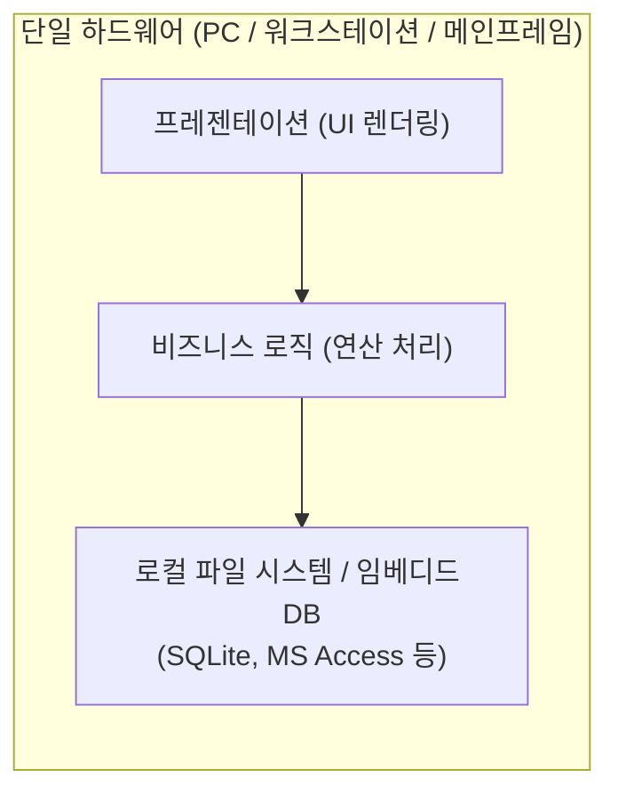

* **동작 방식**: 1980년대 메인프레임(더미 터미널 연결 방식)이나 초기 개인용 컴퓨터(PC)의 독립형(Standalone) 데스크톱 프로그램(예: Microsoft Access, 로컬 엑셀 매크로 장부, 한컴오피스, 모바일 기기 내부에서만 도는 SQLite 기반 오프라인 메모장 앱)이 대표적입니다.
* **장점**:
  1. **극도의 단순성과 속도**: 별도의 네트워크 통신이 전혀 없으므로 네트워크 지연(Latency), 패킷 손실, 분산 트랜잭션, 통신 보안을 고민할 필요가 없습니다.
  2. **빠른 초기 개발과 무비용 인프라**: 서버 호스팅 비용이 들지 않으며 단일 실행 파일(`.exe`, `.apk`) 하나로 즉시 작동합니다.
* **치명적인 한계**:
  1. **다중 사용자 동시성 및 협업 불가**: 데이터가 개별 사용자의 로컬 디스크에 고립되어 있으므로, 서울에 있는 직원과 부산에 있는 직원이 실시간으로 같은 재고 데이터를 차감하거나 공유할 수 없습니다.
  2. **성능 확장의 한계**: 컴퓨터의 하드웨어 스펙(CPU/RAM)을 높이는 스케일업(Scale-up) 외에는 처리량을 늘릴 방법이 없습니다.
  3. **데이터 유실 및 보안 취약성**: 사용자의 PC 하드디스크가 고장 나거나 노트북을 분실하면 기업의 핵심 데이터가 영구 소실되거나 외부에 유출됩니다.

---

### 1.3 2-Tier 아키텍처: 클라이언트-서버(C/S)와 팻 클라이언트(Fat Client)

네트워크 기술(Ethernet, TCP/IP)과 관계형 데이터베이스(RDBMS)의 보급으로 1990년대에는 **클라이언트-서버(Client-Server, C/S)** 모델이 전성기를 맞이했습니다. 각 PC에 흩어져 있던 데이터 저장소를 중앙의 전용 데이터베이스 서버로 통합하여 분리해 낸 것입니다.

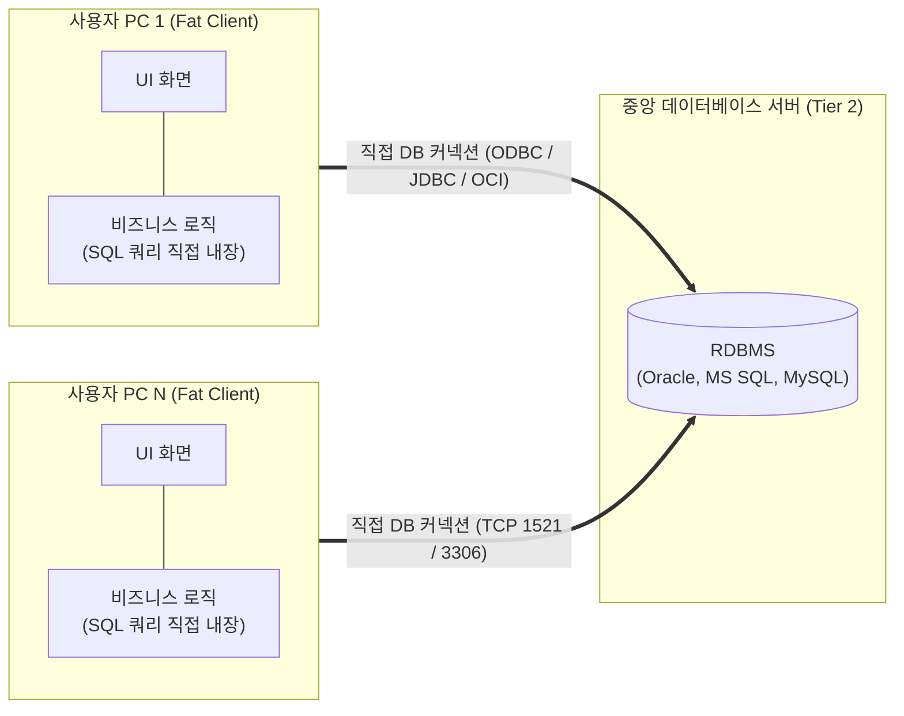

* **동작 방식**: 비주얼 베이직(Visual Basic), 파워빌더(PowerBuilder), 델파이(Delphi), 초기 C# WinForms 등으로 개발된 클라이언트 실행 프로그램이 각 사용자의 PC에 설치됩니다. 이 프로그램 내부에 **데이터베이스 접속 주소(IP/Port), 계정(ID/PW), 비즈니스 로직, 그리고 직접적인 SQL 쿼리문**이 하드코딩되어 있거나 내장되어 있었습니다.
* **팻 클라이언트(Fat Client / Thick Client) 현상**: 클라이언트가 화면 렌더링뿐 아니라 모든 유효성 검증, 할인율 계산, 세금 정산 같은 무거운 비즈니스 연산을 직접 도맡았기 때문에 클라이언트 프로그램의 덩치가 매우 비대했습니다. (반대로 비즈니스 로직을 DB 내부의 스토어드 프로시저(Stored Procedure)에 몰아넣는 변형도 존재했으나, 이는 DB CPU를 고갈시키고 버전 관리를 불가능하게 만들었습니다.)
* **2-Tier가 마주한 3대 재앙**:
  1. **배포의 악몽 (Deployment Hell)**: 만약 정부의 부가가치세 계산 공식이나 사내 할인 정책이 바뀌면 어떻게 될까요? 전국 지점에 깔린 10,000대의 PC에 새로운 `.exe` 패치 파일을 배포해야 합니다. 네트워크 오류나 사용자의 부주의로 단 50대의 PC라도 구버전 프로그램을 그대로 실행하면, 구버전 계산 공식으로 산출된 잘못된 금액이 중앙 DB에 직접 `INSERT/UPDATE`되어 **전사 데이터의 정합성이 영구적으로 오염**됩니다.
  2. **치명적인 보안 구멍 (Security Vulnerability)**: 클라이언트 실행 파일은 사용자의 PC에 존재하므로 해커가 리버스 엔지니어링(디컴파일)하거나 와이어샤크(Wireshark)로 패킷을 스니핑하면 중앙 DB의 접속 IP, 포트, 마스터 계정 비밀번호가 그대로 탈취됩니다. 해커가 DB 클라이언트로 직접 접속해 `DROP TABLE`이나 개인정보 전체 덤프를 수행하는 것을 막을 길이 없었습니다.
  3. **데이터베이스 커넥션 고갈 (Connection Exhaustion)**: RDBMS에서 물리적 커넥션 1개를 맺고 유지하는 것은 수 메가바이트의 메모리와 별도의 프로세스/스레드를 점유하는 매우 값비싼 작업입니다. 동시 접속자가 5,000명으로 늘어나면 DB 서버에 5,000개의 소켓 연결이 직접 꽂히게 되고, 정작 쿼리를 처리해야 할 DB 메모리가 커넥션 유지 비용으로 바닥나면서 DB가 뻗어버렸습니다.

---

### 1.4 3-Tier 아키텍처: 모던 웹과 엔터프라이즈의 표준 패러다임

2-Tier의 구조적 한계를 근본적으로 해결하기 위해, 클라이언트에 들어있던 **비즈니스 로직과 DB 접근 권한을 완전히 적출하여 중앙의 독립된 중간 계층인 애플리케이션 서버(Application Server / WAS)**로 이관한 아키텍처가 바로 **3-Tier 아키텍처**입니다.

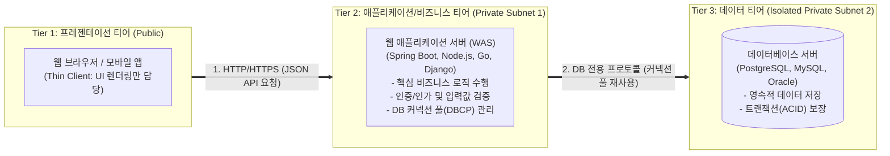

#### 3-Tier로 분리해야만 했던 필연적 이유 4가지

1. **관심사의 분리(Separation of Concerns)와 배포의 단일화**
   * 클라이언트는 화면만 그리는 **씬 클라이언트(Thin Client)**가 됩니다.
   * 할인 정책이나 비즈니스 규칙이 변경되어도 수백만 명의 스마트폰 앱을 강제 업데이트할 필요 없이, 중앙의 WAS만 재배포하면 그 즉시 전 세계 모든 사용자에게 새로운 비즈니스 로직이 100% 동일하게 적용됩니다.
2. **철저한 네트워크 보안 격리 (Network & Security Isolation)**
   * 클라이언트는 오직 WAS(또는 앞단의 웹 서버/로드밸런서)의 공인 IP와만 HTTP/HTTPS(포트 80/443)로 통신합니다.
   * 데이터베이스 서버는 외부 인터넷에서 라우팅조차 불가능한 깊숙한 사설 서브넷(Private Subnet)에 격리되며, 방화벽(Security Group) 규칙을 통해 **오직 Tier 2(WAS)의 사설 IP로부터 오는 3306/5432 포트 접근만 허용**합니다. 해커가 클라이언트 앱을 아무리 뜯어봐도 DB 접속 정보는 단 1바이트도 존재하지 않습니다.
3. **커넥션 풀링(DB Connection Pooling, DBCP)을 통한 DB 보호**
   * 예컨대 HikariCP 같은 커넥션 풀을 사용하여, WAS 한 대당 DB와 미리 맺어두는 물리적 커넥션 수를 20~30개로 고정합니다.
   * 외부에서 10만 명의 사용자가 동시에 접속하더라도, 실제로 쿼리를 실행하는 찰나의 수 밀리초(ms) 동안만 풀(Pool)에서 커넥션을 빌려 쓰고 즉시 반납합니다. 덕분에 DB는 수백 개 수준의 안정적인 커넥션만 유지하며 최고의 쿼리 성능을 발휘할 수 있습니다.
4. **티어별 비대칭적 독립 확장 (Independent Scalability)**
   * 일반적으로 웹 서비스는 DB보다 비즈니스 연산(인증 암호화, JSON 파싱, 템플릿 렌더링, 외부 API 조합)을 수행하는 WAS의 CPU 소모가 훨씬 빠르게 증가합니다.
   * 3-Tier 구조에서는 상태를 가지지 않는(Stateless) Tier 2(WAS)만 트래픽에 따라 2대에서 50대로 유연하게 **스케일아웃(Scale-out)**할 수 있어 인프라 비용 효율성이 극대화됩니다.

---

### 1.5 실무에서의 확장된 3-Tier: Web Server(WS)와 WAS의 분리

현업의 프로덕션 환경에서는 Tier 2 내부를 다시 **웹 서버(Web Server: Nginx, Apache)**와 **웹 애플리케이션 서버(WAS: Tomcat, Spring Boot, Node.js, Gunicorn)**로 세분화하여 구성하는 경우가 많습니다.

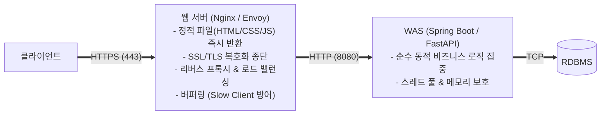

* **왜 WAS 앞에 Nginx(웹 서버)를 두는가?**
  1. **슬로우 클라이언트(Slowloris 등)로부터 WAS 스레드 보호**: 지하철 터널을 지나는 모바일 사용자는 패킷을 주고받는 데 수 초가 걸립니다. 만약 이 느린 네트워크 연결을 무거운 WAS의 워커 스레드가 직접 붙잡고 있으면 WAS 스레드가 금방 고갈됩니다. 앞단의 이벤트 기반(Event-driven) Nginx가 느린 클라이언트의 요청 패킷을 다 받을 때까지 가볍게 버퍼링한 뒤, 완성된 요청만 로컬 루프백이나 초고속 내부망을 통해 WAS에 0.1ms 만에 던져주고 빠집니다.
  2. **무중단 배포와 리버스 프록시**: Nginx의 `upstream` 설정만 동적으로 리로드(`nginx -s reload`)하면 클라이언트 연결을 끊지 않고 뒤에 있는 WAS 컨테이너들을 새 버전으로 교체할 수 있습니다.

#### 1-Tier vs 2-Tier vs 3-Tier 아키텍처 종합 비교

| 비교 항목 | 1-Tier 아키텍처 | 2-Tier (Client-Server) | 3-Tier 아키텍처 |
| :--- | :--- | :--- | :--- |
| **물리적 인프라 구성** | 단일 PC 또는 메인프레임 | 클라이언트 PC + 중앙 DB 서버 | 클라이언트 + WAS + DB 서버 |
| **클라이언트 성격** | 일체형 독립 프로그램 | 팻 클라이언트 (Fat Client) | 씬 클라이언트 (Thin Client) |
| **비즈니스 로직 위치** | 로컬 프로그램 내부 | 클라이언트 내부 (또는 DB SP) | **중앙 애플리케이션 서버 (WAS)** |
| **데이터베이스 보안** | 로컬 디스크 탈취 시 노출 | 취약 (클라이언트에 DB 계정 내장) | **매우 높음 (사설망 격리, 은닉)** |
| **비즈니스 로직 배포** | 모든 사용자 PC마다 재설치 | 모든 클라이언트 PC 패치 (배포 지옥) | **중앙 WAS만 배포 시 즉시 반영** |
| **DB 커넥션 관리** | 로컬 파일 I/O (커넥션 불필요) | 사용자 1명당 DB 커넥션 1개 점유 | **WAS의 커넥션 풀(DBCP)로 공유/재사용** |
| **수평 확장성 (Scale-out)** | 불가능 (스케일업만 가능) | 극히 제한적 (DB 한계에 직면) | **매우 우수 (WAS 무상태 수평 증설)** |

---

## 02. 시스템 아키텍처란 무엇인가요?
> **시스템의 청사진, 구조와 인터페이스, 비기능 요구사항(가용성, 확장성, 보안, 성능, 복구성)을 만족시키기 위한 의사결정의 집합과 실전 용량 산정(Capacity Estimation)**

세계적인 소프트웨어 석학 마틴 파울러(Martin Fowler)와 랄프 존슨(Ralph Johnson)은 아키텍처의 본질을 다음과 같이 통찰력 있게 정의했습니다.

> *"아키텍처란 개발자가 프로젝트 초기에 올바르게 결정하기를 간절히 바라는, 나중에 바꾸기 가장 어려운 의사결정들의 집합이다."*

즉, 시스템 아키텍처는 단순히 프레임워크를 고르거나 폴더 구조를 나누는 수준이 아닙니다. **"이 시스템을 이루는 핵심 컴포넌트들은 무엇이고, 각 컴포넌트는 어떤 책임을 가지며, 서로 어떤 프로토콜과 인터페이스로 통신하고, 장애와 트래픽 폭주 속에서도 어떻게 시스템의 품질을 지켜낼 것인가?"**를 규정하는 전체 시스템의 **거대한 청사진(Blueprint)**입니다.

---

### 2.1 기능적 요구사항(FR) vs 비기능적 요구사항(NFR)

아키텍처 설계가 어려운 이유는 기획서(PRD)에 적힌 요구사항의 이면에 숨겨진 비기능적 본질을 만족시켜야 하기 때문입니다.

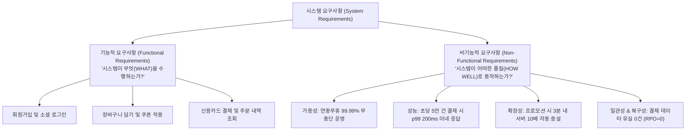

* **기능적 요구사항 (Functional Requirements - WHAT)**: 화면에 결제 버튼이 뜨고, 결제 승인 API가 호출되어 DB에 행(Row) 하나가 추가되면 기능 구현은 끝납니다. 사용자가 1명일 때도 동작합니다.
* **비기능적 요구사항 (Non-Functional Requirements / Quality Attributes - HOW WELL)**: 선착순 100만 명이 동시에 결제 버튼을 누를 때 중복 결제가 일어나지 않는가? 결제 도중 AWS 서울 리전 가용 영역(AZ) 하나에 화재가 나도 서비스가 살아있는가? 해커가 중간에서 패킷을 변조해도 안전한가? **아키텍처는 바로 이 비기능적 요구사항에 의해 결정됩니다.**

---

### 2.2 아키텍트가 반드시 사수해야 할 5대 비기능 요구사항

#### 1. 가용성 (Availability)과 SLA 'Nine'의 법칙
시스템이 장애 없이 정상적으로 서비스를 제공하는 시간의 비율입니다. 공식은 `가용성(%) = (전체 시간 - 다운타임) / 전체 시간 × 100`으로 계산하며, 흔히 **'9(Nine)의 개수'**로 등급을 나눕니다.

| 가용성 등급 | 명칭 | 연간 허용 다운타임 | 월간 허용 다운타임 | 주간 허용 다운타임 | 요구되는 아키텍처 수준 |
| :--- | :--- | :--- | :--- | :--- | :--- |
| **99%** | Two Nines | 3.65일 | 7.31시간 | 1.68시간 | 단일 서버 + 수동 백업 복구 |
| **99.9%** | Three Nines | **8.77시간** | 43.83분 | 10.08분 | 기본 서버 이중화 + 헬스체크 재시작 |
| **99.99%** | Four Nines | **52.60분** | 4.38분 | 1.01분 | 다중 가용영역(Multi-AZ) 자동 Failover, 무중단 배포 |
| **99.999%** | Five Nines | **5.26분** | 26.30초 | 6.05초 | 다중 리전(Multi-Region) Active-Active, 카오스 엔지니어링 |

> **직렬 vs 병렬 컴포넌트의 가용성 수학**:  
> 만약 가용성이 `99.9%`인 두 개의 서버(WAS와 DB)가 직렬로 연결되어 둘 다 살아있어야만 서비스가 동작한다면, 전체 가용성은 `0.999 × 0.999 = 99.8%`로 오히려 떨어집니다. 반면 가용성이 `99%`인 서버 두 대를 병렬(Active-Active 이중화)로 구성하여 둘 중 하나만 살아있어도 동작하게 만들면, 동시에 두 대가 다 죽을 확률은 `0.01 × 0.01 = 0.0001`이므로 전체 가용성은 `1 - 0.0001 = 99.99% (Four Nines)`로 극적으로 상승합니다! 이것이 이중화가 고가용성의 핵심인 수학적 이유입니다.

#### 2. 성능 (Performance): 평균의 함정과 꼬리 지연(Tail Latency)
* **처리량 (Throughput)**: 시스템이 1초당 처리할 수 있는 요청의 수입니다. 조회 위주는 **QPS(Queries Per Second)**, 트랜잭션 위주는 **TPS(Transactions Per Second)**, HTTP 요청 위주는 **RPS(Requests Per Second)**로 측정합니다.
* **지연 시간 (Latency)**: 요청이 들어가서 응답이 나올 때까지 걸리는 시간입니다.
* **왜 평균(Average) 레이턴시는 거짓말을 하는가?**
  * 100명의 사용자 중 99명은 `10ms` 만에 응답을 받았는데, 1명의 사용자가 Full GC나 DB 락 대기 때문에 `10,000ms(10초)` 만에 응답을 받았다고 가정해 봅시다.
  * 산술 평균은 `(99 × 10 + 10000) / 100 = 109.9ms`로 매우 양호해 보입니다! 하지만 실제로는 고객 100명 중 1명이 10초 동안 화면이 멈추는 심각한 장애를 겪고 있습니다.
  * 따라서 아키텍트는 절대 평균을 보지 않으며, 요청을 응답 시간순으로 줄 세웠을 때 하위 95%, 99%, 99.9% 지점의 응답 시간인 **백분위수(Percentile: `p95`, `p99`, `p99.9` Tail Latency)**를 핵심 지표(SLI)로 삼습니다.

#### 3. 확장성 (Scalability)과 탄력성 (Elasticity)
* **확장성(Scalability)**: 트래픽 증가에 맞춰 CPU, 메모리, 서버 노드를 추가했을 때 처리량이 선형적으로 비례하여 늘어나는 구조적 능력입니다.
* **탄력성(Elasticity)**: 트래픽이 몰리는 낮 시간에는 서버를 100대로 자동으로 늘리고(Scale-out), 사용자가 자는 새벽에는 자동으로 10대로 줄여(Scale-in) 클라우드 비용을 최적화하는 동적 수용력입니다.

#### 4. 복구성 (Recoverability): RPO와 RTO
재해 복구(Disaster Recovery, DR) 아키텍처를 설계할 때 비즈니스 경영진과 합의해야 하는 두 가지 핵심 기준점입니다.

```
         [ 과거 마지막 백업 시점 ]          [ 장애 발생! ]              [ 서비스 복구 완료! ]
-------------------|------------------------------|----------------------------|------------------> 시간(Time)
                   |<---------- RPO ------------->|<---------- RTO ----------->|
                   (얼마나 많은 데이터를 잃어도   (얼마나 빨리 서비스를 다시
                    비즈니스가 감내할 수 있는가?)  살려내야 하는가?)
```

* **RPO (Recovery Point Objective, 복구 목표 시점)**: "과거 어느 시점의 데이터까지 손실을 허용할 수 있는가?"
  * 금융/결제 원장 시스템은 단 1원의 유실도 허용되지 않으므로 **RPO = 0 (Zero Data Loss)**이어야 하며, 이를 위해 동기식 복제(Synchronous Replication)가 강제됩니다.
* **RTO (Recovery Time Objective, 복구 목표 시간)**: "장애 발생 후 몇 분 안에 서비스를 정상 가동해야 하는가?"
  * RTO가 1분 이내라면 평소에 완벽히 복제된 서버가 실시간으로 대기하는 **Active-Active** 또는 **Hot Standby(Multi-AZ)** 아키텍처가 필수적입니다.

#### 5. 보안 (Security): 심층 방어 (Defense in Depth)
단 하나의 방화벽에 의존하지 않고, **Edge(Cloudflare WAF / DDoS 방어) → 네트워크(VPC Public/Private 망분리) → 게이트웨이(OAuth 2.0 / JWT 인증 및 Rate Limiting) → 애플리케이션(입력값 검증, RBAC 권한 통제) → 데이터베이스(전송 구간 TLS 및 디스크 저장 암호화 Encryption at Rest)**에 이르는 다중 겹의 보안 계층을 설계해야 합니다.

---

### 2.3 실전 용량 산정 (Capacity Estimation / Back-of-the-Envelope Estimation)

뛰어난 시스템 아키텍트는 코드를 한 줄도 짜기 전에, 종이 한 장과 펜만으로 **"우리 서비스가 감당해야 할 초당 트래픽(QPS), 필요한 네트워크 대역폭, 5년간 쌓일 디스크 스토리지 용량, 그리고 필요한 Redis 메모리와 서버 대수"**를 5분 안에 계산해 냅니다. 이를 **어림셈법(Back-of-the-Envelope Estimation)**이라고 합니다.

#### [실전 예제] DAU 1,000만 명 규모의 소셜 미디어/커머스 플랫폼 용량 산정

**1단계: 기본 전제 조건 설정**
* **일간 활성 사용자 수 (DAU, Daily Active Users)**: `10,000,000명 (1,000만 명)`
* 사용자 1명당 하루 평균 **조회(Read) 요청**: `20회` (피드 조회, 상품 클릭 등)
* 사용자 1명당 하루 평균 **쓰기(Write) 요청**: `2회` (게시글/리뷰 작성, 주문 생성 등)
* 쓰기 1건당 평균 텍스트 메타데이터 크기: `1 KB`
* 쓰기 2건 중 1건은 이미지 1장을 첨부하며, 압축 후 평균 이미지 크기: `500 KB`
* 하루의 초(Seconds) 수: `24시간 × 60분 × 60초 = 86,400초 ≈ 계산 편의상 100,000초(10만 초)`로 근사 계산!

**2단계: 초당 요청 수 (QPS / TPS) 및 피크(Peak) 트래픽 계산**
* **일간 총 읽기 요청 수**: `1,000만 명 × 20회 = 200,000,000건 (2억 건/일)`
* **평균 읽기 QPS (Average Read QPS)**: `200,000,000건 / 100,000초 = 2,000 QPS`
* **평균 쓰기 TPS (Average Write TPS)**: `(1,000만 명 × 2회) / 100,000초 = 200 TPS`
* **피크 타임 QPS (Peak QPS)**: 트래픽은 하루 24시간 균일하게 들어오지 않습니다. 출퇴근 시간이나 저녁 9시 피크 타임에는 평소 평균의 **최소 3배 ~ 5배(이벤트 시 10배)**가 몰립니다. (안전 계수 3배 적용)
  * **Peak Read QPS** = `2,000 × 3 = 6,000 QPS`
  * **Peak Write TPS** = `200 × 3 = 600 TPS`

**3단계: 스토리지(Storage) 용량 산정 (5년 보관 기준)**
* **일간 DB 텍스트 데이터 증가량**: `2,000만 건/일 × 1 KB = 20,000,000 KB = 20 GB / 일`
  * 1년(365일) DB 누적 용량: `20 GB × 365 ≈ 7.3 TB / 년`
  * 5년 DB 누적 용량: `7.3 TB × 5 = 36.5 TB` (여기에 인덱스 용량과 디스크 여유분 30%를 더하면 **약 50 TB 규모의 RDBMS 샤딩 또는 NoSQL 클러스터**가 필요함을 즉시 도출!)
* **일간 미디어(이미지) 객체 스토리지 증가량**: `1,000만 건/일 × 500 KB = 5,000,000,000 KB = 5 TB / 일`
  * 5년 미디어 누적 용량: `5 TB × 365일 × 5년 ≈ 9.125 PB (페타바이트)` → 일반 디스크가 아닌 **AWS S3 + 라이프사이클 정책(Glacier 아카이빙)** 도입이 필수적임을 증명!

**4단계: 캐시(Redis) 메모리 용량 산정 (파레토 법칙 80:20 적용)**
* 전체 조회 트래픽의 80%는 최근 생성된 상위 20%의 인기 게시글/상품에 집중됩니다.
* 하루 생성되는 신규 텍스트 데이터 `20 GB`와 인기 메타데이터를 합쳐 일간 활성 데이터 `100 GB` 중 상위 20%를 모두 Redis 인메모리에 올린다면:
  * **필요한 Redis 메모리** = `100 GB × 0.2 = 20 GB` (복제본 Replica와 메모리 파편화 여유율을 고려해 `64 GB RAM` 규모의 Redis 클러스터 1세트면 `6,000 Read QPS`의 대부분을 DB 접근 없이 방어 가능!)

**5단계: 네트워크 대역폭 (Bandwidth) 및 WAS 서버 대수 산정**
* **인바운드 대역폭 (Ingress - 쓰기)**: 초당 200건(피크 600건)의 절반인 300건이 `500 KB` 이미지를 업로드 → `300 × 500 KB = 150 MB/s = 1.2 Gbps`
* **아웃바운드 대역폭 (Egress - 읽기)**: 피크 시 초당 6,000건의 조회가 각각 `500 KB` 이미지를 본다면 → `6,000 × 500 KB = 3 GB/s = 24 Gbps` → 백엔드 서버가 이 대역폭을 직접 감당하면 파산합니다! 반드시 **CDN(Content Delivery Network)을 앞단에 배치해 95% 이상의 이미지 트래픽을 엣지 서버에서 캐싱 처리**해야 한다는 아키텍처 결론이 도출됩니다.
* **필요한 WAS 인스턴스 대수**: 일반적인 4 vCPU, 8GB RAM 스펙의 Spring Boot / Go WAS 1대가 I/O 대기를 포함해 안정적으로 처리하는 처리량을 `500 RPS`라고 잡으면, 피크 트래픽 `(6,000 + 600) = 6,600 RPS`를 처리하기 위해 최소 `6,600 / 500 = 14대`, 고가용성 여유분(CPU 사용률 60% 이하 유지)을 포함하여 **약 20~24대의 WAS 컨테이너**를 오토스케일링 그룹으로 구성하면 완벽합니다.

---

### 2.4 아키텍처 의사결정 기록 (ADR: Architecture Decision Record)

아키텍처는 정답이 없는 **트레이드오프(Trade-off)**의 연속입니다. 따라서 성숙한 엔지니어링 조직은 중요한 아키텍처 결정을 내릴 때마다 당시의 맥락과 포기한 대안을 **ADR(Architecture Decision Record)**로 남겨 후임 아키텍트들이 "왜 이렇게 설계했는지"를 명확히 알 수 있게 합니다.

```markdown
# ADR-042: 주문 및 결제 시스템의 이벤트 브로커로 Apache Kafka 도입

## 1. 문맥과 문제 정의 (Context)
- 현재 동기식 HTTP REST 호출 구조로 인해 외부 결제 대행사(PG) 응답 지연 시 주문 서버 워커 스레드가 연쇄 고갈됨.
- 주문 완료 시 배송, 알림톡, 포인트 정산, 데이터 분석 시스템으로의 결합도가 높아 단일 장애 전파(Cascading Failure) 발생.

## 2. 고려한 대안 (Considered Options)
1. 대안 A: RabbitMQ (AMQP 기반 전통적 메시지 브로커 - 라우팅 유연성 높으나 소비 후 메시지 삭제됨)
2. 대안 B: Apache Kafka (분산 이벤트 스트리밍 로그 - 디스크 순차 I/O 기반 초고성능 및 이벤트 Replay 가능)
3. 대안 C: Redis Pub/Sub (초저지연이나 영속성 보장 불가 및 구독자 부재 시 메시지 증발)

## 3. 결정 내용 (Decision)
- **Apache Kafka**를 핵심 이벤트 백본(Event Backbone)으로 채택함.
- 이유: 피크 타임 초당 5만 건 이상의 이벤트 버퍼링 필요, 정산 장애 복구를 위한 과거 이벤트 재처리(Offset Replay) 필수.

## 4. 결과 및 트레이드오프 (Consequences)
- **긍정적 효과**: 주문 서버와 후속 서비스 간 완전한 비동기 디커플링 달성. 주문 응답 속도 p99 1,200ms → 85ms로 단축.
- **감당해야 할 대가**: DB 저장과 Kafka 발행 간의 원자성 보장을 위해 Transactional Outbox 패턴 추가 구현 필수. 컨슈머 측 멱등성(Idempotency) 보장 로직 강제.
```

---

## 03. 아키텍처를 잘 설계해야 하는 이유는 무엇인가요?
> **초기 개발 속도 vs 장기적 유지보수성, 스케일업(Scale-up) vs 스케일아웃(Scale-out) 대응, 기술 부채 최소화, 그리고 사용자 1명에서 1,000만 명까지의 단계별 아키텍처 진화 시나리오**

개발 초기 단계에서는 아키텍처의 중요성을 체감하기 어렵습니다. 코드를 한 파일에 몰아넣고, DB에 인덱스 하나 없이 쿼리를 날려도 사용자가 10명일 때는 `1ms` 만에 동작하기 때문입니다.  
하지만 서비스가 비즈니스적 성공을 거두어 사용자가 폭발적으로 유입되는 순간, 초기의 부실한 아키텍처는 기업의 성장을 가로막는 가장 잔인한 족쇄가 됩니다.

---

### 3.1 초기 개발 속도 vs 장기적 유지보수성 (마틴 파울러의 설계 가설)

소프트웨어 공학에는 마틴 파울러가 제시한 유명한 **설계 가치 곡선(Design Stamina Hypothesis)**이 존재합니다.

```
누적 기능 출시량
(생산성)
  ^
  |                                      / [ 좋은 아키텍처: 시간이 갈수록 모듈 재사용과
  |                                     /    격리를 통해 일정하고 빠른 개발 속도 유지 ]
  |                                   /
  |                                 /
  |                               /
  |                             /
  |       [교차점: 변곡점]    /
  |            \            /
  |              \        /
  |                \    /
  |         ________\/________________________ [ 나쁜 아키텍처: 초기엔 빨라 보이나 기술 부채와
  |       /          \                           스파게티 결합도로 인해 기능 추가 속도가 0에 수렴 ]
  |     /              \
  |   /                  \
  +------------------------------------------------------------> 프로젝트 진행 기간 (시간)
```

1. **설계 없는 난개발의 결말**:
   * 첫 몇 주 동안은 아키텍처 없이 코딩하는 쪽이 기능을 더 빨리 찍어내는 것처럼 보입니다.
   * 그러나 불과 수개월 만에 **변곡점(Inflection Point)**을 지납니다. 모듈 간 경계가 없으므로 쿠폰 로직을 한 줄 고쳤는데 회원가입이 멈추는 회귀 버그(Regression Bug)가 속출합니다. 결국 새로운 기능을 하나 추가하는 데 걸리는 시간보다 기존 버그를 땜질하는 시간이 길어지는 **아키텍처 파산(Architectural Bankruptcy)** 상태에 빠집니다.
2. **견고한 아키텍처의 경제적 가치**:
   * 소프트웨어의 전체 생애주기 비용(TCO)에서 **초기 개발 비용은 20%에 불과하며, 나머지 80%는 유지보수와 확장 비용**입니다.
   * 좋은 아키텍처는 변경의 여파(Blast Radius)를 특정 모듈 안에 가두어 둠으로써, 시스템이 거대해져도 스타트업 초기의 민첩한 개발 속도를 영구히 유지하게 해 줍니다.

---

### 3.2 스케일업(Scale-up) vs 스케일아웃(Scale-out) 대응

트래픽이 증가할 때 시스템을 확장하는 두 가지 근본적인 방향성은 아키텍처가 어떻게 설계되어 있느냐에 따라 결정됩니다.

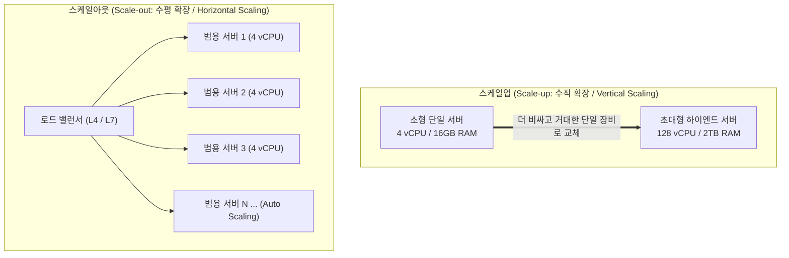

#### 왜 스케일아웃을 위해서는 반드시 '무상태(Stateless) 아키텍처'가 선행되어야 하는가?

많은 주니어 개발자들이 *"트래픽이 늘어나면 클라우드에서 오토스케일링(Auto Scaling)으로 서버 대수를 늘리면 되지 않나요?"*라고 쉽게 말합니다. 하지만 애플리케이션 아키텍처가 **상태 저장(Stateful)** 방식으로 잘못 짜여 있으면 서버를 2대로 늘리는 순간 서비스에 대형 장애가 터집니다.

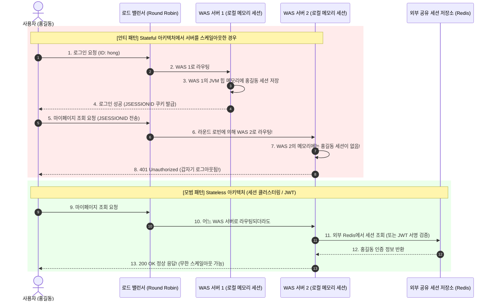

* **Sticky Session(고정 세션)의 한계**: 로드 밸런서가 특정 사용자의 IP나 쿠키를 해싱해 무조건 처음 접속했던 WAS 1번으로만 보내주는 Sticky Session 기법이 있지만, 이는 특정 서버로만 트래픽이 몰리는 불균형을 초래하고, 만약 WAS 1번이 재부팅되면 그 서버에 묶여 있던 수천 명의 사용자가 동시에 로그아웃되는 치명적인 결함이 있습니다.
* **진정한 무상태(Stateless) 달성 법칙**:
  1. **인증 세션의 외부화**: 로그인 세션은 반드시 외부 인메모리 저장소(**Redis Session Clustering**)에 저장하거나, 서버가 상태를 전혀 기억할 필요가 없는 서명된 토큰(**JWT: JSON Web Token**)을 사용해야 합니다.
  2. **로컬 디스크 파일 저장 금지**: 사용자가 업로드한 프로필 사진이나 첨부파일을 WAS의 로컬 디스크(`/var/www/uploads`)에 저장하면 다른 WAS 서버에서는 그 이미지를 읽을 수 없습니다. 모든 파일은 **AWS S3, GCS 같은 외부 오브젝트 스토리지**에 직접 업로드(Presigned URL 활용)해야 합니다.
  3. **인메모리 스케줄러/배치 분리**: WAS 내부에 `@Scheduled`로 매일 밤 12시 정산 배치를 넣어두면, 서버가 10대로 스케일아웃되었을 때 10대의 서버가 동시에 똑같은 정산 배치를 10번 중복 실행하여 고객에게 돈이 10배로 입금되는 대참사가 일어납니다! 스케줄러는 별도의 단일 배치 서버(Spring Batch + Kubernetes CronJob)로 분리하거나 **ShedLock(분산 락)**을 적용해야 합니다.

#### 스케일업 vs 스케일아웃 상세 비교

| 비교 항목 | 스케일업 (Scale-up, 수직 확장) | 스케일아웃 (Scale-out, 수평 확장) |
| :--- | :--- | :--- |
| **확장 메커니즘** | 단일 장비의 CPU, RAM, SSD 스펙을 고사양으로 교체 | 동일한 범용 서버 인스턴스를 병렬로 여러 대 추가 |
| **물리적 한계** | **존재함** (현존 최고 사양 메인보드의 한계 이상 확장 불가) | **사실상 무한함** (클라우드 자원이 허용하는 한 수천 대 확장) |
| **비용 증가 곡선** | 지수 함수적 폭증 (성능 2배 향상에 비용은 4~8배 증가) | 선형적(Linear) 증가 (트래픽만큼만 서버를 빌려 쓰고 반납) |
| **가용성 및 SPOF** | **단일 장애점(SPOF) 그대로 유지** (그 한 대가 죽으면 끝) | **고가용성(HA) 자연 달성** (1대가 죽어도 나머지 N-1대가 처리) |
| **확장 시 다운타임** | 하드웨어 교체 및 리사이징 재부팅 시 다운타임 발생 | **무중단 실시간 증설/축소 (Auto Scaling)** 가능 |
| **아키텍처 난이도** | 매우 낮음 (단일 서버 코드 그대로 실행 가능) | 높음 (**무상태(Stateless) 설계, 분산 락, 데이터 동기화 필수**) |

---

### 3.3 단계별 아키텍처 진화 시나리오: 사용자 1명에서 1,000만 명까지

빅테크 기업의 거대한 시스템도 처음부터 수백 개의 마이크로서비스와 카프카 클러스터로 시작하지 않았습니다. **사용자가 늘어남에 따라 시스템의 어느 지점에서 병목(Bottleneck)이 터지고, 아키텍트가 이를 어떤 컴포넌트로 하나씩 해결하며 진화시키는가**를 5단계 스토리라인으로 따라가 보겠습니다.

---

#### [1단계] 사용자 1명 ~ 1,000명: 단일 서버 올인원 아키텍처 (MVP 단계)
창업 초기, 빠른 아이디어 검증(MVP)이 최우선인 시기입니다. 웹 서버, 애플리케이션(WAS), 데이터베이스(MySQL)까지 단 한 대의 클라우드 가상 머신(예: AWS EC2 1대)에 모두 띄웁니다.

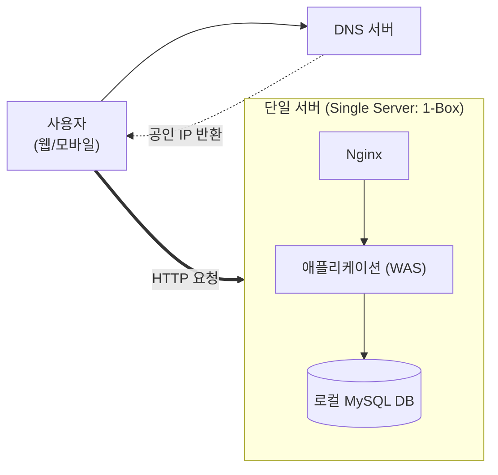

* **발생하는 첫 번째 병목**: 사용자가 1,000명을 넘어가자, WAS가 무거운 비즈니스 연산을 돌릴 때 CPU를 100% 써버리면서 같은 머신에 있는 MySQL이 디스크 I/O와 메모리를 할당받지 못해 쿼리가 멈추기 시작합니다. 또한 서버가 죽으면 서비스와 DB가 동시에 날아갑니다.

---

#### [2단계] 사용자 1,000명 ~ 1만 명: 웹/WAS와 DB의 물리적 분리 + 로드 밸런서 도입
가장 먼저 애플리케이션 계층과 데이터베이스 계층을 별도의 서버로 분리(3-Tier화)하고, SPOF를 없애기 위해 로드 밸런서(Load Balancer)와 다중 WAS를 도입합니다.

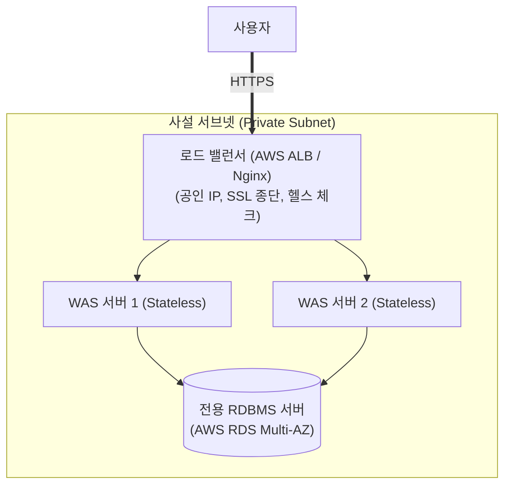

* **아키텍처 개선점**: WAS가 2대 이상으로 늘어났으므로 서버 1대가 죽어도 무중단 운영이 가능합니다.
* **발생하는 두 번째 병목**: 사용자가 1만 명을 넘어 수만 명으로 향하자, WAS는 스케일아웃으로 늘릴 수 있는데 **단 1대뿐인 데이터베이스 서버의 CPU 사용률이 95%를 치며 모든 API가 느려집니다.** 분석해 보니 전체 쿼리의 85%가 똑같은 상품 목록과 게시글을 반복해서 읽는 `SELECT` 쿼리였습니다.

---

#### [3단계] 사용자 1만 명 ~ 10만 명: DB 읽기 복제본(Read Replica) + Redis 캐시 + CDN 도입
단일 데이터베이스에 집중되는 부하를 분산하기 위해 **읽기/쓰기 분리(Read/Write Splitting)**와 **캐시 계층**을 도입합니다.

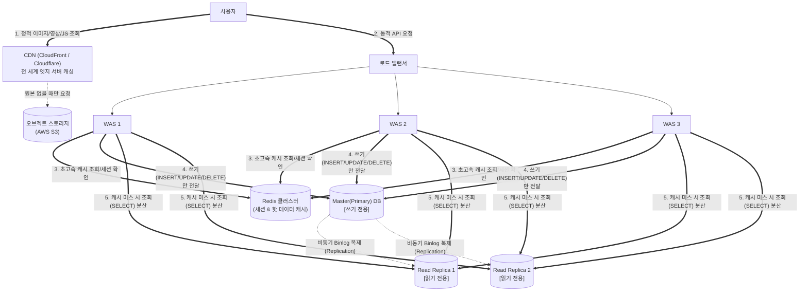

* **핵심 해결 메커니즘**:
  1. **Master-Replica(Primary-Standby) 복제**: 데이터를 변경하는 `INSERT, UPDATE, DELETE`는 오직 **Master DB**로만 보내고, Master의 변경 이력(Binlog / WAL)을 실시간으로 복제받는 여러 대의 **Read Replica**를 두어 무거운 `SELECT` 쿼리를 분산시킵니다.
  2. **Redis 인메모리 캐시**: 자주 조회되는 인기 상품, 홈 화면 배너, 사용자 프로필을 Redis에 캐싱하여 DB까지 가는 쿼리의 80%를 메모리 단계(`0.5ms`)에서 원천 차단합니다.
  3. **CDN과 오브젝트 스토리지**: 용량이 큰 이미지, 동영상, 정적 파일(`.js`, `.css`)은 백엔드 서버를 거치지 않고 사용자와 지리적으로 가장 가까운 CDN 엣지 서버에서 즉시 내려받게 합니다.
* **발생하는 세 번째 병목**: 서비스가 대박이 나서 일간 사용자(DAU)가 100만 명을 돌파하고 타임세일 이벤트를 열었습니다. 순간적으로 **쓰기(Write) 주문 트래픽이 초당 2만 건**이 쏟아지자, 읽기 전용인 Read Replica는 아무 도움이 되지 못하고 **단 1대뿐인 Master DB가 쓰기 락(Lock)과 I/O 한계로 폭발**해 버립니다!

---

#### [4단계] 사용자 10만 명 ~ 100만 명: 비동기 메시지 큐(Kafka) 도입과 DB 샤딩(Sharding)
폭발하는 쓰기 트래픽을 완충하고, 단일 Master DB의 물리적 한계를 돌파하기 위해 **비동기 이벤트 큐**와 **데이터베이스 수평 분할(Sharding)**을 단행합니다.

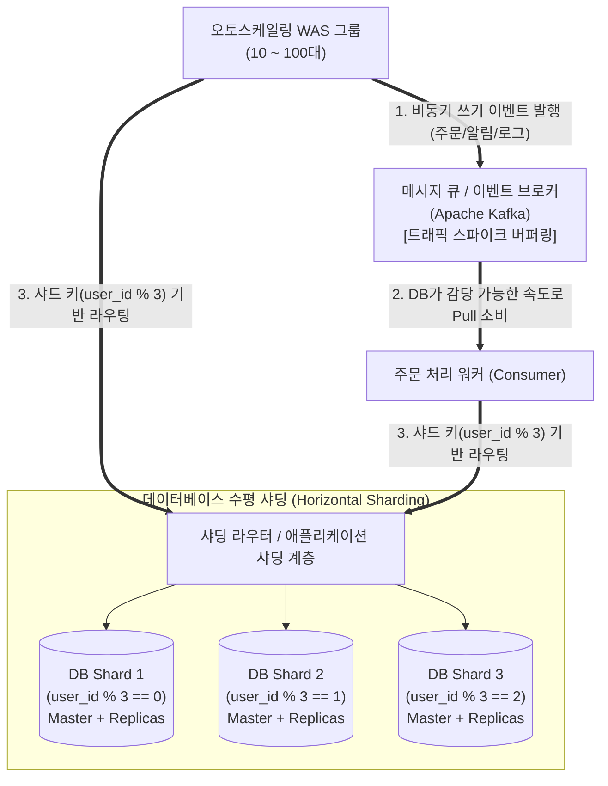

* **핵심 해결 메커니즘 1: 메시지 큐(Kafka)를 통한 쓰기 평탄화(Load Leveling)**
  * 순간적으로 몰리는 초당 2만 건의 주문/결제/알림 요청을 DB에 직접 때리지 않고, 디스크 순차 쓰기로 초당 수십만 건을 거뜬히 받아내는 **Kafka 토픽에 먼저 적재**합니다. 뒤에 있는 워커(Consumer) 서버들이 DB가 죽지 않을 정도의 일정한 속도(예: 초당 2,000건)로 큐에서 꺼내어 안전하게 DB에 반영합니다.
* **핵심 해결 메커니즘 2: 데이터베이스 샤딩 (Database Sharding)**
  * 아무리 비싼 서버라도 1대의 Master DB가 감당할 수 있는 쓰기 처리량과 디스크 크기(보통 단일 테이블 수억 건, 용량 수 TB 이상에서 성능 급락)에는 한계가 있습니다.
  * **샤딩(Sharding)**은 동일한 스키마를 가진 테이블의 데이터를 **샤드 키(Shard Key, 예: `user_id` 또는 `order_id`)**를 기준으로 여러 대의 독립된 물리적 DB 서버(Shard)로 쪼개어 분산 저장하는 기법입니다.
  * **샤딩의 3가지 방식과 안정 해시(Consistent Hashing)**:
    1. **범위 기반 샤딩 (Range Sharding)**: `user_id` 1~100만 번은 1번 샤드, 101만~200만 번은 2번 샤드에 넣습니다. 범위 검색은 쉬우나 최근 가입한 활성 유저들이 모두 마지막 샤드에만 몰리는 **핫스팟(Hotspot / 데이터 편중)** 문제가 발생합니다.
    2. **모듈러 해시 샤딩 (Hash Sharding)**: `hash(user_id) % 샤드_대수`로 분배합니다. 데이터가 고르게 분산되지만, 샤드 대수를 3대에서 4대로 늘리는 순간(`% 3` → `% 4`) 기존 데이터의 75%가 위치를 이동해야 하는 대규모 데이터 재배치(Rebalancing) 대참사가 발생합니다.
    3. **안정 해시 (Consistent Hashing)**: 해시 공간의 양 끝을 이어 붙여 `0`부터 `2^32 - 1`까지의 원형 링(Hash Ring)을 만들고 서버 노드와 데이터 키를 배치합니다. 새로운 DB 샤드나 캐시 노드가 추가/삭제되어도 **전체 데이터가 아닌 인접한 `1/N`만큼의 데이터만 이동**하도록 보장하여 무중단 수평 확장을 가능하게 합니다.

---

#### [5단계] 사용자 100만 명 ~ 1,000만 명 이상: 마이크로서비스(MSA), 폴리글랏 저장소, 다중 리전(Multi-Region)
이제 기술적 병목뿐 아니라 **개발 조직의 규모(개발자 200명 이상)**가 병목이 됩니다. 거대한 단일 코드를 도메인별 마이크로서비스로 분리하고, 검색엔진과 NoSQL을 적재적소에 배치하며, 글로벌 다중 데이터센터로 확장합니다.

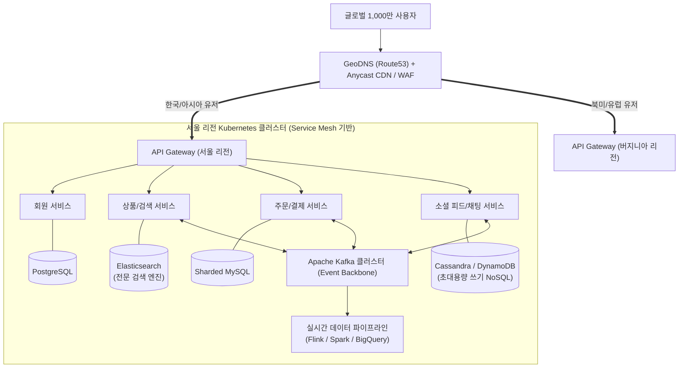

#### 단계별 아키텍처 진화 요약표

| 성장 단계 | 활성 사용자 (DAU) | 핵심 병목 지점 (Bottleneck) | 아키텍처 해결책 (Architectural Solution) |
| :--- | :--- | :--- | :--- |
| **1단계 (MVP)** | 1 ~ 1,000명 | 앱과 DB의 로컬 자원(CPU/RAM) 경합 | 단일 서버 올인원 → **웹/WAS와 DB 서버 물리적 분리** |
| **2단계 (초기 성장)** | 1,000 ~ 1만 명 | 단일 WAS 서버의 CPU 포화 및 SPOF | **로드 밸런서(L4/L7) 도입 + 무상태(Stateless) WAS 다중화** |
| **3단계 (본격 확장)** | 1만 ~ 10만 명 | 단일 DB의 읽기(`SELECT`) 쿼리 과부하 및 이미지 대역폭 | **DB Read Replica 분리 + Redis 인메모리 캐시 + CDN/S3 도입** |
| **4단계 (대규모 트래픽)**| 10만 ~ 100만 명 | 단일 Master DB의 쓰기(`INSERT/UPDATE`) 한계 및 피크 스파이크 | **Kafka 비동기 메시지 큐 버퍼링 + DB 수평 샤딩(Consistent Hashing)** |
| **5단계 (빅테크 스케일)**| 100만 ~ 1,000만+ | 수백 명 개발 조직의 배포 충돌, 복합 검색, 리전 재해 | **MSA 전환 + 폴리글랏 DB(Elasticsearch, NoSQL) + Multi-Region HA** |


---

## 04. 시스템 아키텍처 비유: 스타벅스 매장
> **주문 받는 캐셔(Web/API Gateway), 음료 제조 바리스타(WAS), 원두/재료 보관 창고(DB), 자주 찾는 식수대(Redis 캐시), 진동벨 시스템(비동기 메시지 큐/Kafka), 그리고 아침 출근길 사이렌 오더 대폭주 상황(가상 대기열, 배압 제어, 데드 레터 큐, 멱등성)을 통한 대용량 트래픽 처리 비유 완벽 해설**

대규모 분산 시스템 아키텍처는 용어만 들으면 매우 추상적이고 복잡해 보입니다.  
하지만 전 세계에서 가장 효율적으로 대규모 인파를 처리하는 오프라인 시스템 중 하나인 **'스타벅스(Starbucks) 매장의 운영 메커니즘'**을 대입해 보면, 현대 빅테크 분산 아키텍처의 모든 핵심 원리가 놀라울 정도로 직관적으로 이해됩니다.

---

### 4.1 최악의 안티 패턴: 1인 동기식 카페 (단일 스레드 블로킹 모델의 비극)

만약 어떤 카페에 직원이 단 한 명뿐이고, 모든 일을 순차적으로 처리한다고 가정해 봅시다.
1. 첫 번째 손님이 문을 열고 들어와 아이스 아메리카노를 주문합니다.
2. 직원은 주문을 받고 카드를 긁어 결제를 완료합니다.
3. 직원은 손님을 카운터 앞에 그대로 세워둔 채, 뒤돌아서 지하 원두 창고로 걸어가 원두 봉투를 꺼내 옵니다.
4. 원두를 그라인더에 갈고, 에스프레소 머신에서 샷을 추출하고, 얼음과 물을 붓습니다.
5. 컵 뚜껑을 닫고 빨대를 꽂아 첫 번째 손님에게 건넵니다.
6. 그제서야 줄 서 있던 두 번째 손님을 부릅니다: *"다음 손님, 주문하시겠어요?"*

이 방식이 바로 컴퓨터 공학에서 말하는 **단일 스레드 동기식 블로킹(Single-Threaded Synchronous Blocking) 아키텍처**입니다.
* 손님 한 명이 음료를 받는 데 3분이 걸린다면, 줄의 10번째에 서 있는 손님은 **단순히 주문을 접수하는 데만 30분**을 멍하니 서 있어야 합니다.
* 만약 3번째 손님이 복잡한 수제 과일청 음료를 시켜서 제조에 15분이 걸리거나(Heavy Query), 결제 카드가 마그네틱 손상으로 승인이 안 나고 멈춰버리면(External I/O Blocking), 뒤에 줄 선 수십 명의 손님은 아예 아무것도 하지 못하고 발길을 돌려 나가버립니다(**Connection Timeout & Thread Pool Exhaustion**).
* 스타벅스는 절대 이렇게 일하지 않습니다. 스타벅스는 철저하게 **역할(Tier)을 분리하고, 비동기 큐(진동벨)를 두며, 캐시(식수대)를 전진 배치**합니다.

---

### 4.2 스타벅스 매장과 분산 시스템 컴포넌트 1:1 완벽 매핑

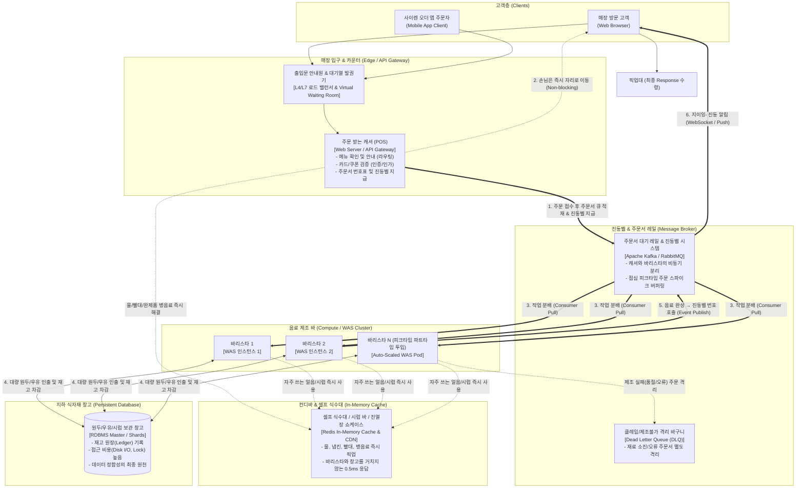

#### 1. 주문 받는 캐셔 (Cashier) = Web Server / API Gateway
* **역할**: 매장에 들어온 손님을 가장 먼저 맞이하는 단일 진입점(Single Entry Point)입니다.
* **핵심 기능**:
  * **인증 및 인가(Auth)**: 손님이 내민 스타벅스 앱 바코드가 유효한지, 카드 잔액이 있는지 검증합니다. 유효하지 않으면 바리스타에게 아예 주문서를 넘기지 않고 카운터에서 바로 돌려보냅니다(`401 Unauthorized` / `403 Forbidden`).
  * **라우팅(Routing)**: 손님이 병음료(완제품)를 샀다면 쇼케이스에서 바로 꺼내주고(정적 파일 서빙), 제조 음료를 시켰다면 바리스타 라인으로 주문서를 넘깁니다.
  * **비동기 논블로킹 접수**: 캐셔는 절대로 직접 커피를 내리지 않습니다. 포스기(POS)에 주문을 찍고 영수증 주문서(Message)를 레일에 올린 뒤 **3초 만에 다음 손님의 주문을 받습니다.** 덕분에 캐셔 1명이 시간당 수백 명의 주문을 막힘없이 접수할 수 있습니다.

#### 2. 음료 제조 바리스타 (Barista) = 애플리케이션 서버 (WAS / Worker)
* **역할**: 주문서에 적힌 복잡한 레시피(비즈니스 로직: *"샷 3개, 디카페인 절반, 저지방 우유, 바닐라 시럽 2펌프, 폼 많이"*)를 해석하여 실제 음료를 제조하는 핵심 연산(CPU/Memory) 주체입니다.
* **오토스케일링(Auto Scaling)과 무상태(Stateless)**:
  * 한가한 평일 오후 3시에는 바리스타 1명만 근무합니다(최소 인스턴스 유지로 인건비/클라우드 비용 절감).
  * 점심시간 12시가 되어 직장인들이 몰려오면, 백룸에서 대기하던 파트타임 바리스타 4명이 즉시 에스프레소 머신 앞으로 투입됩니다(**Scale-out**).
  * 어떤 바리스타도 손님 개인의 사적인 기억을 머릿속에 담아두고 일하지 않으며, 오직 **주문서 스티커(Stateless Request Payload)**에 적힌 내용만 보고 누구든 똑같은 맛의 커피를 만들어냅니다.

#### 3. 지하 식자재 창고 (Warehouse) = 관계형 데이터베이스 (RDBMS)
* **역할**: 매장 깊숙한 곳에 위치한 원두 포대, 대용량 우유 박스, 일일 매출 원장(Ledger)이 금고와 함께 보관되는 영속적 저장소입니다.
* **병목 특성(Disk I/O & Lock 경합)**:
  * 지하 창고로 내려가는 계단과 문은 좁아서 한 번에 들어갈 수 있는 직원 수가 엄격히 제한됩니다(**Database Connection Pool Limit**).
  * 만약 바리스타 5명이 동시에 창고에 들어가 마지막 남은 '한정판 크리스마스 머그컵 1개'를 동시에 집으려고 손을 뻗으면 충돌이 일어나므로, 먼저 문을 열고 들어간 바리스타가 머그컵 선반에 자물쇠를 채우고 꺼내 나올 때까지 나머지 4명은 문밖에서 대기해야 합니다(**Row-Level Lock & Transaction Isolation**).

#### 4. 셀프 식수대와 바리스타 앞 미니 냉장고 (Condiment Bar & Local Fridge) = 캐시 계층 (CDN / Redis / Local Cache)
* **역할**: 지하 창고(DB)까지 내려가는 엄청난 이동 시간(Disk I/O Latency)을 없애기 위해 매장 곳곳에 배치한 초고속 임시 저장소입니다.
* **다계층 캐싱(Multi-Tier Caching) 매핑**:
  * **매장 입구 병음료 쇼케이스 (= CDN)**: 푸딩이나 병주스는 조리할 필요가 없는 정적 파일(이미지/JS/CSS)입니다. 손님이 입구에서 집어 들고 바로 계산하면 끝납니다.
  * **매장 중앙 셀프 식수대 & 냅킨 바 (= Redis 글로벌 캐시)**: *"물 한 잔 주세요"*, *"시럽 추가할게요"* 같은 단순 반복 조회 요청을 바리스타나 창고까지 보낼 필요가 없습니다. 손님이 식수대에서 `0.5초` 만에 직접 해결합니다.
  * **바리스타 바로 밑의 소형 우유 냉장고 (= WAS 로컬 인메모리 캐시, Caffeine/Ehcache)**: 바리스타가 라떼를 한 잔 만들 때마다 지하 창고로 뛰어 내려가 우유 1팩을 가져온다면 하루에 커피 50잔도 못 만듭니다. 아침에 미리 지하 창고에서 우유 30팩을 꺼내와 바리스타 손이 바로 닿는 작업대 아래 미니 냉장고에 채워 넣는 행위, 이것이 바로 **캐시 워밍(Cache Warming)**과 **Cache-Aside** 패턴입니다!

#### 5. 진동벨과 주문서 스티커 레일 (Buzzer & Order Queue) = 메시지 큐 (Kafka / RabbitMQ)
* **역할**: 손님(Client)/캐셔(Gateway)와 바리스타(WAS)를 시간적·공간적으로 완벽히 분리(Decoupling)하는 **비동기 이벤트 드리븐 아키텍처(EDA)**의 핵심입니다.
* **논블로킹(Non-blocking)과 Pub/Sub**:
  * 결제를 마친 손님은 진동벨(고유 Correlation ID)을 받아 들고 2층 창가 자리로 가서 편안하게 자기 할 일을 합니다(클라이언트 스레드가 블로킹되지 않음).
  * 바리스타는 주문서 레일(Kafka Partition)에서 순서대로 스티커를 한 장씩 떼어내어(Pull/Consume) 음료를 만듭니다.
  * 음료가 완성되면 바리스타는 호출기의 번호를 누르고(**Event Publish**) 즉시 다음 커피를 만듭니다. 손님이 픽업대에 빨리 오든 늦게 오든 바리스타의 작업 속도는 전혀 방해받지 않습니다!

---

### 4.3 [심화 확장] 아침 8시 강남역 스타벅스 '사이렌 오더' 대폭주 시나리오!

평소에는 위 구조로도 평화롭게 돌아갑니다. 하지만 **"매년 다이어리 증정 프리퀀시 마지막 날 아침 8시, 강남역 인근 직장인 10,000명이 동시에 사이렌 오더로 주문을 넣는 극한의 트래픽 스파이크(선착순 티켓팅/타임세일 상황)"**가 발생했다고 가정해 봅시다. 이때 대규모 분산 아키텍처의 4대 고급 방어 기제가 어떻게 작동하는지 살펴보겠습니다.

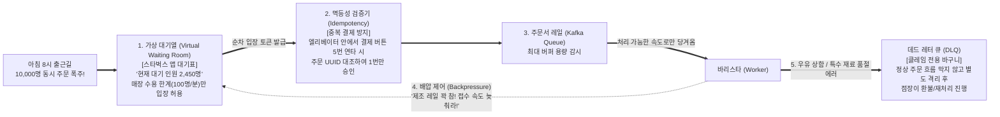

#### ① 가상 대기열 시스템 (Virtual Waiting Room) = 매장 밖 번호표 발권기
* **문제 상황**: 10,000명이 동시에 매장 문을 부수고 안으로 밀고 들어오면 캐셔도 압사하고 매장 바닥이 무너져 단 한 잔의 커피도 만들 수 없습니다(서버 OOM 및 DB 연쇄 다운).
* **스타벅스의 해법**: 매장 입구에 보안 요원(Edge/Queue Server)을 세우고, 매장 안에는 딱 **30명만 들어오게 한 뒤 나머지 9,970명에게는 스마트폰 화면에 `"현재 고객님 앞에 2,450명이 대기 중입니다. 예상 대기 시간 12분"`이라는 전자 번호표**를 띄워줍니다.
* **아키텍처 구현**: 본 서버(주문 WAS와 DB) 앞단에 가벼운 **Redis Sorted Set(ZSET) 기반의 대기열 전용 마이크로서비스**를 배치합니다. 유저가 접속하면 현재 타임스탬프(`System.currentTimeMillis()`)를 점수(Score)로 하여 `ZADD waiting_queue <timestamp> <user_id>`로 줄을 세우고, 본 서버가 소화할 수 있는 만큼만(예: 1초에 100명씩) `ZPOPMIN`으로 꺼내어 입장 허가 토큰(JWT Pass Token)을 발급합니다.

#### ② 배압 제어 (Backpressure) = 바리스타와 캐셔의 호흡 조절
* **문제 상황**: 캐셔는 말만 하면 되니까 1분에 주문을 60건씩 받는데(고속 Producer), 바리스타는 손으로 에스프레소를 내려야 해서 1분에 10잔밖에 못 만듭니다(저속 Consumer). 이 상태가 1시간 지속되면 주문서 스티커가 바닥까지 수천 장 끌려 내려와 매장 전체가 마비됩니다(메모리 버퍼 오버플로우).
* **스타벅스의 해법**: 바리스타가 캐셔에게 소리칩니다. *"지금 에스프레소 머신 앞에 밀린 잔이 50잔이 넘었어! 밀린 잔이 20잔 밑으로 줄어들 때까지 사이렌 오더 신규 접수 속도를 절반으로 줄여!"*
* **아키텍처 구현**: 이것이 바로 리액티브 스트림(Reactive Streams / WebFlux)과 메시징 시스템의 핵심인 **배압(Backpressure)**입니다. 컨슈머(바리스타)가 자신이 현재 처리할 수 있는 여력(`request(n)`)을 프로듀서나 앞단 대기열 제어기에 역방향으로 알려주어, 하류 시스템(Downstream)이 감당할 수 있는 속도로 상류(Upstream)의 데이터 유입 속도를 동적으로 조절합니다.

#### ③ 데드 레터 큐 (DLQ: Dead Letter Queue) = 제조 불가 주문 격리 바구니
* **문제 상황**: 바리스타가 105번 주문서(*"오트밀크 바닐라 라떼"*)를 집어 들고 제조하려는데, 마침 매장 내 오트밀크가 모두 바닥났거나 에스프레소 샷이 탄내가 나서 실패했습니다(예외 발생). 만약 바리스타가 *"오트밀크가 왜 없지? 올 때까지 105번 주문서만 붙잡고 계속 다시 시도해야지!"*라며 무한 재시도(Infinite Retry)에 빠지면, 뒤에 줄 서 있는 106번~500번 아메리카노 주문 전체가 영원히 멈춰버립니다(**Head-of-Line Blocking & Poison Pill Message**).
* **스타벅스의 해법**: 바리스타는 오트밀크 라떼 제조를 3번 시도해 보고 안 되면, 즉시 그 주문서 스티커를 떼어 옆에 있는 **'빨간색 클레임 전용 바구니(DLQ)'**에 옮겨 담아버리고 **지체 없이 106번 아메리카노를 만듭니다!** 빨간 바구니에 담긴 실패 주문서는 부점장(별도의 DLQ 전담 스레드/관리자)이 확인하여 손님에게 사과 알림을 보내고 결제 취소(보상 트랜잭션)나 다른 음료로의 교환을 처리합니다.
* **아키텍처 구현**: Kafka나 RabbitMQ에서 특정 메시지가 포맷 오류나 일시적 외부 API 장애로 인해 N회(예: 3회) 재시도(Retry with Exponential Backoff) 끝에 실패하면, 해당 메시지를 **Dead Letter Queue(DLQ 토픽)**로 별도 이동시키고 원본 큐의 오프셋(Offset)을 넘겨 정상 트래픽의 흐름을 지키는 필수 아키텍처 패턴입니다.

#### ④ 멱등성 (Idempotency) = 결제 버튼 '따닥' 연타 방지
* **문제 상황**: 손님이 지하철 안에서 사이렌 오더로 `[결제하기]` 버튼을 눌렀는데 네트워크가 순간 끊겨 화면이 뱅글뱅글 돕니다. 답답한 손님이 버튼을 5번 연속으로 '따닥따닥' 연타했습니다. 만약 서버가 이를 곧이곧대로 처리하면 손님 카드에서 22,500원이 빠져나가고 매장에 똑같은 아메리카노 5잔이 나옵니다!
* **스타벅스의 해법**: 주문이 처음 생성될 때 앱이 고유한 주문 일련번호(`Idempotency-Key: order-uuid-9876`)를 부여합니다. 캐셔(서버)는 첫 번째 요청을 처리하며 장부에 `order-uuid-9876: 처리중/완료`라고 적어둡니다. 0.2초 뒤에 똑같은 `order-uuid-9876` 번호로 들어온 나머지 4번의 요청에 대해서는 커피를 새로 만들지 않고 *"이미 접수된 그 커피(1잔) 주문 결과입니다"*라며 동일한 영수증만 다시 보여줍니다.
* **아키텍처 구현**: 수학에서 `f(f(x)) = f(x)`인 성질을 **멱등성(Idempotency)**이라고 합니다. 결제, 주문, 송금 API를 설계할 때는 반드시 클라이언트가 헤더에 `Idempotency-Key`를 담아 보내게 하고, 서버는 Redis의 `SETNX`(Atomic Lock)와 DB Unique 제약조건을 통해 **동일한 요청이 1번 들어오든 100번 재전송되든 시스템의 상태(잔액 차감과 주문 생성)는 단 1번만 변경되도록 보장**해야 합니다.

#### 스타벅스 매장 vs 대규모 분산 아키텍처 매핑 총정리

| 스타벅스 매장 요소 | 대응하는 시스템 아키텍처 컴포넌트 | 해결하는 핵심 엔지니어링 문제 |
| :--- | :--- | :--- |
| **출입문 보안요원 & 대기 번호표** | L4/L7 로드 밸런서 & **가상 대기열(Virtual Waiting Room)** | 대규모 트래픽 스파이크 시 서버 초과 유입 차단 및 순차 입장 |
| **주문 받는 캐셔 (POS)** | **API Gateway / Web Server (Nginx)** | 단일 진입점, 인증/인가, 라우팅, 비동기 빠른 응답 접수 |
| **주문 번호 고유 바코드** | **멱등성 키 (Idempotency-Key)** | 네트워크 지연/재시도로 인한 중복 결제 및 중복 주문 원천 방지 |
| **주문서 레일 & 진동벨** | **비동기 메시지 큐 (Apache Kafka / RabbitMQ)** | 클라이언트와 워커의 비동기 분리(Decoupling), 쓰기 부하 평탄화 |
| **바리스타의 접수 속도 조절 요청**| **배압 제어 (Backpressure)** | 컨슈머 처리 속도를 초과하는 프로듀서 유입으로 인한 큐 폭발 방지 |
| **클레임/제조불가 빨간 바구니** | **데드 레터 큐 (DLQ: Dead Letter Queue)** | 에러 메시지(Poison Pill)가 전체 큐를 막는 현상 방지 및 사후 복구 |
| **음료 제조 바리스타들** | **무상태 WAS 클러스터 (Auto Scaling Group)** | 비즈니스 로직 병렬 수행, 트래픽에 따른 탄력적 수평 증설(Scale-out) |
| **셀프 식수대 & 쇼케이스** | **Redis 인메모리 캐시 & CDN** | 자주 찾는 데이터/정적 파일을 창고(DB) 방문 없이 0.5ms 내 즉시 반환 |
| **지하 식자재 창고 & 금고** | **관계형 데이터베이스 (RDBMS Master/Shard)** | 데이터의 최종 영속성(Durability) 및 트랜잭션 무결성(ACID) 보장 |

---

## 05. 서버 아키텍처의 성능 향상을 위한 캐시, Redis
> **인메모리 데이터 구조 저장소, 7대 핵심 자료구조(ZSET 리더보드/대기열), 캐시 전략 패턴, 영속성(RDB vs AOF), 고가용성(Replication/Sentinel/Cluster), 그리고 캐시 3대 장애(Penetration, Breakdown, Avalanche) 완벽 방어 코드**

컴퓨터 하드웨어 계층에서 저장 매체 간의 속도 격차는 상상을 초월합니다.  
CPU 레지스터와 L1/L2 캐시는 `0.5 ~ 7 나노초(ns)`, 메인 메모리(DRAM)는 약 `100 나노초(0.1 마이크로초)` 만에 데이터에 접근합니다. 반면 고성능 NVMe SSD 디스크조차 최소 `50 ~ 150 마이크로초(μs)`가 걸리며, 네트워크를 타고 관계형 데이터베이스(RDBMS)의 디스크 블록을 읽고 B-Tree 인덱스를 탐색해 결과를 받아오는 데는 통상 `5 ~ 50 밀리초(ms)`가 소요됩니다.  
즉, **메모리(RAM)에서 데이터를 읽는 것은 디스크 기반 DB 쿼리보다 최소 1,000배에서 100,000배 이상 빠릅니다.**  
따라서 데이터베이스 앞단에 인메모리 기반의 **캐시(Cache)** 계층을 배치하는 것은 현대 고성능 백엔드 아키텍처에서 선택이 아닌 생존의 필수 조건입니다.

---

### 5.1 Redis(Remote Dictionary Server)의 아키텍처적 본질

Redis는 디스크가 아닌 **메인 메모리(RAM)**에 모든 데이터를 적재하고 처리하는 세계에서 가장 널리 쓰이는 오픈소스 인메모리 데이터 구조 저장소(In-Memory Data Structure Store)입니다.

#### 왜 Redis는 싱글 스레드(Single Thread)인데도 초당 10만 QPS를 처리하는가?
많은 개발자가 *"멀티 코어 시대에 왜 Redis는 싱글 스레드로 명령어를 처리하나요?"*라고 의문을 품습니다. 여기에는 깊은 시스템 프로그래밍의 통찰이 숨어 있습니다.

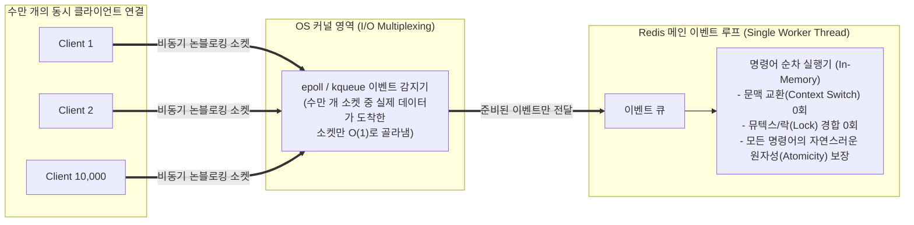

1. **병목은 CPU가 아니라 메모리와 네트워크 I/O다**: Redis의 연산은 복잡한 수학 계산이 아니라 메모리 주소를 찾아 값을 읽고 쓰는 단순 작업(평균 수 마이크로초 미만)입니다. 만약 이를 멀티 스레드로 처리하면, 스레드 간 **문맥 교환(Context Switching) 비용**과 공유 자료구조(Hash, ZSet 등)를 보호하기 위한 **뮤텍스/세마포어 락(Lock) 경합 비용**이 실제 메모리 연산 시간보다 훨씬 커지는 배보다 배꼽이 더 큰 상황이 벌어집니다.
2. **I/O 멀티플렉싱 (I/O Multiplexing - `epoll`, `kqueue`)**: Redis는 운영체제 커널이 제공하는 `epoll`(Linux) 기반의 이벤트 루프를 사용합니다. 클라이언트 10,000명이 소켓을 연결해 놓아도 스레드 10,000개를 만들지 않고, 단 하나의 스레드가 실제 패킷이 도착한 소켓 이벤트만 낚아채어 메모리에서 초고속으로 순서대로 처리합니다.
3. **Redis 6.0 이후의 멀티 스레드 I/O (Threaded I/O) 도입**: 단, **실제 명령어를 실행(Execute)하는 코어 엔진은 여전히 100% 싱글 스레드**입니다! 다만 초당 수십만 건의 패킷이 몰릴 때 네트워크 소켓 버퍼에서 데이터를 읽고(Read/Parse) 응답을 소켓에 쓰는(Write) 네트워크 I/O 과정만 별도의 I/O 스레드들이 병렬로 분담하도록 진화하여 처리량을 2배 이상 끌어올렸습니다.
4. **주의해야 할 O(N) 명령어의 위험성**: 코어가 싱글 스레드이므로, 만약 프로덕션 Redis에서 1,000만 개의 키가 들어있는데 `KEYS *`나 `FLUSHALL`, 혹은 수백만 개 원소가 든 거대 컬렉션에 `HGETALL` 같은 **O(N) 시간 복잡도 명령어**를 날리면 그 명령어가 끝날 때까지 몇 초 동안 Redis 전체가 멈추어 모든 서비스가 장애에 빠집니다! 실무에서는 반드시 커서 기반 순회 명령어인 **`SCAN`, `HSCAN`, `SSCAN`, `ZSCAN`**을 사용해야 합니다.

---

### 5.2 Redis 핵심 자료구조 7종과 실전 아키텍처 활용법

단순히 Key-Value 문자열만 저장하는 Memcached와 달리, Redis가 아키텍처의 스위스 아미 나이프(만능칼)로 불리는 이유는 **메모리 레벨에서 고도로 최적화된 다채로운 자료구조**를 기본 제공하기 때문입니다.

| 자료구조 | 주요 명령어 | 시간 복잡도 | 실무 아키텍처 핵심 활용 사례 |
| :--- | :--- | :--- | :--- |
| **1. String** | `GET`, `SET`, `INCR`, `SETNX`, `MGET` | O(1) | 단순 객체(JSON) 캐싱, 분산 락(`SET key val NX PX`), 조회수/좋아요 원자적 카운터(`INCR`), Rate Limiting |
| **2. List** | `LPUSH`, `RPOP`, `LRANGE`, `BLPOP` | O(1) (양끝) | 최근 본 상품 타임라인(최신 N개 유지 `LTRIM`), 경량 비동기 작업 큐(Blocking Queue) |
| **3. Set** | `SADD`, `SISMEMBER`, `SINTER`, `SCARD` | O(1) | 중복 없는 데이터 집합(이벤트 중복 참여 체크, 게시글 좋아요 누른 유저 ID 목록, 공통 친구 교집합 `SINTER`) |
| **4. Hash** | `HSET`, `HGET`, `HINCRBY`, `HGETALL` | O(1) | 객체의 필드별 부분 갱신(장바구니 상품별 수량 변경, 사용자 세션 프로필 속성 저장) |
| **5. Sorted Set (ZSET)** | `ZADD`, `ZRANGE`, `ZRANK`, `ZINCRBY` | **O(log N)** | **실시간 게임/음원 랭킹 리더보드, 선착순 티켓팅 가상 대기열, 슬라이딩 윈도우 Rate Limiter** |
| **6. HyperLogLog**| `PFADD`, `PFCOUNT`, `PFMERGE` | O(1) | **초대용량 순방문자 수(UV: Unique Visitor) 추정** (단 12KB 메모리로 수억 명의 중복 제거 카운팅, 오차율 0.81%) |
| **7. Stream** | `XADD`, `XREADGROUP`, `XACK` | O(1) | Kafka를 대체하는 경량 소비자 그룹(Consumer Group) 기반 이벤트 스트리밍 및 메시지 브로커 |

#### [심층 해부] 왜 실시간 랭킹(Leaderboard)과 대기열에는 반드시 `Sorted Set (ZSET)`을 쓰는가?

게임에서 1,000만 명의 유저가 실시간으로 점수를 획득할 때 *"내 점수가 현재 전체 몇 등인지(Rank)"*와 *"현재 상위 1위~100위 유저 목록"*을 0.1초마다 보여줘야 한다고 가정해 봅시다.
* **RDBMS(MySQL)로 구현할 경우의 참사**:
  * `SELECT user_id, score, RANK() OVER (ORDER BY score DESC) FROM users WHERE ...` 쿼리는 1,000만 건의 데이터를 정렬하거나 인덱스를 타더라도 특정 유저의 정확한 순위(몇 번째 행인지)를 세기 위해 수만~수백만 개의 인덱스 리프 노드를 스캔(**O(N)**)해야 합니다. 초당 1,000명이 랭킹 창을 열면 DB는 즉시 죽습니다.
* **Redis `Sorted Set (ZSET)`의 내부 구조 (Hash Table + Skip List)**:
  * ZSET은 내부적으로 **해시 테이블(Hash Table)**과 **스킵 리스트(Skip List)**라는 두 가지 자료구조를 결합하여 구현되어 있습니다.
  * 해시 테이블 덕분에 특정 유저의 점수를 조회(`ZSCORE`)하는 것은 **O(1)**입니다.
  * 다층 연결 리스트 구조인 스킵 리스트(Skip List) 덕분에 점수를 갱신(`ZADD`, `ZINCRBY`)하거나, 내 순위를 확인(`ZREVRANK`)하거나, 1등부터 100등까지 범위 조회(`ZREVRANGE`)를 하는 모든 작업이 **`O(log N)`** 만에 끝납니다! (`N = 1,000만`이어도 `log2(10,000,000) ≈ 23번`의 포인터 이동, 즉 `0.1ms` 이내에 끝납니다!)

```bash
# [실전 명령어 예시 1] 실시간 게임 랭킹 리더보드 (ZSET)
ZADD leaderboard:202611 1500 "user:hong"       # 홍길동 1500점 등록 -> O(log N)
ZINCRBY leaderboard:202611 350 "user:hong"     # 홍길동 350점 추가 획득 (총 1850점) -> O(log N)
ZREVRANK leaderboard:202611 "user:hong"        # 홍길동의 현재 전체 등수 조회 (0-base, 0이면 1등) -> O(log N)
ZREVRANGE leaderboard:202611 0 9 WITHSCORES    # 현재 Top 10 랭커와 점수 즉시 조회 -> O(log N + 10)

# [실전 명령어 예시 2] 콘서트 티켓팅 가상 대기열 (ZSET)
# Score에 현재 마이크로초 타임스탬프를 넣어 완벽한 선착순 정렬 보장
ZADD ticket:waiting:queue 1731628900123 "user:kim"
ZRANK ticket:waiting:queue "user:kim"          # 내 앞에 몇 명 대기 중인지 즉시 확인 -> O(log N)
ZPOPMIN ticket:waiting:queue 100               # 가장 먼저 줄 선 100명을 꺼내어 결제 창 입장 허가 -> O(log N * 100)
```

---

### 5.3 대표적인 캐시 전략 패턴 (Caching Patterns)

캐시를 시스템에 도입할 때 아키텍트가 내려야 할 가장 중요한 결정은 **"읽기(Read)와 쓰기(Write) 시점에 캐시와 원본 DB를 어떤 순서로 조합할 것인가?"**입니다. 총 5가지 표준 패턴이 존재합니다.

#### 1. Cache-Aside (Look-Aside / Lazy Loading) 패턴 [가장 널리 쓰이는 표준]
애플리케이션(WAS)이 주체가 되어 캐시를 먼저 찔러보고(Look Aside), 데이터가 없을 때만(Cache Miss) 직접 DB를 읽어와 캐시에 채워 넣는 방식입니다.

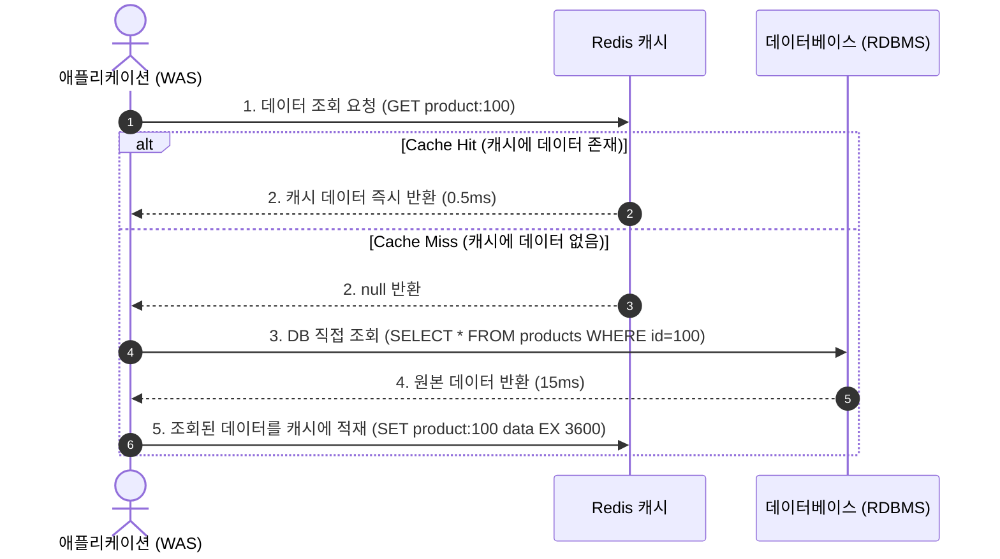

* **장점**: 실제로 사용자가 요청한 데이터만 캐시에 적재되므로 메모리 낭비가 없고, **Redis가 다운되더라도 애플리케이션이 DB로 직접 우회하여 서비스를 계속 유지할 수 있는 회복력(Resilience)**을 가집니다.
* **단점**: 맨 처음 요청(Cold Cache)은 무조건 Cache Miss를 겪으며, DB 데이터가 변경될 때 캐시를 지워주지 않으면 정합성이 깨집니다.

#### 2. Read-Through 패턴
애플리케이션은 오직 캐시만 바라보고, Cache Miss가 발생했을 때 애플리케이션이 아니라 **캐시 프로바이더(또는 데이터 그리드 라이브러리) 자체가 스스로 DB를 조회하여 자신을 채운 뒤 애플리케이션에 반환**하는 패턴입니다 (예: AWS DynamoDB Accelerator(DAX), Hibernate 2차 캐시).

#### 3. Write-Through 패턴
데이터를 추가하거나 수정할 때 애플리케이션(또는 캐시 계층)이 **캐시와 DB 양쪽 모두에 동기적으로(Synchronously) 쓰기를 완료한 뒤에야 성공 응답**을 반환하는 패턴입니다.
* **장점**: 캐시와 DB의 데이터가 항상 100% 최신으로 일치합니다. 읽기 시점에 절대 Stale Data(옛날 데이터)를 읽지 않습니다.
* **단점**: 모든 쓰기마다 인메모리와 디스크 DB 두 곳을 다 써야 하므로 **쓰기 지연 시간(Write Latency)이 길어지고**, 한 번 쓰이고 다시는 읽히지 않을 데이터(One-time Data)까지 무조건 캐시 메모리를 차지하는 낭비가 발생합니다(반드시 TTL과 함께 써야 함).

#### 4. Write-Around 패턴
모든 쓰기 작업은 **캐시를 건너뛰고 오직 DB에만 직접 기록**합니다. 캐시에는 나중에 읽기 요청(Cache Miss)이 들어왔을 때만 Cache-Aside 방식으로 적재됩니다.
* **장점**: 쓰기 성능이 빠르고 안 읽히는 데이터가 캐시에 쌓이지 않습니다.
* **주의점**: 기존에 캐싱되어 있던 데이터가 DB에서 수정될 때는 반드시 **캐시 삭제(Cache Eviction / `DEL`)**를 함께 수행해야 옛날 데이터가 읽히지 않습니다. **(실무에서 `Cache-Aside (읽기) + Write-Around with Cache Eviction (쓰기)` 조합이 가장 많이 쓰입니다!)**

#### 5. Write-Back (Write-Behind) 패턴
쓰기 요청이 들어오면 DB에는 아예 가지 않고 **초고속 Redis 메모리에만 먼저 기록한 뒤 즉시 사용자에게 성공 응답(`0.5ms`)**을 줍니다. 이후 별도의 백그라운드 워커가 일정 주기(예: 5초마다) 또는 일정 건수(예: 1,000건마다)로 캐시의 변경분을 모아서 DB에 **일괄 배치(Batch Insert/Update)**로 반영합니다.

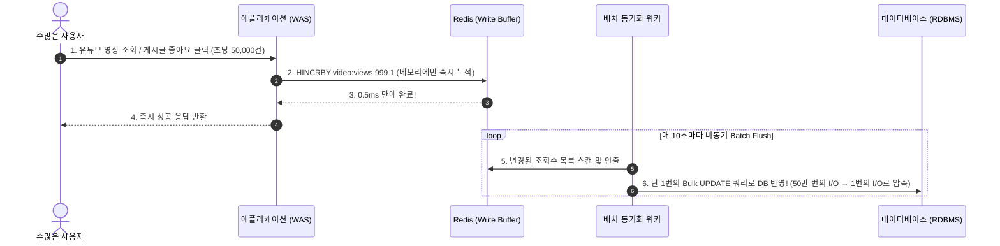

* **장점**: 초당 수십만 건의 쓰기 폭주(조회수, 좋아요, 실시간 위치 좌표 업데이트, 게임 플레이 로그)를 단 1번의 DB Bulk I/O로 압축(Write Coalescing)하므로 **쓰기 처리량이 극대화**됩니다.
* **치명적 약점**: DB에 반영되기 직전의 5초 사이에 Redis 서버 전원이 꺼지면 메모리 속 데이터가 **유실(Data Loss)**될 수 있습니다. 따라서 반드시 Redis AOF 영속성 설정과 클러스터 복제를 함께 구성해야 합니다.

#### 5대 캐시 전략 패턴 한눈에 비교

| 캐시 패턴 | 분류 | 동작 요약 | 장점 | 단점 및 주의사항 |
| :--- | :--- | :--- | :--- | :--- |
| **Cache-Aside** | 읽기 | 앱이 캐시 확인 → 미스 시 앱이 DB 읽고 캐시 적재 | 필요한 데이터만 적재, 캐시 장애 시에도 DB로 서비스 유지 | 초기 요청 지연, 캐시 무효화 직접 관리 필요 |
| **Read-Through** | 읽기 | 앱은 캐시만 호출 → 미스 시 캐시가 DB 읽어 적재 | 애플리케이션 코드가 매우 단순해짐 | 캐시 솔루션에 강하게 결합, 캐시 장애 시 치명적 |
| **Write-Through**| 쓰기 | 캐시와 DB에 동시에 동기식으로 기록 | 캐시와 DB의 강한 데이터 일관성 보장 | 쓰기 레이턴시 증가, 안 읽히는 데이터도 캐시 점유 |
| **Write-Around** | 쓰기 | DB에만 직접 기록 (수정 시 기존 캐시 키는 `DEL`) | 쓰기 부하 최소화, 불필요한 캐시 오염 방지 | 수정 직후 첫 조회 시 무조건 Cache Miss 발생 |
| **Write-Back** | 쓰기 | 캐시에만 즉시 기록 → 비동기 배치로 DB 일괄 반영 | **극강의 쓰기 성능**, DB I/O 횟수 획기적 절감 | 배치 반영 전 캐시 다운 시 **데이터 유실 위험** |

---

### 5.4 인메모리의 휘발성을 극복하는 Redis 영속성(Persistence): RDB vs AOF

*"메모리(RAM)는 전원이 꺼지면 데이터가 다 날아가지 않나요? Redis를 세션 저장소나 Write-Back 버퍼로 썼다가 재부팅되면 어떡하죠?"*  
이를 위해 Redis는 메모리의 데이터를 디스크에 백업하는 두 가지 영속성(Persistence) 엔진을 제공합니다.

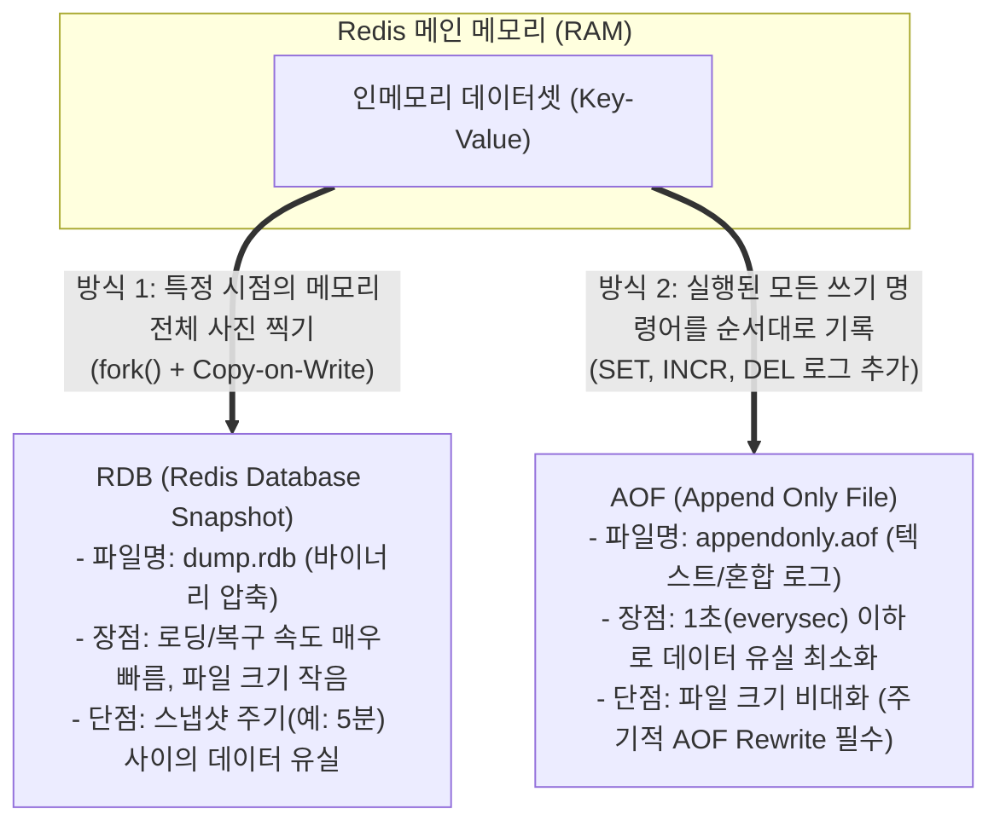

#### 1. RDB (Snapshotting): 시점 단위의 바이너리 스냅샷
* **동작 원리**: 설정된 조건(예: `save 300 100` - 5분 동안 100개 이상 키가 변경되면)에 따라 그 순간의 메모리 전체 데이터를 바이너리 파일(`dump.rdb`)로 통째로 찍어 저장합니다.
* **싱글 스레드인데 어떻게 멈추지 않고 수십 GB 메모리를 디스크에 쓰는가? (`BGSAVE`와 Copy-on-Write)**:
  * `SAVE` 명령어는 메인 스레드를 멈추므로 절대 쓰면 안 되고, 반드시 **`BGSAVE`**를 사용합니다.
  * `BGSAVE`가 실행되면 Redis 메인 프로세스는 OS의 **`fork()` 시스템 콜**을 호출하여 자기 자신과 똑같은 자식 프로세스를 생성합니다. 이때 물리 메모리를 2배로 복사하는 것이 아니라, 운영체제의 **Copy-on-Write(CoW, 쓰기 시 복사)** 페이지 테이블 공유 기술을 활용하여 0.01초 만에 자식 프로세스를 띄웁니다.
  * 자식 프로세스가 백그라운드에서 조용히 `dump.rdb`를 디스크에 쓰는 동안, 부모(메인) 프로세스는 멈추지 않고 계속 클라이언트 요청을 처리합니다! (단, 이때 쓰기 요청이 폭주하면 수정되는 메모리 페이지마다 CoW 복사가 일어나 메모리가 순간 최대 2배까지 필요할 수 있으므로, Redis 서버의 `maxmemory`는 물리 RAM의 50~60%로 잡는 것이 철칙입니다.)

#### 2. AOF (Append Only File): 모든 쓰기 명령어 일지 기록
* **동작 원리**: 조회(`GET`)를 제외한 모든 변경 명령어(`SET`, `INCR`, `ZADD`)가 실행될 때마다 그 명령어 자체를 파일(`appendonly.aof`) 끝에 순차적으로 계속 덧붙여(Append) 기록합니다. 서버가 재시작되면 이 파일의 명령어들을 처음부터 끝까지 재실행(Replay)하여 메모리를 완벽히 복원합니다.
* **`appendfsync` 디스크 동기화 정책 3가지**:
  1. `always`: 명령어 1개마다 즉시 디스크 `fsync` 호출. 데이터 유실은 0이지만 디스크 I/O 때문에 Redis 성능이 급락합니다.
  2. **`everysec` (실무 표준 권장)**: 1초마다 백그라운드 스레드가 모아서 `fsync`를 수행합니다. 인메모리급 성능을 그대로 유지하면서도, 서버가 폭발해도 **최대 1초 치의 데이터만 유실**됩니다.
  3. `no`: OS 커널에게 동기화 시점을 맡깁니다 (유실 시점 예측 불가).
* **AOF Rewrite (`BGREWRITEAOF`)**: 똑같은 카운터 키에 `INCR count`를 100만 번 실행하면 AOF 파일에 100만 줄이 쌓여 용량이 수십 GB가 됩니다. 이를 방지하기 위해 현재 메모리의 최종 상태(`SET count 1000000`) 단 한 줄로 AOF 파일을 압축하여 새로 쓰는 **AOF Rewrite** 기능이 백그라운드에서 주기적으로 동작합니다.

#### RDB vs AOF 비교 및 빅테크 실무 권장 설정

| 비교 항목 | RDB (Snapshotting) | AOF (Append Only File) |
| :--- | :--- | :--- |
| **저장 형태** | 특정 시점의 메모리 바이너리 스냅샷 (`dump.rdb`) | 실행된 모든 쓰기 연산의 로그 (`appendonly.aof`) |
| **장애 시 데이터 유실** | **많음** (마지막 스냅샷 이후 수 분간의 데이터 전부 유실) | **극히 적음** (`everysec` 기준 최대 1초 이내 유실) |
| **파일 크기** | 작음 (바이너리 압축 포맷) | 큼 (동일 키 반복 수정 시 로그 누적, Rewrite 필요) |
| **재시작 시 복구 속도**| **매우 빠름** (메모리에 그대로 로드) | 느림 (명령어를 처음부터 재실행해야 함) |
| **실무 권장 구성** | **RDB + AOF 하이브리드 모드 (`aof-use-rdb-preamble yes`)**: Redis 4.0+부터 기본 지원. 평소에는 빠른 RDB 스냅샷을 베이스로 깔고, 그 이후의 변경분만 AOF 로그로 덧붙여 **빠른 재시작 복구 속도와 1초 이내의 데이터 안전성을 동시에 달성**합니다! |

---

### 5.5 Redis 고가용성(HA) 및 확장 아키텍처: Replication vs Sentinel vs Cluster

단일 Redis 서버는 죽으면 그만이고, 단일 머신의 RAM 용량 이상으로 데이터를 담을 수도 없습니다. 이를 해결하는 3단계 아키텍처입니다.

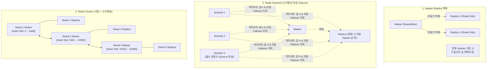

1. **Redis Replication (Master-Replica)**: Master의 데이터를 Replica로 비동기 복제하여 읽기 부하를 분산합니다. 하지만 Master가 죽었을 때 자동으로 Replica를 Master로 승격(Failover)시켜 주는 기능이 없습니다.
2. **Redis Sentinel (고가용성 자동 페일오버)**:
   * 별도의 감시 프로세스인 **Sentinel 노드(반드시 3대 이상의 홀수 구성)**들이 Master와 Replica를 1초마다 감시합니다.
   * Master가 응답하지 않으면 Sentinel 과반수(Quorum, 예: 3대 중 2대)가 투표를 통해 객관적 다운(`ODOWN`)을 선언하고, 살아있는 Replica 중 하나를 **자동으로 새로운 Master로 승격**시킨 뒤 클라이언트(Lettuce/Redisson)에게 새 Master 주소를 공지합니다. (메모리 용량이 단일 서버(예: 32GB 이하)로 충분할 때 가장 추천하는 구성입니다.)
3. **Redis Cluster (수평 샤딩 + 자동 페일오버)**:
   * 캐시 데이터가 100GB, 500GB로 늘어나 단일 서버 메모리에 담을 수 없을 때 도입합니다.
   * 전체 키 공간을 **`16,384개`의 해시 슬롯(Hash Slot: `0 ~ 16383`)**으로 나누고, 각 키에 대해 **`CRC16(Key) % 16384`** 공식을 계산하여 어느 샤드 노드가 담당할지 결정합니다.
   * 별도의 프록시 서버 없이 클라이언트가 직접 올바른 샤드로 찾아가며(Smart Client / `MOVED` 리다이렉션), 각 Master 샤드마다 Replica가 붙어 있어 특정 샤드의 Master가 죽으면 자동으로 Replica가 승격되는 **무중단 수평 확장 아키텍처**입니다.

---

### 5.6 대규모 장애를 부르는 캐시 3대 재앙 완벽 비교 및 실전 방어 코드

실무 면접과 대형 장애 포스트모템에서 가장 빈번하게 등장하는 **캐시 3대 장애 현상(Cache Penetration, Cache Breakdown/Stampede, Cache Avalanche)**은 원인과 해결책이 각각 명확히 다릅니다!

```mermaid
flowchart TD
    subgraph P1["1. 캐시 관통 (Cache Penetration)"]
        Req1["해커/버그: 존재하지 않는 ID 조회\n(GET item:-9999)"] --> Miss1["Redis에 없음 (Miss)"]
        Miss1 --> DB1["DB에도 없음! (빈 결과)\n→ 캐시에 저장 안 됨!"]
        DB1 --> Crash1["매 요청마다 캐시를 뚫고(관통)\nDB를 직접 타격하여 DB 다운!"]
    end

    subgraph P2["2. 캐시 브레이크다운 / 스탬피드 (Cache Breakdown)"]
        Req2["초인기 단일 핫키 1개\n(아이폰 사전예약 item:100)"] --> Miss2["정각 14:00:00에\n해당 키 1개의 TTL 만료!"]
        Miss2 --> Crash2["대기하던 50,000개의 동시 스레드가\n단 1개의 키 때문에 동시에 DB 폭격!"]
    end

    subgraph P3["3. 캐시 눈사태 (Cache Avalanche)"]
        Req3["새벽 배치로 적재한\n수십만 개의 캐시 키들"] --> Miss3["동일한 고정 TTL(1시간) 설정으로\n한날한시에 수십만 개 키 동시 만료!\n(또는 Redis 노드 자체 다운)"]
        Miss3 --> Crash3["전체 서비스의 모든 쿼리가\n눈사태처럼 DB로 쏟아져 전면 마비!"]
    end
```

#### 캐시 3대 장애 현상 완벽 비교표

| 구분 | 1. 캐시 관통 (Cache Penetration) | 2. 캐시 브레이크다운 / 스탬피드 (Cache Breakdown / Stampede) | 3. 캐시 눈사태 (Cache Avalanche) |
| :--- | :--- | :--- | :--- |
| **핵심 원인** | **캐시에도 없고 DB에도 없는 데이터**를 대량으로 반복 요청 | 초당 수만 건 조회되는 **단 1개의 초인기 핫키(Hot Key)**가 만료됨 | **수만~수십만 개의 캐시 키가 동시에 만료**되거나 Redis 장애 발생 |
| **발생 시나리오**| 해커가 `id = -1`, `id = 99999999` 등 없는 상품 번호로 무작위 크롤링 공격 | 유명 연예인 열애설 기사나 타임세일 상품 캐시의 TTL이 끝나는 찰나 | 자정 배치로 10만 개 상품을 똑같이 `TTL=3600초`로 넣었을 때 1시 정각에 동시 증발 |
| **핵심 방어책 1**| **블룸 필터 (Bloom Filter)**: DB에 존재하는 키인지 비트 배열로 사전 검증 후 차단 | **분산 락 (Mutex Lock)**: 단 1개의 스레드만 DB를 읽고 캐시를 채우도록 통제 | **TTL 지터 (Jitter)**: 만료 시간에 난수(`3600 + rand(0, 600)`)를 더해 만료 시점 분산 |
| **핵심 방어책 2**| **Null Object 캐싱**: DB에 없더라도 `"NULL"` 값을 짧은 TTL(30~60초)로 캐싱 | **논리적 만료 (Logical Expiration / XFetch)**: 물리 TTL을 없애고 백그라운드 갱신 | **고가용성 클러스터 & 서킷 브레이커**: Redis Cluster 구성 및 DB 앞단 Rate Limit |

#### [실전 방어 코드] 3대 캐시 장애를 모두 막아내는 프로덕션급 캐시 조회 템플릿 (Java / Spring + Redisson)

아래 코드는 **블룸 필터(캐시 관통 방어) + Null 캐싱(관통 방어) + 분산 락 Double-Checked Locking(캐시 스탬피드 방어) + TTL Jitter(캐시 눈사태 방어)**를 하나로 결합한 실무 아키텍처의 정수입니다.

```java
@Service
@RequiredArgsConstructor
public class ProductCacheService {

    private final StringRedisTemplate redisTemplate;
    private final RedissonClient redissonClient;
    private final ProductRepository productRepository;
    private final RBloomFilter<Long> productBloomFilter; // 서버 기동 시 유효한 상품 ID들이 등록된 블룸 필터

    private static final String CACHE_KEY_PREFIX = "product:detail:";
    private static final String LOCK_KEY_PREFIX = "lock:product:";
    private static final String NULL_VALUE = "__NULL__";

    public ProductDto getProductById(Long productId) {
        // [방어 1: 캐시 관통(Penetration) 1차 차단 - Bloom Filter]
        // DB에 절대 존재할 리 없는 ID라면 Redis나 DB에 근처도 가지 않고 O(1)로 즉시 컷!
        if (!productBloomFilter.contains(productId)) {
            throw new ProductNotFoundException("존재하지 않는 상품입니다. ID: " + productId);
        }

        String cacheKey = CACHE_KEY_PREFIX + productId;

        // 1. Redis 캐시 1차 조회
        String cachedJson = redisTemplate.opsForValue().get(cacheKey);
        if (cachedJson != null) {
            // [방어 1-2: Null Object 캐싱 히트 처리]
            if (NULL_VALUE.equals(cachedJson)) {
                throw new ProductNotFoundException("상품 정보가 없습니다 (Null Cached). ID: " + productId);
            }
            return JsonUtils.fromJson(cachedJson, ProductDto.class);
        }

        // [방어 2: 캐시 스탬피드(Stampede/Breakdown) 차단 - 분산 락(Distributed Mutex)]
        // 캐시 미스 발생 시 50,000개 스레드가 전부 DB로 달려가지 못하도록 락 획득 시도
        String lockKey = LOCK_KEY_PREFIX + productId;
        RLock lock = redissonClient.getLock(lockKey);

        try {
            // 최대 3초 대기, 락 획득 후 5초 뒤 자동 해제 (Watchdog 또는 명시적 leaseTime)
            boolean isLocked = lock.tryLock(3, 5, TimeUnit.SECONDS);
            if (!isLocked) {
                // 락 획득 대기 실패 시 짧은 슬립 후 재시도하거나 Fallback 반환
                Thread.sleep(50);
                return getProductById(productId);
            }

            // [핵심! Double-Checked Locking (이중 확인)]
            // 줄 서서 락을 기다리는 동안 앞선 1등 스레드가 이미 캐시를 채워놓았을 확률이 99.9%임!
            cachedJson = redisTemplate.opsForValue().get(cacheKey);
            if (cachedJson != null) {
                if (NULL_VALUE.equals(cachedJson)) {
                    throw new ProductNotFoundException("상품 정보가 없습니다. ID: " + productId);
                }
                return JsonUtils.fromJson(cachedJson, ProductDto.class);
            }

            // 단 1개의 승리한 스레드만 실제 데이터베이스(RDBMS) 조회 수행!
            Product product = productRepository.findById(productId).orElse(null);

            if (product == null) {
                // [방어 1-2: 캐시 관통 방어를 위한 Null Object 캐싱 (짧은 TTL 60초 적용)]
                redisTemplate.opsForValue().set(cacheKey, NULL_VALUE, Duration.ofSeconds(60));
                throw new ProductNotFoundException("상품이 존재하지 않습니다. ID: " + productId);
            }

            ProductDto dto = ProductDto.from(product);

            // [방어 3: 캐시 눈사태(Avalanche) 차단 - TTL Jitter (난수 분산)]
            // 기본 1시간(3600초) + 0~600초(10분) 사이의 무작위 난수를 더해 동시 만료 원천 차단!
            long baseTtlSeconds = 3600L;
            long jitterSeconds = ThreadLocalRandom.current().nextLong(0, 600);
            redisTemplate.opsForValue().set(
                cacheKey,
                JsonUtils.toJson(dto),
                Duration.ofSeconds(baseTtlSeconds + jitterSeconds)
            );

            return dto;

        } catch (InterruptedException e) {
            Thread.currentThread().interrupt();
            throw new IllegalStateException("캐시 조회 중 인터럽트 발생", e);
        } finally {
            // 현재 스레드가 락을 보유 중일 때만 안전하게 해제
            if (lock.isHeldByCurrentThread()) {
                lock.unlock();
            }
        }
    }
}
```


---

## 06. MSA라는 아키텍처는 왜 인기가 있을까요?
> **모놀리식의 한계와 배포 지옥, MSA의 서비스별 독립 배포/자율성/기술 유연성, 분산 트랜잭션(SAGA 패턴), Transactional Outbox 패턴, CQRS 패턴, 서비스 메시(Istio/Envoy), 그리고 모듈러 모놀리스와 스트랭글러 무화과(Strangler Fig) 패턴까지 완벽 해부**

지난 10여 년간 글로벌 소프트웨어 엔지니어링 생태계에서 가장 뜨거웠던 아키텍처 패러다임은 단연 **MSA(Microservices Architecture, 마이크로서비스 아키텍처)**였습니다. 넷플릭스, 아마존, 우버, 쿠팡, 배달의민족, 토스 등 수많은 빅테크 기업들이 기존의 거대한 모놀리식 시스템을 쪼개어 수십, 수백 개의 마이크로서비스로 전환했습니다. 왜 그들은 엄청난 인프라 복잡성을 감수하면서까지 이 거대한 여정을 선택했을까요?

---

### 6.1 모놀리식(Monolithic) 아키텍처의 빛과 그림자

모놀리식 아키텍처는 회원, 상품, 주문, 결제, 배송, 리뷰, 알림 등 서비스의 모든 비즈니스 도메인이 **단 하나의 코드 저장소(Single Repository)와 단 하나의 빌드 결과물(WAR/JAR 또는 단일 컨테이너 이미지)**로 묶여 배포되고, **단 하나의 거대한 데이터베이스**를 공유하는 전통적인 구조입니다.

```mermaid
flowchart TD
    subgraph Monolith["모놀리식 시스템 (Monolithic Architecture)"]
        direction TB
        subgraph SingleProcess["단일 애플리케이션 프로세스 (예: monolithic-app.jar)"]
            Auth["회원 모듈"] <--> Order["주문 모듈"]
            Order <--> Pay["결제 모듈"]
            Pay <--> Delivery["배송 모듈"]
            Delivery <--> Review["리뷰/알림 모듈"]
        end
        SingleProcess == "모든 모듈이 테이블 직접 JOIN" ==> SharedDB[("단일 거대 통합 DB\n(users, orders, payments, reviews\n수백 개 테이블 강결합)")]
    end
```

#### 초기 스타트업에서 모놀리식이 최강자인 이유
1. **압도적인 초기 개발 속도와 단순성**: IDE 하나만 켜면 모든 코드가 한눈에 들어오며, 로컬 노트북에서 버튼 하나로 전체 시스템을 띄우고 디버깅할 수 있습니다.
2. **강력한 ACID 트랜잭션과 손쉬운 데이터 조회**: 주문 생성과 포인트 차감, 재고 감소를 `@Transactional` 어노테이션 하나로 완벽하게 묶을 수 있고(원자성 보장), SQL `JOIN` 쿼리 한 방으로 회원-주문-상품-배송 정보를 한꺼번에 가져올 수 있습니다.
3. **네트워크 오버헤드 제로**: 모듈 간 호출이 모두 같은 프로세스 내의 메모리 함수 호출(나노초 단위)로 끝납니다.

#### 그러나 조직이 100명, 코드가 100만 줄을 넘어서는 순간 닥치는 '배포 지옥(Deployment Hell)'
1. **사소한 버그의 전사 장애 전파 (Lack of Fault Isolation)**: 신입 개발자가 잘 쓰이지도 않는 '이벤트 배너 이미지 리사이징 모듈'에 메모리 누수(OOM) 버그를 내서 배포했습니다. 그런데 같은 JVM 메모리를 공유하기 때문에 10분 뒤 **가장 중요한 결제와 로그인 기능까지 서버 전체가 함께 죽어버립니다.**
2. **빌드·테스트·기동 시간의 비대화**: 프로젝트가 거대해지면 전체 테스트와 빌드에 40분, 스프링 부트 컨텍스트가 뜨는 데만 5분이 걸립니다. 오타 하나를 고쳐서 배포하는 데 1시간이 날아갑니다.
3. **조직적 병목과 머지 헬 (Merge Hell)**: 150명의 개발자가 하나의 Git 브랜치에 매일 코드를 머지합니다. 매주 목요일 새벽 2시에 '전사 정기 배포'를 진행하는데, 10개 팀의 변경 사항 중 단 한 팀의 코드에서만 에러가 나도 나머지 9개 팀의 신규 기능까지 통째로 롤백해야 합니다.
4. **비효율적인 자원 확장과 기술 스택의 고착화**: 명절 연휴에 '주문 조회' 트래픽만 10배로 몰렸는데, 주문 모듈만 따로 늘릴 수가 없어 무거운 전체 모놀리식 서버를 통째로 10대 증설해야 합니다. 또한 10년 전 선택한 프레임워크 버전(예: Java 8, Spring 4)에 모든 모듈이 묶여 있어 최신 기술을 도입할 엄두를 내지 못합니다.

---

### 6.2 마이크로서비스 아키텍처(MSA)의 본질과 4대 핵심 가치

MSA는 거대한 애플리케이션을 **느슨하게 결합되고(Loosely Coupled), 독립적으로 배포 가능하며(Independently Deployable), 단일 비즈니스 도메인 책임(Bounded Context)에 집중하는 작은 서비스들의 집합**으로 분해하는 아키텍처입니다.

```mermaid
flowchart TD
    Client["클라이언트 (Web / Mobile)"] --> GW["API Gateway (단일 관문)"]

    subgraph MSA_Cluster["마이크로서비스 클러스터 (Independent Services)"]
        direction LR
        subgraph Svc1["회원 서비스 (Node.js)"]
            App1["Auth API"] --- DB1[("User DB\n(PostgreSQL)")]
        end

        subgraph Svc2["주문 서비스 (Java / Spring)"]
            App2["Order API"] --- DB2[("Order DB\n(MySQL)")]
        end

        subgraph Svc3["결제 서비스 (Go)"]
            App3["Payment API"] --- DB3[("Payment DB\n(PostgreSQL)")]
        end

        subgraph Svc4["검색/추천 서비스 (Python)"]
            App4["Search API"] --- DB4[("Elasticsearch &\nVector DB")]
        end
    end

    GW --> App1 & App2 & App3 & App4
    App2 & App3 <== "비동기 이벤트 스트리밍 (Pub/Sub)" ==> Kafka["Apache Kafka (Event Bus)"]
```

#### MSA가 기업에 선사하는 4가지 결정적 무기

1. **서비스별 독립 배포 (Independent Deployability) — MSA의 존재 이유 제1원칙**
   * 주문 팀은 결제 팀이나 회원 팀의 일정을 기다릴 필요 없이, 자신들의 기능이 완성되면 하루에 20번이라도 단독으로 즉시 배포할 수 있습니다.
2. **콘웨이의 법칙(Conway's Law)과 자율적 목적 조직(Two-Pizza Team)**
   * 멜빈 콘웨이는 *"시스템을 설계하는 조직은 그 조직의 의사소통 구조를 그대로 닮은 아키텍처를 만들어낸다"*고 설파했습니다.
   * MSA를 통해 아마존의 **'피자 두 판으로 식사가 가능한 소규모 팀(6~10명 규모의 목적 조직: 기획자 + 프론트 + 백엔드 + 인프라)'**이 하나의 마이크로서비스의 개발부터 배포, 운영까지 온전히 책임지는(You build it, you run it) 극강의 애자일 문화를 구축할 수 있습니다.
3. **데이터베이스의 완전한 캡슐화 (Database-per-Service)**
   * MSA의 철칙은 **"절대로 다른 마이크로서비스의 데이터베이스에 직접 접근(Direct DB Sharing)하지 않는다"**입니다.
   * 만약 주문 서비스가 회원 서비스의 `users` 테이블에 직접 SQL `JOIN`을 걸어 읽고 있다면, 회원 팀이 `users` 테이블의 컬럼 이름을 바꾸는 순간 주문 서비스가 깨져버립니다(강결합). 따라서 각 서비스는 자신만의 전용 DB를 소유하고, 오직 공개된 API(gRPC/REST)나 이벤트(Kafka)를 통해서만 데이터를 주고받습니다.
4. **정밀한 핀포인트 스케일링과 장애 격리**
   * 블랙프라이데이에 검색 트래픽이 폭주하면 오직 `검색 서비스(Search API)` 컨테이너만 10대에서 100대로 오토스케일링하면 됩니다. 리뷰 서비스가 죽더라도 사용자는 리뷰만 못 볼 뿐 상품 주문과 결제는 아무런 지장 없이 100% 정상 작동합니다.

---

### 6.3 분산 트랜잭션의 난제와 SAGA 패턴 (Choreography vs Orchestration)

모놀리식을 쪼개어 `Database-per-Service`를 달성하는 순간, 아키텍트는 가장 고통스러운 대가를 치르게 됩니다. 바로 **단일 DB의 ACID 트랜잭션(`@Transactional`)을 더 이상 쓸 수 없다는 점**입니다.

> **왜 전통적인 분산 트랜잭션(2PC: Two-Phase Commit / XA 프로토콜)은 MSA에서 쓰지 않는가?**  
> 2PC는 코디네이터가 주문 DB, 결제 DB, 재고 DB에 모두 락(Lock)을 걸어두고 *"다들 준비됐니?(Prepare Phase)"*라고 물어본 뒤 모두가 Yes라고 할 때만 *"커밋해!(Commit Phase)"*라고 명령하는 동기식 프로토콜입니다. 참여하는 서비스 중 단 하나라도 네트워크가 느려지면 모든 DB의 로우 락이 풀리지 않아 처리량이 바닥으로 추락하고, 코디네이터가 죽으면 전체 시스템이 멈추기 때문에 고성능 MSA에서는 사실상 금기시됩니다.

따라서 현대 MSA는 즉각적인 강한 일관성(Strong Consistency) 대신, 짧은 시간의 지연 뒤에 결국 데이터가 일치하게 만드는 **최종적 일관성(Eventual Consistency)** 기반의 **SAGA 패턴**을 표준으로 채택합니다.

#### SAGA 패턴의 핵심 원리: 로컬 트랜잭션의 연쇄와 보상 트랜잭션(Compensating Transaction)
각 마이크로서비스는 자신의 DB에 대해 즉시 로컬 트랜잭션을 커밋(Commit)하여 락을 바로 풀어줍니다. 대신 후속 단계의 서비스에서 실패가 발생하면, 이미 커밋된 앞선 단계들의 결과를 논리적으로 취소하는 **보상 트랜잭션(예: 재고 차감의 보상은 재고 복구, 결제 승인의 보상은 결제 취소 API 호출)**을 역순으로 실행합니다.

```mermaid
flowchart TD
    subgraph Choreography["1. 코레오그래피 (Choreography) SAGA: 이벤트 자율 연쇄"]
        C_Order["주문 서비스"] -- "OrderCreated 발행" --> C_Pay["결제 서비스"]
        C_Pay -- "PaymentCompleted 발행" --> C_Stock["재고 서비스"]
        C_Stock -. "[실패!] OutOfStock 발행" .-> C_Pay
        C_Pay -. "[보상] 결제 환불 후\nPaymentRefunded 발행" .-> C_Order
        C_Order -. "[보상] 주문 취소 상태 변경" .-> C_Order
    end

    subgraph Orchestration["2. 오케스트레이션 (Orchestration) SAGA: 중앙 지휘자 제어"]
        Orch["주문 SAGA 오케스트레이터\n(중앙 상태 머신 지휘자)"]
        Orch == "1. 결제 실행 명령" ==> O_Pay["결제 서비스"]
        Orch == "2. 재고 차감 명령" ==> O_Stock["재고 서비스"]
        O_Stock -. "3. 재고 부족 실패 응답!" .-> Orch
        Orch == "4. [보상 명령] 결제 취소 지시!" ==> O_Pay
    end
```

| 구분 | 코레오그래피 (Choreography - 군무 방식) | 오케스트레이션 (Orchestration - 지휘자 방식) |
| :--- | :--- | :--- |
| **동작 방식** | 중앙 제어자 없이 각 서비스가 브로커(Kafka)의 이벤트를 구독하고 다음 이벤트를 발행하며 자율 진행 | 전용 **SAGA Orchestrator(상태 머신)**가 중앙에서 각 서비스에 명령(Command)을 내리고 실패 시 보상 명령 지시 |
| **장점** | 참여 서비스가 2~3개로 적을 때 구현이 매우 간단하며 중앙 단일 장애점(SPOF)이 없음 | 참여 서비스가 4개 이상이고 분기 조건이 복잡할 때 **전체 트랜잭션 진행 상태 추적과 디버깅이 압도적으로 명확함** |
| **단점** | 서비스가 많아지면 누가 어떤 이벤트를 받는지 파악 불능(이벤트 스파게티), 순환 참조 위험 | 오케스트레이터에 비즈니스 흐름 로직이 집중되므로 오케스트레이터의 고가용성 보장 필수 |

---

### 6.4 [심화] Dual Write 문제와 Transactional Outbox 패턴

SAGA 패턴이나 이벤트 기반 아키텍처를 구현할 때 주니어/미들급 개발자들이 가장 많이 범하는 치명적인 아키텍처 결함이 바로 **이중 쓰기(Dual Write) 문제**입니다.

#### 잘못된 코드 (Dual Write 안티 패턴)
```java
@Transactional
public void createOrder(OrderRequest req) {
    // 1. 내 로컬 RDBMS(MySQL)에 주문 데이터 저장
    Order order = orderRepository.save(new Order(req));
    
    // 2. 외부 메시지 브로커(Kafka)에 주문 생성 이벤트 발행
    kafkaTemplate.send("order-events", new OrderCreatedEvent(order.getId()));
}
```
위 코드는 평소에 잘 돌아가는 것처럼 보이지만, 대규모 트래픽 환경에서는 반드시 **데이터 정합성 파괴**를 일으킵니다!
* **시나리오 A**: 1번 DB 저장은 성공하고 `kafkaTemplate.send()`까지 나갔는데, 메서드가 끝나며 DB 커밋(Commit)을 하는 순간 제약조건 위반이나 네트워크 끊김으로 **DB 트랜잭션이 롤백**되었습니다! → **주문은 DB에 없는데 결제 서비스는 Kafka 이벤트를 받아 고객 카드를 결제해 버리는 유령 결제 참사 발생!**
* **시나리오 B**: DB 커밋이 완료된 직후 `kafkaTemplate.send()`를 호출하려는 찰나에 주문 서버 컨테이너가 OOM으로 죽거나 Kafka 브로커가 일시 순단되었습니다! → **주문은 DB에 생성되었는데 Kafka 이벤트는 영원히 발행되지 않아 배송도 안 가고 결제도 안 되는 미아 주문 발생!**

#### 완벽한 해결책: Transactional Outbox (트랜잭셔널 아웃박스) 패턴
서로 다른 두 인프라(MySQL과 Kafka)를 하나의 트랜잭션으로 묶을 수 없다면, **메시지 큐로 보낼 이벤트 자체를 같은 MySQL DB 안의 `outbox` 테이블에 하나의 로컬 트랜잭션으로 함께 `INSERT`**해버리는 천재적인 발상입니다!

```mermaid
sequenceDiagram
    autonumber
    participant App as 주문 서비스 (WAS)
    participant DB as 주문 DB (MySQL)
    participant Relay as 메시지 릴레이 (Debezium CDC / Poller)
    participant Kafka as Apache Kafka

    rect rgb(235, 245, 255)
    Note over App, DB: 단일 로컬 ACID 트랜잭션 (100% 원자성 보장!)
    App->>DB: BEGIN TRANSACTION
    App->>DB: 1. INSERT INTO orders (id, status, amount...)
    App->>DB: 2. INSERT INTO outbox_events (id, aggregate_id, payload, status='PENDING')
    App->>DB: COMMIT! (둘 다 성공하거나, 둘 다 롤백됨!)
    end

    loop 비동기 이벤트 발행 (At-Least-Once 보장)
        Relay->>DB: 3. outbox_events 테이블 조회 (또는 MySQL Binlog 실시간 감시)
        Relay->>Kafka: 4. Kafka 토픽으로 이벤트 안전 발행 (Publish)
        Kafka-->>Relay: 5. 발행 성공 ACK 수신
        Relay->>DB: 6. UPDATE outbox_events SET status='PUBLISHED' (또는 삭제)
    end
```

* **구현 방식 2가지**:
  1. **Polling Publisher**: 별도의 스케줄러 스레드가 0.5초마다 `SELECT * FROM outbox_events WHERE status = 'PENDING'`을 폴링하여 Kafka로 쏘고 상태를 변경합니다 (구현이 매우 쉬움).
  2. **Transaction Log Tailing (CDC: Change Data Capture)**: **Debezium** 같은 CDC 커넥터가 DB 테이블에 SELECT 부하를 전혀 주지 않고, MySQL의 트랜잭션 변경 로그 파일(**Binlog**)이나 PostgreSQL의 **WAL**을 실시간으로 읽어들여 `outbox_events`에 행이 추가되는 즉시 Kafka로 스트리밍합니다 (빅테크 엔터프라이즈 표준).
* **컨슈머 측 멱등성(Idempotent Consumer)과의 결합**: Outbox 패턴은 메시지를 최소 한 번 이상 전달(**At-Least-Once Delivery**)하는 것을 보장합니다. 만약 릴레이가 Kafka에 발행은 성공했는데 DB 상태를 `PUBLISHED`로 바꾸기 직전에 죽으면 같은 이벤트가 한 번 더 발행될 수 있으므로, 이벤트를 받는 쪽(결제 서비스)에서는 `processed_event_ids` 테이블에 `event_id`를 기록하여 중복 수신을 무시(멱등 처리)하면 **사실상의 정확히 한 번 처리(Exactly-Once Processing)**가 완성됩니다.

---

### 6.5 [심화] MSA에서 사라진 JOIN을 대체하는 기술: CQRS 패턴

모놀리식 시절에는 마이페이지의 '주문 내역 상세 화면'을 그리기 위해 `orders`, `users`, `products`, `payments`, `deliveries` 5개 테이블을 한 방에 `JOIN`하는 SQL 쿼리 하나로 끝냈습니다.  
하지만 MSA에서는 이 5개 테이블이 서로 다른 5개의 마이크로서비스 DB에 뿔뿔이 흩어져 있습니다! 화면 하나를 그릴 때마다 5개의 서비스에 API를 호출해 메모리에서 조립(API Composition)하면 응답 속도도 느려지고, 복잡한 검색 조건이나 페이징 처리는 아예 불가능해집니다.

이를 해결하는 핵심 아키텍처가 바로 **CQRS (Command and Query Responsibility Segregation, 명령과 조회의 책임 분리)** 패턴입니다.

```mermaid
flowchart LR
    Client["클라이언트"]

    subgraph CommandSide["명령(Command) 영역: 데이터 변경 최적화"]
        OrderCmd["주문/결제/배송 서비스\n(CUD 트랜잭션 처리)"] --> WriteDB[("Write DB (RDBMS)\n- 제3정규화 스키마\n- 강한 정합성 & 무결성")]
    end

    WriteDB == "도메인 이벤트 발행\n(OrderCreated, DeliveryStarted)" ==> Kafka["Apache Kafka"]

    subgraph QuerySide["조회(Query) 영역: 읽기/검색 극대화"]
        Projector["뷰 생성 워커 (Projector)"]
        ReadDB[("Read 전용 DB\n(Elasticsearch / MongoDB / Redis)\n- 화면 UI 모양 그대로 미리 합쳐놓은\n  비정규화(Denormalized) JSON 문서!")]
        QueryAPI["주문 통합 조회 서비스\n(Read-Only API)"]
        Projector --> ReadDB --> QueryAPI
    end

    Kafka == "이벤트 구독 및 뷰 갱신" ==> Projector
    Client == "1. 주문 생성/취소 (Write)" ==> OrderCmd
    Client == "2. 마이페이지 통합 조회/복합 검색 (Read)" ==> QueryAPI
```

* **핵심 원리**:
  * 데이터를 생성·수정·삭제하는 **Command(명령) 모델**과 데이터를 읽기만 하는 **Query(조회) 모델**의 저장소와 애플리케이션을 아예 분리합니다.
  * 주문, 결제, 배송 서비스에서 상태가 바뀔 때마다 Kafka로 이벤트를 쏘면, 조회 전담 워커(Projector)가 이 이벤트들을 받아서 **조회 전용 DB(Elasticsearch나 MongoDB)**에 화면이 필요로 하는 모든 컬럼(주문자명 + 상품명 + 결제금액 + 현재 배송위치)이 하나로 합쳐진 **완성형 비정규화 문서(Materialized View)**로 미리 저장해 둡니다.
  * 사용자가 마이페이지를 열면 조회 서비스는 아무런 `JOIN`이나 타 서비스 호출 없이 조회 전용 DB에서 단일 문서를 **`1ms` 만에 그대로 꺼내어 반환**합니다!

---

### 6.6 [심화] 서비스 메시 (Service Mesh: Istio & Envoy 사이드카 프록시)

마이크로서비스가 100개로 늘어나고 개발 언어도 Java, Go, Python, Node.js로 다양해지면 새로운 악몽이 시작됩니다.  
서비스 간 통신을 할 때마다 **타임아웃(Timeout), 재시도(Retry), 서킷 브레이커(Circuit Breaker), 상호 TLS 암호화(mTLS), 분산 추적 헤더 전파** 로직을 4가지 프로그래밍 언어의 모든 서비스 코드에 일일이 라이브러리(과거 Netflix Hystrix/Ribbon 방식)로 넣어야 하기 때문입니다.

이를 애플리케이션 코드에서 100% 해방시켜 인프라 계층으로 내린 기술이 바로 **서비스 메시(Service Mesh)**입니다.

```mermaid
flowchart TD
    subgraph PodA["쿠버네티스 Pod A (주문 서비스)"]
        AppA["주문 비즈니스 컨테이너\n(순수 비즈니스 코드만 작성!)"] <== "localhost 통신" ==> EnvoyA["Envoy 사이드카 프록시\n(트래픽 가로채기, Retry,\nCircuit Breaker, Telemetry)"]
    end

    subgraph PodB["쿠버네티스 Pod B (결제 서비스)"]
        EnvoyB["Envoy 사이드카 프록시"] <== "localhost 통신" ==> AppB["결제 비즈니스 컨테이너\n(순수 비즈니스 코드만 작성!)"]
    end

    EnvoyA <== "Data Plane: 자동 mTLS 암호화 통신 & 로드밸런싱" ==> EnvoyB

    subgraph ControlPlane["Control Plane (Istiod)"]
        Istio["Istio 컨트롤 플레인\n- 모든 Envoy 프록시에 라우팅/보안 정책 배포\n- 인증서(mTLS) 자동 발급 및 갱신"]
    end

    Istio -. "정책 설정 하달 (xDS API)" .-> EnvoyA & EnvoyB
```

* **데이터 플레인 (Data Plane - Envoy Sidecar Proxy)**: 모든 마이크로서비스 컨테이너(Pod) 옆에 오토바이의 보조 좌석(Sidecar)처럼 초고성능 C++ 프록시인 **Envoy** 컨테이너가 1:1로 딱 붙어서 함께 배포됩니다. 비즈니스 컨테이너가 밖으로 보내는 모든 네트워크 패킷을 Envoy가 가로채어 재시도, 서킷 브레이커, 카나리 가중치 라우팅, mTLS 암호화를 대신 수행합니다.
* **컨트롤 플레인 (Control Plane - Istiod)**: 수백 개의 Envoy 사이드카들을 중앙에서 지휘하며, 개발자가 코드를 한 줄도 고치지 않고도 YAML 설정 하나로 *"결제 서비스 호출 타임아웃을 3초에서 1초로 줄이고, 에러율 5% 초과 시 서킷을 열어라"*라는 정책을 전사 서비스에 즉시 적용합니다.

---

### 6.7 [심화] 모놀리식에서 MSA로 가는 현실적 로드맵: 모듈러 모놀리스와 스트랭글러 무화과(Strangler Fig) 패턴

> **"처음부터 MSA로 시작하지 마십시오. 그리고 운영 중인 거대한 모놀리식을 하루아침에 전부 다 새로 짜서(Big Bang Rewrite) MSA로 바꾸려 하지 마십시오. 둘 다 99% 실패합니다."**

그렇다면 현업의 수석 아키텍트들은 어떻게 안전하게 MSA로 나아갈까요? 정답은 **모듈러 모놀리스(Modular Monolith)**와 **스트랭글러 무화과(Strangler Fig) 패턴**입니다.

#### 1단계: 모듈러 모놀리스 (Modular Monolith)
* 물리적인 배포 단위는 여전히 단일 서버(모놀리식)로 유지하여 인프라 비용과 분산 트랜잭션의 고통을 피하되, **코드 내부의 패키지/모듈 경계를 마치 마이크로서비스처럼 완벽하게 격리**하는 아키텍처입니다 (예: Spring Modulith, Hexagonal Architecture).
* 주문 모듈이 회원 모듈의 Repository나 DB 테이블을 직접 참조하는 것을 컴파일 타임(ArchUnit 테스트 등)에 금지하고, 오직 공개된 인터페이스나 내부 스프링 이벤트를 통해서만 소통하게 만듭니다. 이렇게 도메인 경계가 잘 다져진 모듈러 모놀리스는 나중에 트래픽이 터졌을 때 단 며칠 만에 독립 마이크로서비스로 떼어낼 수 있습니다.

#### 2단계: 스트랭글러 무화과 (Strangler Fig) 패턴을 통한 점진적 전환
열대 우림의 '교살자 무화과나무(Strangler Fig)'는 기존 거목의 줄기를 타고 자라나면서 조금씩 거목을 감싸고, 수년이 지나 거목이 썩어 사라지면 무화과나무가 그 자리를 완전히 대체합니다. 마틴 파울러는 레거시 모놀리식을 MSA로 전환할 때 이와 똑같은 방식을 쓸 것을 제안했습니다.

```mermaid
flowchart LR
    subgraph Phase1["1단계: 초기 상태 (100% 레거시)"]
        GW1["API Gateway / 프록시"] == "모든 트래픽 100%" ==> Legacy1["거대 레거시 모놀리스\n(회원 + 상품 + 주문 + 정산)"]
    end

    subgraph Phase2["2단계: 점진적 분리 (Strangler 이행기)"]
        GW2["API Gateway\n(경로 기반 라우팅 분기)"]
        GW2 == "/api/orders/** (신규 분리!)" ==> NewOrder["신규 주문 마이크로서비스"]
        GW2 == "나머지 경로 (/users, /settle)" ==> Legacy2["줄어든 레거시 모놀리스\n(회원 + 정산)"]
    end

    subgraph Phase3["3단계: 전환 완료 (레거시 소멸)"]
        GW3["API Gateway"]
        GW3 --> MS_Order["주문 서비스"]
        GW3 --> MS_User["회원 서비스"]
        GW3 --> MS_Settle["정산 서비스"]
    end
```

1. 레거시 모놀리스 앞단에 **API Gateway(또는 리버스 프록시)**를 먼저 세웁니다.
2. 가장 변경이 잦거나 트래픽 병목이 심한 도메인 하나(예: 상품 검색 또는 알림 모듈)만 선정하여 새로운 마이크로서비스로 구축합니다.
3. API Gateway의 라우팅 규칙을 수정하여 `/api/search/**` 경로로 들어오는 트래픽만 10% → 50% → 100% 순으로 신규 마이크로서비스로 빼돌립니다(Strangle).
4. 검증이 끝나면 레거시 모놀리스 내부의 옛날 검색 코드를 안전하게 삭제합니다. 이 과정을 수개월~수년에 걸쳐 반복하면 **단 1초의 서비스 중단도 없이 거대한 항공모함의 엔진을 공중에서 안전하게 교체**할 수 있습니다.


---

## (+) 이중화와 무중단 배포는 무엇인가요?
> **단일 장애점(SPOF) 제거를 위한 High Availability(HA), Active-Active vs Active-Standby, 롤링/블루-그린/카나리 배포 비교, DB 스키마 하위 호환성(Expand and Contract 패턴), 그리고 우아한 종료(Graceful Shutdown)**

현대 디지털 서비스에서 *"서버 정기 점검 안내: 새벽 2시부터 6시까지 서비스 이용이 제한됩니다"*라는 공지는 비즈니스 경쟁력을 스스로 포기하는 선언과 같습니다. 글로벌 사용자는 24시간 깨어 있으며, 금융·커머스·모빌리티 플랫폼은 365일 단 1초도 멈추지 않는 **고가용성(High Availability, HA)**과 배포 중에도 단 한 건의 요청조차 실패하지 않는 **무중단 배포(Zero-Downtime Deployment)**를 필연적으로 요구합니다.

---

### 7.1 단일 장애점(SPOF: Single Point of Failure)의 제거와 다중 계층 이중화

**단일 장애점(SPOF)**이란 시스템 아키텍처의 구성 요소 중 **그 하나가 고장 났을 때 전체 시스템이 즉각 작동을 멈추게 되는 치명적인 병목 및 취약 지점**을 뜻합니다.  
예를 들어 백엔드 WAS 서버를 50대나 스케일아웃해 두었더라도, 그 앞단의 로드 밸런서가 1대뿐이거나 뒤쪽의 마스터 데이터베이스가 복제본 없이 1대뿐이라면, 그 장비의 파워 서플라이가 나가는 순간 50대의 WAS는 아무 소용이 없어집니다.

```mermaid
flowchart LR
    subgraph Bad["SPOF가 존재하는 취약한 아키텍처"]
        U1["사용자"] --> SingleLB["단일 로드 밸런서\n(SPOF 1!)"]
        SingleLB --> W1["WAS 1"] & W2["WAS 2"]
        W1 & W2 --> SingleDB[("단일 DB 서버\n(SPOF 2!)")]
    end

    subgraph Good["전 계층 이중화(Redundancy)가 완성된 HA 아키텍처"]
        U2["사용자"] --> DNS["다중 DNS / Anycast"]
        DNS --> VIP["가상 IP (Floating VIP / VRRP)"]
        VIP --> LBA["LB 1 (AZ-a: Active)"]
        VIP -. "Heartbeat 감시 / 즉시 승격" .-> LBB["LB 2 (AZ-c: Standby/Active)"]
        LBA & LBB --> WA["WAS 그룹 (AZ-a)"] & WB["WAS 그룹 (AZ-c)"]
        WA & WB --> DB_M[("Primary DB (AZ-a)")]
        DB_M <== "동기/준동기 실시간 복제" ==> DB_S[("Standby DB (AZ-c)\n장애 시 자동 Failover")]
    end
```

* **이중화(Redundancy)의 핵심 원칙**: 네트워크 스위치, 전원 공급 장치(Dual Power), 가용 영역(Multi-AZ: 물리적으로 떨어진 데이터센터 건물), 로드 밸런서, WAS, 캐시, 데이터베이스에 이르기까지 **모든 단일 지점을 최소 2벌 이상으로 복제하여 물리적·논리적 장애를 격리**해야 합니다.

---

### 7.2 고가용성 클러스터링 모델: Active-Active vs Active-Standby

이중화된 두 대 이상의 노드를 운영하는 방식은 크게 두 가지로 나뉩니다.

#### 1. Active-Active (액티브-액티브) 구성
* **동작 방식**: 이중화된 모든 노드가 동시에 현역(Active)으로 가동되며, 로드 밸런서를 통해 실시간 트래픽을 나누어 처리합니다.
* **장점**: 놀고 있는 유휴 장비가 없으므로 평소 처리량(Throughput)이 2배 이상 높아지고 인프라 투자 효율이 극대화됩니다. 한쪽 노드가 죽으면 나머지 노드가 즉시 전체 트래픽을 이어받습니다.
* **주의점 (용량 산정의 함정)**: 평소에 노드 A와 노드 B가 각각 CPU **80%**씩을 쓰며 아슬아슬하게 트래픽을 처리하고 있었다면 어떻게 될까요? 노드 A가 죽는 순간 노드 A가 처리하던 80%의 트래픽이 고스란히 노드 B로 넘어오면서 노드 B의 요구 부하가 **160%**가 되어 **노드 B마저 즉각 연쇄 폭발(Cascading Crash)**합니다! 따라서 Active-Active 구성 시에는 한쪽이 죽어도 남은 노드가 전체 부하를 견딜 수 있도록 평소 최대 자원 사용률을 **50% 이하(N+1 또는 N+2 여유율)**로 유지해야 합니다.

#### 2. Active-Standby (액티브-스탠바이 / Failover 구성)
* **동작 방식**: 평상시에는 주 노드(Active / Primary)만 트래픽을 처리하고, 보조 노드(Standby / Secondary)는 데이터를 실시간으로 복제받으며 대기합니다.
* **페일오버(Failover)와 가상 IP(VIP)**: Active와 Standby는 `Keepalived(VRRP 프로토콜)` 등을 통해 1초마다 생존 신호(**Heartbeat**)를 주고받습니다. Active로부터 응답이 끊기면 Standby가 즉시 공유 **가상 IP(Floating VIP)**를 자신의 네트워크 인터페이스로 가져오며(Takeover) 새로운 Active로 승격됩니다.
* **스플릿 브레인(Split-Brain) 현상과 방어책**:
  * 만약 Active 노드가 죽은 게 아니라, 단지 **Active와 Standby를 연결하는 내부 네트워크 랜선만 끊어졌다면** 어떻게 될까요?
  * Standby는 *"Active가 죽었구나! 내가 이제부터 Master DB다!"*라며 VIP를 가져가고 쓰기를 받기 시작합니다. 동시에 살아있는 원래 Active도 *"내가 여전히 Master다!"*라며 쓰기를 받습니다. 하나의 뇌가 두 개로 쪼개져 양쪽 DB에 서로 다른 데이터가 기록되면서 **데이터 정합성이 영구적으로 파괴되는 최악의 재앙, 스플릿 브레인(Split-Brain)**이 발생합니다!
  * **방어책 1 — 정족수 투표 (Quorum)**: 감시 노드를 반드시 **홀수(3대 또는 5대)**로 구성하여 과반수(`N/2 + 1`) 이상의 노드가 동의할 때만 Master 자격을 부여합니다. 네트워크가 단절되어 홀로 고립된 옛 Master는 정족수를 만족하지 못하므로 스스로 쓰기 권한을 내려놓습니다.
  * **방어책 2 — 펜싱 (Fencing / STONITH: "Shoot The Other Node In The Head")**: 새 노드를 Active로 승격시키기 직전에, 공유 스토리지 락을 회수하거나 IPMI/클라우드 API를 통해 **이전 Active 노드의 전원을 물리적으로 강제 차단**하여 두 개의 Active가 동시에 존재하는 확률을 0%로 만듭니다.

---

### 7.3 현대 3대 무중단 배포(Zero-Downtime Deployment) 전략

새로운 버전(v2)의 코드를 서버에 반영할 때, 지금 이 순간 결제 버튼을 누르고 있는 사용자의 연결을 단 1건도 끊지 않고 부드럽게 버전을 교체하는 3대 표준 전략입니다.

```mermaid
flowchart TD
    subgraph Rolling["1. 롤링 (Rolling) 배포: 순차적 점진 교체"]
        R_LB["로드 밸런서"] --> R1["Pod 1 (v2 교체 완료)"]
        R_LB --> R2["Pod 2 (v2 교체 중 - 트래픽 차단)"]
        R_LB --> R3["Pod 3 (v1 구버전 가동 중)"]
    end

    subgraph BlueGreen["2. 블루-그린 (Blue-Green) 배포: 일괄 스위치 전환"]
        BG_LB["로드 밸런서 라우터"]
        BG_LB -. "이전 연결 (대기 상태 유지)" .-> Blue["Blue 그룹: 구버전 v1 (3대)"]
        BG_LB == "라우팅 100% 일괄 전환!" ==> Green["Green 그룹: 신버전 v2 (3대)"]
    end

    subgraph Canary["3. 카나리 (Canary) 배포: 소수 트래픽 사전 검증"]
        C_LB["로드 밸런서 / Istio Ingress"]
        C_LB == "95% 안전 트래픽" ==> C_Old["안정 버전 v1 그룹 (19대)"]
        C_LB == "5% 카나리아 트래픽\n(특정 헤더 또는 5% 확률)" ==> C_New["신버전 v2 카나리 (1대)\n[에러율/지연시간 집중 감시]"]
    end
```

#### 3대 무중단 배포 전략 상세 비교

| 비교 항목 | 롤링 (Rolling) 배포 | 블루-그린 (Blue-Green) 배포 | 카나리 (Canary) 배포 |
| :--- | :--- | :--- | :--- |
| **핵심 메커니즘** | 기존 서버 풀에서 한 대씩(또는 N%씩) 순차적으로 v1을 내리고 v2를 올림 (Kubernetes 기본 전략) | v1(Blue)과 동일한 규모의 v2(Green) 환경을 통째로 띄운 뒤 로드밸런서 방향을 한 번에 전환 | 전체 트래픽의 극소수(1%~5%)만 먼저 v2로 흘려보내 이상 유무를 검증한 뒤 점진적으로 100%까지 확대 |
| **인프라 추가 비용**| **거의 없음** (여유분 1~2대만 있으면 됨) | **높음** (배포 시점에 순간적으로 서버 자원이 **2배(200%)** 필요) | 낮음 (카나리용 소수 인스턴스만 추가) |
| **장애 시 롤백 속도**| 느림 (다시 한 대씩 역순으로 재배포해야 함) | **즉각적 (1초 이내)** (로드밸런서 스위치만 다시 Blue로 꺾으면 끝) | **매우 빠름** (카나리 가중치를 0%로 바꾸면 즉시 차단되며 피해 범위도 1~5%로 극소화됨) |
| **v1과 v2 공존 여부**| **공존함** (배포 진행 중 수 분간 v1과 v2가 동시에 서비스됨) | **공존 안 함** (전환 순간 전 사용자가 v1에서 v2로 일제히 이동) | **공존함** (검증 기간 동안 수 시간~수일간 v1과 v2가 함께 가동됨) |

---

### 7.4 [심화] 무중단 배포의 최대 난제: DB 스키마 하위 호환성과 Expand and Contract 패턴

많은 개발팀이 Kubernetes 롤링 배포나 카나리 배포를 설정해 놓고 *"우리는 무중단 배포가 완벽해!"*라고 착각합니다. 그러다 데이터베이스 테이블 컬럼 이름을 바꾸는 배포를 하는 날 대형 참사를 겪습니다.

#### 왜 단순한 `ALTER TABLE RENAME COLUMN`이 무중단 배포를 파괴하는가?
`users` 테이블의 `name` 컬럼을 `full_name`으로 이름을 바꾸는 요구사항이 들어왔다고 가정해 봅시다.
1. 만약 배포 시작 전에 DB에서 `ALTER TABLE users RENAME COLUMN name TO full_name;`을 먼저 실행하면, 아직 떠 있는 **구버전(v1) 서버들이 `SELECT name FROM users` 쿼리를 날릴 때마다 `Unknown column 'name'` 예외를 뿜으며 전면 장애**가 납니다!
2. 반대로 신버전(v2) 서버를 먼저 배포하면, v2 서버들이 아직 바뀌지 않은 DB에 `SELECT full_name`을 날려 역시 에러가 납니다!
3. 즉, **롤링 배포와 카나리 배포에서는 구버전(v1) 애플리케이션과 신버전(v2) 애플리케이션이 동일한 DB를 바라보며 동시에 살아 숨 쉬는 과도기**가 필연적으로 존재합니다.

#### 완벽한 해결책: Expand and Contract (확장 후 수축 / Parallel Change) 4단계 패턴
데이터베이스 스키마를 깨뜨리지 않고 무중단으로 변경하려면 반드시 아래의 **4단계 점진적 마이그레이션**을 거쳐야 합니다.

```mermaid
flowchart LR
    Step1["1단계: 확장 (Expand)\nDB에 신규 컬럼(full_name)\nNULL 허용으로 추가\n(v1 서버 정상 동작)"] --> Step2["2단계: 이중 쓰기 & 백필\n(Dual Write & Backfill)\nv2 배포: 쓰기 시 name과\nfull_name 양쪽에 모두 기록!\n+ 과거 데이터 배치 복사"]
    Step2 --> Step3["3단계: 읽기 전환 (Switch)\nv3 배포: 이제 조회(Read)와\n쓰기 모두 full_name만 사용\n(v1/v2 서버 완전 소멸 확인)"]
    Step3 --> Step4["4단계: 수축 (Contract)\n더 이상 아무도 안 쓰는\n구 컬럼(name)을 DB에서\n안전하게 DROP!"]
```

* **[1단계: Expand (확장)]**: 기존 `name` 컬럼은 절대 건드리지 않고, 새 컬럼 `full_name VARCHAR(100) NULL`을 추가합니다 (`NOT NULL` 제약조건을 걸면 구버전 v1이 `INSERT`할 때 죽으므로 반드시 **`NULL` 허용**으로 추가해야 합니다!).
* **[2단계: Dual Write & Backfill (이중 쓰기 및 과거 데이터 채우기)]**:
  * 애플리케이션 코드를 수정하여 `INSERT/UPDATE`할 때 기존의 `name` 컬럼과 새로운 `full_name` 컬럼 **양쪽 모두에 똑같은 값을 기록(Dual Write)**하도록 배포합니다 (조회는 아직 `name`에서 읽음).
  * 동시에 별도의 배치 스크립트로 과거에 쌓여 있던 기존 행들의 `name` 값을 `full_name`으로 복사(**Backfill**)하여 빈칸을 모두 채웁니다.
* **[3단계: Read Switch (읽기 및 코드 완전 전환)]**: 이제 DB의 모든 행에 `full_name` 값이 완벽히 들어있으므로, 애플리케이션이 조회(`SELECT`)와 쓰기 모두 `full_name`만 사용하도록 새 버전을 배포합니다.
* **[4단계: Contract (수축 및 정리)]**: 모든 구버전 컨테이너가 내려가고 롤백할 가능성도 사라졌음이 확인되면(예: 1주일 뒤), 비로소 DB에서 구 컬럼인 `ALTER TABLE users DROP COLUMN name;`을 실행하여 마이그레이션을 우아하게 마무리합니다.

---

### 7.5 [심화] 진행 중인 결제를 죽이지 마라: 우아한 종료 (Graceful Shutdown)

무중단 배포에서 구버전 컨테이너를 내릴 때 절대 `kill -9 (SIGKILL)`로 프로세스를 즉사시키면 안 됩니다. 그 순간 컨테이너 내부에서 고객의 신용카드 승인을 처리 중이던 스레드가 중간에 찢겨 나가면서 결제는 됐는데 주문은 안 생기는 대참사가 일어나기 때문입니다.

```mermaid
sequenceDiagram
    autonumber
    participant K8s as Kubernetes / 컨트롤러
    participant LB as Kube-Proxy / Ingress LB
    participant Pod as 종료 대상 WAS Pod (Spring Boot)

    K8s->>Pod: 1. Pod 삭제 결정 (Terminating 상태 진입)
    par 비동기 동시 진행 (레이스 컨디션 주의!)
        K8s->>LB: 2a. Endpoint 목록에서 해당 Pod IP 제거 요청
        K8s->>Pod: 2b. preStop Hook 실행 (예: sleep 5) 후 SIGTERM 시그널 전송!
    end
    Note over LB, Pod: preStop(5초 대기) 덕분에 LB에서 IP가 완전히 빠진 뒤<br/>안전하게 종료 절차가 시작됨! (신규 트래픽 유입 0건)
    Pod->>Pod: 3. server.shutdown=graceful 발동!<br/>신규 요청 거부 + 현재 처리 중인 결제 스레드가 끝날 때까지 대기 (최대 30초)
    Pod->>Pod: 4. 진행 중이던 모든 HTTP 응답 완료 후 DB 커넥션 풀(HikariCP) 안전 반납
    Pod-->>K8s: 5. 프로세스 정상 종료 (Exit Code 0)
```

* **핵심 설정 (`Spring Boot` + `Kubernetes`)**:
  1. `application.yml`에 **`server.shutdown: graceful`**과 `spring.lifecycle.timeout-per-shutdown-phase: 30s`를 반드시 설정합니다.
  2. Kubernetes에서는 Pod가 종료될 때 Kube-Proxy(로드밸런서)의 iptables가 갱신되는 시간보다 `SIGTERM`이 Pod에 도착하는 시간이 0.5초 더 빨라서, 이미 죽기 시작한 Pod로 새 요청이 들어와 `502 Bad Gateway`가 터지는 고질적인 레이스 컨디션이 있습니다. 이를 막기 위해 Pod 스펙에 **`lifecycle.preStop: exec: command: ["sh", "-c", "sleep 5"]`**를 넣어 로드밸런서에서 IP가 완전히 빠질 시간을 벌어준 뒤 `SIGTERM`을 받게 하는 것이 빅테크 SRE의 필수 노하우입니다.

---

## (+) API 게이트웨이(API Gateway)는 무엇인가요?
> **클라이언트 단일 진입점, 라우팅, 인증/인가, SSL 종단, Rate Limiting 4대 알고리즘(Token Bucket, Leaky Bucket, Fixed Window, Sliding Window) 완벽 비교 및 Redis 구현, 그리고 BFF(Backend For Frontend) 패턴**

마이크로서비스 아키텍처(MSA)로 전환하여 백엔드가 회원, 상품, 주문, 결제, 배송, 리뷰 등 50개의 독립된 서비스로 쪼개졌다고 생각해 봅시다. 만약 모바일 앱이나 웹 브라우저가 이 50개 서비스의 IP와 포트를 각각 알아내어 직접 호출해야 한다면 어떻게 될까요?

---

### 8.1 API Gateway가 없는 구조의 참사 vs 도입 후의 질서

```mermaid
flowchart LR
    subgraph Chaos["API Gateway가 없는 구조 (Direct Client-to-Microservice)"]
        App1["모바일 앱 / 브라우저"]
        App1 -- "HTTPS + JWT 검증" --> M1["회원 서버 (:8081)"]
        App1 -- "HTTPS + JWT 검증" --> M2["상품 서버 (:8082)"]
        App1 -- "HTTPS + JWT 검증" --> M3["주문 서버 (:8083)"]
        App1 -- "HTTPS + JWT 검증" --> M4["결제 서버 (:8084)"]
        Note1["- 클라이언트 코드에 내부 아키텍처 강결합\n- 화면 1번 그릴 때 N번의 외부 왕복 지연\n- 50개 서버마다 인증/CORS/로깅 중복 개발"]
    end

    subgraph Order["API Gateway 도입 구조 (Single Entry Point)"]
        App2["모바일 앱 / 브라우저"] == "단일 도메인 호출\nhttps://api.service.com" ==> GW["API GATEWAY\n(Spring Cloud Gateway / Kong / Envoy)\n- SSL 종단 & CORS 통합 처리\n- 중앙 JWT 인증/인가 필터\n- Rate Limiting & 서킷 브레이커\n- 동적 경로 라우팅"]
        GW -- "고속 내부 사설망\n(HTTP / gRPC)" --> S1["회원 서비스"] & S2["상품 서비스"] & S3["주문 서비스"] & S4["결제 서비스"]
    end
```

---

### 8.2 API Gateway의 7대 핵심 역할과 인프라 계층별 비교

API Gateway는 시스템의 최전방에서 모든 외부 클라이언트 트래픽을 맞이하는 **수문장(Gatekeeper)**이자 **교통정리 경찰관**입니다. 모든 비즈니스 서비스에 공통으로 필요한 **횡단 관심사(Cross-Cutting Concerns)**를 게이트웨이 한 곳으로 응집시킵니다.

1. **동적 라우팅 (Dynamic Reverse Proxy Routing)**: 요청 URL 경로(`/v1/orders/**`), HTTP 메서드, 헤더 조건을 보고 내부의 알맞은 마이크로서비스 클러스터로 요청을 전달합니다.
2. **인증 및 인가 위임 (Authentication & Authorization Offloading)**: 외부에서 들어온 무거운 OAuth 2.0 액세스 토큰이나 JWT의 서명 검증, 만료 여부 확인을 게이트웨이에서 단 한 번만 수행합니다. 검증이 통과되면 내부 마이크로서비스들에게는 파싱이 끝난 안전한 헤더(`X-Authenticated-User-Id: 7788`)만 넘겨주어 백엔드 서버들이 비즈니스 로직에만 전념하게 합니다.
3. **처리율 제한 (Rate Limiting & Throttling)**: 특정 IP나 악성 유저가 초당 수천 번씩 API를 호출하여 서버를 마비시키는 것을 막기 위해 분당/초당 허용 호출 횟수를 제한합니다.
4. **SSL/TLS 종단 (SSL Termination) 및 프로토콜 변환**: 비용이 많이 드는 TLS 암호화 해제 작업을 게이트웨이에서 끝내고, 외부의 REST JSON 요청을 내부의 초고속 **gRPC(Protobuf)** 호출로 변환(Transcoding)하여 중계합니다.
5. **요청/응답 집계 및 변환 (API Composition & Transformation)**: 레거시 API의 응답 포맷을 최신 규격으로 가공하거나, 여러 마이크로서비스의 데이터를 묶어서 내려줍니다.
6. **장애 격리 (Circuit Breaking & Fallback)**: 하류 서비스가 응답 불능일 때 요청을 즉시 차단하고 기본 응답(Fallback JSON)을 내려주어 연쇄 장애를 막습니다.
7. **관측 가능성 (Observability) 시작점**: 모든 인바운드 요청에 전역 추적 ID(`traceparent` / `X-B3-TraceId`)를 최초 발급하고 중앙 액세스 로그와 메트릭을 수집합니다.

#### L4 로드밸런서 vs L7 로드밸런서 vs API Gateway vs Service Mesh 완벽 구분

| 구분 계층 | 대표 솔루션 | 동작 계층 및 인식 범위 | 핵심 목적 및 역할 |
| :--- | :--- | :--- | :--- |
| **L4 Load Balancer** | AWS NLB, HAProxy(TCP), L4 스위치 | OSI 4계층 (IP 주소 + TCP/UDP 포트) | 패킷의 내용(URL/헤더)은 보지 않고 **초고속으로 패킷을 서버들에 단순 분산** (초당 수백만 패킷 처리) |
| **L7 Load Balancer** | AWS ALB, Nginx, HAProxy(HTTP) | OSI 7계층 (HTTP URI, Host 헤더, 쿠키) | URL 경로(`/images` vs `/api`)나 도메인 기반 라우팅, SSL 종단, 기본 헬스체크 수행 |
| **API Gateway** | Kong, AWS API GW, Spring Cloud Gateway, Apigee | OSI 7계층 + **애플리케이션 비즈니스 문맥** | **남북 트래픽(North-South: 외부 클라이언트 ↔ 내부망)** 관문. JWT 인증/인가, 유저별 과금/Rate Limiting, 프로토콜 변환 |
| **Service Mesh** | Istio + Envoy, Linkerd | OSI 4~7계층 (사이드카 프록시) | **동서 트래픽(East-West: 내부 마이크로서비스 ↔ 마이크로서비스)** 관리. 내부 mTLS 보안, 세밀한 재시도/서킷 브레이커 |

---

### 8.3 [심화] 트래픽 제어의 심장: Rate Limiting(처리율 제한) 4대 알고리즘 완벽 해부

API Gateway에서 가장 중요한 엔지니어링 기술은 디도스(DDoS) 공격, 악성 스크래핑 봇, 혹은 선착순 이벤트 폭주로부터 백엔드를 지켜내는 **Rate Limiter(처리율 제한기)**입니다. 시스템 설계 면접의 단골 주제인 **4대 Rate Limiting 알고리즘**의 원리와 장단점을 완벽히 비교해 보겠습니다.

```mermaid
flowchart TD
    subgraph Algo1["1. 토큰 버킷 (Token Bucket)"]
        TB_Refill["일정 속도로 토큰 충전\n(예: 초당 2개)"] --> TB_Bucket["버킷 (최대 용량 5개)\n[ 🪙 🪙 🪙 ]"]
        TB_Req["요청 도착"] --> TB_Check{"토큰이 있는가?"}
        TB_Check -- "Yes (토큰 1개 소모)" --> TB_Pass["200 OK 통과!\n(남은 토큰만큼 순간 버스트 허용)"]
        TB_Check -- "No (버킷 비어있음)" --> TB_Drop["429 Too Many Requests 차단!"]
    end

    subgraph Algo2["2. 누출 버킷 (Leaky Bucket)"]
        LB_Req["불규칙한 폭주 요청 유입"] --> LB_Queue["밑 빠진 양동이 (FIFO 큐)\n용량 초과 시 넘쳐서 버려짐"]
        LB_Queue == "바닥 구멍으로 일정한 속도로만 똑똑 떨어짐\n(예: 정확히 0.5초에 1개씩만 워커로 전달)" ==> LB_Out["완벽히 평탄화된 처리율!"]
    end
```

#### 1. 토큰 버킷 (Token Bucket) 알고리즘 — *[실무 가장 대중적 표준: AWS, Stripe]*
* **동작 원리**:
  * 최대 `B`개의 토큰을 담을 수 있는 양동이(Bucket)가 있고, 충전기(Refiller)가 매초 `R`개의 토큰을 양동이에 일정하게 채워 넣습니다 (양동이가 꽉 차면 추가 토큰은 버려짐).
  * 요청이 1개 들어올 때마다 양동이에서 토큰을 1개 꺼내야만 통과할 수 있습니다. 토큰이 없으면 `429 Too Many Requests`를 반환합니다.
* **장점**: 평소에 토큰을 안 쓰고 모아두었다면, 사용자가 짧은 순간에 여러 번 클릭하는 **순간적인 버스트(Burst) 트래픽을 버킷 크기(`B`)만큼 유연하게 허용**해 주어 실제 사용자 경험(UX)에 가장 친화적입니다. 메모리 사용량도 유저당 변수 2개(남은 토큰 수, 마지막 충전 시각)뿐이라 매우 가볍습니다.

#### 2. 누출 버킷 (Leaky Bucket) 알고리즘 — *[Shopify, 네트워크 트래픽 셰이핑]*
* **동작 원리**:
  * 밑바닥에 작은 구멍이 뚫린 양동이(고정 크기 FIFO 큐)입니다. 위에서는 물(요청)이 한 바가지로 쏟아져 들어와도, 아래쪽 구멍으로는 **무조건 일정한 속도(Fixed Outflow Rate)**로만 물방울이 똑똑 떨어져 나가 처리됩니다. 양동이가 가득 차서 넘치는 물은 즉시 버려집니다(Drop).
* **장점과 한계**: 뒤에 있는 데이터베이스나 결제 PG사가 **절대로 순간 스파이크를 견디지 못하고 무조건 일정한 속도(예: 초당 정확히 100건)로만 요청을 받아야 할 때** 완벽한 평탄화(Smoothing)를 제공합니다. 단, 급한 요청이 와도 큐 앞의 요청들이 빠져나갈 때까지 기다려야 하므로 순간 버스트 처리에는 불리합니다.

#### 3. 고정 윈도우 카운터 (Fixed Window Counter) — *[가장 단순하나 경계면 치명적 결함 존재!]*
* **동작 원리**: 시간을 고정된 격자(예: `00:00~01:00`, `01:00~02:00`의 1분 단위)로 나누고, Redis의 `INCR user:123:0100` 명령어로 카운트를 올려 제한값(예: 분당 100회)을 넘으면 차단합니다.
* **치명적 결함 — 윈도우 경계면 버스트 (Boundary Spike 문제)**:

```
                [ 1분당 최대 100회 제한 설정 시 ]
   00분 00초                   00분 59초 | 01분 00초                   02분 00초
-------|---------------------------+-----|-----+---------------------------|-------> 시간
                                   |요청 100건!|요청 100건!|
                                   |<--------->|<--------->|
                                     (00:50~01:10 사이의 단 20초 동안
                                      무려 200건(허용치의 2배!)이 서버를 타격함!)
```
  * 만약 어떤 유저가 `00분 50초 ~ 01분 00초` 사이에 100건을 쏘고, 윈도우가 초기화되는 `01분 00초 ~ 01분 10초` 사이에 또 100건을 쏘면 어떻게 될까요? 두 개의 고정 윈도우 각각에서는 100건 이하이므로 모두 통과하지만, **실제 서버 입장에서는 `00분 50초 ~ 01분 10초`라는 단 20초 동안 허용치의 2배인 200건의 폭격을 맞는 구멍**이 뚫립니다!

#### 4. 슬라이딩 윈도우 로그 & 카운터 (Sliding Window Log / Counter)
* **슬라이딩 윈도우 로그 (Sliding Window Log)**:
  * 고정된 격자 대신, **"현재 시각(`now`)으로부터 정확히 과거 60초(`now - 60s`) 동안 몇 번 요청했는가?"**를 창문(Window)을 미끄러뜨리며 계산합니다.
  * **Redis `Sorted Set (ZSET)`과 Lua 스크립트**를 사용하면 완벽한 원자적(Atomic) 슬라이딩 윈도우를 단 몇 줄로 구현할 수 있습니다!

```lua
-- [실전 코드] Redis ZSET 기반 슬라이딩 윈도우 Rate Limiter (Lua Script)
-- KEYS[1]: rate_limit:user:1004
-- ARGV[1]: 현재 타임스탬프(ms), ARGV[2]: 윈도우 크기(60000ms), ARGV[3]: 최대 허용 횟수(100), ARGV[4]: 고유 요청 UUID
local key = KEYS[1]
local now = tonumber(ARGV[1])
local window = tonumber(ARGV[2])
local limit = tonumber(ARGV[3])
local req_id = ARGV[4]

-- 1. 현재 시각 기준 윈도우(과거 60초) 밖으로 벗어난 오래된 요청 로그 모두 삭제
redis.call('ZREMRANGEBYSCORE', key, 0, now - window)

-- 2. 현재 윈도우 안에 남아있는 요청 개수 카운트
local current_requests = redis.call('ZCARD', key)

-- 3. 허용 한도 미만이면 현재 요청 타임스탬프를 ZSET에 추가하고 통과(1 반환), 초과면 차단(0 반환)
if current_requests < limit then
    redis.call('ZADD', key, now, req_id)
    redis.call('PEXPIRE', key, window)
    return 1 -- Allowed (200 OK)
else
    return 0 -- Rejected (429 Too Many Requests)
end
```

* **슬라이딩 윈도우 카운터 (Sliding Window Counter - Cloudflare 방식)**: ZSET에 모든 요청 로그를 다 저장하면 메모리가 많이 들기 때문에, `직전 윈도우의 카운트 × (겹치는 시간 비율) + 현재 윈도우의 카운트`라는 가중 평균 공식으로 근사 계산하여 **메모리는 고정 윈도우만큼 적게 쓰면서도 경계면 버스트를 99.997% 정확도로 막아내는 하이브리드 기법**입니다.

#### Rate Limiting 4대 알고리즘 종합 비교표

| 알고리즘 | 메모리 효율 | 순간 버스트(Burst) 허용 | 윈도우 경계면 2배 폭증 방어 | 추천 사용 시나리오 |
| :--- | :--- | :--- | :--- | :--- |
| **Token Bucket** | **매우 우수 (O(1))** | **허용함 (버킷 크기만큼)** | 안전함 | **일반적인 REST API, 사용자 클릭 트래픽 제어 (가장 추천)** |
| **Leaky Bucket** | 우수 (큐 크기 고정) | **절대 불허 (일정 속도 강제)**| 안전함 | **하류 레거시 DB나 외부 PG사로 가는 호출 속도 평탄화** |
| **Fixed Window** | **매우 우수 (카운터 1개)**| 윈도우 내 버스트 가능 | **취약함 (경계면에서 2배 통과)**| 정밀도가 덜 중요한 단순 일일/시간당 할당량(Quota) 제한 |
| **Sliding Window Log** | 낮음 (요청마다 타임스탬프 저장)| 윈도우 내 버스트 가능 | **100% 완벽히 방어함** | **금융/결제/로그인 시도 제한 등 엄격하고 정밀한 차단 필수 시** |

---

### 8.4 BFF (Backend For Frontend) 패턴의 진화

단일 범용 API Gateway의 한계를 넘어, **프론트엔드 클라이언트 디바이스의 특성(PC 웹, 모바일 앱, 스마트워치, 외부 파트너 API)에 1:1로 맞춤형 백엔드 게이트웨이를 제공하는 아키텍처**가 바로 **BFF(Backend For Frontend)**입니다.

```mermaid
flowchart TD
    subgraph Clients["다변화된 프론트엔드 디바이스"]
        Desktop["데스크톱 웹 브라우저\n(고해상도, 광대역 유선망)"]
        Mobile["iOS / Android 네이티브 앱\n(작은 화면, 무선 배터리/데이터 제약)"]
        Watch["스마트 워치 / 차량용 IVI\n(초소형 화면, 핵심 텍스트 2줄만 필요)"]
    end

    subgraph BFF_Layer["BFF 계층 (프론트엔드 팀이 직접 소유 및 배포)"]
        WebBFF["Web 전용 BFF\n(풍부한 대시보드 데이터 Aggregation)"]
        MobileBFF["Mobile 전용 BFF\n(GraphQL / 경량 페이로드 압축)"]
        WatchBFF["Wearable 전용 BFF\n(최소 필드 추출 & 푸시 최적화)"]
    end

    subgraph CoreMSA["코어 도메인 마이크로서비스 (백엔드 팀 소유)"]
        OrderMS["주문 서비스"]
        DeliveryMS["배송 추적 서비스"]
        RecommendMS["추천 서비스"]
    end

    Desktop --> WebBFF
    Mobile --> MobileBFF
    Watch --> WatchBFF

    WebBFF --> OrderMS & DeliveryMS & RecommendMS
    MobileBFF --> OrderMS & DeliveryMS
    WatchBFF --> DeliveryMS
```

* **BFF가 해결하는 2가지 핵심 문제**:
  1. **오버페칭(Over-fetching) 제거**: 스마트 워치에서는 *"배달 완료 5분 전"*이라는 글자 하나만 필요한데, 범용 API가 100개 필드가 든 50KB짜리 주문 전체 JSON을 내려주는 대역폭 낭비를 막습니다.
  2. **언더페칭(Under-fetching) 및 Chattiness 해결**: 모바일 앱이 첫 화면을 그리기 위해 무선 통신망(높은 RTT 지연)을 통해 회원 API, 쿠폰 API, 배너 API, 장바구니 API를 4번 연속 호출하는 대신, **Mobile BFF를 딱 1번만 호출**하면 BFF가 내부 초고속 광케이블망에서 4개 마이크로서비스를 병렬(`CompletableFuture` / `Promise.all` / Coroutines)로 호출해 하나의 딱 맞는 JSON으로 조립해 내려줍니다.

---

## (+) 서비스 장애가 발생하면 어떻게 대응해야 하나요?
> **장애 대응 라이프사이클: 감지(Golden Signals & Observability) → 장애 격리(Circuit Breaker & Bulkhead) → 긴급 완화(Mitigation) → 카오스 엔지니어링 → 근본 원인 분석(RCA 5 Whys) 및 비난 없는 사후 검토(Blameless Post-mortem) 문화**

아마존의 CTO 버너 보겔스(Werner Vogels)는 분산 시스템을 다루는 모든 아키텍트가 가슴에 새겨야 할 불변의 진리를 남겼습니다.

> *"모든 것은 항상 실패한다 (Everything fails, all the time)."*

하드디스크는 예고 없이 배드 섹터를 내며 죽고, 포크레인이 데이터센터 광케이블을 끊어버리며, 외부 PG사는 응답을 멈추고, 에이스 개발자도 금요일 오후에 버그를 배포합니다.  
따라서 위대한 아키텍처의 기준은 **"장애가 절대 안 나는 시스템"**이 아니라, **"어느 한 부품이 폭발하더라도 전체 시스템으로 불길이 번지지 않도록 격리하고(Resilience), 몇 분 안에 숨통을 틔워 복구하며(MTTR 단축), 그 장애를 양분 삼아 시스템의 면역력을 한 단계 진화시키는가(Antifragile)"**에 있습니다.

---

### 9.1 장애 대응의 5단계 표준 라이프사이클 (Incident Response Lifecycle)

장애가 발생했을 때 우왕좌왕하지 않고 일사불란하게 움직이기 위한 글로벌 SRE(Site Reliability Engineering)의 5단계 프로토콜과 핵심 시간 지표입니다.

```mermaid
flowchart LR
    T0(("장애 발생!\n(Incident Start)")) --> D["1. 감지 및 경보\n(Detect & Alert)"]
    D --> I["2. 장애 격리\n(Isolate & Contain)"]
    I --> M["3. 긴급 완화 및 복구\n(Mitigate & Recover)"]
    M --> T1(("서비스 정상화!\n(Resolved)"))
    T1 --> R["4. 근본 원인 분석\n(RCA: 5 Whys)"]
    R --> P["5. 비난 없는 사후 검토\n(Blameless Post-mortem)"]

    style T0 fill:#ffcccc,stroke:#cc0000
    style T1 fill:#ccffcc,stroke:#009900
```

* **아키텍트가 관리하는 핵심 시간 지표**:
  * **MTTD (Mean Time To Detect, 평균 감지 시간)**: 장애가 시작된 순간부터 모니터링 알람이 울려 엔지니어가 인지하기까지 걸린 시간.
  * **MTTR (Mean Time To Resolve/Recover, 평균 복구 시간)**: 장애를 인지한 순간부터 **긴급 완화 조치를 통해 고객이 다시 정상적으로 서비스를 이용할 수 있게 되기까지** 걸린 시간 (SRE의 최우선 단축 목표!).
  * **MTBF (Mean Time Between Failures, 평균 무고장 시간)**: 이전 장애가 복구된 시점부터 다음 장애가 발생할 때까지 시스템이 건강하게 버틴 시간.

---

### 9.2 [1단계] 감지(Detect)와 관측 가능성(Observability)의 3대 기둥

고객센터에 항의 전화가 빗발치거나 인터넷 커뮤니티에 *"지금 XX 앱 먹통인가요?"*라는 글이 올라온 뒤에야 장애를 알았다면, 이미 골든타임은 끝난 것입니다.

#### 1. Google SRE의 4대 골든 시그널 (The Four Golden Signals)
알람을 설정할 때 반드시 최우선으로 감시해야 하는 4가지 핵심 신호입니다.
1. **지연 시간 (Latency)**: 요청 처리 시간. 이때 반드시 **성공(`200 OK`)한 요청의 레이턴시와 실패(`500 Error`)한 요청의 레이턴시를 분리해서 측정**해야 합니다! (DB가 죽어서 `0.1ms` 만에 즉시 `500 에러`를 뱉기 시작하면, 전체 평균 레이턴시는 오히려 평소보다 더 빨라진 것처럼 보이는 착시가 발생하기 때문입니다!)
2. **트래픽 (Traffic)**: 초당 유입되는 HTTP 요청 수(RPS), 메시지 큐 유입률 등 시스템이 받고 있는 부하의 크기.
3. **오류 (Errors)**: HTTP `5xx` 응답 비율뿐만 아니라, 응답 코드는 `200 OK`인데 본문에 `"결제 실패"`가 나가는 비즈니스 로직 예외 비율.
4. **포화도 (Saturation)**: 시스템의 한계 용량이 얼마나 찼는지를 나타내는 선행 지표 (CPU 85%, JVM Old Gen Heap 메모리 90%, HikariCP Active Connection 95%, 디스크 잔여 용량). 포화도가 95%를 넘으면 곧 시스템이 절벽 아래로 추락한다는 뜻입니다.

#### 2. 단순 모니터링을 넘어선 '관측 가능성 (Observability) 3대 기둥'
모니터링(Monitoring)이 *"내가 이미 알고 있는 고장 징후(Known Unknowns)"*를 대시보드로 보는 것이라면, **관측 가능성(Observability)**은 복잡한 MSA에서 *"한 번도 겪어보지 못한 기상천외한 장애(Unknown Unknowns)"*가 터졌을 때 시스템 외부로 배출된 세 가지 신호를 조합해 원인을 역추적해 내는 능력입니다.

```mermaid
flowchart TD
    subgraph Pillars["관측 가능성 (Observability)의 3대 기둥 (Three Pillars)"]
        Metrics["1. 메트릭 (Metrics)\n'무엇이(WHAT) 이상한가?'\n- 숫자 시계열 데이터\n- 예: 주문 API p99가 3초로 급증!\n- 도구: Prometheus, VictoriaMetrics"]
        Traces["2. 분산 추적 (Distributed Traces)\n'어디서(WHERE) 병목이 났는가?'\n- 요청 1건의 전체 서비스 이동 경로\n- 예: 주문(10ms) → 결제(2,950ms) 지연 발견!\n- 도구: OpenTelemetry, Jaeger, Tempo"]
        Logs["3. 로그 (Logs)\n'왜(WHY) 에러가 났는가?'\n- 개별 이벤트의 상세 스택트레이스 기록\n- 예: PG사 소켓 ReadTimeoutException!\n- 도구: Elasticsearch(ELK), Grafana Loki"]
    end

    Metrics == "이상 징후 알람 발생!\n(Exemplar / TraceId 클릭)" ==> Traces
    Traces == "지연된 특정 Span의\nTraceId로 로그 필터링!" ==> Logs
```

* **실전 추적 시나리오**:
  1. **Metrics (Prometheus)**: 새벽 2시, *"주문 API 5xx 에러율 15% 돌파!"* 알람이 PagerDuty/슬랙으로 울립니다 (**WHAT 인지**).
  2. **Traces (OpenTelemetry & Jaeger/Tempo)**: 엔지니어가 대시보드에서 실패한 요청의 `TraceId`를 클릭하자, `[API Gateway] → [주문 서버] → [쿠폰 서버] → [회원 등급 서버]`로 이어진 폭포수(Waterfall) 그래프 중 **`[쿠폰 서버]` 구간에서 3,000ms 타임아웃이 발생한 것**을 3초 만에 찾아냅니다 (**WHERE 특정**).
  3. **Logs (Grafana Loki / ELK)**: 해당 `TraceId`로 쿠폰 서버의 JSON 구조화 로그를 즉시 조회하자, `Deadlock found when trying to get lock on table 'user_coupons'`라는 정확한 스택 트레이스가 화면에 나타납니다 (**WHY 규명 완료!**).

---

### 9.3 [2단계] 장애 격리 (Isolate & Contain): 연쇄 폭발의 도화선을 잘라라

분산 시스템에서 가장 무서운 것은 **부분 장애가 전체 장애로 번지는 연쇄 장애(Cascading Failure)**입니다. 비핵심 기능인 '오늘의 운세 API'나 '추천 상품 배너'가 느려졌다는 이유만으로, 핵심 기능인 '상품 결제'까지 함께 죽어버리는 비극을 막기 위해 아키텍트는 3가지 물리적 방화벽을 코드에 심어둡니다.

#### 1. 타임아웃(Timeout)과 서킷 브레이커(Circuit Breaker)
* **타임아웃 미설정의 죄악**: 외부 API나 타 마이크로서비스를 호출하는 HTTP 클라이언트(WebClient, RestTemplate, Feign)에 `Connection Timeout`과 `Read Timeout`을 설정하지 않고 기본값(무한 대기 또는 30초)으로 두는 것은 시한폭탄을 안고 달리는 것과 같습니다. 타 서비스가 행(Hang)에 걸리는 순간 내 서버의 스레드 200개가 1초 만에 전부 묶여서 내 서버까지 즉사합니다. (반드시 `Timeout = 1~3초` 이내로 짧게 강제해야 합니다.)
* **서킷 브레이커(Circuit Breaker)**: 상대 서비스가 이미 죽어있는데도 매초 수천 건의 요청을 계속 던져 타임아웃을 기다리는 것은 내 스레드도 낭비하고 죽어가는 상대 서버에 확인 사살을 가하는 짓입니다. 최근 N번의 호출 중 실패율이 임계치(예: 50%)를 넘으면 즉시 **차단기(Open)를 내려 아예 네트워크 호출조차 시도하지 않고 `0.01ms` 만에 미리 준비된 기본 응답(Fallback: 빈 추천 목록, 캐시된 이전 데이터 등)을 반환(Graceful Degradation, 우아한 성능 저하)**합니다.

#### 2. 벌크헤드 (Bulkhead, 선박 격벽) 패턴
타이타닉호가 침몰한 이유는 빙산에 부딪혀 들어온 바닷물이 배 전체의 방으로 넘어 들어왔기 때문입니다. 현대 선박은 선체 내부를 물이 통하지 않는 여러 개의 철제 격벽(Bulkhead)으로 완전히 밀폐하여 분리합니다.

```mermaid
flowchart TD
    subgraph NoBulkhead["격벽(Bulkhead)이 없는 공유 스레드 풀의 비극"]
        Pool1["단일 공유 워커 스레드 풀 (총 100개)"]
        Pool1 --> Slow["느려진 외부 리뷰 서버 호출\n(스레드 100개 전부 대기 상태로 점유!)"]
        Pool1 -. "남은 스레드 0개!" .-> PayFail["핵심 결제 API 요청 거부 (전면 장애!)"]
    end

    subgraph WithBulkhead["벌크헤드(Bulkhead) 패턴 적용: 자원 격벽 분리"]
        PayPool["결제 전용 스레드 풀 (70개 할당)"] --> PayOK["결제 서비스 호출 (100% 정상 작동!)"]
        OrderPool["주문 조회 스레드 풀 (20개 할당)"] --> OrderOK["주문 조회 정상 작동!"]
        ReviewPool["리뷰 전용 격벽 스레드 풀 (최대 10개 제한)"] --> ReviewSlow["리뷰 서버 먹통 시\n오직 이 10개 스레드만 소진되고\n결제/주문은 완벽히 보호됨!"]
    end
```

#### 3. 재시도 폭풍(Retry Storm) 방지: 지수 백오프와 지터 (Exponential Backoff with Jitter)
네트워크가 잠깐 흔들려 요청이 실패했을 때 재시도(Retry)는 유용합니다. 하지만 만약 DB가 순간 과부하로 1초간 삐끗해서 10,000명의 요청이 실패했는데, 10,000개의 클라이언트가 모두 똑같이 *"실패 시 정확히 1초 뒤에 재시도!"*라는 코드로 짜여 있다면 어떻게 될까요?
* 1초 뒤, 새로 들어온 원래 트래픽 10,000건 + 재시도 트래픽 10,000건 = **20,000건의 망치가 매초 정확히 같은 박자로 부상당한 서버의 머리를 내리찍어 서버를 영원히 회생 불능으로 만듭니다.** 이를 **재시도 폭풍(Retry Storm)**이라고 합니다.
* **해결 공식 — 지수 백오프 + 무작위 지터 (Exponential Backoff + Full Jitter)**:
  * 재시도 간격을 `1초 → 2초 → 4초 → 8초(2^n)`로 지수적으로 늘리되(**Exponential Backoff**), 여기에 반드시 **무작위 난수(Jitter)**를 섞어 대기 시간을 `random(0, base × 2^attempt)`로 흩뿌려야 합니다. 그래야만 10,000개의 재시도가 시간축 위에 부드럽게 흩어져 서버가 숨을 돌리고 살아날 수 있습니다!

---

### 9.4 [3단계] 긴급 완화 및 복구 (Mitigate & Recover)

> **온콜(On-Call) 엔지니어의 제1계명**:  
> *"집에 불이 났을 때는 왜 불이 났는지 방화범을 찾으러 다닐 때가 아니라, 당장 소화기로 불부터 꺼야 할 때다!"*

장애가 발생한 한복판에서 코드를 한 줄씩 읽으며 원인을 디버깅하고 패치 코드를 새로 짜서 빌드·배포하려는 시도는 MTTR을 수 시간으로 늘리는 최악의 판단입니다. 3단계의 유일한 목표는 **가장 빠르고 확실한 수단으로 시스템을 장애 이전의 정상 상태(Known Good State)로 되돌리는 것**입니다.

1. **즉각적인 배포 롤백 (Immediate Rollback)**: 장애 발생 30분 이내에 나간 배포나 설정 변경이 있다면, 인과관계를 따지지 말고 **무조건 먼저 롤백**부터 실행합니다 (전체 장애의 70% 이상은 최근 배포나 설정 변경 때문에 발생합니다).
2. **피처 플래그 / 킬 스위치 (Feature Flag / Kill Switch) OFF**: 런타임 설정 제어판(LaunchDarkly, Spring Cloud Config, Redis 동적 플래그)에서 새로 켠 기능이나 무거운 외부 연동 모듈의 스위치를 즉시 `false`로 꺼버립니다.
3. **부하 버리기 (Load Shedding)와 강제 스케일아웃**: 트래픽 폭주가 원인이라면 API Gateway에서 비핵심 API(추천, 검색 자동완성, 통계)를 일시 차단하고, WAS와 DB 읽기 복제본 스펙/대수를 즉시 최대치로 증설합니다.

---

### 9.5 [심화] 매를 먼저 맞는 예방 주사: 카오스 엔지니어링 (Chaos Engineering)

*"우리가 설계한 Multi-AZ DB 페일오버와 서킷 브레이커가 실제 장애가 터졌을 때도 설계도대로 진짜 작동할까요?"*  
소방 훈련을 한 번도 해보지 않은 건물은 실제 화재가 났을 때 비상구가 잠겨 있거나 소화기가 고장 나 있기 마련입니다.

넷플릭스(Netflix)는 2010년 자체 데이터센터에서 AWS 클라우드로 이전하면서 역사적인 발상의 전환을 했습니다. **"어차피 클라우드 서버는 예고 없이 죽는다. 그렇다면 새벽 3시에 불시에 죽어서 당황하지 말고, 대낮에 엔지니어들이 모두 깨어 있을 때 프로덕션 서버를 일부러 무작위로 죽여보자!"**  
그렇게 탄생한 도구가 바로 프로덕션 인스턴스를 무작위로 강제 종료시키는 **카오스 몽키(Chaos Monkey)**이며, 나아가 가용 영역(AZ)이나 리전 전체를 통째로 끊어버리는 **카오스 고릴라(Chaos Gorilla)**와 **카오스 콩(Chaos Kong)**으로 이루어진 **시미안 아미(Simian Army)** 군단입니다.

```mermaid
flowchart LR
    Step1["1. 정상 상태(Steady State) 정의\n'평소 초당 주문 성공 건수는\n1,000건이며 p99는 150ms이다'"] --> Step2["2. 가설(Hypothesis) 수립\n'결제 Redis Master 노드 1대를\n강제 종료해도 Sentinel이 3초 내 승격하여\n주문 성공률은 99.9%를 유지할 것이다'"]
    Step2 --> Step3["3. 실전 장애 주입 실험\n(Blast Radius 최소화 통제)\n실제 트래픽 일부에 지연 주입\n또는 서버 강제 Kill 실행!"]
    Step3 --> Step4["4. 검증 및 면역력 강화\n가설이 깨졌다면(예: 승격에 40초 걸림)\n타임아웃과 페일오버 설정을 즉시 수정!"]
```

* **카오스 엔지니어링의 핵심 가치**: 백신 주사가 약화시킨 바이러스를 몸에 미리 주입해 항체를 만들듯, 통제된 폭발 반경(Blast Radius) 안에서 의도적으로 장애(네트워크 지연 500ms 주입, 특정 Pod 강제 Kill, DNS 실패 주입)를 일으켜 아키텍처의 숨겨진 단일 장애점(SPOF)과 잘못된 타임아웃 설정을 실제 대형 참사가 터지기 전에 미리 찾아내어 고치는 최상위 SRE 엔지니어링 기법입니다.

---

### 9.6 [4단계 & 5단계] 5 Whys 근본 원인 분석(RCA)과 비난 없는 사후 검토(Blameless Post-mortem)

불을 끄고 고객 서비스가 완벽히 정상화되었다면, 이제 이 쓰라린 장애로부터 값비싼 교훈을 뽑아낼 차례입니다.

#### 1. 5 Whys 기법을 통한 시스템적 결함 도출
표면적인 현상("서버가 죽었다", "개발자가 실수했다")에서 멈추지 않고, **"왜(Why)?"를 5번 연속 파고들어 개인의 부주의가 아닌 '시스템과 프로세스의 구조적 구멍'을 찾아냅니다.**

* **현상**: 금요일 오후 3시, 프로모션 시작과 동시에 전체 서비스가 25분간 먹통이 됨.
* **Why 1**: 왜 서비스 전체가 먹통이 되었는가? → 주문 WAS 서버 20대의 HikariCP DB 커넥션 풀이 모두 100% 고갈되어 모든 API 스레드가 멈췄습니다.
* **Why 2**: 왜 DB 커넥션 풀이 갑자기 고갈되었는가? → 주문 완료 시 호출하는 '외부 알림톡 발송 API'가 프로모션 트래픽으로 응답이 15초씩 지연되었는데, 그 외부 HTTP 호출이 **`@Transactional` 메서드 내부에 들어있어서** 외부 응답을 기다리는 15초 내내 DB 커넥션을 물고 놓아주지 않았습니다!
* **Why 3**: 왜 외부 HTTP 통신이 DB 트랜잭션 내부에 작성되었는가? → 작성한 개발자가 `@Transactional` 안에서 외부 네트워크 I/O를 수행하면 DB 커넥션이 장시간 점유된다는 안티 패턴을 인지하지 못했습니다.
* **Why 4**: 왜 코드 리뷰와 QA 스테이징 테스트에서 이 치명적인 병목이 걸러지지 않았는가? → 스테이징 환경의 외부 알림톡 Mock 서버는 무조건 `1ms` 만에 즉시 응답하도록 짜여 있어서 지연 상황을 재현하지 못했습니다.
* **Why 5**: 왜 외부 API가 지연되어도 주문이 죽지 않도록 격리되어 있지 않았는가? → 알림톡 발송은 주문의 핵심 트랜잭션이 아님에도 동기식(Synchronous)으로 강결합되어 있었고, HTTP Read Timeout조차 기본값(무한대)으로 방치되어 있었습니다.
* **도출된 재발 방지 대책 (Action Items)**:
  1. **[단기/즉시]**: 모든 외부 HTTP 클라이언트에 `Connect Timeout 1초, Read Timeout 2초`를 강제하는 공통 인터셉터 적용.
  2. **[중기/아키텍처]**: 주문 완료 후 알림톡 발송을 `@Transactional` 내부에서 완전히 제거하고, **Transactional Outbox + Kafka 비동기 이벤트**로 분리하여 알림톡 서버가 아예 폭발하더라도 주문과 결제는 `50ms` 만에 100% 성공하도록 아키텍처 개선.
  3. **[장기/자동화]**: 정적 코드 분석기(ArchUnit / SonarQube 커스텀 룰)에 `@Transactional` 어노테이션이 붙은 메서드 내부에서 외부 FeignClient/WebClient 호출 시 빌드를 실패시키는 자동 검증 규칙 추가.

#### 2. 비난 없는 사후 검토 (Blameless Post-mortem) 문화의 본질
구글, 넷플릭스, 아마존 등 세계 최고의 기술 조직들이 장애 보고서를 쓸 때 목숨처럼 지키는 철칙은 **"절대로 특정 개인의 이름을 거론하며 비난하거나 문책하지 않는다(Blameless)"**입니다.

```markdown
# [잘못된 장애 보고서 (비난 중심 - 후진적 문화)]
- 원인: 주문팀 김OO 사원이 트랜잭션 개념을 제대로 숙지하지 않고 부주의하게 외부 API 호출 코드를 작성하여 배포함.
- 대책: 김OO 사원 시말서 제출 및 전 개발자 대상 "코딩할 때 주의하기" 정신 교육 실시.
(결과: 아무런 시스템도 바뀌지 않았으며, 3개월 뒤 새로 입사한 박OO 사원이 똑같은 실수를 저질러 또 서버가 터짐. 개발자들은 장애가 나면 처벌이 두려워 로그를 지우고 문제를 은폐함.)

# [올바른 포스트모템 보고서 (시스템 중심 - Blameless SRE 문화)]
- 원인: 현재 우리 아키텍처는 DB 트랜잭션 범위 내에서 블로킹 네트워크 I/O가 실행되는 것을 정적 분석 단계에서 감지하지 못하며, 비핵심 알림 로직이 핵심 주문 트랜잭션과 동기식으로 결합되어 있어 외부 지연이 내부 DB 커넥션 고갈로 직결되는 구조적 취약점을 안고 있었음.
- 대책: 외부 연동의 비동기 이벤트 큐(Kafka) 분리 및 CI 파이프라인에 트랜잭션 내 외부 I/O 탐지 자동화 린터 도입.
(결과: 실수한 개발자가 가장 먼저 용기 있게 장애 원인을 투명하게 공유하고, 시스템 자체가 진화하여 앞으로 그 어떤 개발자가 들어와도 똑같은 장애가 원천적으로 발생할 수 없게 됨!)
```

> **아키텍트의 통찰**: 인간은 누구나 피곤하면 실수를 합니다. 만약 개발자 한 명이 엔터 키를 잘못 쳤다고 해서 수천만 명이 쓰는 프로덕션 시스템이 무너졌다면, 그것은 엔터 키를 친 개발자의 죄가 아니라 **단 한 번의 엔터 키 실수로 프로덕션이 무너지도록 안전장치 없이 설계된 시스템 아키텍처의 결함**입니다. 사람을 고치려 하지 말고 시스템을 고치십시오.

---

## PART 09 요약 및 아키텍트의 나침반

지금까지 우리는 단일 컴퓨터에서 시작해 수천만 사용자를 지탱하는 빅테크 분산 아키텍처의 전 영역을 깊이 있게 탐구했습니다. 소프트웨어 아키텍처의 세계에는 모든 문제를 마법처럼 해결해 주는 은총알(Silver Bullet)은 존재하지 않으며, 오직 비즈니스 상황과 기술적 대가를 저울질하는 **냉철한 트레이드오프(Trade-off)**만이 존재합니다.

```mermaid
flowchart TD
    Compass["수석 시스템 아키텍트의 6대 의사결정 나침반"]
    Compass --> P1["1. 어림셈(Capacity Estimation)과 비즈니스 단계에 기반하십시오.\nDAU와 Peak QPS를 먼저 계산하고, 단계별 병목에 맞는 적정 아키텍처를 선택하십시오."]
    Compass --> P2["2. 철저한 무상태(Stateless)와 관심사의 분리를 사수하십시오.\n티어를 물리적으로 격리하고 상태(세션/파일)를 외부화해야만 무한한 스케일아웃이 열립니다."]
    Compass --> P3["3. 읽기 병목은 캐시(Redis/CDN)로, 쓰기 스파이크는 큐(Kafka)로 제압하십시오.\n캐시 3대 재앙(관통/스탬피드/눈사태)과 배압 제어, DLQ, 멱등성을 코드로 방어하십시오."]
    Compass --> P4["4. 모놀리식에서 시작해 도메인 경계가 무르익을 때 MSA로 진화하십시오.\n모듈러 모놀리스와 Strangler Fig로 전환하고, SAGA·Outbox·CQRS로 분산 정합성을 완성하십시오."]
    Compass --> P5["5. 모든 계층의 SPOF를 제거하고 DB까지 무중단으로 배포하십시오.\nMulti-AZ 이중화, Graceful Shutdown, 그리고 Expand and Contract로 배포의 두려움을 없애십시오."]
    Compass --> P6["6. 실패를 전제로 설계(Design for Failure)하고 시스템의 면역력을 키우십시오.\nRate Limiting, 서킷 브레이커, Observability 3대 기둥, 카오스 엔지니어링과 Blameless 문화를 정착시키십시오."]
```

| 핵심 챕터 | 주요 기술 및 아키텍처 패턴 | 아키텍트 핵심 실무 설계 지침 |
| :--- | :--- | :--- |
| **01. 서버/클라이언트 구성** | Layer vs Tier, 1/2/3-Tier, WS+WAS 분리 | UI·비즈니스·데이터를 물리적 서브넷으로 격리하여 보안성 확보 및 DBCP 커넥션 풀 보호 |
| **02. 시스템 아키텍처 본질** | NFR(Nine의 법칙, p99, RPO/RTO), 용량 산정 | 평균 대신 `p99` 꼬리 지연을 추적하고, DAU 기반 Peak QPS·스토리지·대역폭을 사전 산출 후 ADR 기록 |
| **03. 아키텍처 설계와 진화** | Scale-up vs Scale-out, 1명→1,000만 명 진화 | Stateless 설계로 수평 확장을 달성하고, 트래픽 성장에 맞춰 Replica → Redis/CDN → Kafka/Sharding 순차 도입 |
| **04. 스타벅스 분산 비유** | 캐셔/바리스타/식수대/진동벨, 대기열/배압/DLQ | 가상 대기열(ZSET)로 유입을 통제하고, 배압 제어(Backpressure)와 데드 레터 큐(DLQ), 멱등성 키로 폭주 방어 |
| **05. 고성능 캐시 Redis** | 7대 자료구조(ZSET), RDB/AOF, Sentinel/Cluster | `Cache-Aside`를 기본으로 하되, **블룸 필터(관통) + 분산 락(스탬피드) + TTL Jitter(눈사태)** 3중 방어막 구축 |
| **06. MSA의 가치와 대가** | SAGA, **Transactional Outbox**, **CQRS**, Service Mesh | Dual Write를 Outbox CDC로 해결하고, 조회는 CQRS로 분리하며, **모듈러 모놀리스 & Strangler Fig**로 점진 전환 |
| **(+) 이중화와 무중단 배포** | Active-Active/Standby, 롤링/블루그린/카나리 | 스플릿 브레인을 Quorum으로 막고, **Expand and Contract 4단계 패턴**으로 DB 스키마 무중단 마이그레이션 달성 |
| **(+) API 게이트웨이** | 단일 관문, **Rate Limiting 4대 알고리즘**, BFF | Token/Leaky Bucket 및 Redis ZSET 슬라이딩 윈도우로 과부하를 차단하고, 디바이스별 맞춤형 BFF 구성 |
| **(+) 장애 대응과 SRE** | Golden Signals, **Observability**, **카오스 엔지니어링** | Metrics·Traces·Logs를 `TraceId`로 연결해 MTTR을 단축하고, 서킷 브레이커/벌크헤드 격리 및 Blameless 문화 확립 |
