# PART 09. 아키텍처 (System Architecture & Scalability)

> **"소프트웨어 아키텍처는 시스템이 무너지지 않고 비즈니스의 폭발적인 성장을 견뎌내도록 받쳐주는 뼈대이자, 시간이 흘러도 변경하기 가장 어려운 전략적 의사결정의 총체입니다."**  
> 초기 스타트업의 작은 토이 프로젝트는 단 한 대의 컴퓨터로도 완벽하게 동작합니다. 하지만 사용자가 수만 명, 수천만 명으로 늘어나고, 초당 수십만 건의 결제와 트래픽이 쏟아져 들어오면 시스템은 완전히 다른 차원의 도전에 직면합니다.  
> 아무리 코드를 최적화해도 서버의 CPU와 메모리는 한계에 도달하고, 데이터베이스는 병목으로 비명을 지르며, 사소한 버그 하나가 서비스 전체를 일순간에 마비시키기도 합니다.  
> 이번 파트에서는 전통적인 티어(Tier) 아키텍처의 분리부터, 스타벅스 매장을 통해 이해하는 대규모 트래픽 분산 처리 비유, 캐시와 Redis의 전략적 활용, 모놀리식과 MSA의 현실적 트레이드오프, 고가용성을 위한 이중화와 무중단 배포, 단일 관문인 API Gateway, 그리고 시스템 장애를 우아하게 다루는 SRE 관점의 장애 대응 라이프사이클까지, 대규모 분산 시스템 아키텍트가 갖추어야 할 핵심 지식과 실무 인사이트를 깊이 있게 해설합니다.

---

## 01. 서버와 클라이언트 구성
> **1-Tier, 2-Tier(클라이언트-DB), 3-Tier(프레젠테이션-비즈니스-데이터) 아키텍처의 발전과 분리 이유**

컴퓨터 시스템의 역사는 **"어떻게 책임을 나누고, 어디에 데이터를 두며, 어떻게 물리적 부하를 격리할 것인가?"**에 대한 끊임없는 탐구 과정이었습니다. 우리가 브라우저나 앱에서 버튼을 클릭했을 때 일어나는 일련의 과정은 지난 수십 년 동안 거대한 진화를 거쳐 왔습니다.

---

### 1.1 티어(Tier)와 레이어(Layer)의 명확한 구분

소프트웨어 공학에서 흔히 혼용되는 두 개념인 **계층(Layer)**과 **티어(Tier)**는 아키텍처를 설계할 때 명확히 구분해야 합니다.

* **논리적 계층 (Logical Layer)**: 코드와 기능의 구조적인 분리를 의미합니다. 단일 실행 바이너리 내에서도 사용자 인터페이스 계층(UI), 비즈니스 로직 계층(Service), 데이터 접근 계층(DAO/Repository)으로 분리할 수 있습니다. 동일한 프로세스, 동일한 물리 머신 안에서 메모리 호출을 통해 동작합니다.
* **물리적 티어 (Physical Tier)**: 애플리케이션의 구성 요소가 **서로 다른 물리적(또는 가상화된) 하드웨어 장비 및 독립된 네트워크 노드**로 분리되어 구동되는 상태를 의미합니다. 각 티어 간에는 프로세스 간 통신(IPC)이나 네트워크 통신(TCP/IP, HTTP, RPC)이 필수적으로 발생합니다.

```
+-----------------------------------------------------------------------+
| [논리적 계층 (Layer)] vs [물리적 티어 (Tier)]                         |
|                                                                       |
|  [ Layer: 코드 관심사의 분리 ]          [ Tier: 물리적 인프라의 분리 ] |
|  +--------------------------+          +---------+                   |
|  | Presentation Layer (UI)  |          | Tier 1  | (사용자 스마트폰)   |
|  +--------------------------+          +----+----+                   |
|  | Business Logic Layer     |               | (인터넷 / HTTPS)        |
|  +--------------------------+          +----+----+                   |
|  | Data Access Layer        |          | Tier 2  | (클라우드 WAS 인스턴스) |
|  +--------------------------+          +----+----+                   |
|                                             | (전용망 / TCP)          |
|  (동일 머신 내 메모리 함수 호출)       +----+----+                   |
|                                        | Tier 3  | (데이터베이스 서버)   |
|                                        +---------+                   |
+-----------------------------------------------------------------------+
```

---

### 1.2 1-Tier 아키텍처: 모든 것이 하나의 컴퓨터 안에

1-Tier 아키텍처는 화면 표시(Presentation), 연산(Business Logic), 그리고 데이터 저장(Data Storage)이 **단 한 대의 컴퓨터**에서 일괄 처리되는 구조입니다.

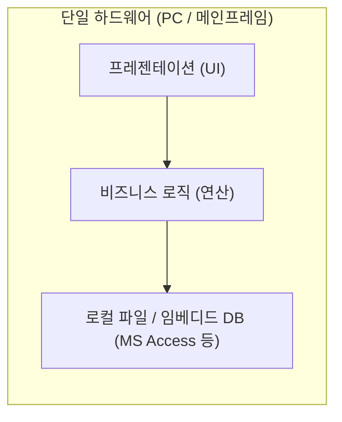

* **동작 방식**: 1980년대 메인프레임 시절이나 초기 개인용 컴퓨터(PC)의 독립형(Standalone) 데스크톱 프로그램(예: Microsoft Access, 로컬 파일 기반 장부 프로그램, 한글/워드 프로세서)이 대표적입니다.
* **장점**:
  1. **극도의 단순성**: 별도의 네트워크 통신이 없어 네트워크 지연(Latency), 패킷 손실, 통신 보안을 고민할 필요가 없습니다.
  2. **빠른 초기 개발**: 인프라 배포 설정이 필요 없고 단일 실행 파일(.exe) 하나로 동작합니다.
* **치명적인 한계**:
  1. **동시성 및 협업 불가**: 데이터가 사용자의 로컬 디스크에 묶여 있으므로 여러 사용자가 동시에 데이터를 읽고 수정하기가 극히 어렵습니다.
  2. **성능 확장의 한계**: 컴퓨터의 하드웨어 스펙(CPU/RAM)을 높이는 스케일업(Scale-up) 외에는 처리량을 늘릴 방법이 없습니다.
  3. **데이터 유실 위험**: 사용자의 PC가 고장 나거나 디스크가 손상되면 영구적인 데이터 손실로 직결됩니다.

---

### 1.3 2-Tier 아키텍처: 클라이언트-서버(C/S)와 팻 클라이언트(Fat Client)

네트워크 기술과 관계형 데이터베이스(RDBMS)의 보급으로 1990년대 클라이언트-서버(Client-Server, C/S) 모델이 대세로 떠올랐습니다. 데이터 저장소를 중앙의 전용 서버 컴퓨터로 분리해 낸 것입니다.

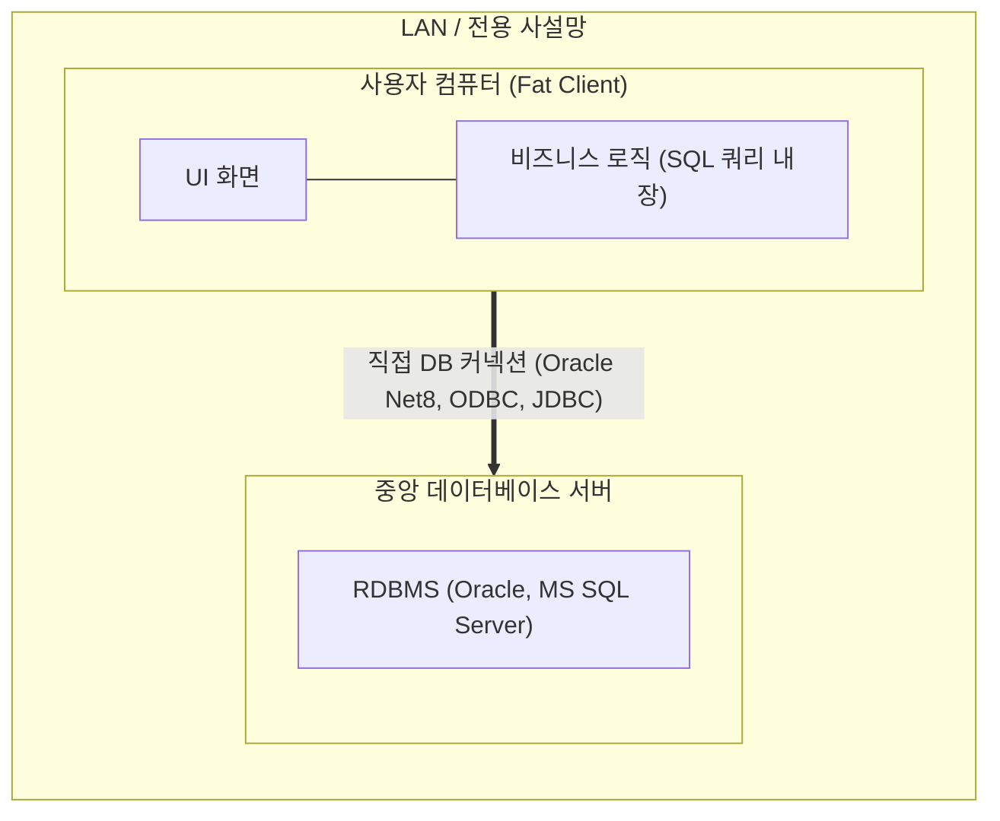

* **동작 방식**: 비주얼 베이직(Visual Basic), 파워빌더(PowerBuilder), 델파이(Delphi) 등으로 개발된 클라이언트 실행 프로그램이 각 사용자의 PC에 설치되고, 프로그램 내부에 데이터베이스 접속 계정(ID/PW)과 비즈니스 로직, 직접적인 SQL 쿼리가 포함되어 있었습니다.
* **팻 클라이언트(Fat Client) 현상**: 클라이언트가 화면 렌더링뿐 아니라 대부분의 연산과 유효성 검증, 비즈니스 계산을 모두 도맡았기에 프로그램 덩치가 매우 무거웠습니다.
* **치명적인 한계**:
  1. **배포의 악몽(Deployment Hell)**: 비즈니스 규칙(예: 세금 계산 공식)이 조금만 바뀌어도 수천, 수만 대의 사용자 PC에 설치된 `.exe` 파일을 재배포해야 했습니다. 사용자가 업데이트를 거부하면 구버전 로직이 DB 데이터를 오염시켰습니다.
  2. **심각한 보안 취약점**: 클라이언트 소프트웨어를 디컴파일(Decompile)하거나 네트워크 패킷을 리버스 엔지니어링하면 DB 접속 주소, 마스터 계정, 테이블 스키마가 고스란히 노출되었습니다.
  3. **데이터베이스 커넥션 고갈**: RDBMS의 커넥션(Connection)은 매우 비싼 자원입니다. 접속자가 1,000명이면 1,000개의 소켓 세션이 DB에 맺어지며 메모리를 잠식하여 DB가 쉽게 다운되었습니다.

---

### 1.4 3-Tier 아키텍처: 모던 웹의 표준 패러다임

2-Tier의 한계를 극복하기 위해, 비즈니스 로직을 클라이언트로부터 완전히 떼어내어 중앙의 독립된 계층인 **애플리케이션 서버(Application Server / WAS)**로 이관한 아키텍처가 바로 **3-Tier 아키텍처**입니다.

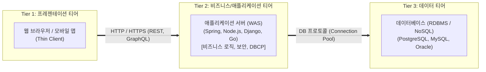

#### 3-Tier로 분리해야만 했던 필연적 이유 4가지

1. **관심사의 분리(Separation of Concerns)와 유지보수성**
   * 화면 UI가 모바일 앱으로 바뀌든 React 웹으로 바뀌든 백엔드의 핵심 비즈니스 로직은 수정할 필요가 없습니다.
   * 비즈니스 규칙이 변경되어도 사용자의 브라우저나 앱을 강제 재설치시킬 필요 없이 중앙의 WAS만 재배포하면 즉시 모든 클라이언트에 반영됩니다.
2. **철저한 보안 격리와 캡슐화 (Security Isolation)**
   * 클라이언트는 데이터베이스의 IP 주소도, 테이블 스키마도, 비밀번호도 알 수 없습니다.
   * WAS가 프론트엔드의 비정상 요청(SQL Injection, 위변조)을 1차로 필터링하고 검증(Sanitize)하며, DB는 외부 인터넷에 노출되지 않는 사설 서브넷(Private Subnet)에 안전하게 숨겨집니다.
3. **데이터베이스 커넥션 풀(DBCP)을 통한 자원 최적화**
   * 사용자 10만 명이 접속하더라도 10만 개의 커넥션을 DB에 맺지 않습니다.
   * WAS가 미리 최적화된 수(예: 30~50개)의 DB 커넥션을 풀(Pool)에 생성해 두고, 요청을 처리할 때만 잠깐 빌려 쓴 뒤 반납합니다. 데이터베이스의 CPU와 메모리 오버헤드가 극적으로 감소합니다.
4. **독립적인 스케일아웃(Scale-out) 지원**
   * 연산량이 몰리는 백엔드 애플리케이션 계층(WAS)은 무상태(Stateless)로 설계되어 서버를 1대에서 10대, 100대로 자유롭게 늘릴 수 있습니다. 각 티어의 병목 특성에 맞추어 인프라 자원을 유연하게 확장할 수 있습니다.

#### 1-Tier vs 2-Tier vs 3-Tier 종합 비교

| 비교 항목 | 1-Tier 아키텍처 | 2-Tier (Client-Server) | 3-Tier 아키텍처 |
| :--- | :--- | :--- | :--- |
| **물리 구성** | 단일 PC/메인프레임 | 클라이언트 PC + DB 서버 | 클라이언트 + WAS + DB 서버 |
| **클라이언트 성격** | 일체형 독립 프로그램 | 팻 클라이언트 (Fat Client) | 씬 클라이언트 (Thin Client) |
| **비즈니스 로직 위치** | 클라이언트 내부 | 클라이언트 내부 (SQL 내장) | **중앙 WAS (서버 내부)** |
| **보안성** | 하드웨어 분실 시 즉시 노출 | 취약 (DB 계정 탈취 위험) | **매우 높음 (DB 사설망 격리)** |
| **배포 및 업데이트** | PC마다 설치/갱신 | PC마다 배포 필요 (배포 지옥) | **중앙 서버만 무중단 배포** |
| **DB 커넥션 관리** | 불필요 (로컬 파일) | 클라이언트당 1개 (자원 낭비) | **DBCP 커넥션 풀 재사용** |
| **확장성(Scalability)** | 불가 (스케일업만 가능) | DB 스케일업에 의존 | **WAS 수평 확장(Scale-out) 용이** |

---

## 02. 시스템 아키텍처란 무엇인가요?
> **시스템의 청사진, 구조와 인터페이스, 비기능 요구사항(가용성, 확장성, 보안, 성능, 복구성)을 만족시키기 위한 의사결정의 집합**

세계적인 소프트웨어 석학 마틴 파울러(Martin Fowler)와 랄프 존슨(Ralph Johnson)은 아키텍처를 다음과 같이 정의했습니다.

> *"아키텍처란 개발자가 프로젝트 초기에 올바르게 결정하기를 간절히 바라는, 나중에 바꾸기 가장 어려운 결정들의 집합이다."*

즉, 시스템 아키텍처는 단순한 코드 작성 기법이 아닙니다. **"이 시스템을 이루는 구성 요소(컴포넌트)들은 무엇이고, 그들은 어떤 책임을 가지며, 서로 어떤 인터페이스로 신호를 주고받을 것인가?"**를 규정하는 전체 시스템의 **거대한 청사진(Blueprint)**입니다.

---

### 2.1 기능적 요구사항(FR) vs 비기능적 요구사항(NFR)

아키텍처 설계가 어려운 이유는 고객이 말하는 요구사항의 이면에 숨겨진 본질을 만족시켜야 하기 때문입니다.

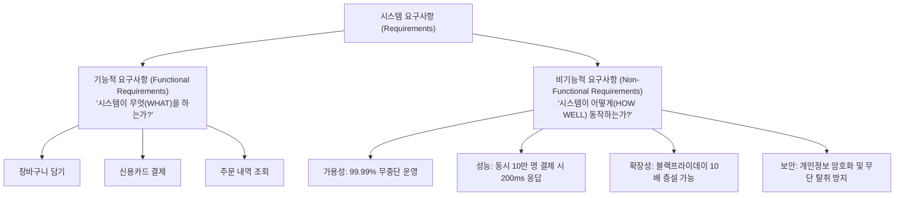

주니어 개발자는 주로 **기능적 요구사항(WHAT)**에 집중합니다. 화면에 결제 버튼이 뜨고, 결제 승인 API가 호출되어 DB에 행(Row) 하나가 추가되면 개발이 끝났다고 생각합니다.  
하지만 아키텍트는 **비기능적 요구사항(HOW WELL)**을 책임집니다. 결제 버튼을 누르는 순간 데이터센터 전원이 꺼지면 어떻게 될 것인가? 결제 트래픽이 100배 폭증해도 시스템이 다운되지 않고 버틸 수 있는가? 해커가 트래픽을 가로채도 고객의 카드 번호는 안전한가? 이것이 바로 아키텍처의 영역입니다.

---

### 2.2 아키텍트가 반드시 사수해야 할 5대 비기능 요구사항

#### 1. 가용성 (Availability)
시스템이 장애 없이 정상적으로 서비스를 제공하는 시간의 비율을 의미합니다. 흔히 **'Nine(9)'의 개수**로 표현합니다.
* **SLA(Service Level Agreement) 99.9% (Three Nines)**: 1년에 약 8.76시간 다운타임 허용
* **SLA 99.99% (Four Nines)**: 1년에 약 52.6분 다운타임 허용
* **SLA 99.999% (Five Nines)**: 1년에 약 5.26분 다운타임 허용 (금융, 미션 크리티컬 인프라)
* 고가용성을 달성하기 위해서는 모든 구성 요소의 단일 장애점(SPOF)을 제거하고 이중화(Redundancy) 및 자동 페일오버(Failover) 체계를 구축해야 합니다.

#### 2. 확장성 (Scalability)
작업량(Workload)이나 트래픽이 증가했을 때, 하드웨어 자원을 추가 투입함으로써 성능 저하 없이 처리량을 비례적으로 증가시킬 수 있는 시스템의 구조적 수용력입니다. 상태를 보관하지 않는 무상태(Stateless) 설계가 확장성의 핵심 토대입니다.

#### 3. 성능 (Performance)
주어진 시간 동안 시스템이 얼마나 빠르고 효율적으로 요청을 처리하는가를 측정합니다.
* **지연 시간 (Latency / Response Time)**: 클라이언트가 요청을 보낸 뒤 응답을 받기까지 걸리는 시간입니다. 평균(Mean)보다는 극단적인 꼬리 지연을 반영하는 **p95(하위 95%), p99(하위 99%) 레이턴시**가 핵심 지표입니다.
* **처리량 (Throughput)**: 단위 시간당 처리할 수 있는 작업의 양으로 **TPS(Transactions Per Second)** 또는 **QPS(Queries Per Second)**로 나타냅니다.

#### 4. 보안 (Security)
정보 보안의 3대 요소인 **CIA Triad**를 보장해야 합니다.
* **기밀성 (Confidentiality)**: 인가되지 않은 주체는 데이터를 볼 수 없음 (TLS 전송 암호화, DB 컬럼 암호화).
* **무결성 (Integrity)**: 인가되지 않은 주체에 의해 데이터가 위조되거나 변조되지 않음 (디지털 서명, 체크섬).
* **가용성 (Availability)**: 인가된 사용자가 원할 때 언제든 자원에 접근할 수 있음 (DDoS 방어, Rate Limiting).

#### 5. 복구성 및 탄력성 (Resilience & Recoverability)
재난이나 천재지변, 소프트웨어 치명적 버그가 발생했을 때 시스템이 스스로 회복하거나 정상 상태로 복구할 수 있는 역량입니다.
* **RPO (Recovery Point Objective, 복구 목표 시점)**: 장애 발생 시 허용 가능한 최대 데이터 유실 허용 범위 (예: RPO = 5분이면 최대 5분 전 데이터까지 복구되어야 함).
* **RTO (Recovery Time Objective, 복구 목표 시간)**: 장애 발생 시 서비스를 정상화하는 데까지 허용되는 최대 소요 시간 (예: RTO = 1시간이면 1시간 내에 서비스가 다시 켜져야 함).

---

### 2.3 아키텍처 의사결정 기록 (ADR: Architecture Decision Record)

아키텍처는 정답이 없는 **트레이드오프(Trade-off)**의 학문입니다. 모든 기술적 선택에는 대가가 따릅니다. 따라서 현업의 우수한 엔지니어링 조직은 중요한 아키텍처 변경이 있을 때마다 **ADR(Architecture Decision Record)**을 작성하여 문서화합니다.

```markdown
# ADR-042: 주문 및 결제 시스템의 이벤트 브로커로 Apache Kafka 도입

## 1. 문맥과 문제 정의 (Context)
- 현재 동기식 HTTP REST 호출 구조로 인해 결제 대행사(PG) 지연 시 주문 서버 스레드가 고갈됨.
- 주문 완료 시 배송, 알림, 정산 시스템으로의 결합도가 높아 단일 장애 전파 발생.

## 2. 고려한 대안 (Considered Options)
1. 대안 A: RabbitMQ (AMQP 기반 메시징)
2. 대안 B: Apache Kafka (분산 이벤트 로그 스트리밍)
3. 대안 C: AWS SQS + SNS 조합

## 3. 결정 내용 (Decision)
- **Apache Kafka**를 채택하기로 결정함.
- 이유: 초당 10만 건 이상의 대용량 이벤트 처리 필요, 이벤트 영속성(Replay) 보장 필요, 향후 데이터 파이프라인(Spark)과의 연동성 고려.

## 4. 결과 및 트레이드오프 (Consequences)
- **긍정적 효과**: 주문 서버와 다운스트림 서비스 간 완전한 비동기 디커플링 달성. 트래픽 버퍼링 가능.
- **감당해야 할 대가 (부정적 효과)**: 운영 복잡도 증가(Zookeeper/KRaft 관리, 파티션 리밸런싱 모니터링 필요), 최종 일관성(Eventual Consistency) 처리를 위한 비즈니스 예외 로직 추가 필요.
```

---

## 03. 아키텍처를 잘 설계해야 하는 이유는 무엇인가요?
> **초기 개발 속도 vs 장기적 유지보수성, 스케일업(Scale-up) vs 스케일아웃(Scale-out) 대응, 기술 부채 최소화**

개발 초기 단계에서는 아키텍처의 중요성을 체감하기 어렵습니다. 코드를 아무렇게나 작성하고, DB에 인덱스 하나 없이 뷰와 컨트롤러를 한 파일에 욱여넣어도 사용자가 10명일 때는 눈 깜짝할 사이에 동작하기 때문입니다.  
하지만 서비스가 성공하여 사용자가 유입되기 시작하면, 초기의 부실한 아키텍처는 기업의 생존을 위협하는 치명적인 독이 되어 돌아옵니다.

---

### 3.1 초기 개발 속도 vs 장기적 유지보수성 (설계의 비용 곡선)

소프트웨어 공학에는 유명한 **설계-속도 트레이드오프 곡선**이 존재합니다.

```
생산성 /
기능 개발 속도
  ^
  |        [ 훌륭한 아키텍처: 시간이 지나도 일정한 생산성 유지 ]
  |                 /----------------------------------------
  |                /
  |  \            /
  |   \          /
  |    \        /
  |     \      /
  |      \    /
  |       \  /
  |        \/
  |         \
  |          \
  |           \----------------- [ 나쁜 아키텍처: 기술 부채로 인한 급격한 생산성 추락 ]
  +------------------------------------------------------------> 프로젝트 기간 (시간)
```

1. **설계 없는 난개발의 결말**:
   * 프로젝트 시작 후 1~2개월은 프레임워크 규칙도, 레이어 분리도 없이 코딩하므로 기능이 매우 빠르게 출시됩니다.
   * 하지만 6개월, 1년이 지나면 코드 간 결합도(Coupling)가 극에 달합니다. 결제 로직을 고쳤는데 로그인 화면이 깨지고, 사소한 필드 하나를 추가하는 데 3주가 걸립니다. 마침내 버그 수정 속도가 신규 기능 개발 속도를 앞지르는 **개발 마비 상태(Feature Freeze)**에 봉착합니다.
2. **견고한 아키텍처의 가치**:
   * 초기에는 인터페이스를 정의하고, 도메인 경계를 나누며, 인프라를 분리하느라 첫 기능이 나오기까지 시간이 조금 더 걸립니다.
   * 하지만 시스템의 경계가 명확하므로 새로운 팀원이 합류해도 격리된 모듈만 파악하면 됩니다. 트래픽이 10배 늘어나도 아키텍처의 뼈대를 갈아엎지 않고 모듈 단위로 확장할 수 있습니다.

---

### 3.2 스케일업(Scale-up) vs 스케일아웃(Scale-out) 대응

트래픽이 폭증할 때 시스템을 확장하는 방법은 크게 두 가지가 있습니다. 시스템 아키텍처가 어떻게 설계되어 있느냐에 따라 우리가 선택할 수 있는 경로가 완전히 달라집니다.

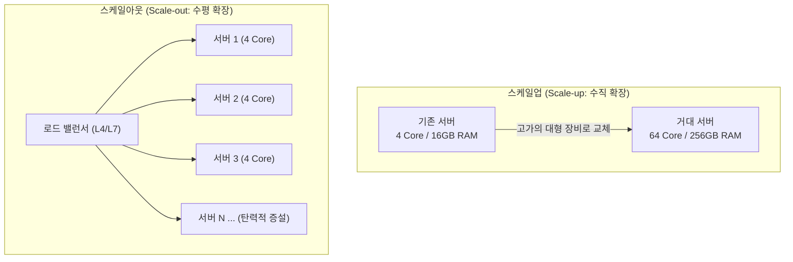

#### 스케일업(Scale-up, 수직 확장)
* **개념**: 단일 서버의 하드웨어 부품을 더 높은 사양(더 빠른 CPU 클럭, 더 많은 코어, 테라바이트급 메모리)으로 교체하거나 증설하는 방식입니다.
* **장점**: 
  1. 아키텍처나 코드를 수정할 필요가 거의 없습니다.
  2. 분산 네트워크 통신이나 데이터 일관성(트랜잭션) 문제를 고민할 필요가 없습니다.
* **치명적인 한계**:
  1. **하드웨어의 물리적 한계벽**: CPU 소켓 수와 마더보드가 지원하는 메모리 용량에는 한계가 있습니다.
  2. **기하급수적인 비용 증가**: 스펙이 2배 좋아질 때 서버 가격은 5배, 10배로 폭등합니다.
  3. **단일 장애점(SPOF)의 유지**: 아무리 값비싼 슈퍼컴퓨터라도 메인보드가 타버리면 전체 시스템이 멈춥니다. 장비 교체 시 필연적으로 다운타임이 발생합니다.

#### 스케일아웃(Scale-out, 수평 확장)
* **개념**: 비슷한 사양의 저렴한 범용(Commodity) 서버 여러 대를 병렬로 추가하여 부하를 분산하는 방식입니다.
* **장점**:
  1. **이론상 무한한 확장성**: 트래픽이 100배로 뛰면 서버를 100대 띄우면 됩니다.
  2. **뛰어난 비용 효율성**: 고가의 특수 장비 대신 클라우드 가상 인스턴스(AWS EC2 등)를 필요한 만큼만 띄워 쓸 수 있습니다.
  3. **고가용성(HA)**: 서버 10대 중 2대가 고장 나도 로드 밸런서가 나머지 8대로 트래픽을 넘기면 되므로 서비스가 중단되지 않습니다.
* **아키텍처적 전제 조건 (무상태성, Statelessness)**:
  * **"아키텍처가 뒷받침되지 않으면 스케일아웃은 불가능합니다."**
  * 만약 서버 로컬 메모리에 사용자의 세션 정보(로그인 상태)나 업로드된 파일을 직접 저장하고 있다면(Stateful), 사용자의 요청이 1번 서버로 갔다가 2번 서버로 가는 순간 로그인이 풀려버립니다.
  * 따라서 애플리케이션 서버는 어떠한 클라이언트 상태도 메모리에 두지 않는 **Stateless** 구조로 설계하고, 세션은 Redis로, 파일은 S3 같은 공용 객체 저장소로 완전히 외주화해야만 스케일아웃이 가능해집니다.

#### 스케일업 vs 스케일아웃 상세 비교

| 항목 | 스케일업 (Scale-up) | 스케일아웃 (Scale-out) |
| :--- | :--- | :--- |
| **확장 방식** | 기존 장비의 부품 교체/사양 상향 | 동일/유사 사양의 서버 인스턴스 대수 추가 |
| **적합한 계층** | 관계형 데이터베이스(RDBMS의 전통적 방식) | 웹 서버, WAS, 컨테이너, 캐시 클러스터 |
| **확장 한계** | 하드웨어 스펙 한계 존재 (유한함) | 아키텍처 설계에 따라 거의 무한 확장 가능 |
| **비용 증가 추이** | 지수 함수적 증가 (매우 비쌈) | 선형적(Linear) 증가 (비용 효율적) |
| **장애 복원력** | 서버 다운 시 서비스 전체 마비 (SPOF) | 일부 노드 장애 시에도 무중단 서비스 (HA) |
| **아키텍처 복잡도** | 낮음 (기존 코드 유지 가능) | 높음 (로드 밸런싱, 무상태 설계, 동기화 필요) |
| **확장 시 다운타임** | 부품 교체 및 재부팅 시 작업 중단 발생 | 무중단 동적 추가(Auto Scaling) 가능 |

---

### 3.3 기술 부채(Technical Debt)의 복리 이자

워드 커닝햄(Ward Cunningham)이 명명한 **기술 부채**는 금융 부채와 소름 돋을 정도로 똑같이 작동합니다.
* 비즈니스 일정을 맞추기 위해 타협하고 대충 작성한 아키텍처는 일종의 '대출'입니다. 출시 속도를 앞당길 수 있습니다.
* 하지만 부채를 갚지(리팩토링하지) 않고 방치하면 매일매일 **'복리 이자'**가 붙습니다.
* 이자가 원금을 초과하는 순간, 엔지니어링 팀은 새로운 비즈니스 가치를 단 1%도 생산하지 못하고 오직 기존 버그를 막고 서버를 껐다 켜는 '이자 갚기'에만 모든 시간을 탕진하게 됩니다. 견고한 아키텍처는 이 기술 부채의 발생을 사전에 억제하는 가장 강력한 방파제입니다.

---

## 04. 시스템 아키텍처 비유: 스타벅스 매장
> **주문 받는 캐셔(Web/API Gateway), 음료 제조 바리스타(WAS), 원두/재료 보관 창고(DB), 자주 찾는 식수대(Redis 캐시), 진동벨 시스템(비동기 메시지 큐/Kafka)을 통한 대용량 트래픽 처리 비유 완벽 해설**

대규모 분산 시스템 아키텍처는 용어만 들으면 매우 추상적이고 복잡해 보입니다.  
하지만 전 세계에서 가장 효율적으로 대규모 인파를 처리하는 시스템 중 하나인 **'스타벅스(Starbucks) 매장의 운영 메커니즘'**을 대입해 보면, 현대 분산 아키텍처의 모든 핵심 원리가 놀라울 정도로 직관적으로 이해됩니다.

---

### 4.1 최악의 안티 패턴: 1인 동기식 카페 (1-Tier / Monolithic의 비극)

만약 어떤 카페에 직원이 단 한 명만 있다고 가정해 봅시다.
1. 손님이 문을 열고 들어와 아메리카노를 주문합니다.
2. 직원은 주문을 받고 카드를 긁어 결제를 완료합니다.
3. 직원은 손님을 카운터 앞에 세워둔 채, 뒤돌아서 원두 창고로 걸어가 원두 봉투를 꺼냅니다.
4. 원두를 그라인더에 갈고, 에스프레소 머신에서 샷을 추출하고, 얼음과 물을 붓습니다.
5. 컵 뚜껑을 닫고 빨대를 꽂아 손님에게 건넵니다.
6. 그제서야 줄 서 있던 다음 두 번째 손님을 부릅니다: *"다음 손님, 주문하세요!"*

이 방식이 바로 **단일 스레드 동기식 블로킹(Synchronous Blocking) 모델**입니다.
* 손님 한 명이 음료를 받는 데 3분이 걸린다면, 뒤에 서 있는 10명의 손님은 아무것도 하지 못하고 30분을 멍하니 서 있어야 합니다.
* 만약 앞선 손님이 *"원두 어디 산인가요?", "결제가 잘 안 되네요"*라며 시간을 끌면 뒤에 줄 선 수십 명의 손님은 주문조차 못 하고 발길을 돌립니다(Request Timeout).
* 스타벅스는 절대 이렇게 일하지 않습니다. 스타벅스는 철저하게 **관심사를 분리하고, 비동기 큐를 두며, 캐시를 전진 배치**합니다.

---

### 4.2 스타벅스 매장과 분산 시스템 컴포넌트 1:1 완벽 매핑

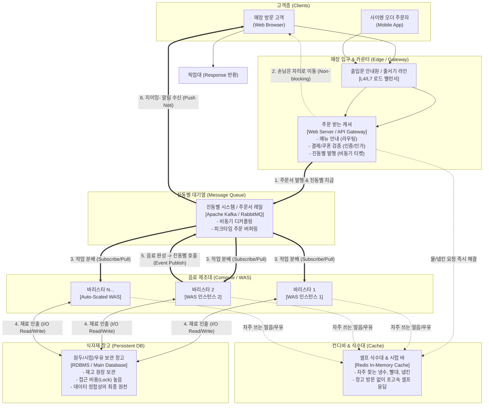

#### 1. 주문 받는 캐셔 (Cashier) = Web Server / API Gateway
* **역할**: 매장에 들어온 손님을 가장 먼저 맞이하는 단일 진입점입니다.
* **핵심 기능**:
  * **라우팅(Routing)**: 손님이 찾는 메뉴(콜드브루, 케이크, 텀블러)가 어느 파트에서 처리되어야 하는지 파악합니다.
  * **인증 및 결제(Auth & Payment)**: 유효한 스타벅스 카드인지, 잔액이 충분한지 확인합니다.
  * **부하 제어(Rate Limiting)**: 매장이 꽉 차면 *"잠시만 문밖에서 대기해 주시겠어요?"*라며 매장 내 인원을 제어합니다.
* **비동기 접수**: 캐셔는 음료를 직접 만들지 않습니다. 주문을 전산에 넣고 주문서(메시지)를 발행한 뒤 **곧바로 다음 손님의 주문을 받습니다.** 캐셔의 처리량(Throughput)이 극대화됩니다.

#### 2. 음료 제조 바리스타 (Barista) = 애플리케이션 서버 (WAS / Worker)
* **역할**: 주문서에 적힌 비즈니스 규칙(레시피)대로 에스프레소를 내리고 우유를 스팀하여 완성된 음료를 만들어내는 실제 연산 주체입니다.
* **스케일아웃(Scale-out)**:
  * 평일 한가한 오후에는 바리스타 1명으로 충분합니다.
  * 하지만 인근 직장인들이 쏟아져 나오는 점심 피크타임(트래픽 스파이크)이 되면 점장이 지원 바리스타를 4명으로 늘립니다(**Auto Scaling**).
  * 바리스타는 각자 독립적으로 커피를 제조하므로 손님이 늘어나도 병렬 처리가 가능합니다.

#### 3. 원두/재료 보관 창고 (Warehouse) = 데이터베이스 (RDBMS)
* **역할**: 매장 깊숙한 곳에 위치한 원두 포대, 대용량 우유 박스, 텀블러 완제품 재고가 안전하게 보관되는 최종 저장소입니다.
* **병목 특성(Disk I/O & Lock)**:
  * 창고 문은 좁고 안전을 위해 한 번에 들어갈 수 있는 인원이 제한적입니다(**Database Connection Limit**).
  * 바리스타 5명이 동시에 마지막 남은 딸기 시럽 한 병을 집으려고 하면 병목과 충돌이 발생합니다(**Row Lock / Race Condition**).
  * 따라서 바리스타가 사소한 재료 하나를 찾으려고 매번 창고 깊숙이 걸어 들어가는 것은 시스템 전체의 성능을 갉아먹는 치명적인 행동입니다.

#### 4. 셀프 식수대와 컨디바 (Water Station & Condiment Bar) = Redis 캐시
* **역할**: 매장 한가운데 누구나 손쉽게 접근할 수 있도록 비치된 얼음물통, 시럽, 냅킨, 빨대 보관대입니다.
* **캐시의 위력**:
  * 어떤 손님이 *"시원한 물 한 잔만 주세요"*라고 했다고 해서 캐셔가 주문을 넣고, 바리스타가 장갑을 끼고, 창고에서 물병을 찾아오는 것은 엄청난 리소스 낭비입니다.
  * 캐셔는 *"물과 빨대는 뒤편 컨디바에서 바로 이용하실 수 있습니다"*라고 안내합니다.
  * 전체 요청의 80%를 차지하는 단순 반복 조회(메뉴판 보기, 베스트셀러 목록 등)를 초고속 인메모리(식수대)에서 즉시 반환함으로써, DB 창고 문을 열 필요를 없애줍니다.

#### 5. 진동벨 시스템 (Buzzer System) = 비동기 메시지 큐 (Kafka / RabbitMQ)
* **역할**: 손님(Client)과 바리스타(WAS)를 시간적, 공간적으로 완전히 분리해 주는 **비동기 이벤트 기반 아키텍처(Event-Driven Architecture)**의 정수입니다.
* **논블로킹(Non-blocking) 처리**:
  * 캐셔는 결제가 끝나자마자 손님에게 **진동벨(고유한 티켓 번호 / Message Token)**을 쥐여줍니다.
  * 손님은 픽업대 앞에서 바리스타를 뚫어져라 쳐다보며 서 있을 필요가 없습니다. 편안하게 자리에 앉아 노트북을 하거나 친구와 대화를 나눕니다. 손님의 스레드가 차단(Block)되지 않습니다.
* **이벤트 발행 및 소비(Pub/Sub)**:
  * 바리스타가 음료를 다 만들면 카운터 단말기에서 해당 번호를 누릅니다(**Event Publish**).
  * 손님의 손에 쥐어진 진동벨이 지이잉- 울리고 불빛이 깜빡입니다(**Event Push / Consume**).
  * 손님은 여유롭게 픽업대로 걸어가 음료를 수령(Response 획득)하고 진동벨을 반납합니다.
* **버퍼링(Buffering) 효과**:
  * 비가 와서 사이렌 오더 주문이 1초에 1,000건이 밀려들어도 바리스타 머리 위로 주문이 쏟아져 기절하지 않습니다.
  * 주문서는 진동벨 큐(Kafka 토픽)에 안전하게 순서대로 쌓이고, 바리스타들은 자신이 소화할 수 있는 일정한 속도로 주문서를 한 장씩 꺼내어(Pull) 안전하게 커피를 만듭니다.

---

## 05. 서버 아키텍처의 성능 향상을 위한 캐시, Redis
> **인메모리 데이터 구조 저장소, Cache-Aside 패턴, Write-Through/Write-Back 패턴, 캐시 스탬피드(Cache Stampede) 방지 전략**

컴퓨팅 환경에서 처리 속도의 격차는 상상을 초월합니다.
CPU 연산은 나노초($ns$) 단위로 일어나고, 시스템 메모리(RAM)는 수십 나노초 수준입니다. 반면 고성능 NVMe SSD 디스크는 수십 마이크로초($\mu s$), 일반적인 네트워크 왕복과 관계형 DB 쿼리는 수 밀리초($ms$)에서 수 초 단위가 소요됩니다. RAM은 디스크보다 **약 10만 배 이상 빠릅니다.**  
따라서 데이터베이스 앞단에 인메모리 기반의 **캐시(Cache)**를 배치하는 것은 현대 고성능 백엔드 아키텍처의 절대적인 필수 조건입니다.

---

### 5.1 Redis (Remote Dictionary Server)란 무엇인가?

Redis는 디스크가 아닌 **컴퓨터 메인 메모리(RAM)**에 모든 데이터를 저장하고 조회하는 고성능 오픈소스 인메모리 키-값(Key-Value) 데이터 구조 저장소입니다.

* **초고속 성능**: 모든 데이터 읽기/쓰기가 메모리에서 발생하므로 평균 응답 시간이 서브 밀리초(Sub-millisecond, $0.1 \sim 1ms$)에 불과합니다. 단일 인스턴스로도 초당 10만 건 이상의 QPS를 거뜬히 소화합니다.
* **풍부한 인메모리 자료구조**: 단순한 문자열(String)뿐만 아니라 해시(Hash), 리스트(List), 셋(Set), 정렬된 셋(Sorted Set / ZSet), 비트맵(Bitmap), 지오스페셜(Geospatial), 하이퍼로그로그(HyperLogLog)를 지원합니다. 이를 통해 복잡한 비즈니스 로직(실시간 랭킹 순위표, 중복 투표 방지, 최근 본 상품 목록 등)을 DB 쿼리 없이 O(1)이나 O(log N)으로 해결할 수 있습니다.
* **싱글 스레드 이벤트 루프 모델**:
  * Redis의 코어 연산 엔진은 **싱글 스레드(Single Thread)** 기반의 이벤트 루프(I/O Multiplexing)로 구동됩니다.
  * 멀티 스레드 환경에서 발생하는 극심한 문맥 교환(Context Switching) 오버헤드와 락(Lock) 경합, 교착 상태(Deadlock)가 원천적으로 발생하지 않아 극도의 예측 가능한 속도를 보장합니다.

---

### 5.2 대표적인 캐시 전략 패턴 (Caching Patterns)

캐시를 시스템에 도입할 때 가장 핵심적인 질문은 **"캐시와 원본 데이터베이스 간의 동기화를 어떻게 유지할 것인가?"**입니다.

#### 1. Cache-Aside (Look-Aside / 지연 로딩) 패턴
가장 일반적으로 사용되는 기본 패턴입니다. 애플리케이션이 캐시를 먼저 확인하고, 없으면 DB를 조회합니다.

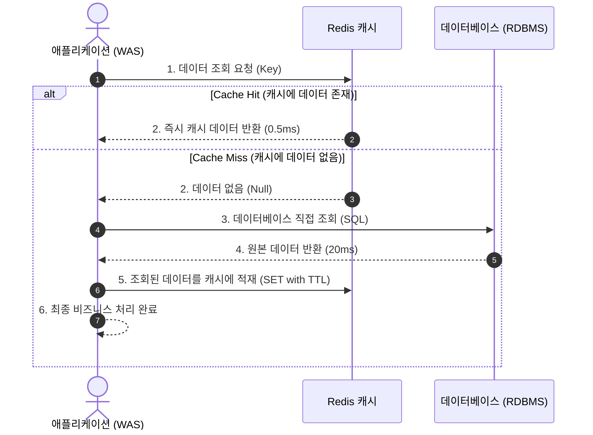

* **장점**:
  * 실제로 요청된 데이터만 캐시에 올라가므로 메모리가 효율적으로 사용됩니다(Lazy Loading).
  * Redis가 다운되더라도 애플리케이션은 DB에서 직접 데이터를 읽어올 수 있어 서비스 전체가 멈추지 않는 뛰어난 내결함성을 가집니다.
* **단점**:
  * 캐시 미스가 발생한 초기 요청은 캐시 확인 $\to$ DB 조회 $\to$ 캐시 쓰기라는 3단계 과정을 거치므로 레이턴시가 증가합니다.
  * DB의 데이터가 수정되었을 때 캐시를 갱신하거나 지워주지 않으면 데이터 불일치(Stale Data)가 발생합니다.

#### 2. Write-Through 패턴
데이터를 쓸 때마다 **캐시와 DB에 동시에(동기적으로)** 작성하는 방식입니다.

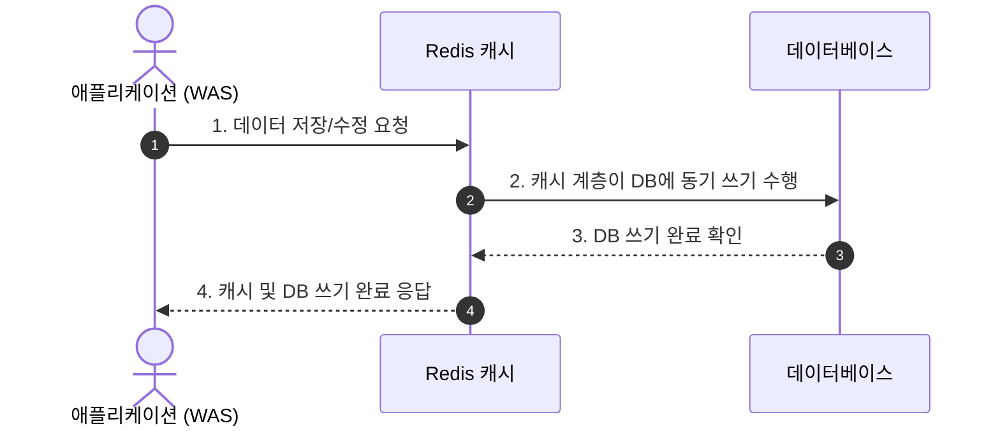

* **장점**: 캐시의 데이터가 항상 최신 상태로 유지되므로 데이터 일관성이 뛰어납니다. 캐시 미스가 거의 없습니다.
* **단점**: 매번 쓰기 작업마다 두 번의 저장이 발생하므로 쓰기 지연 시간(Write Latency)이 증가합니다. 자주 읽히지 않는 데이터까지 캐시 메모리를 낭비할 수 있습니다.

#### 3. Write-Back (Write-Behind) 패턴
데이터를 **캐시에만 먼저 초고속으로 저장**해 두고, 백그라운드 배치 프로세스가 모아서 비동기로 DB에 반영하는 방식입니다.

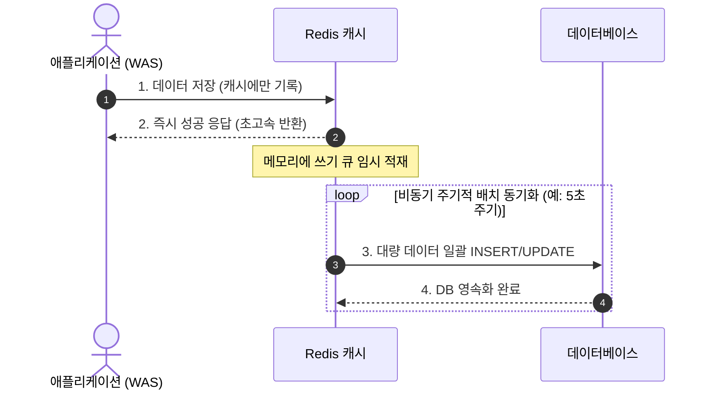

* **장점**: 쓰기 성능이 극대화됩니다. 초당 수만 건의 유튜브 조회수 카운팅, 실시간 채팅 로그, 좋아요 클릭 등 극심한 쓰기 트래픽을 감당할 수 있습니다. DB에 가해지는 쓰기 부하를 획기적으로 줄여줍니다.
* **단점**: 캐시 서버가 불의의 사고로 다운되거나 재부팅되면, 미처 DB에 영속화되지 못한 메모리 속 최신 데이터가 **영구히 유실(Data Loss)**될 수 있습니다.

#### 캐시 전략 종합 비교

| 캐시 패턴 | 주 사용 목적 | 일관성 (Consistency) | 쓰기 성능 | 데이터 유실 위험 |
| :--- | :--- | :--- | :--- | :--- |
| **Cache-Aside** | 일반적인 웹 서비스의 읽기 집약적 워크로드 | 보통 (TTL 및 무효화에 의존) | 보통 | 없음 (DB가 원천) |
| **Write-Through** | 데이터 정합성이 매우 중요한 시스템 | **매우 높음 (항상 최신 동기화)** | 느림 (2중 쓰기 오버헤드) | 없음 |
| **Write-Back** | 초고속 대량 쓰기 워크로드 (조회수, 로그) | 낮음 (최종 일관성) | **극도로 빠름 (메모리 쓰기)** | **높음 (장애 시 유실 가능)** |

---

### 5.3 캐시 무효화(Cache Invalidation)의 난제

> *"컴퓨터 과학에는 단 두 가지의 어려운 문제가 있다. 바로 캐시 무효화와 이름 짓기다."*  
> — 필 칼튼(Phil Karlton)

캐시를 도입하는 순간 우리는 **"동일한 데이터가 서로 다른 두 장소(Redis와 DB)에 복제되어 존재한다"**는 위험을 떠안게 됩니다. DB의 사용자 닉네임이 '홍길동'에서 '이순신'으로 바뀌었는데, Redis에는 여전히 '홍길동'이 남아 있다면 사용자에게 치명적인 혼란을 줍니다.  
이를 방지하기 위한 캐시 무효화 전략:
1. **만료 시간(TTL: Time-To-Live) 강제 설정**: 모든 캐시 키에는 반드시 적절한 TTL(예: 10분, 1시간)을 걸어야 합니다. 최악의 경우에도 TTL이 지나면 캐시에서 자동 소멸되어 DB의 최신값을 다시 긁어옵니다.
2. **명시적 삭제 (Eviction on Update)**: DB에서 UPDATE나 DELETE 트랜잭션이 성공하면, 그 즉시 애플리케이션 이벤트나 DB 트리거/CDC(Change Data Capture, Debezium)를 통해 Redis의 해당 키를 즉각 `DEL` 처리합니다. (업데이트 대신 삭제를 선택하는 이유는 동시성 쓰기 경쟁 상태를 피하기 위함입니다.)

---

### 5.4 대규모 장애를 부르는 현상: 캐시 스탬피드 (Cache Stampede)

대규모 트래픽 환경에서 가장 두려운 장애 중 하나가 바로 **캐시 스탬피드(Cache Stampede)**, 또는 **Thundering Herd(우르르 몰려드는 소 떼)** 현상입니다.

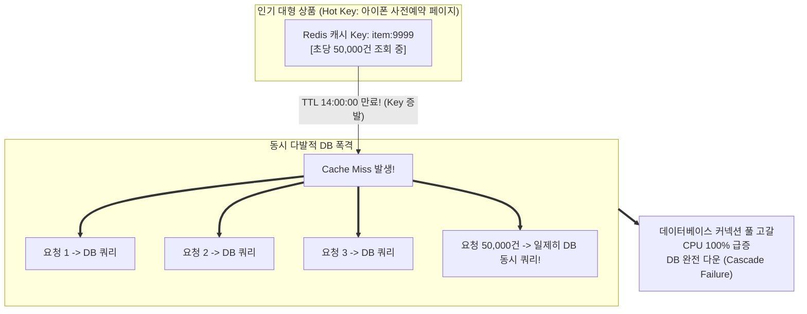

* **원인**: 수만 명이 1초마다 조회하는 초인기 데이터의 캐시 만료 시간(TTL)이 특정 순간 끝나는 순간, 그 찰나의 0.1초 동안 들어온 수만 개의 요청이 모두 캐시 미스를 겪게 됩니다. 이 수만 개의 요청이 일제히 무거운 복합 SQL 쿼리를 DB로 직접 던져버리고, DB는 감당할 수 없는 부하로 완전히 뻗어버립니다.

#### 캐시 스탬피드 방지 전략 3가지

1. **분산 락(Distributed Lock) 활용**
   * 캐시 미스가 났을 때 모든 스레드가 DB로 가지 못하도록 Redis의 `SETNX`나 Redisson 분산 락을 획득한 **단 1개의 스레드만** DB로 쿼리를 날리게 합니다.
   * 나머지 49,999개의 요청은 0.1초간 잠시 대기했다가, 첫 번째 스레드가 캐시에 데이터를 적재해 놓으면 그 캐시를 읽어갑니다.
2. **TTL 지터 (Jitter / 무작위 만료 분산)**
   * 동일한 배치나 시점에 대량의 캐시 키가 생성될 때 만료 시간을 고정값(예: 3600초)으로 주지 않습니다.
   * `TTL = 3600초 + random(1, 300)초` 형태로 난수(Jitter)를 섞어 만료 시점을 분산시킴으로써 한날한시에 캐시가 무더기로 만료되는 참사를 원천 차단합니다.
3. **확률적 조기 만료 (XFetch 알고리즘)**
   * TTL이 실제로 완전히 만료되기 직전에, 남은 시간과 계산 비용에 비례한 확률 함수를 돌려 백그라운드에서 미리 DB의 최신 데이터를 읽어와 캐시를 갱신(Recompute)해 두는 고급 알고리즘입니다. 사용자는 영원히 캐시 미스를 겪지 않습니다.

---

## 06. MSA라는 아키텍처는 왜 인기가 있을까요?
> **모놀리식의 한계와 배포 지옥, MSA의 서비스별 독립 배포/자율성/기술 유연성, 분산 트랜잭션(SAGA 패턴)과 분산 추적 등 감당해야 할 복잡성**

지난 10년간 엔지니어링 생태계에서 가장 뜨거웠던 화두는 단연 **MSA(Microservices Architecture, 마이크로서비스 아키텍처)**였습니다. 수많은 글로벌 IT 기업들이 기존의 모놀리식 시스템을 쪼개어 수십, 수백 개의 마이크로서비스로 전환했습니다. 왜 그들은 이 거대한 모험을 감행했을까요?

---

### 6.1 모놀리식(Monolithic) 아키텍처의 한계와 배포 지옥

모놀리식 아키텍처는 주문, 결제, 회원, 배송, 정산, 알림 등 시스템의 모든 비즈니스 도메인이 **단 하나의 거대한 코드베이스(Single Repository)**에 담겨 있고, 단 하나의 실행 파일(WAR, JAR, 단일 컨테이너)로 빌드되어 배포되는 구조입니다.

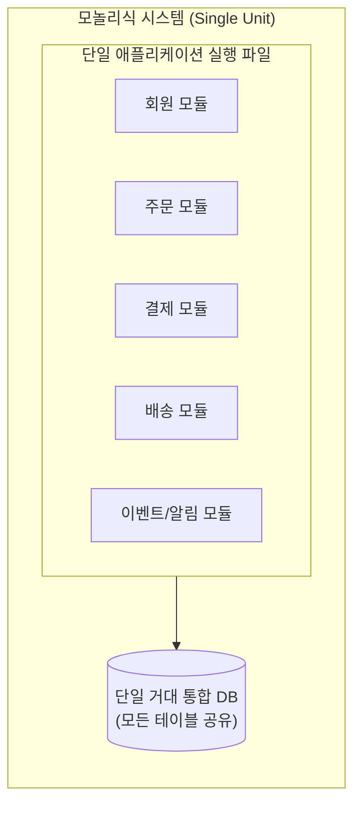

#### 모놀리식의 명확한 장점 (초기 스타트업의 최강자)
* 개발 환경 구축이 쉽고 로컬 머신에서 바로 디버깅할 수 있습니다.
* 데이터베이스 트랜잭션이 ACID를 완벽히 만족합니다(단일 DB 커밋/롤백).
* 배포 파이프라인이 하나뿐이므로 운영이 단순합니다.

#### 규모가 커졌을 때 닥치는 '배포 지옥(Deployment Hell)'
1. **거대해진 빌드와 배포 시간**: 코드가 수백만 줄에 달하면 소스 코드 빌드와 테스트를 수행하는 데만 1~2시간이 걸립니다.
2. **사소한 변경의 전체 장애 전파**: 배송팀 개발자가 코드 오타 하나를 내서 배포하면, 전혀 상관없는 결제와 로그인까지 서비스 전체가 먹통이 됩니다.
3. **머지 헬(Merge Hell)과 일정 병목**: 100명의 개발자가 매일 같은 코드 저장소에 PR을 올리면 코드 충돌을 해결하느라 하루가 다 갑니다. 매주 목요일 밤에 전사 배포를 하기 위해 모든 팀이 야근을 해야 합니다.
4. **선택적 확장의 불가능**: 이벤트 알림 모듈 하나 때문에 CPU가 치솟아도, 메모리를 엄청나게 잡아먹는 거대한 전체 모놀리스 덩어리를 통째로 여러 대 띄워야 하므로 인프라 비용이 낭비됩니다.

---

### 6.2 마이크로서비스 아키텍처(MSA)의 본질과 핵심 가치

MSA는 시스템을 **비즈니스 도메인 단위로 작고 독립적인 서비스들로 쪼개어**, 각 서비스가 자신만의 독립적인 프로세스로 실행되고 경량화된 메커니즘(HTTP REST, gRPC, 메시지 큐)으로 통신하는 아키텍처입니다.

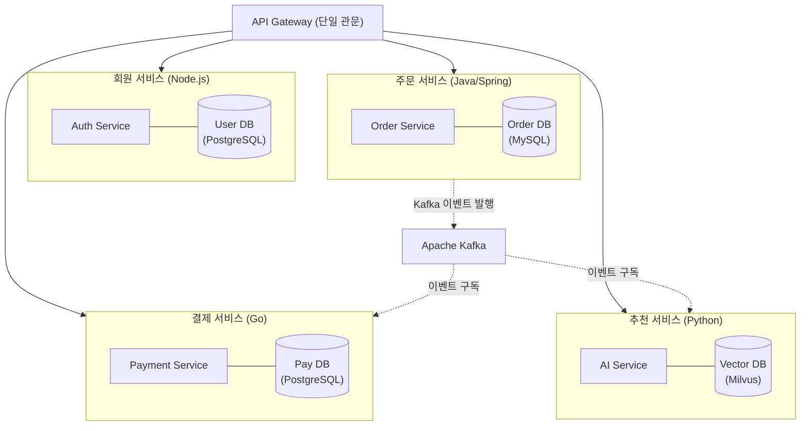

#### MSA가 제공하는 4가지 압도적 자유
1. **서비스별 독립 배포 가능성 (Independent Deployability)**
   * 주문 서비스 팀은 결제 서비스 팀이나 배송 서비스 팀의 허락을 받을 필요 없이 하루에도 수십 번씩 자유롭게 프로덕션에 신규 기능을 배포할 수 있습니다. 장애가 발생해도 해당 서비스만 격리되어 롤백됩니다.
2. **콘웨이의 법칙(Conway's Law)과 조직의 자율성**
   * *"시스템의 구조는 그 시스템을 설계하는 조직의 소통 구조를 닮아간다."*
   * 서비스 단위로 크로스 펑셔널 피처 팀(기획자, 프론트, 백엔드가 한 팀인 아마존의 2-Pizza Team)을 구성하여 고도의 애자일 개발을 달성할 수 있습니다.
3. **폴리글랏(Polyglot) 아키텍처 지원**
   * 성능과 동시성이 극도로 중요한 결제 엔진은 Go로, 방대한 엔터프라이즈 비즈니스 규칙이 있는 주문 시스템은 Java/Spring으로, AI 추천 엔진은 Python 생태계로 각 도메인에 가장 적합한 언어와 DB를 자유롭게 선택할 수 있습니다.
4. **자율적인 데이터베이스 격리 (Database-per-Service)**
   * 각 마이크로서비스는 자신만의 전용 데이터베이스를 소유하며, 타 서비스는 절대로 남의 DB에 직접 SQL을 날릴 수 없습니다. 오직 잘 정의된 API나 이벤트를 통해서만 데이터를 주고받습니다. 이를 통해 테이블 스키마 변경의 영향도가 외부로 전파되지 않습니다.

---

### 6.3 세상에 공짜 점심은 없다: MSA 도입 시 감당해야 할 복잡성

MSA는 은총알(Silver Bullet)이 아닙니다. 모놀리식의 조직적 문제를 해결해 주는 대신, **극도로 가혹한 분산 컴퓨팅의 복잡성**을 시스템에 안겨줍니다.

#### 1. 네트워크 신뢰성의 붕괴와 레이턴시
모놀리식에서는 함수 호출(메모리 참조, 0.0001ms)이었던 것이 MSA에서는 네트워크 HTTP/gRPC 패킷 왕복(수십 ms)으로 바뀝니다. 네트워크는 언제든 유실되고, 지연되며, 순서가 뒤바뀔 수 있습니다.

#### 2. 분산 트랜잭션의 파괴: 2PC의 한계와 SAGA 패턴
단일 DB에서는 `@Transactional` 어노테이션 하나로 묶이던 원자성(Atomicity)이 산산조각 납니다.
`[주문 생성] -> [쿠폰 차감] -> [카드 결제] -> [재고 감소]` 과정에서 재고 감소가 실패하면, 이미 승인된 카드 결제와 쿠폰 차감은 어떻게 취소해야 할까요?

분산 락이나 2-Phase Commit(2PC)은 모든 노드의 응답을 기다려야 하므로 시스템 전체의 성능과 가용성을 파괴합니다. 따라서 현대 MSA는 **SAGA 패턴**을 채택합니다.
* **SAGA 패턴**: 로컬 트랜잭션을 단계별로 실행하고, 도중에 실패가 발생하면 지금까지 성공했던 이전 단계들을 역순으로 되돌리는 **보상 트랜잭션(Compensating Transaction)**을 연쇄적으로 실행하여 최종적 일관성(Eventual Consistency)을 맞춥니다.

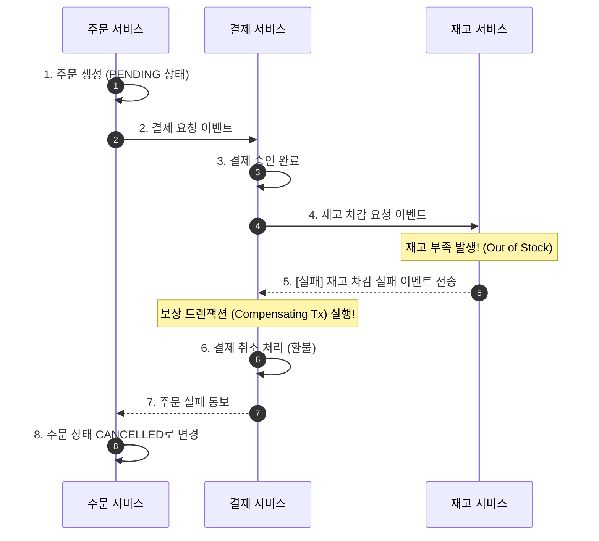

* **Choreography SAGA**: 중앙 조정자 없이 각 서비스가 이벤트를 발행(Pub)하고 구독(Sub)하며 자율적으로 보상 트랜잭션을 주고받는 방식 (구조가 단순하나 흐름 추적이 어려움).
* **Orchestration SAGA**: 전용 오케스트레이터(Saga Coordinator)가 워크플로우를 중앙에서 지휘하며 어떤 보상 트랜잭션을 호출할지 명시적으로 제어하는 방식 (복잡한 비즈니스에 적합).

#### 3. 분산 추적(Distributed Tracing)의 필수성
어떤 사용자가 구매 버튼을 눌렀는데 화면에 500 에러가 떴습니다. 이 요청은 게이트웨이 $\to$ 주문 $\to$ 결제 $\to$ 인증 $\to$ PG사 $\to$ 재고 서비스 등 7개의 마이크로서비스를 거쳤습니다. 도대체 어느 서비스의 몇 번째 줄 코드에서 에러가 났을까요?  
이를 추적하기 위해 모든 HTTP 요청 헤더에 고유한 추적 ID(`TraceId`, `SpanId`)를 주입하고, 전체 서비스의 호출 흐름을 시각화해 주는 **OpenTelemetry, Jaeger, Zipkin** 같은 분산 트랜잭션 추적 시스템이 반드시 구축되어야 합니다.

#### 모놀리식 vs MSA 핵심 비교

| 비교 항목 | 모놀리식 (Monolithic) | 마이크로서비스 (MSA) |
| :--- | :--- | :--- |
| **코드베이스** | 단일 저장소 (Single Repository) | 도메인별 다중 저장소 (Multi-Repo) |
| **데이터베이스** | 단일 통합 DB (테이블 조인 가능) | **서비스별 독립 DB (Database-per-Service)** |
| **트랜잭션** | ACID 보장 (로컬 트랜잭션) | BASE / 최종 일관성 (**SAGA 패턴 필수**) |
| **배포 주기** | 전사 통합 배포 (느림, 야간 배포) | **서비스별 독립적 상시 배포 (매우 빠름)** |
| **장애 격리** | 부분 버그가 전체 시스템 다운 유발 | **장애 격리 우수 (해당 서비스만 영향)** |
| **네트워크 오버헤드** | 없음 (메모리 함수 호출) | 높음 (네트워크 IPC, 직렬화 비용) |
| **운영 및 인프라 비용** | 낮음 (서버 몇 대로 운영 가능) | **극도로 높음 (K8s, 모니터링, 메시지 큐 필수)** |
| **도입 추천 시기** | **비즈니스 초기, 도메인이 불명확할 때** | **조직이 수십 명 이상이고 트래픽이 폭증할 때** |

> **아키텍트의 금언 (Martin Fowler의 Monolith First)**  
> *"새로운 시스템을 처음부터 MSA로 구축하려는 시도는 거의 모든 경우 비참한 재앙으로 끝납니다. 시스템의 비즈니스 도메인 경계가 명확해지고, 트래픽과 조직 규모가 모놀리식의 한계에 부딪혔을 때 비로소 가장 병목이 심한 모듈부터 차근차근 마이크로서비스로 발라내야 합니다."*

---

## (+) 이중화와 무중단 배포는 무엇인가요?
> **단일 장애점(SPOF) 제거를 위한 High Availability(HA), Active-Active vs Active-Standby, 롤링, 블루-그린, 카나리 배포 방식 비교표**

현대 인터넷 서비스에서 "서버 점검 중: 새벽 2시부터 6시까지 서비스가 일시 중단됩니다"라는 공지는 사용자를 경쟁사로 내쫓는 치명적인 약점입니다. 글로벌 서비스는 밤낮이 없으며, 365일 24시간 1초도 멈추지 않는 **고가용성(High Availability, HA)**과 **무중단 배포(Zero-Downtime Deployment)**를 필연적으로 요구합니다.

---

### 7.1 단일 장애점(SPOF: Single Point of Failure)의 제거와 이중화

**단일 장애점(SPOF)**이란 시스템 내의 여러 구성 요소 중, **어느 하나가 고장 났을 때 시스템 전체가 작동을 멈추게 만드는 치명적인 취약 지점**을 뜻합니다.  
예를 들어 서버가 100대 있어도 인터넷 관문에 스위칭 허브나 로드 밸런서가 단 1대뿐이라면, 그 허브에 번개가 치는 순간 100대의 서버는 무용지물이 됩니다.

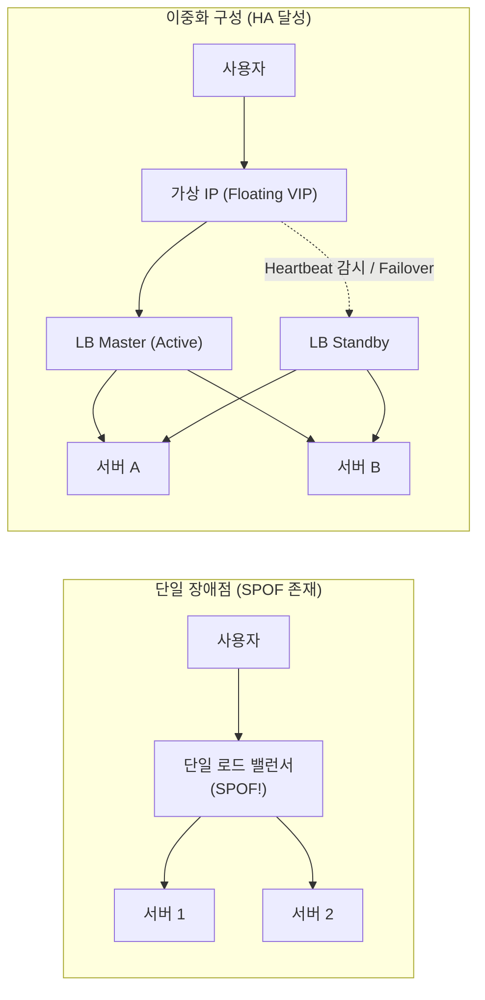

* **이중화(Redundancy)**: 시스템의 모든 핵심 계층(DNS, 방화벽, L4 스위치, API Gateway, WAS, Database, 스토리지, 전원 공급 장치)에 예비 자원을 2벌 이상 배치하여 하나의 노드가 파괴되어도 시스템 전체의 연속성을 유지하는 기술입니다.

---

### 7.2 고가용성 클러스터링 모델: Active-Active vs Active-Standby

#### 1. Active-Active (액티브-액티브)
* **동작 방식**: 이중화된 2개 이상의 노드가 **모두 동시에 가동**되며, 로드 밸런서에 의해 실제 트래픽을 분산 처리합니다.
* **장점**: 모든 인프라 자원을 100% 활용하므로 처리량이 극대화되며, 평소에도 투자 비용 대비 높은 효율을 냅니다.
* **고려 사항**: 두 노드 간의 실시간 데이터 동기화와 세션 정합성을 유지해야 하므로 구현 복잡도가 높습니다.

#### 2. Active-Standby (액티브-스탠바이 / Failover 모델)
* **동작 방식**: 1대의 노드만 실제 트래픽을 처리(Active)하고, 다른 1대의 예비 노드는 평소에 대기(Standby) 상태를 유지합니다.
* **페일오버(Failover)**: Active 노드가 두 노드 간에 주고받는 하트비트(Heartbeat, 생존 신호)를 보내지 못하면, 감시 에이전트(Keepalived 등)가 Active의 사망을 선언하고 가상 IP(VIP)를 즉시 Standby 노드로 전환(Takeover)합니다.
* **Standby의 세 가지 형태**:
  * **Hot Standby**: 전원이 켜져 있고 DB 복제(Replication)가 실시간으로 돌고 있어 수 초 내에 즉시 승격 가능한 상태.
  * **Warm Standby**: 시스템은 준비되어 있으나 트래픽을 받기까지 일부 초기화 작업(캐시 워밍 등)이 필요한 상태.
  * **Cold Standby**: 평소엔 꺼져 있다가 장애 시 수동으로 전원을 켜고 백업본을 복원하는 상태 (복구 시간 수 시간 소요).
* **스플릿 브레인(Split-Brain) 문제**: 두 노드 간의 네트워크 회선만 끊어지고 노드는 둘 다 살아있을 때, 서로 상대방이 죽었다고 판단하여 양쪽 모두 자신이 Active라고 주장하며 데이터를 독자 수정하여 데이터가 영구 파괴되는 현상입니다. 이를 방지하기 위해 정족수(Quorum, 홀수 노드 투표)나 펜싱(Fencing / STONITH) 메커니즘을 반드시 적용해야 합니다.

---

### 7.3 현대 3대 무중단 배포(Zero-Downtime Deployment) 전략

소프트웨어 신규 버전을 배포할 때 사용자의 요청을 단 한 건도 유실하지 않고 자연스럽게 최신 코드로 갈아타는 배포 아키텍처입니다.

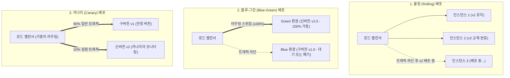

#### 1. 롤링(Rolling) 배포
* **동작 원리**: 로드 밸런서의 연결을 하나씩 끊어가며 서버 인스턴스를 한 대씩 순차적으로 새 버전으로 교체합니다.
* **장점**: 추가적인 하드웨어 인프라 비용이 거의 들지 않습니다.
* **단점**:
  * 배포가 진행되는 동안 구버전(v1)과 신버전(v2) 서버가 동시에 트래픽을 처리하므로 **버전 호환성 문제(Backward Compatibility)**가 발생할 수 있습니다 (DB 스키마가 바뀌었을 때 치명적).
  * 롤백을 하려면 다시 한 대씩 순차적으로 다운그레이드해야 하므로 롤백 속도가 느립니다.

#### 2. 블루-그린(Blue-Green) 배포
* **동작 원리**: 구버전 환경(Blue)과 똑같은 크기의 신버전 환경(Green)을 100% 동일하게 완전히 새롭게 구축합니다. Green에 대한 모든 테스트가 끝나면 로드 밸런서의 가상 스위치를 단 1초 만에 Blue에서 Green으로 전환합니다.
* **장점**:
  * 구버전과 신버전이 공존하는 과도기가 전혀 없습니다.
  * 신버전에 치명적인 결함이 발견되면 스위치를 다시 Blue로 되돌리기만 하면 되므로 **롤백이 수 초 만에 즉각 완료**됩니다.
* **단점**: 배포 순간에 서버 인프라 자원이 2배로 소모되므로 비용이 많이 듭니다.

#### 3. 카나리(Canary) 배포
* **어원**: 과거 광부들이 유독가스에 민감한 카나리아 새를 먼저 갱도에 넣어 위험을 감지했던 관행에서 유래했습니다.
* **동작 원리**: 신버전을 전체에 배포하기 전에 소수의 서버(또는 전체 트래픽의 1% $\to$ 5% $\to$ 20%)에만 신버전을 흘려보냅니다. APM 모니터링을 통해 에러율과 레이턴시를 관찰한 뒤 안전성이 검증되면 점진적으로 100%까지 확대합니다.
* **장점**: 실제 프로덕션 환경에서 실제 사용자 트래픽으로 안전하게 A/B 테스팅 및 잠재적 버그를 검증할 수 있으며, 장애가 발생해도 소수의 사용자에게만 국한됩니다.
* **단점**: 가중치 기반 라우팅(L7 로드 밸런서, 서비스 메시) 설정이 정교해야 하며, 롤링과 마찬가지로 구/신버전 공존 기간에 대한 하위 호환성 처리가 필수적입니다.

#### 무중단 배포 전략 종합 비교표

| 비교 항목 | 롤링 (Rolling) | 블루-그린 (Blue-Green) | 카나리 (Canary) |
| :--- | :--- | :--- | :--- |
| **추가 인프라 비용** | 없음 또는 매우 적음 (1대분) | **매우 큼 (인프라 2배 필요)** | 적음 (일부 인스턴스만 신버전) |
| **롤백 소요 시간** | 느림 (역순차 재배포 필요) | **극도로 빠름 (스위치 즉각 전환)** | 빠름 (카나리 트래픽 즉시 차단) |
| **구/신버전 공존 여부**| **있음 (호환성 설계 필수)** | **없음 (완전 분리)** | **있음 (점진적 전환 기간)** |
| **실제 트래픽 사전 검증**| 불가 | 불가 (내부 테스트만 가능) | **가능 (실제 트래픽 위험 감지)** |
| **라우팅 제어 복잡도** | 단순 (헬스체크 기반 탈락) | 보통 (DNS 또는 VIP 스위칭) | **매우 높음 (가중치/헤더 라우팅)** |
| **추천 사용 환경** | 일반적인 웹 애플리케이션 | 엔터프라이즈 미션 크리티컬 시스템 | 초대규모 B2C 서비스, 리스크 높은 기능 |

---

## (+) API 게이트웨이(API Gateway)는 무엇인가요?
> **클라이언트 단일 진입점, 라우팅, 인증/인가, Rate Limiting, SSL 종단, 서비스 가상화, BFF(Backend For Frontend) 패턴**

마이크로서비스 아키텍처(MSA)나 다중 분산 서버 환경으로 넘어가면, 클라이언트(모바일 앱, 웹 브라우저)는 당혹스러운 상황에 빠집니다. 화면 하나를 그리기 위해 회원 서버, 주문 서버, 상품 서버, 리뷰 서버, 결제 서버 등 수십 개의 서로 다른 서버 IP와 포트를 일일이 호출해야 하기 때문입니다.  
이 문제를 해결하기 위해 시스템의 최전방에 배치하는 마법 같은 단일 관문이 바로 **API 게이트웨이(API Gateway)**입니다.

---

### 8.1 API Gateway 없는 구조의 참사 vs API Gateway 도입 후

```mermaid
flowchart LR
    subgraph WithoutGW["API Gateway가 없는 혼돈 (Direct Connection)"]
        Client1["모바일 앱"]
        Client1 --> S1["회원 서비스 (Port: 8081)"]
        Client1 --> S2["주문 서비스 (Port: 8082)"]
        Client1 --> S3["결제 서비스 (Port: 8083)"]
        Client1 --> S4["배송 서비스 (Port: 8084)"]
        Note over Client1: - 클라이언트 코드에 내부 IP 노출<br/>- N번의 SSL Handshake 오버헤드<br/>- 모든 마이크로서비스마다 인증 로직 중복 구현
    end

    subgraph WithGW["API Gateway를 통한 질서 (Single Entry Point)"]
        Client2["모바일 앱 / 웹"] == "https://api.mycompany.com" ==> APIGW["API GATEWAY\n[단일 진입점 & 공통 처리]"]
        APIGW --> MS1["회원 서비스"]
        APIGW --> MS2["주문 서비스"]
        APIGW --> MS3["결제 서비스"]
        APIGW --> MS4["배송 서비스"]
    end
```

---

### 8.2 API Gateway의 7대 핵심 기능

1. **단일 진입점(Single Entry Point)과 동적 역방향 프록시(Reverse Proxy Routing)**
   * 클라이언트는 오직 게이트웨이 도메인(`api.service.com`) 하나만 바라봅니다.
   * 게이트웨이는 요청 URI 경로(Path)를 분석하여 `/api/v1/users/**`는 회원 서비스로, `/api/v1/orders/**`는 주문 서비스로 트래픽을 똑똑하게 라우팅합니다.
2. **중앙 집중식 인증 및 인가 (Authentication & Authorization)**
   * 모든 마이크로서비스가 각자 JWT 토큰을 검증하고 공개키를 조회할 필요가 없습니다.
   * API Gateway 최전방에서 토큰의 유효성을 1차 검증하고, 유효한 요청이라면 토큰을 디코딩하여 내부 헤더(`X-User-Id: 1024`, `X-User-Role: ADMIN`)에 심어서 내부 마이크로서비스로 전달합니다.
3. **트래픽 제어 및 속도 제한 (Rate Limiting & Throttling)**
   * 악의적인 크롤러나 DDoS 공격, 비정상적인 버그로 인한 무한 루프 요청을 차단합니다.
   * **토큰 버킷(Token Bucket) 알고리즘**이나 **누출 버킷(Leaky Bucket)** 알고리즘을 사용하여 IP당 또는 유저당 *"1초에 최대 100회 요청까지만 허용"*하고 초과분은 `429 Too Many Requests`로 쳐냅니다.
4. **SSL/TLS 종단 (SSL Termination)**
   * 무거운 암호화/복호화 연산인 HTTPS 핸드셰이크를 게이트웨이에서 끝냅니다.
   * 게이트웨이와 내부 마이크로서비스 간의 통신은 안전한 사설 VPC망 내부에서 고속 HTTP/1.1이나 gRPC 평문 통신으로 처리하여 백엔드 WAS의 CPU 부담을 대폭 덜어줍니다.
5. **프로토콜 및 요청/응답 변환 (Protocol Translation)**
   * 외부 클라이언트와는 표준적인 RESTful JSON으로 통신하고, 내부 마이크로서비스들 간에는 초고속 바이너리 RPC인 **gRPC**나 **Protobuf**로 변환하여 중계할 수 있습니다.
6. **서킷 브레이커(Circuit Breaker) 연동 및 폴백(Fallback)**
   * 특정 다운스트림 마이크로서비스(예: 추천 엔진)가 완전히 다운되었을 때, 게이트웨이가 요청을 차단하고 미리 정의된 기본값(Default Best Seller 목록)을 즉시 반환(Fallback)하여 사용자가 에러 화면을 보지 않도록 보호합니다.
7. **중앙 로깅, 메트릭, 분산 추적 헤더 주입**
   * 유입되는 모든 패킷에 고유한 `X-Request-Id`와 `Trace-Id`를 발급하고, 접근 로그(Access Log)를 중앙에서 집계합니다.

---

### 8.3 BFF (Backend For Frontend) 패턴의 진화

서비스가 발전하면 클라이언트의 종류가 웹 브라우저(데스크톱), 스마트폰(iOS/Android 모바일 앱), 스마트 TV, 스마트 워치 등으로 다변화됩니다.
* 데스크톱 웹 화면은 해상도가 넓어 주문 목록과 함께 고객 프로필, 배송 추적, 추천 상품까지 한 번에 많은 데이터를 필요로 합니다.
* 반면 모바일 앱은 화면이 좁고 LTE/5G 무선 네트워크 대역폭과 배터리가 제한적이므로 핵심 필드 몇 개만 가볍게 내려주길 원합니다.

단 하나의 거대한 범용 API Gateway로 모든 클라이언트의 입맛을 맞추려다 보면 게이트웨이 코드가 누더기가 됩니다. 이를 해결하기 위해 등장한 아키텍처가 **BFF(Backend For Frontend)** 패턴입니다.

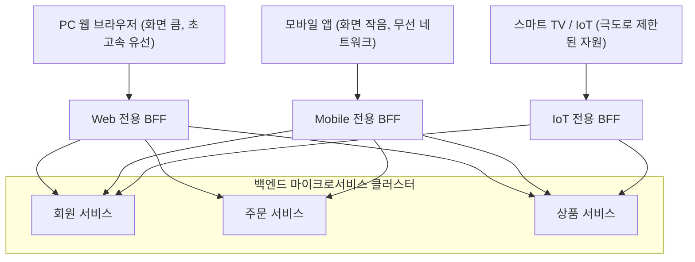

* **개념**: 프론트엔드의 각 클라이언트 유형(Web, Mobile, Third-Party API)에 1:1로 특화된 전용 게이트웨이를 따로 두는 방식입니다.
* **장점**: 
  * 모바일 프론트엔드 개발팀이 모바일 BFF의 API 스펙과 데이터 가공 로직을 직접 주도적으로 개발할 수 있습니다.
  * 불필요한 필드를 걸러내는 데이터 다이어트(Over-fetching 방지)와 여러 마이크로서비스 호출 결과를 단 한 번의 호출로 묶어주는 API 집합(Aggregation, Under-fetching 방지)을 클라이언트 최적화 수준으로 완벽하게 달성할 수 있습니다.

---

## (+) 서비스 장애가 발생하면 어떻게 대응해야 하나요?
> **장애 대응 라이프사이클: 모니터링/경보 감지 -> 장애 격리(서킷 브레이커) -> 긴급 복구(롤백/우회) -> 근본 원인 분석(RCA) 및 사후 검토(Post-mortem) 문화**

세계적인 분산 시스템의 거두 버너 보겔스(Werner Vogels, Amazon CTO)는 시스템을 구축하는 모든 엔지니어의 뇌리에 각인되어야 할 명언을 남겼습니다.

> *"모든 것은 항상 실패한다 (Everything fails, all the time)."*

하드웨어는 불시에 고장 나고, 네트워크 스위치는 패킷을 유실하며, 클라우드 가상 머신은 예고 없이 재부팅되고, 개발자는 실수로 버그를 배포합니다.  
성숙한 엔지니어링 조직과 아마추어 조직을 가르는 유일한 기준은 **"장애를 100% 안 낼 수 있는가?"**가 아니라, **"장애가 발생했을 때 얼마나 빠르고 우아하게 격리하고, 신속하게 복구하며, 똑같은 실수를 영원히 반복하지 않도록 시스템을 진화시키는가?"**에 있습니다.

---

### 9.1 장애 대응의 5단계 라이프사이클 (Incident Lifecycle)

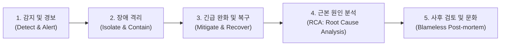

---

### 9.2 [1단계] 감지 및 경보 (Detect & Alert): 골든 시그널

장애가 났다는 사실을 고객이 고객센터(CS)에 전화해서 따질 때 알게 된다면 그 조직의 모니터링은 낙제점입니다. 시스템 이상은 발생 즉시 엔지니어에게 알람이 울려야 합니다.

Google SRE(Site Reliability Engineering)에서 정의한 **4대 골든 시그널(The Four Golden Signals)**:
1. **지연 시간 (Latency)**: 요청을 처리하는 데 걸리는 시간. 성공한 요청의 레이턴시뿐만 아니라 실패한 요청의 레이턴시도 추적해야 합니다.
2. **트래픽 (Traffic)**: 시스템에 가해지는 수요의 측정값 (초당 HTTP 요청 수, 초당 네트워크 I/O 전송량).
3. **오류율 (Errors)**: 명시적으로 실패한 요청의 비율 (HTTP 500 에러, 예외 발생 건수, 비즈니스 실패율).
4. **포화도 (Saturation)**: 시스템의 가장 제약이 심한 자원이 얼마나 꽉 찼는가를 나타내는 백분율 (CPU 사용률 90%, DB 커넥션 풀 98%, 메모리 잔여량).

> **경보 피로(Alert Fatigue) 방지**: 중요하지 않은 사소한 경고(Warning)로 온콜(On-Call) 엔지니어의 휴대폰을 새벽 내내 울려대면, 정작 서비스가 죽는 치명적인 P0(Sev-1) 장애 알람이 왔을 때 무시하게 됩니다. 즉각적인 조치가 필요한 실행 가능한(Actionable) 알람만 울리도록 정교하게 임계치를 튜닝해야 합니다.

---

### 9.3 [2단계] 장애 격리 (Isolate & Contain): 서킷 브레이커와 벌크헤드

어떤 한 서비스의 장애가 시스템 전체로 들불처럼 번져나가는 현상을 **카스케이드 장애(Cascading Failure, 연쇄 장애)**라고 합니다.
예를 들어 추천 서비스가 응답을 못 하고 지연되면, 주문 서버의 스레드가 추천 서버 응답을 기다리느라 하나씩 블로킹되고, 결국 주문 서버의 스레드 풀이 완전히 고갈되어 주문 전체가 멈춰버립니다.

이를 물리적으로 차단하기 위한 두 가지 핵심 패턴:

#### 1. 서킷 브레이커 (Circuit Breaker) 패턴
가정집 분전반의 두꺼비집(누전 차단기)과 똑같이 동작하는 소프트웨어 스위치입니다 (Resilience4j, Envoy 등).

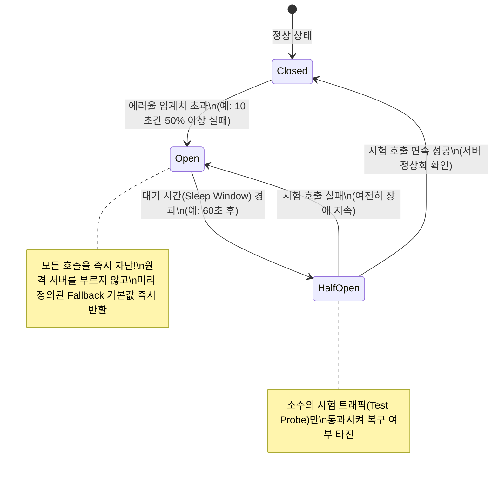

#### 2. 벌크헤드 (Bulkhead, 격벽) 패턴
선박의 선체 바닥에 구멍이 뚫려 물이 차오를 때 배 전체가 침몰하지 않도록 방을 여러 개의 격벽(Bulkhead)으로 쪼개어 놓는 설계입니다.  
애플리케이션에서도 중요한 결제용 스레드 풀과 상대적으로 덜 중요한 리뷰 조회용 스레드 풀을 완전히 분리해 둡니다. 리뷰 서비스가 마비되어 리뷰 스레드가 다 타버려도 결제 스레드는 단 1개도 영향을 받지 않습니다.

---

### 9.4 [3단계] 긴급 완화 및 복구 (Mitigate & Recover)

> **장애 대응 중 가장 중요한 원칙: "원인 분석(Debugging)은 나중에 하고, 일단 환자의 숨(서비스)부터 살려라!"**

장애가 터졌을 때 서버에 터미널을 띄우고 수십만 줄의 로그 파일을 열어 코드 디버깅을 시작하는 것은 최악의 대응입니다.  
엔지니어의 최우선 목표는 시스템을 어떻게든 정상 상태로 되돌리는 **완화(Mitigation)**입니다.
1. **코드 롤백 (Rollback)**: 방금 배포가 나간 직후 장애가 났다면 코드를 분석하지 말고 즉시 직전의 안정적인 버전으로 롤백합니다.
2. **피처 플래그(Feature Flag) 끄기**: 새로 오픈한 기능이 문제라면 설정 관리 대시보드에서 해당 기능의 토글 스위치를 끕니다.
3. **트래픽 우회 및 트래픽 드롭 (Shed Load)**: 중요도가 낮은 백그라운드 배치 작업, 정산 작업, 추천 API를 차단하고 핵심 기능(로그인, 결제)에만 자원을 몰아줍니다.
4. **스케일아웃 임시 강제 증설**: CPU나 메모리 병목이라면 비용을 따지지 말고 인스턴스 대수를 3배로 늘려 버퍼를 확보합니다.

---

### 9.5 [4단계 & 5단계] 근본 원인 분석(RCA)과 비난 없는 사후 검토(Blameless Post-mortem)

서비스가 정상화되었다면, 이제 차분하게 근본 원인을 파헤치고 시스템을 개선할 시간입니다.

#### 5 Whys 기법을 통한 심층 인과관계 추적
표면적인 원인에서 멈추지 않고 "왜?"를 최소 5번 물어 인간의 실수가 아닌 **시스템 프로세스의 결함**을 찾아냅니다.
* **Q1**: 왜 결제 서비스가 다운되었는가? $\to$ **A**: DB 커넥션 풀이 고갈되었습니다.
* **Q2**: 왜 DB 커넥션 풀이 고갈되었는가? $\to$ **A**: 특정 쿼리가 30초 이상 풀 테이블 스캔을 하며 락을 잡았습니다.
* **Q3**: 왜 풀 테이블 스캔이 발생했는가? $\to$ **A**: 새로 추가된 쿼리에 인덱스가 걸려있지 않았습니다.
* **Q4**: 왜 인덱스가 누락된 채 프로덕션에 배포되었는가? $\to$ **A**: 스테이징 DB는 데이터가 100건뿐이라 인덱스 없이도 0.01초 만에 테스트를 통과했습니다.
* **Q5**: 왜 실제 데이터와 유사한 볼륨의 성능 테스트 파이프라인이 없었는가? $\to$ **A**: CI/CD 파이프라인에 쿼리 성능 검증(Explain Plan) 자동화 게이트가 없었기 때문입니다.
* **도출된 진짜 액션 아이템**: "개발자 주의 주기"가 아니라, **"CI/CD 파이프라인에 풀 테이블 스캔 쿼리 탐지 린터 자동 추가 및 스테이징 환경 대용량 데이터 시뮬레이션 구축"**이라는 시스템적 방어책이 수립됩니다.

#### 비난 없는 사후 검토 (Blameless Post-mortem) 문화
구글, 넷플릭스 등 세계 최고의 테크 기업들이 가장 엄격하게 지키는 원칙은 **"사람을 비난하지 않는다(Blameless)"**입니다.
* *"김 대리가 잘못된 명령어를 입력해서 DB가 날아갔습니다"*는 잘못된 보고서입니다.
* *"신입 개발자가 단 하나의 CLI 명령어로 프로덕션 DB를 삭제할 수 있도록 방치한 인프라 안전장치(권한 제어, 2인 승인 시스템)의 부재가 원인입니다"*가 올바른 엔지니어링 접근입니다.
* 사람을 처벌하면 엔지니어들은 다음부터 실수를 숨기고 은폐하여 더 거대한 재앙을 낳습니다. 시스템의 취약점을 투명하게 공개하고, 이를 방어하는 코드와 자동화된 테스트를 작성할 때 시스템은 비로소 단단해집니다.

---

## PART 09 요약 및 아키텍트의 나침반

시스템 아키텍처의 세계에는 은총알이 없으며 오직 **트레이드오프(Trade-off)**만이 존재합니다.

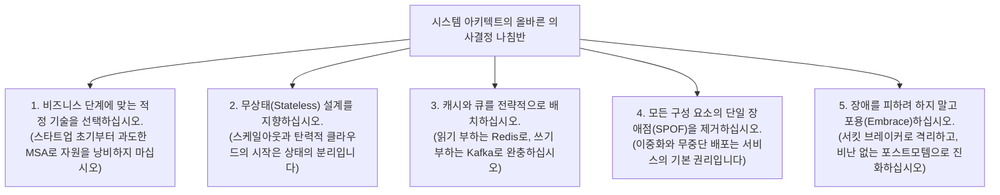

| 핵심 영역 | 주요 개념 | 아키텍처 핵심 설계 지침 |
| :--- | :--- | :--- |
| **티어(Tier) 분리** | 1-Tier $\to$ 2-Tier $\to$ 3-Tier | 화면, 연산, 저장을 물리적으로 격리하여 보안, 유지보수성, DBCP 효율성 극대화 |
| **비기능 요구사항** | 가용성, 확장성, 성능, 보안, 복구성 | 단순 기능 구현(WHAT)을 넘어 대규모 트래픽을 견뎌내는 품질 속성(HOW WELL) 사수 |
| **확장 전략** | Scale-up vs Scale-out | 하드웨어 교체의 한계를 넘어 무상태(Stateless) 설계를 통한 유연한 수평 확장 달성 |
| **분산 처리 비유** | 스타벅스 매장 운영 모델 | 캐셔(Gateway) - 바리스타(WAS) - 창고(DB) - 식수대(Cache) - 진동벨(Message Queue) |
| **캐시와 Redis** | In-Memory, Cache-Aside, Stampede | RAM 기반 초고속 데이터 접근, 분산 락과 TTL Jitter를 통한 Thundering Herd 방지 |
| **마이크로서비스** | Monolith vs MSA, SAGA, Tracing | 서비스별 독립 배포와 자율성을 획득하되, 분산 트랜잭션과 추적의 복잡성을 철저히 대비 |
| **고가용성 & 배포** | SPOF 제거, 롤링/블루그린/카나리 | Active-Active/Standby 이중화와 비즈니스 무중단을 보장하는 점진적 배포 전략 |
| **API 관문** | API Gateway & BFF 패턴 | 단일 진입점, 라우팅, 인증/인가, Rate Limiting 통합 및 프론트엔드별 맞춤형 API 제공 |
| **장애 대응 문화** | Golden Signals, 서킷 브레이커, RCA | 골든 시그널 기반 감지, 연쇄 장애 격리, 5 Whys와 비난 없는 사후 검토(Blameless) |
