# PART 10. 클라우드, 빅데이터, 인공지능 (Cloud, Big Data, and AI)

> **"소프트웨어가 세상을 집어삼키고 있다면, 클라우드는 그 소프트웨어가 뛰어노는 거대한 대지이며, 빅데이터는 대지를 비옥하게 만드는 원유이고, 인공지능은 그 위에서 스스로 사고하고 꽃을 피우는 두뇌입니다."**  
> 오늘날 현대 IT 엔지니어링은 더 이상 물리적인 서버의 볼트를 조이거나 단일 컴퓨터의 성능에 갇혀 있지 않습니다. 인터넷이라는 광활한 고속 통신망을 통해 지구 반대편의 슈퍼컴퓨터 수만 대를 초 단위로 부르고 해산하며, 매초 쏟아지는 수억 건의 데이터 스트림에서 보석 같은 비즈니스 통찰을 캐내고, 마침내 인간의 지적 노동을 보조하고 확장하는 생성형 AI(Generative AI)에 도달했습니다.  
> 
> 이 책의 마지막을 장식하는 이번 PART 10에서는 현대 디지털 문명을 지탱하는 세 가지 핵심 축인 **클라우드(Cloud)**, **빅데이터(Big Data)**, 그리고 **인공지능(AI/ML/LLM)**의 기술적 본질과 설계 원리를 가장 밑바닥 인프라부터 최첨단 인공지능 아키텍처까지 한 폭의 지도처럼 명쾌하게 펼쳐 보여드립니다.

---

## 01. 클라우드 컴퓨팅이란 무엇인가요?
> **온프레미스(자체 데이터센터)의 한계와 클라우드의 등장, 인터넷을 통해 IT 자원을 빌려 쓰는 온디맨드 모델**

우리가 매일 사용하는 스마트폰 앱, 온라인 뱅킹, 동영상 스트리밍 서비스의 뒷단에는 수많은 서버와 스토리지, 네트워크 장비가 24시간 365일 쉼 없이 돌아가고 있습니다. 불과 십수 년 전만 해도 이러한 IT 시스템을 운영하려면 회사가 직접 건물을 짓거나 임대하여 서버 컴퓨터를 구매해 꽂아 넣어야 했습니다. 

하지만 오늘날 스타트업부터 포춘 500대 글로벌 대기업에 이르기까지, 물리적인 서버를 직접 소유하는 대신 **클라우드(Cloud)**를 선택하고 있습니다. 클라우드 컴퓨팅이란 도대체 무엇이며, 왜 세상을 이토록 극적으로 바꾸어 놓았을까요?

---

### 1.1 온프레미스(On-Premises)의 황금기와 그 치명적인 한계

**온프레미스(On-Premises)**란 기업이 자체적으로 보유한 전산실이나 외부 IDC(Internet Data Center)의 물리적 공간(랙, Rack)을 임대하여, 서버 컴퓨터, 스위치, 라우터, 스토리지, 보안 장비 등을 직접 구매하고 설치하여 운영하는 전통적인 인프라 구축 방식을 의미합니다.

과거 온프레미스 환경에서 새로운 서비스를 론칭하려면 다음과 같은 고통스러운 과정을 거쳐야만 했습니다.

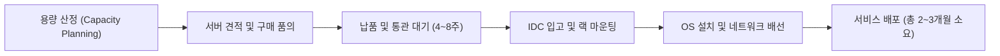

이러한 온프레미스 방식은 인프라를 완전히 통제할 수 있다는 장점이 있었지만, 다음과 같은 치명적인 한계를 안고 있었습니다.

1. **용량 산정(Capacity Planning)의 딜레마:**
   - 서비스 오픈 전에는 미래의 트래픽을 정확히 예측하기가 불가능합니다.
   - **과잉 투자(Over-provisioning):** 블랙프라이데이나 수강신청 등 1년에 며칠 되지 않는 피크(Peak) 트래픽에 맞춰 수억 원어치 서버를 사두면, 평상시에는 하드웨어의 90%가 유휴 상태(놀고 있는 상태)로 방치되어 막대한 자본이 낭비됩니다.
   - **과소 투자(Under-provisioning):** 반대로 예산을 아끼려 서버를 적게 샀다가 마케팅 대박이나 바이럴로 사용자가 폭증하면 서버가 즉각 다운되어 비즈니스 기회를 통째로 날려버립니다.
2. **느린 시장 대응 속도(Long Lead Time):**
   - 서버 증설이 필요해도 주문부터 세관 통관, IDC 입고, OS 설치, 케이블 연결까지 최소 수 주에서 수개월이 걸립니다. 변화무쌍한 현대 비즈니스 환경에서 이는 치명적인 약점입니다.
3. **가혹한 유지보수 부담과 단일 장애점(SPOF):**
   - 하드디스크 배드섹터 발생, 파워서플라이 고장, 냉방기(항온항습기) 고장, 무정전 전원장치(UPS) 배터리 폭발 등 하드웨어 장애가 일어날 때마다 엔지니어가 새벽에 IDC로 달려가 물리적 부품을 교체해야 했습니다.

---

### 1.2 클라우드 컴퓨팅(Cloud Computing)의 본질: 온디맨드 IT 유틸리티

**클라우드 컴퓨팅**은 이러한 물리적 제약을 일순간에 허물어뜨렸습니다. 

> **클라우드 컴퓨팅의 정의**  
> IT 자원(컴퓨팅 파워, 스토리지, 데이터베이스, 네트워킹 등)을 직접 소유하거나 물리적으로 관리할 필요 없이, **인터넷을 통해 언제 어디서나 필요한 만큼 주문형(On-demand)으로 빌려 쓰고, 사용한 만큼만 비용을 지불(Pay-as-you-go)하는 컴퓨팅 패러다임**입니다.

이것은 우리가 전기를 사용하는 방식과 완벽히 일치합니다. 집에서 냉장고나 에어컨을 켜기 위해 마당에 직접 화력 발전소나 풍력 발전기를 짓는 사람은 없습니다. 한국전력 같은 발전 사업자가 구축해 둔 거대한 전력망에서 콘센트 플러그를 꽂아 전기를 끌어 쓰고, 월말에 계량기에 찍힌 kw/h 단위만큼 요금을 냅니다. 클라우드는 **"IT 인프라의 전기화(Utility Computing)"**인 셈입니다.

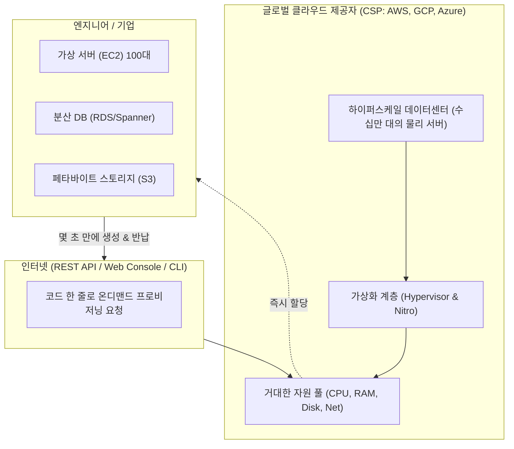

#### 미국 국립표준기술원(NIST)이 정의한 클라우드의 5대 핵심 특성
1. **주문형 셀프 서비스 (On-demand Self-service):** 사람이 승인해 줄 때까지 기다릴 필요 없이, 엔지니어가 웹 콘솔 클릭이나 API 호출 한 번으로 즉시 인프라를 프로비저닝합니다.
2. **광범위한 네트워크 접근성 (Broad Network Access):** 특정 사내망에 얽매이지 않고 표준 인터넷 프로토콜을 통해 전 세계 어디서든 모바일, PC 등 다양한 단말기로 접근할 수 있습니다.
3. **자원 풀링 및 멀티 테넌시 (Resource Pooling & Multi-tenancy):** 여러 고객이 하나의 거대한 물리적 하드웨어 풀을 가상화 기술로 안전하게 격리된 상태에서 공유하여 효율을 극대화합니다.
4. **신속한 탄력성 (Rapid Elasticity):** 트래픽이 몰리면 서버가 순식간에 수천 대로 불어나고, 트래픽이 빠지면 즉시 사라져 비용을 최소화합니다.
5. **측정 가능한 서비스 (Measured Service):** CPU 사용 시간, 네트워크 아웃바운드 대역폭, 스토리지 저장 용량 등이 초(second) 또는 밀리초(ms) 단위로 투명하게 계측되어 청구됩니다.

---

### 1.3 인프라 관리 철학의 전환: 애완동물(Pets)에서 가축(Cattle)으로

클라우드 컴퓨팅이 도래하면서 시스템 엔지니어들이 인프라를 바라보는 철학 자체가 근본적으로 바뀌었습니다. 바로 업계의 유명한 비유인 **'Pets vs Cattle'** 패러다임입니다.

| 구분 | 전통적 온프레미스 방식: 애완동물 (Pets) | 현대적 클라우드 방식: 가축 (Cattle) |
| :--- | :--- | :--- |
| **명명 방식** | `zeus`, `hera`, `poseidon` 등 서버마다 고유 이름을 붙임 | `prod-web-asg-i-0a1b2c3d` 등 식별 번호로 무작위 부여 |
| **서버 고장 시** | 서버가 아프면 밤새워 간호하고 부품을 갈아 끼우며 고침 | 서버에 문제가 생기면 즉시 폐기(Terminate)하고 새 인스턴스로 교체 |
| **설정 방식** | 엔지니어가 직접 SSH 접속하여 일일이 손으로 설정(Snowflake Server) | 코드로 인프라를 정의(IaC)하여 동일한 서버를 수천 대 복제 |
| **규모 확장** | 수십 대 이상의 서버를 일일이 관리하기 벅참 | 수천, 수만 대의 서버를 오토스케일링 그룹으로 한꺼번에 제어 |

클라우드 환경에서는 어떤 서버도 특별 대우를 받지 않습니다. 언제든 고장 날 수 있음을 전제로 아키텍처를 설계하며(Design for Failure), 언제든 교체 가능한 소모품으로 취급합니다.

---

## 02. 클라우드 컴퓨팅이 대세가 된 이유
> **CAPEX(자본 지출)에서 OPEX(운영 지출)로의 전환, 빠른 출시 속도(Time-to-Market), 글로벌 확장성, 탄력적 오토스케일링**

전 세계 수많은 스타트업, 금융기관, 정부 부처가 앞다투어 클라우드로 인프라를 이전(Cloud Migration)한 데에는 기술적 우수성을 뛰어넘는 강력한 비즈니스 및 재무적 이유가 존재합니다.

---

### 2.1 CAPEX(자본 지출)에서 OPEX(운영 지출)로의 재무적 혁신

기업 회계와 재무 관점에서 인프라 비용을 처리하는 방식이 완전히 바뀌었습니다.

```
[온프레미스 (CAPEX 중심)]
 초기에 수십억 원 일시 지출 (하드웨어 구매, IDC 구축)
 ───> 5년간 매년 감가상각 ───> 사업 실패 시 막대한 '매몰 비용(Sunk Cost)' 발생!

[클라우드 (OPEX 중심)]
 초기 비용 0원
 ───> 매달 쓴 만큼만 수도세/전기세처럼 경비 처리 (비용 유연성) ───> 실패 시 즉시 해지 가능!
```

- **CAPEX (Capital Expenditure, 자본 지출):** 건물, 토지, 대규모 기계 장비처럼 미래 이윤 창출을 위해 초기에 거액을 일시불로 투자하는 지출입니다. 한번 구입하면 감가상각 기간(보통 3~5년) 동안 자산으로 묶이며, 사업 아이템이 실패하더라도 하드웨어는 중고 처분조차 어려워 치명적인 매몰 비용이 됩니다.
- **OPEX (Operational Expenditure, 운영 지출):** 제품이나 서비스를 일상적으로 운영하면서 발생하는 경상 비용(전기료, 사무실 임대료, 클라우드 이용료 등)입니다. 수익 창출 활동에 즉각 대응하여 비용을 늘리거나 줄일 수 있으며, 전액 당해 연도 세무상 비용으로 공제받을 수 있습니다.

> **스타트업 혁명의 일등공신**  
> 과거에는 참신한 아이디어가 있어도 서버를 살 돈(수천만~수억 원)이 없어 창업 문턱이 높았습니다. 하지만 클라우드 덕분에 오늘날의 창업팀은 단돈 몇만 원, 커피 몇 잔 값으로 AWS나 GCP에서 최신 사양의 인프라를 임대하여 글로벌 서비스를 론칭할 수 있게 되었습니다.

---

### 2.2 압도적인 시장 출시 속도 (Time-to-Market)와 기민성 (Agility)

비즈니스의 승패는 "누가 더 좋은 아이디어를 빠르게 시장에 선보이고 고객의 반응을 검증하느냐"에 달려 있습니다.

- **온프레미스:** 아이디어 기획부터 서버 발주, 통관, 설치까지 최소 **2~3개월**이 소요됩니다. 인프라를 준비하는 사이에 경쟁자가 먼저 유사한 서비스를 출시해 버립니다.
- **클라우드:** 테라폼(Terraform) 같은 코드로 인프라를 정의(IaC)해 두면, 단 **5분** 만에 운영 가능한 풀스택 인프라가 배포됩니다. 가설이 맞지 않으면 10분 만에 인프라를 삭제해 비용 발생을 0으로 되돌립니다. 실패에 따르는 비용이 극단적으로 낮아지므로 기업은 마음껏 혁신적인 실험을 시도할 수 있습니다.

---

### 2.3 국경 없는 글로벌 확장성 (Global Scalability)

만약 한국의 게임 개발사가 북미와 유럽, 일본 시장에 동시에 게임을 론칭하려 한다면 어떻게 해야 할까요? 온프레미스 방식이라면 각 대륙의 현지 IDC를 물색하고, 현지 네트워크 엔지니어를 고용하며, 해저 광케이블 회선을 계약하느라 1년이 넘는 시간과 천문학적인 비용이 소모될 것입니다.

클라우드 제공자(CSP)는 이미 전 세계에 초고속 사설 광케이블망으로 연결된 수십 개의 **리전(Region)**과 수백 개의 **엣지 로케이션(Edge Location)**을 구축해 두었습니다.

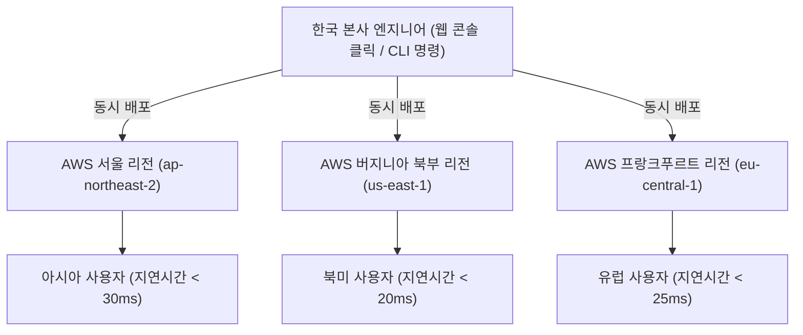

엔지니어는 서울 사무실에 앉아 마우스 클릭 몇 번으로 미국 동부, 유럽, 동남아시아에 동일한 아키텍처의 서버 수백 대를 즉시 가동시킬 수 있습니다. 전 세계 사용자에게 빛의 속도에 가까운 초저지연(Low Latency) 사용자 경험을 즉각 제공하는 것입니다.

---

### 2.4 수요에 실시간으로 반응하는 탄력적 오토스케일링 (Elastic Auto Scaling)

전통적인 시스템 증설 방식인 **스케일 업(Scale-up, 수직 확장)**은 서버에 더 비싼 CPU와 더 많은 RAM을 꽂는 방식입니다. 하지만 아무리 돈을 들여도 단일 머신이 감당할 수 있는 물리적 한계선에 부딪히며, 부품을 교체하는 동안 반드시 시스템 다운타임이 발생합니다.

반면 클라우드는 **스케일 아웃(Scale-out, 수평 확장)**을 기본 철학으로 삼습니다. 똑같은 가상 서버를 옆으로 여러 대 늘리는 방식입니다.

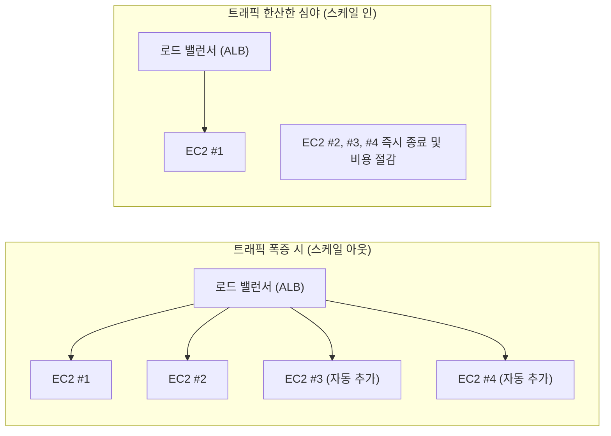

오토스케일링(Auto Scaling) 메커니즘은 CPU 사용률, 네트워크 대역폭, 또는 대기 큐의 요청 수와 같은 메트릭을 실시간으로 감시합니다.
1. 평일 오전 9시, 출근길 사용자가 폭증하여 CPU 사용률이 70%를 넘으면 즉시 새 서버 10대를 자동으로 띄우고 로드 밸런서에 연결합니다.
2. 밤 12시가 지나 트래픽이 평소의 10%로 줄어들면, 잉여 서버 9대를 자동으로 폐기(Scale-in)하여 불필요한 과금을 1초 단위로 차단합니다.

#### 온프레미스 vs 클라우드 종합 비교 요약
| 비교 항목 | 온프레미스 (On-Premises) | 클라우드 컴퓨팅 (Cloud) |
| :--- | :--- | :--- |
| **비용 모델** | CAPEX (초기 대규모 자본 지출) | OPEX (사용한 만큼 내는 운영 비용) |
| **자원 조달 기간** | 수 주 ~ 수개월 (구매, 배송, 설치) | 수 초 ~ 수 분 (API 호출 즉시 생성) |
| **인프라 확장성** | 스케일 업 위주, 물리적 한계 명확 | 무한에 가까운 탄력적 스케일 아웃 |
| **글로벌 진출** | 현지 데이터센터 섭외에 1년 이상 소요 | 클릭 한 번으로 글로벌 리전 즉시 배포 |
| **장애 대응** | 엔지니어 현장 출동 및 부품 교체 | 가용 영역(AZ) 다중화 및 자동 페일오버 |
| **보안 및 규제** | 방화벽, IDC 물리 보안을 자체 구축 | CSP의 글로벌 최고 수준 보안 인증 상속 |

---

## 03. AWS 클라우드는 실제로 어떤 서비스들로 구성되나요?
> **컴퓨팅(EC2), 스토리지(S3), 관계형DB(RDS), 가상네트워크(VPC), 접근제어(IAM), 모니터링(CloudWatch) 등 필수 서비스 맵과 연계 구조**

전 세계 클라우드 시장 점유율 1위인 **AWS(Amazon Web Services)**는 200개가 넘는 방대한 서비스를 제공합니다. 하지만 실무에서 웹 애플리케이션과 엔터프라이즈 시스템을 지탱하는 핵심 뼈대는 다음 **6대 기본 서비스**로 수렴됩니다.

---

### 3.1 AWS의 기반: 글로벌 인프라스트럭처 (Region & AZ)

AWS의 개별 서비스를 이해하기 전에, 전 세계에 깔려 있는 물리적 인프라 단위를 알아야 합니다.

```
[AWS 글로벌 인프라 계층 구조]
 리전 (Region, 예: 서울 ap-northeast-2)
  ├── 가용 영역 A (AZ-a: 물리적으로 떨어진 1개 이상의 IDC 군집)
  ├── 가용 영역 B (AZ-b: 지진/화재/정전 격리, 초고속 전용 광케이블 연결)
  ├── 가용 영역 C (AZ-c)
  └── 가용 영역 D (AZ-d)
```

- **리전 (Region):** 전 세계 주요 거점 도시(서울, 도쿄, 버지니아, 프랑크푸르트 등)에 위치한 독립된 지리적 영역입니다.
- **가용 영역 (AZ, Availability Zone):** 하나의 리전 안에 존재하는 **완전히 격리된 데이터센터(IDC) 군집**입니다. 각 AZ는 홍수, 지진, 정전 등의 재난이 동시에 영향을 주지 않도록 수십 킬로미터 이상 물리적으로 떨어져 있으며, AZ 간에는 자체 초고속 전용 광케이블로 연결되어 있어 1~2ms 이하의 초저지연 통신이 가능합니다. 엔지니어는 시스템을 최소 2개 이상의 AZ에 분산 배치하여 **고가용성(High Availability, HA)**을 달성합니다.

---

### 3.2 백엔드 및 인프라 엔지니어가 매일 다루는 6대 핵심 서비스

```mermaid
mindmap
  root((AWS 핵심 서비스))
    네트워크
      Amazon VPC
        서브넷 (Public / Private)
        인터넷 게이트웨이 (IGW)
        보안 그룹 (Security Group)
    컴퓨팅
      Amazon EC2
        가상 서버 인스턴스
        Auto Scaling Group
    스토리지
      Amazon S3
        오브젝트 스토리지 (99.999999999% 내구성)
        버킷 및 정적 웹 호스팅
    데이터베이스
      Amazon RDS
        관리형 RDBMS (MySQL, PostgreSQL)
        Multi-AZ 복제 및 Read Replica
    보안 / 권한
      AWS IAM
        최소 권한의 원칙
        User, Group, Role, Policy
    관제 / 모니터링
      Amazon CloudWatch
        메트릭 수집, 로그 관리
        경보 (Alarm) & 자동 조치
```

#### 1. 컴퓨팅: Amazon EC2 (Elastic Compute Cloud)
- **개념:** 클라우드 상에서 구동되는 크기 조정이 가능한 가상 서버(Virtual Machine)입니다.
- **특징:** 필요한 OS(리눅스, 윈도우), CPU 코어 수, RAM 용량, GPU 유무에 따라 수백 가지의 **인스턴스 타입**(예: `t4g.micro`, `c6i.xlarge`, `p4d.24xlarge`)을 자유롭게 선택할 수 있습니다.
- **AMI (Amazon Machine Image):** OS와 기본 소프트웨어가 미리 구워진 황금 템플릿(Golden Template)으로, 언제든 동일한 상태의 서버를 무한 복제할 수 있습니다.

#### 2. 스토리지: Amazon S3 (Simple Storage Service)
- **개념:** 인터넷 어디서나 웹 표준 프로토콜(HTTP/HTTPS)로 데이터를 저장하고 꺼내올 수 있는 고확장성 **오브젝트 스토리지(Object Storage)**입니다.
- **경이로운 내구성:** 연간 **99.999999999%(11 9s)**의 데이터 내구성을 자랑합니다. 1,000만 개의 객체를 보관했을 때 10,000년에 단 1개의 파일이 손상될까 말까 한 신뢰도입니다.
- **버킷(Bucket)과 객체(Object):** 계층형 폴더 구조가 아닌 플랫(Flat)한 네임스페이스 구조이며, 이미지, 동영상 백업, 로그 파일, 정적 웹사이트 호스팅에 표준으로 사용됩니다.

#### 3. 관리형 관계형 데이터베이스: Amazon RDS (Relational Database Service)
- **개념:** MySQL, PostgreSQL, MariaDB, Oracle, SQL Server 등을 클라우드에서 손쉽게 설치, 운영, 확장할 수 있도록 돕는 완전관리형 DB 서비스입니다.
- **자동화된 유지보수:** OS 패치, 백업 생성, 시점 복구(Point-in-Time Recovery), 장애 조치(Failover)를 AWS가 알아서 처리합니다.
- **Multi-AZ 기능:** 메인 DB(Primary)의 데이터를 다른 AZ에 있는 대기 DB(Standby)로 동기식 실시간 복제합니다. 메인 IDC에 불이 나더라도 1~2분 안에 대기 DB가 자동으로 메인으로 승격되어 무중단 서비스를 유지합니다.

#### 4. 격리된 가상 네트워크: Amazon VPC (Virtual Private Cloud)
- **개념:** 사용자 전용의 논리적으로 완벽히 격리된 가상 사설 네트워크 공간입니다.
- **서브넷(Subnet) 분리:**
  - **퍼블릭 서브넷(Public Subnet):** 인터넷 게이트웨이(IGW)와 연결되어 외부 인터넷 사용자가 직접 접속할 수 있는 영역 (웹 서버, 로드 밸런서 배치).
  - **프라이빗 서브넷(Private Subnet):** 외부 인터넷과 완전히 단절된 안전한 내부 영역 (데이터베이스, 결제 엔진 등 핵심 백엔드 배치).
- **보안 그룹 (Security Group):** 인스턴스 가상 방화벽으로, 포트(Port)와 IP 대역 기반으로 인바운드/아웃바운드 트래픽을 허용(White-list)합니다.

#### 5. 신원 및 접근 관리: AWS IAM (Identity and Access Management)
- **개념:** AWS 내의 모든 리소스에 대한 접근 권한을 세밀하게 제어하는 관문입니다.
- **최소 권한의 원칙(Principle of Least Privilege):** 업무를 수행하는 데 꼭 필요한 최소한의 권한만 부여해야 안전합니다.
- **핵심 구성요소:**
  - **User / Group:** 사람 개발자 및 팀에 부여하는 영구 자격증명.
  - **Role (역할):** 사람이 아닌 **EC2 서버나 람다 함수 같은 AWS 리소스에 임시 권한을 위임**할 때 사용합니다. (하드코딩된 API Key 유출 사고를 방지하는 핵심 보안 장치).
  - **Policy (정책):** "S3의 특정 버킷에서 읽기만 허용한다"와 같이 JSON 문서 형태로 작성하는 권한 규칙.

#### 6. 통합 관제 및 로깅: Amazon CloudWatch
- **개념:** AWS 리소스와 애플리케이션의 상태를 실시간으로 모니터링하는 눈과 귀입니다.
- **기능:** EC2의 CPU 사용률, 디스크 I/O, 네트워크 트래픽 등 기본 메트릭을 수집하고, 애플리케이션 로그(CloudWatch Logs)를 중앙 집중 저장합니다.
- **경보(Alarm)와 액션:** "CPU 사용률이 3분 연속 80%를 넘으면 오토스케일링을 트리거하여 서버를 2대 더 늘리고, 담당 엔지니어 슬랙(Slack)으로 비상 알림을 쏴라"와 같은 자동화 파이프라인을 구축합니다.

---

### 3.3 프로덕션 엔터프라이즈 3-Tier 아키텍처 연계 구조

이 6가지 서비스는 따로 노는 것이 아니라, 현실 세계의 웹 애플리케이션에서 다음과 같이 아름다운 유기적 연계망을 이룹니다.

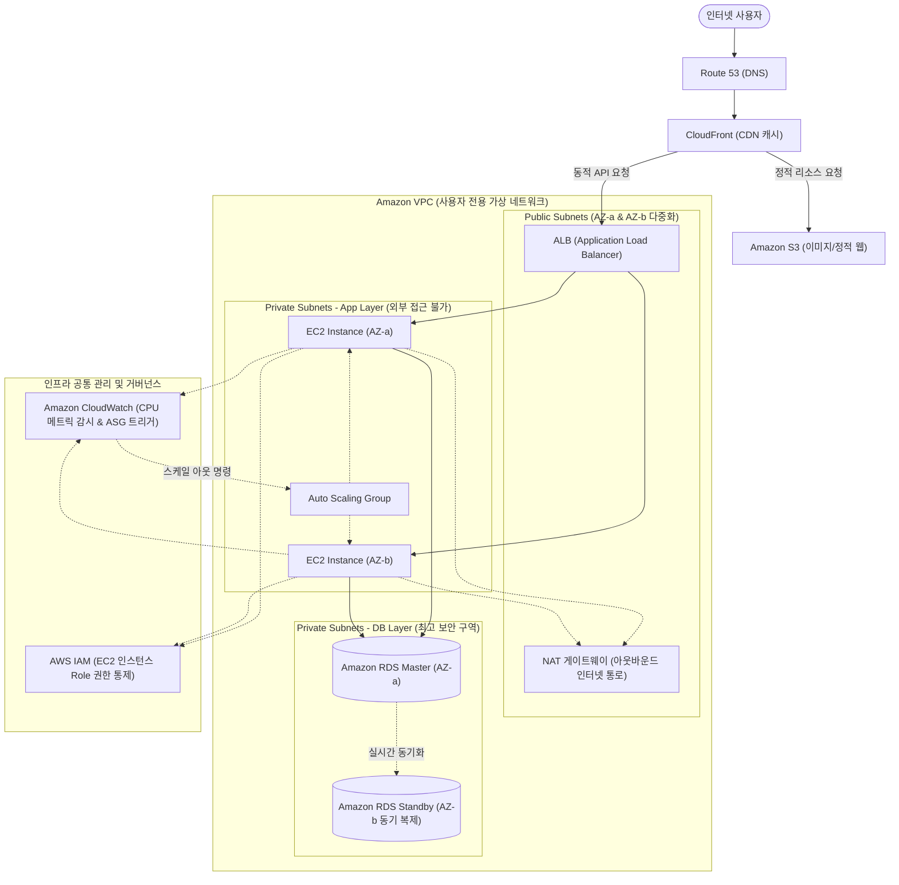

이 구조는 외부 공격자로부터 데이터베이스를 완벽히 격리(Private Subnet)하면서도, 트래픽 폭증에 유연하게 대응(ALB + EC2 ASG)하고, 재난 상황에서도 서비스가 멈추지 않는(Multi-AZ RDS) 현대 클라우드 아키텍처의 교과서적인 모범 사례(Best Practice)입니다.

---

## 04. 클라우드 서비스의 종류는 무엇인가요? IaaS, PaaS, SaaS
> **Pizza as a Service 비유, 책임 공유 모델(Shared Responsibility), 인프라 대여(IaaS), 플랫폼 대여(PaaS), 완제품 소프트웨어(SaaS) 비교 분석표**

클라우드를 처음 접할 때 가장 헷갈리는 약어들이 바로 **IaaS, PaaS, SaaS**입니다. 이들은 클라우드 벤더가 인프라 스택의 "어디서부터 어디까지를 대신 관리해 주느냐"에 따른 서비스 추상화(Abstraction) 수준의 분류입니다.

---

### 4.1 '피자 서비스 모델 (Pizza as a Service)' 비유로 한눈에 정복하기

엔지니어링 업계에서 가장 유명한 알버트 바론(Albert Barron)의 **'피자 비유(Pizza as a Service)'**를 통해 이 세 가지 모델을 직관적으로 이해해 보겠습니다.

```
[피자를 먹는 4가지 방식]
1. Traditional On-Premises (집에서 피자 만들기):
   도우 반죽, 토핑, 피자 소스, 가스렌지/오븐, 전기/가스, 식탁, 음료수까지 모든 것을 본인이 준비합니다.

2. IaaS (Take and Bake / 냉동 피자 포장):
   가게에서 도우, 소스, 토핑이 올려진 조리 전 피자를 사옵니다. 가스렌지/오븐과 식탁, 음료는 본인 것을 씁니다.

3. PaaS (피자 배달 주문):
   가게에서 완성된 따뜻한 피자를 집 문앞까지 배달해 줍니다. 당신은 집 식탁에 앉아 음료수만 따라 마시면 됩니다.

4. SaaS (피자 레스토랑 외식):
   피자 전문점에 걸어 들어가 주문하고 포크와 나이프를 들고 먹기만 하면 됩니다. 조리, 설거지, 서빙 모두 식당이 합니다.
```

---

### 4.2 IaaS, PaaS, SaaS의 기술적 정의와 실전 사례

```mermaid
flowchart TD
    subgraph IaaS["IaaS (Infrastructure as a Service)"]
        direction TB
        I_Manage["내가 관리: OS, 런타임, 미들웨어, 앱, 데이터"]
        I_Vendor["벤더가 관리: 서버 하드웨어, 스토리지, 가상화, 네트워크"]
        I_Ex["대표: AWS EC2, GCP GCE, Azure VM"]
    end

    subgraph PaaS["PaaS (Platform as a Service)"]
        direction TB
        P_Manage["내가 관리: 소스코드 애플리케이션, 데이터"]
        P_Vendor["벤더가 관리: OS 패치, 런타임 튜닝, 오토스케일링, 인프라 전체"]
        P_Ex["대표: Elastic Beanstalk, Heroku, Vercel, App Engine"]
    end

    subgraph SaaS["SaaS (Software as a Service)"]
        direction TB
        S_Manage["내가 관리: 웹 브라우저 접속, 계정 로그인, 데이터 활용"]
        S_Vendor["벤더가 관리: 코드, 서버, 인프라, 보안, 패치, 기능 업데이트 100%"]
        S_Ex["대표: Gmail, Google Docs, Notion, Slack, Salesforce"]
    end
```

#### 1. IaaS (Infrastructure as a Service, 서비스형 인프라)
- **개념:** 가상화된 순수 하드웨어 자원(컴퓨팅, 스토리지, 네트워킹)만을 빌려주는 모델입니다.
- **특징:** 빈 방을 빌리는 것과 같습니다. OS 설치(Ubuntu, RedHat, Windows), 웹 서버(Nginx, Apache) 세팅, 런타임(Java, Python, Node.js) 설치, 보안 방화벽 설정까지 사용자가 완벽한 제어권(Full Control)을 가집니다.
- **적합 대상:** 시스템 환경에 대한 극도로 세밀한 튜닝이 필요하거나, 레거시 시스템을 그대로 클라우드로 옮겨오는(Lift-and-Shift) 엔터프라이즈 기업.

#### 2. PaaS (Platform as a Service, 서비스형 플랫폼)
- **개념:** 개발자가 복잡한 하부 인프라(OS, 네트워크, 서버 패치 등)를 일체 신경 쓰지 않고, 오직 **애플리케이션 소스코드와 비즈니스 로직에만 집중**할 수 있도록 런타임 플랫폼 전체를 빌려주는 모델입니다.
- **특징:** 개발자가 `git push` 명령을 날리거나 빌드된 JAR 파일을 업로드하면, 플랫폼이 알아서 컨테이너를 띄우고, 로드 밸런서를 붙이며, 트래픽에 맞춰 오토스케일링을 수행합니다. OS 버전 업데이트나 보안 패치도 벤더가 대신합니다.
- **적합 대상:** 인프라 전담 엔지니어가 부족한 초기 스타트업이나, 빠른 프로토타입 및 MVP(최소 기능 제품) 개발이 필요한 개발팀.

#### 3. SaaS (Software as a Service, 서비스형 소프트웨어)
- **개념:** 클라우드 인프라 위에서 구동되는 완제품 형태의 소프트웨어를 사용자가 별도의 설치 없이 웹 브라우저나 모바일 앱을 통해 구독형으로 사용하는 모델입니다.
- **특징:** 사용자는 서버가 어디서 어떻게 돌아가는지 전혀 알 필요가 없습니다. 소프트웨어의 버그 수정, 대규모 기능 릴리스, 데이터 백업이 클라우드 뒷단에서 투명하게 이루어집니다.
- **적합 대상:** 일반 소비자 및 기업의 업무 생산성 도구 (협업 툴, CRM, 메일 서비스 등).

---

### 4.3 보안의 황금률: 책임 공유 모델 (Shared Responsibility Model)

클라우드를 사용할 때 가장 많은 오해가 일어나는 지점이 바로 **보안**입니다. "우리는 AWS를 쓰니까 보안은 아마존이 다 알아서 해주겠지?"라고 믿었다가는 치명적인 데이터 유출 사고를 당하게 됩니다. 클라우드 보안의 대원칙은 바로 **책임 공유 모델**입니다.

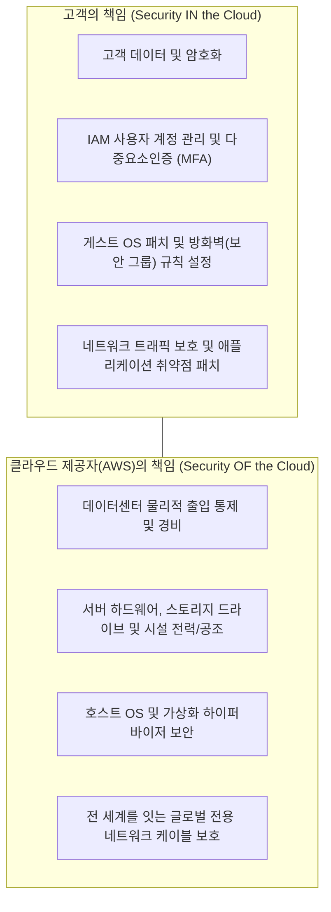

- **CSP의 책임 ("Security OF the Cloud"):** AWS/GCP는 물리적 데이터센터의 무단 침입 방지, 하드웨어 파손, 하이퍼바이저 소프트웨어 취약점, 해저 케이블 절단 등 클라우드 서비스를 구성하는 기반 인프라를 철통같이 지킬 책임이 있습니다.
- **고객의 책임 ("Security IN the Cloud"):** 클라우드 위에 올린 가상 서버의 비밀번호를 `1234`로 설정하거나, DB 포트(3306)를 전 세계(`0.0.0.0/0`)에 열어두거나, S3 버킷을 실수로 퍼블릭 공개로 돌려 기밀 문서를 유출한 것은 전적으로 고객의 책임입니다.

#### 서비스 모델별 관리 영역 및 책임 분계선 비교 매트릭스
| 인프라 스택 계층 | 온프레미스 (On-Premises) | IaaS (예: EC2) | PaaS (예: Elastic Beanstalk) | SaaS (예: Google Docs) |
| :--- | :---: | :---: | :---: | :---: |
| **애플리케이션 (Code)** | **고객 직접 관리** | **고객 직접 관리** | **고객 직접 관리** | 클라우드 제공자 |
| **데이터 (Data)** | **고객 직접 관리** | **고객 직접 관리** | **고객 직접 관리** | **고객 직접 관리(권한)** |
| **런타임 (Java, Python 등)** | **고객 직접 관리** | **고객 직접 관리** | 클라우드 제공자 | 클라우드 제공자 |
| **미들웨어 (WAS, 웹서버)** | **고객 직접 관리** | **고객 직접 관리** | 클라우드 제공자 | 클라우드 제공자 |
| **운영체제 (OS)** | **고객 직접 관리** | **고객 직접 관리** | 클라우드 제공자 | 클라우드 제공자 |
| **가상화 계층 (Hypervisor)** | **고객 직접 관리** | 클라우드 제공자 | 클라우드 제공자 | 클라우드 제공자 |
| **물리 서버 (Hardware)** | **고객 직접 관리** | 클라우드 제공자 | 클라우드 제공자 | 클라우드 제공자 |
| **스토리지 (Disk/SAN)** | **고객 직접 관리** | 클라우드 제공자 | 클라우드 제공자 | 클라우드 제공자 |
| **네트워킹 (Switch, Cable)** | **고객 직접 관리** | 클라우드 제공자 | 클라우드 제공자 | 클라우드 제공자 |

---

## 05. 하이브리드 클라우드와 멀티 클라우드는 무엇인가요?
> **온프레미스 + 퍼블릭 클라우드(하이브리드: 금융/공공 보안 준수), 복수 벤더 사용(멀티: AWS + GCP 등, 락인(Lock-in) 방지 및 재해 복구)**

기업의 규모가 커지고 비즈니스가 고도화되면, "모든 시스템을 단 하나의 퍼블릭 클라우드(예: AWS)로 옮기자"는 단순한 전략은 다양한 현실적 제약에 부딪히게 됩니다. 이로 인해 현대 엔터프라이즈 아키텍처의 표준으로 자리 잡은 것이 바로 **하이브리드 클라우드(Hybrid Cloud)**와 **멀티 클라우드(Multi-Cloud)**입니다.

---

### 5.1 하이브리드 클라우드(Hybrid Cloud): 과거와 미래의 지혜로운 동거

**하이브리드 클라우드**는 기업 내부의 **온프레미스(프라이빗 데이터센터)와 퍼블릭 클라우드를 전용망(AWS Direct Connect, VPN 등)으로 연결하여 하나의 유기적인 단일 인프라처럼 연동**하는 아키텍처입니다.

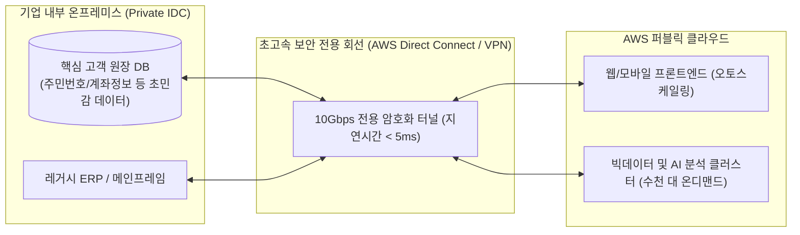

#### 하이브리드 클라우드가 반드시 필요한 3대 현실적 이유
1. **엄격한 법적 규제 준수(Compliance) 및 데이터 주권(Data Sovereignty):**
   - 금융권(은행, 증권사)의 고객 금융 거래 원장, 국방 및 공공기관의 국가 기밀 데이터, 병원의 전자의무기록(EMR)은 법적으로 국가 내 물리적 IDC 외부나 공용 클라우드로 반출이 금지되어 있는 경우가 많습니다.
   - 따라서 핵심 민감 데이터는 사내 온프레미스에 두고, 대고객 이벤트 웹사이트나 모바일 알림 서비스만 퍼블릭 클라우드로 띄워 연결합니다.
2. **기존 설비 투자에 대한 감가상각 잔존:**
   - 3년 전 수백억 원을 들여 구축한 데이터센터 하드웨어가 아직 멀쩡히 돌아가고 있는데, 이를 하루아침에 폐기처분하는 것은 기업 재무상 불가능합니다. 점진적 마이그레이션의 징검다리 역할을 합니다.
3. **클라우드 버스팅 (Cloud Bursting):**
   - 평상시의 일상적인 연산은 이미 구축된 사내 온프레미스 자원으로 100% 처리하여 비용을 아낍니다.
   - 연말 정산이나 명절 이벤트처럼 트래픽이 평소의 10배로 폭증할 때만 순간적으로 퍼블릭 클라우드로 연산 부하를 넘겨(Bursting) 유연하게 처리합니다.

---

### 5.2 멀티 클라우드(Multi-Cloud): 독점의 공포를 넘어서는 분산 전략

**멀티 클라우드**는 두 개 이상의 서로 다른 퍼블릭 클라우드 벤더(예: **AWS + Google Cloud(GCP)**, 또는 **AWS + Microsoft Azure**)를 동시에 조합하여 사용하는 전략입니다.

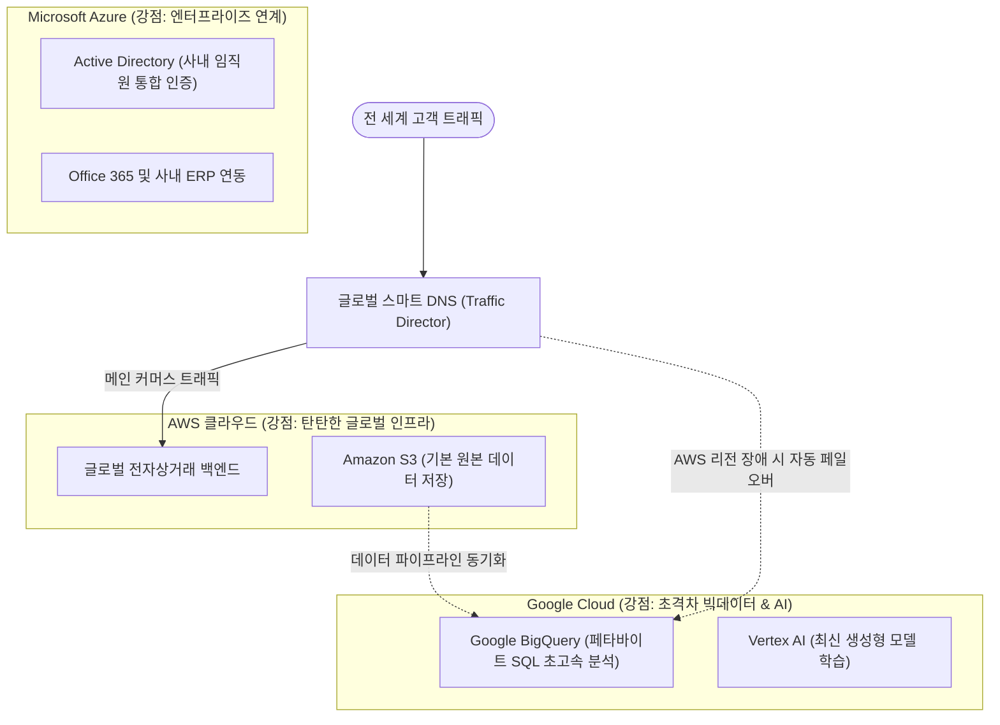

#### 기업들이 멀티 클라우드를 도입하는 핵심 동기
1. **벤더 락인(Vendor Lock-in, 종속) 방지:**
   - 한 클라우드 업체의 특정 기술(독점 API)에 시스템 전체가 종속되면, 향후 해당 업체가 이용료를 큰 폭으로 인상하거나 불리한 라이선스 정책을 강요해도 울며 겨자 먹기로 끌려갈 수밖에 없습니다.
   - 멀티 클라우드 전략은 협상력을 높이고 주도권을 기업이 쥐도록 돕습니다.
2. **완벽한 재해 복구(DR, Disaster Recovery)와 비즈니스 연속성:**
   - 아무리 거대한 AWS나 Azure라 할지라도 전 세계적인 광케이블 단선이나 전력망 사고, BGP 라우팅 오류로 리전 전체가 먹통이 되는 대형 장애가 발생하곤 합니다.
   - 금융이나 결제 시스템처럼 1분의 중단도 허용되지 않는 미션 크리티컬(Mission Critical) 서비스는 AWS 장애 시 즉시 GCP로 트래픽을 자동 우회하도록 설계합니다.
3. **각 클라우드 벤더의 최강 기술 취사선택 (Best-of-Breed):**
   - 글로벌 인프라의 안정성과 컴퓨팅 다양성은 **AWS**를 활용하고,
   - 방대한 로그 분석과 최신 머신러닝/AI 모델링은 **GCP(BigQuery, TPU)**를 사용하며,
   - 사내 임직원 인증과 윈도우 기반 엔터프라이즈 시스템 연동은 **Azure**를 채택하는 방식입니다.

#### 멀티 클라우드의 트레이드오프 (현실적 난관)
- **관리 복잡도 폭증:** 엔지니어가 AWS IAM과 GCP IAM, Azure 네트워킹 문법을 모두 능숙하게 다루어야 하므로 인재 확보 비용이 커집니다.
- **클라우드 간 데이터 전송 비용(Egress Cost):** 클라우드로 데이터를 넣을 때는 무료지만, 서로 다른 클라우드로 데이터를 뽑아낼 때는 기가바이트당 데이터 전송 요금이 비싸게 청구되므로 아키텍처 설계 시 세심한 주의가 필요합니다.

---

## 06. 서버리스 컴퓨팅은 무엇인가요?
> **서버 인프라 관리의 완전한 위임, FaaS(AWS Lambda), 이벤트 기반 호출, 사용한 밀리초(ms) 단위 과금, 콜드 스타트(Cold Start) 현상과 대처법**

클라우드 기술의 궁극적인 지향점은 "개발자가 인프라라는 존재 자체를 잊어버리게 만드는 것"입니다. 그 정점에 서 있는 패러다임이 바로 **서버리스(Serverless)**입니다.

---

### 6.1 서버리스(Serverless)의 본질: 서버가 없는 것이 아니다!

> **서버리스의 진짜 의미**  
> 서버리스라는 단어 때문에 "서버 컴퓨터가 아예 존재하지 않는 기술"로 오해하기 쉽습니다. 당연히 물리적인 서버는 클라우드 데이터센터 어딘가에서 치열하게 돌고 있습니다.  
> 서버리스의 진짜 의미는 **"개발자 입장에서 서버를 프로비저닝하고, OS 패치를 하고, CPU 용량을 가늠하고, 스케일링을 고민할 필요가 전혀 없는(Server-less), 인프라 관리의 완전한 위임"**입니다.

과거에는 웹 API 하나를 만들려고 해도 EC2 가상 서버를 띄우고, 리눅스 보안 패치를 하고, Nginx 웹 서버를 띄우며, 트래픽을 대비해 오토스케일링 규칙을 걸어야 했습니다. 

하지만 서버리스 환경에서는 개발자가 오직 **"실행될 소스코드 함수(Function)"** 하나만 작성해서 클라우드에 등록하면 끝납니다.

---

### 6.2 FaaS(Function as a Service)의 선구자: AWS Lambda

서버리스를 대표하는 실행 모델이 바로 **FaaS(서비스형 함수)**이며, 그 대표주자가 2014년 등장하여 세상을 뒤흔든 **AWS Lambda(람다)**입니다.

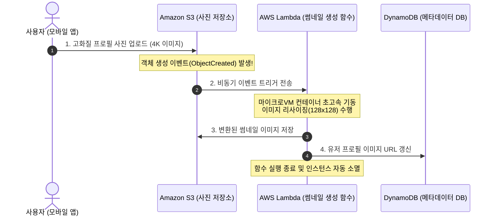

#### FaaS의 핵심 동작 원리
1. **상시 구동(Always-On)이 아닌 이벤트 기반(Event-Driven) 호출:**
   - 람다 함수는 24시간 켜져서 전기를 낭비하지 않습니다. 평소에는 완전히 잠들어 있습니다.
   - S3에 파일이 올라오거나, API Gateway로 HTTP 요청이 도달하거나, 메시지 큐(SQS)에 새 데이터가 들어오는 순간 즉시 깨어나 단 한 번 실행되고 사라집니다.
2. **경이로운 1밀리초(ms) 단위 종량제 과금:**
   - 기존 가상 서버(EC2)는 사용자가 한 명도 안 들어오는 심야 시간대에도 켜져 있는 시간(초 단위) 전체에 대해 돈을 내야 했습니다.
   - AWS Lambda는 **함수가 실제로 코드를 실행한 정확한 시간(밀리초, ms)**과 함수에 할당한 메모리 양에 대해서만 과금합니다. 호출이 전혀 없으면 청구 금액은 완벽한 **0원**입니다.
3. **무한한 자동 확장(Automatic Concurrency):**
   - 1초에 요청이 1건 오면 컨테이너 1개가 떠서 처리합니다.
   - 찰나의 순간에 1만 건의 동시 요청이 쏟아지면, 개발자가 아무 조치를 취하지 않아도 클라우드가 순식간에 1만 개의 격리된 실행 환경을 동시에 병렬로 띄워 1초 만에 해치워 버립니다.

---

### 6.3 서버리스의 최대 난제: 콜드 스타트(Cold Start) 현상과 대처법

서버리스가 완벽한 은탄환(Silver Bullet)처럼 보이지만, 실시간 대화형 서비스에서 반드시 해결해야 할 고질적인 문제가 있습니다. 바로 **콜드 스타트(Cold Start)**입니다.

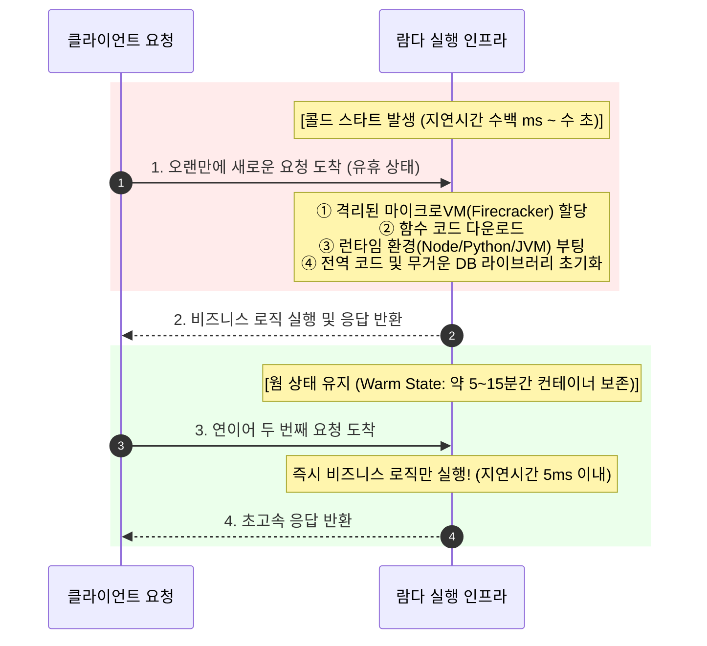

- **웜 스타트 (Warm Start):** 이미 메모리에 올라와 대기 중인 컨테이너가 요청을 받아 즉시(수 밀리초 이내) 실행되는 상태입니다.
- **콜드 스타트 (Cold Start):** 유휴 상태이거나 트래픽이 급증하여 새로운 가상 실행 환경을 밑바닥부터 띄워야 할 때 발생합니다. 환경 격리, 런타임 부팅, 무거운 의존성 라이브러리 로딩으로 인해 첫 번째 응답에 수백 밀리초에서 길게는 수 초의 랙(지연)이 발생합니다.

#### 현업 시니어 엔지니어들의 콜드 스타트 극복 비법
1. **프로비저닝된 동시성 (Provisioned Concurrency) 적용:**
   - AWS Lambda의 기능으로, 일정 수량의 실행 환경을 미리 항상 웜(Warm) 상태로 예열해 두어 콜드 스타트를 100% 원천 차단합니다 (약간의 고정 대기 비용 발생).
2. **경량 런타임 언어 선택:**
   - 거대한 JVM(Java Virtual Machine)을 띄우고 수많은 스프링 빈(Spring Bean)을 등록해야 하는 전통적인 Java 환경은 콜드 스타트가 4~8초에 달할 수 있습니다.
   - 부팅 속도가 압도적으로 빠른 **Go, Rust, Node.js, Python** 같은 가벼운 언어를 사용하면 콜드 스타트를 100ms 이내로 단축할 수 있습니다.
3. **불필요한 SDK 의존성 가지치기(Tree-Shaking):**
   - 람다 코드에서 거대한 `aws-sdk` 전체를 임포트하지 않고, 필요한 특정 클라이언트(예: `@aws-sdk/client-s3`)만 핀포인트로 임포트하여 패키지 번들 크기를 수십 메가바이트에서 수백 킬로바이트 수준으로 다이어트시킵니다.
4. **웜업 핑(Warm-up Ping) 스케줄러:**
   - CloudWatch Event(EventBridge)를 이용해 5분마다 람다 함수에 빈 더미(Dummy) 신호를 보내 컨테이너가 동면(Sleep)에 들어가지 않도록 깨워두는 트릭을 활용합니다.

---

## 07. 도커, 컨테이너, 쿠버네티스란 무엇인가요?
> **가상 머신(Hypervisor 기반) vs 컨테이너(OS 커널 공유) 비교, 도커 이미지와 컨테이너, 쿠버네티스(K8s)의 컨테이너 오케스트레이션(배포, 스케일링, 자가치유) 핵심 원리**

현대 클라우드 네이티브(Cloud-Native) 엔지니어링의 표준 기술을 단 두 단어로 요약하자면 바로 **도커(Docker)**와 **쿠버네티스(Kubernetes)**입니다. 이 기술들은 소프트웨어를 패키징하고 대규모로 배포하는 방식을 근본적으로 혁신했습니다.

---

### 7.1 "제 컴퓨터에서는 잘 되는데, 서버에서는 왜 안 되죠?"

개발팀에서 매일같이 벌어지던 가장 끔찍한 비극은 바로 **'환경 불일치(Matrix of Hell)'**였습니다.
- 개발자 맥북: macOS, Node.js v20, 최신 OpenSSL, 로컬 환경변수 세팅 완료 -> 정상 동작!
- 스테이징 서버: Ubuntu 20.04, Node.js v18, 구버전 C 라이브러리 충돌 -> **런타임 에러 뿜으며 서비스 폭파!**

이 문제를 해결하기 위해 과거에는 가상 머신(VM)을 통째로 넘기곤 했습니다. 하지만 VM은 너무나 무겁고 느렸습니다. 여기서 혜성처럼 등장한 구원투수가 바로 **컨테이너(Container)**입니다.

---

### 7.2 가상 머신(VM) vs 컨테이너(Container) 기술적 차이

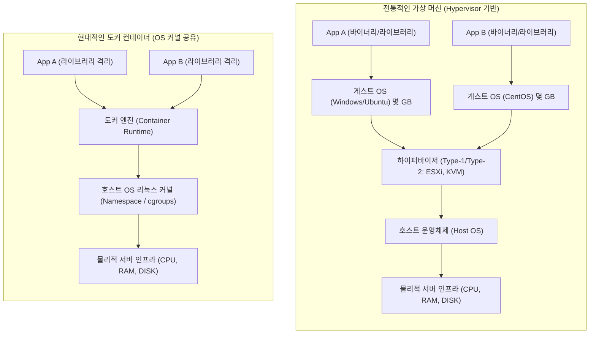

- **가상 머신 (VM):**
  - 물리 하드웨어 위에 **하이퍼바이저(Hypervisor)**를 올리고, 그 위에 가상 하드웨어를 에뮬레이트한 뒤 **완전한 독립 게스트 OS(Guest OS)**를 각각 설치합니다.
  - 게스트 OS 하나가 수 기가바이트(GB)의 디스크와 수백 메가바이트의 메모리를 잡아먹으며, 부팅하는 데만 수 분이 걸립니다.
- **컨테이너 (Container):**
  - 호스트 OS의 **리눅스 커널(Kernel)을 모든 컨테이너가 직접 공유**합니다.
  - 리눅스 커널의 핵심 기능인 **네임스페이스(Namespace: 프로세스, 파일시스템, 네트워크 격리)**와 **cgroups(Control Groups: CPU, 메모리 자원 사용량 제한)** 기술을 이용해, 마치 독립된 OS에 있는 것처럼 프로세스를 샌드박스 형태로 완벽히 격리합니다.
  - 게스트 OS가 없으므로 크기가 수십 메가바이트(MB)에 불과하며, 부팅 과정 없이 프로세스가 즉각 뜨므로 **0.1초 만에 기동**됩니다.

---

### 7.3 도커(Docker)의 핵심 3요소

도커는 리눅스의 복잡한 컨테이너 격리 기술을 누구나 명령어 한 줄로 다룰 수 있도록 대중화시킨 혁명적 도구입니다.

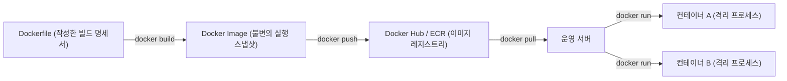

1. **Dockerfile (빌드 레시피):** 어떤 베이스 OS 이미지를 쓰고, 어떤 소스코드를 복사하며, 어떤 패키지를 설치하고, 마지막에 어떤 명령어를 실행할지 텍스트로 적어둔 설계도입니다.
2. **도커 이미지 (Docker Image):** Dockerfile을 빌드하여 만들어진 **읽기 전용(Read-only)의 불변(Immutable) 실행 파일 묶음**입니다. 애플리케이션 실행에 필요한 코드, 런타임, 시스템 라이브러리, 환경 설정이 완벽히 동결되어 담겨 있습니다.
3. **도커 컨테이너 (Docker Container):** 이미지를 실체화하여 메모리에 올려 격리된 프로세스로 실행시킨 상태입니다. 하나의 이미지로부터 완전히 동일한 컨테이너를 수천 개 찍어낼 수 있습니다.

> **"한 번 빌드하면, 어디서나 실행된다 (Build Once, Run Anywhere)"**  
> 내 로컬 노트북에서 빌드되어 정상 동작한 도커 이미지는 테스트 서버, 온프레미스 서버, AWS 클라우드, 구글 클라우드 어디로 가져가도 0.001%의 오차도 없이 100% 동일하게 동작합니다.

---

### 7.4 컨테이너가 수백 개로 늘어난다면? 쿠버네티스(Kubernetes, K8s)

도커 덕분에 컨테이너를 쉽게 만들 수 있게 되었지만, 마이크로서비스 아키텍처(MSA)가 도입되면서 또 다른 거대한 문제가 발생했습니다.

> *"운영 서버가 100대이고, 그 위에서 돌아가는 도커 컨테이너가 1,000개입니다. 37번 서버에 트래픽이 몰리는데 어떤 서버로 컨테이너를 옮겨야 할까요? 82번 서버의 컨테이너가 새벽 3시에 메모리 누수로 죽었습니다. 누가 다시 띄워주죠? 새 버전 코드를 1,000개 컨테이너에 서비스 중단 없이 배포하려면 어떻게 해야 하나요?"*

사람의 손으로 수천 개의 컨테이너를 일일이 관리하는 것은 불가능합니다. 수많은 서버 위에 컨테이너를 자동으로 배치하고, 확장하며, 장애를 복구해 주는 **오케스트라 지휘자**가 필요해졌습니다. 이 역할을 수행하는 사실상의 전 세계 표준(De-facto Standard) 플랫폼이 바로 **쿠버네티스(K8s)**입니다. (K와 s 사이에 8글자가 있어서 K8s라고 부릅니다.)

---

### 7.5 쿠버네티스의 3대 핵심 메커니즘과 아키텍처

쿠버네티스의 핵심 철학은 **"선언적 상태 관리(Declarative State Management)"**입니다. 엔지니어가 "컨테이너를 띄워라, 죽여라" 명령(Imperative)을 내리지 않고, YAML 파일에 **"내가 원하는 최종 상태(Desired State)는 Nginx 컨테이너 3개가 항상 살아있는 것이다"**라고 선언해 둡니다. 그러면 쿠버네티스는 24시간 감시 루프(Control Loop)를 돌며 현재 상태를 원하는 상태와 일치시킵니다.

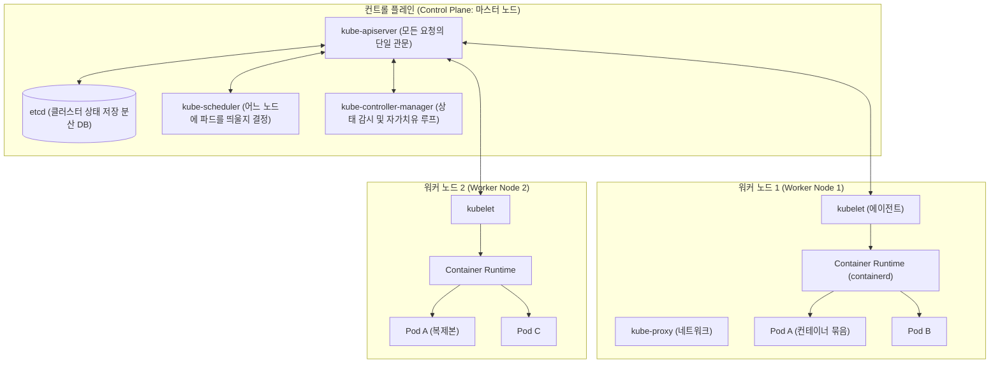

#### 쿠버네티스가 제공하는 마법 같은 3대 기능
1. **자가 치유 (Self-Healing):** 
   - 워커 노드 1번의 하드웨어가 완전히 타버려 파드(Pod)들이 죽으면, 컨트롤러가 이를 즉각 감지하고 살아있는 워커 노드 2번에 똑같은 파드를 즉시 재생성하여 원하는 파드 개수(3개)를 맞춥니다.
2. **무중단 롤링 업데이트 (Zero-Downtime Rolling Update) & 롤백:**
   - 구버전 파드(v1) 3개가 돌아가는 중에 v2 배포 명령이 내려오면, v2 파드를 하나 띄워 헬스체크가 통과되면 v1 파드를 하나 죽이는 방식으로 점진 교체합니다. 사용자는 단 1밀리초의 다운타임도 느끼지 못합니다. 문제가 발견되면 즉시 이전 버전으로 원클릭 롤백합니다.
3. **수평적 파드 자동 확장 (HPA: Horizontal Pod Autoscaler):**
   - 파드들의 CPU 사용률이 지정한 임계치(예: 70%)를 넘으면 파드 개수를 3개에서 10개, 30개로 자동 증설하고, 트래픽이 빠지면 다시 줄입니다.

---

## 08. 빅데이터란 무엇인가요?
> **데이터의 3V(Volume, Velocity, Variety) + Value, Veracity, 비정형 데이터의 급증, 데이터 수집 -> 저장 -> 처리 -> 시각화 파이프라인, 데이터 웨어하우스(DW) vs 데이터 레이크(Data Lake)**

오늘날 하루 동안 전 세계에서 생성되는 데이터의 양은 수백 엑사바이트(EB)에 달합니다. 스마트폰 터치 한 번, 결제 내역, 배달 앱의 GPS 이동 경로, 스마트워치의 심박수, 공장 센서의 진동 로그까지 인류의 모든 발자취가 데이터로 기록되고 있습니다. 이 방대한 데이터를 우리는 **빅데이터(Big Data)**라고 부릅니다.

---

### 8.1 빅데이터의 본질: 3V에서 5V로의 확장

단순히 하드디스크에 저장된 용량이 크다고 해서 빅데이터가 아닙니다. 빅데이터는 전통적인 단일 데이터베이스(RDBMS)나 파일 시스템의 처리 한계를 뛰어넘는 복합적인 특성을 지닙니다.

```mermaid
mindmap
  root((빅데이터의 5V))
    Volume 규모
      테라바이트(TB)를 넘어 페타바이트(PB), 제타바이트(ZB)
      단일 서버 저장 불가 -> 분산 스토리지 필수
    Velocity 속도
      실시간 스트리밍 생성
      IoT 센서, 클릭스트림, 주식 호가 데이터 초당 수십만 건
    Variety 다양성
      정형 데이터 (RDB 테이블)
      반정형 데이터 (JSON, XML, 웹 로그)
      비정형 데이터 (이미지, 동영상, 텍스트 음성)
    Veracity 신뢰성/정확성
      노이즈와 결측치 속에서
      데이터의 품질과 신뢰도를 정제
    Value 가치
      가장 중요한 궁극적 목표
      비즈니스 통찰, 매출 증대, 위험 예측
```

1. **Volume (규모):** 데이터의 절대적인 양이 상상을 초월합니다. 단일 고성능 데이터베이스 서버의 디스크 용량 한계를 아득히 초과하므로 분산 파일 시스템(HDFS, S3)에 나누어 담아야 합니다.
2. **Velocity (속도):** 데이터가 생성되고, 유입되고, 처리되는 주기가 극도로 빠릅니다. 하루에 한 번 야간 배치(Batch)로 처리하던 시절을 지나, 실시간(Real-Time) 스트리밍 분석이 요구됩니다.
3. **Variety (다양성):** 전통적인 관계형 데이터베이스의 행(Row)과 열(Column)에 예쁘게 들어맞는 **정형 데이터(Structured Data)**는 전체 데이터의 20%도 되지 않습니다. 소셜 미디어 게시글, 고객 리뷰(텍스트), 사진, 유튜브 영상, 음성 녹음 등 규격화되지 않은 **비정형 데이터(Unstructured Data)**와 JSON, 로그 같은 **반정형 데이터(Semi-structured Data)**가 80% 이상을 차지합니다.
4. **Veracity (정확성 / 신뢰성):** 수집된 원천 데이터에는 이상치(Outlier), 중복값, 결측치, 네트워크 전송 오류 등 수많은 노이즈(Noise)가 섞여 있습니다. 이를 올바르게 정제(Data Cleansing)하여 신뢰성을 확보해야 합니다.
5. **Value (가치):** 아무리 방대한 데이터를 쌓아두어도 비즈니스 의사결정에 기여하지 못하거나 수익을 창출하지 못하면 그저 비싼 전기만 먹는 '데이터 쓰레기통(Data Swamps)'에 불과합니다.

---

### 8.2 엔드투엔드(End-to-End) 빅데이터 엔지니어링 파이프라인

원시 데이터(Raw Data)가 기업의 황금 같은 인사이트로 탈바꿈하기까지는 4단계의 체계적인 데이터 파이프라인을 거치게 됩니다.

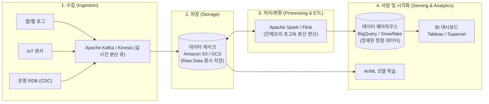

1. **수집 단계 (Ingestion):** 초당 수만 건씩 쏟아지는 로그와 트랜잭션을 버퍼링 유실 없이 안정적으로 받아내기 위해 **Apache Kafka**나 AWS Kinesis 같은 고성능 분산 메시징 큐를 파이프라인 최전선에 배치합니다.
2. **저장 단계 (Storage):** 원본 데이터의 형태를 훼손하지 않고 있는 그대로 무제한 저장할 수 있는 저비용·고내구성 클라우드 오브젝트 스토리지(S3, GCS)에 원시 데이터(Raw Data)를 영구 적재합니다.
3. **처리 및 변환 단계 (Processing / ETL):** 
   - 과거에는 **Hadoop MapReduce**를 써서 디스크 기반으로 느리게 연산했습니다.
   - 오늘날에는 데이터를 메모리에 올려 초고속으로 병렬 분산 처리하는 **Apache Spark**가 업계의 표준입니다. 데이터를 추출(Extract), 변환/정제(Transform), 적재(Load)하는 ETL 작업을 수행합니다.
4. **서빙 및 시각화 단계 (Analytics & Visualization):** 정제된 데이터를 SQL 기반으로 초고속 집계할 수 있는 데이터 웨어하우스로 보내 비즈니스 인텔리전스(BI) 대시보드로 시각화하거나, 머신러닝 엔지니어의 모델 학습 데이터셋으로 공급합니다.

---

### 8.3 데이터 아키텍처의 진화: 데이터 웨어하우스(DW) vs 데이터 레이크(Data Lake)

빅데이터 인프라를 설계할 때 가장 핵심적인 두 저장소의 차이를 이해해야 합니다.

```
[데이터 웨어하우스 (DW): 정제된 생수병]
 공장에서 흙과 불순물을 완벽히 거르고 살균하여 규격화된 페트병에 담아둔 생수.
 누구나 뚜껑을 열어 즉시 안심하고 마실 수 있지만(초고속 SQL 분석),
 강물 본연의 다양한 생태계 표본(비정형 원시 데이터)을 연구할 수는 없습니다.

[데이터 레이크 (Data Lake): 거대한 자연 호수]
 상류에서 흘러내려오는 빗물, 낙엽, 물고기, 흙탕물이 원형 그대로 끝없이 모이는 호수.
 온갖 비정형 데이터(이미지, 로그, 오디오)를 저렴한 비용으로 무제한 담아둘 수 있지만,
 정수기(Spark/ETL) 없이 그냥 마셨다가는 탈이 납니다.
```

#### DW vs Data Lake 핵심 비교표
| 비교 항목 | 데이터 웨어하우스 (Data Warehouse) | 데이터 레이크 (Data Lake) |
| :--- | :--- | :--- |
| **데이터 형태** | 엄격히 정제된 정형 데이터 위주 (RDBMS 테이블) | 원시 형태 그대로의 모든 데이터 (정형, 반정형, 비정형) |
| **스키마 적용 시점** | **Schema-on-Write** (저장하기 전에 스키마를 엄격히 검증) | **Schema-on-Read** (저장할 땐 아무렇게나 넣고, 읽을 때 해석) |
| **저장 비용** | 상대적으로 고비용 (고성능 SSD 및 컴퓨팅 결합) | 초저비용 (클라우드 오브젝트 스토리지 S3/GCS 활용) |
| **주요 사용자** | 비즈니스 분석가(BA), 마케터, 경영진, SQL 개발자 | 데이터 엔지니어, 데이터 사이언티스트, AI/ML 연구원 |
| **주요 질의 언어** | 표준 SQL (대화형 초고속 집계 질의) | Python, Scala, Java, Spark API, SQL |
| **대표 솔루션** | Google BigQuery, Snowflake, AWS Redshift | Amazon S3 + Apache Iceberg/Delta Lake, Hadoop HDFS |

> **최신 트렌드: 데이터 레이크하우스(Data Lakehouse)의 등장**  
> 최근에는 데이터 레이크의 저렴한 저장 비용과 유연성에, 데이터 웨어하우스의 ACID 트랜잭션 보장 및 고성능 SQL 엔진을 결합한 **'데이터 레이크하우스(Lakehouse)'** 아키텍처(Apache Iceberg, Databricks Delta Lake 등)가 엔터프라이즈의 표준으로 급부상하고 있습니다.

---

## 09. 빅데이터 vs 머신러닝 vs 인공지능
> **AI > ML > DL 포함 관계 다이어그램, 데이터가 모델을 학습시키는 원리, 지도학습, 비지도학습, 강화학습의 개념 및 비즈니스 활용**

뉴스나 마케팅에서는 AI, 머신러닝, 딥러닝, 빅데이터라는 단어가 마치 동의어인 양 혼용되곤 합니다. 하지만 기술적으로 이들은 매우 명확하고 엄격한 포함 관계와 상호보완적 역할을 가집니다.

---

### 9.1 개념의 혼란을 끝내는 포함 관계: AI > ML > DL

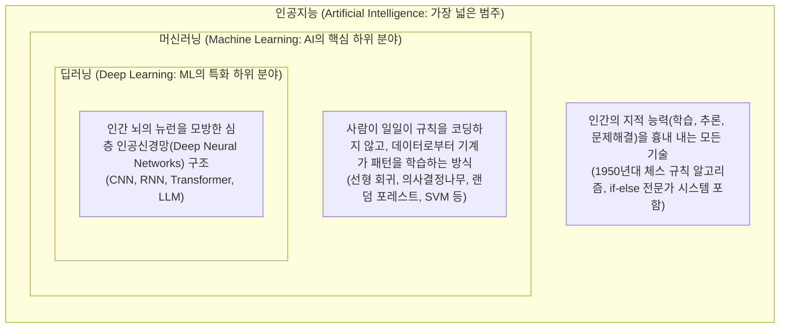

- **인공지능 (AI):** 인간의 지능적 행동을 모방하는 컴퓨터 과학의 가장 거대한 우산입니다. 1950년대의 단순한 규칙 기반 `if-else` 전문가 시스템(Expert System)도 AI에 포함됩니다.
- **머신러닝 (ML):** AI를 달성하기 위한 구체적인 방법론 중 하나입니다. 인간이 모든 규칙을 하드코딩하는 대신, 대량의 데이터 속에서 컴퓨터가 스스로 통계적 패턴과 규칙을 찾아내도록 만듭니다.
- **딥러닝 (DL):** 머신러닝의 수많은 알고리즘 중, 인간의 뇌 신경망에서 영감을 얻은 **인공신경망(Artificial Neural Network)**을 여러 층(Deep Layer)으로 깊게 쌓아 올려 복잡한 특징(Feature)을 스스로 추출하는 기술입니다. 이미지 인식, 음성 합성, 현대의 대형 언어 모델(LLM)이 모두 딥러닝에 속합니다.

---

### 9.2 전통적 프로그래밍 vs 머신러닝: 사고방식의 대전환

소프트웨어 엔지니어링 역사에서 머신러닝의 등장은 코드를 작성하는 철학을 180도 바꾸어 놓았습니다.

```
[전통적 프로그래밍 (Traditional Programming)]
 규칙(코드/로직) ──┐
                  ├──> [ 컴퓨터 ] ───> 정답 (Output / 결과)
 데이터 (Input)   ──┘
 * 예: if (email.contains("무료 대출") && email.count("$$$") > 3) return SPAM;
 -> 스팸 발송자가 "무.료 대.출"로 문자를 바꾸면 엔지니어가 수작업으로 코드를 고쳐야 함!

[머신러닝 패러다임 (Machine Learning)]
 데이터 (Input)   ──┐
                  ├──> [ 머신러닝 알고리즘 ] ───> 규칙 (Model / 프로그램)
 정답 (Labels)    ──┘
 * 수백만 개의 정상 메일과 스팸 메일을 던져주면, 알고리즘이 "어떤 단어 조합이 스팸일 확률이 높은지"
   스스로 가중치(규칙)를 학습하여 '모델(Model)'을 출력함!
```

전통적 프로그래밍에서는 엔지니어가 머릿속으로 모든 예외 조건과 비즈니스 룰을 생각해서 코드로 짜야 했습니다. 하지만 머신러닝에서는 엔지니어가 규칙을 짜는 대신 **"좋은 데이터를 먹여서 기계가 최적의 함수 $f(x) = y$를 찾아내도록 학습 환경을 구축"**합니다.

---

### 9.3 머신러닝의 3대 학습 방식과 실무 비즈니스 활용

기계에게 데이터를 어떻게 제공하고 무엇을 학습시키느냐에 따라 머신러닝은 크게 세 가지로 분류됩니다.

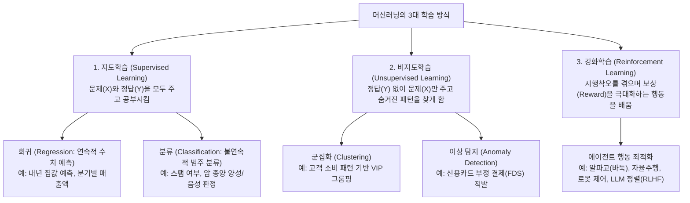

#### 1. 지도학습 (Supervised Learning): 선생님이 정답을 알려주는 공부
- **원리:** 입력 데이터(문제, $X$)와 함께 라벨(정답, $Y$)을 쌍으로 제공하여 둘 사이의 매핑 함수를 학습합니다.
- **회귀 (Regression):** 출력 결과가 연속된 숫자(수치)일 때 사용합니다.
  - *비즈니스 활용:* 아파트 평수, 역세권 거리, 학군 데이터를 보고 "이 아파트의 6개월 뒤 매매가" 예측하기.
- **분류 (Classification):** 출력 결과가 둘 중 하나(이진 분류)이거나 정해진 카테고리(다중 분류)일 때 사용합니다.
  - *비즈니스 활용:* 흉부 X-ray 사진을 보고 폐렴인지 정상인지 판별, 은행 대출 고객의 채무 불이행 가능성 예측.

#### 2. 비지도학습 (Unsupervised Learning): 자율적인 패턴 발견
- **원리:** 정답 라벨($Y$) 없이 오직 원천 데이터($X$)만 제공합니다. 데이터 자체의 통계적 유사성과 군집 구조를 컴퓨터가 스스로 탐색합니다.
- **군집화 (Clustering):** 비슷한 특징을 가진 데이터끼리 무리를 짓습니다.
  - *비즈니스 활용:* 이커머스에서 고객의 구매 주기, 장바구니 품목 데이터를 바탕으로 마케팅 타깃 고객군(알뜰족, 얼리어답터, 명품 선호족) 자동 세분화.
- **이상치 탐지 (Anomaly Detection):** 전체 데이터의 일반적인 분포에서 벗어나는 이상한 징후를 포착합니다.
  - *비즈니스 활용:* 신용카드 FDS(이상 금융거래 탐지) - 한국에서 결제하던 카드가 10분 뒤 나이지리아 ATM에서 거액 인출을 시도할 때 즉시 결제 차단.

#### 3. 강화학습 (Reinforcement Learning): 당근과 채찍을 통한 최적화
- **원리:** 데이터셋을 주는 대신, 가상 환경(Environment)에 에이전트(Agent)를 던져놓고 특정 행동(Action)을 취할 때마다 **보상(Reward, 당근)**이나 **페널티(Penalty, 채찍)**를 부여합니다. 에이전트는 시행착오를 거치며 장기적 누적 보상을 극대화하는 최적의 행동 정책(Policy)을 학습합니다.
- *비즈니스 활용:* 
  - 딥마인드의 **알파고(AlphaGo)**: 수천만 번의 자가 대국(Self-play)을 통해 인간이 가르쳐주지 않은 신의 한 수를 체득.
  - 물류 창고 자동화 로봇, 고성능 자율주행 알고리즘 제어.
  - **ChatGPT의 탄생 비밀:** 인간 피드백 기반 강화학습(RLHF)을 통해 언어 모델이 인간에게 무례하거나 위험한 대답을 피하고 친절하고 유용한 대답을 하도록 길들이는 핵심 기술.

---

## 10. (+) LLM과 생성형 AI는 어떻게 동작하나요?
> **트랜스포머(Transformer)의 혁신과 어텐션(Attention) 메커니즘, 사전학습(Pre-training)과 파인튜닝(Fine-tuning)/RLHF, RAG(검색 증강 생성) 아키텍처, AI 할루시네이션(환각) 극복 방안**

2022년 말 ChatGPT의 등장은 전 인류에게 거대한 기술적 충격을 안겨주었습니다. 과거의 AI가 "이 사진이 고양이인가 개인가?"를 맞히는 **판별형 AI(Discriminative AI)**였다면, 오늘날의 AI는 "존재하지 않는 환상적인 고양이 시를 짓고, 파이썬 코드를 작성하며, 변호사 시험을 통과하는" **생성형 AI(Generative AI)**로 진화했습니다. 그 중심에는 **LLM(Large Language Model, 거대 언어 모델)**이 있습니다.

---

### 10.1 패러다임의 혁명: 트랜스포머(Transformer)와 자가 어텐션(Self-Attention)

오늘날 ChatGPT(GPT-4), Gemini, Claude, LLaMA 등 모든 현대 거대 언어 모델의 뼈대가 된 단 하나의 기념비적인 논문이 있습니다. 바로 2017년 구글 연구팀이 발표한 **"Attention Is All You Need"**입니다.

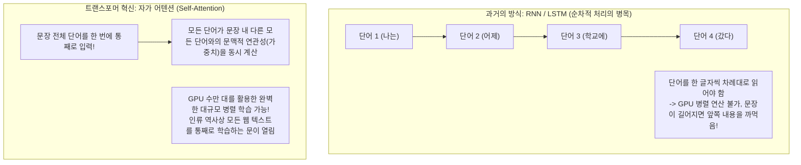

#### 트랜스포머가 이전 자연어 처리 모델(RNN)을 압살한 이유
1. **자가 어텐션 (Self-Attention) 메커니즘:**
   - 문장 속에서 어떤 단어가 다른 어떤 단어와 깊은 연관을 맺고 있는지를 수학적으로 계산합니다.
   - 예를 들어, *"동물이 길을 건너지 않았다. 왜냐하면 **그것(it)**이 너무 피곤했기 때문이다."*라는 문장에서, 컴퓨터는 '그것(it)'이 '길'인지 '동물'인지 알기 어렵습니다.
   - 자가 어텐션 메커니즘은 문장 내 모든 단어 간의 유사도 행렬을 계산하여, **'it'과 '동물(animal)' 사이의 어텐션 스코어(연관도)를 가장 높게 부여**함으로써 인간처럼 문맥을 완벽히 파악해 냅니다.
2. **GPU 분산 병렬 연산의 극대화:**
   - 단어를 시간 순서대로 하나씩 읽어야 했던 RNN과 달리, 트랜스포머는 문장 전체를 행렬 곱셈 연산으로 한 번에 밀어 넣습니다. 이로 인해 수만 개의 GPU 코어를 100% 활용할 수 있게 되었고, 비로소 테라바이트 단위의 초거대 말뭉치를 학습시킬 수 있게 되었습니다.

---

### 10.2 거대 언어 모델(LLM)의 3단계 탄생 파이프라인

수천억 개의 매개변수(Parameter)를 가진 LLM이 태어나 인간의 질문에 지혜롭게 답하기까지는 다음과 같은 3단계 과정을 거칩니다.

```mermaid
flowchart LR
    subgraph Step1["1. 사전 학습 (Pre-training)"]
        RawText["수조 개의 웹 텍스트 말뭉치\n(위키백과, 책, 깃허브 코드)"]
        BaseModel["파운데이션 베이스 모델\n(단순한 '다음 단어 맞히기' 기계)"]
        RawText -->|수천 개 GPU로 수개월 학습| BaseModel
    end

    subgraph Step2["2. 지도 파인튜닝 (SFT)"]
        Instruct["고품질 지시-응답 쌍\n(Q&A 대화 데이터셋)"]
        InstructModel["지시 이행 모델\n(질문에 정중히 답하는 법을 배움)"]
        BaseModel -->|SFT 학습| InstructModel
    end

    subgraph Step3["3. 인간 피드백 강화학습 (RLHF)"]
        HumanPref["인간 평가자 피드백\n(유용성, 진실성, 무해성 채점)"]
        AlignedLLM["최종 정렬된 상용 LLM\n(ChatGPT, Gemini)"]
        InstructModel -->|PPO/DPO 알고리즘 정렬| AlignedLLM
    end
```

1. **사전 학습 (Pre-training - 파운데이션 모델 구축):**
   - 인터넷에 존재하는 수조 개의 텍스트 토큰을 모아놓고, 모델에게 오직 한 가지만 시킵니다: **"앞의 단어들이 주어졌을 때, 통계적으로 바로 다음에 올 가장 그럴듯한 단어는 무엇인가? (Next-Token Prediction)"**
   - 수천 대의 최신 엔비디아 GPU 클러스터에서 수백억 원의 전기세를 쓰며 몇 달 동안 단어 맞히기를 반복하다 보면, 모델은 문법뿐만 아니라 역사, 철학, 수학 공식, 코딩 문법 등 인류의 지식 체계를 스스로 내부 가중치 신경망에 압축하여 각인하게 됩니다.
2. **지도 파인튜닝 (SFT: Supervised Fine-Tuning):**
   - 사전 학습만 끝난 베이스 모델은 인간의 질문에 제대로 답하지 못합니다. 예를 들어 "프랑스의 수도는 어디인가요?"라고 물으면 답변을 주는 대신 "스페인의 수도는 어디인가요? 독일의 수도는 어디인가요?"라며 다음 시험 문제를 계속 나열할 뿐입니다.
   - 전문가들이 정성껏 작성한 수만 건의 고품질 **"질문 - 모범 답변"** 대화 데이터를 학습시켜, 질문을 받으면 친절하게 대답하는 인터랙션 방식을 훈련시킵니다.
3. **인간 피드백 기반 강화학습 (RLHF / DPO):**
   - 모델이 폭탄 제조법을 알려주거나, 인종차별적 욕설을 내뱉거나, 거짓말을 그럴듯하게 하지 않도록 인간의 가치관과 윤리 기준에 맞추는 **'정렬(Alignment)'** 작업입니다.
   - 여러 개의 생성 답변 중 인간 평가자가 가장 선호하는 답변에 높은 점수를 부여하는 보상 모델(Reward Model)을 만들어 모델을 바람직한 방향으로 길들입니다.

---

### 10.3 LLM의 아킬레스건: 할루시네이션(Hallucination, 환각)

LLM을 기업 실무에 도입할 때 마주치는 가장 큰 장벽은 바로 **환각(할루시네이션)** 현상입니다.

> **할루시네이션이란?**  
> AI가 전혀 사실이 아닌 거짓 정보를 마치 대단히 확신에 찬 전문가처럼 유려하고 그럴듯한 언어로 지어내어 답변하는 현상입니다. (예: "조선왕조실록에 기록된 세종대왕의 맥북프로 던짐 사건에 대해 알려줘"라는 장난스런 질문에, 가상의 연도와 신하들의 이름을 지어내며 진지하게 서술하는 현상)

#### 환각이 발생하는 근본적인 기술적 원인
LLM은 사실(Fact)을 검증하는 진실 판별기가 아닙니다. LLM의 본질은 **"앞 단어에 이어질 확률이 가장 높은 단어를 수학적으로 이어 붙이는 통계적 앵무새(Stochastic Parrot)"**입니다. 학습 데이터에 없는 최신 정보나 기업 내부 기밀 문서를 물어보면, 모델은 "모릅니다"라고 답하기보다 확률적으로 가장 매끄러운 단어들을 조합해 그럴싸한 거짓말을 창작해 내는 것입니다.

---

### 10.4 환각을 극복하는 게임 체인저: RAG (검색 증강 생성)

기업들은 내부 데이터 유출 없이 최신 문서를 바탕으로 정확한 답변을 생성하기 위해 **RAG(Retrieval-Augmented Generation, 검색 증강 생성)** 아키텍처를 표준으로 도입하고 있습니다.

```
[RAG를 이해하는 가장 쉬운 비유: 오픈북 테스트]
- 순수 LLM: 학생의 머릿속 기억(사전학습 가중치)에만 의존해 시험을 치는 '폐쇄형 시험(Closed-book Exam)'.
  기억이 안 나거나 안 배운 문제가 나오면 엉뚱한 오답(환각)을 적어냅니다.
- RAG 시스템: 시험장에 '사내 최신 규정집과 매뉴얼 책'을 들고 들어가는 '오픈북 시험(Open-book Exam)'.
  문제를 받으면 먼저 책에서 관련 페이지를 찾아 펼친 뒤(Retrieval),
  그 페이지에 적힌 내용을 눈으로 확인하고 정확한 정답을 작성(Generation)합니다.
```

```mermaid
flowchart TD
    subgraph DataPrep["[오프라인 단계] 지식 문서 벡터화 및 색인"]
        Doc["기업 내부 문서 (PDF, Word, 사내 위키)"]
        Chunk["작은 문맥 단위로 쪼개기 (Chunking: 500자 단위)"]
        EmbModel1["임베딩 모델 (Text -> 고차원 벡터 변환)"]
        VecDB[("벡터 데이터베이스\n(Pinecone / Milvus / Chroma / pgvector)")]
        Doc --> Chunk --> EmbModel1 -->|수치 벡터 저장| VecDB
    end

    subgraph Runtime["[온라인 실시간 단계] 사용자 질의 및 RAG 답변 생성"]
        User(["사용자: 2026년 우리 회사 육아휴직 수당 규정 알려줘"])
        EmbModel2["임베딩 모델"]
        Search["코사인 유사도 검색 (Semantic Similarity Search)"]
        Prompt["프롬프트 엔지니어링\n[참고 문서]: 발췌된 사내 규정 3페이지 내용\n[질문]: 사용자의 질문\n위 참고 문서를 바탕으로만 사실대로 답하세요."]
        LLM["대형 언어 모델 (LLM)"]
        Answer(["최종 답변 생성:\n사내 규정 제12조에 의거하여 월 최대 250만 원이 지급됩니다. (출처: 2026_복무규정.pdf 3p)"])

        User --> EmbModel2
        EmbModel2 -->|질문 벡터| Search
        VecDB -.->|Top-K 관련 청크 검색| Search
        Search --> Prompt
        User -.-> Prompt
        Prompt --> LLM
        LLM --> Answer
    end
```

#### RAG 파이프라인의 엔지니어링 핵심 3단계
1. **임베딩(Embedding)과 벡터 DB 색인:**
   - 텍스트 문서들을 컴퓨터가 의미를 이해할 수 있는 수천 차원의 실수 숫자 배열(Vector)로 변환합니다. 의미가 비슷한 문장은 다차원 공간에서 서로 가까운 거리에 위치하게 됩니다.
   - 이렇게 변환된 수백만 개의 문장 벡터들을 초고속으로 공간 검색할 수 있도록 특화된 저장소가 바로 **벡터 데이터베이스(Vector DB)**입니다.
2. **유사도 기반 의미 검색 (Semantic Retrieval):**
   - 사용자가 질문을 던지면, 질문 문장 역시 동일한 임베딩 모델을 통해 벡터로 변환합니다.
   - 벡터 DB에서 질문 벡터와 각도(방향)가 가장 유사한 상위 $K$개(Top-K)의 문서 청크(Chunk)를 수학적인 **코사인 유사도(Cosine Similarity)** 연산으로 0.01초 만에 뽑아냅니다.
3. **컨텍스트 기반 생성 (Augmented Generation):**
   - 검색된 실제 문서 조각들을 프롬프트의 지침(Context)에 끼워 넣어 LLM에게 보냅니다.
   - *"너의 사전 지식으로 추측하지 말고, 제공된 다음 [참고 문서] 내용만을 엄격히 기반으로 하여 답변하고 출처를 명시해라."*
   - 결과적으로 모델은 환각을 일으키지 않고, 회사의 최신 보안 규정이나 제품 카탈로그를 완벽하게 반영한 정확무오한 답변을 출력하게 됩니다.

---

### 10.5 엔지니어를 위한 선택 가이드: RAG vs 파인튜닝(Fine-Tuning)

현업에서 생성형 AI 프로젝트를 시작할 때 가장 많이 갈등하는 의사결정 매트릭스입니다.

| 비교 기준 | RAG (검색 증강 생성) | 파인튜닝 (Fine-Tuning) |
| :--- | :--- | :--- |
| **주요 목적** | **최신 지식, 비공개 외부 데이터 주입 및 환각 방지** | **모델의 어투, 포맷, 특정 도메인 특화 스타일/문법 학습** |
| **데이터 업데이트** | 실시간 문서 추가 및 수정 즉시 반영 (DB 인서트) | 데이터가 바뀔 때마다 모델을 재학습(Re-training)해야 함 |
| **비용 및 컴퓨팅 자원** | 상대적으로 매우 저렴 (일반 인프라 + 벡터 DB) | 고가의 고성능 GPU 연산 자원과 지속적인 학습 비용 소모 |
| **환각(할루시네이션)** | 참조 문서를 강제하므로 환각이 획기적으로 억제됨 | 모델 자체의 가중치를 바꾸는 것이므로 환각 위험 잔존 |
| **출처 추적성** | 답변의 근거가 된 원본 문서 페이지를 정확히 링크 가능 | 블랙박스 가중치에 녹아있어 답변의 출처 제시 불가 |
| **추천 적용 사례** | 사내 지식 검색 챗봇, 법률/규정 Q&A, 최신 고객 상담 | 의료 전문 용어 번역기, 특정 회사 전용 SQL 생성기, 말투 복제 |

> **시니어 아키텍트의 황금률**  
> *"새로운 지식을 모델에게 가르치고 싶다면 먼저 **RAG**를 도입하십시오. 모델의 행동 양식, 특수 문법 출력, 응답 스타일 자체를 뼛속부터 개조해야 할 때 비로소 **파인튜닝**을 고려하십시오."*

---

## 에필로그: 미래를 항해하는 엔지니어를 위한 나침반

우리는 지금까지 소프트웨어 엔지니어링의 가장 깊은 기초부터, 인터넷을 통해 전 세계의 슈퍼 인프라를 지휘하는 **클라우드**, 폭발하는 디지털 문명의 혈액인 **빅데이터**, 그리고 마침내 기계가 언어와 지능을 구사하게 된 **인공지능**의 최전선까지 긴 항해를 함께 마쳤습니다.

이 세 가지 기술은 서로 분리된 섬이 아닙니다.
- **클라우드**라는 무한한 탄력성의 인프라가 없었다면 수만 대의 GPU를 엮어 거대 언어 모델을 학습시키는 것은 불가능했습니다.
- 전 세계 수십억 명의 상호작용을 담아낸 **빅데이터**라는 비옥한 연료가 없었다면 인공지능은 그 어떤 똑똑한 통찰도 얻어낼 수 없었을 것입니다.
- 그리고 **인공지능**은 다시 수억 대의 클라우드 서버와 데이터베이스를 스스로 자가 치유하고 최적화하는 궁극의 오케스트레이터로 진화하고 있습니다.

기술의 유행과 프레임워크의 이름은 계절처럼 빠르게 바뀌지만, 이 책을 관통하며 우리가 함께 탐구했던 **"문제를 격리하고, 복잡성을 추상화하며, 시스템의 신뢰성을 보장하는 공학적 원리와 철학"**은 10년, 20년 뒤에도 여러분의 손끝에서 변함없이 빛나는 나침반이 되어줄 것입니다. 

세상의 복잡한 문제를 소프트웨어의 힘으로 풀어내는 위대한 여정에 나선 모든 엔지니어 여러분의 건투를 진심으로 응원합니다.
