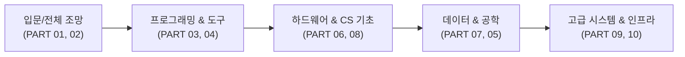

# 📘 소프트웨어 엔지니어링 올인원 (Software Engineering All-in-One)
> **컴퓨터 기초 원리부터 최신 클라우드·인공지능 아키텍처까지, 단 1권으로 마스터하는 모바일 친화형 개발자 필독서**

---

## 📱 모바일 웹 리더 (Mobile Web Reader) 안내

본 저장소는 모바일 스마트폰(iOS / Android)과 데스크톱 어디서나 최적의 독서 경험을 제공하는 **반응형 웹 애플리케이션([index.html](./index.html))**을 기본 탑재하고 있습니다.

### 🌟 모바일 리더 주요 기능
1. **엄지존(Thumb-Zone) 최적화 하단 바**: 이동 중 한 손으로 스마트폰을 잡고도 `[이전]`, `[목차]`, `[검색]`, `[소제목]`, `[다음]` 버튼을 편리하게 조작할 수 있습니다.
2. **좌우 스와이프 제스처**: 화면을 좌우로 가볍게 밀어 파트 간을 자유롭게 탐색할 수 있습니다.
3. **3가지 시각 테마 & 글자 크기 조절**:
   - ☀️ **라이트 모드**: 산뜻하고 선명한 기본 읽기 모드
   - 📖 **세피아(Sepia) 모드**: 장시간 독서 시 눈의 피로를 덜어주는 전자책 킨들 스타일
   - 🌙 **다크 모드**: OLED 디스플레이 배터리 절약 및 야간 독서 최적화
   - 🔠 **4단계 폰트 스케일링**: 14.5px ~ 20px까지 취향에 맞게 조정 가능
4. **전권 즉시 통합 검색 (Full-Text Instant Search)**:
   - 검색 아이콘 또는 `Ctrl + K`를 눌러 10개 파트 전체 본문(42만 자)을 0.01초 만에 실시간 검색하고 하이라이트된 위치로 즉시 점프합니다.
5. **인터랙티브 다이어그램 줌 (Mermaid Zoom)**:
   - 복잡한 아키텍처 및 시퀀스 다이어그램의 `[🔍 크게 보기]` 버튼을 눌러 모바일 전체 화면에서 확대하여 볼 수 있습니다.
6. **코드 원터치 복사**:
   - 모든 예제 코드 블록 상단에 `[📋 복사]` 버튼이 제공되어 모바일에서도 손쉽게 코드를 클립보드로 복사할 수 있습니다.
7. **PWA 홈 화면 추가**:
   - 모바일 브라우저의 '홈 화면에 추가'를 누르면 브라우저 주소창 없는 네이티브 앱처럼 동작합니다.

---

## 🚀 GitHub Pages 배포 방법 (1분 완성)

본 저장소의 코드를 GitHub에 업로드한 후 **단 2번의 클릭**으로 나만의 모바일 웹북 사이트를 배포할 수 있습니다.

### 방법 1. GitHub Pages 기본 설정 (가장 쉬운 방법)
1. 이 저장소의 파일들을 본인의 GitHub 레포지토리(예: `https://github.com/jamingoo83/tech-notes`)에 푸시(Push)합니다.
2. 레포지토리 상단의 **`Settings`** 탭을 클릭합니다.
3. 좌측 사이드바 메뉴에서 **`Pages`**를 클릭합니다.
4. **Build and deployment** 항목의 **Source**를 **`Deploy from a branch`**로 선택합니다.
5. **Branch** 설정에서:
   - 브랜치: **`main`** (또는 `master`)
   - 폴더: **`/(root)`** 선택 후 **`Save`** 버튼 클릭!
6. 약 30초 후 상단에 생성된 웹사이트 주소(예: `https://jamingoo83.github.io/tech-notes/`)가 표시되며, 스마트폰으로 접속하시면 즉시 책을 읽으실 수 있습니다!

### 방법 2. GitHub Actions 자동 배포
- 저장소 내 [`.github/workflows/deploy.yml`](./.github/workflows/deploy.yml)이 이미 설정되어 있으므로, `Settings` → `Pages` → `Source`에서 **`GitHub Actions`**를 선택하시면 커밋할 때마다 자동으로 최신 버전이 무중단 배포됩니다.

---

## 💻 로컬에서 바로 실행하기

컴퓨터에서 즉시 브라우저로 열어보고 싶을 때는 아래 명령어로 간단히 로컬 웹서버를 구동할 수 있습니다.

```bash
# Python 내장 웹서버 실행 (포트 8000)
python -m http.server 8000

# 브라우저에서 접속
http://localhost:8000
```
*(별도의 빌드 도구나 Node.js 설치 없이 순수 웹 표준 기술로 즉시 구동됩니다.)*

---

## 📚 전체 목차 및 파트별 바로가기

| 파트 | 주제 | 핵심 내용 | 파일 링크 |
| :---: | :--- | :--- | :---: |
| **PART 01** | **소프트웨어 개발** | CS 전공 커리큘럼, 개발의 본질, SDLC 7단계, 개발자의 적성과 마인드셋, AI 시대의 생존 역량 | [01_소프트웨어_개발.md](./01_소프트웨어_개발.md) |
| **PART 02** | **소프트웨어의 종류와 특징** | 시스템/응용/임베디드 SW, 웹 vs 웹앱 vs 네이티브 vs 하이브리드, 프론트엔드와 백엔드, PWA | [02_소프트웨어의_종류와_특징.md](./02_소프트웨어의_종류와_특징.md) |
| **PART 03** | **개발 언어 및 프레임워크** | 언어 선택 가이드, C/C++, 객체지향 4대 특성, Java/JVM, 프레임워크와 IoC, React 가상 DOM, Python, TS, npm, GC | [03_개발_언어_및_프레임워크.md](./03_개발_언어_및_프레임워크.md) |
| **PART 04** | **개발할 때 알아야 하는 필수 지식** | 선형/비선형 자료구조, 핵심 용어 계층도, API vs OpenAPI, RESTful, 동기/비동기/블로킹, Ajax, JSON/XML, 실시간 통신, 알고리즘 | [04_개발_필수_지식.md](./04_개발_필수_지식.md) |
| **PART 05** | **소프트웨어 공학** | 개발 방법론 진화사, CBD, 스크럼과 칸반(애자일), DevOps 문화, CI/CD 파이프라인, 테스트 피라미드, Git 워크플로우 | [05_소프트웨어_공학.md](./05_소프트웨어_공학.md) |
| **PART 06** | **컴퓨터 구조와 운영체제의 이해** | 폰 노이만 구조, 메모리 계층 구조, 캐시 지역성, 가상 메모리와 페이징, 컨텍스트 스위칭, 커널과 시스템 콜, 프로세스 vs 스레드, 동기화와 데드락, 32/64비트 | [06_컴퓨터_구조와_운영체제.md](./06_컴퓨터_구조와_운영체제.md) |
| **PART 07** | **데이터베이스 기술** | DBMS와 RDBMS, ERD 설계 및 까마귀 발 표기법, 트랜잭션과 ACID, B+Tree 인덱스 튜닝, 3-Tier DB 연동, NoSQL과 CAP, 정규화/반정규화, 백업 전략 | [07_데이터베이스_기술.md](./07_데이터베이스_기술.md) |
| **PART 08** | **네트워크 기술** | 3-Way/4-Way Handshake, DNS 질의 흐름, Web vs WAS, HTTP 캐싱(ETag/304), TCP vs UDP, HTTP/1.1~HTTP/3, 렌더링 파이프라인, 쿠키/세션/JWT, L4/L7 로드밸런서, WebSocket | [08_네트워크_기술.md](./08_네트워크_기술.md) |
| **PART 09** | **아키텍처** | 3-Tier 아키텍처, 비기능 요구사항, 스타벅스 비유로 배우는 분산 시스템, Redis 캐싱 전략, 모놀리스 vs MSA, 무중단 배포(Blue-Green/Canary), API Gateway, 장애 대응 프로세스 | [09_아키텍처.md](./09_아키텍처.md) |
| **PART 10** | **클라우드, 빅데이터, 인공지능** | 클라우드 패러다임과 Pets vs Cattle, AWS 핵심 서비스 맵, IaaS/PaaS/SaaS(Pizza as a Service), 하이브리드/멀티 클라우드, 서버리스 Lambda, Docker와 K8s, 빅데이터 5V, 머신러닝, LLM/Transformer/RAG | [10_클라우드_빅데이터_인공지능.md](./10_클라우드_빅데이터_인공지능.md) |
| **단권 통합본** | **전체 1권 풀버전** | 위 10개 파트의 모든 내용을 단 한 권으로 엮어 연속 열람 및 PDF 변환이 가능한 마스터 파일 | [full_book.md](./full_book.md) |

---

## 💡 이 책의 4대 특징

1. **풍부한 직관적 비유와 현실 매핑**
   - 시스템 아키텍처를 '스타벅스 매장'의 동선과 분업으로 설명합니다.
   - IaaS, PaaS, SaaS를 '피자(Pizza as a Service)'를 만드는 방식으로 명쾌하게 풀어냅니다.
   - 프론트엔드와 백엔드를 식당의 '홀'과 '주방'의 상호작용으로 도식화합니다.

2. **개념에서 실전 코드까지 이어지는 구조**
   - 단순 용어 암기가 아닌, 각 기술이 "왜(Why)" 탄생했고 "어떤 문제(What problem)"를 해결하기 위해 진화했는지를 역사적 맥락과 함께 설명합니다.
   - C, Java, JavaScript, TypeScript, Python, SQL 등 실무 언어 예제와 함께 실전 코드 패턴을 제시합니다.

3. **고해상도 시각 자료 및 비교 분석표**
   - 60개 이상의 Mermaid 아키텍처/시퀀스/ERD 다이어그램 수록
   - 기술 선택의 딜레마를 해결해 주는 40개 이상의 핵심 기술 비교 매트릭스 표 수록

4. **최신 트렌드 완벽 반영**
   - REST를 넘어선 웹소켓과 실시간 이벤트 스트리밍
   - 쿠버네티스(K8s) 기반의 컨테이너 오케스트레이션
   - 트랜스포머(Transformer), RAG(검색 증강 생성), 생성형 AI의 엔지니어링 원리 수록

---

## 🗺️ 추천 학습 로드맵



---
*Created & Orchestrated with Antigravity AI Multi-Agent System*
